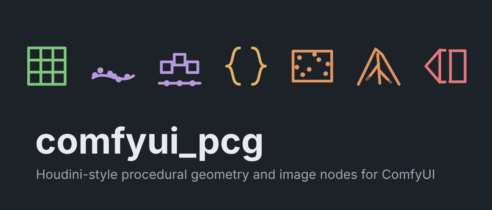
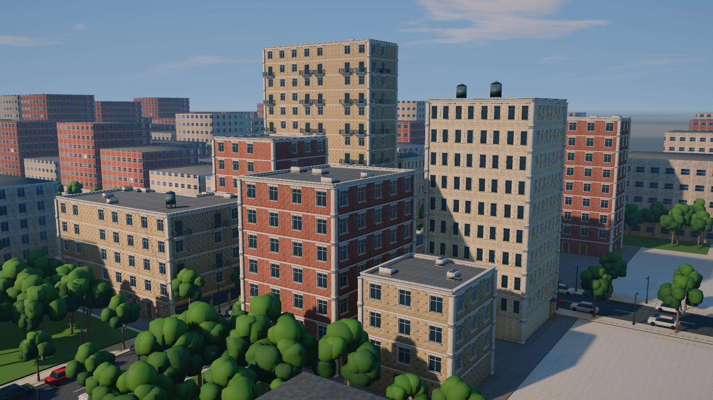
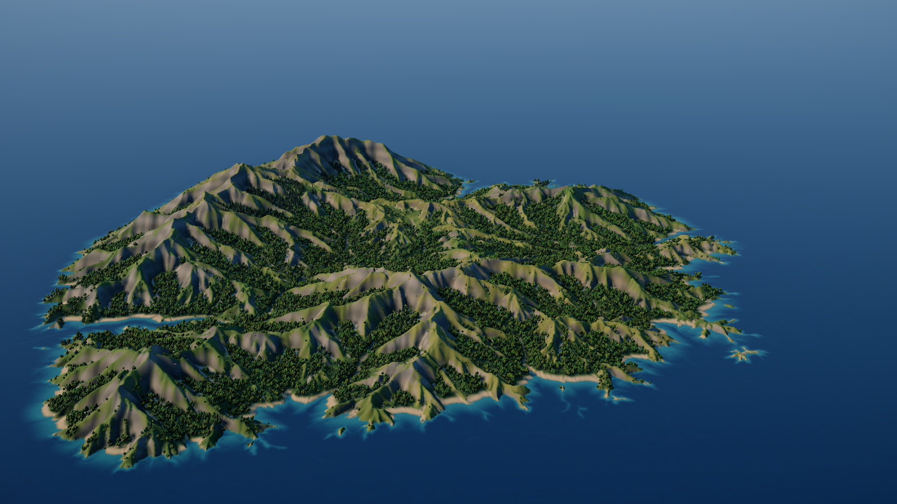
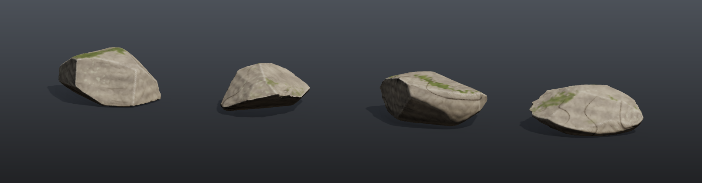
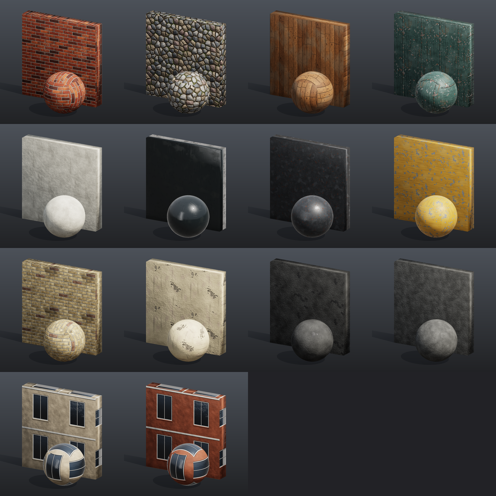

<p align="center">
  
</p>

<p align="center">
  <b>Houdini-style procedural geometry and Copernicus-style image nodes for ComfyUI.</b><br>
  500+ nodes in pure numpy · Houdini-style parameter panels · 3D viewport with handles · expressions, keyframes and loops
</p>

<p align="center">
  <a href="LICENSE"></a>
  <a href="https://github.com/fedrov/comfyui_pcg/actions/workflows/tests.yml"></a>
  <a href="docs/README.md"></a>
</p>

<p align="center">
  <a href="README.zh-CN.md">中文说明</a> ·
  <a href="docs/getting-started.md">Getting started</a> ·
  <a href="docs/houdini-users.md">For Houdini users</a> ·
  <a href="docs/reference/README.md">Node reference</a> ·
  <a href="docs/examples/README.md">Example workflows</a> ·
  <a href="docs/concepts/wrangle.md">Wrangle syntax</a> ·
  <a href="docs/concepts/shortcuts.md">Shortcuts</a> ·
  <a href="https://fedrov.github.io/comfyui_pcg/">HTML docs</a>
</p>

<!-- Recording a 20–40 s GIF of the viewport (drag a handle, draw a curve, scatter + copy) and putting it here is the single
     most effective thing for this page: docs/images/demo.gif -->

<p align="center">
  
  
</p>
<p align="center">
  
</p>
<p align="center">
  
</p>
<p align="center"><sub>All generated in ComfyUI by the example workflows, no source files: a modular city kit, 4 × 4 terrain tiles,
game-ready rocks (LODs, baked textures, collision) and a 14-material PBR library.</sub></p>

## Why

ComfyUI is great at images and terrible at geometry. Houdini is great at geometry and lives outside the AI graph.
**comfyui_pcg** puts a Houdini-style procedural toolkit *inside* ComfyUI, so geometry, height fields, textures and
diffusion models live in one graph:

```
Grid → Wrangle → Normal → Scatter → Copy to Points → Render Pass → ControlNet → KSampler → UV back-projection → textured mesh
```

No Houdini license and no extra binaries: every node is plain numpy (a handful of nodes use optional packages).

## Features

- **Geometry (SOPs)** — points / primitives / vertices / detail with typed attributes and groups, modelled on Houdini's
  data model. Generators, PolyExtrude, PolyBevel, Boolean, Clip, Remesh, Fuse, Divide, curves (Resample, Sweep, Skin,
  NURBS / Bezier), UVs (project, flatten, layout), volumes, fracturing, deformers and more.
- **Volumes & VDB** — Houdini's VDB SOPs (VDB from Polygons / Particles, Activate, Combine, Smooth, Advect, Analysis,
  Fracture, to Spheres, Segment, Resample, Project Non-Divergent ...) and the rest of the Volume SOPs, on dense grids with
  VDB semantics (active mask, background); fog is drawn as ray-marched smoke in the viewport, SDFs as closed surfaces.
- **Images (COPs)** — a Copernicus-style layer/channel image context: noise and patterns, compositing, colour, filters,
  height fields and erosion, normals / AO / curvature, UV and space transforms, simple solvers.
- **Houdini workflow** — Houdini-style parameter panels (tabs, folders, ramps, hide-when), display flags, a 3D viewport
  with transform / shape handles, interactive curve drawing, a spreadsheet, a playbar with keyframes,
  `ch()` / relative references / `$F` expressions, VEX-like Wrangle, For-Each and frame loops, spare parameters on any node.
- **Network editor** — Houdini-style rounded wires, drag a wire end to rewire, Y + drag to cut, shake to disconnect,
  snapping and Alt-drag arranging, a Tab menu of PCG nodes; see [Wires](docs/concepts/wires.md) and
  [Keyboard and mouse](docs/concepts/shortcuts.md).
- **Presentable previews** — Geometry Preview's *Studio* look (soft shadows, occlusion, a shadow-catching floor,
  textures straight from the COP chain) and *Outdoor* look (perspective camera, sky and clouds, soft sun shadows,
  the sky as an area light, haze, AgX tone curve) for environment shots.
- **Production pipelines** — rock assets with LODs, baked textures and engine collision; open-world terrain tiles with
  weight maps and instance tables; a modular building kit; a seamless PBR material library.
- **AI round trip** — render passes (depth, normal, ID, regional prompts) to feed ControlNet, and back-projection of the
  generated image onto the mesh UVs.
- **Export** — glb / obj meshes (split by attribute, packed geometry as GPU instances), instance tables, 8 / 16 / 32-bit textures, height maps and tiles.
- **Documented and tested** — a generated [reference](docs/reference/README.md) for every node and parameter with the
  Houdini equivalent and known differences, concept pages such as [Wrangle syntax](docs/concepts/wrangle.md);
  ~100 test suites with analytic checks.

## Installation

**ComfyUI-Manager** (once published): search for **PCG — Procedural Geometry** and install.

**Comfy CLI:**

```bash
comfy node install pcg-geometry
```

**Manual:**

```bash
cd ComfyUI/custom_nodes
git clone https://github.com/fedrov/comfyui_pcg.git
# install into the Python that runs ComfyUI (portable build: python_embeded\python.exe -m pip ...)
python -m pip install -r comfyui_pcg/requirements.txt
```

Restart ComfyUI and reload the browser page. The nodes are under **PCG/** in the node menu. Optional packages
(`manifold3d` for Boolean, `fonttools` for Font) are listed in [Getting started](docs/getting-started.md#optional-packages).

## Quick start

1. Drag [`example_workflows/tutorial_01_first_geometry.json`](example_workflows/tutorial_01_first_geometry.json) onto the canvas
   and press **Queue**.
2. Click a node's display flag to show it in the 3D viewport; select a Transform or Box node to get handles.
3. Work through the six [tutorials](docs/examples/README.md) — each is 10–14 nodes and needs no model files.

The documentation is also an illustrated, searchable site: open `docs/html/index.html` locally, or the
[GitHub Pages version](https://fedrov.github.io/comfyui_pcg/).

Coming from Houdini? [For Houdini users](docs/houdini-users.md) maps SOPs/COPs to nodes here, and the
[Houdini node index](docs/reference/houdini-index.md) goes from a Houdini node name to the node to use.

## Example workflows

| | |
|---|---|
| Tutorials | first geometry · scatter & copy · attributes & wrangle · for-each · COP texture · controller panel |
| Showcase | rock garden · city block · brick-wall PBR · terrain maps |
| Production | game-ready rock assets with LODs and collision · 4×4 world tiles · modular city kit · material library |
| With AI | terrain → regional prompts + depth ControlNet → SDXL texture → textured mesh · image → terrain |

All of them are in [`example_workflows/`](example_workflows) with a walkthrough in [`docs/examples`](docs/examples/README.md).

## Security

Wrangle code, group expressions and Expression / Switch formulas are stored in the workflow and run as **Python on the
machine that runs ComfyUI**. A code guard rejects imports, Python internals and numpy's file functions before anything
runs, but it is a guard, not a sandbox: **run workflows only from people you trust**, and read the Wrangle nodes of a
workflow from an unknown source before queueing it. Details: [Wrangle syntax: Security](docs/concepts/wrangle.md#security).

## Status and limitations

This is an early public release (0.2.0); expect rough edges:

- Expressions and geometry queries in parameter fields are evaluated in the browser; workflows run headless through
  the API use the last values the UI wrote, and geometry queries lag one run.
- Not yet implemented: Remesh adaptive edge lengths; curve tangent handles / weights; selecting points or faces
  in the viewport (use groups); font kerning (GPOS); Boolean does not carry edge groups.
- Behaviour follows Houdini where documented; per-node differences are listed in the reference.

Issues and pull requests are welcome — see [CONTRIBUTING.md](CONTRIBUTING.md).

## Development

```bash
cd ComfyUI/custom_nodes/comfyui_pcg
python tests/run_tests.py          # Python suites (numpy, scipy, trimesh)
npm install && python tests/run_tests.py --js   # + frontend suites (Node 22.22+, jsdom)
```

## License

[Apache License 2.0](LICENSE). Copyright 2026 fedrov. Bundles three.js (MIT); see [NOTICE](NOTICE).

Not affiliated with or endorsed by SideFX. Houdini, Copernicus and VEX are trademarks of Side Effects Software Inc.,
used here only to describe what the nodes are modelled on.
