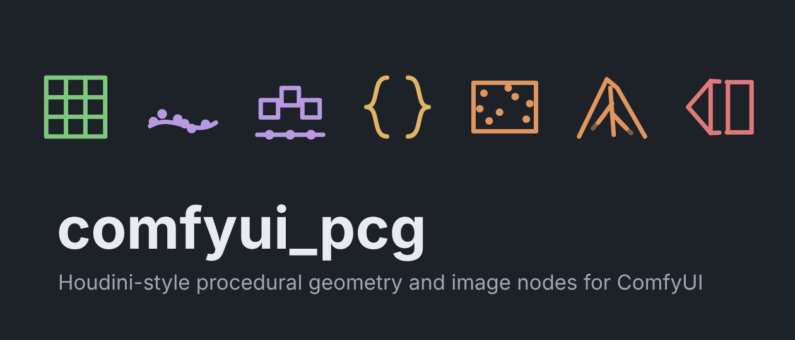
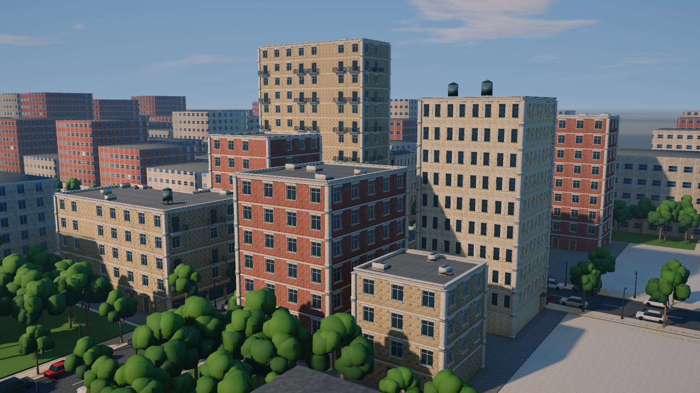
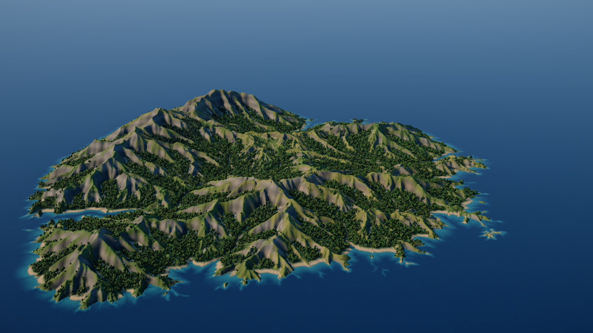
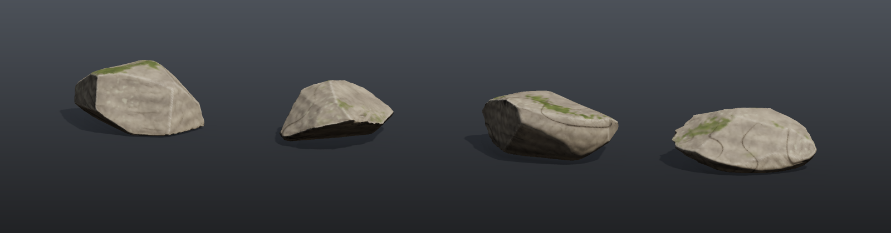
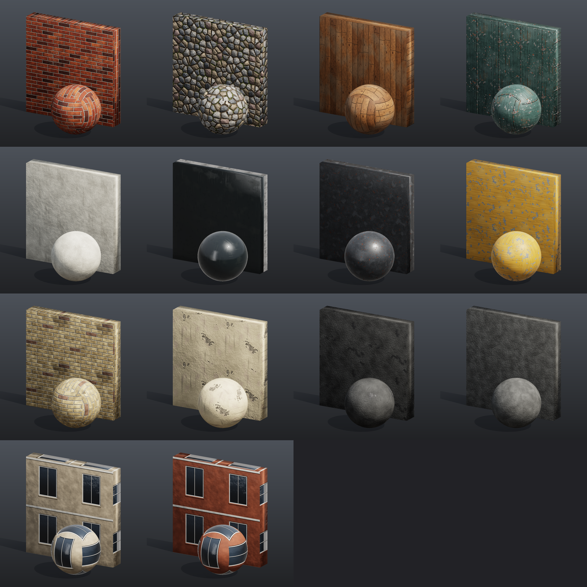

<p align="center">
  
</p>

<p align="center">
  <b>在 ComfyUI 里用 Houdini 的方式做程序化几何（SOP）和 Copernicus 风格的图像处理（COP）。</b><br>
  500+ 个纯 numpy 节点 · Houdini 风格参数面板 · 带手柄的 3D 视口 · 表达式、关键帧、循环
</p>

<p align="center">
  <a href="README.md">English</a> ·
  <a href="docs/getting-started.md">Getting started</a> ·
  <a href="docs/houdini-users.md">For Houdini users</a> ·
  <a href="docs/reference/README.md">节点参考</a> ·
  <a href="docs/examples/README.md">示例工作流</a> ·
  <a href="docs/concepts/wrangle.md">Wrangle 语法</a> ·
  <a href="docs/concepts/shortcuts.md">快捷键</a> ·
  <a href="https://fedrov.github.io/comfyui_pcg/">HTML 文档</a>
</p>

<p align="center">
  
  
</p>
<p align="center">
  
</p>
<p align="center">
  
</p>
<p align="center"><sub>全部由示例工作流在 ComfyUI 里生成，不需要任何源文件：模块化城市套件、4 × 4 地形分块、
可直接进引擎的岩石（LOD、烘焙贴图、碰撞体）和 14 种 PBR 材质。</sub></p>

## 为什么

ComfyUI 擅长图像、不擅长几何；Houdini 擅长几何、却在 AI 图之外。comfyui_pcg 把一套 Houdini 风格的程序化工具放进
ComfyUI，让几何、高度场、贴图和扩散模型在同一张图里流转：

```
Grid → Wrangle → Normal → Scatter → Copy to Points → Render Pass → ControlNet → KSampler → UV 反投影 → 带贴图的模型
```

不需要 Houdini 授权，也没有额外的二进制依赖，节点全部用 numpy 实现（少数节点用可选包）。

## 功能

- **几何（SOP）**：点 / 图元 / 顶点 / detail 四级属性和组，数据模型对齐 Houdini。生成器、PolyExtrude、PolyBevel、
  Boolean、Clip、Remesh、Fuse、Divide、曲线（Resample、Sweep、Skin、NURBS / Bezier）、UV、体积、破碎、变形器等。
- **体积与 VDB**：Houdini 的 VDB 节点（VDB from Polygons / Particles、Activate、Combine、Smooth、Advect、Analysis、Fracture、
  to Spheres、Segment、Resample、Project Non-Divergent 等）和其余 Volume 节点，在稠密网格上实现 VDB 语义（活跃掩码、背景值）；
  视口里 fog 以光线步进的烟雾显示，SDF 显示为封闭曲面。
- **图像（COP）**：Copernicus 风格的图层 / 通道图像上下文：噪波与图案、合成、调色、滤镜、高度场与侵蚀、法线 / AO / 曲率、
  UV 与空间变换、简单解算。
- **Houdini 工作方式**：Houdini 风格参数面板（页签、折叠、ramp、hide-when）、显示标记、带变换 / 形状手柄的 3D 视口、
  交互画曲线、Spreadsheet、带关键帧的时间轴、`ch()` / 相对引用 / `$F` 表达式、类 VEX 的 Wrangle、For-Each 和帧循环、
  任意节点自定义参数。
- **节点编辑器**：Houdini 式圆角连线、拖连线端点改接、按住 Y 划线剪断、晃动节点断开连线、拖动吸附和 Alt 拖动排列、
  Tab 弹出 PCG 节点菜单；见 [Wires](docs/concepts/wires.md) 和 [Keyboard and mouse](docs/concepts/shortcuts.md)。
- **可直接展示的预览**：Geometry Preview 的 *Studio* 外观（软阴影、遮蔽、接阴影的地面，贴图可以直接来自 COP 链）和 *Outdoor* 外观（透视相机、天空与云、太阳软阴影、天空面光源、雾气、AgX 色调曲线），用于场景镜头。
- **生产级流程**：带 LOD、烘焙贴图和引擎碰撞体的岩石资产；带权重图和实例表的开放世界地形分块；模块化建筑套件；
  无缝 PBR 材质库。
- **AI 闭环**：渲染通道（深度、法线、ID、区域提示词）喂给 ControlNet，生成的图再反投影回模型 UV。
- **导出**：glb / obj（可按属性拆分，打包几何体写成 GPU 实例）、实例表、8 / 16 / 32 位贴图、高度图和分块。
- **文档和测试**：每个节点、每个参数都有自动生成的[参考文档](docs/reference/README.md)（含对应的 Houdini 节点和已知差异），
  另有 [Wrangle 语法](docs/concepts/wrangle.md) 等概念页；约 100 个测试套件。

## 安装

**ComfyUI-Manager**（发布后）：搜索 **PCG — Procedural Geometry** 安装。

**Comfy CLI：**

```bash
comfy node install pcg-geometry
```

**手动：**

```bash
cd ComfyUI/custom_nodes
git clone https://github.com/fedrov/comfyui_pcg.git
# 装进运行 ComfyUI 的那个 Python（便携版：python_embeded\python.exe -m pip ...）
python -m pip install -r comfyui_pcg/requirements.txt
```

重启 ComfyUI 并刷新网页，节点在菜单的 **PCG/** 下。可选包（Boolean 用的 `manifold3d`、Font 用的 `fonttools`）见
[Getting started](docs/getting-started.md#optional-packages)。

## 快速上手

1. 把 [`example_workflows/tutorial_01_first_geometry.json`](example_workflows/tutorial_01_first_geometry.json) 拖到画布上，点 **Queue**。
2. 点节点的显示标记在 3D 视口里查看；选中 Transform 或 Box 节点会出现手柄。
3. 把六个[教程](docs/examples/README.md)过一遍，每个 10–14 个节点，不需要模型文件。

Houdini 用户请看 [For Houdini users](docs/houdini-users.md) 和 [Houdini 节点索引](docs/reference/houdini-index.md)。
文档目前只有英文。另有图文并茂、可搜索的 HTML 版：本地打开 `docs/html/index.html`，或
[GitHub Pages 站点](https://fedrov.github.io/comfyui_pcg/)。

## 示例工作流

| | |
|---|---|
| 教程 | 第一个几何体 · 散布与复制 · 属性与 Wrangle · For-Each · COP 贴图 · 控制面板 |
| 展示 | 岩石花园 · 城市街区 · 砖墙 PBR · 地形贴图 |
| 生产 | 带 LOD 和碰撞体的岩石资产 · 4×4 世界分块 · 模块化城市套件 · 材质库 |
| AI | 地形 → 区域提示词 + 深度 ControlNet → SDXL 贴图 → 带贴图的模型 · 图片 → 地形 |

全部在 [`example_workflows/`](example_workflows) 里，[`docs/examples`](docs/examples/README.md) 有逐步讲解。

## 安全

Wrangle 代码、组表达式和 Expression / Switch 的公式保存在工作流里，在**运行 ComfyUI 的那台机器上**作为 Python 执行。
插件在执行前会拦截 import、Python 内部属性和 numpy 的文件读写函数，但这只是一道防护，不是沙箱：**只运行你信任的人的工作流**；
来路不明的工作流，先看一眼里面的 Wrangle 再运行。详见 [Wrangle syntax: Security](docs/concepts/wrangle.md#security)。

## 现状和限制

这是早期公开版本（0.2.0），还会有不完善的地方：

- 参数里的表达式和几何查询在浏览器端求值；通过 API 无界面运行时用的是界面上次写入的值，几何查询会滞后一次运行。
- 尚未实现：Remesh 自适应边长；曲线切线手柄 / 权重；视口内直接选点选面（请用组）；字体 GPOS 字距；Boolean 不保留边组。

欢迎提 Issue 和 PR，见 [CONTRIBUTING.md](CONTRIBUTING.md)。

## 协议

[Apache License 2.0](LICENSE)。Copyright 2026 fedrov。内含 three.js（MIT），见 [NOTICE](NOTICE)。

本项目与 SideFX 无关联，也未获其认可。Houdini、Copernicus、VEX 是 Side Effects Software Inc. 的商标，这里仅用于说明节点参照的对象。
