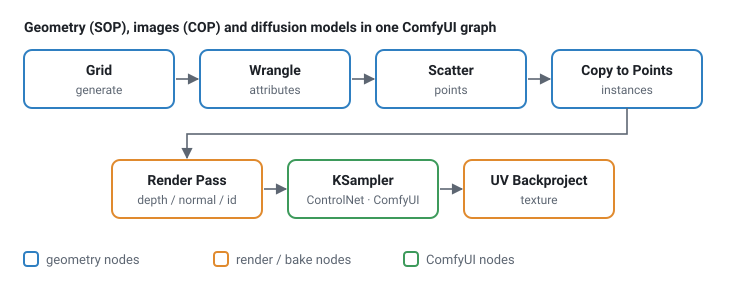

# comfyui_pcg documentation

comfyui_pcg brings Houdini-style procedural geometry (SOPs) and image processing (COPs / Copernicus) into
ComfyUI. Every node is written in numpy, has a Houdini-style parameter panel, and is named after the Houdini
node it replaces ("Clip (PCG)", "Scatter (PCG)", "COP Blur (PCG)" …). Geometry, height fields, textures and
ComfyUI's AI nodes live in the same graph.



## Start here

- [Getting started](getting-started.md) — install, first graph, how the panels work.
- [For Houdini users](houdini-users.md) — what maps 1:1, what is different, how to find a node.
- [Example workflows](examples/README.md) — six small tutorials plus the showcase and production
  workflows that ship in `example_workflows/`, each with a step-by-step walkthrough.

## Concepts

| Page | Covers |
|---|---|
| [Geometry](concepts/geometry.md) | Points, primitives, vertices, detail; attributes; groups; the spreadsheet. |
| [Groups](concepts/groups.md) | The group pattern syntax accepted by every *Group* field. |
| [Expressions](concepts/expressions.md) | Expression nodes, expressions in parameter fields, `ch()`, frame variables, keyframe channels. |
| [Wrangle syntax](concepts/wrangle.md) | The Wrangle language: attributes and type prefixes, `@group_`, operators, functions, Volume and COP Wrangle, VEX equivalents. |
| [Parameters and panels](concepts/parameters.md) | The Houdini-style panel, ramps, references between parameters, the Parameters (PCG) controller. |
| [Loops and time](concepts/loops-and-time.md) | For-Each loops, frame loops, the playbar, trails. |
| [Images (COP)](concepts/images.md) | COP images, layers and channels, devices, converting to and from ComfyUI images and geometry. |
| [Viewing and export](concepts/viewing-and-export.md) | Preview images, the 3D viewport, cameras, exporting meshes, instances and images. |
| [Wires](concepts/wires.md) | Wire styles, rewiring by the ends, cutting, snapping and arranging nodes, reference lines. |
| [Keyboard and mouse](concepts/shortcuts.md) | Every shortcut: canvas, parameter panel, viewport, handles, curve tool, playbar. |

## Node reference

The [node reference](reference/README.md) documents all nodes: inputs, outputs, every parameter with its
type, default and options, the Houdini equivalent and known differences. It is split into pages by
category (geometry) and by topic (images). The [Houdini node index](reference/houdini-index.md) goes the
other way: from a Houdini SOP or COP to the node to use here.

## Maintaining these docs

The reference pages are generated. Parameter names, defaults, ranges, menu options and panel layout come
from the code; the prose comes from `docs/_data/nodes/*.json`. After changing a node, edit its entry in the
JSON and run

```
python comfyui_pcg/docs/build_docs.py
```

`test_docs.py` fails when a node or parameter has no text, when text exists for a parameter that is gone,
when the generated pages are out of date, or when a link in the docs is broken.

**HTML version.** `docs/html/` is the same documentation as a static site (sidebar, search that works offline,
node icons, light / dark theme). Open `docs/html/index.html` in a browser, or publish it with GitHub Pages
(`.github/workflows/pages.yml`; set *Settings › Pages › Source* to *GitHub Actions*). Rebuild it after any change
to the Markdown:

```
python docs/build_html.py
```

`test_docs_html.py` fails when `docs/html` is stale, when a page is missing from the navigation, or when a link,
anchor or picture of the site is broken.

**Pictures.** The concept diagrams are drawn by `python tools/concept_diagrams.py`. The "input → result" pictures of
the node reference are rendered by the plugin's own viewport in headless Chromium:
`python tools/doc_images.py [node ...]` (needs Node.js with `playwright`), then rerun `build_docs.py` and
`build_html.py`. Node icons for the HTML come from `node tools/render_doc_icons.mjs`.
