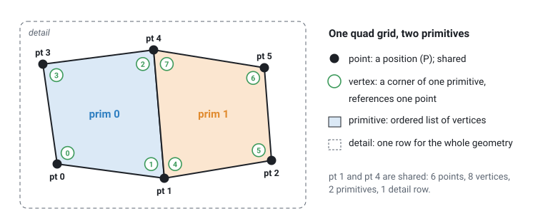
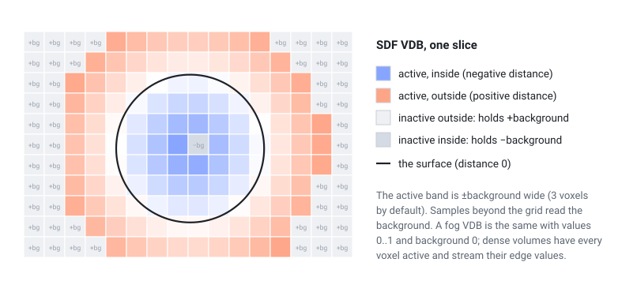
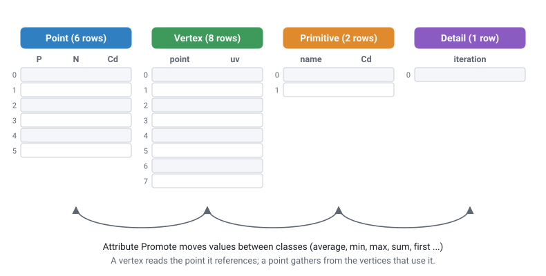

# Geometry

Geometry nodes pass a single data type between them, `GEOMETRY`. It follows Houdini's attribute-centric model: points, vertices and primitives, each with their own attribute tables, plus one detail row for whole-geometry values. If you know Houdini's geometry spreadsheet you already know the layout; this page lists what is the same, what is stored differently, and what the plugin does not have.

## Elements

| Class | What it is | Count |
|---|---|---|
| **point** | A position in space. Holds the `P` attribute. Points can be shared by several primitives. | `npoints` |
| **vertex** | A corner of a primitive. Each vertex references one point. Two faces meeting at a point have two different vertices that use the same point. | `nvertices` |
| **primitive** | A polygon, polyline, volume or spline. It is an ordered list of vertices. | `nprims` |
| **detail** | One row of values that belong to the whole geometry. | always 1 |

A geometry with points but no primitives is a point cloud. Points that no primitive uses are allowed.

The order of vertices inside a primitive defines its winding and therefore the direction of its normal, as in Houdini.

## Primitive kinds

| Kind | How it is stored | Notes |
|---|---|---|
| Polygon | Closed list of vertices | Any number of sides (triangles, quads, n-gons). |
| Polyline | Open list of vertices | "Curves" in most nodes are polylines. |
| Volume | One vertex at the volume centre; voxel grid kept beside the attribute tables | Dense grids with VDB semantics (see below). |
| NURBS / Bezier curve | Open or closed list of control vertices | Uniform clamped knots only. |
| NURBS / Bezier surface | Grid of control vertices | Produced by some generators and by Convert. |

The primitive type, vertex count and closed flag of every primitive are visible in the primitive tab of the [Geometry Spreadsheet](#inspecting-geometry) (`type`, `nvtx`, `closed` columns).

**Volumes** are dense voxel grids. A volume primitive carries the primitive attributes `res` (resolution, 3 integers), `vsize` (world size, 3 floats) and `fog` (the grid class: 0 = signed distance field, 1 = fog / density, 2 = none). Samples sit on the grid points, the outermost ones on the bounding-box corners, so the voxel size is `vsize / (res − 1)`. Voxels are scalar, or vectors of three floats (`vel`, `Cd` ...).

**VDB semantics.** A primitive with `vdb = 1` behaves like a VDB: it has a `background` value and an *active mask*. Inactive voxels always hold the background (an SDF's inside holds −background), and samples beyond the grid read the background, so VDB operations such as [VDB Activate](../reference/volume.md#pcg-vdbactivate), [VDB Prune](../reference/volume.md#pcg-vdbprune), [VDB Clip](../reference/volume.md#pcg-vdbclip) or the activity operations of [VDB Combine](../reference/volume.md#pcg-vdbcombine) give the same values as in Houdini. The tree itself is not modelled; [VDB Visualize Tree](../reference/volume.md#pcg-vdbvisualizetree) derives the 8³ leaf layout from the mask. Grids are axis aligned; a rotation resamples. Dense volumes (`vdb = 0`) have every voxel active and repeat their edge values beyond the grid, like Houdini volumes with a streak border.

Volumes are created by [VDB (PCG)](../reference/volume.md#pcg-vdb), [VDB from Polygons](../reference/volume.md#pcg-vdbfrompolygons), [VDB from Particles](../reference/volume.md#pcg-vdbfromparticles), [Volume (PCG)](../reference/generate.md#pcg-volume), [Convert (PCG)](../reference/modify.md#pcg-convert) and others; the [Volumes & VDB](../reference/volume.md) page lists all the volume nodes. The viewport draws fog as smoke and SDFs as closed iso-surfaces (see [Viewing and export](viewing-and-export.md#volumes)).

**Splines** (NURBS and Bezier) are produced by a few generators that offer a primitive-type option and by [Convert (PCG)](../reference/modify.md#pcg-convert), which also turns them back into polygons or polylines. Only uniform clamped knot vectors are supported. The viewport tessellates splines for display and draws the control hull as a second layer. Most modelling nodes expect polygons, so convert first when a node does not accept splines.

**Packed primitives** stand for a whole piece of geometry placed somewhere: one point per piece, with the piece and its rotation / scale stored on the primitive (`packedxform`, `packedpivot`). [Pack](../reference/scatter.md#pcg-pack) makes them from pieces, [Copy to Points](../reference/scatter.md#pcg-copytopoints) with *Pack and Instance* makes one per copy, and [Unpack](../reference/scatter.md#pcg-unpack) turns them back into real geometry (for copies exactly what Copy to Points gives unpacked). Ten thousand packed rocks are ten thousand points: Transform, Merge, Blast, Sort and the point attribute / group nodes work on them directly, and the viewport draws them as GPU instances. Every other node receives them unpacked automatically, so a packed input never gives a wrong result. [Assemble](../reference/scatter.md#pcg-assemble) names the loose pieces of a mesh and can pack them; [Export Mesh](../reference/output.md#pcg-exportmesh) writes packed primitives to glTF as GPU instances and [Export Instances](../reference/output.md#pcg-exportinstances) writes one table row per packed primitive.

**Not available:** packed disk primitives, metaballs, tetrahedra and other Houdini-only primitive types.

## Attributes

Every attribute is a table with one row per element and a fixed number of components per row. A scalar has 1 component, a vector 3, a quaternion 4, and so on. Names are case-sensitive.

### Types

| Kind | Storage | Created by |
|---|---|---|
| float | 32-bit float | Attribute Create `float`/`vector`/`vector4`, Wrangle `f@` / `v@` |
| integer | 32-bit integer | Attribute Create `int`, Wrangle `i@` |
| string | fixed-width text | Attribute Create `string`, Wrangle `s@` |
| boolean | 1-component boolean | Wrangle comparisons such as `@flag = @P.y > 0` |

[Attribute Cast (PCG)](../reference/attribute.md#pcg-attribcast) converts between `float32`, `float64`, `int32`, `int64` and `string`.

String attributes have no length limit: Attribute Create and Wrangle size the storage to the longest value (earlier versions cut text at 64 characters).

There are no array or dictionary attributes, because every row must have the same size. Houdini nodes that need them (for example *Array of All Values* modes) are not available.

### Attribute classes and promotion

The same name can exist on several classes (a point `N` and a vertex `N`, for example). Nodes document which class they read; many have an attribute-class menu. To move an attribute from one class to another, use [Attribute Promote (PCG)](../reference/attribute.md#pcg-attribpromote).

### Standard attributes

The plugin uses Houdini's conventional names. The most important ones:

| Name | Class | Size | Meaning |
|---|---|---|---|
| `P` | point | 3 | Position. Every geometry has it. |
| `N` | point or vertex | 3 | Normal. Vertex normals give hard edges. Computed by [Normal (PCG)](../reference/attribute.md#pcg-normal). |
| `Cd` | any | 3 | Colour, linear 0–1. Point `Cd` is shown in the 3D viewport; Geometry Preview looks it up on any class. |
| `uv` | vertex (or point) | 2 or 3 | Texture coordinates. Vertex `uv` can have seams; point `uv` cannot. |
| `pscale` | point | 1 | Uniform scale for copies and instances. |
| `scale` | point | 3 | Per-axis scale for copies (multiplied with `pscale`). |
| `orient` | point | 4 | Orientation quaternion, stored as (x, y, z, w). Overrides `N` / `up`. |
| `N`, `up` | point | 3 | Copy orientation when there is no `orient`: +Z along `N`, +Y towards `up`. |
| `v` | point | 3 | Velocity. Used as the copy direction when there is no `N`. |
| `rot` | point | 4 | Extra local rotation applied inside `orient`. |
| `pivot`, `trans` | point | 3 | Copy pivot and extra translation. |
| `transform` | point | 9 or 16 | Full 3x3 or 4x4 matrix in Houdini's convention (row vectors, `p' = p * M`, translation in the fourth row); overrides all other copy rotation and scale. |
| `id` | point | 1 | Stable identity. Some nodes can key their random numbers on it instead of the point number (for example Point Jitter's ID attribute option). |
| `name` | primitive | string | Piece name. The default piece attribute of For-Each and many piece-based nodes. |
| `material` | primitive | string | Material slot name, read by [Export Mesh (PCG)](../reference/output.md#pcg-exportmesh). |

Copy to Points, Export Instances and the other instancing nodes read the copy attributes in the same order as Houdini: `P' = P + trans + orient * (rot * (scale * (p - pivot)))`, with `transform` replacing the whole rotation and scale part when present.

Matrix attributes (9 or 16 components) use Houdini's layout everywhere in the plugin: a point is a row vector multiplied on the left, `p' = p * M`, and a 4x4 keeps its translation in the fourth row. A matrix written in Houdini (for example with VEX `maketransform`) means the same thing here. Copy to Points, Transform by Attribute, Extract Transform's matrix outputs and Attribute Transform Extract all follow it. Earlier versions read the 3x3 part transposed, so rotations ran the other way.

## Groups

Groups are named selections:

- **point, vertex and primitive groups** are stored as one true/false flag per element;
- **edge groups** are stored as a list of point pairs, so they stay valid when other edges are added or removed, as long as the two points survive.

Groups are created by the Group nodes ([Group Create](../reference/group.md#pcg-groupcreate), [Group Combine](../reference/group.md#pcg-groupcombine), [Group Expand](../reference/group.md#pcg-groupexpand) and others) and by many modelling nodes that output groups, for example PolyExtrude's `extrudeFront` / `extrudeSide`. Almost every node has a **Group** field that limits it to a selection; its syntax is described in [Group patterns](groups.md).

There is no "group" attribute type: writing `@group_top = ...` in a Wrangle creates an ordinary boolean point attribute named `group_top`, not a group. Use [Group Create (PCG)](../reference/group.md#pcg-groupcreate) with an `@` expression to make a group from a condition.

## How data flows between nodes

- **Each node returns new geometry.** A node never modifies its input. Internally the attribute arrays are read-only and shared between the input and output until a node changes them, so passing geometry through many nodes costs little memory.
- **Outputs are cached by ComfyUI.** When you run the graph again, only nodes whose inputs or parameters changed are recomputed. One output can feed any number of downstream nodes.
- **Randomness comes only from seed parameters.** Random nodes have an explicit seed (usually called `rand_seed`), and the same seed always gives the same result. The plugin never uses the clock or a global random state, so results are reproducible and caching stays correct.
- **Merging** ([Merge (PCG)](../reference/modify.md#pcg-merge)) takes the union of attributes and groups. An attribute missing on one input is filled with zeros for that input's elements; a group missing on one input simply does not contain its elements. Detail attributes of later inputs overwrite earlier ones.
- **Geometry lives in the ComfyUI process.** It is not stored in the workflow file. After restarting ComfyUI the chain is recomputed on the next run, unless you cache it with [File Cache (PCG)](../reference/output.md#pcg-filecache).

## Inspecting geometry

| Tool | What it shows |
|---|---|
| [Geometry Spreadsheet (PCG)](../reference/output.md#pcg-geospreadsheet) | A table in the node body with one tab per class (point, vertex, prim, detail). Vertex rows show the point and primitive they belong to; primitive rows show type, vertex count and closed flag. Each group is a 0/1 column and member rows are highlighted. Max Rows and Start Row page through large geometry. Its `info` output is a short text summary. |
| [Viewport (PCG)](../reference/output.md#pcg-viewport) and [Display (PCG)](../reference/output.md#pcg-display) | Interactive 3D view. See [Viewing and export](viewing-and-export.md). |
| [Geo Metrics (PCG)](../reference/output.md#pcg-geometrics) | Counts, closedness, manifoldness, degenerate faces, UV statistics, genus, as numbers and detail attributes. |
| Group / attribute name `▾` | Lists the groups and attributes that exist upstream (after the upstream has run). |

## See also

- [Group patterns](groups.md)
- [Expressions](expressions.md): reading and writing attributes with the Wrangle language
- [Images](images.md): the separate `COPIMAGE` data type and how it connects to geometry
- [Houdini users](../houdini-users.md)
- Reference: [Attributes](../reference/attribute.md), [Groups](../reference/group.md), [Convert](../reference/convert.md)
