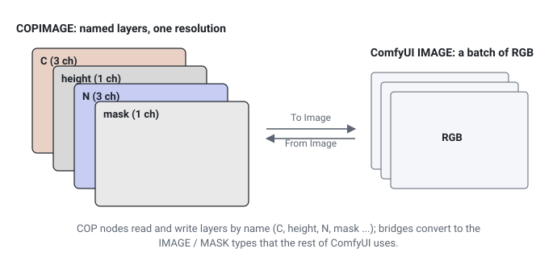

# Images (COP)

Besides geometry, comfyui_pcg has an image context modelled on Houdini's Copernicus (COP) network. COP nodes pass a `COPIMAGE`: a set of named **layers** that share one resolution, hold unclamped linear floating-point values and may have any number of channels. Two bridge nodes convert to and from ComfyUI's own `IMAGE`, and a family of nodes moves data between images and geometry (height fields, rasterising, baking, sampling). This page explains the data model, the conventions that differ from ComfyUI, the in-node thumbnails and the compute backends.

## COPIMAGE versus ComfyUI IMAGE

| | ComfyUI `IMAGE` | `COPIMAGE` |
|---|---|---|
| Content | One RGB picture per batch entry | Several named layers (`C`, `mask`, `N`, `depth`, ...) |
| Values | 0..1 | Any float, never clamped inside a chain (SDFs are negative outside, noise can be signed, heights are in world units) |
| Channels | 3 (alpha is a separate `MASK`) | Any count per layer: 1 for masks and heights, 2 for motion vectors, 3 for colour and normals, 4 for RGBA |
| Row 0 | Top of the image | **Bottom** of the image (v points up, as in UVs and Houdini) |
| Colour space | Usually sRGB-encoded | Linear; no sRGB conversion inside the chain |

Keeping these properties is the reason for the separate type: flattening every step to 0..1 RGB would destroy SDFs, normals and heights.

## Layers

- Layers are looked up by name. The conventional names follow Houdini: **`C`** for colour, `mask`, `P`, `N`, `depth`. Most nodes read and write `C` by default; their *Layer* parameters let you choose another layer.
- Asking for a layer that does not exist is an error that lists the existing layers.
- All layers of one image have the same resolution. Use [COP Resize (PCG)](../reference/cop-transform.md#pcg-copresize) or [COP Crop / Pad (PCG)](../reference/cop-transform.md#pcg-copcrop) to change it.
- Layer tools: [COP Layer Edit](../reference/cop-layers.md#pcg-coplayeredit), [COP Layer Merge](../reference/cop-layers.md#pcg-coplayermerge), [COP Layer Combine](../reference/cop-composite.md#pcg-coplayercombine), [COP Channel Split](../reference/cop-layers.md#pcg-copchannelsplit), [COP Channel Join](../reference/cop-layers.md#pcg-copchanneljoin), [COP Swizzle](../reference/cop-layers.md#pcg-copswizzle) and the rest of [Channels & Layers](../reference/cop-layers.md).

**Channel matching.** When two layers are combined, a 1-channel layer is broadcast to the other's channel count. Any other mismatch (for example 3 against 4) is an error, because the plugin cannot know whether you meant to add alpha or connected the wrong layer.

**Resolution matching.** When a node with two image inputs (compositing, for instance) receives different resolutions, the second input is resampled bilinearly to the resolution of the first, as Houdini's COPs do.

## Resolution and coordinates

Generators set the resolution with a *Resolution* pair (width, height), up to 16384 in each direction. Pixel coordinates refer to **pixel centres**: `u = (x + 0.5) / width`, so tiling patterns have no seam. In [COP Wrangle (PCG)](../reference/cop-utility.md#pcg-copwrangle), `@u` / `@v` are these centre coordinates with v pointing up.

The vertical flip between COP and ComfyUI happens only in the bridge nodes (and when writing files). You never need to flip inside a chain; if a result looks upside down, look for an extra flip you added.

## Bridging to ComfyUI images

| Node | Direction | Notes |
|---|---|---|
| [COP Import (PCG)](../reference/cop-utility.md#pcg-copimport) | IMAGE to COP | One batch entry into one layer (default `C`). Chooses the device. |
| [COP Export (PCG)](../reference/cop-utility.md#pcg-copexport) | COP to IMAGE + MASK | Range Mode: *Clamp 0-1* (colour), *Raw*, *Signed* (-1..1 to 0..1, for normals), *Normalize* (this image's min..max, for SDFs and heights; not stable across frames). 1-channel layers become grey; alpha goes to the MASK output from the `mask` layer. |
| [Control Image (PCG)](../reference/cop-layers.md#pcg-controlimage) | COP to IMAGE + MASK | Packs a layer following ControlNet conventions. |
| [Sequence Import (PCG)](../reference/cop-utility.md#pcg-sequenceimport) / [Sequence Export (PCG)](../reference/cop-utility.md#pcg-sequenceexport) | IMAGE batch to / from COP sequence | One frame per batch entry. |
| [Regional Prompt from COP (PCG)](../reference/cop-layers.md#pcg-regionalprompt), [ID Masks (PCG)](../reference/cop-layers.md#pcg-idmasks) | COP to conditioning / masks | Region masks for diffusion. |

Images generated by diffusion models are sRGB-encoded. Nodes that use image values as data (for example Attribute from Map) have an option to decode them first; see the node's reference.

## Thumbnails

Every node that outputs a `COPIMAGE` shows a thumbnail of its result in the node body. Nodes that only consume images (COP Export, COP Info) show their input instead. The thumbnail is sent as floating-point data, so it shows real values, not a pre-clamped picture.

| Action | Effect |
|---|---|
| Click | Next layer (`C`, `mask`, ...). With a single layer, next mapping mode. |
| Shift+click | Next mapping mode: *auto*, *clamp*, *signed*, *normalize*. |
| Hover | Shows the real value of the pixel under the cursor, all channels. |
| Resize the node | Width sets the thumbnail size. |

The line under the thumbnail shows the layer name, its channel count, the real min..max and the mapping. *auto* picks clamp when all values are in 0..1, signed when there are negative values, normalize otherwise. Up to 8 layers are sent, downsampled to 192 pixels.

## Devices and backends

COP layers can live in plain numpy arrays or in torch tensors on the CPU or a CUDA GPU. torch is already part of ComfyUI, so this adds no dependency. The **Device** menu on generators and on COP Import decides where the chain runs; filters and composites follow their input.

| Device | Backend |
|---|---|
| Auto (default) | CUDA when available, the image has at least 256 x 256 pixels and it fits the memory budget (1 GB per image); otherwise numpy. Small images are faster on the CPU. |
| CPU | torch on the CPU (numpy if torch is missing). |
| CUDA | torch on the GPU (numpy if CUDA is unavailable). |
| NumPy | numpy, float32. |
| Exact (float64) | numpy in float64. Slowest, but noise is bit-identical to the geometry side's noise. |

All layers of one image are on the same backend. GPU results are float32 and differ from the numpy float64 path by rounding only (around 1e-6). To move an image explicitly use [COP To Device (PCG)](../reference/cop-utility.md#pcg-coptodevice); each move copies the whole image, so avoid moving back and forth. [COP Info (PCG)](../reference/cop-utility.md#pcg-copinfo) reports the torch and CUDA status and where an image lives, which answers "is this actually running on the GPU?".

A few heavy iterative nodes (reaction diffusion, ripple, flow solve, TV denoise, directional blur, Noise Extra, thermal and hydraulic erosion) also have a **Compute** menu (auto / cpu / cuda) that chooses where that single node computes. The output is always returned to the input's backend.

## Images and geometry

Height fields are **image layers** in this plugin, not volumes: terrain generation, erosion and masking happen in COP nodes ([Height Fields & Terrain](../reference/cop-terrain.md)), working on a height layer (default `C`). The other bridges:

| From | To | Nodes |
|---|---|---|
| Image | Geometry | [Heightfield from Image (PCG)](../reference/image.md#pcg-heightfieldfromimage) (ComfyUI IMAGE to displaced grid), [COP HeightField to Mesh (PCG)](../reference/cop-geometry.md#pcg-copheightfieldtomesh), [COP Layer To Points (PCG)](../reference/cop-geometry.md#pcg-coplayertopoints), [COP Points From Blobs (PCG)](../reference/cop-geometry.md#pcg-coppointsfromblobs), [Trace (PCG)](../reference/convert.md#pcg-trace) (contours to curves) |
| Image | Attributes | [Attribute from Map (PCG)](../reference/attribute.md#pcg-attribfrommap) (sample at UVs), [Displace from Map (PCG)](../reference/deform.md#pcg-displacefrommap), [Scatter from Map (PCG)](../reference/scatter.md#pcg-scatterfrommap) (image as density) |
| Geometry | Image | [COP Layer from Attribute (PCG)](../reference/cop-geometry.md#pcg-coplayerfromattrib), [COP Rasterize Curves (PCG)](../reference/cop-geometry.md#pcg-coprasterizecurves), [COP Rasterize Splats (PCG)](../reference/cop-geometry.md#pcg-coprasterizesplats), [COP Geometry to Layer (PCG)](../reference/cop-geometry.md#pcg-copgeotolayer) (volume slices), [COP Integrate Volume (PCG)](../reference/cop-geometry.md#pcg-copintegratevolume) |
| Geometry + UVs | Textures | [COP Bake Textures (PCG)](../reference/cop-geometry.md#pcg-copbaketextures) |
| Geometry + camera | Image layers | [Render Pass (PCG)](../reference/cop-geometry.md#pcg-renderpass) (depth, mask, normals and more, for ControlNet), [Render Sequence (PCG)](../reference/render.md#pcg-rendersequence), [Motion Vectors (PCG)](../reference/render.md#pcg-motionvectors) |
| Image + camera | Texture on geometry | [UV Backproject (PCG)](../reference/render.md#pcg-uvbackproject) then [UV Resolve (PCG)](../reference/render.md#pcg-uvresolve) |

A typical diffusion round trip is: geometry, Render Pass, Control Image, ControlNet and sampler, COP Import, UV Backproject, UV Resolve, then Attribute from Map or COP Write File to bring the texture back onto the mesh or to disk.

## Writing images

[COP Write File (PCG)](../reference/cop-utility.md#pcg-copwritefile) writes PNG (8/16 bit), OpenEXR (half/float) or RAW (`.r16` / `.r32`) into the ComfyUI output folder, with channel packing (`ao roughness metallic` into one RGB file), remapping, sRGB encoding, OpenGL / DirectX normal convention, terrain tiles with shared edges, and a sidecar JSON recording the value range. For quick previews, COP Export into ComfyUI's Preview Image or Save Image is enough. See [Viewing and export](viewing-and-export.md).

## See also

- [Wrangle syntax](wrangle.md#volume-wrangle-and-cop-wrangle): COP Wrangle
- [Loops and time](loops-and-time.md): COP sequences from frame loops
- [Viewing and export](viewing-and-export.md)
- Reference: [Image](../reference/image.md), [Generators](../reference/cop-generate.md), [Color & Levels](../reference/cop-color.md), [Filters](../reference/cop-filter.md), [Compositing & Masks](../reference/cop-composite.md), [Transform & Warp](../reference/cop-transform.md), [Channels & Layers](../reference/cop-layers.md), [Height Fields & Terrain](../reference/cop-terrain.md), [Geometry and Images](../reference/cop-geometry.md), [Simulation](../reference/cop-sim.md), [Analysis, I/O & Utility](../reference/cop-utility.md)
