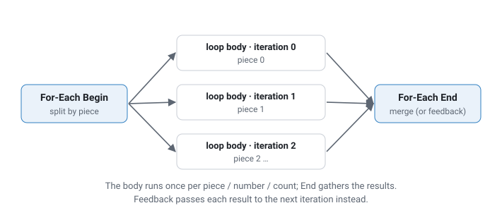

# Loops and time

A ComfyUI graph is evaluated once per run, each node at most once. comfyui_pcg adds Houdini-style loops on top of that: **For-Each Begin / End** repeats a chain of nodes per piece, per element or a fixed number of times, and **For-Each Frame Begin / End** repeats it per frame to produce animated geometry and image sequences. Time itself comes from the **Frame (PCG)** node, which the on-screen **playbar** drives. This page explains these pieces, how they relate to ComfyUI's caching, and the time-based sequence nodes (Trail, Time Blend, Retime).

## For-Each loops

[For-Each Begin (PCG)](../reference/loop.md#pcg-foreachbegin) and [For-Each End (PCG)](../reference/loop.md#pcg-foreachend) enclose a chain of any length, like Houdini's Block Begin / Block End:



```text
source --> [For-Each Begin] --geo--> ... any nodes ... --> [For-Each End] --> result
                  |                                           ^
                  +------------------- loop ------------------+
```

The `loop` wire from Begin to End is required: it is how End finds its Begin. End's `geo` input must come from the chain that starts at Begin; a link from outside the loop is an error.

### Iteration Method (on Begin)

| Iteration Method | One iteration per |
|---|---|
| By Pieces (Attribute) | Distinct value of *Piece Attribute* (default `name`), on primitives or points (*Piece Elements*). |
| By Primitives | Primitive. |
| By Points | Point. |
| By Connectivity | Connected component (no separate Connectivity node needed). |
| By Count | Nothing is split; the whole input runs *Iterations* times. |

*Group* restricts which elements are split into pieces (not used by By Count).

### Method (on Begin)

| Method | Begin's `geo` output carries |
|---|---|
| Extract Piece or Point | The current piece. |
| Fetch Feedback | The previous iteration's result (the original input on the first iteration). |
| Fetch Input | Always the whole input. |

Begin also has an `input` output that always carries the whole, uncut input, so you do not need a second Begin set to Fetch Input as in Houdini.

### Gather Method (on End)

| Gather Method | End outputs |
|---|---|
| Merge Each Iteration | All iteration results merged. |
| Feedback Each Iteration | Only the last result. Use with Begin's Fetch Feedback for iterative processes. |

### Iteration values

Begin outputs `iteration` (from 0), `numiterations`, `value` (the piece attribute value as text, or the element / iteration number) and `ivalue` (`value` as an integer when it is numeric, else the iteration index). The same four values are also written as **detail attributes** on the piece, so a Wrangle in the body can use `detail("iteration")` without an extra wire. Connect the INT outputs to parameters (for example a seed) to vary each iteration.

### Debugging and limits

- **Use Single Pass** + **Single Pass** runs only one iteration, like Houdini's Single Pass.
- **Max Iterations** (default 1000) stops runaway loops.
- With zero pieces, the body still runs once on an empty geometry that keeps the input's attribute layout, and End outputs an empty result. A ComfyUI graph always executes its nodes once; it cannot skip the body the way Houdini does.
- Nested loops work, and the body may use nodes outside the block; those run once and stay cached.

### Differences from Houdini

The iteration settings live on **Begin**, not End. Begin runs first in ComfyUI and has to produce the first piece itself, and keeping the settings on Begin makes them part of Begin's cache key, so changing them always re-runs the loop. The loop is implemented by expanding the body one iteration at a time; with many iterations internal node ids grow long, which is why Max Iterations exists.

## Time: Frame (PCG) and the playbar

There is no global `$F` that nodes read implicitly. Time is a value produced by [Frame (PCG)](../reference/param.md#pcg-frame) and carried by wires (or read by parameter expressions; see below). Because time is an ordinary input, ComfyUI's cache recomputes only what depends on it: changing the frame re-runs the nodes downstream of Frame and reuses everything else.

Frame's outputs:

| Output | Value |
|---|---|
| `frame` | Current frame (INT). |
| `frame_f` | The same frame as FLOAT, for float parameters (ComfyUI cannot connect an INT output to a FLOAT input). |
| `t` | Normalised 0..1: (frame - start) / (end - start). |
| `frames` | Number of frames, end - start + 1. |
| `seconds` | (frame - start) / fps. |

Connect them to parameters directly or through an [Expression (PCG)](../reference/param.md#pcg-expr), for example `fit(a, 0, 1, 0, 360)` for one turn over the range, or a [Channel (PCG)](../reference/param.md#pcg-channel) for keyframed values (connect `frame_f` to the Channel's `frame`).

### The playbar

When the graph contains a Frame node, a playbar appears at the bottom of the screen: start, play / step buttons, the frame field and slider, end and fps. Changing the frame writes it into **all** Frame nodes and queues the graph. While a run is in progress, only the latest requested frame is remembered and queued next, so scrubbing never floods the queue.

| Control | Effect |
|---|---|
| Space | Play / pause. |
| Left / Right | Step one frame. |
| Keyboard button | Turns the Space / arrow shortcuts on or off. They only act when the focus is not in a text field and no modifier key is held. |
| Loop button | Loop playback. |
| Live button | Re-run while dragging the slider, not only on release. |
| Handle | Drag the playbar itself. |

Start, end and fps are written to the first Frame node only, so several Frame nodes can have different ranges; each computes its own `t`. An end before start is a valid reversed range.

### Time in parameter fields

Parameter expressions can use `$F`, `$FF`, `$T`, `$FPS`, `$FSTART`, `$FEND` and `$NFRAMES`, taken from the Frame node, and any numeric field can be keyframed with Alt+click. These are evaluated in the browser and written into the parameter before each run, so they also follow the playbar. See [Parameter expressions](expressions.md#parameter-expressions).

## For-Each Frame: animated geometry

Driving a parameter from Frame and pressing play gives one result per run. To compute **all frames in one run** and collect them as a sequence, use [For-Each Frame Begin (PCG)](../reference/loop.md#pcg-foreachframebegin) and [For-Each Frame End (PCG)](../reference/loop.md#pcg-foreachframeend):

```text
source --> [Frame Begin] --geo--> ... any nodes ... --> [Frame End] --> geoseq / seq / merged
               |  frame / frame_f / t / seconds --> parameters in the body
               |  cam --> Render Pass ...
               +---------------------- loop -----------------------+
```

Begin's settings are *Start Frame*, *Frames*, *FPS*, *Max Iterations* and *Single Pass*. Its outputs are `frame`, `frame_f`, `t`, `frames`, `seconds` and, when a camera sequence from [Camera Path (PCG)](../reference/render.md#pcg-camerapath) is connected to `cams`, the camera for the current frame (`cam`). The camera count must equal the frame count, or be 1 for a fixed camera.

| Method | Each frame starts from |
|---|---|
| Fetch Input (Each Frame) | The original input. Frame N depends only on the frame number: keyframed animation, procedural deformation. |
| Fetch Feedback (Solver) | The previous frame's result (frame 0 from the input), like Houdini's SOP Solver: growth, accumulation, progressive fracture. Frames are computed strictly in order. |

The frame values are also written as detail attributes on the geometry: `frame`, `frameindex`, `numframes`, `t` and `time`.

End collects whatever is connected to its `geo` and/or `cop` inputs:

| Output | Content |
|---|---|
| `geoseq` | Geometry sequence (`GEOSEQUENCE`), one geometry per frame. |
| `seq` | COP image sequence (`COPSEQUENCE`), one image per frame, for [Sequence Export (PCG)](../reference/cop-utility.md#pcg-sequenceexport). |
| `merged` | All frames merged into one geometry when *Output Merged Geometry* is on; otherwise the last frame. |
| `frames` | Number of frames collected. |

All collected frames are held in memory. End raises an error once they exceed about 1 GB, with advice: lower the resolution, keep fewer image layers, use fewer frames, or render in segments. Frame loops can be nested with For-Each loops.

## Working with geometry sequences

| Node | Purpose |
|---|---|
| [Geo Sequence Pick (PCG)](../reference/loop.md#pcg-geosequencepick) | One frame by index (wraps around). |
| [Time Blend (PCG)](../reference/loop.md#pcg-timeblend) | The geometry at a fractional frame, interpolated between neighbours. |
| [Retime (PCG)](../reference/loop.md#pcg-retime) | A new sequence by speed, target length or a keyframed time-warp curve (the only way to express a hold). |
| [Trail (PCG)](../reference/loop.md#pcg-trail) | Earlier frames as stacked copies, polylines, a swept mesh, or a velocity attribute. |
| [Sequence Motion (PCG)](../reference/render.md#pcg-sequencemotion) | Motion vectors for a deforming geometry sequence plus cameras. |
| [Select Best (PCG)](../reference/loop.md#pcg-selectbest) | Score every geometry of a sequence and keep the best (variant selection). |

Interpolating between frames (*Blend Subframes*, Trail's connect modes) requires every frame involved to have the same topology; the error names the frame that differs. Sequences whose topology changes must use *Integer Frames (Hold)*. Integer, boolean and string attributes and groups are never interpolated; they come from the nearer frame.

## Caching and persistence

- Inside one ComfyUI session, results are cached per node and reused whenever inputs and parameters are unchanged; this applies to every iteration's dependencies outside a loop as well.
- Geometry is not stored in the workflow file. To keep expensive results across sessions, use [File Cache (PCG)](../reference/output.md#pcg-filecache): it writes `.npz` files and, when reading, does not execute the upstream at all. For per-frame caches put `$F4` in the file name and connect the cache's *Frame* input from a Frame or For-Each Frame Begin output; it does not read the timeline by itself. See [Viewing and export](viewing-and-export.md#geometry-cache).

## See also

- [Expressions](expressions.md): frame variables, keyframes and Channel syntax
- [Images](images.md): COP sequences
- [Viewing and export](viewing-and-export.md): rendering and exporting sequences
- Reference: [Loops](../reference/loop.md), [Parameters & Expressions](../reference/param.md)
