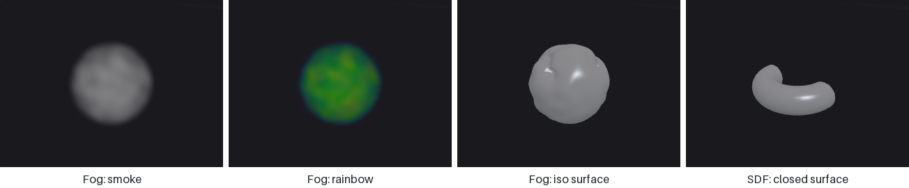

# Viewing and export

Geometry lives inside the ComfyUI server process, so you look at it through dedicated nodes: an interactive 3D viewport (in a node or in a floating panel driven by Houdini-style display flags), a software-rendered preview image, and a spreadsheet. Cameras are nodes too, shared by every render and projection step. To get results out of ComfyUI you write meshes, instance tables, images, image sequences or geometry caches into the ComfyUI output folder. This page gives an overview of those tools and when to use which.

## Looking at geometry

| Node | Shows | Use it when |
|---|---|---|
| [Display (PCG)](../reference/output.md#pcg-display) | The flagged node's output in the floating 3D panel | Day-to-day work: click a node's display flag to see it. |
| [Viewport (PCG)](../reference/output.md#pcg-viewport) | An interactive 3D view inside the node | Pinning several views on the canvas, e.g. to compare branches. |
| [Geometry Preview (PCG)](../reference/output.md#pcg-previewimage) | A software-rendered ComfyUI `IMAGE` | You need an image: to save it, or to feed an image node. |
| [Geometry Spreadsheet (PCG)](../reference/output.md#pcg-geospreadsheet) | Attribute tables per class | Checking values, groups and topology. |

Viewport and Display pass their input through unchanged, so they can sit in the middle of a chain. Both take an optional `template` input that is drawn as a grey wireframe for reference, like Houdini's template flag.

Geometry Preview has three looks. *Basic* is a quick flat-lit render. *Studio* is meant for pictures you keep: smooth shading, a key light with shadows, sky fill, ambient occlusion, a ground that catches shadows and fades into a gradient background, and supersampled edges. It can also show textures, either files (`basecolor = pcg/materials/T_{material}_BaseColor.png`, `normal = ...`, picked per face by a `material` attribute) or layers straight from a COP chain (`basecolor = @basecolor` with the COP image connected to `textures_cop`), using the same tangent frames as Export Mesh, so a baked normal map looks as it will in an engine. *Outdoor* is an environment shot instead of an object on a studio floor: a perspective camera (a connected [Camera](../reference/render.md#pcg-camera), or an automatic 35 mm camera at Elevation / Azimuth), a sky whose colours follow the sun's elevation, soft sun shadows that are crisp at contact and widen with distance, the sky as an area light with its own shadows (*Sky Samples* directions: a narrow street is darker than a square, and shaded walls pick up light bounced off sunlit ground), an optional cumulus layer that also shades the ground (*Clouds*), aerial perspective that fades distant surfaces toward the horizon (*Haze*), an optional ground plane to the horizon, and a photographic finish (bloom, a slight vignette, the AgX tone curve). A texture line can name a layer per material (`orm = @{material}_orm`); faces whose layer does not exist keep their own colour, so one image can texture a terrain and leave the trees on it alone. It is what makes a street or a valley read at its real scale; the modular city and world tiles examples use it, the asset examples use Studio.

### Display flags and the floating panel

Every node with a geometry output has two small squares above its title bar, on the left: **blue** is the display flag, **grey** the template flag.

| Action | Effect |
|---|---|
| Click the blue square | Display this node's output in the panel. |
| Click the grey square (or right-click / Ctrl+click the blue one) | Use this node as the template (grey wireframe). |
| Click the same flag again | Clear it. |

ComfyUI only executes nodes that lead to an output node, so a flag cannot simply "look at" an intermediate node. Instead, the flag **rewires the input of a Display (PCG) node** to the flagged node; that wire is the real dependency, and it survives save, undo and copy/paste. A graph needs only one Display node; if there is none, clicking a flag creates one next to the flagged node. If auto re-run is on (the `↻` button in the panel title bar, on by default), clicking a flag also queues the graph; clicks made while a run is in progress are merged into one follow-up run.

The panel floats over the canvas; drag and resize it, and its position, size and shading options are remembered. Title bar buttons: `↻` auto re-run, `⛶` frame everything, `✕` hide. The `3D` button in the bottom-right corner of the window shows or hides the panel. The title bar names the node being shown.

### Viewport controls

The same viewer is used by Viewport (PCG) and the floating panel.

| Input | Action |
|---|---|
| Left drag | Tumble. |
| Middle drag | Track (pan). |
| Right drag, mouse wheel | Dolly. |
| Double-click, `F` / `G` / `H` / Home | Frame all. |
| `1` / `2` / `3` / `4` | Perspective / top / front / right view (also leave the UV view). |
| `5` | UV view on / off (see [UV view](#uv-view)). |
| Alt or Space + left drag | Tumble, even when a handle or the curve tool is active. |

Keys act while the pointer is over the view, also when a toolbar menu of the panel still has focus; only a text box being typed in keeps its keys. Display options are front-end only and do not re-run the graph: shading (*phong*, *lambert*, *normal*, *color* — flat colour without highlights, *uv* — a UV checker, *wire*), normals (*auto*, *smooth*, *vertex*, *flat*), wireframe overlay, points, normals display (point / vertex / prim) and their length, element numbers (point / vertex / prim), grid, group highlight, and attribute visualisation. Like Houdini, the shaded view shows `Cd` in every mode except *normal*: a vertex `Cd` wins over a point `Cd`, which wins over a primitive `Cd`, which wins over a detail `Cd` (that one tints the whole object); attribute visualisation takes precedence over `Cd`. Curves and point clouds take a point `Cd`. The point markers of the *Points* toggle are an overlay on a mesh or a curve and keep their own cyan whatever `Cd` is; in a point cloud the points are the geometry and show `Cd`. Polylines and point clouds are drawn as lines and points; volumes are drawn as smoke or iso-surfaces (see [Volumes](#volumes) below) and NURBS / Bezier primitives are tessellated for display.

The viewer is built on three.js. It is loaded from `web/vendor/three.module.js` inside the plugin folder if that file exists, otherwise from a CDN (three.js 0.160.0). On a machine without internet access, put `three.module.js` (version 0.160.0) into `web/vendor/`.

### UV view

Press `5` over the view for an orthographic look at the uv layout, like Houdini's UV viewport: the 0–1 tile with a 0.1 grid and its neighbouring tiles, the faces filled translucent (overlapping islands read darker) and the polygon edges drawn in uv space, so seams show as separate edges. Faces wound against the majority — a mirrored island or a fold — are red, and the info bar counts them. A vertex `uv` wins over a point `uv`; both size 2 and size 3 work. Left or middle drag pans, right drag or the wheel zooms about the pointer, `F` or a double-click frames the layout together with the 0–1 tile; `5` again or `1`–`4` return to the 3D view as you left it. Handles are off in the UV view.

To see the uv on the model, pick the *uv* shading: a checker, 8 × 8 cells per tile, light cells tinted by position (more red along u, more green along v) with a dark notch in their low-u, low-v corner, so stretching, scale differences and mirrored faces are visible at a glance. Without a `uv` attribute the model stays grey and the info bar says so.

### Volumes

Volumes are drawn the way Houdini draws them, and [Volume Visualization (PCG)](../reference/volume.md#pcg-volumevisualization)
changes it per geometry:

| Volume | Drawn as |
|---|---|
| Fog / density, or a grid of class none | **Smoke**, ray-marched in the browser. The value is optical thickness per unit length: density 1 across one unit lets e⁻¹ ≈ 37 % of the light through, independent of the resolution. Lit by the headlight with self-shadowing. |
| SDF (level set) | The **iso-surface** at 0, closed where the grid boundary cuts it. |
| Vector grid | Its bounding box only (use [Volume Trail](../reference/volume.md#pcg-volumetrail), [Volume Slice](../reference/volume.md#pcg-volumeslice) or [VDB Vector Split](../reference/volume.md#pcg-vdbvectorsplit) to look inside). |

Volume Visualization can pick the volumes to draw (Density Field), switch to Rainbow, Iso Surface (at an Iso Value) or
Invisible, scale the density and the self-shadowing, colour the smoke with a diffuse field (a scalar through a ramp, or
a vector / three scalars as RGB) and add emission. Grids larger than Max Vis Res (128 by default) are resampled for display
only. With the *wire* shading mode volumes show as their bounding boxes.

Smoke is drawn after the solid geometry: geometry in front of a volume hides it, geometry inside a volume shows through the
smoke in front of it but is not blended exactly.

### Handles

Select a node in the graph and its handle appears in the view, like Houdini's state handles (no need to press Enter). Nodes with handles: [Transform](../reference/modify.md#pcg-transform), Soft Transform, Copy and Transform, Clip, Mirror, and the generators Box, Sphere, Grid, Tube, Torus, Circle, Line and Platonic Solids. [Curve (PCG)](../reference/generate.md#pcg-curve) gets the curve drawing tool instead (below). With several nodes selected, the handle belongs to the current node.

| Input | Action |
|---|---|
| `T` / `R` / `E` | Translate / rotate / scale handle (only the kinds the node has). The buttons at the bottom left do the same. |
| Drag an arrow | Move along that world axis. |
| Drag a small square | Move in that plane. |
| Drag the centre circle | Move in the screen plane. |
| Drag a ring | Rotate. Each ring edits one rotate channel and is drawn around the axis that channel really turns about (gimbal rings), so the result matches what you see for any Rotate Order. |
| Drag a scale box / the centre box | Scale along the object's own (rotated) axis / uniformly (Uniform Scale where the node has it). |
| Ctrl while dragging | Snap: a tenth of the grid unit, 15 degrees, steps of 0.1. |

A handle only changes the node's parameters, exactly as dragging the numbers in the panel would; the geometry is still computed in Python. While you drag, the graph is queued at most every 120 ms and once more on release, when the panel's *Auto* is on. Undo, saving and copying nodes work as usual. A parameter that is driven by an expression, a reference or a link is locked (grey, cannot be dragged); a keyframed parameter gets a key at the current frame. Dragging a Clip handle in *Direction* mode turns on *Use Origin*, and rotating a Circle turns on its rotate option, because otherwise the values would have no effect.

### Selecting

Press **S** with the pointer over a viewport (node or panel) to enter select mode; a toolbar appears at the top, Esc leaves it. The selection becomes a group expression that any group field understands.

| Input | Action |
|---|---|
| Click | Pick the nearest point (within 10 pixels), or the primitive under the cursor. |
| Drag | Box select: points by position, primitives by their centre. |
| Shift / Ctrl | Add to / remove from the selection; plain click or drag replaces it. |
| `points` / `prims` | What is selected (switching clears the selection). |
| `visible` | Skip what the surface hides (on large meshes with many candidates it selects through and says so). |
| `copy` | Put the expression, such as `0-4 7 12-19`, on the clipboard. |
| `→ group` | Create a [Group Create](../reference/group.md#pcg-groupcreate) node wired to the node feeding the viewport, with the expression as its base pattern. |

Numbers refer to the geometry the viewport shows, so the expression belongs on nodes downstream of the node that feeds it. Alt / Space + drag and the middle and right buttons still navigate.

### Drawing curves

Select a [Curve (PCG)](../reference/generate.md#pcg-curve) node to draw in the view. The points are stored in the node's *Points* field (one `x, y, z` per line), so they can also be typed or edited by hand.

| Input | Action |
|---|---|
| Click empty space | Add a point at the end. It lands on the displayed geometry if the click hits it, otherwise on the construction plane: the ground plane when looking down or up, or a vertical plane through the previous point, facing the camera, when looking from the side. |
| Drag a point | Move it (in the same kind of plane through the point). Shift: snap to the surface under the cursor. Ctrl: snap to a tenth of the grid unit. |
| Ctrl + click a segment | Insert a point there. |
| Delete / Backspace over a point | Remove it. |
| Click the first point | Close the curve (with three or more points). |
| Click and drag on empty space | Tumble; no point is added. |

The curve is shown as a dashed overlay at once; the cooked curve (Polygon, NURBS or Bezier) follows when the graph has run.

### Cameras in the panel

The floating panel has a camera bar. Choose a [Camera (PCG)](../reference/render.md#pcg-camera) node from the graph to look through it, then:

| Button | Effect |
|---|---|
| `⦿` | Move the view to the camera once. |
| `↥` | Write the current view into the camera once. |
| Lock | While locked, tumbling the view edits the camera's parameters (Houdini's "lock camera to view"). The graph is queued once you stop moving. |
| Resolution gate | Shows the frame that will be rendered; inside the gate you see exactly the rendered field of view. |

Writing the view into a camera sets its mode to `look_at`.

### Spreadsheet paging

When a class has more rows than *Max Rows*, the [Geometry Spreadsheet](../reference/output.md#pcg-geospreadsheet) footer shows page buttons and a row field. Pages come from the server's cache of the last run, so paging through a million points never re-runs the graph and leaves *Start Row* alone. The panel warns when the view cannot match the render exactly (`frame` mode, orthographic cameras, an `up` vector other than +Y).

## Cameras

Cameras are a separate data type so that the view used to render an image and the view used to project it back are the same wire.

| Node | Purpose |
|---|---|
| [Camera (PCG)](../reference/render.md#pcg-camera) | One camera: `frame` (fit to the geometry's bounding sphere), `orbit` around a target, or `look_at`. |
| [Camera Path (PCG)](../reference/render.md#pcg-camerapath) | A camera sequence along an orbit or a fly-through. |
| [Camera Pick (PCG)](../reference/render.md#pcg-camerapick) | One camera from a sequence. |
| [Camera from Points (PCG)](../reference/render.md#pcg-camerafrompoints) / [Camera To Points (PCG)](../reference/render.md#pcg-cameratopoints) | Convert between camera sequences and points (with optional path and frustum wireframes). |

Cameras feed [Render Pass (PCG)](../reference/cop-geometry.md#pcg-renderpass), [Render Sequence (PCG)](../reference/render.md#pcg-rendersequence), [Texture Render (PCG)](../reference/render.md#pcg-texturerender), [Motion Vectors (PCG)](../reference/render.md#pcg-motionvectors), [UV Backproject (PCG)](../reference/render.md#pcg-uvbackproject) and the `cams` input of For-Each Frame Begin. See [Images](images.md#images-and-geometry).

## Exporting

All writers put their files under the **ComfyUI output folder**; file names are relative to it.

| What | Node | Formats and notes |
|---|---|---|
| Meshes | [Export Mesh (PCG)](../reference/output.md#pcg-exportmesh) | `.glb` or `.obj` (+ `.mtl`), with UVs, normals, tangents, vertex colours and material slots from the primitive `material` attribute. Can split into named meshes or into one file per attribute value. glTF is written Y-up in metres; *Scale* converts units. The returned path of a `.glb` can be connected to ComfyUI's Preview3D node. Packed primitives are written as GPU instances (`EXT_mesh_gpu_instancing`): one mesh per piece plus per-instance transforms. |
| Instances | [Export Instances (PCG)](../reference/output.md#pcg-exportinstances) | CSV or JSON, one row per point: asset name, position, quaternion, Euler angles and scale, read exactly as Copy to Points reads them; packed primitives are read directly (one row each). Axis remapping, unit scale, optional tiling. |
| Images | [COP Write File (PCG)](../reference/cop-utility.md#pcg-copwritefile) | PNG 8/16, EXR half/float, RAW `.r16` / `.r32`, channel packing, tiles, sidecar JSON. Or COP Export into ComfyUI's Save Image. |
| Image sequences / video | [Sequence Export (PCG)](../reference/cop-utility.md#pcg-sequenceexport) | Turns a COP sequence (from For-Each Frame End or Render Sequence) into an `IMAGE` batch for ComfyUI's image and video nodes. |
| Geometry as data | [Geo to JSON (PCG)](../reference/convert.md#pcg-geotojson) | Attributes as JSON text. |

File-name parameters support placeholders such as `{index}` (and `{tx}` / `{ty}` for tiles, `{name}` for per-attribute files); string fields also accept [templates](expressions.md#string-fields-and-templates) such as `out/$F4`, which are expanded in the browser before the run.

### Importing

[Import Mesh (PCG)](../reference/convert.md#pcg-importmesh) reads OBJ, PLY, STL, GLB / glTF and LAS without external libraries (n-gons are kept, UVs go to vertices, PLY point clouds including Gaussian splats are supported); compressed LAZ needs the optional `laspy` package. Survey-sized LAS coordinates are recentred, with the offset in the `las_origin` detail attribute. Choose *Weld* and *Up Axis* deliberately; the reference explains why. [File Merge (PCG)](../reference/convert.md#pcg-filemerge) and [From JSON (PCG)](../reference/convert.md#pcg-fromjson) are the other entry points.

## Geometry cache

Geometry is not saved in the workflow, so after a restart every chain is recomputed on the next run. [File Cache (PCG)](../reference/output.md#pcg-filecache) stores geometry on disk:

| Mode | Behaviour |
|---|---|
| Automatic (Read if Exists) | Read the file if it exists, otherwise compute and write it. |
| Always Write | Recompute and overwrite. Use it once after changing the upstream. |
| Load from Disk | Always read; error if the file is missing. |

When the node reads, the upstream is **not executed at all**: its input is lazy. The file path (default `pcg_cache/geo_$F4.npz`) replaces `$F` / `$F4` with the node's *Frame* value and `$V` with *Version*. Frame is not taken from the timeline automatically; connect it from Frame (PCG) or For-Each Frame Begin for per-frame caches. Change *Reload* to force a new read or write. Files are `.npz` with a JSON manifest and no pickle, so they are safe to share.

## See also

- [Geometry](geometry.md#inspecting-geometry)
- [Images](images.md)
- [Loops and time](loops-and-time.md)
- Reference: [Output & Export](../reference/output.md), [Render & View](../reference/render.md)
