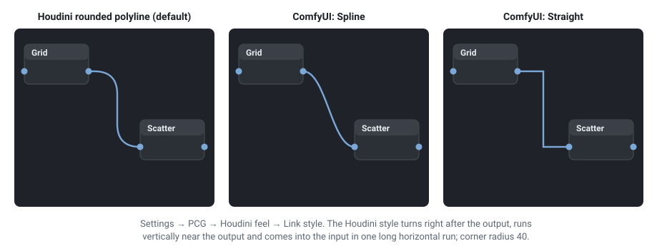
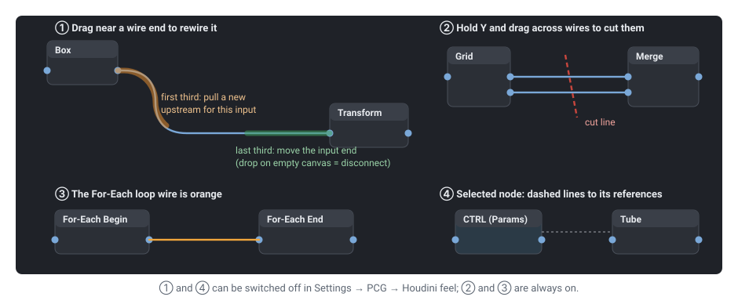

# Wires

comfyui_pcg changes how wires look and how they are edited on the canvas, to feel like Houdini's network editor. Everything here is front end only: workflows are saved exactly as ComfyUI saves them, and the graph runs the same with any style. The switches are in ComfyUI's settings under **PCG → Houdini feel**.

## Wire style

| Style | Shape |
|---|---|
| **Houdini rounded polyline** (default) | A short stub out of the output, a rounded turn, a vertical run close to the **output**, another rounded turn, then one long horizontal run into the input. Corner radius 40 canvas units, smaller when the nodes are close. When the input is to the left of the output the vertical run goes halfway between them. |
| **Follow ComfyUI setting** | ComfyUI's own *Link Render Mode* (Spline, Linear, Straight or Hidden) is used again. |

Set it in **Settings → PCG → Houdini feel → Link style**. The Houdini style is drawn by ComfyUI's *Straight* mode with rounded corners, so while it is on the canvas keeps *Straight* as its render mode; switching back restores whatever ComfyUI's setting was. The drag preview, the wire's click area, the midpoint dot (its menu) and cutting with Y all follow the shape that is drawn.

Wire colours come from ComfyUI's colour palette for each data type. The plugin adds one: the **loop wire** from For-Each Begin to For-Each End is orange (`#f0a63c`), and the two loop nodes are tinted brown, so a loop block stands out from the data wires.

## Editing wires

| Action | How |
|---|---|
| **Move the input end** of a wire | Hover the last third of the wire (near the input); it highlights and the cursor becomes a hand. Press and drag it to another node's input. Dropped on empty canvas it disconnects (and ComfyUI's release menu or search box appears, as when dragging out of an input). |
| **Give an input a new upstream** | Press and drag the first third of the wire (near the output): a new wire is pulled from the same input. Drop it on another output to change the source; dropped on empty canvas nothing changes. |
| Midpoint menu | The middle third behaves as in ComfyUI: click the dot for the wire's menu. |
| **Cut wires** | Hold **Y** and left-drag a line across the wires to cut. Esc cancels. Works on every node in the graph. |
| **Disconnect a node** | Shake it left and right while dragging (a few quick swings): all its wires are disconnected and it flashes. Undo brings them back. |
| Connect to a parameter | Drop a wire on a cell of the parameter panel; it connects to that parameter (the cell is outlined in yellow while dragging). See [Parameters](parameters.md#connecting-wires-to-parameters). |

Moving the ends uses ComfyUI's own link dragging, so type checks and undo are the same as when dragging from a slot. Turn it off with **Drag link ends**.

## Snapping and arranging nodes

While a node is dragged it snaps (within 8 screen pixels, at any zoom) so that:

- its wires to the nodes upstream and downstream become **horizontal** (both slots at the same height);
- its left edge, right edge, top edge or horizontal centre line **aligns** with a nearby node.

A cyan guide line shows the snap. Hold **Shift** while dragging to not snap (ComfyUI then snaps to its grid, if that is on). Turn snapping off with **Node snapping**.

To line up several nodes at once, select them and **Alt + left-drag**: drag mostly vertically to stack them in a column, mostly horizontally to put them in a row, with an even gap. The direction is fixed once the drag has moved 10 pixels; Esc cancels.

## Reference lines

When a node is selected, a faint dashed line is drawn between it and every node it has a **parameter reference** with (`ch("../title/parm")` in a field, or a pasted relative reference), in both directions, as in Houdini's network view. They are drawn only, not wires: the reference is evaluated in the browser, see [Parameters](parameters.md#linking-parameters). Turn them off with **Reference dashed lines**.

## Renamed nodes

A node whose title was changed shows its original type in small, dimmer text after the title (`tree proxy  Tube`), so a renamed node can still be recognised. Its right-click menu shows the full original name and can restore it. Setting: **PCG → Nodes → Show original type on renamed nodes** (All nodes, PCG nodes only, Off).

## See also

- [Keyboard and mouse](shortcuts.md): every shortcut in one table
- [Parameters](parameters.md): the panel, references and wires into parameters
- [Loops and time](loops-and-time.md): the For-Each loop wire
