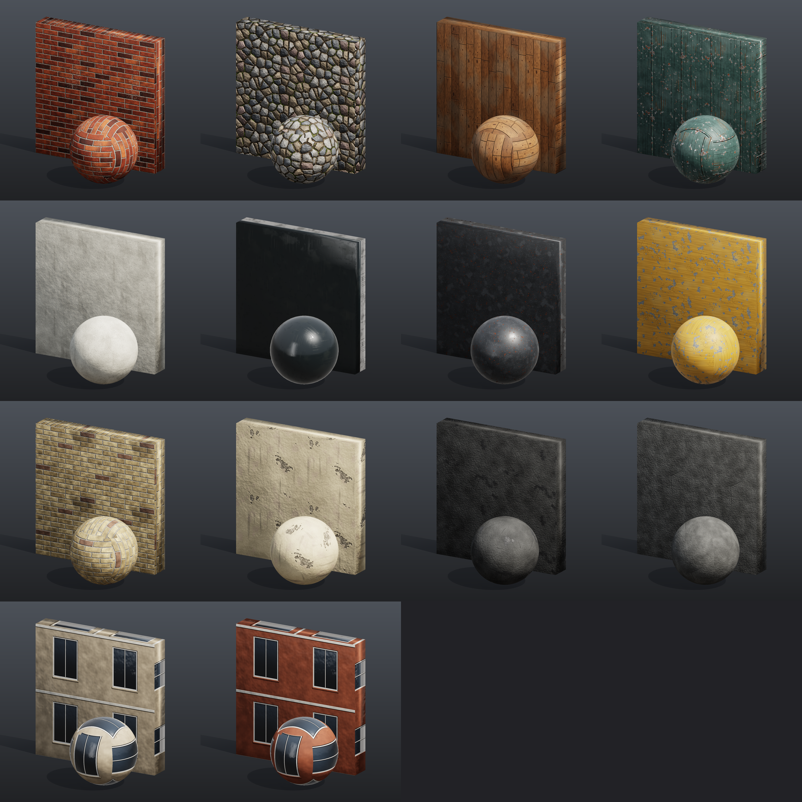

# Material library

A set of fourteen tileable PBR materials, 1024 x 1024 and seamless on all four sides. **One texture covers 1 m x 1 m** (1024 px/m); the [modular city](pcg_prod_modular_city.md) kit also uses 1 UV = 1 m, so bricks, planks and seams come out at their real size. Heights are authored in metres, so the relief is real size too (a 7 mm mortar joint is 7 mm deep).

## Load it

Drag `example_workflows/pcg_prod_material_library.json` onto the ComfyUI canvas and press **Queue**. Only comfyui_pcg nodes plus ComfyUI's Preview Image are used. It takes about two and a half minutes.

Each material writes five maps to `output/pcg/materials/`, named `T_<material>_<map>.png`:

| Map | Content |
|---|---|
| `BaseColor` | sRGB colour. |
| `Normal_GL` | Tangent-space normal, +Y (OpenGL convention). |
| `Normal_DX` | The same with -Y (DirectX convention). |
| `ORM` | R = AO, G = roughness, B = metallic. |
| `Height` | 16-bit height; its range **in metres** is in a `.json` next to it. |

| Material | Content |
|---|---|
| `M_Wall` | Brick, 240 x 67 mm with 10 mm joints struck 7 mm back; chipped, rounded arrises; one colour per brick (reds and oranges, dark over-fired clinker, a few pale buff ones), fire flash at one end, iron specks, sand pits, salt bloom. |
| `Ground_Cobble` | Rounded field cobbles about 12 cm across, set in sand: domed stones, four stone types (grey granite, sandstone, basalt, pink granite) with crystal grain, soil round the feet, moss in the joints. |
| `M_Door` | Vertical planks 12.5 cm wide with V joints and a butt joint per metre at a different height in each plank; growth rings that bend round knots; nails on two battens, with rust halos and runs. |
| `M_Roof` | Standing-seam metal: 25 mm seams every 50 cm, stiffening ribs, oil canning; paint fading and chipping (mostly on the seam caps) to galvanized steel (metallic 1); dirt and rust running down the fall line. |
| `M_Trim` | Painted precast concrete / stucco for bands, sills, frames and cornices: pores, gentle mottling, rain-washed grime. |
| `M_Glass` | Window glass: dark tint, roughness 0.04 when clean; dirt film, drips and smudges raise the roughness. |
| `M_Metal` | Powder-coated dark steel for railings and canopies: scratches in six directions to bare steel (metallic), burnished scuffs, rust pinholes. |
| `M_Sign` | Enamel-painted sign panel: brush marks, sun fading, craquelure in patches, flakes down to grey primer. |
| `M_BrickBuff` | The same bricks in a yellow-grey stock clay, with a few purple-brown and orange strays and patches of city soot. |
| `M_Stucco` | Cream lime render over masonry: trowel undulation, hairline cracks in patches, older coats showing through, spalled patches down to the grey render, rain streaks. |
| `Ground_Asphalt` | Road asphalt: exposed aggregate, sun-bleached patches, oil drips, tar-sealed cracks. |
| `M_RoofFlat` | Flat-roof bitumen membrane with mineral grit, ponding stains and sealed seams. |
| `M_FacadeFar`, `M_FacadeFarBrick` | **One whole facade bay per image** (4 m x 3.5 m: wall, window with frame and mullion, sill, floor band) for the city's low-detail context buildings, whose UVs are u = x / 4, v = y / 3.5. These two are the exception to 1 texture = 1 m, and they repeat by bay rather than seamlessly. |

The names are the material slots of the modular city kit (walls in three facade variants, trim, glass, door, metal, roofs, sign), its streets (cobbles, asphalt) and its context buildings. The kit's glb files reference these textures by relative path, so run this workflow first and the kit opens with textures.

## How the tiling is kept seamless

- All noise is the Wrangle function `pnoise(p, period)` (periodic Perlin noise, like VEX's `pnoise`) with the period equal to the frequency, at a whole number of cells per metre. Every octave then repeats exactly once per texture. A small `fbm(fx, fy, seed, octaves)` helper at the top of each Wrangle sums the octaves; unequal `fx` / `fy` stretch it (wood grain, dirt streaks).
- Pattern counts are whole numbers.
- Stripes (plank columns, roof seams) are periodic functions of u. The scratch directions on the steel use integer direction vectors such as (1, 1) or (2, 1), so rotated lines wrap too.
- `noise()` is not periodic. Do not use it for anything that must tile.

## Step by step

The materials sit in two rows of four. Each one is the same short chain:

1. **Source.** **[COP Pattern (PCG)](../reference/cop-generate.md#pcg-coppattern)** where the material has pieces: tiles 4 x 13 with offset 0.5 and gap 0.13 for the bricks (the gap is a fraction of the 77 mm row, so 10 mm), cells 8 x 8 for the cobbles, cells 28 x 28 for the sign's craquelure. The others start from a blank 1024 x 1024 **[COP Constant (PCG)](../reference/cop-generate.md#pcg-copconstant)**; their planks and seams are computed in the Wrangle.
2. **Height.** A **[COP Wrangle (PCG)](../reference/cop-utility.md#pcg-copwrangle)** writes `height` in metres, plus masks the colour step needs (`brick`, `stone`, `plank`, `knot`, `nail`, `seam`, `scratch`, `crack`, `flake`...). The cobbles get their form from a dome on the distance to the cell centre; the distance to the joint only adds a narrow rounded lip, because a wide ramp on it would show the Voronoi corners as pyramid facets. *Rows per Pass* is 256 to keep memory down.
3. **Normal and AO.** **[COP Height to Normal (PCG)](../reference/cop-terrain.md#pcg-copheighttonormal)** and **[COP Height to AO (PCG)](../reference/cop-terrain.md#pcg-copheighttoao)** with *Strength* 1, *World Size* 1 m and *Tile* on, so the normals have real slopes.
4. **Colour and ORM.** A second **[COP Wrangle (PCG)](../reference/cop-utility.md#pcg-copwrangle)** writes `basecolor`, `ao`, `roughness` and `metallic`. Colours are typed as display (sRGB) values and turned linear with `** 2.2` at the end, because Write File encodes BaseColor to sRGB.
5. **Files.** Five **[COP Write File (PCG)](../reference/cop-utility.md#pcg-copwritefile)** nodes write the maps (`Normal_DX` with *Normal Y* set to `-y`, `Height` normalized to 16 bits with the range in the `.json`).
6. **Preview.** **[Geometry Preview (PCG)](../reference/output.md#pcg-previewimage)** in the *Studio* look renders a swatch (a 2 m slab and a 1 m sphere, box-projected at 1 UV = 1 m) with `basecolor = @basecolor`, `normal = @N` and `orm = @ao roughness metallic` read straight from the colour Wrangle's output. The orm line switches the studio look to PBR shading (reflections of the studio, Fresnel, a GGX highlight); without it the preview is diffuse only, and the dark tinted glass and the scratched powder coat would look like black plastic. The slab shows a 2 x 2 repeat, so a seam would be visible.

## Worth tweaking

| Node | Parameter | Effect |
|---|---|---|
| COP Pattern | `counts`, `gap`, `jitter` | Brick and joint size, cobble size and regularity. Keep the counts whole numbers. |
| Height Wrangles | `code` | Joint depth, chipping, doming, plank width (`N`), seam spacing (`S`), scratch density. Keep frequencies whole numbers. |
| Colour Wrangles | `code` | Palettes, weathering amounts, roughness. |

## See also

- [Brick wall PBR](pcg_cop_brick_material.md): a single material built from COP nodes instead of Wrangles.
- [Modular city](pcg_prod_modular_city.md): the kit that uses these textures.
- [Images (COP)](../concepts/images.md): layers, export and file writing.
- [Expressions](../concepts/expressions.md): the Wrangle functions, including `pnoise`.
- [Example index](README.md).
