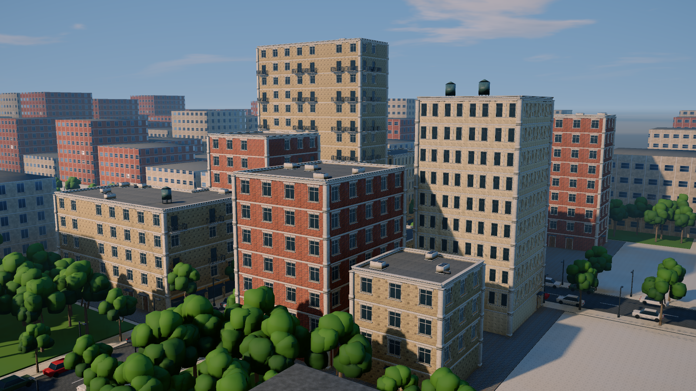
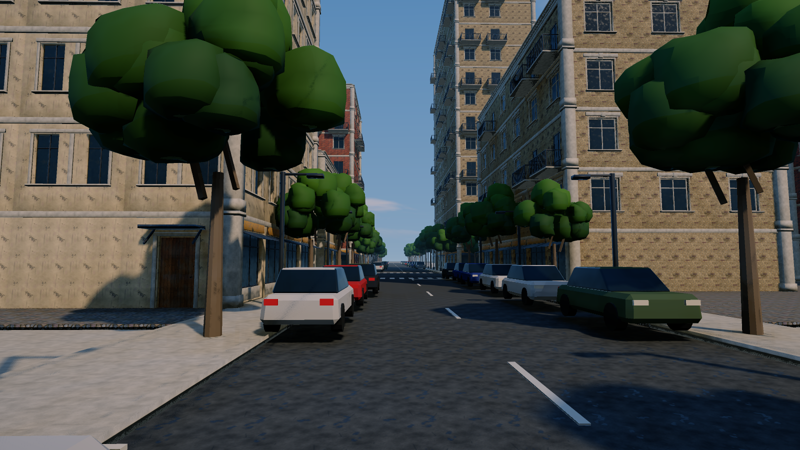

# Modular city

Modular buildings: first a kit of facade and roof pieces (each 4 m wide, one storey = 3.5 m), then rules that place the kit onto the facades and roofs of twelve buildings along two crossing streets. The deliverable is **the kit meshes plus an instance table**, not one merged building mesh. The preview dresses the block as a street scene (asphalt, road paint, trees, lamps, parked cars, low-detail context blocks to the horizon) and shoots it with two cameras in the *Outdoor* look.

## Load it

Drag `example_workflows/pcg_prod_modular_city.json` onto the ComfyUI canvas and press **Queue**. Only comfyui_pcg nodes plus ComfyUI's Preview Image are used. Run the [material library](pcg_prod_material_library.md) first if you want the kit to open with textures (see below).

Output, in `output/pcg/assets/kit/`:

| File | Content |
|---|---|
| `SM_Kit_<piece>.glb` | One glb per kit piece. |
| `Block_Instances.csv` | One row per placed piece. The `asset` column is the kit glb's file name without extension; the extra columns `bld` (building), `floor` and `facade` (the building's facade variant: 0 red brick, 1 buff brick, 2 painted render, for an engine-side material override of `M_Wall`) are included. |

## The kit (left four columns)

Pieces: `Wall_Plain`, `Wall_Window`, `Wall_WindowPair`, `Wall_Door`, `Wall_Shopfront`, `Wall_Balcony`, `Corner_Pillar`, `Roof_Cornice`, `Roof_Flat`, and the rooftop plant `Roof_Unit` (a condenser with two fans and a duct) and `Roof_Tank` (a water tank with a conical lid on four legs).

Conventions:

- The pivot is at the centre of the bottom edge (rooftop plant: on the roof surface); the outer facade faces +Z and the wall thickness goes towards -Z.
- Every face carries a `material` attribute (`M_Wall`, `M_Trim`, `M_Glass`, `M_Door`, `M_Metal`, `M_Roof`, `M_RoofFlat`, `M_Sign`), exported as glTF material slots.
- UVs are a world-scale box projection (1 UV = 1 m), the same density as the material library (one texture = 1 m).
- All slots point by relative path to the material library's textures, so after running the material library the kit opens textured.

How the pieces are built: **[Box (PCG)](../reference/generate.md#pcg-box)** parts, openings cut with **[Boolean (PCG)](../reference/modify.md#pcg-boolean)** (subtract). The facade face is z = 0; glass and door leaves sit back at z = -0.2, so every opening has a 20 cm reveal. The window has a stone surround, a lintel with a keystone, a sill and a painted frame with a mullion and a transom; the door has a casing, four raised panels, a handle and a canopy on two diagonal brackets; the balcony door a metal frame, and the balcony a slab, rails, corner posts and 12 cm balusters on three sides (one baluster box copied onto a row of points with **[Copy to Points (PCG)](../reference/scatter.md#pcg-copytopoints)**), 1 m high; the shopfront a stall riser, a metal frame in three bays with a transom, a sloping awning and a sign; the corner pillar a plinth and a capital; the cornice a fascia, a bed moulding, a row of dentils and a crown rounded with **[PolyBevel (PCG)](../reference/modify.md#pcg-polybevel)**. each part tagged with a `material` by a **[Wrangle (PCG)](../reference/attribute.md#pcg-wrangle)**, and each piece merged with **[Merge (PCG)](../reference/modify.md#pcg-merge)** and named (`s@name = "Wall_Window"` and so on). The library is merged, UV-projected with **[UV Project (PCG)](../reference/uv.md#pcg-uvproject)** (box, 1 UV = 1 m), coloured per material for previews, and exported by **[Export Mesh (PCG)](../reference/output.md#pcg-exportmesh)** with *Split by Attribute* `name`, so each piece becomes its own glb.

## Assembly (right columns)

1. **Footprints.** **[Grid (PCG)](../reference/generate.md#pcg-grid)** with 4 m cells; a Wrangle over primitives assigns cells to twelve buildings by rules (L shapes, slabs, a 14-storey tower, small houses, from a table in the generator) and gives each a floor count from 3 to 14 and a facade variant. The streets run along x = 0 and z = 0 (16 m between the facades, 10 m of road). **[Blast (PCG)](../reference/modify.md#pcg-blast)** keeps the occupied cells and **[Divide (PCG)](../reference/modify.md#pcg-divide)** (remove shared edges) merges them into outlines.
2. **Slots.** **[PolyExtrude (PCG)](../reference/modify.md#pcg-polyextrude)** extrudes the outlines to the maximum height in 14 storey-high divisions; faces above each building's floor count are removed. Every side face is now a 4 m x 3.5 m slot. **[Normal (PCG)](../reference/attribute.md#pcg-normal)** (on primitives) gives the outward normal, and **[Extract Centroid (PCG)](../reference/attribute.md#pcg-extractcentroid)** puts one point at the centre of each slot, carrying `N`, `floors`, `bld` and `facade`.
3. **Rules.** A Wrangle decides per slot point: ground floors facing one of the two streets (the point 2 m in front of the facade lies within 8 m of a street axis) are shopfronts, other ground floors are occasionally doors; upper floors use a random number per facade column (so pieces line up vertically), with random balconies on even floors of the street facade and a few plain walls; render facades use the paired windows. The top-floor slots are copied up one storey as `Roof_Cornice`. Corner pillars go on the points of sharp edges of the extruded mass (**[Group Create (PCG)](../reference/group.md#pcg-groupcreate)** by edge angle, one per storey, without the top ring). Roof points are the centres of the footprint cells lifted to the roof height (`Roof_Flat`); about one roof cell in seven also gets a condenser, and buildings of five floors or more the occasional water tank, turned by quarter turns and nudged inside the cell.
4. **Delivery.** All instance points are merged, `asset` is set to `SM_Kit_<name>`, and **[Export Instances (PCG)](../reference/output.md#pcg-exportinstances)** writes the CSV.
5. **Preview.** **[Copy to Points (PCG)](../reference/scatter.md#pcg-copytopoints)** with *Piece Attribute* `name` places the kit back onto the points, carrying `facade` to the primitives; a Wrangle swaps `M_Wall` for `M_BrickBuff` or `M_Stucco` per building, as an engine would with a material override. The street scene around it is made in the workflow, not part of the kit:
   - asphalt carriageways (`Ground_Asphalt`) that run on to the horizon, 15 cm below the cobbled quarters (`Ground_Cobble`) and 3 m concrete sidewalks (`M_Trim`); dashed centre lines, zebra crossings and stop lines as boxes copied onto a table of points and sizes;
   - street lamps and trees alternating every 6 m along the curbs (trees: a tapering trunk, two limbs, a crown of eighteen noise-displaced clusters on the shell of an ellipsoid, darker low and inside, random turn and size);
   - parked cars in the parking lanes, about two slots in three, heading with the traffic, in a random paint colour (a bevelled body, a cabin tapered to raked screens with a painted roof, lights, four wheels);
   - **context blocks**: a 640 m grid of 32 m blocks outside the plot, shrunk to 27 m footprints and extruded to random heights (**[PolyExtrude (PCG)](../reference/modify.md#pcg-polyextrude)** by a `h` attribute), low around the plot and taller toward the horizon. Their walls use `M_FacadeFar` / `M_FacadeFarBrick`, one whole 4 m x 3.5 m bay per image with UVs u = x / 4, v = y / 3.5, so a plain box reads as a building with windows at a distance, the way a game fills the background behind a hero area. They stand on one concrete slab;
   - a **green belt** west and east of the plot, between it and the first context blocks: lawn with about a hundred scattered trees (the same tree, larger).

   Two **[Camera (PCG)](../reference/render.md#pcg-camera)** nodes (*look_at*) frame the block from the south-west and an eye-level view down the street, and **[Geometry Preview (PCG)](../reference/output.md#pcg-previewimage)** renders both in the *Outdoor* look (perspective, a sky with clouds, soft sun shadows, the sky as an area light so the street is darker than the roofs and shaded walls pick up light bounced off the sunlit ground, aerial perspective; the aerial in afternoon light, the street with the sun down its length) with the material library's textures (`basecolor = pcg/materials/T_{material}_BaseColor.png`, `normal = pcg/materials/T_{material}_Normal_GL.png`, `orm = pcg/materials/T_{material}_ORM.png`, looked up by each face's `material`; a material whose files are missing keeps its colour). A third preview lines up the eleven kit pieces in the *Studio* look.

## Worth tweaking

| Node | Parameter | Effect |
|---|---|---|
| Footprint rule Wrangle | `code` | Building shapes and floor counts. |
| Slot rule Wrangle | `code` | Which piece goes where: shopfront and door rules, balcony probability (`h > 0.55`), share of plain walls. |
| `CITY_FACADE` table (generator) / footprint Wrangle | `code` | Facade variant per building. |
| Rooftop plant Wrangle | `code` | How many roof cells get condensers and tanks. |
| Camera nodes | `eye_*`, `target_*`, `fov` | The two hero shots. |
| Geometry Preview | `sun_elevation`, `sun_azimuth`, `haze`, `clouds` | Time of day, atmosphere and weather. |
| Kit boxes | `size_*`, `c*` | Proportions of windows, doors and trims (keep the 4 m x 3.5 m module). |
| Export Mesh (kit) | `textures`, `texture_materials` | Which slots get texture paths, and the paths themselves. |

## See also

- [Material library](pcg_prod_material_library.md): the textures the kit points to.
- [City block](pcg_sop_city_block.md): buildings modelled in place instead of assembled.
- [Viewing and export](../concepts/viewing-and-export.md): glb and instance export.
- [Example index](README.md).
