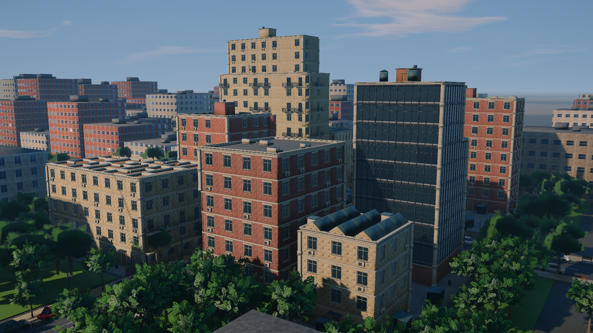
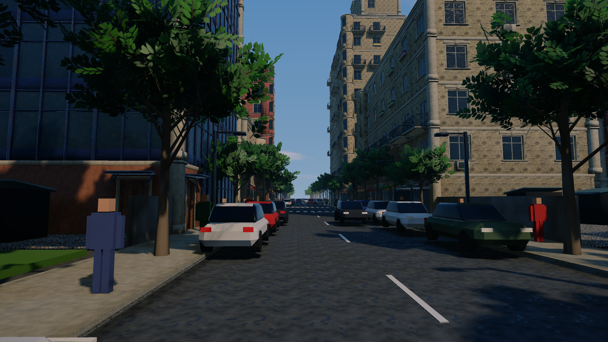
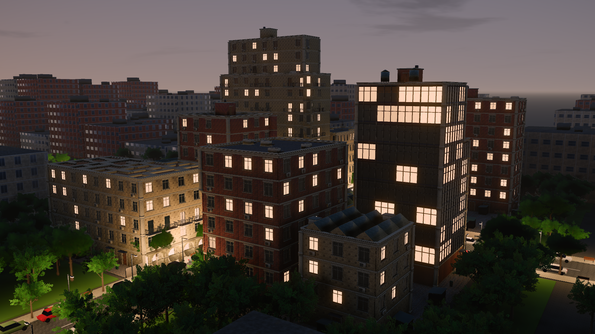

# Modular city

Modular buildings: first a kit of facade and roof pieces (each 4 m wide, one storey = 3.5 m), then rules that place the kit onto the facades and roofs of twelve buildings along two crossing streets. The deliverable is **the kit meshes plus an instance table**, not one merged building mesh. The preview dresses the block as a street scene (curbs and paving, road paint, lane trees with leaf cards, lamps, benches, bus shelters, traffic lights, parked cars, low-detail context blocks to the horizon), weathers the facades per building, and shoots it with two cameras in the *Outdoor* look, plus the aerial at dusk with the windows and lamps lit. A copy of the block is also written as a world that the [engine importers](../../engine/README.md) read.

## Load it

Drag `example_workflows/pcg_prod_modular_city.json` onto the ComfyUI canvas and press **Queue**. Only comfyui_pcg nodes plus ComfyUI's Preview Image are used. Run the [material library](pcg_prod_material_library.md) first if you want the kit to open with textures (see below).

The working nodes open collapsed (their titles say what each does; double-click a title, or select nodes and press Alt+C, to open them): hundreds of open nodes, each code box a DOM element the frontend repositions on every frame, make the canvas slow to pan. Previews, viewports and notes stay open. After restarting ComfyUI, reload the browser page too (Ctrl+F5): a page left open keeps the node list of the server it first loaded, and nodes added since show as missing.

Output, in `output/pcg/assets/kit/`:

| File | Content |
|---|---|
| `SM_Kit_<piece>.glb` | One glb per kit piece, with three nodes: `SM_Kit_<piece>_LOD0`, `_LOD1` and the collision hull `UCX_SM_Kit_<piece>_00`. |
| `SM_Kit_<piece>.lods.json` | Its LOD manifest: the switch distance (LOD1 at 40 m), Unreal screen sizes, Unity LODGroup transitions, the collision node. |
| `Block_Instances.csv` | One row per placed piece. The `asset` column is the kit glb's file name without extension; the extra columns `bld` (building), `floor` and `facade` (the building's facade variant: 0 red brick, 1 buff brick, 2 painted render, for an engine-side material override of `M_Wall`) are included. |

And in `output/pcg/city/`, the same block as a world: `World.json`, the kit glbs in `assets/`, `instances/Instances_x0_y0.csv` (the block in the middle of one 1024 m tile whose origin is its north-west corner) and `tiles/Tile_x0_y0.json`. See [Engine import](#engine-import).

## The kit (left four columns)

Pieces: `Wall_Plain`, `Wall_Window`, `Wall_WindowPair`, `Wall_Door`, `Wall_Shopfront`, `Wall_Balcony`, `Corner_Pillar`, `Roof_Cornice`, `Roof_Flat`, and the rooftop plant `Roof_Unit` (a condenser with two fans and a duct) and `Roof_Tank` (a water tank with a conical lid on four legs), and `Roof_Penthouse`, a stair and lift core (rendered walls, a door, an overhanging slab, a vent) for the roofs of tall buildings.

Conventions:

- The pivot is at the centre of the bottom edge (rooftop plant: on the roof surface); the outer facade faces +Z and the wall thickness goes towards -Z.
- Every face carries a `material` attribute (`M_Wall`, `M_Trim`, `M_Glass`, `M_Door`, `M_Metal`, `M_Roof`, `M_RoofFlat`, `M_Sign`), exported as glTF material slots.
- UVs are a world-scale box projection (1 UV = 1 m), the same density as the material library (one texture = 1 m).
- All slots point by relative path to the material library's textures, so after running the material library the kit opens textured.

How the pieces are built: **[Box (PCG)](../reference/generate.md#pcg-box)** parts, openings cut with **[Boolean (PCG)](../reference/modify.md#pcg-boolean)** (subtract). The facade face is z = 0; glass and door leaves sit back at z = -0.2, so every opening has a 20 cm reveal. The window has a stone surround, a lintel with a keystone, a sill and a painted frame with a mullion and a transom; the door has a casing, four raised panels, a handle and a canopy on two diagonal brackets; the balcony door a metal frame, and the balcony a slab, rails, corner posts and 12 cm balusters on three sides (one baluster box copied onto a row of points with **[Copy to Points (PCG)](../reference/scatter.md#pcg-copytopoints)**), 1 m high; the shopfront a stall riser, a metal frame in three bays with a transom, a sloping awning and a sign; the corner pillar a plinth and a capital; the cornice a fascia, a bed moulding, a row of dentils and a crown rounded with **[PolyBevel (PCG)](../reference/modify.md#pcg-polybevel)**. each part tagged with a `material` by a **[Wrangle (PCG)](../reference/attribute.md#pcg-wrangle)**, and each piece merged with **[Merge (PCG)](../reference/modify.md#pcg-merge)** and named (`s@name = "Wall_Window"` and so on). The library is merged, UV-projected with **[UV Project (PCG)](../reference/uv.md#pcg-uvproject)** (box, 1 UV = 1 m), coloured per material for previews, and exported by **[Export Mesh (PCG)](../reference/output.md#pcg-exportmesh)** with *Split by Attribute* `name`, so each piece becomes its own glb.

**LODs and collision.** Before the export each piece gets an `asset` (`SM_Kit_<piece>`, the glb's name). **[LOD Create (PCG)](../reference/modify.md#pcg-lodcreate)** makes the chain with the stripped piece as a custom level: LOD1 is the piece without its faces under 0.1 m² (**[Measure (PCG)](../reference/attribute.md#pcg-measure)** area, then Blast), so frames, mullions, rails and dentils go while the outline, the openings and the glass stay, and the silhouette and textures still match at 40 m. A **[For-Each](../reference/loop.md#pcg-foreachbegin)** over the pieces wraps each in a **[Convex Hull (PCG)](../reference/modify.md#pcg-convexhull)** named `UCX_SM_Kit_<piece>_00`, the usual engine collision naming. Export Mesh writes *Split Attribute* `name` (the nodes) and *File Attribute* `asset` (the files), with *LOD Manifest* on: one `.lods.json` beside each glb.

## Assembly (right columns)

1. **Footprints.** **[Grid (PCG)](../reference/generate.md#pcg-grid)** with 4 m cells; a Wrangle over primitives assigns cells to twelve buildings by rules (L shapes, slabs, a 14-storey tower, small houses, from a table in the generator) and gives each a floor count from 3 to 14 and a facade variant. Its spare parameters switch to a generated block: *Layout* 1 cuts each quarter into lots along both streets (3 to 5 cells, 12-20 m, of frontage, 3 or 4 deep, the last cell of each lot a 4 m lane so no two buildings share a wall), builds a lot with the probability *Density*, makes it taller toward the crossing (*Max Floors* there, *Min Floors* at the edge, give or take two) and picks a facade; *Seed* gives another block. *Layout* 0, the default, is the table. The streets run along x = 0 and z = 0 (16 m between the facades, 10 m of road). **[Blast (PCG)](../reference/modify.md#pcg-blast)** keeps the occupied cells and **[Divide (PCG)](../reference/modify.md#pcg-divide)** (remove shared edges) merges them into outlines.
2. **Slots.** **[PolyExtrude (PCG)](../reference/modify.md#pcg-polyextrude)** extrudes the outlines to the maximum height in 14 storey-high divisions; faces above each building's floor count are removed. Every side face is now a 4 m x 3.5 m slot. **[Normal (PCG)](../reference/attribute.md#pcg-normal)** (on primitives) gives the outward normal, and **[Extract Centroid (PCG)](../reference/attribute.md#pcg-extractcentroid)** puts one point at the centre of each slot, carrying `N`, `floors`, `bld` and `facade`.
3. **Rules.** A Wrangle decides per slot point, with the street a facade faces found from the point 2 m in front of it (within 8 m of a street axis). The main street (along x) has shopfronts on every ground floor; the side street only within 24 m of the crossing, and further on entrances and windows; the backs get occasional doors. Towers of 9+ floors stand on a two-storey podium: where the ground floor is a shop, so is the first floor. Upper floors use a random number per facade column (so pieces line up vertically) with a few plain walls; every building has one balcony style on its street facades, drawn from its number: none, scattered on even floors, or bands across every column on every third floor. Render facades use the paired windows. The top-floor slots are copied up one storey as `Roof_Cornice`. Corner pillars go on the points of sharp edges of the extruded mass (**[Group Create (PCG)](../reference/group.md#pcg-groupcreate)** by edge angle, one per storey, without the top ring). Roof points are the centres of the footprint cells lifted to the roof height (`Roof_Flat`); about one roof cell in seven also gets a condenser, and buildings of five floors or more the occasional water tank, turned by quarter turns and nudged inside the cell. Buildings of eight floors or more get a `Roof_Penthouse` on the roof cell nearest their middle (no plant there).
4. **Delivery.** All instance points are merged, `asset` is set to `SM_Kit_<name>`, and **[Export Instances (PCG)](../reference/output.md#pcg-exportinstances)** writes the CSV. For the engine the points are moved by (512, 0, 512) and written again per 1024 m tile under `pcg/city/instances`, the kit glbs again under `pcg/city/assets`, and **[World Manifest (PCG)](../reference/output.md#pcg-worldmanifest)** reads them back into `pcg/city/World.json`.
5. **Preview.** **[Copy to Points (PCG)](../reference/scatter.md#pcg-copytopoints)** with *Piece Attribute* `name` places the kit back onto the points, carrying `facade` to the primitives; a Wrangle swaps `M_Wall` for `M_BrickBuff` or `M_Stucco` per building, as an engine would with a material override. The street scene around it is made in the workflow, not part of the kit:
   - asphalt carriageways (`Ground_Asphalt`) that run on to the horizon, 15 cm below the cobbled quarters (`Ground_Cobble`) and 3 m concrete sidewalks (`M_Trim`); dashed centre lines, zebra crossings and stop lines as boxes copied onto a table of points and sizes;
   - curbs along every sidewalk edge, manhole covers in the carriageways, and the context blocks' slab paved in concrete (the sidewalks' texture, tinted darker) with lighter sidewalks round the blocks;
   - street lamps and trees alternating every 6 m along the curbs, and benches, litter bins, bus shelters and traffic lights at the crossing; the trees are a **[Tree Generator (PCG)](../reference/generate.md#pcg-treegenerator)** broadleaf with leaf cards cut out by **[Leaf Card Texture (PCG)](../reference/cop-generate.md#pcg-leafcardtexture)** and lit as translucent (`translucency 0.5`), also lining lanes and parks between the context blocks (about 220 more);
   - **weathering** per building, on the facades' vertices: a tint drawn from the building's number, grime toward the foot, the glass varied (curtains, dark panes) with some windows lit (`emit`, for the dusk shot), and the texture shifted per building so neighbours don't repeat;
   - parked cars in the parking lanes, about two slots in three, heading with the traffic, in a random paint colour (a bevelled body, a cabin tapered to raked screens with a painted roof, lights, four wheels);
   - **context blocks**: a 640 m grid of 32 m blocks outside the plot, shrunk to 27 m footprints and extruded to random heights (**[PolyExtrude (PCG)](../reference/modify.md#pcg-polyextrude)** by a `h` attribute), low around the plot and taller toward the horizon. Their walls use `M_FacadeFar` / `M_FacadeFarBrick`, one whole 4 m x 3.5 m bay per image with UVs u = x / 4, v = y / 3.5, so a plain box reads as a building with windows at a distance, the way a game fills the background behind a hero area. They stand on one concrete slab, tinted by district (a low-frequency noise) and per block, and carry rooftop clutter (plant boxes on the roof centres);
   - a **green belt** west and east of the plot, between it and the first context blocks: lawn with about a hundred scattered trees (the same tree, larger).

   Two **[Camera (PCG)](../reference/render.md#pcg-camera)** nodes (*look_at*) frame the block from the south-west and an eye-level view down the street, and **[Geometry Preview (PCG)](../reference/output.md#pcg-previewimage)** renders both in the *Outdoor* look (perspective, a sky with clouds, soft sun shadows, the sky as an area light so the street is darker than the roofs and shaded walls pick up light bounced off the sunlit ground, aerial perspective; the aerial in afternoon light, the street with the sun down its length) with the material library's textures (`basecolor = pcg/materials/T_{material}_BaseColor.png`, `normal = pcg/materials/T_{material}_Normal_GL.png`, `orm = pcg/materials/T_{material}_ORM.png`, looked up by each face's `material`; a material whose files are missing keeps its colour). A dusk preview renders the aerial camera with the sun 4° below the horizon: the lit windows glow (`emit_attrib`), and every street lamp is a point light (*lights*, 4.8 m up and 1.2 m out over the road). A last preview lines up the twelve kit pieces in the *Studio* look.

## Engine import

`output/pcg/city/World.json` is a [World Manifest](../reference/output.md#pcg-worldmanifest) like the open-world terrain's, without terrain: the importers in `engine/` read it. In Unreal run `engine/unreal/pcg_world_import.py` (`run("<path>/World.json")`): the kit glbs are imported to `/Game/PCGWorld/Assets`, each piece's LOD1 is set from its manifest, and every tile's table becomes one Hierarchical Instanced Static Mesh actor per piece (an instance's `asset`, say `SM_Kit_Wall_Window`, uses the static mesh `SM_Kit_Wall_Window_LOD0`). In Unity, Tools > PCG World > Import World.json... (with glTFast) places the `_LOD0` nodes the same way. Neither importer turns the `UCX_` node into collision (FBX imports do; a glb import keeps it a mesh: delete it or set the collision from it), and neither applies the facade variant: World.json's `city` key says which material replaces `M_Wall` for each value of the instances' `facade` column, for a material override in the project.

## Worth tweaking

| Node | Parameter | Effect |
|---|---|---|
| Footprint rule Wrangle | `code` | Building shapes and floor counts. |
| Footprint rule Wrangle | spare `layout`, `seed`, `density`, `min_floors`, `max_floors` | A generated block instead of the table (Layout 1). |
| Slot rule Wrangle | `code` | Which piece goes where: shop streets, the podium height (9 floors), balcony styles, share of plain walls. |
| `CITY_FACADE` table (generator) / footprint Wrangle | `code` | Facade variant per building. |
| Rooftop plant Wrangle | `code` | How many roof cells get condensers and tanks; from how many floors a stair core. |
| LOD Create (kit) | `distances`; the Blast's `@area < 0.1` | Where LOD1 switches in, and what it strips. |
| Camera nodes | `eye_*`, `target_*`, `fov` | The two hero shots. |
| Geometry Preview | `sun_elevation`, `sun_azimuth`, `haze`, `clouds` | Time of day, atmosphere and weather. |
| Dusk preview | `exposure`, `light_range`; the lamp Wrangle's `@intensity` | How bright the lit windows and the lamps read. |
| Kit boxes | `size_*`, `c*` | Proportions of windows, doors and trims (keep the 4 m x 3.5 m module). |
| Export Mesh (kit) | `textures`, `texture_materials` | Which slots get texture paths, and the paths themselves. |

## See also

- [Material library](pcg_prod_material_library.md): the textures the kit points to.
- [City block](pcg_sop_city_block.md): buildings modelled in place instead of assembled.
- [Viewing and export](../concepts/viewing-and-export.md): glb and instance export.
- [Open-world terrain tiles](pcg_prod_world_tiles.md): the same World.json with terrain, towns and roads.
- [Example index](README.md).
