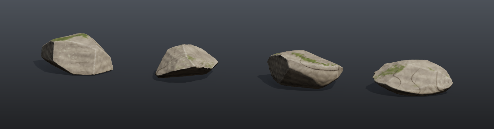

# Rock assets pipeline

Produces four engine-ready rock assets in one run, fully procedurally and without any source files. Each rock comes with:

- a high-poly mesh (about 35k faces: SDF -> voxels -> surface nets);
- LOD0 with about 4,500 triangles (the same SDF lightly blurred and re-extracted at 9 cm voxels, so it is made of even quads), with automatic seams, LSCM/ARAP unwrapping and shape-aware packing;
- LOD1 and LOD2 reduced from LOD0 with *Preserve UVs* (half-edge collapse with locked seams), so they **share LOD0's textures**;
- a convex-decomposition collision mesh (`UCX_` prefix, one convex hull per piece, at most 32 points / 60 triangles each);
- textures: BaseColor (sRGB), Normal (tangent space, OpenGL +Y), ORM (AO, roughness and metallic packed) and Height (16-bit, with its range in a `.json` next to it). Detail finer than the high poly's voxels (bedding grooves, hairline cracks, grain, colour speckle) is computed per texel after the bake, so the 1024 px per rock carry real detail.

## Load it

Drag `example_workflows/pcg_prod_rock_assets.json` onto the ComfyUI canvas and press **Queue**. Only comfyui_pcg nodes plus ComfyUI's Preview Image and Save Image are used. A run takes roughly two to three minutes (reduction and baking take most of it).

Output, all in `output/pcg/assets/rocks/`:

| File | Content |
|---|---|
| `SM_Rock_00.glb` ... `SM_Rock_03.glb` | One file per rock with the nodes LOD0 / LOD1 / LOD2 / UCX, all using one material slot `Rock_0N`, with BaseColor / Normal / ORM already attached by relative path. |
| `T_Rock_0N_BaseColor.png`, `_Normal.png`, `_ORM.png`, `_Height.png` | The baked maps per rock. |
| `preview_*.png` | LOD0 rendered with the baked textures. |

Dragging a glb into Blender or an engine gives the textured rock. The pivot is on the ground line: the flat base is at y = -0.5, so placing the rock on the ground buries it half a metre, and on a slope no floating base shows (the instance tables of the [world tiles](pcg_prod_world_tiles.md) pipeline place rocks this way).

## Step by step

**1. Variant loop: high poly**

1. **[Volume (PCG)](../reference/generate.md#pcg-volume)** is the sampling volume (2.8 x 2.3 x 2.6 m, 128 x 104 x 120 voxels). **[For-Each Begin (PCG)](../reference/loop.md#pcg-foreachbegin)** runs four iterations (By Count, Fetch Input).
2. **[Volume Wrangle (PCG)](../reference/modify.md#pcg-volumewrangle)** writes the rock's signed distance field; its `rand_seed` is wired to `iteration`, so `seed` in the code is the rock number. Each rock first gets its own proportions (a boulder, a slab, a block...). The SDF then intersects 13 random half-spaces (the big faces) with a smooth maximum of 1.5 cm, so the faces meet in crisp but not knife-sharp arrises, shears a whole side off along one deep joint plane, shaves a few corners and edges off with 4 more planes close to the surface (fracture chips), trims the far corners with a soft sphere, adds a broad undulation and shallow weathering hollows, and finally cuts the base flat and keeps clear of the sampling volume's walls (an open surface there frays the mesh). It deliberately stops at forms of about three voxels and up: at 2.2 cm voxels, grooves and cracks only a voxel wide come out as stair-stepped dashes, so they are added per texel in step 10.
3. **[Convert (PCG)](../reference/modify.md#pcg-convert)** turns the volume into the high-poly mesh; **[Normal (PCG)](../reference/attribute.md#pcg-normal)**, then **[Measure (PCG)](../reference/attribute.md#pcg-measure)** writes the curvature `curv` (concave < 0 < convex).
4. A **[Wrangle (PCG)](../reference/attribute.md#pcg-wrangle)** colours the high-poly mesh for its own preview (dust in cavities, pale edges, bands, moss; the textures are coloured per texel in step 10). Another Wrangle tags it `part = "high"` and names it `SM_Rock_0N`.

**2. Low poly, UVs, LODs, collision**

5. LOD0 comes from the same SDF: **[Volume Blur (PCG)](../reference/modify.md#pcg-volumeblur)** removes high frequencies, **[Volume Resample (PCG)](../reference/modify.md#pcg-volumeresample)** resamples to 9 cm voxels, **[Convert (PCG)](../reference/modify.md#pcg-convert)** extracts even quads, **[Normal (PCG)](../reference/attribute.md#pcg-normal)** gives smooth normals (details go into the normal map). Even quads avoid the thin triangles a reduction leaves, which would flip in UV unwrapping and overlap in packing.
6. **[UV Auto Seams (PCG)](../reference/uv.md#pcg-uvautoseams)** (charts), **[UV Flatten (PCG)](../reference/uv.md#pcg-uvflatten)** (LSCM + ARAP, even texel density) and **[UV Layout (PCG)](../reference/uv.md#pcg-uvlayout)** (raster packing) make the UVs. A Wrangle writes `uv_atlas`, which moves rock N into cell N of a 4 x 1 atlas so all four can be baked at once; `uv` itself is left unchanged for export.
7. **[PolyReduce (PCG)](../reference/modify.md#pcg-polyreduce)** with *Preserve UVs* makes LOD1 (50%) and LOD2 (20%). **[Convex Decompose (PCG)](../reference/modify.md#pcg-convexdecompose)** (hull mode, at most 4 pieces, *Max Hull Points* 32) builds the collision mesh from LOD2; each hull keeps at most 32 of its vertices (at most 60 triangles: Unity rejects convex colliders over 255, and small hulls simulate faster). The pieces are named `UCX_<asset>_00`, `_01`, ... (the common engine naming convention).
8. Wrangles tag each part (`part`, `asset`, `material = Rock_0N`, `name`). The parts are merged, each rock is moved 3.5 m along X per iteration (so bake rays do not hit a neighbour), and **[For-Each End (PCG)](../reference/loop.md#pcg-foreachend)** gathers all four.

**3. Baking**

9. Two **[Blast (PCG)](../reference/modify.md#pcg-blast)** nodes split the high-poly meshes and the LOD0s. **[COP Bake Textures (PCG)](../reference/cop-geometry.md#pcg-copbaketextures)** bakes the LOD0s through `uv_atlas` into a 4096 x 1024 atlas, like UDIMs: one bake, then cut into tiles on write. Besides `normal_ts` and `displacement` it writes the high-poly hit `position`, its `worldnormal`, the tangent frame (`tangent`, `bitangent`) and the high-poly `curv`. The bake's tangents are the same as the exported TANGENT attribute, so when the engine uses the file's tangents the normal map matches per pixel.
10. **Texture-space detail.** A **[COP Wrangle (PCG)](../reference/cop-utility.md#pcg-copwrangle)** works on every texel's 3D position (the atlas cell tells which rock it is, and the 3.5 m spread is undone): a detail height made of bedding grooves along warped, irregular layers, hairline cracks on a thin noise iso-line, and two octaves of grain. Its slope along `tangent` and `bitangent` (finite differences, 3 mm) tilts `normal_ts`, and the height is added to `displacement`. The same pass colours the texel: strata in step with the grooves, mottling and speckle, pale worn edges and dark cavities from `curv`, darker crevices, olive moss on the flatter tops and small pale lichen crusts. Colours are picked as display values and written to the layer as linear (`** 2.2`), because Write File encodes BaseColor to sRGB.
11. **[COP Height to AO (PCG)](../reference/cop-terrain.md#pcg-copheighttoao)** derives AO from the displacement (now including the texel detail); a second COP Wrangle combines it with the cavity and crevice terms into `ao`, darkens `basecolor` by it, and sets `roughness` (smoother worn edges, rougher moss and crevices) and `metallic`. **[COP Light (PCG)](../reference/cop-utility.md#pcg-coplight)** lights the atlas for a check image.
12. Four **[COP Write File (PCG)](../reference/cop-utility.md#pcg-copwritefile)** nodes write BaseColor, Normal, ORM and Height, each cut into 4 tiles (`T_Rock_{tx:02}_...`).

**4. Export and previews**

13. **[Blast (PCG)](../reference/modify.md#pcg-blast)** removes the high-poly parts, a Wrangle moves every rock back to the origin, and **[Export Mesh (PCG)](../reference/output.md#pcg-exportmesh)** writes one glb per `asset` with the textures attached (`textures` field: `basecolor = T_{material}_BaseColor.png` and so on).
14. Previews: the high-poly meshes with their colour, LOD0 / LOD1 / LOD2 in three rows with the baked textures (two **[Transform (PCG)](../reference/modify.md#pcg-transform)** nodes; LOD1 and LOD2 are reduced from the mesh that already has `uv_atlas`, so they show the shared texture set), the 3D viewport, and a final render of LOD0 with the baked textures: **[Geometry Preview (PCG)](../reference/output.md#pcg-previewimage)** in the *Studio* look reads `basecolor` and `normal_ts` straight from the COP chain (`textures_cop`, `basecolor = @basecolor`, `normal = @normal_ts`, UV Attribute `uv_atlas`), with the same tangent frames the engine will use. That is how the rock will look in an engine: low-poly silhouette, high-poly and texel detail.

## Worth tweaking

| Node | Parameter | Effect |
|---|---|---|
| Volume Wrangle (SDF) | `code` | The rock shape: number and size of the cut planes, bedding, cracks, noise. |
| For-Each Begin | `iterations` | More rocks. Change three places together: the atlas width (`resolution_x` of COP Bake Textures), the `4` in the `uv_atlas` Wrangle, and `tiles_x` of the Write File nodes. |
| Volume Resample | `voxel_size` | LOD0 density (9 cm gives about 4,500 triangles). |
| Poly Reduce (LOD1 / LOD2) | `keep_percent` | LOD budgets. |
| Texture-space detail (COP Wrangle) | `code` | Groove spacing and depth, crack width, grain, rock colour, edge wear, moss. |

## See also

- [Tutorial 4: for-each variations](tutorial_04_foreach_variations.md): the variant-loop pattern on its own.
- [World tiles](pcg_prod_world_tiles.md): its instance tables reference `SM_Rock_00` ... `SM_Rock_03`.
- [Viewing and export](../concepts/viewing-and-export.md): mesh export and texture rendering.
- [Example index](README.md).
