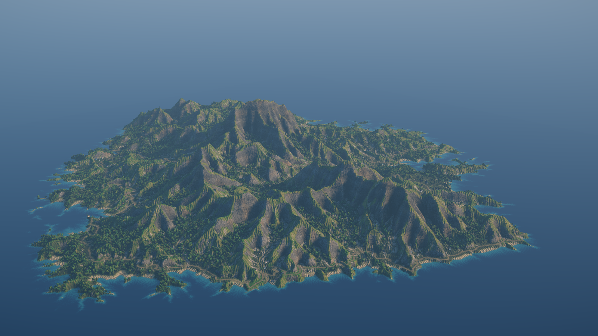
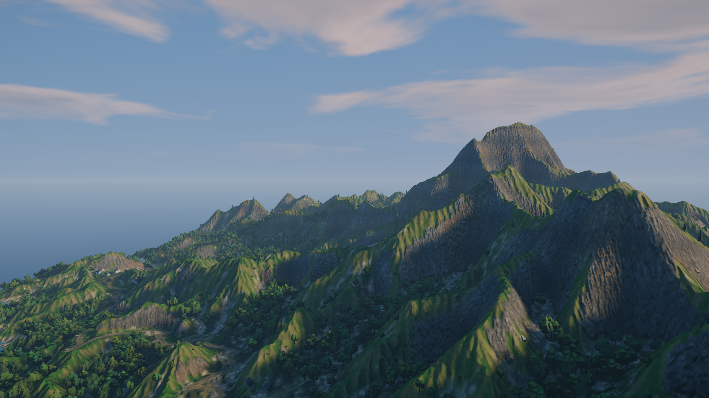
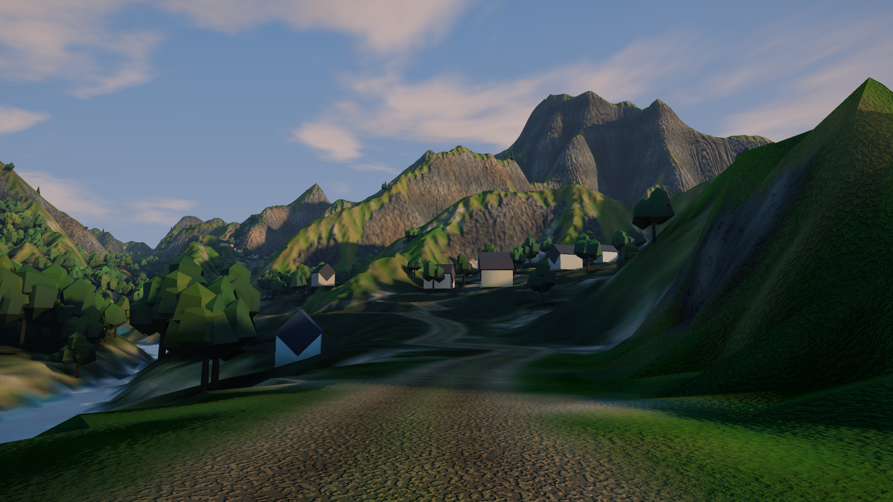

# World tiles

A 4 km x 4 km island for an open world, delivered as 4 x 4 tiles, engine-agnostic: tiled 16-bit height maps with shared edges, seven material weight maps per tile, a road network, 1 m terrain textures (BaseColor and normal map) and per-tile instance tables for trees, bushes and rocks, plus a minimap and a preview.

## Load it

Drag `example_workflows/pcg_prod_world_tiles.json` onto the ComfyUI canvas and press **Queue**. Only comfyui_pcg nodes plus ComfyUI's Preview Image are used. The terrain takes about two minutes on numpy (the two HeightField Erode passes are most of it), much less with CUDA; the 1 m surface textures about a minute and a half, and each preview render about a minute and a half. Allow 6-8 GB of memory.

## Deliverables

All files go to `output/pcg/world/`.

| Files | Content |
|---|---|
| `height/Height_x{tx}_y{ty}.png` | 1025 x 1025 samples, 4 m per cell, cut into 16 tiles of 257 x 257 as 16-bit PNG. **Adjacent tiles share the row of pixels on their common edge**, so heights at the seams are identical bit for bit. Metres = minimum + value x range; the range is `range_scaled` in `Height.json`, one range for the whole map. |
| `height/Height_full.r16` | The whole height map as raw 16-bit. |
| `weight/<Layer>_x{tx}_y{ty}.png` | Seven layers (Grass, ForestFloor, Sediment, Rock, Sand, Water, Road), one 8-bit greyscale PNG per tile and layer. **They sum to 1 at every pixel**, ready for an engine's terrain layers. |
| `roads/Roads.obj` | The road centre lines as OBJ polylines (`l` records), one per road, on the cut road bed: the splines for the engine's road tool. Same origin and axes as the instances. |
| `texture/T_Terrain_BaseColor_x{tx}_y{ty}.png`, `T_Terrain_Normal_GL_x{tx}_y{ty}.png` | The surface at about 1 m per texel: 4096 x 4096 over the map, cut into 16 tiles of 1024 x 1024. BaseColor is sRGB; the normal map is tangent space, OpenGL (+Y = north, up the image), the detail on top of the height map's own shape. |
| `instances/Instances_x{tx}_y{ty}.csv` | Trees (three pines and two broadleaf types, chosen by altitude), bushes, rocks and houses (`SM_House_A`..`C`, front toward the road), one CSV per 1024 m tile, plus `Instances_index.json` listing the tiles. Rock names match the `SM_Rock_0N` assets of the [rock assets pipeline](pcg_prod_rock_assets.md). |
| `texture/detail/T_Detail_<Grass/Rock/Gravel/Litter>_<Color/Normal_GL>.png` | Four tileable detail maps (512², one 4 m tile): colour read linear, 0.5 = no change, and an OpenGL normal map each. Blend them by the weights (grass, rock, gravel for scree / sand / road, litter for forest floor) for close views, as an engine's detail texturing does. |
| `Overview.png` | A lit minimap with the tile borders drawn in yellow. |

**Coordinate convention** (written into every `.json`): the origin is the north-west corner, which is the top-left of the height map; x points east, z points south (same as the image row order), y points up; units are metres. Instance transforms read the same way as in Copy to Points, so what the preview places is exactly what the tables say.

## Step by step

**1. Terrain: an island grown by its rivers**

1. **[COP Noise (PCG)](../reference/cop-generate.md#pcg-copnoise)** (513 x 513, 8 m cells) and a **[COP Wrangle (PCG)](../reference/cop-utility.md#pcg-copwrangle)** that draws the island outline (distance from the centre, pushed in and out by two scales of noise for bays and headlands), marks the sea (`sea`), makes an uplift map (`up`: a ridged spine for the main range, with spurs and massifs on it, low toward the coast) and a rock-hardness map (`kk`: hard cores and dykes at 0.6, soft basins at 1.5).
2. **[COP HeightField Stream Power Erosion (PCG)](../reference/cop-terrain.md#pcg-copstreampower)** (500 steps, `base_layer` = `sea`, `erodibility_layer` = `kk`): the whole island rises while rivers cut it down to the sea, until uplift and erosion balance. This is what puts detail everywhere: every slope belongs to a valley, every valley branches and reaches the coast, there are no flat interiors. The relief is about Uplift / Erodibility, per pixel by the rock: hard ground stands higher and steeper (crags, the main peak), soft ground wears into broad lower valleys, so the island is not one evenly dissected dome (here up to about 380 m). `diffusion` 0.03 keeps the ridges sharp (0.12 rounds them into domes).
3. **[COP Blur (PCG)](../reference/cop-filter.md#pcg-copblur)** (0.5 px) softens the one-cell river cuts, **[COP Resize (PCG)](../reference/cop-transform.md#pcg-copresize)** goes to 1025 x 1025 (4 m cells), **[COP Height to Normal (PCG)](../reference/cop-terrain.md#pcg-copheighttonormal)** gives the slope direction and a Wrangle cuts buttresses and couloirs down the steep faces (sharp ridged noise across the slope, 120 m and 45 m apart, up to about 25 m deep: a steady-state slope is otherwise one smooth plane), then adds hollows (60-150 m) and rock roughness on the land, and **[COP Erosion Filter (PCG)](../reference/cop-terrain.md#pcg-coperosion)** the gully pattern.
4. **[COP HeightField Erode (PCG)](../reference/cop-terrain.md#pcg-copheightfielderode)** (160 steps, `capacity` 4 with `bed_change_limit` 0.03 so the strong carving does not ripple) cuts the gullies and writes the masks the materials are made from: `flow` (where water ran), `sediment` and `debris` (scree). Its `hardness_layer` comes from the same rock map as Stream Power's K, so hard ground resists the water too. Then Houdini's terrain recipe, erode - distort - erode: **[COP Distort (PCG)](../reference/cop-transform.md#pcg-copdistort)** shifts the height up to about 6 m sideways by a 2-D noise field (new obstacles for the water), and a second, shorter HeightField Erode (60 steps, capacity 2) breaks the first pass's channels into finer, less regular ones; a Wrangle adds both passes' masks together.
5. **[COP Flow Accumulation (PCG)](../reference/cop-terrain.md#pcg-copflowaccumulation)** (Rho8, draining to the sea) finds the rivers; a Blur and a Wrangle turn them into beds cut 1.5-5 m into the valley floors, deeper and wider for larger catchments.
**1b. Roads**

6. Town sites: a Wrangle marks flat (under about 15 degrees), low (4-150 m), dry ground (`d_town`), **[COP Layer To Points (PCG)](../reference/cop-geometry.md#pcg-coplayertopoints)** scatters 150 candidates by it and **[Adaptive Prune (PCG)](../reference/scatter.md#pcg-adaptiveprune)** keeps the flattest ones at least 500 m apart (about a dozen). Ground below 2.5 m (beach and sea) is marked `noroad`.
7. **[COP HeightField Road Network (PCG)](../reference/cop-terrain.md#pcg-coproadnetwork)** joins them: least-cost paths on a 513 x 513 grid (8 m) that keep to a 10 % grade (a hillside four times steeper is crossed at 1:4, in switchbacks), avoid the river beds (`avoid_layer` = `bed`), never touch `noroad`, and branch off the roads already built (`reuse` 0.4), so the result is a network: a coast road with spurs up the valleys. Each road point carries `road_h`, the ground smoothed along the road over 80 m: the bed, which evens out the gullies it crosses (95 % of the road ends up under about 13 %).
8. Two **[COP Rasterize Curves (PCG)](../reference/cop-geometry.md#pcg-coprasterizecurves)** draw the roads back: a 28 m corridor with the bed height and a 6.5 m road surface (`road`). After a Blur, a Wrangle replaces the ground in the corridor by the bed, blending out over the cut and fill slopes. The centre lines are written to `roads/Roads.obj` (moved to the north-west origin).

9. **[COP Height to Normal (PCG)](../reference/cop-terrain.md#pcg-copheighttonormal)** (strength 2048, world size 4100) gives the slopes and the normal used to tilt rocks.

**2. Ecology and colour**

10. A **[COP Wrangle (PCG)](../reference/cop-utility.md#pcg-copwrangle)** builds the seven weight layers and the scatter densities, each layer taking its share of what the ones above left: the road first (fords cross the rivers), water (the sea, and the trunk rivers in their beds), sand (the beach 0-4 m above the sea, and the beds of the smaller streams), rock (above about 55 degrees everywhere, from about 45 degrees in patches: bare outcrops in the grass), scree (the debris below them), woodland (valleys and lower slopes where water collects, in clumps) and grass. The colour comes from the same masks: rock with warm and cool beds, darkened where water streaks down it; grass lush in the valleys, dry on sunny ridges, heath-coloured on the high ground and darker along every gully, so the drainage pattern reads in the colour as well as the shape. Like Project Pegasus's global colour map, the colour is read off the terrain's own features: a **[COP Curvature (PCG)](../reference/cop-terrain.md#pcg-copcurvature)** layer (mean, in 1/m) makes ridges and rock edges lighter and hollows darker and damper, and fresh `sediment` (the fans the water laid down) turns the grass a pale silt-green. It also keeps the grass and rock colours on their own (`grass_c`, `rock_c`) for the surface textures.

**2b. The 1 m surface textures**

11. **[COP Layer Edit (PCG)](../reference/cop-layers.md#pcg-coplayeredit)** keeps the layers the surface needs; **[COP Resize (PCG)](../reference/cop-transform.md#pcg-copresize)** takes the height alone to 4096 x 4096 (1 m texels) for the next step, and a **[COP Layer Merge (PCG)](../reference/cop-layers.md#pcg-coplayermerge)** after it brings the other layers across, resampled to that size (so the erosion filter's working memory sits next to one layer, not all of them). At 4 m per sample a mountainside is smooth and every material edge is a blur; the detail a close shot needs is added at this size.
12. **[COP Erosion Filter (PCG)](../reference/cop-terrain.md#pcg-coperosion)** (10 m, 3 octaves, to a separate layer `Ce`) gives the rills, and a Worley **[COP Noise (PCG)](../reference/cop-generate.md#pcg-copnoise)** (cell edges about 7 m apart) the joints in rock and the stones in scree.
13. A **[COP Wrangle (PCG)](../reference/cop-utility.md#pcg-copwrangle)** (`rows_per_pass` 64, so a 4096² image with many noise calls stays within memory) makes the surface: rock outcrops with crisp, ragged edges instead of a soft blend (the weight pushed past a noisy threshold; the other layers share what is left, so they still sum to 1); couloirs and ribs running down the faces, joints, colour banded by beds of two thicknesses (5 m and 13 m), lichen on the tops and dark streaks down the faces; grass mottled at 4, 15 and 50 m, greener in the rills and drier on the spurs, with bare soil where rill walls are steep; gravel, wet sand at the waterline. The roads are drawn again at 1 m (two more Rasterize Curves: the 6 m road and an 11 m verge): packed light dirt with gravel, a worn verge, flat in the normal map. Two wheel ruts (the centre line moved 1.1 m either side along `road_t`) are darker and sunk 8 cm, with a grassy crown between them. It also writes a detail height in metres (rills on soil, ledges and joints on rock), which **[COP Height to Normal (PCG)](../reference/cop-terrain.md#pcg-copheighttonormal)** (strength 1, world size 4100) turns into the normal map, and a roughness layer.
14. Two **[COP Write File (PCG)](../reference/cop-utility.md#pcg-copwritefile)** nodes write them as 4 x 4 tiles: BaseColor encoded sRGB, the normal map with `remap` = `signed`. The surface also writes `terrain_dw`, four weights for the detail maps.
15. Detail maps for close views: a COP Wrangle on a 512² canvas makes four tileable 4 m tiles with `pnoise` (grass tufts, rock grain and cracks, gravel stones, leaf litter), each a colour around 0.5 and a height in metres that **[COP Height to Normal (PCG)](../reference/cop-terrain.md#pcg-copheighttonormal)** (Tile on) turns into its normal map. They are written to `texture/detail/` and go to the previews' `detail_cop`, where `detail1..4`, `detail_normal1..4`, `detail_weights = @{material}_dw` and `detail_tiling = 1025` blend them in. A metre-per-texel terrain is soft at your feet; the detail adds the centimetres, and fades with distance as its mips average to 0.5.

**3. Scatter**

16. Three **[COP Layer To Points (PCG)](../reference/cop-geometry.md#pcg-coplayertopoints)** nodes (mode `scatter`) scatter 30,000 trees, 14,000 bushes and 4,000 rocks by their density layers (kept off the road verges and mostly out of the towns), sampling the height (`height_scale` 2048) and the attributes `hn`, `tn`, `wet` and the density itself.
17. Houses: the towns are 160 m discs (**[Circle (PCG)](../reference/generate.md#pcg-circle)** copied to the town points, drawn with Rasterize Curves `fill` on), the ground near the roads an 80 m band, blurred. `d_house` is high in a town, near a road but off its corridor, on flat dry land; a scatter of 12,000 candidates and Adaptive Prune at 16 m leave about 160 houses. Each faces the road: up the slope of the blurred band (its normal, `Nrd`). The proxy is a whitewashed box with a slate gable (a box turned 45 degrees).
18. One **[Wrangle (PCG)](../reference/attribute.md#pcg-wrangle)** per type picks the asset name and the orientation: trees stand upright with a random rotation (pines higher up, broadleaf lower, mixed in between), bigger deep in the forest and where it is wet, smaller at the edges and toward the tree line; bushes lean a little with the slope; rocks lean 70% towards the slope normal and are sunk by `0.25 * pscale`.
19. **[Merge (PCG)](../reference/modify.md#pcg-merge)**, **[Transform (PCG)](../reference/modify.md#pcg-transform)** (moves the origin to the north-west corner), and **[Blast (PCG)](../reference/modify.md#pcg-blast)** removes points that fell half a cell outside the terrain (they would create empty extra tiles). **[Export Instances (PCG)](../reference/output.md#pcg-exportinstances)** writes the CSVs in 1024 m tiles.

**4. Files and preview**

20. **[COP Write File (PCG)](../reference/cop-utility.md#pcg-copwritefile)** nodes write the tiled height (16-bit, `shared_edge` on, `value_scale` 2048), the full `.r16`, and the six weight layers.
21. **[COP Light (PCG)](../reference/cop-utility.md#pcg-coplight)** plus a Wrangle that draws the tile borders produce the minimap, written as `Overview.png` and previewed.
22. **[COP HeightField to Mesh (PCG)](../reference/cop-geometry.md#pcg-copheightfieldtomesh)** (every sample, about two million triangles) builds the terrain mesh; below sea level the preview mesh is flattened to the water surface (the height files keep the sea floor), and a single quad continues the sea to the horizon. Proxies stand in for the engine's assets: pines of stacked cones, broadleaf trees with a crown of lumpy clusters, bushes and angular rocks, darker toward the bottom of the crown and tinted per instance (*Multiply Attributes* = `Cd`).
23. Three **[Camera (PCG)](../reference/render.md#pcg-camera)** nodes and **[Geometry Preview (PCG)](../reference/output.md#pcg-previewimage)** in the *Outdoor* look at 1600 x 900: the whole island from the air south-west of it, a low view from a ridge toward the main peak, and one on the south-east road at eye height, along it toward the peak (picked from the road network: open ground for 200 m ahead, the mountains rising behind). The sun comes from the side (about 90 degrees off the view), low (28 and 20 degrees): light from behind the camera flattens every ridge, light from the side carves them. Haze is in metres (`haze` 1 = light falls to 1/e over 12 km), so the far ridges fade into the air. Both read the surface set on `textures_cop` by material (`basecolor = @{material}_albedo`, `normal = @{material}_nrm`, `roughness = @{material}_rough`): the terrain gets its 1 m colour and normal map, the sea its roughness (it has no colour layer, so it keeps its `Cd`), and the proxies, with no layers of their own, keep theirs.

## Worth tweaking

| Node | Parameter | Effect |
|---|---|---|
| COP Noise / island Wrangle | `rand_seed`, `code` | A different island: outline, where the massifs are. |
| Stream Power | `uplift`, `erodibility`, `diffusion` | Height of the island (about uplift / erodibility), how far apart the valleys are. |
| Geometry Preview | `sun_elevation`, `sun_azimuth`, `clouds`, `haze` | Time of day and weather of the shot; keep the sun to the side of the view for relief. |
| HeightField Erode | `iterations`, `capacity`, `talus_angle` | How deeply water carves, how much scree. |
| Ecology Wrangle | `code` | Where rock, sand, woodland and grass go; density and colour formulas. |
| Surface Wrangle | `code` | The 1 m look: the ribs on rock faces (`rib`), the bed thicknesses of the colour bands (`/ 5`, `/ 13`), how ragged the outcrops are, the rill strength in the normal map (`em`). |
| Houses | `count`, prune `radius`, `d_house` in the ecology Wrangle | How many houses and how close; where they may stand. |
| Detail maps | the detail Wrangle, `detail_tiling` | The look at your feet; how large one tile is (4100 / tiling metres). |
| Road Network | `max_grade`, `reuse`, `avoid_cost` | How steep the roads may climb (lower: more switchbacks), how strongly new roads follow old ones, how hard they avoid the river beds. |
| Town sites | `count`, prune `radius` | How many places the roads join and how far apart. |
| Island Wrangle | `@kk` | Rock hardness for Stream Power: lower = harder (stands as crags and cliffs), higher = softer (broad valleys). |
| Upsample to 4096² | `resolution_x`, `resolution_y` | Texel size of the surface textures (2048 halves the time and memory, 2 m texels). |
| COP Layer to Points (x3) | `count`, `rand_seed` | Number of trees, bushes and rocks. |
| Tree / bush / rock Wrangles | `code` | Asset names (match your engine's assets), altitude split, tilt, scale range. |
| Write File / Export Instances | `tiles_x`, `tiles_y`, `tile_size` | Tile layout of the deliverables. |

## See also

- [Terrain maps](pcg_cop_terrain_maps.md): the same terrain chain at a smaller scale.
- [Rock assets pipeline](pcg_prod_rock_assets.md): the rocks these tables reference.
- [Viewing and export](../concepts/viewing-and-export.md): writing images and instance tables.
- [Example index](README.md).
