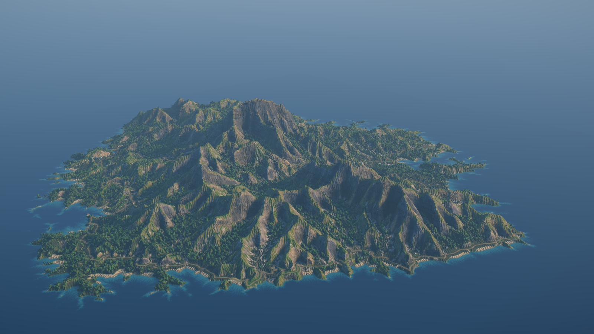
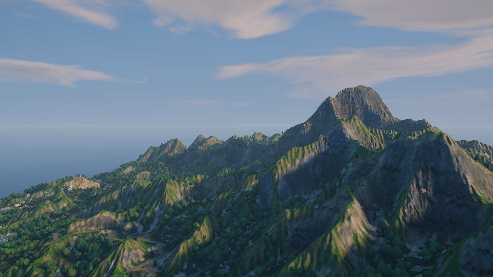
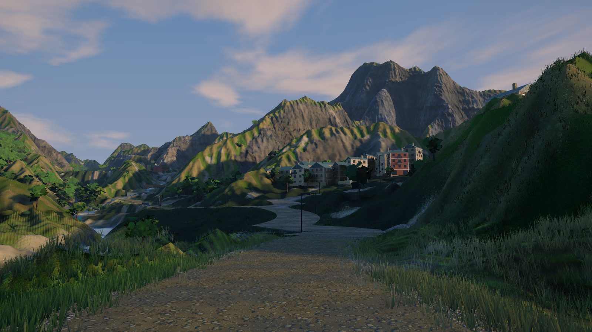

# World tiles

A 4 km x 4 km island for an open world, delivered as 4 x 4 tiles, engine-agnostic: tiled 16-bit height maps with shared edges, seven material weight maps per tile, a road network, towns of buildings along their roads on levelled lots (with LODs) and a patchwork of fields round them, 1 m terrain textures (BaseColor and normal map), per-tile instance tables for trees, bushes and rocks, the tree proxies as LOD chains with impostor atlases for the far view, plus a minimap and a preview.

## Load it

Drag `example_workflows/pcg_prod_world_tiles.json` onto the ComfyUI canvas and press **Queue**. Only comfyui_pcg nodes plus ComfyUI's Preview Image are used. The terrain takes about two minutes on numpy (the two HeightField Erode passes are most of it), much less with CUDA; the 1 m surface textures about a minute and a half, and each preview render about a minute and a half. Allow 6-8 GB of memory.

## Deliverables

All files go to `output/pcg/world/`.

| Files | Content |
|---|---|
| `height/Height_x{tx}_y{ty}.png` | 1025 x 1025 samples, 4 m per cell, cut into 16 tiles of 257 x 257 as 16-bit PNG. **Adjacent tiles share the row of pixels on their common edge**, so heights at the seams are identical bit for bit. Metres = minimum + value x range; the range is `range_scaled` in `Height.json`, one range for the whole map. |
| `height/Height_full.r16` | The whole height map as raw 16-bit. |
| `weight/<Layer>_x{tx}_y{ty}.png` | Seven layers (Grass, ForestFloor, Sediment, Rock, Sand, Water, Road), one 8-bit greyscale PNG per tile and layer. **They sum to 1 at every pixel**, ready for an engine's terrain layers. |
| `roads/Roads.obj` | The road centre lines as OBJ polylines (`l` records), one per road, on the cut road bed: the splines for the engine's road tool. Same origin and axes as the instances. |
| `texture/T_Terrain_BaseColor_x{tx}_y{ty}.png`, `T_Terrain_Normal_GL_x{tx}_y{ty}.png` | The surface at about 1 m per texel: 4096 x 4096 over the map, cut into 16 tiles of 1024 x 1024. BaseColor is sRGB; the normal map is tangent space, OpenGL (+Y = north, up the image), the detail on top of the height map's own shape. |
| `instances/Instances_x{tx}_y{ty}.csv` | Trees (three pines and two broadleaf types, chosen by altitude; broadleaf only near the towns), orchard trees (`Tree_Fruit_A`, in rows), hedges (`Hedge_A`), bushes, rocks and road furniture (`SM_Bridge`, `SM_StreetLamp`, `SM_GuardRail`), one CSV per 1024 m tile, plus `Instances_index.json` listing the tiles. Rock names match the `SM_Rock_0N` assets of the [rock assets pipeline](pcg_prod_rock_assets.md). |
| `texture/T_Terrain_Splat{0..3}_x{tx}_y{ty}.png`, `T_Terrain_Macro_x{tx}_y{ty}.png` | The terrain layers' masks at 2 m (2048² over the map, 16 tiles of 512²): four RGBA splat maps, four layers each in the order of the library below (Splat0 = GrassLush, GrassDry, Moss, ForestFloor; Splat1 = Soil, Mud, Gravel, Sand; Splat2 = RockCliff, RockStrata, RockSlab, Road; Splat3 = Crops in R); with the water they sum to 1. The macro map multiplies the layered colour (stored halved: 0.5 = 1x): the 1 m colour over the mean colour of the layers under it, so the painted variation (wet hollows, bleached spurs, stains, ruts) stays. |
| `texture/layers/T_Layer_<Name>_<Color/Normal_GL/Height/Roughness>.png` | The layer library: thirteen tileable materials (512², one tile = the layer's size: grass 3 m, rock 9-16 m): colour sRGB, OpenGL normal map, height 0..1 for blending by height, roughness. An engine's landscape material samples them under the splat maps. |
| `buildings/Towns.glb` | The towns' buildings, a node per town and LOD (`Town_01_LOD0` the buildings, `_LOD1` their massing at 400 m, `_LOD2` the massing reduced at 1200 m), in the same frame as the instances; the material library's materials (`M_Stucco` / `M_BrickBuff` / `M_Wall`, `M_Trim`, `M_Glass`, `M_Door`, `M_Roof`, `M_RoofFlat`, textures from `../../materials/` once Material Library has been run), uv in metres. |
| `roads/Lanes.obj` | The side streets' centre lines, on their graded bed, as OBJ polylines (beside `roads/Roads.obj`). |
| `buildings/Towns.lods.json` | The towns' LOD chains for an engine (Export Mesh's LOD Manifest): per town the LOD nodes, switch distances, triangle counts, bounds and materials, with Unreal screen sizes and Unity LODGroup transition heights for a 60 degree camera. |
| `assets/SM_Proxy_Pine.glb`, `SM_Proxy_Broadleaf.glb` | The tree proxies as engine assets, each a LOD chain: `_LOD0`, `_LOD1` (40% of the triangles), `_LOD2` (two crossed cards for the impostor). |
| `assets/SM_Props.glb` | The orchard tree, the hedge, the bridge (a 30 m deck with parapets, stretched along the road to its span by the instance's scale), the bridge pier (1 m high, stretched up to the deck), the street lamp and the 4 m guard rail, a node each, named as in the instance tables. |
| `assets/T_Impostor_<Pine/Broadleaf>_<BaseColor/Alpha/Normal/Depth>.png` | Their impostor atlases: 8 x 8 views over the upper half of the sphere (hemi-octahedral), 128² each: colour (sRGB), alpha, world-space normal, depth. |
| `Overview.png` | A lit minimap with the tile borders drawn in yellow. |

**Coordinate convention** (written into every `.json`): the origin is the north-west corner, which is the top-left of the height map; x points east, z points south (same as the image row order), y points up; units are metres. Instance transforms read the same way as in Copy to Points, so what the preview places is exactly what the tables say.

## Step by step

**1. Terrain: an island grown by its rivers**

1. **[COP Noise (PCG)](../reference/cop-generate.md#pcg-copnoise)** (513 x 513, 8 m cells) and a **[COP Wrangle (PCG)](../reference/cop-utility.md#pcg-copwrangle)** that draws the island outline (distance from the centre, pushed in and out by two scales of noise for bays and headlands), marks the sea (`sea`), makes an uplift map (`up`: a ridged spine for the main range, with spurs and massifs on it, low toward the coast) and a rock-hardness map (`kk`: hard cores and dykes at 0.6, soft basins at 1.5).
2. **[COP HeightField Stream Power Erosion (PCG)](../reference/cop-terrain.md#pcg-copstreampower)** (500 steps, `base_layer` = `sea`, `erodibility_layer` = `kk`): the whole island rises while rivers cut it down to the sea, until uplift and erosion balance. This is what puts detail everywhere: every slope belongs to a valley, every valley branches and reaches the coast, there are no flat interiors. The relief is about Uplift / Erodibility, per pixel by the rock: hard ground stands higher and steeper (crags, the main peak), soft ground wears into broad lower valleys, so the island is not one evenly dissected dome (here up to about 380 m). `diffusion` 0.03 keeps the ridges sharp (0.12 rounds them into domes).
3. **[COP Blur (PCG)](../reference/cop-filter.md#pcg-copblur)** (0.5 px) softens the one-cell river cuts, **[COP Resize (PCG)](../reference/cop-transform.md#pcg-copresize)** goes to 1025 x 1025 (4 m cells), **[COP Height to Normal (PCG)](../reference/cop-terrain.md#pcg-copheighttonormal)** gives the slope direction and a Wrangle cuts buttresses and couloirs down the steep faces (sharp ridged noise across the slope, 120 m and 45 m apart, up to about 25 m deep: a steady-state slope is otherwise one smooth plane), then adds hollows (60-150 m) and rock roughness on the land, and **[COP Erosion Filter (PCG)](../reference/cop-terrain.md#pcg-coperosion)** the gully pattern.
4. **[COP HeightField Erode (PCG)](../reference/cop-terrain.md#pcg-copheightfielderode)** (160 steps, `capacity` 4 with `bed_change_limit` 0.03 so the strong carving does not ripple) cuts the gullies and writes the masks the materials are made from: `flow` (where water ran), `sediment` and `debris` (scree). Its `hardness_layer` comes from the same rock map as Stream Power's K, so hard ground resists the water too. Then Houdini's terrain recipe, erode - distort - erode: **[COP Distort (PCG)](../reference/cop-transform.md#pcg-copdistort)** shifts the height up to about 6 m sideways by a 2-D noise field (new obstacles for the water), and a second, shorter HeightField Erode (60 steps, capacity 2) breaks the first pass's channels into finer, less regular ones; a Wrangle adds both passes' masks together.
5. **[COP Flow Accumulation (PCG)](../reference/cop-terrain.md#pcg-copflowaccumulation)** (Rho8, draining to the sea) finds the rivers; a Blur and a Wrangle turn them into beds cut 1.5-5 m into the valley floors, deeper and wider for larger catchments.
**1b. Roads**

6. Town sites: a Wrangle marks flat (under about 15 degrees), low (4-150 m), dry ground (`d_town`), **[COP Layer To Points (PCG)](../reference/cop-geometry.md#pcg-coplayertopoints)** scatters 150 candidates by it and **[Adaptive Prune (PCG)](../reference/scatter.md#pcg-adaptiveprune)** keeps the flattest ones at least 500 m apart (about a dozen). Ground below 2.5 m (beach and sea) is marked `noroad`.
7. **[COP HeightField Road Network (PCG)](../reference/cop-terrain.md#pcg-coproadnetwork)** joins them: least-cost paths on a 513 x 513 grid (8 m) that keep to a 10 % grade (a hillside four times steeper is crossed at 1:4, in switchbacks), avoid the river beds (`avoid_layer` = `bed`), never touch `noroad`, and branch off the roads already built (`reuse` 0.4), so the result is a network: a coast road with spurs up the valleys. Each road point carries `road_h`, the ground smoothed along the road over 80 m: the bed, which evens out the gullies it crosses (95 % of the road ends up under about 13 %).
8. Two **[COP Rasterize Curves (PCG)](../reference/cop-geometry.md#pcg-coprasterizecurves)** draw the roads back: a 28 m corridor with the bed height and a 6.5 m road surface (`road`). After a Blur, a Wrangle replaces the ground in the corridor by the bed, blending out over the cut and fill slopes. The centre lines are written to `roads/Roads.obj` (moved to the north-west origin).

**1c. Towns and fields**

*Lots.* The towns grow along their roads. **[Resample (PCG)](../reference/modify.md#pcg-resample)** puts a point every 16 m on the road network (with its tangent); the points in a town disc get a plot on each side, 26 m out from the centre line (past the road's cut and fill slopes) and facing the road (`front`), **[Adaptive Prune (PCG)](../reference/scatter.md#pcg-adaptiveprune)** keeps them 15 m apart (no overlaps at bends and crossings), a 14 m x 56 m **[Grid (PCG)](../reference/generate.md#pcg-grid)** is copied to each, and **[Lot Subdivision (PCG)](../reference/generate.md#pcg-lotsubdivision)** cuts it into four lots, one behind the other (Longest Edge, two iterations, Irregularity 0.3). **[Attribute from Map (PCG)](../reference/attribute.md#pcg-attribfrommap)** samples the town disc, the road corridor, the river beds, the sea, the height and the town core (the discs blurred) at every lot corner, **[Attribute Transfer (PCG)](../reference/attribute.md#pcg-attribtransfer)** takes the nearest town's number, **[Attribute Promote (PCG)](../reference/attribute.md#pcg-attribpromote)** takes their minimum, maximum or average per lot, and a Blast keeps the lots inside the disc, off the corridor, dry, above 1.5 m and with at most 8 m of fall across them; 12% more are left as yards. *Side streets.* From road points well inside each town, at least 140 m apart, a lane runs 150 m out on both sides, square to the road; the lanes and a 22 m square at every town centre (where its roads meet) are rasterized and paved (the Road weight and the 1 m road surface), on the ground as it is. No road plots are made within 12 m of a lane, and plots line the lanes too, from 90 m out (behind the road's plots), 6 m from the lane's centre. Lanes reaching the sea or climbing more than 30 m are left out. The lanes are graded like the roads, only gentler: the ground every 8 m along each lane, smoothed along it, is cut in over 10 m and kept over the soft edges of the lots' pads (where a road's bed is, the road's wins; from the road's height where a lane leaves it), and the lane centre lines are written to `roads/Lanes.obj` on that bed. *Corner lots.* A street 12 m out to either side of a lot (the road corridor, or the lanes and squares softened over 8 m) makes it a corner lot: that side gets the front's ground floor too (`side_front_attribute`), so the building faces both streets. Every plot keeps the street point it was made from (`street`) and the direction to it (`front`); both reach the lots and the buildings' faces, so an engine (or a check) knows which street each building belongs to.

*Pads.* Each lot is levelled at its mid height: the lots (with points of their own, **[Facet (PCG)](../reference/modify.md#pcg-facet)**) are raised to their pad height and **[COP HeightField Project (PCG)](../reference/cop-terrain.md#pcg-cophfproject)** (`mode` blend) writes them into the height map, so everything after -- the mesh, the weights, the 1 m surface -- sees the terraces. The hit mask (`pad`) turns the ground on the lots to trodden earth and keeps trees off them.

*Buildings.* **[Building Generator (PCG)](../reference/generate.md#pcg-buildinggenerator)** puts a building on each lot: set back 2 m from the lot lines (`footprint_inset`, so the lots leave lanes and yards), 1-5 floors of 3.1 m (3.4 m on the ground floor), more toward the town core, windows, the door and its two windows on the wall facing the road (`front_pattern` on the lot's `front`), corners, a ledge on every floor, gable roofs (hip from four floors: `roof_attribute`) of 32 degrees with a 0.35 m overhang, and a 3 m plinth (`foundation_depth`) so no gap shows where the ground falls away at a pad's edge. A Wrangle gives the parts the material library's materials (a facade material per building). A second Building Generator with the same settings but no openings, ledges or corners makes the massing; **[LOD Create (PCG)](../reference/modify.md#pcg-lodcreate)** takes it on its `custom` input as levels 1 and 2 (reducing the detailed facades would tear them: T-junctions, the glass stretched over the walls), the second reduced to 35%, and `buildings/Towns.glb` gets a node per town and level. In the core (the town-core weight above 0.82, three floors or more) the ground floor facing the street is `shopfront door shopfront` (`front_pattern_attribute`), and half of those buildings are L-shaped (`notch_attribute` 0.45; their roofs two gable wings, a cross gable); upper floors mix windows and balconies, half the pitched roofs get a chimney, and every lot gets a 1.6 m yard wall along its lines, open toward the street. Balconies take `M_Trim`, railings `M_Metal`, chimneys `M_BrickBuff`, yard walls the building's facade material.

*Fields.* Farmland is a 650 m disc round each town, fading out over 80 m. The fields are a **[COP WFC (PCG)](../reference/cop-generate.md#pcg-copwfc)** patchwork: a 24 x 24 drawing of parcels (wheat, green crop, pasture, ploughed soil) with grass margins between them, one pixel per 32 m cell, grown over the whole map (128 x 128 cells, tileable, `pattern_size` 2) and merged in as `field` / `field_id`. On gentle farmland outside the towns the ecology Wrangle clears the woodland and colours the grass by the field (the margins keep their trees and get bushes: hedgerows), and keeps the scatter off the crops. *Orchards and hedgerows.* The town discs blurred wide (100 m) make a ring round each town: on gentle, dry ground there that is not a field, a lot or a road, orchard trees stand in rows 8 m apart (COP Layer To Points, mode `pixels`, every other cell), and no pines grow in the ring. Hedges are scattered along the field margins.

9. **[COP Height to Normal (PCG)](../reference/cop-terrain.md#pcg-copheighttonormal)** (strength 2048, world size 4100) gives the slopes and the normal used to tilt rocks.

**2. Ecology and colour**

10. A **[COP Wrangle (PCG)](../reference/cop-utility.md#pcg-copwrangle)** builds the seven weight layers and the scatter densities, each layer taking its share of what the ones above left: the road first (fords cross the rivers), water (the sea, and the trunk rivers in their beds), sand (the beach 0-4 m above the sea, and the beds of the smaller streams), rock (above about 55 degrees everywhere, from about 45 degrees in patches: bare outcrops in the grass), scree (the debris below them), woodland (valleys and lower slopes where water collects, in clumps) and grass. The colour comes from the same masks: rock with warm and cool beds, darkened where water streaks down it; grass lush in the valleys, dry on sunny ridges, heath-coloured on the high ground and darker along every gully, so the drainage pattern reads in the colour as well as the shape. Like Project Pegasus's global colour map, the colour is read off the terrain's own features: a **[COP Curvature (PCG)](../reference/cop-terrain.md#pcg-copcurvature)** layer (mean, in 1/m) makes ridges and rock edges lighter and hollows darker and damper, and fresh `sediment` (the fans the water laid down) turns the grass a pale silt-green. It also keeps the grass and rock colours on their own (`grass_c`, `rock_c`) for the surface textures.

**2b. The 1 m surface textures**

11. **[COP Layer Edit (PCG)](../reference/cop-layers.md#pcg-coplayeredit)** keeps the layers the surface needs; **[COP Resize (PCG)](../reference/cop-transform.md#pcg-copresize)** takes the height alone to 4096 x 4096 (1 m texels) for the next step, and a **[COP Layer Merge (PCG)](../reference/cop-layers.md#pcg-coplayermerge)** after it brings the other layers across, resampled to that size (so the erosion filter's working memory sits next to one layer, not all of them). At 4 m per sample a mountainside is smooth and every material edge is a blur; the detail a close shot needs is added at this size.
12. **[COP Erosion Filter (PCG)](../reference/cop-terrain.md#pcg-coperosion)** (10 m, 3 octaves, to a separate layer `Ce`) gives the rills, and a Worley **[COP Noise (PCG)](../reference/cop-generate.md#pcg-copnoise)** (cell edges about 7 m apart) the joints in rock and the stones in scree.
13. A **[COP Wrangle (PCG)](../reference/cop-utility.md#pcg-copwrangle)** (`rows_per_pass` 64, so a 4096² image with many noise calls stays within memory) makes the surface: rock outcrops with crisp, ragged edges instead of a soft blend (the weight pushed past a noisy threshold; the other layers share what is left, so they still sum to 1); rock in four layers -- cliff faces (the steepest: cool, dark), slabs (warmer, lighter), moss on the flatter rock and the ledge tops, stains hanging under the ledges -- over crags, angular blocks of 8 m and 2.7 m (a Worley cell each with its own facet plane, dark joints between them: sharp-edged relief keeps a face crisp from afar, smooth noise reads as clay); couloirs in patches (noise stretched along six fixed directions, each pixel taking the ones nearest its downhill direction: a frame per pixel degenerates round a cone-shaped peak and draws rings like the grain of a sawn log), ledges where each 9 m bed crops out for some 40-120 m, joints, colour banded by beds of two thicknesses (5 m and 13 m, on a tilted plane rather than the contours), lichen on the tops and dark streaks down the faces; grass mottled at 4, 15 and 50 m, greener in the rills and drier on the spurs, with bare soil where rill walls are steep; gravel, wet sand at the waterline. The roads are drawn again at 1 m (two more Rasterize Curves: the 6 m road and an 11 m verge): packed light dirt with gravel, a worn verge, flat in the normal map. Two wheel ruts (the centre line moved 1.1 m either side along `road_t`) are darker and sunk 8 cm, with a grassy crown between them. It also writes a detail height in metres (rills on soil, ledges and joints on rock), which **[COP Height to Normal (PCG)](../reference/cop-terrain.md#pcg-copheighttonormal)** (strength 1, world size 4100) turns into the normal map, and a roughness layer.
14. Two **[COP Write File (PCG)](../reference/cop-utility.md#pcg-copwritefile)** nodes write them as 4 x 4 tiles: BaseColor encoded sRGB, the normal map with `remap` = `signed`. The surface also writes the thirteen layer weights, `terrain_w0..3` (from the same masks: grass split into lush and dry by the sun on the spurs and the water in the hollows, moss in the wet ones and on the flatter rock, worn verges to soil, the waterline to mud, rock into cliff, strata in patches of hard rock, and slab, and the fields as Crops); Layer Edit and Resize take them to 2048² with the colour, a Wrangle divides the colour by the mean colour of the layers there (the macro map), and they are written as RGBA tiles.
15. The layer library, as a material artist builds a landscape material's layers in a node graph: one COP Wrangle on a 512² canvas makes thirteen tileable materials from cells (periodic Worley: `pworley`, `pworley_dir`) and periodic noise -- lush and dry grass and moss (clumps of blades, each turned its own way, over soil), forest floor (overlapping leaves, twigs), soil (pebbles, dry cracks), mud (slick puddles: low roughness), gravel (round stones in packed dirt, a contact shadow round each), sand (wind ripples), cliff rock (angular blocks, each a facet of its own, dark joints), strata (beds of varying thickness along the world's up, soft ones weathered back), slab (rounded, lichen crusts) the road (stones pressed into dirt) and crops (rows 0.67 m apart over soil). Six Grunge maps (**[COP Grunge Rust (PCG)](../reference/cop-generate.md#pcg-copgrungerust)** and its siblings) on the same canvas (Leaking Streaks, Rust, Moisture, Mold Spots, Layered Noise, Sheets; one tile each, so they tile with the layers) add the wear: water streaks, iron stains and lichen colonies on the cliff and the strata, exfoliation sheets and damp patches on the slab, damp and dust on soil and road, moss between the gravel, fungus on the forest floor. Each writes a colour, a height (metres: **[COP Height to Normal (PCG)](../reference/cop-terrain.md#pcg-copheighttonormal)**, Tile on, turns it into the normal map; and 0..1 for blending by height) and a roughness; they go to `texture/layers/` and to the previews' `detail_cop`, the splat maps to their `splat_cop`. The Textures lines name them `layer1..13` with `layerN_normal / _rough / _height / _size`, `layer_weights = @{material}_w0 .. @{material}_w3`, `layer_blend = 0.2` (at a seam the higher material wins: stones through grass, not a soft fade), `layer_antitile = 0.4` (a second sample, 3.7 times larger and turned, so the repeat does not line up across a mountainside) and `layer_macro`. Every layer is projected in world space from the three axes, so a cliff is not stretched down the slope.

**3. Scatter**

16. Three **[COP Layer To Points (PCG)](../reference/cop-geometry.md#pcg-coplayertopoints)** nodes (mode `scatter`) scatter 30,000 trees, 14,000 bushes and 4,000 rocks by their density layers (kept off the road verges and mostly out of the towns), sampling the height (`height_scale` 2048) and the attributes `hn`, `tn`, `wet` and the density itself. Hedges and orchard trees join them (above), and road furniture from the road network resampled every 4 m: a bridge where a road crosses a river bed with a large catchment (one per crossing, 40 m apart; an 88 m line of probes along the road, every 4 m, measures the bed: the deck spans it plus 8 m, at least 16 m, centred on it, and the deck lies at the higher bank, and a pier stands on the bed about every 12 m, up to the deck), street lamps in the towns (28 m apart, alternating sides, 6 m out, the arm over the road), and guard rails 5.5 m out wherever the ground 12 m from the road lies more than 4 m below it, outside the towns.
17. The far view: the pine and broadleaf proxies are exported as engine assets. **[LOD Create (PCG)](../reference/modify.md#pcg-lodcreate)** makes each a chain (100 / 40 / 10% at 0 / 80 / 300 m, the last level two crossed cards: *Last LOD is Impostor*), written as `assets/SM_Proxy_<Pine/Broadleaf>.glb` with a node per level; **[Impostor Textures (PCG)](../reference/render.md#pcg-impostortextures)** renders the atlas for the cards (hemi-octahedral, 8 x 8 frames of 128²), and COP Write File writes its colour, alpha, normal and depth.
18. One **[Wrangle (PCG)](../reference/attribute.md#pcg-wrangle)** per type picks the asset name and the orientation: trees stand upright with a random rotation (pines higher up, broadleaf lower, mixed in between), bigger deep in the forest and where it is wet, smaller at the edges and toward the tree line; bushes lean a little with the slope; rocks lean 70% towards the slope normal and are sunk by `0.25 * pscale`.
19. **[Merge (PCG)](../reference/modify.md#pcg-merge)**, **[Transform (PCG)](../reference/modify.md#pcg-transform)** (moves the origin to the north-west corner), and **[Blast (PCG)](../reference/modify.md#pcg-blast)** removes points that fell half a cell outside the terrain (they would create empty extra tiles). **[Export Instances (PCG)](../reference/output.md#pcg-exportinstances)** writes the CSVs in 1024 m tiles.

**4. Files and preview**

20. **[COP Write File (PCG)](../reference/cop-utility.md#pcg-copwritefile)** nodes write the tiled height (16-bit, `shared_edge` on, `value_scale` 2048), the full `.r16`, and the six weight layers.
21. **[COP Light (PCG)](../reference/cop-utility.md#pcg-coplight)** plus a Wrangle that draws the tile borders produce the minimap, written as `Overview.png` and previewed.
22. **[COP HeightField to Mesh (PCG)](../reference/cop-geometry.md#pcg-copheightfieldtomesh)** (every sample, about two million triangles) builds the terrain mesh; below sea level the preview mesh is flattened to the water surface (the height files keep the sea floor), and a single quad continues the sea to the horizon. Proxies stand in for the engine's assets: pines of stacked cones, broadleaf trees with a crown of lumpy clusters, bushes and angular rocks, darker toward the bottom of the crown and tinted per instance (*Multiply Attributes* = `Cd`). The crowns get soft normals (out from the middle of the crown, tilted up), so a tree shades as one volume under the sky rather than a cluster of facets. Over the road view (the valley, the town and the main peak: 1.6 x 1.6 km) the preview terrain is a 2 m mesh instead: a **[Grid (PCG)](../reference/generate.md#pcg-grid)** on the full map's 4 m grid, its heights read from the 1 m surface with **[Attribute from Map (PCG)](../reference/attribute.md#pcg-attribfrommap)** and displaced by the detail height -- crags, ribs, ledges and rills as real relief that casts shadows and breaks the silhouettes, where the 4 m mesh is a smooth surface (from afar that read as blur however good the textures). The full-map mesh is cut there (**[Blast (PCG)](../reference/modify.md#pcg-blast)**); the detail fades out toward the border, which lies on the 4 m grid, so the two meet without a crack.
23. Three **[Camera (PCG)](../reference/render.md#pcg-camera)** nodes and **[Geometry Preview (PCG)](../reference/output.md#pcg-previewimage)** in the *Outdoor* look at 1600 x 900: the whole island from the air south-west of it, a low view from a ridge toward the main peak, and one on the south-east road at eye height, along it toward the peak (picked from the road network: open ground for 200 m ahead, the mountains rising behind). The sun comes from the side (about 90 degrees off the view), low (28 and 20 degrees): light from behind the camera flattens every ridge, light from the side carves them. Haze is in metres (`haze` 1 = light falls to 1/e over 12 km), so the far ridges fade into the air. They read the surface set on `textures_cop` by material (`basecolor = @{material}_albedo | @{material}_C | pcg/materials/T_{material}_BaseColor.png`: the first of the alternatives found): the terrain gets its 1 m colour and normal map, the sea its roughness, the buildings the material library's textures (when it has been run; otherwise their colours). Each camera gets its own `extra_geo` : the trees within 500 m (350 m on the road, none from the air) as proxies, the rest as impostor cards -- the card from Impostor Textures turned about the up axis to the camera, its uv on the atlas frame of the direction it is seen from, `alpha = @{material}_alpha` cutting the crown out (the atlases are merged into the layer library on `detail_cop`), over a blob with `shadow_only` = 1 for the shadow -- and the towns at the LOD of each lot's distance, as an engine switches them. The buildings are textured in the same run: the material library's recipes for their materials are made at 512² a metre and merged into the layer library (`@{material}_basecolor`, `_N`, `_ao roughness metallic`), so no files are needed. The impostor cards tilt to the camera as well as turning (from the air a card is not seen edge-on), take the tree's tint (`basecolor_tint = imp_*`), and blend the four atlas frames round their view direction (`uv_blend`). `extra_geo` is drawn beside the scene without merging the two, so each view costs no copy of the terrain.
24. The road view also gets grass, as an engine would draw it from the grass weight (it is not exported: engines scatter grass themselves). **[COP Crop / Pad (PCG)](../reference/cop-transform.md#pcg-copcrop)** cuts the 280 m around the camera from the 1 m surface; a Wrangle turns the grass weight into a density, 40 tufts per m² at the camera falling as 1 / distance² to 2 per m² (a tuft farther out is under a pixel; the texture carries the grass there) and to none at 140 m; Layer To Points scatters about 50,000 tufts, each six blades built with **[Add (PCG)](../reference/generate.md#pcg-add)**, in the ground's colour, darker at the base. The blades carry the ground's up as their normal, so from either side they shade like the ground they grow from.

## Worth tweaking

| Node | Parameter | Effect |
|---|---|---|
| COP Noise / island Wrangle | `rand_seed`, `code` | A different island: outline, where the massifs are. |
| Stream Power | `uplift`, `erodibility`, `diffusion` | Height of the island (about uplift / erodibility), how far apart the valleys are. |
| Geometry Preview | `sun_elevation`, `sun_azimuth`, `clouds`, `haze` | Time of day and weather of the shot; keep the sun to the side of the view for relief. |
| HeightField Erode | `iterations`, `capacity`, `talus_angle` | How deeply water carves, how much scree. |
| Ecology Wrangle | `code` | Where rock, sand, woodland and grass go; density and colour formulas. |
| Surface Wrangle | `code` | The 1 m look: the ribs on rock faces (`rib`), the bed thicknesses of the colour bands (`/ 5`, `/ 13`), how ragged the outcrops are, the rill strength in the normal map (`em`). |
| Plots along the roads, Lot Subdivision | `TOWN_PLOT`, `TOWN_SETBACK`, the Resample `length`, `irregularity` | How big the plots are, how far from the road, how much the lots vary. |
| Lots to build on (Blast) | the group, `TOWN_FALL` | Which lots get a building: how steep a lot may be before it is left. |
| Building Generator | `floor_height`, `facade_pattern`, `front_pattern`, `roof_pitch`, `footprint_inset`, the lots Wrangle (`floors`, `rf`) | The look of the buildings, the street side, the roofs, how tall toward the core. |
| Towns: LOD chains | `TOWN_LODS`, `percents`; the material Wrangle (`TOWN_FACADES`) | The buildings' LOD switch distances; their materials. |
| Fields | the sample Wrangle (`FIELD_SAMPLE`), WFC `pattern_size`, `rand_seed`, the farmland radius | The parcel shapes and crops, a different patchwork, how far the fields reach. |
| LOD Create / Impostor Textures | `percents`, `distances`; `impostor_type`, `frames_x`, `sprite_resolution` | The proxies' LOD steps and switch distances; the atlas layout and size. |
| Terrain layers | the layer Wrangle, `LAYERS` (sizes), the weight lines in the surface Wrangle, `layer_blend`, `layer_antitile` | What each material looks like and how large it is; where each lies; how sharp the seams are; how well the repeat hides. |
| Grass | the density Wrangle, the tuft | How thick near the camera and how far it reaches; blade length and lean. |
| Road Network | `max_grade`, `reuse`, `avoid_cost` | How steep the roads may climb (lower: more switchbacks), how strongly new roads follow old ones, how hard they avoid the river beds. |
| Town sites | `count`, prune `radius` | How many places the roads join and how far apart. |
| Island Wrangle | `@kk` | Rock hardness for Stream Power: lower = harder (stands as crags and cliffs), higher = softer (broad valleys). |
| Upsample to 4096² | `resolution_x`, `resolution_y` | Texel size of the surface textures (2048 halves the time and memory, 2 m texels). |
| COP Layer to Points (x3) | `count`, `rand_seed` | Number of trees, bushes and rocks. |
| Tree / bush / rock Wrangles | `code` | Asset names (match your engine's assets), altitude split, tilt, scale range. |
| Write File / Export Instances | `tiles_x`, `tiles_y`, `tile_size` | Tile layout of the deliverables. |

## See also

- [Terrain maps](pcg_cop_terrain_maps.md): the same terrain chain at a smaller scale.
- [Rock assets pipeline](pcg_prod_rock_assets.md): the rocks these tables reference.
- [Viewing and export](../concepts/viewing-and-export.md): writing images and instance tables.
- [Example index](README.md).
