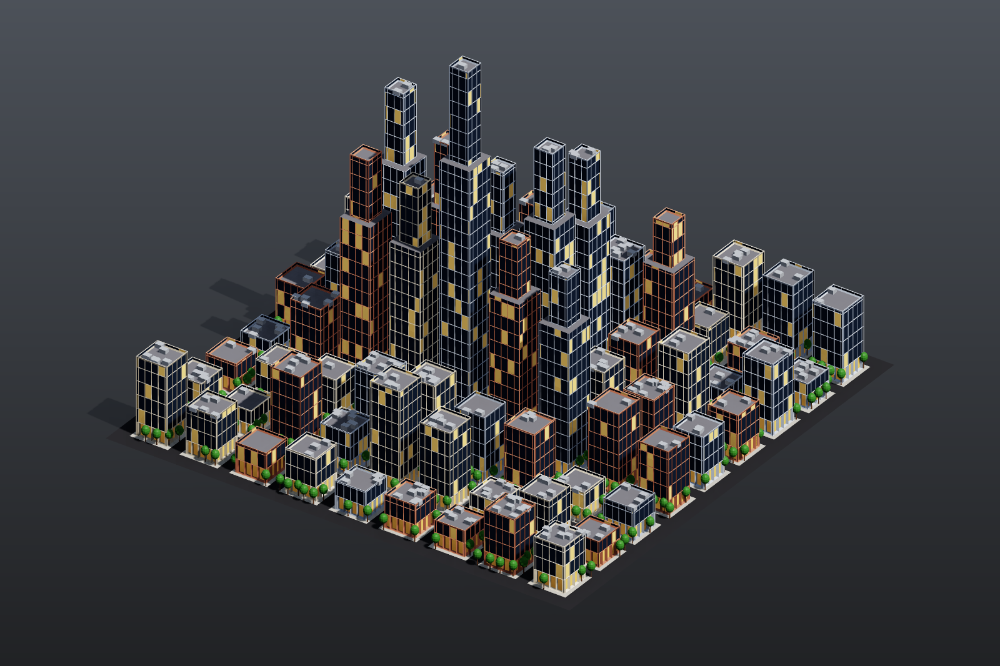

# City block

A whole city block built only from face operations and groups, without a single hand-placed point: 81 lots with streets and sidewalks, buildings extruded by a per-lot height, setback towers on the tall ones, window grids, shopfronts, parapets, rooftop units, street trees and per-building colours.

## Load it

Drag `example_workflows/pcg_sop_city_block.json` onto the ComfyUI canvas and press **Queue**. Only comfyui_pcg nodes plus ComfyUI's Preview Image are used.

## Step by step

**1. Lots (first column)**

1. **[Grid (PCG)](../reference/generate.md#pcg-grid)** (108 x 108 m, 10 x 10 points = 9 x 9 cells of 12 m) is the street grid.
2. **[PolyExtrude (PCG)](../reference/modify.md#pcg-polyextrude)** with distance 0 and inset 1.4 only insets each cell, which leaves room for the streets. **[Blast (PCG)](../reference/modify.md#pcg-blast)** keeps the inset faces (group `extrudeFront`): 81 lots.
3. A **[Wrangle (PCG)](../reference/attribute.md#pcg-wrangle)** running over primitives computes per lot `height` (taller towards the centre, randomised with `rand(@primnum + ...)`; in primitive context `@P` is the face centre), `crown` (0.35 x height) and the integer `lot` id.
4. Another **[PolyExtrude (PCG)](../reference/modify.md#pcg-polyextrude)** (inset 0.9, distance 0) splits each lot into a `footprint` and a ring of `sidewalk`.

**2. Buildings (second column)**

5. **[PolyExtrude (PCG)](../reference/modify.md#pcg-polyextrude)** extrudes the group `footprint` by the primitive attribute `height` (*Local Attributes* on, *Distance Scale* `height`), writing the groups `roof` and `walls`.
6. **[Group Create (PCG)](../reference/group.md#pcg-groupcreate)** with base `@height > 28` creates the group `tall`; **[Group Combine (PCG)](../reference/group.md#pcg-groupcombine)** intersects it with the roofs (`tall & roof` -> `setback`).
7. Those roofs are first inset (setback terrace), then extruded again by `crown` into towers. Two more Group Combine nodes collect all walls (`walls | walls2`) and all roofs (`(roof - setback) | roof2`).

**3. Facades (third column)**

8. **[Divide (PCG)](../reference/modify.md#pcg-divide)** with *Bricker Polygons* cuts the walls into 1.6 m x 3.2 m window cells; floor lines line up automatically.
9. **[Group Create (PCG)](../reference/group.md#pcg-groupcreate)** selects the ground floor by bounding box (y below 3.3) as `ground`; Group Combine gives `upper` = walls minus ground.
10. **[PolyExtrude (PCG)](../reference/modify.md#pcg-polyextrude)** recesses the ground-floor cells into shopfronts (inset 0.25, distance -0.5). A second one insets every upper cell and pushes it in (inset 0.45, distance -0.25) to make window frames and glass. *Limit Insetting* is on for both: the top row of cells can be only a few centimetres tall, and without the limit the inset would push points outside the cell (frames poking through the roof).
11. A third PolyExtrude insets and sinks the roofs (inset 0.35, distance -0.8) to create parapets.

**4. Colour and details (fourth and fifth columns)**

12. Wrangles over primitives pick one of three palettes per building by `lot`, light about 12% of the windows (`rand(...) > 0.88` on the group `glass`), and colour shops, roofs, terraces and sidewalks; **[Color (PCG)](../reference/attribute.md#pcg-color)** nodes add the warm shop light and the sidewalk colour.
13. Rooftop units: a **[Box (PCG)](../reference/generate.md#pcg-box)** whose base is moved to y = 0 by **[Match Size (PCG)](../reference/modify.md#pcg-matchsize)**, copied by **[Copy to Points (PCG)](../reference/scatter.md#pcg-copytopoints)** onto 90 points from **[Scatter (PCG)](../reference/scatter.md#pcg-scatter)** on the group `roofin`, then coloured metal grey.
14. Street trees: a trunk (**[Tube (PCG)](../reference/generate.md#pcg-tube)**) and crown (**[Sphere (PCG)](../reference/generate.md#pcg-sphere)** moved up with **[Transform (PCG)](../reference/modify.md#pcg-transform)**) are merged into one tree, then copied onto 150 points scattered on `sidewalk` (with relaxation so they are spaced out) and scaled by a random `pscale` from **[Attribute Randomize (PCG)](../reference/attribute.md#pcg-attribrandomize)**.
15. A road plane, then **[Merge (PCG)](../reference/modify.md#pcg-merge)** of everything, **[Viewport (PCG)](../reference/output.md#pcg-viewport)**, **[Geometry Preview (PCG)](../reference/output.md#pcg-previewimage)** (1600 x 1066, *Studio* look) and **[Export Mesh (PCG)](../reference/output.md#pcg-exportmesh)** (`pcg/city_block`).

All colours are written on primitives (the Color nodes also use the class `prim`). That way every part being merged has `Cd` on the same class, instead of half point colour and half primitive colour.

## Worth tweaking

| Node | Parameter | Effect |
|---|---|---|
| Grid | `size_x`, `size_z`, `cols`, `rows` | Number and size of lots. |
| Lot Wrangle | `code` | The height formula: how tall, how much taller in the centre. |
| Group Create (`tall`) | `base` | Which buildings get setback towers (`@height > 28`). |
| Divide | `brick_size_x`, `brick_size_y` | Window cell width and storey height. |
| Window PolyExtrude | `inset`, `distance` | Frame width and window depth. |
| Glass Wrangle | `code` | The share of lit windows (`> 0.8`). |
| Scatter (roofs / sidewalks) | `count`, `rand_seed` | Number of rooftop units and trees. |

## See also

- [Groups](../concepts/groups.md): group names, `@attribute` patterns and group combine expressions.
- [Tutorial 3: attributes and wrangle](tutorial_03_attributes_wrangle.md): extruding by a primitive attribute.
- [Modular city](pcg_prod_modular_city.md): buildings assembled from a kit instead of modelled in place.
- [Example index](README.md).
