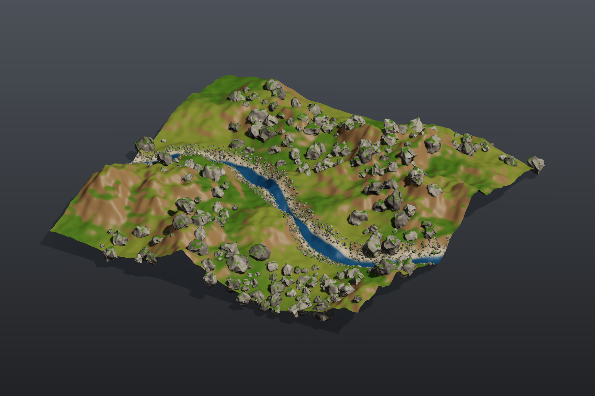

# Rock garden

Pure procedural modelling with geometry (SOP) nodes and no model files: a library of eight different rocks built by a For-Each loop, a terrain with a small stream, weighted scattering of boulders and pebbles, per-variant copying, moss, and output as a preview image, a 3D viewport and a glb file.

## Load it

Drag `example_workflows/pcg_sop_rock_garden.json` onto the ComfyUI canvas and press **Queue**. Only comfyui_pcg nodes plus ComfyUI's Preview Image are used.

## Step by step

**1. Rock library (first column)**

1. **[Sphere (PCG)](../reference/generate.md#pcg-sphere)** (radius 1, 12 x 8) is the start shape.
2. **[For-Each Begin (PCG)](../reference/loop.md#pcg-foreachbegin)** (By Count, 8 iterations, Fetch Input) runs the body eight times on the same sphere.
3. **[Point Jitter (PCG)](../reference/modify.md#pcg-pointjitter)** (scale 0.55) and later **[Attribute Noise (PCG)](../reference/attribute.md#pcg-attribnoise)** have their `rand_seed` wired to `iteration`, so the same chain produces eight differently shaped rocks. In between, **[Transform (PCG)](../reference/modify.md#pcg-transform)** squashes the rock (sy 0.7), **[Subdivide (PCG)](../reference/modify.md#pcg-subdivide)** (depth 2) smooths it and **[Normal (PCG)](../reference/attribute.md#pcg-normal)** gives it normals; the Attribute Noise then cuts pits along the normal (Worley F2-F1, amplitude 0.12).
4. **[Match Size (PCG)](../reference/modify.md#pcg-matchsize)** puts each rock's base on y = 0 and buries it 0.15 deeper. **[For-Each End (PCG)](../reference/loop.md#pcg-foreachend)** merges the eight rocks.
5. **[Connectivity (PCG)](../reference/topology.md#pcg-connectivity)** numbers the rocks into the primitive attribute `class` (0 to 7); a **[Normal (PCG)](../reference/attribute.md#pcg-normal)** finishes the rock library. **[PolyReduce (PCG)](../reference/modify.md#pcg-polyreduce)** (keep 20%) makes a low-poly copy of the library for pebbles (an LOD).

**2. Terrain (second column)**

6. **[Grid (PCG)](../reference/generate.md#pcg-grid)** (40 x 40, 240 x 240 points) with **[Attribute Noise (PCG)](../reference/attribute.md#pcg-attribnoise)** (terrain fractal, Y only, amplitude 2.5) is the ground.
7. A **[Wrangle (PCG)](../reference/attribute.md#pcg-wrangle)** digs a small stream: it computes `@dstream`, the distance to a sine curve, and lowers the points near it. **[Normal (PCG)](../reference/attribute.md#pcg-normal)** recomputes normals.
8. A second Wrangle colours by slope (grass on flat ground, soil on slopes, a gravel bank by the stream, water in it) and computes two weights: `boulder` (flat ground, inside noise patches, away from the stream) and `bank` (the stream banks).
9. **[Attribute Promote (PCG)](../reference/attribute.md#pcg-attribpromote)** copies both weights to the faces, because the scatter groups are face groups. In the Group field you can then write `@boulder > 0.5` directly.

**3. Scatter and copy (third column)**

10. **[Scatter and Align (PCG)](../reference/scatter.md#pcg-scatteralign)** (group `@boulder > 0.5`, 230 points) scatters boulders with random scale (0.3 to 1.3), random rotation, a tilt of up to 18 degrees and *Avoid Overlap* (pushed apart with Point Relax).
11. A **[Wrangle (PCG)](../reference/attribute.md#pcg-wrangle)** picks a random rock per point: `i@class = floor(rand(@ptnum + 0.5) * 8)`.
12. **[Copy to Points (PCG)](../reference/scatter.md#pcg-copytopoints)** with *Piece Attribute* `class` places, on each point, the rock whose `class` matches: one node places all eight variants.
13. Pebbles follow the same pattern: Scatter and Align on `@bank > 0.3` (2,600 points, small scale, tilt up to 40, no overlap avoidance), a random class per point, and Copy to Points from the low-poly library.
14. **[Merge (PCG)](../reference/modify.md#pcg-merge)** combines all rocks; a Wrangle gives each rock a grey tint per class and grows moss on faces that point up, inside a noise pattern.

**4. Output (right column)**

15. **[Merge (PCG)](../reference/modify.md#pcg-merge)** joins terrain and rocks; **[Viewport (PCG)](../reference/output.md#pcg-viewport)** shows the 3D view, **[Geometry Preview (PCG)](../reference/output.md#pcg-previewimage)** (1600 x 1066, *Studio* look) renders a picture, and **[Export Mesh (PCG)](../reference/output.md#pcg-exportmesh)** writes `pcg/rock_garden` (glb).

## Worth tweaking

| Node | Parameter | Effect |
|---|---|---|
| For-Each Begin | `iterations` | Size of the rock library. Also change the `* 8` in both Wrangles that pick a random rock. |
| Scatter and Align (big rocks) | `count`, `scale_min`, `scale_max`, `tilt`, `rand_seed` | Number, size and pose of the boulders. |
| Wrangle (colour + scatter weights) | `code` | Where boulders and pebbles may appear (the `boulder` and `bank` expressions). |
| Wrangle (stream) | `code` | Shape and depth of the stream. |
| Wrangle (rock colour + moss) | `code` | Rock tint and moss amount. |

## See also

- [Tutorial 2: scatter and copy](tutorial_02_scatter_copy.md) and [Tutorial 4: for-each variations](tutorial_04_foreach_variations.md): the two building blocks of this graph.
- [Groups](../concepts/groups.md): `@attribute` group patterns.
- [Loops and time](../concepts/loops-and-time.md): For-Each loops.
- [Example index](README.md).
