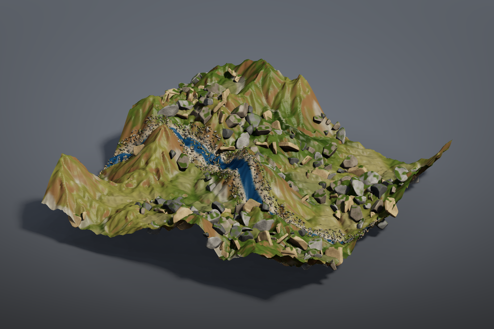

# Rock garden

Pure procedural modelling and no model files: a library of eight different rocks built by a For-Each loop from a signed distance field, an eroded terrain with a small stream whose erosion masks colour it and place the rocks, weighted scattering of boulders and pebbles, per-variant copying, moss, and output as a preview image, a 3D viewport and a glb file.

## Load it

Drag `example_workflows/pcg_sop_rock_garden.json` onto the ComfyUI canvas and press **Queue**. Only comfyui_pcg nodes plus ComfyUI's Preview Image are used.

## Step by step

**1. Rock library (first column)**

1. **[Volume (PCG)](../reference/generate.md#pcg-volume)** (2.8 x 2.5 x 2.6 m, 40 x 36 x 37 voxels, about 7 cm) is the space each rock is drawn in.
2. **[For-Each Begin (PCG)](../reference/loop.md#pcg-foreachbegin)** (By Count, 8 iterations, Fetch Input) runs the body eight times on the same volume.
3. A **[Volume Wrangle (PCG)](../reference/modify.md#pcg-volumewrangle)** writes the rock's signed distance field -- the same one as the [rock asset pipeline](pcg_prod_rock_assets.md): random half-spaces meet in crisp arrises, a split face, chipped edges, a flat bottom. Its `rand_seed` is wired to `iteration`, so every pass makes a different rock, and `seed % 4` picks the kind: a chunky boulder, a bedded slab with stepped ledges, a tall split shard, a weathered block with rounded edges.
4. **[Convert (PCG)](../reference/modify.md#pcg-convert)** turns the field into polygons and **[Normal (PCG)](../reference/attribute.md#pcg-normal)** gives them normals; **[Match Size (PCG)](../reference/modify.md#pcg-matchsize)** puts each rock's base on y = 0 and buries it 0.15 deeper. **[For-Each End (PCG)](../reference/loop.md#pcg-foreachend)** merges the eight rocks.
5. **[Connectivity (PCG)](../reference/topology.md#pcg-connectivity)** numbers the rocks into the primitive attribute `class` (0 to 7); a **[Normal (PCG)](../reference/attribute.md#pcg-normal)** finishes the rock library. **[PolyReduce (PCG)](../reference/modify.md#pcg-polyreduce)** (keep 10%) makes a low-poly copy of the library for pebbles (an LOD).

**2. Terrain (second column)**

6. The ground is a height field: **[COP Noise (PCG)](../reference/cop-generate.md#pcg-copnoise)** (256 x 256 over 40 m, 16 cm cells, a hybrid terrain fractal of about 8 m relief).
7. A **[COP Wrangle (PCG)](../reference/cop-utility.md#pcg-copwrangle)** digs a small stream: it computes `@dstream`, the distance to a sine curve (in metres, in the mesh's x / z), and lowers the ground near it.
8. **[COP HeightField Erode (PCG)](../reference/cop-terrain.md#pcg-copheightfielderode)** (200 steps) washes it: rills down the slopes, scree (`debris`) where slopes slumped, silt (`sediment`) where the water slowed, and `flow` where it ran. **[COP Erosion Filter (PCG)](../reference/cop-terrain.md#pcg-coperosion)** adds rills finer than the solver carves at this cell size, and **[COP Height to Normal (PCG)](../reference/cop-terrain.md#pcg-copheighttonormal)** gives the slope.
9. A second COP Wrangle colours from the masks -- grass lush where water runs and dry on the spurs, darker along the rills, bare soil on steep ground, grey scree on the debris, pale silt on the deposits, a gravel bank by the stream, water in it -- and computes two weights: `boulder` (the scree, and gentle ground in noise patches, away from the stream) and `bank` (the stream banks and the silt near them).
10. **[COP Height Field to Mesh (PCG)](../reference/cop-geometry.md#pcg-copheightfieldtomesh)** makes the mesh, carrying `Cd`, the two weights and `dstream` over as point attributes; **[Attribute Promote (PCG)](../reference/attribute.md#pcg-attribpromote)** copies the weights to the faces, because the scatter groups are face groups. In the Group field you can then write `@boulder > 0.5` directly.

**3. Scatter and copy (third column)**

11. **[Scatter and Align (PCG)](../reference/scatter.md#pcg-scatteralign)** (group `@boulder > 0.5`, 230 points) scatters boulders with random scale (0.3 to 1.3), random rotation, a tilt of up to 18 degrees and *Avoid Overlap* (pushed apart with Point Relax).
12. A **[Wrangle (PCG)](../reference/attribute.md#pcg-wrangle)** picks a random rock per point: `i@class = floor(rand(@ptnum + 0.5) * 8)`.
13. **[Copy to Points (PCG)](../reference/scatter.md#pcg-copytopoints)** with *Piece Attribute* `class` places, on each point, the rock whose `class` matches: one node places all eight variants.
14. Pebbles follow the same pattern: Scatter and Align on `@bank > 0.3` (2,600 points, small scale, tilt up to 40, no overlap avoidance), a random class per point, and Copy to Points from the low-poly library.
15. **[Merge (PCG)](../reference/modify.md#pcg-merge)** combines all rocks; a Wrangle gives each rock the stone of its kind (class % 4) and grows moss on faces that point up, inside a noise pattern.

**4. Output (right column)**

16. **[Merge (PCG)](../reference/modify.md#pcg-merge)** joins terrain and rocks; **[Viewport (PCG)](../reference/output.md#pcg-viewport)** shows the 3D view, **[Geometry Preview (PCG)](../reference/output.md#pcg-previewimage)** (1600 x 1066, *Studio* look) renders a picture, and **[Export Mesh (PCG)](../reference/output.md#pcg-exportmesh)** writes `pcg/rock_garden` (glb).

## Worth tweaking

| Node | Parameter | Effect |
|---|---|---|
| For-Each Begin | `iterations` | Size of the rock library. Also change the `* 8` in both Wrangles that pick a random rock. |
| Scatter and Align (big rocks) | `count`, `scale_min`, `scale_max`, `tilt`, `rand_seed` | Number, size and pose of the boulders. |
| Volume Wrangle (rock SDF) | `code` | The rocks' shapes: the four kinds, how many faces, how soft their edges. |
| COP HeightField Erode | `iterations`, `capacity`, `talus_angle` | How deeply the ground is washed; how much scree. |
| COP Wrangle (colour + scatter weights) | `code` | The ground colours, and where boulders and pebbles may appear (the `boulder` and `bank` expressions). |
| COP Wrangle (stream) | `code` | Shape and depth of the stream. |
| Wrangle (rock colour + moss) | `code` | Rock tint and moss amount. |

## See also

- [Tutorial 2: scatter and copy](tutorial_02_scatter_copy.md) and [Tutorial 4: for-each variations](tutorial_04_foreach_variations.md): the two building blocks of this graph.
- [Groups](../concepts/groups.md): `@attribute` group patterns.
- [Loops and time](../concepts/loops-and-time.md): For-Each loops.
- [Example index](README.md).
