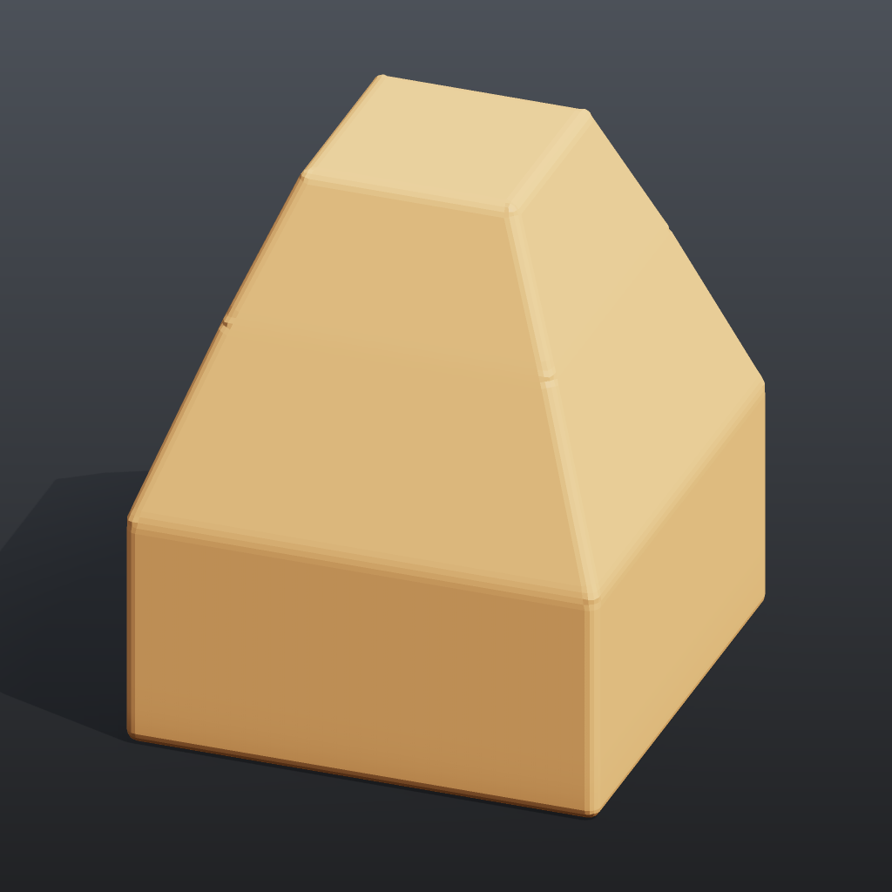

# Tutorial 1: first geometry

Builds a small tapered tower from a single box: transform it, select its top face with a group, extrude that face twice, bevel all edges, colour it, and look at the result as a rendered image and in the 3D viewport. It is the smallest complete "make something, see it" loop in comfyui_pcg.

## Load it

Drag `example_workflows/tutorial_01_first_geometry.json` onto the ComfyUI canvas and press **Queue**. No model files or other custom nodes are needed.

## Step by step

1. **[Box (PCG)](../reference/generate.md#pcg-box)** creates a 2 x 1 x 2 box centred at the origin (6 quads).
2. **[Transform (PCG)](../reference/modify.md#pcg-transform)** ("Turn 15 degrees") rotates it 15 degrees around Y.
3. **[Group Create (PCG)](../reference/group.md#pcg-groupcreate)** ("Group 'top'") puts every primitive whose normal is within 10 degrees of +Y into the primitive group `top` (*Keep by Normals*, direction 0 1 0, spread 10). On a box that is exactly one face.
4. **[PolyExtrude (PCG)](../reference/modify.md#pcg-polyextrude)** ("Extrude the top face", group `top`) insets that face by 0.3 and pushes it up 0.8. The new top face is written to the output group `extrudeFront` and the new walls to `extrudeSide`.
5. A second **[PolyExtrude (PCG)](../reference/modify.md#pcg-polyextrude)** ("Extrude it again", group `extrudeFront`) repeats the move with inset 0.25 and distance 0.6, which gives the second storey. The top of the tower ends at y = 0.5 + 0.8 + 0.6 = 1.9.
6. **[PolyBevel (PCG)](../reference/modify.md#pcg-polybevel)** ("Round all edges") bevels every edge by 0.05 with 2 divisions.
7. **[Color (PCG)](../reference/attribute.md#pcg-color)** ("Paint") writes a constant colour `Cd`.
8. **[Geometry Preview (PCG)](../reference/output.md#pcg-previewimage)** renders the geometry to a ComfyUI IMAGE (1024 x 1024, *Studio* look: shadows, AO, a shadow-catching ground), which ComfyUI's **Preview Image** displays. **[Viewport (PCG)](../reference/output.md#pcg-viewport)** shows the same mesh in an interactive 3D view on the node.

## Worth tweaking

| Node | Parameter | Effect |
|---|---|---|
| PolyExtrude (both) | `distance`, `inset` | Storey height and how much each storey steps in. A negative distance pushes the face into the box. |
| PolyExtrude | `divisions` | Extra edge loops on the new walls. |
| Group Create | `spread` | Raise it to also catch faces that are not exactly horizontal. |
| PolyBevel | `distance`, `divisions`, `shape` | Bevel size and roundness (round, chamfer, ...). |
| Geometry Preview (PCG) | `look`, `elevation`, `azimuth` | *Basic* is the plain preview (then `shading` applies: `normal` and `lambert` ignore the colour and show the shape); the angles move the camera and the key light with it. |

## See also

- [Geometry concepts](../concepts/geometry.md): points, primitives and groups such as `extrudeFront`.
- [Groups](../concepts/groups.md): the syntax accepted by every Group field.
- [Viewing and export](../concepts/viewing-and-export.md): Preview Image (PCG), the 3D viewport and exporting meshes.
- Next: [Tutorial 2: scatter and copy](tutorial_02_scatter_copy.md).
