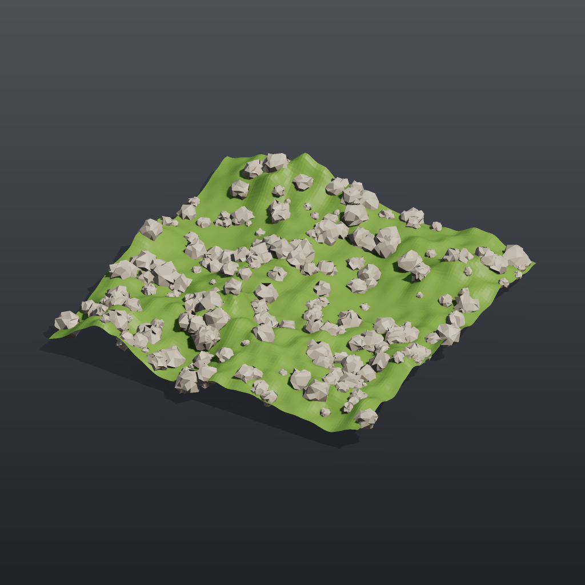

# Tutorial 2: scatter and copy

Scatters points over a noisy ground plane, gives every point a random size and rotation, and copies a small rock onto each point. This is the basic instancing pattern behind most set dressing: a surface, a point cloud with per-point attributes, and Copy to Points.

## Load it

Drag `example_workflows/tutorial_02_scatter_copy.json` onto the ComfyUI canvas and press **Queue**. No model files or other custom nodes are needed.

## Step by step

**Ground**

1. **[Grid (PCG)](../reference/generate.md#pcg-grid)** makes a 16 x 16 grid with 120 x 120 points.
2. **[Attribute Noise (PCG)](../reference/attribute.md#pcg-attribnoise)** ("Rolling ground") adds a terrain-fractal Perlin noise to `P`, on Y only (`use_x` and `use_z` are off), amplitude 1.2, element size 7.
3. **[Color (PCG)](../reference/attribute.md#pcg-color)** ("Ground colour") paints it green.

**Points**

4. **[Scatter (PCG)](../reference/scatter.md#pcg-scatter)** places 250 random points on the noisy ground (seed 7). The points carry the surface normal `N` and the other interpolated attributes.
5. **[Attribute Randomize (PCG)](../reference/attribute.md#pcg-attribrandomize)** ("Random size (pscale)") writes the point attribute `pscale` with a uniform value between 0.15 and 0.6.
6. A second **[Attribute Randomize (PCG)](../reference/attribute.md#pcg-attribrandomize)** ("Random rotation (orient)") switches *Mode* to `orient` and writes `orient`, a uniformly random rotation quaternion per point.

**The rock and the copy**

7. **[Sphere (PCG)](../reference/generate.md#pcg-sphere)** ("Rock base shape") is a coarse sphere (10 columns, 7 rows); **[Point Jitter (PCG)](../reference/modify.md#pcg-pointjitter)** ("Roughen", scale 0.35) moves its points randomly so it stops looking like a sphere. **[Color (PCG)](../reference/attribute.md#pcg-color)** ("Rock colour") makes it grey.
8. **[Copy to Points (PCG)](../reference/scatter.md#pcg-copytopoints)** puts one copy of the rock on each of the 250 points. With *Transform Using Target Point Orientations* on (the default) each copy is scaled by `pscale` and rotated by `orient`, as in Houdini.
9. **[Merge (PCG)](../reference/modify.md#pcg-merge)** ("Ground + rocks") combines both, and **[Geometry Preview (PCG)](../reference/output.md#pcg-previewimage)** plus **[Viewport (PCG)](../reference/output.md#pcg-viewport)** show the result.

## Worth tweaking

| Node | Parameter | Effect |
|---|---|---|
| Scatter | `count`, `rand_seed` | Number of rocks and their layout. Turn on `use_relax` to push the points apart. |
| Random size (pscale) | `min_x`, `max_x`, `distribution` | Size range; the `power` distribution with an exponent above 1 gives many small rocks and a few large ones. |
| Random rotation (orient) | (whole node) | Bypass it and the copies are oriented by the scattered `N` and the default up vector instead, so every rock sits on the slope the same way. |
| Roughen | `scale`, `rand_seed` | How lumpy the rock is. |
| Rolling ground | `amplitude`, `element_size_*` | Height and width of the hills. |

Any geometry can replace the rock: wire a different chain into the `source` input of Copy to Points.

## See also

- [Geometry concepts](../concepts/geometry.md): point attributes such as `pscale`, `orient` and `N`.
- [Tutorial 4: for-each variations](tutorial_04_foreach_variations.md): make several different rocks and pick one per point.
- [Rock garden](pcg_sop_rock_garden.md): the same idea at full scale, with a rock library and weighted scattering.
- Next: [Tutorial 3: attributes and wrangle](tutorial_03_attributes_wrangle.md).
