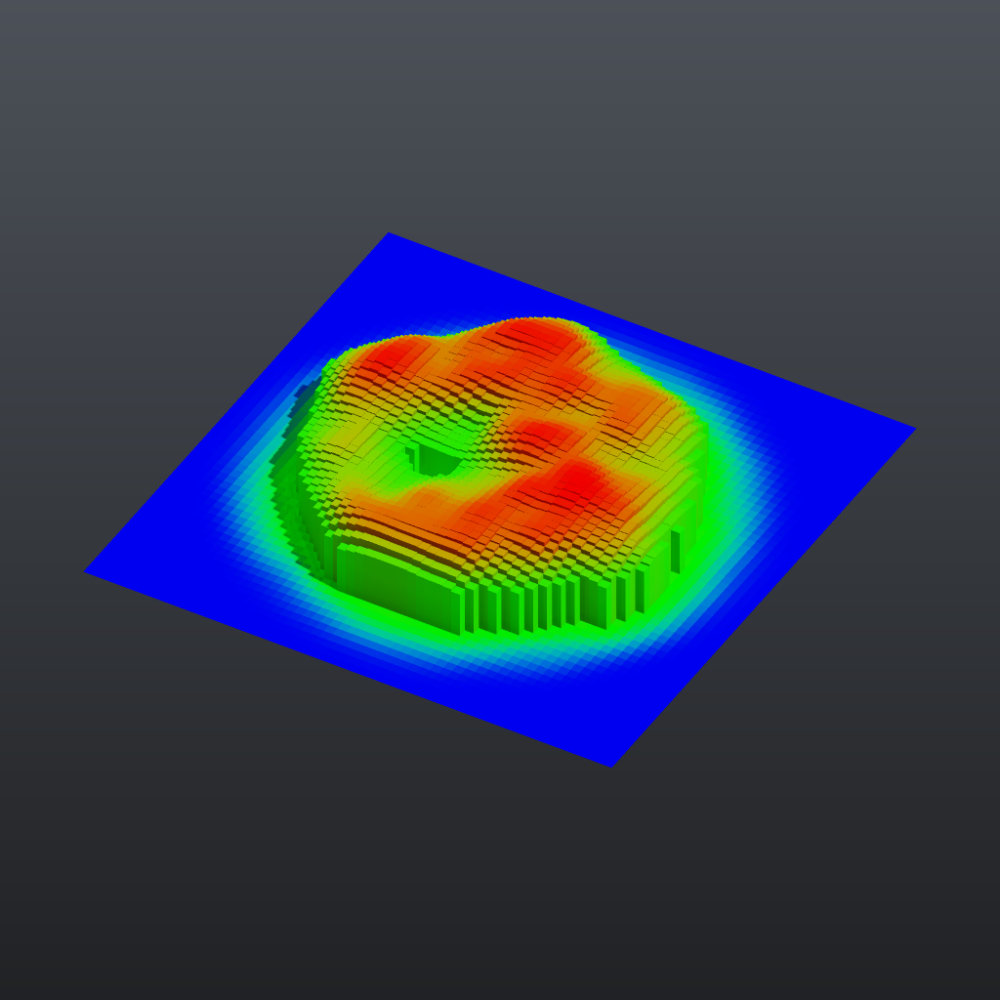

# Tutorial 3: attributes and wrangle

Attributes are named values stored per point, per primitive, per vertex or once per geometry (detail). This tutorial creates two point attributes, edits one with a Wrangle expression, moves it from points to faces, colours by it, and turns a comparison on it into a group that drives an extrusion.



## Load it

Drag `example_workflows/tutorial_03_attributes_wrangle.json` onto the ComfyUI canvas and press **Queue**. No model files or other custom nodes are needed.

## Step by step

1. **[Grid (PCG)](../reference/generate.md#pcg-grid)** makes a flat 12 x 12 grid with 61 x 61 points.
2. **[Attribute Create (PCG)](../reference/attribute.md#pcg-attribcreate)** ("dist = length(@P)") creates the float point attribute `dist`. *Use Expression* is on, so the value comes from the expression `length(@P)`: the distance of each point from the origin.
3. **[Attribute Noise (PCG)](../reference/attribute.md#pcg-attribnoise)** ("height = noise") writes noise into a new attribute instead of moving the points: *Attribute Names* is `height`, the type is `float` and the range is `zero_to_one`, so every point gets a value between 0 and 1.
4. **[Wrangle (PCG)](../reference/attribute.md#pcg-wrangle)** ("Fade towards the edge") runs one line of code over all points at once:

   ```python
   @height = @height * (1 - smoothstep(3.0, 6.0, @dist))
   ```

   `@name` reads or writes an attribute; the code is Python syntax evaluated on whole numpy arrays, so there is no per-point loop. Points further than 6 from the centre end up with height 0.
5. **[Attribute Promote (PCG)](../reference/attribute.md#pcg-attribpromote)** ("height: points to faces") averages `height` from the points of each face into a primitive attribute (and, with the default *Delete Original*, removes the point version). The next two nodes work on faces.
6. **[Group Create (PCG)](../reference/group.md#pcg-groupcreate)** ("Group 'tall'") uses the base pattern `@height > 0.35` to put the matching faces into the primitive group `tall`. Any Group field in the plugin accepts this kind of `@attribute` comparison.
7. **[PolyExtrude (PCG)](../reference/modify.md#pcg-polyextrude)** ("Raise 'tall' by its height") extrudes only the group `tall`, each face separately (`individual`). *Local Attributes* is on with *Distance Scale* `height`, so each face moves by distance 3 times its own height.
8. **[Color (PCG)](../reference/attribute.md#pcg-color)** ("Colour by height") uses the mode *Ramp from Attribute* on the primitive attribute `height`. The range is computed automatically and mapped through the default blue-green-red ramp.
9. **[Geometry Preview (PCG)](../reference/output.md#pcg-previewimage)** (*Studio* look) and **[Viewport (PCG)](../reference/output.md#pcg-viewport)** show the result.

## Worth tweaking

| Node | Parameter | Effect |
|---|---|---|
| Group 'tall' | `base` | Try `@height > 0.6`, or `@height > 0.35 & @height < 0.5`, to change which faces rise. |
| height = noise | `element_size_*`, `rand_seed`, `noise_type` | Size and layout of the noise blobs. |
| Fade towards the edge | `code` | Change the fade radii, or add a second line such as `@height = @height ** 2` for sharper peaks. |
| Raise 'tall' by its height | `distance` | Multiplier for the attribute; `inset` adds a gap between neighbouring columns. |
| Colour by height | `ramp`, `auto_range` | Your own colour ramp, or a fixed input range. |

To see the attribute values at any step, wire that node into a [Geometry Spreadsheet (PCG)](../reference/output.md#pcg-geospreadsheet) node: it shows the point, primitive, vertex and detail attributes in tables on the node.

## See also

- [Geometry concepts](../concepts/geometry.md): attribute classes and types.
- [Expressions](../concepts/expressions.md): the Wrangle language and its functions.
- [Groups](../concepts/groups.md): `@attribute` comparisons and other group patterns.
- Next: [Tutorial 4: for-each variations](tutorial_04_foreach_variations.md).
