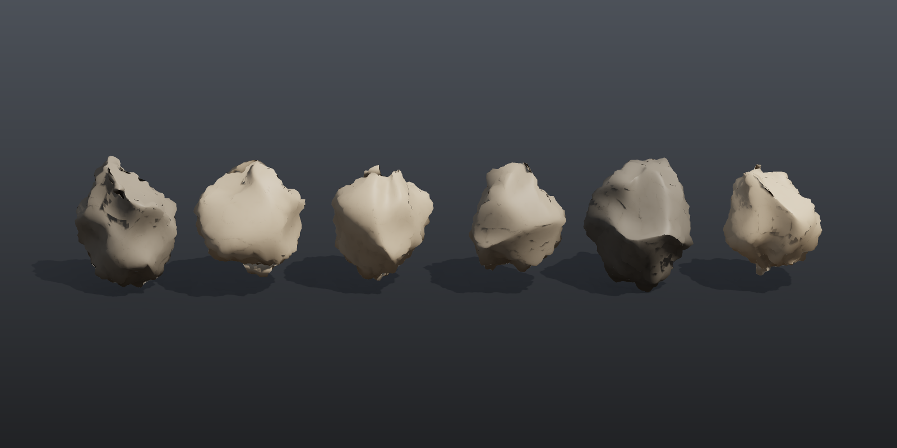

# Tutorial 4: for-each variations

Runs the same small modelling chain six times with a different random seed each pass and gathers the results: six different stones from one graph. The loop's iteration number is wired into the Seed inputs, which is how the larger example workflows build their rock libraries.



## Load it

Drag `example_workflows/tutorial_04_foreach_variations.json` onto the ComfyUI canvas and press **Queue**. No model files or other custom nodes are needed.

## Step by step

1. **[Sphere (PCG)](../reference/generate.md#pcg-sphere)** makes a coarse sphere (10 columns, 7 rows). It is the input of the loop.
2. **[For-Each Begin (PCG)](../reference/loop.md#pcg-foreachbegin)** ("Each stone (count x 6)") is set to *Iteration Method* `By Count` with 6 iterations and *Method* `Fetch Input`, so every pass receives the whole, uncut sphere on its `geo` output. Its `iteration` output counts 0, 1, ... 5.
3. The loop body:
   - **[Point Jitter (PCG)](../reference/modify.md#pcg-pointjitter)** (scale 0.5) moves the points randomly. Its `rand_seed` input is connected to `iteration`, so the jitter differs per pass.
   - **[Subdivide (PCG)](../reference/modify.md#pcg-subdivide)** (depth 3) smooths the jittered sphere; **[Normal (PCG)](../reference/attribute.md#pcg-normal)** (cusp angle 180) gives it smooth point normals.
   - **[Attribute Noise (PCG)](../reference/attribute.md#pcg-attribnoise)** ("Pits along the normal") displaces the points along `N` with a two-octave Worley F2-F1 noise (amplitude 0.12). Its `rand_seed` is also wired to `iteration`.
   - **[Wrangle (PCG)](../reference/attribute.md#pcg-wrangle)** ("Place and colour") receives `iteration` on its Seed input too. Inside the code that value is the variable `seed`:

     ```python
     @P.x += (seed - 2.5) * 2.3
     @Cd = lerp(set(0.42, 0.40, 0.37), set(0.66, 0.60, 0.52), rand(seed + 0.5))
     ```

     Each stone is moved to its own slot along X and gets a colour between two greys.
4. **[For-Each End (PCG)](../reference/loop.md#pcg-foreachend)** (*Gather* `merge`) is linked to the Begin node by the `loop` wire and merges the six results.
5. **[Geometry Preview (PCG)](../reference/output.md#pcg-previewimage)** (1600 x 800, *Studio* look) and **[Viewport (PCG)](../reference/output.md#pcg-viewport)** show the row of stones.

Nodes between Begin and End (everything that depends on the Begin outputs) form the loop body. Nodes outside it, such as the Sphere, run once.

## Worth tweaking

| Node | Parameter | Effect |
|---|---|---|
| For-Each Begin | `iterations` | Number of stones. With more than 6, change the `2.5` in the Wrangle to `(iterations - 1) / 2` to keep the row centred. |
| For-Each Begin | `use_single_pass`, `single_pass` | Run only one iteration, to inspect the body on a single stone. |
| Point Jitter | `scale` | How irregular the base shape is. |
| Pits along the normal | `amplitude`, `element_size_*`, `noise_type` | Size and depth of the surface pits. |
| Place and colour | `code` | Anything that should vary per stone: scale (`@P *= 0.7 + 0.6 * rand(seed + 3)`), colour, placement. |

To scatter the variations, give every stone an integer piece attribute (for example `i@class = seed` in the Wrangle) and use Copy to Points with *Piece Attribute* `class`, as the [rock garden](pcg_sop_rock_garden.md) does.

## See also

- [Loops and time](../concepts/loops-and-time.md): For-Each methods, gather modes and the iteration outputs.
- [Expressions](../concepts/expressions.md): `seed`, `rand()` and the other Wrangle functions.
- [Rock assets pipeline](pcg_prod_rock_assets.md): the same loop pattern producing game-ready assets.
- Next: [Tutorial 5: COP texture](tutorial_05_cop_texture.md).
