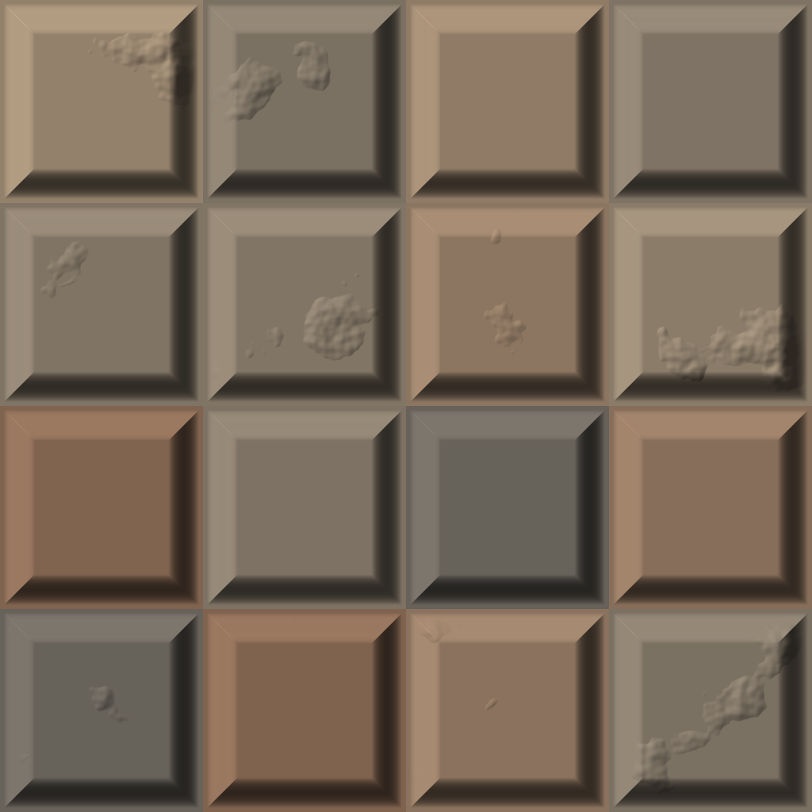
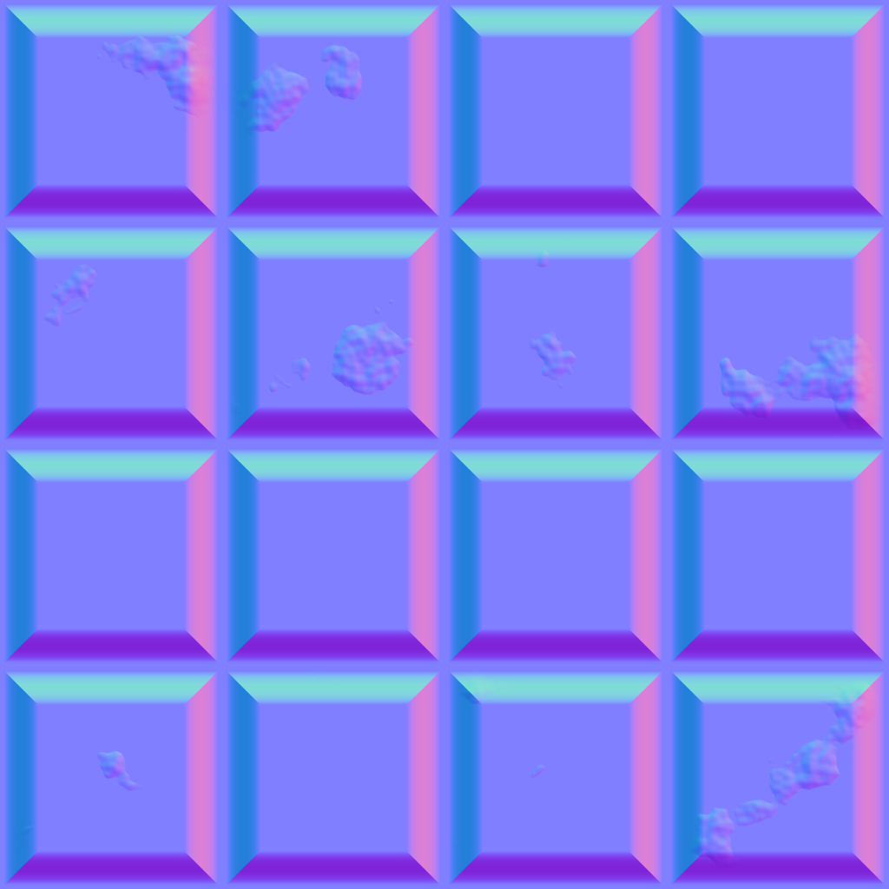
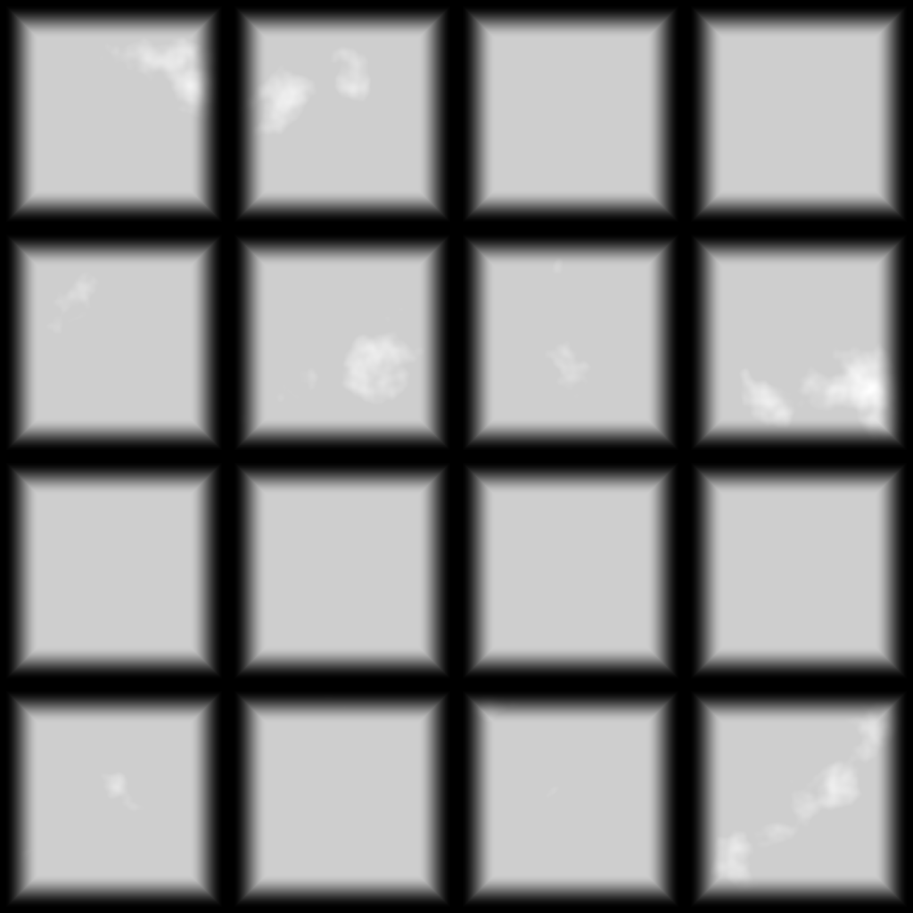

# Tutorial 5: COP texture

Builds a small stone-tile texture with COP (image) nodes: a noise and a tile pattern are combined into a height layer, the tiles get a colour each, a normal map is derived from the height, and the result is lit, previewed and saved. COP nodes pass a COPIMAGE, a stack of named layers, between them; most nodes read one layer and write another.

| Lit result | Normal map (`signed` export) | Height (`normalize` export) |
|---|---|---|
|  |  |  |

## Load it

Drag `example_workflows/tutorial_05_cop_texture.json` onto the ComfyUI canvas and press **Queue**. No model files or other custom nodes are needed. The two Save Image nodes write `pcg/tutorial_tiles_normal_*.png` and `pcg/tutorial_tiles_height_*.png` into ComfyUI's output folder.

## Step by step

1. **[COP Noise (PCG)](../reference/cop-generate.md#pcg-copnoise)** ("Noise (layer C)") creates a 1024 x 1024 image with a 5-octave Perlin noise in the default layer `C`.
2. **[COP Levels (PCG)](../reference/cop-color.md#pcg-coplevels)** ("More contrast") remaps `C` from the input range 0.25..0.75 to 0..1 (clamped), which turns the soft noise into distinct patches.
3. **[COP Pattern (PCG)](../reference/cop-generate.md#pcg-coppattern)** ("Tiles 4 x 4") is a separate 1024 x 1024 image with *Pattern Type* `Tile Pattern`, 4 x 4 tiles, no row offset, gap 0.04 and bevel 0.15. With *Output Layer* `tile` it writes `tile` (mask, 0 in the gaps), `tile_height` (the bevelled tile shape), `tile_rand` (one random value per tile) and a few more helper layers.
4. **[COP Composite (PCG)](../reference/cop-composite.md#pcg-copcomposite)** ("height = tile_height x noise") takes the pattern as background and the noise as foreground: *Layer* `tile_height` is multiplied by the foreground layer `C` at opacity 0.35 and written to the new layer `height`. The other pattern layers are kept.
5. **[COP Remap (PCG)](../reference/cop-color.md#pcg-copremap)** ("Colour per tile") runs `tile_rand` through the ramp `0:0.42,0.40,0.37  0.5:0.62,0.55,0.46  1:0.50,0.36,0.28`. Because the stops are `r,g,b`, the one-channel layer becomes a three-channel colour: one colour per tile.
6. **[COP Height to Normal (PCG)](../reference/cop-terrain.md#pcg-copheighttonormal)** derives a normal map `N` from `height` (strength 0.04).
7. **[COP Light (PCG)](../reference/cop-utility.md#pcg-coplight)** shades the tile colours (*Albedo Layer* `tile_rand`) with `N`, from azimuth 135 and elevation 40, into the layer `lit`.
8. Three **[COP Export (PCG)](../reference/cop-utility.md#pcg-copexport)** nodes turn layers into ComfyUI IMAGEs: `lit` (mode `clamp`) for the **Preview Image**, `N` with mode `signed` (maps -1..1 to 0..1, the usual normal-map encoding) and `height` with mode `normalize` (stretches the layer to 0..1) for the two **Save Image** nodes.

## Worth tweaking

| Node | Parameter | Effect |
|---|---|---|
| Tiles 4 x 4 | `counts`, `gap`, `bevel`, `offset` | Tile layout. `offset` 0.5 with counts like `4 8` gives running-bond bricks. |
| Tiles 4 x 4 | `kind` | `cell` gives Voronoi stones instead of tiles; the layer `tile_rand` then holds one value per cell, so the colouring still works. Cell Pattern has no `_height` layer: point the Composite at `tile` (the mask) instead. |
| More contrast | `in_black`, `in_white`, `gamma` | How patchy the noise is. |
| height = ... | `mode`, `opacity` | How strongly the noise marks the tiles. |
| Colour per tile | `ramp` | The tile palette. |
| Height to Normal | `strength` | Bump depth. Raise it and the light shows more relief. |
| COP Light | `azimuth`, `elevation`, `shadows`, `height_layer` | Light direction; with `shadows` on and `height_layer` set to `height`, the tiles cast shadows. |

Every COP node shows a thumbnail of its output, so you can follow the layers as they are built.

## See also

- [Images (COP)](../concepts/images.md): COPIMAGE vs IMAGE, layers and channel counts.
- [Brick wall PBR](pcg_cop_brick_material.md) and [material library](pcg_prod_material_library.md): full, seamless material sets built the same way.
- Next: [Tutorial 6: controller panel](tutorial_06_controller.md).
