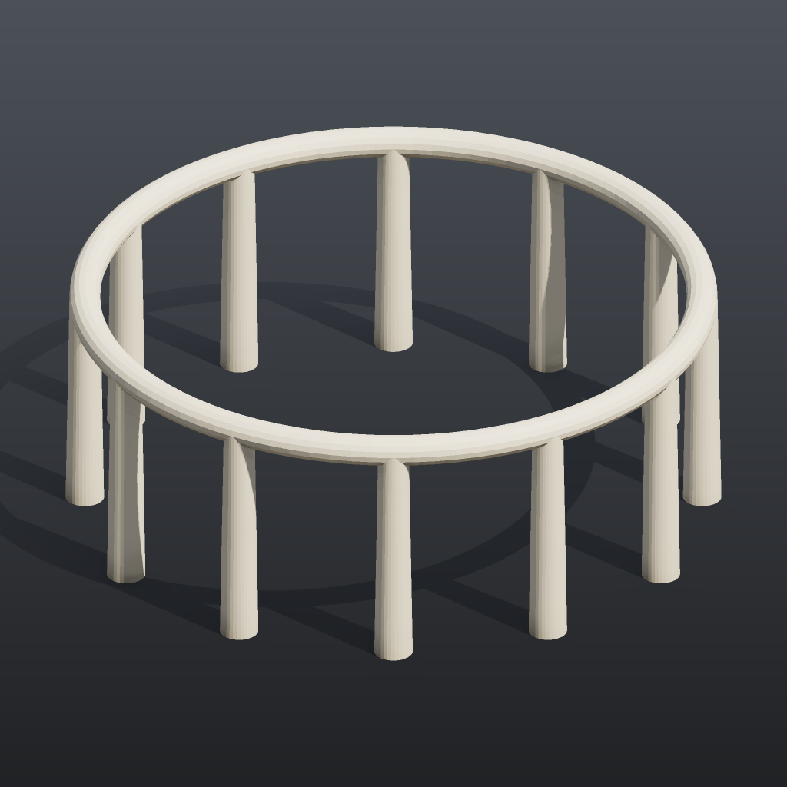

# Tutorial 6: controller panel

One **Parameters (PCG)** node acts as the control panel for a small model: three values on it drive six widgets on four other nodes. This is the comfyui_pcg version of putting spare parameters on a Houdini null and pasting relative references to them.



## Load it

Drag `example_workflows/tutorial_06_controller.json` onto the ComfyUI canvas and press **Queue**. No model files or other custom nodes are needed.

## Step by step

**The panel**

**[Parameters (PCG)](../reference/param.md#pcg-parameters)** ("Controls") declares its parameters as text, one per line:

```
float ring_radius = 4 : 1 12  # Ring radius
int pillars = 12 : 3 48  # Pillar count
float pillar_height = 3 : 0.5 10  # Pillar height
```

Each line is `<type> <name> = <default> : <min> <max> # <label>`. The front end grows one control per parameter on the node. The panel has no wires: nothing is connected to its outputs.

**The bindings**

| Node | Widget | Bound to |
|---|---|---|
| Circle ("Pillar positions") | `radius_x`, `radius_y` | `ring_radius` |
| Circle | `divisions` | `pillars` |
| Tube ("Pillar") | `height` | `pillar_height` |
| Torus ("Top ring") | `radius` | `ring_radius` |
| Transform ("Lift to the pillar tops") | `ty` | `pillar_height` |

A bound widget shows its reference in its label, for example `radius_x ←ch("../Controls/ring_radius")`. Change a value on the panel and every widget bound to it follows. Bindings are made from the target node's right-click menu (the PCG bind-parameter entry), or by copying a parameter reference on one node and pasting it on another.

**The model**

1. **[Circle (PCG)](../reference/generate.md#pcg-circle)** (orientation ZX) gives `pillars` points on a circle of radius `ring_radius`.
2. **[Tube (PCG)](../reference/generate.md#pcg-tube)** ("Pillar") is a slightly tapered cylinder of height `pillar_height`; **[Match Size (PCG)](../reference/modify.md#pcg-matchsize)** ("Base at y = 0", *Justify Y* `min`) moves its base onto the ground.
3. **[Copy to Points (PCG)](../reference/scatter.md#pcg-copytopoints)** ("Pillars on the circle") puts one pillar on every circle point. *Transform Using Target Point Orientations* is off, so the pillars are only translated and stay upright.
4. **[Torus (PCG)](../reference/generate.md#pcg-torus)** ("Top ring", radius `ring_radius`) is lifted by **[Transform (PCG)](../reference/modify.md#pcg-transform)** to y = `pillar_height`.
5. **[Merge (PCG)](../reference/modify.md#pcg-merge)**, **[Color (PCG)](../reference/attribute.md#pcg-color)**, **[Geometry Preview (PCG)](../reference/output.md#pcg-previewimage)** and **[Viewport (PCG)](../reference/output.md#pcg-viewport)** combine and display the result.

## How bindings run

Bindings are evaluated in the browser: when a panel value changes, the new value is written straight into each bound widget. The bindings themselves are stored in the workflow (in each node's properties), but the prompt sent to the server only contains plain widget values. Two consequences:

- Only nodes whose widget value actually changed are recomputed; the rest of the graph stays cached.
- When the workflow is run through the API or headless, nothing is re-evaluated: the values last written into the widgets are used. The saved tutorial has every bound widget already set to the panel's value.

## Worth tweaking

| Where | What | Effect |
|---|---|---|
| Controls | `ring_radius`, `pillars`, `pillar_height` | The whole point of the panel: change them here, not on the individual nodes. |
| Controls | `declare` | Add a parameter (for example `float pillar_radius = 0.25 : 0.05 1`) and bind the Tube's `radius1` and `radius2` to it. |
| Pillar | `radius1`, `radius2`, `cols` | Pillar shape (not bound, so edit them directly). |

## See also

- [Parameters](../concepts/parameters.md): the panel, the Edit Parameter Interface dialog, copy/paste references and `ch()` expressions.
- [Expressions](../concepts/expressions.md): expressions in fields, which can reference panel values too.
- [Example index](README.md).
