# Attributes

Create, edit, transfer and randomize attributes.

45 nodes.

[Back to the reference index](README.md)

## Contents

- [Attribute Adjust (PCG)](#pcg-attribadjust) — Builds or edits one numeric attribute through a fixed pipeline of initialize, adjustment stack, remap and post-process.
- [Attribute Adjust Color (PCG)](#pcg-attribadjustcolor) — Generates or modifies a color attribute with constant, random, noise, attribute-driven or bounding-box patterns, then color-corrects and blends it.
- [Attribute Adjust Float (PCG)](#pcg-attribadjustfloat) — Sets, offsets or scales a float attribute using constant, random, noise or attribute-driven values.
- [Attribute Adjust Integer (PCG)](#pcg-attribadjustinteger) — Sets, offsets or scales an integer attribute using constant, random, noise or attribute-driven values.
- [Attribute Adjust Vector (PCG)](#pcg-attribadjustvector) — Adjusts a vector attribute by direction and length, with constant, random, noise or attribute-driven values.
- [Attribute Blur (PCG)](#pcg-attribblur) — Smooths point or primitive attributes by diffusing them along mesh connectivity.
- [Attribute Cast (PCG)](#pcg-attribcast) — Changes the storage type of attributes between 32/64-bit float, 32/64-bit integer and string.
- [Attribute Composite (PCG)](#pcg-attribcomposite) — Composites a foreground attribute over a background attribute with a blend mode and alpha.
- [Attribute Copy (PCG)](#pcg-attribcopy) — Copies attributes and groups from a source geometry to a destination, element by element.
- [Attribute Create (PCG)](#pcg-attribcreate) — Creates attributes and writes a constant or expression value, optionally only on a group.
- [Attribute Delete (PCG)](#pcg-attribdelete) — Deletes attributes by name pattern on each attribute class, or keeps only the matching ones.
- [Attribute Fade (PCG)](#pcg-attribfade) — Writes a spatial falloff attribute that is full inside a group and fades out with distance from it.
- [Attribute Fade · Time (PCG)](#pcg-attribfadetime) — Fades a point attribute in, holds it, and fades it out over time using per-point start frames.
- [Attribute Fill (PCG)](#pcg-attribfill) — Fills a point attribute from known points to the remaining points along mesh connectivity.
- [Attribute from Camera (PCG)](#pcg-attribfromcamera) — Projects an image onto geometry through a camera, with visibility testing, and writes an attribute plus visible and mask groups.
- [Attribute from Map (PCG)](#pcg-attribfrommap) — Samples an image layer at the UVs of each element and writes the result as an attribute.
- [Attribute from Pieces (PCG)](#pcg-attribfrompieces) — Assigns each element or piece a variant from a weighted library and writes it as an attribute.
- [Attribute from Volume (PCG)](#pcg-attribfromvolume) — Samples a dense volume at point positions or primitive centers and writes the value as an attribute.
- [Attribute Interpolate (PCG)](#pcg-attribinterpolate) — Interpolates source geometry attributes onto points using the source primitive each point lies on.
- [Attribute Mirror (PCG)](#pcg-attribmirror) — Copies point attributes from one side of a plane to the mirrored points on the other side.
- [Attribute Noise (PCG)](#pcg-attribnoise) — Adds noise to attributes such as position, color or any numeric attribute.
- [Attribute Promote (PCG)](#pcg-attribpromote) — Moves attributes between point, vertex, primitive and detail classes, reducing values when several sources map to one target.
- [Attribute Randomize (PCG)](#pcg-attribrandomize) — Writes random values, directions or orientations into an attribute.
- [Attribute Rename (PCG)](#pcg-attribrename) — Renames attributes or groups using old:new pairs, with wildcard support.
- [Attribute Reorient (PCG)](#pcg-attribreorient) — Rotates vector and quaternion point attributes to follow a deformation between a rest and a deformed pose.
- [Attribute String Edit (PCG)](#pcg-attribstringedit) — Finds and replaces text inside string attributes using substring, wildcard or regular-expression matching.
- [Attribute Transfer (PCG)](#pcg-attribtransfer) — Transfers attributes and groups from a source geometry to a destination by spatial proximity.
- [Attribute Transfer by UV (PCG)](#pcg-attribtransferbyuv) — Transfers attributes between geometries by matching UV coordinates instead of positions.
- [Attribute Transform Extract (PCG)](#pcg-attribtransformextract) — Computes one rigid transform per piece between a rest and an animated copy of the same geometry.
- [Attribute Transform Extract · Houdini (PCG)](#pcg-attribtransformextracthou) — Decomposes 9- or 16-component matrix point attributes into translate, rotate and scale/shear/stretch attributes.
- [Cluster Points (PCG)](#pcg-clusterpoints) — Groups points into clusters with k-means and writes a cluster index, cluster centers and optional averaged points or boxes.
- [Color (PCG)](#pcg-color) — Sets colors with a constant, random values, per-attribute random colors, a ramp over a scalar attribute, or an HSV adjustment.
- [Distance along Geometry (PCG)](#pcg-distancealonggeometry) — Distance from start points measured along the surface (geodesic or along edges).
- [Distance from Geometry (PCG)](#pcg-distancefromgeometry) — Writes each point's distance to a reference geometry: to its surface, its edges, or its nearest point.
- [Edge Transport (PCG)](#pcg-edgetransport) — Propagates or accumulates a point attribute along a tree grown from root points over the edges.
- [Enumerate (PCG)](#pcg-enumerate) — Writes sequence numbers to elements or pieces, as integers or formatted names.
- [Extract Centroid (PCG)](#pcg-extractcentroid) — Reduces each piece of geometry to a single point at its centroid.
- [Measure (PCG)](#pcg-measure) — Measures area, perimeter, volume or curvature of primitives or points and optionally visualizes the result as color.
- [Name (PCG)](#pcg-name) — Writes a string attribute (default `name`) based on group membership, with an optional text replacement.
- [Normal (PCG)](#pcg-normal) — Computes normals on points, vertices, primitives or the detail, with smoothing control.
- [Orient Along Curve (PCG)](#pcg-orientalongcurve) — Writes a rotation-minimizing frame (tangent, up and orientation quaternion) on the points of curves.
- [Point Velocity (PCG)](#pcg-pointvelocity) — Computes point velocity (and optionally acceleration) from positions on neighbouring frames.
- [PolyFrame (PCG)](#pcg-polyframe) — Writes a local frame (N, tangentu, tangentv) on points or primitives.
- [Tangent Field (PCG)](#pcg-tangentfield) — Computes the smoothest direction field with 1-, 2-, 4- or 6-fold symmetry on a surface.
- [Wrangle (PCG)](#pcg-wrangle) — Runs a short vectorized script over points, primitives, vertices or the detail, with VEX-style attribute syntax.

## Nodes

### Attribute Adjust (PCG)

<a id="pcg-attribadjust"></a>

`PCG_AttribAdjust` · category `PCG/attribute` · Houdini: Attribute Remap (SOP)

Builds or edits one numeric attribute through a fixed pipeline of initialize, adjustment stack, remap and post-process.

A single-node alternative to Houdini's Attribute Adjust Float, Integer and Vector. Values are always handled as an array with one to four components, so one node covers all three; the component count is taken from the existing attribute, or from `size` when the attribute is created.

The four stages always run in the same order: **Initialize**, then the **Adjustments** stack, then **Remap**, then **Post-Process**. The order matters: Remap needs to see the final distribution to pick its automatic input range, and rounding must come last (rounding before a multiply by 2 would give even numbers). Only elements in `group` are processed, and the automatic remap range looks only at the elements in the group, so outliers outside the group cannot squash the contrast. Elements outside the group keep their original value.

The Adjustments parameter is a text stack with one step per line, because ComfyUI widgets cannot grow like a Houdini multiparm. Each line is `<operation> <source> [mask=<source>]`; text after `#` is a comment:

```
mul   2.0
add   @curvature
mul   rand(0.8, 1.2)
add   noise(perlin, 2.0, 0.3)
mix   1.0 mask=@occlusion
set   (@P.y * 0.1)
```

Operations are `set add sub mul div min max pow mix`. A source is a number, a comma-separated vector, `@attribute`, `rand(min, max)`, `noise(type, size, amplitude)`, or a wrangle expression in parentheses. A single value is spread over all components. `mask=` is per step and controls how much of that step is applied (0..1); for `mix` the mask is the interpolation factor itself (0.5 if omitted). `div` raises an error naming the line if any divisor is zero, and `pow` errors on negative bases with non-integer exponents instead of producing NaN.

**Inputs**

| Input | Type | Description |
|---|---|---|
| `geo` | GEOMETRY | Geometry containing (or receiving) the attribute. |

**Outputs**

| Output | Type | Description |
|---|---|---|
| `geo` | GEOMETRY | Copy of the input with the attribute written. Existing attribute types are kept (integer attributes are rounded). |

**Parameters**

| Parameter | Type | Default | Description |
|---|---|---|---|
| Group `group` | string | *(empty)* | Group pattern restricting which elements are adjusted. Elements outside the group keep their values. |
| Attribute Class `attribute_class` | menu | Point | Attribute class that holds the attribute. Options: Point (`point`), Vertex (`vertex`), Primitive (`prim`), Detail (`detail`). |
| Attribute Name `attribute_name` | string | `pscale` | Name of the attribute to edit or create. String attributes are rejected. |
| Create If Missing `create_if_missing` | toggle | on | Create the attribute when it does not exist. When off, a missing attribute is an error. A missing attribute also needs Initialize to be something other than Off, since there is no original value to keep. |
| Size `size` | int [1..4] | 1 | Number of components of a newly created attribute (1 to 4). Ignored when the attribute already exists. |
| To Int `to_int` | toggle | off | Create a new attribute as 32-bit integer instead of float. Has no effect on an existing attribute, which keeps its type. |

*Initialize*

| Parameter | Type | Default | Description |
|---|---|---|---|
| Initialize `initialize` | menu | Off | Where the starting values come from. Off keeps the current values; Constant, Random, Noise and Expression generate new values; Attribute copies another attribute. Options: Off (`off`), Constant (`constant`), Random (`random`), Attribute (`attribute`), Noise (`noise`), Expression (`expression`). |
| Constant `constant_x` `constant_y` `constant_z` `constant_w` | float | 1, 0, 0, 0 | Constant used by Initialize = Constant. Only as many components as the attribute has are used. |
| Source Attribute `source_attribute` | string | *(empty)* | Attribute copied by Initialize = Attribute. A single-component source is spread over all components. |
| Distribution `distribution` | menu | Uniform | Distribution for Initialize = Random. Uniform fills Rand Min..Rand Max; Gaussian uses mean and standard deviation; Power raises the uniform value to the exponent before scaling to Rand Min..Rand Max. Options: Uniform (`uniform`), Gaussian (`gaussian`), Power (`power`). |
| Rand Min `rand_min` | float | 0 | Lower end of the random range (Uniform and Power distributions). |
| Rand Max `rand_max` | float | 1 | Upper end of the random range (Uniform and Power distributions). |
| Gaussian Mean `gaussian_mean` | float | 0.5 | Mean of the Gaussian distribution. |
| Gaussian Stddev `gaussian_stddev` | float | 0.25 | Standard deviation of the Gaussian distribution. |
| Power Exponent `power_exponent` | float [0.001..64.0] | 2 | Exponent for the Power distribution. Values above 1 bias results toward Rand Min. |
| Noise Type `noise_type` | menu | Value | Noise basis for Initialize = Noise. Options: Value (`value`), Perlin (`perlin`), Simplex (`simplex`), Worley (`worley`), Worley F2f1 (`worley_f2f1`). |
| Noise Size `noise_size` | float [1e-06..] | 1 | Feature size of the noise in world units; the point position is divided by this value. |
| Noise Amplitude `noise_amplitude` | float | 1 | Multiplier applied to the noise value. |
| Expression `expression` | string | `@P.y` | Wrangle-style expression evaluated per element for Initialize = Expression, for example `@P.y`. A scalar result is spread over all components. |
| Seed `rand_seed` | int [0..] | 0 | Seed for the random and noise sources, including `rand()` and `noise()` in the Adjustments stack. |
| ID Attribute `id_attribute` | string | *(empty)* | Optional numeric attribute whose first component replaces the element number as the random key for Initialize = Random, so the random values follow an id instead of the element order. |

*Adjustments*

| Parameter | Type | Default | Description |
|---|---|---|---|
| Adjustments `adjustments` | string | *(empty)* | Adjustment stack, one step per line: `<operation> <source> [mask=<source>]`. See the node description for the syntax. |

*Remap*

| Parameter | Type | Default | Description |
|---|---|---|---|
| Use Remap `use_remap` | toggle | off | Enable the Remap stage. |
| Remap Ramp `remap_ramp` | string | `0:0  0.5:0.25  1:1` | Ramp applied after the value is normalized to 0..1. Written as `position:value` pairs separated by spaces. |
| Ramp Mode `ramp_mode` | menu | Linear | Interpolation between ramp points. Options: Linear (`linear`), Smooth (`smooth`), Constant (`constant`). |
| Input Range `input_range` | menu | Auto | Auto uses the minimum and maximum of the processed elements; Manual uses In Min and In Max. Options: Auto (`auto`), Manual (`manual`). |
| In Min `in_min` | float | 0 | Input value that maps to 0 in Manual input range. Values outside the range are clamped. |
| In Max `in_max` | float | 1 | Input value that maps to 1 in Manual input range. |
| Out Min `out_min` | float | 0 | Output value that ramp value 0 maps to. |
| Out Max `out_max` | float | 1 | Output value that ramp value 1 maps to. |
| Range Per Component `range_per_component` | toggle | off | In Auto mode, find the range separately for each component. When off, all components share one range, which keeps a grey color grey when remapping `Cd`. |

*Post-Process*

| Parameter | Type | Default | Description |
|---|---|---|---|
| Clamp Min `clamp_min` | float | 0 | Lower limit applied per component when Use Clamp Min is on. |
| Use Clamp Min `use_clamp_min` | toggle | off | Enable the lower clamp. |
| Clamp Max `clamp_max` | float | 1 | Upper limit applied per component when Use Clamp Max is on. |
| Use Clamp Max `use_clamp_max` | toggle | off | Enable the upper clamp. |
| Normalize `normalize` | menu | None | Unit Length scales each vector to length 1 (zero vectors stay zero); Sum To One divides by the component sum. Options: None (`none`), Unit Length (`unit_length`), Sum to One (`sum_to_one`). |
| Round Mode `round_mode` | menu | None | Rounding applied last to every component. Options: None (`none`), Nearest (`nearest`), Down (`down`), Up (`up`). |

**Compared with Houdini**

Combines Attribute Adjust Float, Integer and Vector in one node and uses its own Initialize / Adjustments / Remap / Post-Process model instead of Houdini's Operation and Pattern Type. For the Houdini-style behaviour use the dedicated Attribute Adjust Float, Integer, Vector and Color nodes.

**Tips**

- Because a missing attribute with Initialize = Off is an error, set Initialize to Constant when you only want to create an attribute.
- Use `mask=` on a step to apply an operation only where an attribute (for example occlusion) is high.

---

### Attribute Adjust Color (PCG)

<a id="pcg-attribadjustcolor"></a>

`PCG_AttribAdjustColor` · category `PCG/attribute` · Houdini: Attribute Adjust Color (SOP)

Generates or modifies a color attribute with constant, random, noise, attribute-driven or bounding-box patterns, then color-corrects and blends it.

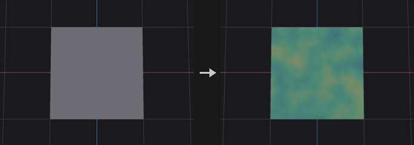

Follows the Houdini Attribute Adjust Color workflow. Stages in order: optional overwrite of the initial color, the **adjustment color** (from the pattern type) combined with the existing color by the operation, **color correction** (hue, saturation, value, brightness, gain, contrast, gamma, in that order), **post-process** (minimum, maximum, complement) and finally **blend** with the original input. Blend is last, so a blend of 0 really means no change, including the correction and post-process stages.

Random and Noise patterns use a separate random or noise value per RGB channel when interpolating between a min and max color. With a color ramp, a single value indexes the ramp. With Specific Colors, a single value picks one color from the list or scheme, weighted by `w=`. Noise values are not equalized, so they cluster around the middle of the range.

Elements outside `group` keep their original color. The attribute is created as a float color if it does not exist.

**Inputs**

| Input | Type | Description |
|---|---|---|
| `geo` | GEOMETRY | Geometry whose color attribute is edited. |

**Outputs**

| Output | Type | Description |
|---|---|---|
| `geo` | GEOMETRY | Copy of the input with the color attribute written. |

**Parameters**

| Parameter | Type | Default | Description |
|---|---|---|---|
| Group `group` | string | *(empty)* | Group pattern restricting which elements are adjusted. Elements outside the group keep their values. |
| Blend `blend_mode` | menu | Constant | Whether the blend amount is a constant or read from an attribute. Options: Constant (`constant`), Use Attribute (`attribute`). |
| Blend `blend` | float [0.0..1.0] | 1 | Blend amount between the original value (0) and the adjusted result (1). *Hidden when blend_mode ≠ constant.* |
| Blend Attribute `blend_attribute` | string | `mask` | Numeric attribute (clamped to 0..1) giving the blend amount per element. *Hidden when blend_mode ≠ attribute.* |
| Attribute Name `attribute_name` | string | `Cd` | Name of the color attribute, which must have three numeric components. It is created if missing. |
| Attribute Class `attribute_class` | menu | Point | Attribute class that holds the attribute. Options: Point (`point`), Primitive (`prim`), Vertex (`vertex`), Detail (`detail`). |

*Pre-Process*

| Parameter | Type | Default | Description |
|---|---|---|---|
| Delete All Existing Color Attributes `delete_other_colors` | toggle | off | Remove attributes of the same name on the other classes. A point color would otherwise override a primitive color, so this makes the class you write to the one that shows. |
| Overwrite Initial Color `overwrite_initial` | toggle | off | Replace the starting color before the operation with the color chosen in Initial Color From. |
| Initial Color From `initial_from` | menu | Constant | Source of the starting color: a constant, a 3-component color attribute, or a float attribute spread over RGB. Options: Constant (`constant`), Color Attribute (`color_attribute`), Float Attribute (`float_attribute`). *Disabled when overwrite_initial is off.* |
| Initial Color `initial_color_r` `initial_color_g` `initial_color_b` | float | 1, 1, 1 | Starting color for Initial Color From = Constant. *Hidden when initial_from ≠ constant.* *Disabled when overwrite_initial is off.* |
| Initial Attribute `initial_attribute` | string | *(empty)* | Attribute read for the starting color when Initial Color From is an attribute. *Hidden when initial_from = constant.* *Disabled when overwrite_initial is off.* |

*Adjustment Value*

| Parameter | Type | Default | Description |
|---|---|---|---|
| Adjust Value `adjust_value` | toggle | on | Turns the adjustment off when disabled, so only the later stages (blend, clamp, and so on) are applied. |
| Operation `operation` | menu | Set Always | How the adjustment color is combined with the existing color, per channel. Overlay branches on the existing color (below 0.5 multiplies, above screens); Screen is 1-(1-a)(1-b); Hard Mix gives 1 where the sum reaches 1 and 0 elsewhere; Difference is adjustment minus original, without absolute value. If the attribute does not exist yet, every operation writes the adjustment color. Options: Set Always (`set_always`), Set Initial (`set_initial`), Add (`add`), Subtract (`subtract`), Multiply (`multiply`), Overlay (`overlay`), Screen (`screen`), Hard Mix (`hard_mix`), Difference (`difference`), Minimum (`minimum`), Maximum (`maximum`). *Disabled when adjust_value is off.* |
| Pattern Type `pattern_type` | menu | Constant | How the adjustment color is generated. Constant uses one color; Random and Noise pick colors from the range settings; Color Attribute reads a color attribute; Remap Attribute maps a float attribute through the color ramp; Bounding Box maps position along a direction through the color ramp. Options: Constant (`constant`), Random (`random`), Noise (`noise`), Color Attribute (`color_attribute`), Remap Attribute (`remap_attribute`), Bounding Box (`bounding_box`). *Disabled when adjust_value is off.* |
| Value `color_r` `color_g` `color_b` | float | 1, 1, 1 | Adjustment color for Pattern Type = Constant. *Hidden when pattern_type ≠ constant.* |
| Range Values `range_values` | menu | Min/Max | Where Random and Noise colors come from: between a min and max color, along a color ramp, or from a specific list or color scheme. Options: Min/Max (`min_max`), Color Ramp (`color_ramp`), Specific Colors (`specific`). *Hidden when pattern_type ≠ random pattern_type ≠ noise.* |
| Color Space `color_space` | menu | RGB | Color space in which Min/Max interpolate. In HSV the three components are hue (0..1 is a full turn), saturation and value, and the result is converted back to RGB. Options: RGB (`rgb`), HSV (`hsv`). *Hidden when pattern_type ≠ random pattern_type ≠ noise } { range_values ≠ min_max.* |
| Min `min_color_r` `min_color_g` `min_color_b` | float | 0, 0, 0 | Color at the low end of Min/Max. Components are interpreted according to Color Space. *Hidden when pattern_type ≠ random pattern_type ≠ noise } { range_values ≠ min_max.* |
| Max `max_color_r` `max_color_g` `max_color_b` | float | 1, 1, 1 | Color at the high end of Min/Max. Components are interpreted according to Color Space. *Hidden when pattern_type ≠ random pattern_type ≠ noise } { range_values ≠ min_max.* |
| Color Ramp `color_ramp` | string | `0:0,0,0 1:1,1,1` | Color ramp as `position:r,g,b` entries separated by spaces. Used by Random/Noise with Color Ramp, and by Remap Attribute and Bounding Box. *Hidden when pattern_type = constant } { pattern_type = color_attribute } { pattern_type = random range_values ≠ color_ramp } { pattern_type = noise range_values ≠ color_ramp.* |
| Color Scheme `color_scheme` | menu | Custom (Color List) | Specific Colors source. Custom uses the color list; the other schemes derive colors from a base color in HSV: Constant (the base), Complementary (+180 degrees), Analogous 2 and 4 (neighbours spaced by Distance), Triadic (+-120 degrees), Tetradic, 5 Shades (value scaled by 1, .8, .6, .4, .2) and 5 Tints (saturation scaled the same way). Options: Custom (Color List) (`custom`), Constant (`constant`), Complementary (`complementary`), 2 Analogous (`analogous2`), 4 Analogous (`analogous4`), Triadic (`triadic`), Tetradic (`tetradic`), 5 Shades (`shades5`), 5 Tints (`tints5`). *Hidden when pattern_type ≠ random pattern_type ≠ noise } { range_values ≠ specific.* |
| Color `scheme_color_r` `scheme_color_g` `scheme_color_b` | float | 1, 0, 0 | Base color the color scheme is derived from. *Hidden when pattern_type ≠ random pattern_type ≠ noise } { range_values ≠ specific } { color_scheme = custom.* |
| Distance `scheme_distance` | float [0.0..180.0] | 30 | Hue spacing in degrees for the Analogous and Tetradic schemes. Shades and Tints use a fixed step. *Hidden when pattern_type ≠ random pattern_type ≠ noise } { range_values ≠ specific } { color_scheme ≠ analogous2 color_scheme ≠ analogous4 color_scheme ≠ tetradic.* |
| Colors `color_list` | string | *(see panel)* | Colors for Specific Colors with the Custom scheme, one `r g b` per line. Append `w=weight` to set the probability of that color. Lines starting with `#` are comments. *Hidden when pattern_type ≠ random pattern_type ≠ noise } { range_values ≠ specific } { color_scheme ≠ custom.* |
| Adjustment Attribute `adjustment_attribute` | string | *(empty)* | Color attribute (three components) read when Pattern Type = Color Attribute. *Hidden when pattern_type ≠ color_attribute.* |
| Source Attribute `source_attribute` | string | *(empty)* | Float attribute (first component) mapped through the color ramp when Pattern Type = Remap Attribute. *Hidden when pattern_type ≠ remap_attribute.* |
| Direction `bbox_direction_x` `bbox_direction_y` `bbox_direction_z` | float | 0, 1, 0 | Direction along which position is projected for Pattern Type = Bounding Box. The vector is normalized, then the projected values are normalized to 0..1 and looked up in the color ramp. *Hidden when pattern_type ≠ bounding_box.* |
| Compute Range `compute_range` | toggle | on | Take the minimum and maximum of the selected elements as the source range. When off, Source Min and Source Max are used. *Hidden when pattern_type ≠ remap_attribute pattern_type ≠ bounding_box.* |
| Source Range `source_min` `source_max` | float | 0, 1 | Source range used when Compute Range is off (first value = minimum, second = maximum). Values outside it are clamped to the ends of the ramp. *Hidden when pattern_type ≠ remap_attribute pattern_type ≠ bounding_box.* *Disabled when compute_range is on.* |

*Random*

| Parameter | Type | Default | Description |
|---|---|---|---|
| Randomization By `randomization_by` | menu | Element Number | Where the random seed key comes from: the element number, or the values of a custom attribute so the result follows the element rather than its index. Options: Element Number (`element_number`), Custom Attribute (`custom_attribute`). |
| Custom Attribute `custom_attribute` | string | `id` | Numeric attribute whose first component is used as the random key when Randomization By is Custom Attribute. *Disabled when randomization_by = element_number.* |
| Seed `rand_seed` | int [0..] | 0 | Seed for the Random and Noise patterns. |

*Noise Pattern*

| Parameter | Type | Default | Description |
|---|---|---|---|
| Noise Type `noise_type` | menu | Perlin | Noise basis used when the pattern type is Noise. The `*_f2f1` variants return the difference between the second and first nearest feature distance. Options: Value (`value`), Perlin (`perlin`), Simplex (`simplex`), Worley Cellular F1 (`worley`), Worley Cellular F2-F1 (`worley_f2f1`), Manhattan Cellular F1 (`manhattan`), Manhattan Cellular F2-F1 (`manhattan_f2f1`), Chebyshev Cellular F1 (`chebyshev`), Chebyshev Cellular F2-F1 (`chebyshev_f2f1`). *Hidden when pattern_type ≠ noise.* |
| Location Attribute `location_attribute` | string | `P` | Attribute that supplies the sample position for the noise. It is read from the target attribute class if it exists there as a 3-component attribute, otherwise it is taken from the point attribute of that name (vertices use their point, primitives their center, detail the mean position). *Hidden when pattern_type ≠ noise.* |
| Element Size `element_size` | float [1e-06..] | 1 | Feature size of the noise in world units. The sample position is divided by `element_size` multiplied by `element_scale`. *Hidden when pattern_type ≠ noise.* |
| Element Scale `element_scale_x` `element_scale_y` `element_scale_z` | float | 1, 1, 1 | Per-axis scale applied on top of `element_size`, so the noise can be stretched along one axis. *Hidden when pattern_type ≠ noise.* |
| Offset `noise_offset_x` `noise_offset_y` `noise_offset_z` | float | 0, 0, 0 | Offset added to the sample position before it is divided by the element size. Moves the noise pattern through space. *Hidden when pattern_type ≠ noise.* |
| Fractal Type `fractal_type` | menu | None | How octaves are combined. None gives a single octave; Standard sums octaves with falling weights; Terrain multiplies octaves so low areas flatten out; Hybrid Terrain is a multifractal with clamped weights. Options: None (`none`), Standard (`standard`), Terrain (`terrain`), Hybrid (`hybrid`). *Hidden when pattern_type ≠ noise.* |
| Max Octaves `max_octaves` | int [1..16] | 3 | Number of noise layers stacked when the fractal type is not None. *Hidden when pattern_type ≠ noise } { fractal_type = none.* |
| Lacunarity `lacunarity` | float [-16.0..16.0] | 2 | Frequency multiplier from one octave to the next. *Hidden when pattern_type ≠ noise } { fractal_type = none.* |
| Roughness `roughness` | float [-4.0..4.0] | 0.5 | Amplitude falloff from one octave to the next. Lower values give smoother results. *Hidden when pattern_type ≠ noise } { fractal_type = none.* |

*Color Correction*

| Parameter | Type | Default | Description |
|---|---|---|---|
| Hue Shift `hue_shift` | float [-360.0..360.0] | 0 | Rotates hue, in degrees. |
| Saturation `saturation` | float [0.0..100.0] | 1 | Multiplier for HSV saturation (result clamped to 0..1). |
| Value `value` | float [0.0..100.0] | 1 | Multiplier for HSV value. |
| Brightness `brightness` | float | 0 | Amount added to HSV value after the Value multiplier. |
| Contrast `contrast` | float [0.0..100.0] | 1 | Scales colors around 0.5. |
| Gain `gain` | float [0.0..100.0] | 1 | Multiplier applied to RGB after the HSV step. |
| Gamma `gamma` | float [0.001..100.0] | 1 | Gamma correction `c^(1/gamma)`; values above 1 brighten. |

*Post-Process*

| Parameter | Type | Default | Description |
|---|---|---|---|
| Minimum `minimum` | float | 0 | Lower clamp, applied when Use Minimum is on. |
| Use Minimum `use_minimum` | toggle | off | Enables the lower clamp. |
| Maximum `maximum` | float | 1 | Upper clamp, applied when Use Maximum is on. |
| Use Maximum `use_maximum` | toggle | off | Enables the upper clamp. |
| Complement Color `complement` | toggle | off | Invert the final color to `1 - color`. |

**Compared with Houdini**

The Color Map pattern (texture sampling) and the viewport-handle Line / Radial gradients are not implemented, and the color-correction parameters have no per-attribute variant. Color Correction order, the Overlay and Screen formulas and the 5 Shades / 5 Tints steps are fixed choices of this plugin. The Color SOP equivalent is the separate Color node.

**Tips**

- Use Remap Attribute with a float attribute such as curvature to color geometry through a ramp.
- Set Delete Other Colors when a point color is hiding the primitive color you just wrote.

---

### Attribute Adjust Float (PCG)

<a id="pcg-attribadjustfloat"></a>

`PCG_AttribAdjustFloat` · category `PCG/attribute` · Houdini: Attribute Adjust Float (SOP)

Sets, offsets or scales a float attribute using constant, random, noise or attribute-driven values.

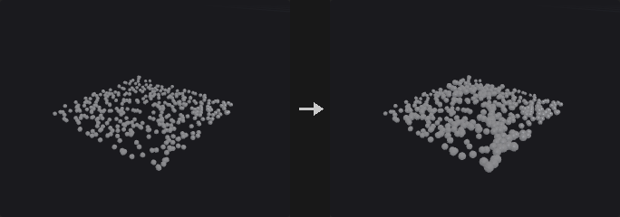

Follows the Houdini Attribute Adjust Float model. An **adjustment value** is generated by the Pattern Type (Constant, Random, Noise, Attribute) and merged into the existing value by the Operation. The result is blended with the original (constant or per-element amount) and optionally clamped with Minimum / Maximum. Elements outside `group` keep their value.

Random and Noise first produce a value `u` in 0..1 which Range Values maps to the final range. Random is uniform and keyed on the element number (or a custom attribute). Noise is the fractal noise mapped from -1..1 to 0..1; it is not equalized, so noise-driven values cluster in the middle of the range and rarely reach the ends. With Specific Values the same `u` selects from a weighted value list, so in Noise mode the discrete values appear in coherent patches.

If the attribute does not exist it is created as a float, and every operation (including Set Initial) just writes the adjustment value. A component suffix such as `v.x` edits one component; a vector attribute named without suffix gets its length adjusted.

**Inputs**

| Input | Type | Description |
|---|---|---|
| `geo` | GEOMETRY | Geometry whose attribute is adjusted. |

**Outputs**

| Output | Type | Description |
|---|---|---|
| `geo` | GEOMETRY | Copy of the input with the attribute written. |

**Parameters**

| Parameter | Type | Default | Description |
|---|---|---|---|
| Group `group` | string | *(empty)* | Group pattern restricting which elements are adjusted. Elements outside the group keep their values. |
| Blend `blend_mode` | menu | Constant | Whether the blend amount is a constant or read from an attribute. Options: Constant (`constant`), Use Attribute (`attribute`). |
| Blend `blend` | float [0.0..1.0] | 1 | Blend amount between the original value (0) and the adjusted result (1). *Hidden when blend_mode ≠ constant.* |
| Blend Attribute `blend_attribute` | string | `mask` | Numeric attribute (clamped to 0..1) giving the blend amount per element. *Hidden when blend_mode ≠ attribute.* |
| Attribute Name `attribute_name` | string | `pscale` | Attribute to edit. A component suffix such as `v.x` or `v[1]` edits only that component; a vector attribute without a suffix has its length adjusted (direction kept, zero vectors stay zero). The attribute is created if missing. |
| Attribute Class `attribute_class` | menu | Point | Attribute class that holds the attribute. Options: Point (`point`), Primitive (`prim`), Vertex (`vertex`), Detail (`detail`). |

*Adjustment Value*

| Parameter | Type | Default | Description |
|---|---|---|---|
| Adjust Value `adjust_value` | toggle | on | Turns the adjustment off when disabled, so only the later stages (blend, clamp, and so on) are applied. |
| Operation `operation` | menu | Set Always | How the adjustment is combined with the existing value. Set Always overwrites; Set Initial only writes when the attribute did not exist; the others combine per element. If the attribute does not exist yet, every operation simply writes the adjustment value. Options: Set Always (`set_always`), Set Initial (`set_initial`), Add (`add`), Subtract (`subtract`), Multiply (`multiply`), Minimum (`minimum`), Maximum (`maximum`). *Disabled when adjust_value is off.* |
| Pattern Type `pattern_type` | menu | Constant | How the adjustment value is generated: a constant, a random value, a noise value or another attribute. Options: Constant (`constant`), Random (`random`), Noise (`noise`), Attribute (`attribute`). *Disabled when adjust_value is off.* |
| Constant Value `constant_value` | float | 0 | Adjustment value for Pattern Type = Constant. *Hidden when pattern_type ≠ constant.* |
| Range Values `range_values` | menu | Min/Max | How the random or noise value in 0..1 is mapped to a value. Min/Max interpolates between the two bounds; Min + Range Length goes from Min up by the length; Middle +- Range Length is centred on Middle with a total width equal to the length (half-width = length / 2); Specific Values picks from the value list. Options: Min/Max (`min_max`), Min + Range Length (`min_range`), Middle ± Range Length (`middle_range`), Specific Values (`specific`). *Hidden when pattern_type = constant } { pattern_type = attribute.* |
| Min Value `min_value` | float | 0 | Lower bound of the range (Min/Max and Min + Range Length modes). *Hidden when pattern_type = constant } { pattern_type = attribute } { range_values = middle_range } { range_values = specific.* |
| Max Value `max_value` | float | 1 | Upper bound of the range (Min/Max mode). *Hidden when pattern_type = constant } { pattern_type = attribute } { range_values ≠ min_max.* |
| Middle Value `middle_value` | float | 0.5 | Centre of the range (Middle +- Range Length mode). *Hidden when pattern_type = constant } { pattern_type = attribute } { range_values ≠ middle_range.* |
| Range Length `range_length` | float | 1 | Length of the range. In Middle +- Range Length mode the half-width is half of this value. *Hidden when pattern_type = constant } { pattern_type = attribute } { range_values = min_max } { range_values = specific.* |
| Values `value_list` | string | *(see panel)* | Values to pick from when Range Values is Specific Values. One group per line: numbers separated by spaces, commas or semicolons, where `min-max:step` expands to a series. Append `w=weight` to a line to set the probability of that group; the values inside a group are chosen evenly. Lines starting with `#` are comments. *Hidden when pattern_type = constant } { pattern_type = attribute } { range_values ≠ specific.* |
| Value Distribution `value_distribution` | menu | Uniform | Shape of the distribution. Uniform maps the value directly; Uniform Remap passes it through the remap ramp first; Uniform with Outliers sends a percentage of elements outside the range. Options: Uniform (`uniform`), Uniform with Remapping (`uniform_remap`), Uniform with Outliers (`uniform_outliers`). *Hidden when pattern_type = constant } { pattern_type = attribute } { range_values = specific.* |
| Remap Ramp `remap_ramp` | string | `0:0 1:1` | Ramp used by Uniform Remap. The horizontal axis is the random value (left = Min, right = Max), the vertical axis is the position inside the range. *Hidden when pattern_type = constant } { pattern_type = attribute } { range_values = specific } { value_distribution ≠ uniform_remap.* |
| Outlier Percent `outlier_percent` | float [0.0..100.0] | 10 | Percentage of elements that become outliers (Uniform with Outliers). *Hidden when pattern_type = constant } { pattern_type = attribute } { range_values = specific } { value_distribution ≠ uniform_outliers.* |
| Outlier Range `outlier_range` | float | 1 | How far outliers extend beyond the range. In Additive mode it is an absolute distance; in Multiplicative mode the extension is (value - 1) times the range length. *Hidden when pattern_type = constant } { pattern_type = attribute } { range_values = specific } { value_distribution ≠ uniform_outliers.* |
| Outlier Range Mode `outlier_range_mode` | menu | Additive | Additive extends the range by a fixed distance; Multiplicative extends it by a multiple of the range length. Options: Additive (`additive`), Multiplicative (`multiplicative`). *Hidden when pattern_type = constant } { pattern_type = attribute } { range_values = specific } { value_distribution ≠ uniform_outliers.* |
| Outlier Extent `outlier_extent` | menu | Above Max Value | Which side outliers fall on: above the maximum, below the minimum, or either side at random. Options: Above Max Value (`above_max`), Below Min Value (`below_min`), Both (`both`). *Hidden when pattern_type = constant } { pattern_type = attribute } { range_values = specific } { value_distribution ≠ uniform_outliers.* |
| Outlier Seed `outlier_seed` | int [0..] | 0 | Seed for choosing which elements are outliers and how far they go. *Hidden when pattern_type = constant } { pattern_type = attribute } { range_values = specific } { value_distribution ≠ uniform_outliers.* |
| Outlier Attribute `outlier_attribute` | string | *(empty)* | Optional name of an integer attribute (same class) that receives 1 for outlier elements and 0 otherwise. Empty means no attribute is written. |
| Enable Stepping `use_stepping` | toggle | off | Snap generated values to a grid of `step_size`, counted from the minimum of the range. *Hidden when pattern_type = constant } { pattern_type = attribute } { range_values = specific.* |
| Step Size `step_size` | float [0.0..] | 1 | Grid spacing used when stepping is on. *Hidden when pattern_type = constant } { pattern_type = attribute } { range_values = specific.* *Disabled when use_stepping is off.* |
| Attribute `adjustment_attribute` | string | *(empty)* | Attribute read when the pattern type is Attribute. *Hidden when pattern_type ≠ attribute.* |
| Attribute Adjustment `attribute_adjustment` | menu | Scale | How the adjustment attribute is modified before use: scaled, offset, or both. Options: Scale (`scale`), Offset (`offset`), Apply Both (`both`). *Hidden when pattern_type ≠ attribute.* |
| Scale `attribute_scale` | float | 1 | Multiplier applied to the adjustment attribute. *Hidden when pattern_type ≠ attribute } { attribute_adjustment = offset.* |
| Offset `attribute_offset` | float | 0 | Value added to the adjustment attribute. *Hidden when pattern_type ≠ attribute } { attribute_adjustment = scale.* |

*Random*

| Parameter | Type | Default | Description |
|---|---|---|---|
| Randomization By `randomization_by` | menu | Element Number | Where the random seed key comes from: the element number, or the values of a custom attribute so the result follows the element rather than its index. Options: Element Number (`element_number`), Custom Attribute (`custom_attribute`). |
| Custom Attribute `custom_attribute` | string | `id` | Numeric attribute whose first component is used as the random key when Randomization By is Custom Attribute. *Disabled when randomization_by = element_number.* |
| Seed `rand_seed` | int [0..] | 0 | Seed for the Random and Noise patterns. |

*Noise Pattern*

| Parameter | Type | Default | Description |
|---|---|---|---|
| Noise Type `noise_type` | menu | Perlin | Noise basis used when the pattern type is Noise. The `*_f2f1` variants return the difference between the second and first nearest feature distance. Options: Value (`value`), Perlin (`perlin`), Simplex (`simplex`), Worley Cellular F1 (`worley`), Worley Cellular F2-F1 (`worley_f2f1`), Manhattan Cellular F1 (`manhattan`), Manhattan Cellular F2-F1 (`manhattan_f2f1`), Chebyshev Cellular F1 (`chebyshev`), Chebyshev Cellular F2-F1 (`chebyshev_f2f1`). *Hidden when pattern_type ≠ noise.* |
| Location Attribute `location_attribute` | string | `P` | Attribute that supplies the sample position for the noise. It is read from the target attribute class if it exists there as a 3-component attribute, otherwise it is taken from the point attribute of that name (vertices use their point, primitives their center, detail the mean position). *Hidden when pattern_type ≠ noise.* |
| Element Size `element_size` | float [1e-06..] | 1 | Feature size of the noise in world units. The sample position is divided by `element_size` multiplied by `element_scale`. *Hidden when pattern_type ≠ noise.* |
| Element Scale `element_scale_x` `element_scale_y` `element_scale_z` | float | 1, 1, 1 | Per-axis scale applied on top of `element_size`, so the noise can be stretched along one axis. *Hidden when pattern_type ≠ noise.* |
| Offset `noise_offset_x` `noise_offset_y` `noise_offset_z` | float | 0, 0, 0 | Offset added to the sample position before it is divided by the element size. Moves the noise pattern through space. *Hidden when pattern_type ≠ noise.* |
| Fractal Type `fractal_type` | menu | None | How octaves are combined. None gives a single octave; Standard sums octaves with falling weights; Terrain multiplies octaves so low areas flatten out; Hybrid Terrain is a multifractal with clamped weights. Options: None (`none`), Standard (`standard`), Terrain (`terrain`), Hybrid (`hybrid`). *Hidden when pattern_type ≠ noise.* |
| Max Octaves `max_octaves` | int [1..16] | 3 | Number of noise layers stacked when the fractal type is not None. *Hidden when pattern_type ≠ noise } { fractal_type = none.* |
| Lacunarity `lacunarity` | float [-16.0..16.0] | 2 | Frequency multiplier from one octave to the next. *Hidden when pattern_type ≠ noise } { fractal_type = none.* |
| Roughness `roughness` | float [-4.0..4.0] | 0.5 | Amplitude falloff from one octave to the next. Lower values give smoother results. *Hidden when pattern_type ≠ noise } { fractal_type = none.* |

*Post-Process*

| Parameter | Type | Default | Description |
|---|---|---|---|
| Minimum `minimum` | float | 0 | Lower clamp, applied when Use Minimum is on. |
| Use Minimum `use_minimum` | toggle | off | Enables the lower clamp. |
| Maximum `maximum` | float | 1 | Upper clamp, applied when Use Maximum is on. |
| Use Maximum `use_maximum` | toggle | off | Enables the upper clamp. |

**Compared with Houdini**

Unit Settings, VEXpression, Animate Noise, Warping and Default Value are not implemented. Middle +- Range Length uses half the length on each side (as Attribute Adjust does; Attribute Noise defines the same mode with the full width). Houdini does not document whether noise is equalized; here it is not. The Specific Values list is written one group per line with the group's weight as the selection probability. Outlier extension in Multiplicative mode is measured in range lengths so that a range starting at 0 can still extend.

**Tips**

- Set Outlier Attribute to get a mask of the elements that were sent outside the range.

---

### Attribute Adjust Integer (PCG)

<a id="pcg-attribadjustinteger"></a>

`PCG_AttribAdjustInteger` · category `PCG/attribute` · Houdini: Attribute Adjust Integer (SOP)

Sets, offsets or scales an integer attribute using constant, random, noise or attribute-driven values.

Same structure as Attribute Adjust Float (Pattern Type, Range Values, Operation, outliers, stepping), with integer behaviour: random integers are drawn uniformly from Min..Max **including both ends**, Stepping counts from Min (range 1..9 with step 2 gives 1 3 5 7 9), outliers are integers at least 1 outside the range, and the final result is rounded. A new attribute is created as `int32`. There is no Blend. Elements outside `group` keep their value.

In Middle +- Range Length mode the half-width is half the length, and bounds that fall between integers are pulled inwards (center 0, length 3 gives -1..1).

**Inputs**

| Input | Type | Description |
|---|---|---|
| `geo` | GEOMETRY | Geometry whose attribute is adjusted. |

**Outputs**

| Output | Type | Description |
|---|---|---|
| `geo` | GEOMETRY | Copy of the input with the attribute written. |

**Parameters**

| Parameter | Type | Default | Description |
|---|---|---|---|
| Group `group` | string | *(empty)* | Group pattern restricting which elements are adjusted. Elements outside the group keep their values. |
| Attribute Name `attribute_name` | string | `pscale` | Attribute to edit. A component suffix such as `v.x` or `v[1]` edits only that component; a vector attribute without a suffix has its length adjusted (direction kept, zero vectors stay zero). The attribute is created if missing. |
| Attribute Class `attribute_class` | menu | Point | Attribute class that holds the attribute. Options: Point (`point`), Primitive (`prim`), Vertex (`vertex`), Detail (`detail`). |

*Adjustment Value*

| Parameter | Type | Default | Description |
|---|---|---|---|
| Adjust Value `adjust_value` | toggle | on | Turns the adjustment off when disabled, so only the later stages (blend, clamp, and so on) are applied. |
| Operation `operation` | menu | Set Always | How the adjustment is combined with the existing value. Set Always overwrites; Set Initial only writes when the attribute did not exist; the others combine per element. If the attribute does not exist yet, every operation simply writes the adjustment value. Options: Set Always (`set_always`), Set Initial (`set_initial`), Add (`add`), Subtract (`subtract`), Multiply (`multiply`), Minimum (`minimum`), Maximum (`maximum`). *Disabled when adjust_value is off.* |
| Pattern Type `pattern_type` | menu | Constant | How the adjustment value is generated: a constant, a random value, a noise value or another attribute. Options: Constant (`constant`), Random (`random`), Noise (`noise`), Attribute (`attribute`). *Disabled when adjust_value is off.* |
| Constant Value `constant_value` | int | 0 | Adjustment value for Pattern Type = Constant. *Hidden when pattern_type ≠ constant.* |
| Range Values `range_values` | menu | Min/Max | How the random or noise value in 0..1 is mapped to a value. Min/Max interpolates between the two bounds; Min + Range Length goes from Min up by the length; Middle +- Range Length is centred on Middle with a total width equal to the length (half-width = length / 2); Specific Values picks from the value list. Options: Min/Max (`min_max`), Min + Range Length (`min_range`), Middle ± Range Length (`middle_range`), Specific Values (`specific`). *Hidden when pattern_type = constant } { pattern_type = attribute.* |
| Min Value `min_value` | int | 0 | Lower bound of the range (Min/Max and Min + Range Length modes). *Hidden when pattern_type = constant } { pattern_type = attribute } { range_values = middle_range } { range_values = specific.* |
| Max Value `max_value` | int | 10 | Upper bound of the range (Min/Max mode). *Hidden when pattern_type = constant } { pattern_type = attribute } { range_values ≠ min_max.* |
| Middle Value `middle_value` | int | 5 | Centre of the range (Middle +- Range Length mode). *Hidden when pattern_type = constant } { pattern_type = attribute } { range_values ≠ middle_range.* |
| Range Length `range_length` | int | 10 | Length of the range. In Middle +- Range Length mode the half-width is half of this value. *Hidden when pattern_type = constant } { pattern_type = attribute } { range_values = min_max } { range_values = specific.* |
| Values `value_list` | string | *(see panel)* | Values to pick from when Range Values is Specific Values. One group per line: numbers separated by spaces, commas or semicolons, where `min-max:step` expands to a series. Append `w=weight` to a line to set the probability of that group; the values inside a group are chosen evenly. Lines starting with `#` are comments. *Hidden when pattern_type = constant } { pattern_type = attribute } { range_values ≠ specific.* |
| Value Distribution `value_distribution` | menu | Uniform | Shape of the distribution. Uniform maps the value directly; Uniform Remap passes it through the remap ramp first; Uniform with Outliers sends a percentage of elements outside the range. Options: Uniform (`uniform`), Uniform with Remapping (`uniform_remap`), Uniform with Outliers (`uniform_outliers`). *Hidden when pattern_type = constant } { pattern_type = attribute } { range_values = specific.* |
| Remap Ramp `remap_ramp` | string | `0:0 1:1` | Ramp used by Uniform Remap. The horizontal axis is the random value (left = Min, right = Max), the vertical axis is the position inside the range. *Hidden when pattern_type = constant } { pattern_type = attribute } { range_values = specific } { value_distribution ≠ uniform_remap.* |
| Outlier Percent `outlier_percent` | float [0.0..100.0] | 10 | Percentage of elements that become outliers (Uniform with Outliers). *Hidden when pattern_type = constant } { pattern_type = attribute } { range_values = specific } { value_distribution ≠ uniform_outliers.* |
| Outlier Range `outlier_range` | int | 1 | How far outliers extend beyond the range, in whole numbers. In Additive mode it is an absolute distance; in Multiplicative mode the extension is (value - 1) times the range length. Outliers always land at least 1 outside the range. *Hidden when pattern_type = constant } { pattern_type = attribute } { range_values = specific } { value_distribution ≠ uniform_outliers.* |
| Outlier Range Mode `outlier_range_mode` | menu | Additive | Additive extends the range by a fixed distance; Multiplicative extends it by a multiple of the range length. Options: Additive (`additive`), Multiplicative (`multiplicative`). *Hidden when pattern_type = constant } { pattern_type = attribute } { range_values = specific } { value_distribution ≠ uniform_outliers.* |
| Outlier Extent `outlier_extent` | menu | Above Max Value | Which side outliers fall on: above the maximum, below the minimum, or either side at random. Options: Above Max Value (`above_max`), Below Min Value (`below_min`), Both (`both`). *Hidden when pattern_type = constant } { pattern_type = attribute } { range_values = specific } { value_distribution ≠ uniform_outliers.* |
| Outlier Seed `outlier_seed` | int [0..] | 0 | Seed for choosing which elements are outliers and how far they go. *Hidden when pattern_type = constant } { pattern_type = attribute } { range_values = specific } { value_distribution ≠ uniform_outliers.* |
| Outlier Attribute `outlier_attribute` | string | *(empty)* | Optional name of an integer attribute (same class) that receives 1 for outlier elements and 0 otherwise. Empty means no attribute is written. |
| Enable Stepping `use_stepping` | toggle | off | Snap generated values to a grid of `step_size`, counted from the minimum of the range. *Hidden when pattern_type = constant } { pattern_type = attribute } { range_values = specific.* |
| Step Size `step_size` | int [1..] | 1 | Grid spacing used when stepping is on. *Hidden when pattern_type = constant } { pattern_type = attribute } { range_values = specific.* *Disabled when use_stepping is off.* |
| Attribute `adjustment_attribute` | string | *(empty)* | Attribute read when the pattern type is Attribute. *Hidden when pattern_type ≠ attribute.* |
| Attribute Adjustment `attribute_adjustment` | menu | Scale | How the adjustment attribute is modified before use: scaled, offset, or both. Options: Scale (`scale`), Offset (`offset`), Apply Both (`both`). *Hidden when pattern_type ≠ attribute.* |
| Scale `attribute_scale` | float | 1 | Multiplier applied to the adjustment attribute. *Hidden when pattern_type ≠ attribute } { attribute_adjustment = offset.* |
| Offset `attribute_offset` | float | 0 | Value added to the adjustment attribute. *Hidden when pattern_type ≠ attribute } { attribute_adjustment = scale.* |

*Random*

| Parameter | Type | Default | Description |
|---|---|---|---|
| Randomization By `randomization_by` | menu | Element Number | Where the random seed key comes from: the element number, or the values of a custom attribute so the result follows the element rather than its index. Options: Element Number (`element_number`), Custom Attribute (`custom_attribute`). |
| Custom Attribute `custom_attribute` | string | `id` | Numeric attribute whose first component is used as the random key when Randomization By is Custom Attribute. *Disabled when randomization_by = element_number.* |
| Seed `rand_seed` | int [0..] | 0 | Seed for the Random and Noise patterns. |

*Noise Pattern*

| Parameter | Type | Default | Description |
|---|---|---|---|
| Noise Type `noise_type` | menu | Perlin | Noise basis used when the pattern type is Noise. The `*_f2f1` variants return the difference between the second and first nearest feature distance. Options: Value (`value`), Perlin (`perlin`), Simplex (`simplex`), Worley Cellular F1 (`worley`), Worley Cellular F2-F1 (`worley_f2f1`), Manhattan Cellular F1 (`manhattan`), Manhattan Cellular F2-F1 (`manhattan_f2f1`), Chebyshev Cellular F1 (`chebyshev`), Chebyshev Cellular F2-F1 (`chebyshev_f2f1`). *Hidden when pattern_type ≠ noise.* |
| Location Attribute `location_attribute` | string | `P` | Attribute that supplies the sample position for the noise. It is read from the target attribute class if it exists there as a 3-component attribute, otherwise it is taken from the point attribute of that name (vertices use their point, primitives their center, detail the mean position). *Hidden when pattern_type ≠ noise.* |
| Element Size `element_size` | float [1e-06..] | 1 | Feature size of the noise in world units. The sample position is divided by `element_size` multiplied by `element_scale`. *Hidden when pattern_type ≠ noise.* |
| Element Scale `element_scale_x` `element_scale_y` `element_scale_z` | float | 1, 1, 1 | Per-axis scale applied on top of `element_size`, so the noise can be stretched along one axis. *Hidden when pattern_type ≠ noise.* |
| Offset `noise_offset_x` `noise_offset_y` `noise_offset_z` | float | 0, 0, 0 | Offset added to the sample position before it is divided by the element size. Moves the noise pattern through space. *Hidden when pattern_type ≠ noise.* |
| Fractal Type `fractal_type` | menu | None | How octaves are combined. None gives a single octave; Standard sums octaves with falling weights; Terrain multiplies octaves so low areas flatten out; Hybrid Terrain is a multifractal with clamped weights. Options: None (`none`), Standard (`standard`), Terrain (`terrain`), Hybrid (`hybrid`). *Hidden when pattern_type ≠ noise.* |
| Max Octaves `max_octaves` | int [1..16] | 3 | Number of noise layers stacked when the fractal type is not None. *Hidden when pattern_type ≠ noise } { fractal_type = none.* |
| Lacunarity `lacunarity` | float [-16.0..16.0] | 2 | Frequency multiplier from one octave to the next. *Hidden when pattern_type ≠ noise } { fractal_type = none.* |
| Roughness `roughness` | float [-4.0..4.0] | 0.5 | Amplitude falloff from one octave to the next. Lower values give smoother results. *Hidden when pattern_type ≠ noise } { fractal_type = none.* |

*Post-Process*

| Parameter | Type | Default | Description |
|---|---|---|---|
| Minimum `minimum` | int | 0 | Lower clamp, applied when Use Minimum is on. |
| Use Minimum `use_minimum` | toggle | off | Enables the lower clamp. |
| Maximum `maximum` | int | 1 | Upper clamp, applied when Use Maximum is on. |
| Use Maximum `use_maximum` | toggle | off | Enables the upper clamp. |

**Compared with Houdini**

Same unimplemented options as the Float node (Unit Settings, VEXpression, Animate Noise, Warping, Default Value). Noise values are not equalized, so noise-driven integers cluster around the middle of the range.

---

### Attribute Adjust Vector (PCG)

<a id="pcg-attribadjustvector"></a>

`PCG_AttribAdjustVector` · category `PCG/attribute` · Houdini: Attribute Adjust Vector (SOP)

Adjusts a vector attribute by direction and length, with constant, random, noise or attribute-driven values.

Follows the Houdini Attribute Adjust Vector workflow: **Pre-Process** (optionally overwrite the starting vector, reverse it, normalize it, scale its length), the **adjustment** (per Adjustment For and Operation), then **Post-Process** (blend with the original, length scale, minimum and maximum length, unit length and an optional length attribute). Elements outside `group` keep their vector.

In Direction & Length mode the adjustment is a vector, produced by Adjust With: a constant, an attribute, or random / noise values drawn per component with independent random streams (so vectors are not confined to the diagonal). Direction Only and Length Only use a scalar adjustment (length, angle or bias) taken from the Float-style Range Values settings. Direction Only operations keep the original length; zero vectors stay zero for Direction Only and Length Only.

The outlier attribute, if named, is written as an integer 0/1 mask.

**Inputs**

| Input | Type | Description |
|---|---|---|
| `geo` | GEOMETRY | Geometry whose vector attribute is adjusted. |

**Outputs**

| Output | Type | Description |
|---|---|---|
| `geo` | GEOMETRY | Copy of the input with the vector attribute written. |

**Parameters**

| Parameter | Type | Default | Description |
|---|---|---|---|
| Group `group` | string | *(empty)* | Group pattern restricting which elements are adjusted. Elements outside the group keep their values. |
| Attribute Name `attribute_name` | string | `v` | Name of a 3-component numeric attribute. Created as a float vector if missing. |
| Attribute Class `attribute_class` | menu | Point | Attribute class that holds the attribute. Options: Point (`point`), Primitive (`prim`), Vertex (`vertex`), Detail (`detail`). |

*Pre-Process*

| Parameter | Type | Default | Description |
|---|---|---|---|
| Enable Pre-Process `enable_preprocess` | toggle | off | Enables the Pre-Process options (overwrite initial value, reverse, unit length, length scale). |
| Overwrite Initial Value `overwrite_initial` | toggle | off | Replace the starting vector with the one chosen in Initial Value From before the adjustment. *Disabled when enable_preprocess is off.* |
| Initial Value From `initial_from` | menu | Constant Value | Source of the starting vector: a constant, the computed normal of the chosen class, or another attribute. Options: Constant Value (`constant`), Normal Attribute (`normal`), Vector Attribute (`attribute`). *Disabled when enable_preprocess is off } { overwrite_initial is off.* |
| Initial Vector `initial_vector_x` `initial_vector_y` `initial_vector_z` | float | 0, 1, 0 | Starting vector for Initial Value From = Constant. *Hidden when initial_from ≠ constant.* *Disabled when enable_preprocess is off } { overwrite_initial is off.* |
| Vector Attribute `initial_attribute` | string | `N` | Attribute read for the starting vector. A single-component attribute is spread over all three components. *Hidden when initial_from ≠ attribute.* *Disabled when enable_preprocess is off } { overwrite_initial is off.* |
| Reverse Direction `reverse_direction` | toggle | off | Negate the starting vector. *Disabled when enable_preprocess is off.* |
| Make Vectors Unit Length `pre_unit_length` | toggle | off | Normalize the starting vector to length 1 (zero vectors stay zero). *Disabled when enable_preprocess is off.* |
| Length Scale `pre_length_scale` | float | 1 | Factor the starting vector is multiplied by when Use Pre Length Scale is on. |
| Use Pre Length Scale `use_pre_length_scale` | toggle | off | Enable the pre-process length scale. |

*Adjustment Value*

| Parameter | Type | Default | Description |
|---|---|---|---|
| Adjust Value `adjust_value` | toggle | on | Turns the adjustment off when disabled, so only the later stages (blend, clamp, and so on) are applied. |
| Adjustment for `adjustment_for` | menu | Direction & Length | What the adjustment changes. Direction & Length edits the whole vector with a vector adjustment value; Direction Only changes the direction and keeps the length; Length Only changes the length and keeps the direction (scalar adjustment value). Options: Direction & Length (`direction_length`), Direction Only (`direction_only`), Length Only (`length_only`). *Disabled when adjust_value is off.* |
| Operation `operation` | menu | Set Always | How the adjustment is combined. Allowed operations depend on Adjustment For, and an invalid combination is an error: Direction & Length allows Set Always, Set Initial, Set, Add, Subtract, Multiply, Minimum, Maximum; Direction Only allows Add, Subtract (the result is renormalized to the original length), Rotate (about the axis by an angle), Spread (onto a cone around the original direction, random azimuth) and Interpolate (spherically toward the goal); Length Only allows Add, Subtract, Multiply, Minimum, Maximum. Options: Set Always (`set_always`), Set Initial (`set_initial`), Set (`set`), Add (`add`), Subtract (`subtract`), Multiply (`multiply`), Minimum (`minimum`), Maximum (`maximum`), Rotate (`rotate`), Spread (`spread`), Interpolate (`interpolate`). *Disabled when adjust_value is off.* |
| Adjust With `adjust_with` | menu | Constant | How the adjustment value is generated: constant, random, noise, or from an attribute. Options: Constant (`constant`), Random (`random`), Noise (`noise`), Attribute (`attribute`). *Disabled when adjust_value is off.* |
| Constant Value `constant_vector_x` `constant_vector_y` `constant_vector_z` | float | 0, 1, 0 | Adjustment vector for Adjust With = Constant when the adjustment is a vector. *Hidden when adjust_with ≠ constant } { adjustment_for = length_only } { operation = rotate } { operation = spread } { operation = interpolate.* |
| Value / Angle / Bias `scalar_value` | float | 1 | Adjustment value for Adjust With = Constant when the adjustment is a scalar: the length change for Length Only, the angle in degrees for Rotate and Spread, and the Bias (0..1) for Interpolate. *Hidden when adjust_with ≠ constant } { adjustment_for ≠ length_only operation ≠ rotate operation ≠ spread operation ≠ interpolate.* |
| Range Values `vector_range` | menu | Zero Centered | Range used for random and noise vectors. Positive spans 0..Amplitude; Zero Centered spans -0.5..0.5 times Amplitude (so amplitude 1 gives +-0.5); Min/Max interpolates between two vectors; Specific Values picks from the vector list. Options: Positive (`positive`), Zero Centered (`zero_centered`), Min/Max (`min_max`), Specific Values (`specific`). *Hidden when adjustment_for = length_only } { operation = rotate } { operation = spread } { operation = interpolate } { adjust_with = constant } { adjust_with = attribute.* |
| Amplitude `amplitude` | float | 1 | Overall size of Positive and Zero Centered vector ranges. *Hidden when adjustment_for = length_only } { operation = rotate } { operation = spread } { operation = interpolate } { adjust_with = constant } { adjust_with = attribute } { vector_range = min_max } { vector_range = specific.* |
| Amplitude Scale `amplitude_scale_x` `amplitude_scale_y` `amplitude_scale_z` | float | 1, 1, 1 | Per-axis multiplier on Amplitude. *Hidden when adjustment_for = length_only } { operation = rotate } { operation = spread } { operation = interpolate } { adjust_with = constant } { adjust_with = attribute } { vector_range = min_max } { vector_range = specific.* |
| Min Value `min_vector_x` `min_vector_y` `min_vector_z` | float | 0, 0, 0 | Lower corner of the Min/Max vector range. *Hidden when adjustment_for = length_only } { operation = rotate } { operation = spread } { operation = interpolate } { adjust_with = constant } { adjust_with = attribute } { vector_range ≠ min_max.* |
| Max Value `max_vector_x` `max_vector_y` `max_vector_z` | float | 1, 1, 1 | Upper corner of the Min/Max vector range. *Hidden when adjustment_for = length_only } { operation = rotate } { operation = spread } { operation = interpolate } { adjust_with = constant } { adjust_with = attribute } { vector_range ≠ min_max.* |
| Values `vector_list` | string | *(see panel)* | Vectors for Specific Values, one `x y z` per line. Append `w=weight` to set the probability of that vector. Lines starting with `#` are comments. *Hidden when adjustment_for = length_only } { operation = rotate } { operation = spread } { operation = interpolate } { adjust_with = constant } { adjust_with = attribute } { vector_range ≠ specific.* |
| Range Values `range_values` | menu | Min/Max | Range mapping used for scalar random and noise adjustments (length change, angle, bias). See the Float node: Min/Max, Min + Range Length, Middle +- Range Length (half-width = length / 2) or Specific Values. Options: Min/Max (`min_max`), Min + Range Length (`min_range`), Middle ± Range Length (`middle_range`), Specific Values (`specific`). *Hidden when adjustment_for ≠ length_only operation ≠ rotate operation ≠ spread operation ≠ interpolate } { adjust_with = constant } { adjust_with = attribute.* |
| Min Value `min_value` | float | 0 | Lower bound of the range (Min/Max and Min + Range Length modes). *Hidden when adjustment_for ≠ length_only operation ≠ rotate operation ≠ spread operation ≠ interpolate } { adjust_with = constant } { adjust_with = attribute } { range_values = middle_range } { range_values = specific.* |
| Max Value `max_value` | float | 1 | Upper bound of the range (Min/Max mode). *Hidden when adjustment_for ≠ length_only operation ≠ rotate operation ≠ spread operation ≠ interpolate } { adjust_with = constant } { adjust_with = attribute } { range_values ≠ min_max.* |
| Middle Value `middle_value` | float | 0.5 | Centre of the range (Middle +- Range Length mode). *Hidden when adjustment_for ≠ length_only operation ≠ rotate operation ≠ spread operation ≠ interpolate } { adjust_with = constant } { adjust_with = attribute } { range_values ≠ middle_range.* |
| Range Length `range_length` | float | 1 | Length of the range. In Middle +- Range Length mode the half-width is half of this value. *Hidden when adjustment_for ≠ length_only operation ≠ rotate operation ≠ spread operation ≠ interpolate } { adjust_with = constant } { adjust_with = attribute } { range_values = min_max } { range_values = specific.* |
| Values `value_list` | string | *(see panel)* | Values for scalar adjustments when Range Values is Specific Values. One group per line: numbers separated by spaces, commas or semicolons, where `min-max:step` expands to a series; append `w=weight` for the group's probability. Not to be confused with the vector list. *Hidden when adjustment_for ≠ length_only operation ≠ rotate operation ≠ spread operation ≠ interpolate } { adjust_with = constant } { adjust_with = attribute } { range_values ≠ specific.* |
| Value Distribution `value_distribution` | menu | Uniform | Shape of the distribution. Uniform maps the value directly; Uniform Remap passes it through the remap ramp first; Uniform with Outliers sends a percentage of elements outside the range. Options: Uniform (`uniform`), Uniform with Remapping (`uniform_remap`), Uniform with Outliers (`uniform_outliers`). *Hidden when adjustment_for ≠ length_only operation ≠ rotate operation ≠ spread operation ≠ interpolate } { adjust_with = constant } { adjust_with = attribute } { range_values = specific.* |
| Remap Ramp `remap_ramp` | string | `0:0 1:1` | Ramp used by Uniform Remap. The horizontal axis is the random value (left = Min, right = Max), the vertical axis is the position inside the range. *Hidden when adjustment_for ≠ length_only operation ≠ rotate operation ≠ spread operation ≠ interpolate } { adjust_with = constant } { adjust_with = attribute } { range_values = specific } { value_distribution ≠ uniform_remap.* |
| Outlier Percent `outlier_percent` | float [0.0..100.0] | 10 | Percentage of elements that become outliers (Uniform with Outliers). *Hidden when adjustment_for ≠ length_only operation ≠ rotate operation ≠ spread operation ≠ interpolate } { adjust_with = constant } { adjust_with = attribute } { range_values = specific } { value_distribution ≠ uniform_outliers.* |
| Outlier Range `outlier_range` | float | 1 | How far outliers extend beyond the range. In Additive mode it is an absolute distance; in Multiplicative mode the extension is (value - 1) times the range length. *Hidden when adjustment_for ≠ length_only operation ≠ rotate operation ≠ spread operation ≠ interpolate } { adjust_with = constant } { adjust_with = attribute } { range_values = specific } { value_distribution ≠ uniform_outliers.* |
| Outlier Range Mode `outlier_range_mode` | menu | Additive | Additive extends the range by a fixed distance; Multiplicative extends it by a multiple of the range length. Options: Additive (`additive`), Multiplicative (`multiplicative`). *Hidden when adjustment_for ≠ length_only operation ≠ rotate operation ≠ spread operation ≠ interpolate } { adjust_with = constant } { adjust_with = attribute } { range_values = specific } { value_distribution ≠ uniform_outliers.* |
| Outlier Extent `outlier_extent` | menu | Above Max Value | Which side outliers fall on: above the maximum, below the minimum, or either side at random. Options: Above Max Value (`above_max`), Below Min Value (`below_min`), Both (`both`). *Hidden when adjustment_for ≠ length_only operation ≠ rotate operation ≠ spread operation ≠ interpolate } { adjust_with = constant } { adjust_with = attribute } { range_values = specific } { value_distribution ≠ uniform_outliers.* |
| Outlier Seed `outlier_seed` | int [0..] | 0 | Seed for choosing which elements are outliers and how far they go. *Hidden when adjustment_for ≠ length_only operation ≠ rotate operation ≠ spread operation ≠ interpolate } { adjust_with = constant } { adjust_with = attribute } { range_values = specific } { value_distribution ≠ uniform_outliers.* |
| Outlier Attribute `outlier_attribute` | string | *(empty)* | Optional name of an integer attribute (same class) that receives 1 for outlier elements and 0 otherwise. Empty means no attribute is written. |
| Enable Stepping `use_stepping` | toggle | off | Snap generated values to a grid of `step_size`, counted from the minimum of the range. *Hidden when adjustment_for ≠ length_only operation ≠ rotate operation ≠ spread operation ≠ interpolate } { adjust_with = constant } { adjust_with = attribute } { range_values = specific.* |
| Step Size `step_size` | float [0.0..] | 1 | Grid spacing used when stepping is on. *Hidden when adjustment_for ≠ length_only operation ≠ rotate operation ≠ spread operation ≠ interpolate } { adjust_with = constant } { adjust_with = attribute } { range_values = specific.* *Disabled when use_stepping is off.* |
| Axis of Rotation `axis_from` | menu | Constant Value | Whether the Rotate axis is a constant or read from an attribute. Options: Constant Value (`constant`), From Attribute (`attribute`). *Hidden when operation ≠ rotate.* |
| Axis `axis_x` `axis_y` `axis_z` | float | 0, 1, 0 | Rotation axis for Rotate (normalized internally). *Hidden when operation ≠ rotate } { axis_from ≠ constant.* |
| Axis Attribute `axis_attribute` | string | `up` | Vector attribute giving the rotation axis per element. *Hidden when operation ≠ rotate } { axis_from ≠ attribute.* |
| Goal Direction `goal_from` | menu | Constant Value | Whether the Interpolate goal direction is a constant or read from an attribute. Options: Constant Value (`constant`), From Attribute (`attribute`). *Hidden when operation ≠ interpolate.* |
| Goal `goal_x` `goal_y` `goal_z` | float | 0, 1, 0 | Goal direction for Interpolate (normalized internally). *Hidden when operation ≠ interpolate } { goal_from ≠ constant.* |
| Goal Attribute `goal_attribute` | string | `N` | Vector attribute giving the goal direction per element. *Hidden when operation ≠ interpolate } { goal_from ≠ attribute.* |
| Adjustment Attribute `adjustment_attribute` | string | *(empty)* | Attribute read when Adjust With = Attribute. For vector adjustments it needs three components (or one, spread over all three); for scalar adjustments the first component is used. *Hidden when adjust_with ≠ attribute.* |

*Random*

| Parameter | Type | Default | Description |
|---|---|---|---|
| Randomization By `randomization_by` | menu | Element Number | Where the random seed key comes from: the element number, or the values of a custom attribute so the result follows the element rather than its index. Options: Element Number (`element_number`), Custom Attribute (`custom_attribute`). |
| Custom Attribute `custom_attribute` | string | `id` | Numeric attribute whose first component is used as the random key when Randomization By is Custom Attribute. *Disabled when randomization_by = element_number.* |
| Seed `rand_seed` | int [0..] | 0 | Seed for Random and Noise adjustments. It also determines the azimuth used by Spread. |

*Noise Pattern*

| Parameter | Type | Default | Description |
|---|---|---|---|
| Noise Type `noise_type` | menu | Perlin | Noise basis used when the pattern type is Noise. The `*_f2f1` variants return the difference between the second and first nearest feature distance. Options: Value (`value`), Perlin (`perlin`), Simplex (`simplex`), Worley Cellular F1 (`worley`), Worley Cellular F2-F1 (`worley_f2f1`), Manhattan Cellular F1 (`manhattan`), Manhattan Cellular F2-F1 (`manhattan_f2f1`), Chebyshev Cellular F1 (`chebyshev`), Chebyshev Cellular F2-F1 (`chebyshev_f2f1`). *Hidden when adjust_with ≠ noise.* |
| Location Attribute `location_attribute` | string | `P` | Attribute that supplies the sample position for the noise. It is read from the target attribute class if it exists there as a 3-component attribute, otherwise it is taken from the point attribute of that name (vertices use their point, primitives their center, detail the mean position). *Hidden when adjust_with ≠ noise.* |
| Element Size `element_size` | float [1e-06..] | 1 | Feature size of the noise in world units. The sample position is divided by `element_size` multiplied by `element_scale`. *Hidden when adjust_with ≠ noise.* |
| Element Scale `element_scale_x` `element_scale_y` `element_scale_z` | float | 1, 1, 1 | Per-axis scale applied on top of `element_size`, so the noise can be stretched along one axis. *Hidden when adjust_with ≠ noise.* |
| Offset `noise_offset_x` `noise_offset_y` `noise_offset_z` | float | 0, 0, 0 | Offset added to the sample position before it is divided by the element size. Moves the noise pattern through space. *Hidden when adjust_with ≠ noise.* |
| Fractal Type `fractal_type` | menu | None | How octaves are combined. None gives a single octave; Standard sums octaves with falling weights; Terrain multiplies octaves so low areas flatten out; Hybrid Terrain is a multifractal with clamped weights. Options: None (`none`), Standard (`standard`), Terrain (`terrain`), Hybrid (`hybrid`). *Hidden when adjust_with ≠ noise.* |
| Max Octaves `max_octaves` | int [1..16] | 3 | Number of noise layers stacked when the fractal type is not None. *Hidden when adjust_with ≠ noise } { fractal_type = none.* |
| Lacunarity `lacunarity` | float [-16.0..16.0] | 2 | Frequency multiplier from one octave to the next. *Hidden when adjust_with ≠ noise } { fractal_type = none.* |
| Roughness `roughness` | float [-4.0..4.0] | 0.5 | Amplitude falloff from one octave to the next. Lower values give smoother results. *Hidden when adjust_with ≠ noise } { fractal_type = none.* |

*Post-Process*

| Parameter | Type | Default | Description |
|---|---|---|---|
| Blend `blend_mode` | menu | Constant | Whether the blend amount is a constant or read from an attribute. Options: Constant (`constant`), Use Attribute (`attribute`). |
| Blend `blend` | float [0.0..1.0] | 1 | Blend amount between the original value (0) and the adjusted result (1). *Hidden when blend_mode ≠ constant.* |
| Blend Attribute `blend_attribute` | string | `mask` | Numeric attribute (clamped to 0..1) giving the blend amount per element. *Hidden when blend_mode ≠ attribute.* |
| Blend Type `blend_type` | menu | Linear | Linear blends the vectors component by component. Spherical interpolates the direction on the sphere and the length linearly. Options: Linear (`linear`), Spherical (`spherical`). |
| Length Scale `post_length_scale` | float | 1 | Factor the result is multiplied by when Use Post Length Scale is on. |
| Use Post Length Scale `use_post_length_scale` | toggle | off | Enable the post-process length scale. |
| Minimum Length `min_length` | float [0.0..] | 0 | Smallest allowed vector length when Use Min Length is on. Zero vectors have no direction and stay zero. |
| Use Min Length `use_min_length` | toggle | off | Enable the minimum length. |
| Maximum Length `max_length` | float [0.0..] | 1 | Largest allowed vector length when Use Max Length is on. |
| Use Max Length `use_max_length` | toggle | off | Enable the maximum length. |
| Make Vectors Unit Length `post_unit_length` | toggle | off | Normalize the final vector to length 1 (zero vectors stay zero). |
| Length Attribute `length_attribute` | string | *(empty)* | Optional name of a float attribute (same class) that receives the length of the final vector. Empty means nothing is written. |

**Compared with Houdini**

Zero Centered vectors follow the Houdini documentation: values are shifted to -0.5..0.5 and then multiplied by Amplitude. The azimuth for Spread, and the formulas of Spherical blend, are this plugin's choices where Houdini does not specify them. Selecting an operation that does not match Adjustment For is an error rather than a silent substitution.

---

### Attribute Blur (PCG)

<a id="pcg-attribblur"></a>

`PCG_AttribBlur` · category `PCG/attribute` · Houdini: Attribute Blur (SOP)

Smooths point or primitive attributes by diffusing them along mesh connectivity.

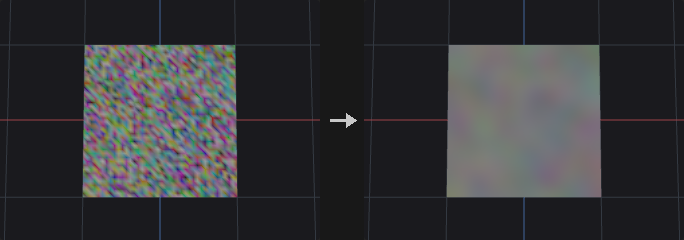

Not a spatial blur: values spread along edges (points) or across shared edges (primitives), so two pieces of geometry that are not connected never influence each other, however close they are. Typical uses are feathering scatter density maps, softening masks and turning hard `Connectivity` blocks into gradients.

Each iteration does `v += step * mask * (neighbour_average - v)`, an explicit heat diffusion. `step` is clamped to 0..1 because larger values oscillate and diverge; for a wider blur add iterations rather than increasing the step. There is deliberately no radius parameter: on a mesh with uneven edge lengths the same radius would be one step in sparse areas and ten in dense ones. The spread is roughly proportional to the square root of `iterations * step` edge lengths.

Elements outside `group`, or with a zero mask, are frozen (not written) but still contribute to their neighbours' averages, so the border of a blurred region is not held back by its own value. String attributes are skipped.

**Inputs**

| Input | Type | Description |
|---|---|---|
| `geo` | GEOMETRY | Geometry with connectivity and the attributes to blur. |

**Outputs**

| Output | Type | Description |
|---|---|---|
| `geo` | GEOMETRY | Copy of the input with the blurred attributes written back with their original types (integer attributes are rounded). |

**Parameters**

| Parameter | Type | Default | Description |
|---|---|---|---|
| Group `group` | string | *(empty)* | Group pattern restricting which elements are modified. Others stay unchanged but still feed the averages. |
| Attribute Class `attribute_class` | menu | Point | Point diffuses along edges; Primitive diffuses between faces that share an edge. Vertex and detail attributes have no neighbourhood and are not supported. Options: Point (`point`), Primitive (`prim`). |
| Attributes `attributes` | string | `Cd` | Attribute names to blur, space separated, wildcards allowed (for example `uv*` or `* ^P`). Only numeric attributes are blurred. It is an error if nothing matches. |
| Weighting Method `mode` | menu | Uniform | Uniform averages the neighbours equally. Edge Length weights each neighbour by the inverse of its distance (points only), so closer neighbours count more. Options: Uniform (`uniform`), Edge Length (`edge_length`). *Hidden when attribute_class = prim.* |
| Blurring Iterations `iterations` | int [0..1000] | 5 | Number of diffusion passes. More iterations spread values further. |
| Step Size `step` | float [0.0..1.0] | 0.5 | Fraction of the way each element moves toward its neighbour average per pass. Clamped to 0..1. |
| Mask Attribute `mask_attribute` | string | *(empty)* | Optional numeric attribute (clamped to 0..1) that scales the step per element. 0 leaves the element fixed, though its value still influences neighbours. |
| Invert Mask `invert_mask` | toggle | off | Use `1 - mask` instead of the mask. *Disabled when mask_attribute = "".* |

**Tips**

- Add iterations, not step, for a softer result.
- Blur a mask attribute before using it as a scatter density to avoid hard edges.

---

### Attribute Cast (PCG)

<a id="pcg-attribcast"></a>

`PCG_AttribCast` · category `PCG/attribute` · Houdini: Attribute Cast (SOP)

Changes the storage type of attributes between 32/64-bit float, 32/64-bit integer and string.

Converts the data type of every attribute matching the name pattern in the chosen class. float64 gives more precision at twice the memory, int32 halves it, and string attributes are handy for tagging. Float to integer **rounds to the nearest integer** rather than truncating (2.9 becomes 3), because truncation tends to look like an upstream error.

Converting to string writes the components of each element as a space-separated text. Converting a string attribute to a number parses the text and errors out on values that cannot be read as numbers. Strings are left alone when the target is also string.

**Inputs**

| Input | Type | Description |
|---|---|---|
| `geo` | GEOMETRY | Geometry with the attributes to convert. |

**Outputs**

| Output | Type | Description |
|---|---|---|
| `geo` | GEOMETRY | Copy of the input with the converted attributes. |

**Parameters**

| Parameter | Type | Default | Description |
|---|---|---|---|
| Class `attribute_class` | menu | Point | Attribute class to look in. Options: Point (`point`), Vertex (`vertex`), Primitive (`prim`), Detail (`detail`). |
| Attributes `attributes` | string | `*` | Attribute names to convert, space separated, wildcards allowed (`*` means all). It is an error if nothing matches. |
| Precision `to_type` | menu | 32-bit Float | Target storage type. Integer targets round to the nearest value. Options: 32-bit Float (`float32`), 64-bit Float (`float64`), 32-bit Integer (`int32`), 64-bit Integer (`int64`), String (`string`). |

---

### Attribute Composite (PCG)

<a id="pcg-attribcomposite"></a>

`PCG_AttribComposite` · category `PCG/attribute` · Houdini: Attribute Composite (SOP)

Composites a foreground attribute over a background attribute with a blend mode and alpha.

Blends attribute B (foreground) into attribute A (background) like image layers. The result is `A + alpha * (blend(A, B) - A)`, where `alpha` is the Alpha value multiplied by an optional per-element alpha attribute read from the foreground. The background comes from `geo`; the foreground comes from the `fg` input, or from `geo` itself when `fg` is not connected.

Foreground elements are paired with background elements by element number, or by the value of a match attribute (typically `id`; the first foreground element with that value is used). Background elements without a partner are left unchanged. Blend modes: over (take B), add, subtract, multiply, divide (A is kept where B is 0), screen, overlay (decided by A: below 0.5 multiplies, above screens), min, max, difference (absolute), average.

A single-component attribute is spread over the components of the other side. String attributes only support Over, in which case the foreground value is taken where alpha exceeds 0.5. The `report` output lists how many elements matched.

**Inputs**

| Input | Type | Description |
|---|---|---|
| `geo` | GEOMETRY | Geometry that provides the background attribute and receives the result. |
| `fg` *(optional)* | GEOMETRY | Optional geometry that provides the foreground attribute. If not connected, the foreground is read from `geo` itself. |

**Outputs**

| Output | Type | Description |
|---|---|---|
| `geo` | GEOMETRY | Copy of `geo` with the composited attribute written. |
| `report` | STRING | Text summary with the numbers of matched and unmatched elements. |

**Parameters**

| Parameter | Type | Default | Description |
|---|---|---|---|
| Class `attribute_class` | menu | Point | Attribute class of the background, foreground and result. Options: Point (`point`), Primitive (`prim`), Vertex (`vertex`), Detail (`detail`). |
| Background Attribute `bg_attribute` | string | `Cd` | Background attribute in `geo`. If it does not exist it is treated as zero. |
| Foreground Attribute `fg_attribute` | string | `Cd` | Foreground attribute, read from `fg` (or from `geo` when `fg` is not connected). It must exist. |
| Compositing Operation `mode` | menu | Over | Blend function applied between background and foreground, per component. Options: Over (`over`), Add (`add`), Subtract (`subtract`), Multiply (`multiply`), Divide (`divide`), Screen (`screen`), Overlay (`overlay`), Minimum (`min`), Maximum (`max`), Difference (`difference`), Mean (`average`). |
| Alpha `alpha` | float [0.0..1.0] | 1 | Global opacity of the foreground, 0 to 1. |
| Alpha Attribute `alpha_attribute` | string | *(empty)* | Optional numeric attribute on the foreground that multiplies Alpha per element. Unmatched elements get alpha 0. |
| Match By `match` | menu | Element Number | How foreground elements are paired with background elements: by element number or by a matching attribute. Options: Element Number (`index`), Attribute (`attribute`). *Hidden when attribute_class = detail.* |
| Match Attribute `match_attribute` | string | `id` | Attribute present on both sides whose values are compared when Match is By Attribute. *Hidden when match ≠ attribute } { attribute_class = detail.* |
| Output Attribute `output` | string | `Cd` | Name of the attribute to write. Empty writes back into the background attribute. |

**Compared with Houdini**

Foreground and background are attributes of geometry rather than image layers; the blend formulas are the common layer-blend equations.

---

### Attribute Copy (PCG)

<a id="pcg-attribcopy"></a>

`PCG_AttribCopy` · category `PCG/attribute` · Houdini: Attribute Copy (SOP), Group Copy (SOP)

Copies attributes and groups from a source geometry to a destination, element by element.

Moves attributes from `source` onto `dest` by **element number**, one to one. It is meant for the case where both sides were originally the same geometry (two branches that each computed something and are merged back). If topology has changed so numbers no longer line up, either match by an id attribute or use Attribute Transfer to look up by distance.

Elements whose number is beyond the source range keep their current value instead of being zero-filled; zero-filling would make an element-count mismatch look like a region of genuine zeros. With a match attribute, destination elements take the value from the first source element with the same value; those without a match are left alone. Groups listed in `groups` are copied with the same pairing.

**Inputs**

| Input | Type | Description |
|---|---|---|
| `dest` | GEOMETRY | Geometry that receives the attributes. |
| `source` | GEOMETRY | Geometry the attributes are read from. |

**Outputs**

| Output | Type | Description |
|---|---|---|
| `geo` | GEOMETRY | Copy of `dest` with the copied attributes and groups. |

**Parameters**

| Parameter | Type | Default | Description |
|---|---|---|---|
| Destination Group `group` | string | *(empty)* | Group pattern on `dest` limiting which elements are written. |
| Attribute Class `attribute_class` | menu | Point | Attribute class to copy within. Options: Point (`point`), Vertex (`vertex`), Primitive (`prim`), Detail (`detail`). |
| Attribute Name `attributes` | string | `Cd` | Names of source attributes to copy, space separated, wildcards allowed. It is an error if neither attributes nor groups match. |
| Copy Groups `groups` | string | *(empty)* | Names of source groups of this class to copy, wildcards allowed. They are paired the same way as the attributes. |
| Match by Attribute `match_attribute` | string | `id` | Attribute present on both geometries whose values pair the elements (typically `id`). Used only when Use Match Attribute is on. |
| Use Match Attribute `use_match_attribute` | toggle | off | Pair elements by Match Attribute instead of by element number. |

**Compared with Houdini**

Covers Attribute Copy and Group Copy together (the `groups` field).

---

### Attribute Create (PCG)

<a id="pcg-attribcreate"></a>

`PCG_AttribCreate` · category `PCG/attribute` · Houdini: Attribute Create (SOP)

Creates attributes and writes a constant or expression value, optionally only on a group.

Creates one or more attributes (names separated by spaces) of the chosen class and type and fills them with a value. If `group` is set, only the selected elements are written and the rest keep their existing value, or zero for a new attribute. This is the usual way to tag a subset of elements.

With Use Expression on, the value comes from a one-line wrangle expression evaluated per element (for example `@P.y` or `@ptnum % 3`) instead of the constant. The node exists to make the graph self-documenting: a named node reads better than another anonymous wrangle.

Types: Float and Integer use `size` components; Vector has 3 and Vector4 has 4; String writes `string_value`. Integer values are rounded. An existing attribute of a different component count is replaced.

**Inputs**

| Input | Type | Description |
|---|---|---|
| `geo` | GEOMETRY | Geometry to add the attributes to. |

**Outputs**

| Output | Type | Description |
|---|---|---|
| `geo` | GEOMETRY | Copy of the input with the new or updated attributes. |

**Parameters**

| Parameter | Type | Default | Description |
|---|---|---|---|
| Group `group` | string | *(empty)* | Group pattern restricting which elements are written. |
| Name `name` | string | `attrib` | Attribute name(s) to create, separated by spaces. Each one gets the same value. |
| Class `attribute_class` | menu | Point | Class that the attribute is created on. Options: Point (`point`), Vertex (`vertex`), Primitive (`prim`), Detail (`detail`). |
| Type `attribute_type` | menu | Float | Data type. Vector is three components, Vector4 four; Float and Integer use Size. Options: Float (`float`), Integer (`int`), Vector (`vector`), Vector4 (`vector4`), String (`string`). |
| Size `size` | int [1..4] | 1 | Number of components for Float and Integer attributes. *Hidden when attribute_type = vector } { attribute_type = vector4 } { attribute_type = string.* |
| Value `value_x` `value_y` `value_z` `value_w` | float | 0, 0, 0, 0 | Constant value. Only the first Size components (3 for Vector, 4 for Vector4) are used. *Hidden when attribute_type = string.* *Disabled when use_expression is on.* |
| String `string_value` | string | *(empty)* | Text written when the type is String. *Hidden when attribute_type ≠ string.* |
| Expression `expression` | string | `@P.y` | Wrangle-style expression evaluated per element when Use Expression is on. *Hidden when attribute_type = string.* |
| Use Expression `use_expression` | toggle | off | Use the expression instead of the constant value. |
| Only If Missing `only_if_missing` | toggle | off | Skip names that already exist on the geometry instead of overwriting them. |

---

### Attribute Delete (PCG)

<a id="pcg-attribdelete"></a>

`PCG_AttribDelete` · category `PCG/attribute` · Houdini: Attribute Delete (SOP)

Deletes attributes by name pattern on each attribute class, or keeps only the matching ones.

Each class has its own name pattern field. Patterns accept wildcards (`uv*` matches everything starting with `uv`) and exclusions (`* ^P ^N` means all but `P` and `N`). An **empty field leaves that class untouched**, which matters especially with Delete Non Selected: an empty field is not interpreted as select-all. The point position `P` is never deleted, since geometry without positions is invalid.

**Inputs**

| Input | Type | Description |
|---|---|---|
| `geo` | GEOMETRY | Geometry to remove attributes from. |

**Outputs**

| Output | Type | Description |
|---|---|---|
| `geo` | GEOMETRY | Copy of the input without the deleted attributes. |

**Parameters**

| Parameter | Type | Default | Description |
|---|---|---|---|
| Point Attributes `point` | string | *(empty)* | Point attribute names to delete, space separated, wildcards allowed. Empty leaves point attributes alone. |
| Vertex Attributes `vertex` | string | *(empty)* | Vertex attribute names to delete. Empty leaves vertex attributes alone. |
| Primitive Attributes `prim` | string | *(empty)* | Primitive attribute names to delete. Empty leaves primitive attributes alone. |
| Detail Attributes `detail` | string | *(empty)* | Detail attribute names to delete. Empty leaves detail attributes alone. |
| Delete Non Selected `delete_non_selected` | toggle | off | Delete everything that does not match instead. Classes with an empty field are still left alone. |

---

### Attribute Fade (PCG)

<a id="pcg-attribfade"></a>

`PCG_AttribFade` · category `PCG/attribute`

Writes a spatial falloff attribute that is full inside a group and fades out with distance from it.

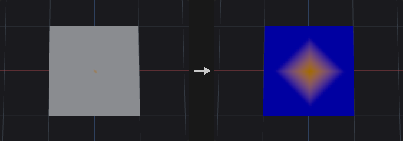

Starting from `group`, each element receives a value based on how far it is from the group. Elements inside the group get Inside Value; elements farther than `radius` get Outside Value; in between, the distance `d` is converted to `1 - d / radius`, shaped by the falloff ramp, and interpolated between Outside and Inside Value. Distance is measured either in edge steps or in world units along the surface, depending on Metric.

The usual use is a mask for Transform, Attribute Adjust or Noise ("lift only this area, with a smooth edge"). The ramp defaults to Smooth rather than Linear because a linear ramp has a slope discontinuity at the group border that shows up as a visible ridge when displaced.

With From Boundary on, the falloff runs on the inside of the group instead: the ring of elements touching the boundary is 0 and values rise toward 1 in the interior (full value beyond `radius` from the boundary); everything outside the group is 0. That produces a soft selection that is only full in the centre.

The group must select at least one element, otherwise the node errors (an empty group is treated as the empty set, not as all elements).

**Inputs**

| Input | Type | Description |
|---|---|---|
| `geo` | GEOMETRY | Geometry to write the fade attribute on. |

**Outputs**

| Output | Type | Description |
|---|---|---|
| `geo` | GEOMETRY | Copy of the input with the fade attribute written. |

**Parameters**

| Parameter | Type | Default | Description |
|---|---|---|---|
| Group `group` | string | *(empty)* | Group pattern the fade starts from. It must select at least one element. |
| Class `cls` | menu | Point | Attribute class that the fade is computed and stored on (points or primitives). Distance on primitives is measured across shared edges. Options: Point (`point`), Primitive (`prim`). |
| Attribute Name `attribute_name` | string | `fade` | Name of the output attribute. If it already exists as a single-component attribute it keeps its type and is combined according to Combine. |
| Distance Metric `metric` | menu | Edge Steps | Steps counts edge hops from the group; Distance measures world-space distance along the mesh. Options: Edge Steps (`steps`), Distance (`distance`). |
| Radius `radius` | float [0.0..] | 3 | Fade length: number of steps or world distance (according to Metric) over which the value falls from inside to outside. |
| From Group Boundary `from_boundary` | toggle | off | Fade toward the boundary from within the group instead of outward from it, giving a soft selection that is full only in the middle. |

*Falloff*

| Parameter | Type | Default | Description |
|---|---|---|---|
| Falloff Ramp `falloff_ramp` | string | `0:0  1:1` | Ramp that shapes the falloff. The horizontal axis is `1 - d / radius` (0 at the far edge, 1 at the group), the vertical axis is the result before Inside / Outside scaling. Written as `position:value` pairs. |
| Ramp Mode `ramp_mode` | menu | Smooth | Interpolation between ramp points. Smooth avoids the visible crease that Linear leaves at the group border. Options: Linear (`linear`), Smooth (`smooth`), Constant (`constant`). |
| Inside Value `inside_value` | float | 1 | Value at the full end of the ramp (inside the group). |
| Outside Value `outside_value` | float | 0 | Value at the far end of the ramp (beyond the radius). |
| Invert Ramp `invert` | toggle | off | Invert the ramp result (`1 - v`) before applying Inside and Outside Value. |
| Combine `combine` | menu | Set | How the new fade merges with an existing attribute of the same name: Set replaces it; Add, Multiply, Max and Min combine per element. A missing attribute counts as 0 (1 for Multiply). Options: Set (`set`), Add (`add`), Multiply (`multiply`), Maximum (`max`), Minimum (`min`). |

**Tips**

- Plug the fade attribute into a mask-aware node such as Attribute Adjust or Transform to get smooth localized edits.

---

### Attribute Fade · Time (PCG)

<a id="pcg-attribfadetime"></a>

`PCG_AttribFadeTime` · category `PCG/attribute` · Houdini: Attribute Fade (SOP)

Fades a point attribute in, holds it, and fades it out over time using per-point start frames.

Time-based fade, following the Houdini Attribute Fade SOP. For each point the local time is `t = Frame - start`, where `start = start_attribute * start_retime + frame_offset` (0 if the start attribute is missing). Then:

- `0 <= t < fade_in`: fading in, evaluated through the Fade In Ramp at `t / fade_in`.
- `fade_in <= t < fade_in + hold`: fully on (1), where `hold = fade_hold * holdscale` (scale is 1 if the attribute is missing).
- Next `fade_out` frames: fading out through the Fade Out Ramp.
- Before the start or after the end: 0.

The result is `original * fade`; if the attribute does not exist it is created from 1, so it holds the fade itself. Only points in `group` are changed; others keep their value (or 1 for a newly created attribute). Phases with zero length are skipped.

The second and third inputs can supply the start frame and the hold scale instead of reading them from `geo`; they are matched by point number, so the point counts must be equal. The `report` output counts points at zero, fully on and mid-fade.

**Inputs**

| Input | Type | Description |
|---|---|---|
| `geo` | GEOMETRY | Points whose attribute is faded. |
| `start_geo` *(optional)* | GEOMETRY | Optional geometry to read the start frame attribute from (matched by point number, same point count as `geo`). |
| `hold_geo` *(optional)* | GEOMETRY | Optional geometry to read the hold scale attribute from (matched by point number, same point count as `geo`). |

**Outputs**

| Output | Type | Description |
|---|---|---|
| `geo` | GEOMETRY | Copy of `geo` with the faded attribute. |
| `report` | STRING | Text summary of how many points are at zero, fully on and fading. |

**Parameters**

| Parameter | Type | Default | Description |
|---|---|---|---|
| Visualize Fade `visualize` | toggle | off | Also write the fade value into `Cd` of the points in the group, for a quick look at the result. |
| Point Group `group` | string | *(empty)* | Point group pattern limiting which points are faded. |

*Attributes*

| Parameter | Type | Default | Description |
|---|---|---|---|
| Fade `fade_attribute` | string | `fade` | Point attribute that is multiplied by the fade. If it does not exist, it is created with the fade value itself. |
| Fade Start Frame `start_attribute` | string | `fadestart` | Point attribute holding each point's start frame (from `start_geo` if connected). A missing attribute means start 0. |
| Start Frame Retime `start_retime` | float | 1 | Multiplier from the start attribute value to frames. Use the frame rate if the attribute stores seconds. |
| Hold Frame Scale `hold_scale_attribute` | string | `holdscale` | Point attribute that multiplies the hold duration per point (from `hold_geo` if connected). A missing attribute means 1. |

*Timings*

| Parameter | Type | Default | Description |
|---|---|---|---|
| Frame `frame` | float | 1 | Current frame. ComfyUI has no global timeline, so drive this from a playbar or value node. |
| Frame Offset `frame_offset` | float | 0 | Frames added to every start frame. |
| Fade In Frames `fade_in` | float [0.0..] | 10 | Duration of the fade-in, in frames. |
| Fade Hold Frames `fade_hold` | float [0.0..] | 10 | Duration of the fully-on phase, in frames, before being scaled by the hold scale attribute. |
| Fade out Frames `fade_out` | float [0.0..] | 10 | Duration of the fade-out, in frames. |
| Fade In Ramp `fade_in_ramp` | string | `0:0 1:1` | Curve for the fade-in. Horizontal axis is progress through the fade-in, vertical axis is the fade value. Written as `position:value` pairs. |
| Fade in Ramp Mode `fade_in_ramp_mode` | menu | Linear | Interpolation between fade-in ramp points. Options: Linear (`linear`), Smooth (`smooth`), Constant (`constant`). |
| Fade Out Ramp `fade_out_ramp` | string | `0:1 1:0` | Curve for the fade-out. Horizontal axis is progress through the fade-out, vertical axis is the fade value (the default goes from 1 down to 0). |
| Fade Out Ramp Mode `fade_out_ramp_mode` | menu | Linear | Interpolation between fade-out ramp points. Options: Linear (`linear`), Smooth (`smooth`), Constant (`constant`). |

**Compared with Houdini**

The current frame is an explicit parameter instead of the global time. Both ramps hold the actual fade value (fade-out is not reversed internally). Start Frame Retime is a single multiplier rather than a from/to pair. Spatial falloff from a group is the separate Attribute Fade node.

---

### Attribute Fill (PCG)

<a id="pcg-attribfill"></a>

`PCG_AttribFill` · category `PCG/attribute` · Houdini: Attribute Fill (SOP)

Fills a point attribute from known points to the remaining points along mesh connectivity.

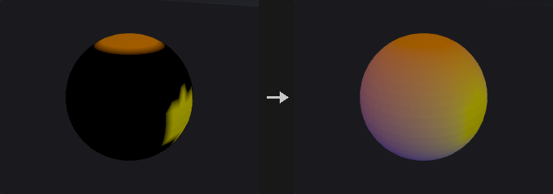

The attribute is meaningful only on the *known* points (the `known_group`; if empty, the points whose attribute is not all zero). Values are propagated to the other points through the mesh edges, so disconnected pieces never exchange values. Points not connected to any known point keep their value (Poisson writes 0 there, Eikonal writes Unreachable Time).

Methods:

- **Harmonic** solves a Laplace equation with the known values as boundary conditions (conjugate gradient). The result is smooth and has no overshoot; extremes occur only on known points.
- **Nearest** copies the value of the closest known point measured along edges.
- **Diffuse** runs `iterations` of weighted averaging with the known points pinned. Few iterations give a soft transition near the known points; many converge to Harmonic.
- **Eikonal** writes the travel time along edges from the Boundary Group (`edge length / speed at the departing point`). It does not read the input values and requires a group. It follows edges, it is not a fast-marching solver.
- **Poisson** is a harmonic fill with edge weights `1 / edge length`, optionally guided by the gradient of Attribute to Match.
- **Diffusion** performs one implicit diffusion step from the current values; known points act as fixed sources. Without a group nothing is fixed. Repeat the node for more steps.
- **Extrapolate** copies values outward from the known points along shortest paths, either as plain scalars or, for vectors, by parallel transport of the tangential part.

The `report` output lists how many points were known, filled and unreachable.

**Inputs**

| Input | Type | Description |
|---|---|---|
| `geo` | GEOMETRY | Geometry with a point attribute to fill. |

**Outputs**

| Output | Type | Description |
|---|---|---|
| `geo` | GEOMETRY | Copy of the input with the filled point attribute. |
| `report` | STRING | Text summary with the numbers of known, filled and unreachable points. |

**Parameters**

| Parameter | Type | Default | Description |
|---|---|---|---|
| Mode `method` | menu | Harmonic (Laplace) | Fill algorithm; see the node description. Harmonic, Nearest and Diffuse use Weights and Iterations as applicable; the last four options correspond to Houdini's modes and use the parameters below. Options: Harmonic (Laplace) (`harmonic`), Nearest Known Point (`nearest`), Diffuse (`diffuse`), Eikonal (`eikonal`), Poisson (`poisson`), Diffusion (`diffusion`), Extrapolate (`extrapolate`). |
| Attribute `attribute` | string | `Cd` | Point attribute to fill. It must exist and be numeric, except for Eikonal which creates it. |
| Speed Attribute `speed_attribute` | string | *(empty)* | Optional point attribute giving the propagation speed for Eikonal and Diffusion. Values are limited below by Minimum Speed. *Hidden when method ≠ eikonal method ≠ diffusion.* |
| Attribute to Match `match_attribute` | string | *(empty)* | Optional attribute for Poisson whose differences between neighbours guide the fill (Attribute to Match). *Hidden when method ≠ poisson.* |
| Weight Attribute `weight_attribute` | string | *(empty)* | Optional point attribute (0..1) that controls how strongly Attribute to Match guides the Poisson fill. *Hidden when method ≠ poisson.* *Disabled when match_attribute = "".* |
| Boundary Group `known_group` | string | *(empty)* | Point group of known points (Boundary Group for the Houdini-style methods). Empty uses the points where the attribute is not all zero; Eikonal requires a group, Diffusion treats empty as no fixed sources. |
| Edge Weights `weights` | menu | Uniform | Edge weighting for Harmonic and Diffuse: Uniform gives every edge weight 1, Inverse Length gives shorter edges more weight. Options: Uniform (`uniform`), Inverse Edge Length (`inverse_length`). *Hidden when method ≠ harmonic method ≠ diffuse.* |
| Iterations `iterations` | int [1..] | 50 | Number of averaging passes for Diffuse. *Hidden when method ≠ diffuse.* |
| Minimum Edge Length `min_edge_length` | float [0.0..] | 1e-06 | Lower limit on edge length used in the Poisson and Diffusion weights, to avoid division by tiny lengths. *Hidden when method ≠ poisson method ≠ diffusion.* |
| Minimum Speed `min_speed` | float [0.0..] | 0.001 | Lower limit on speed for Eikonal and Diffusion. *Hidden when method ≠ eikonal method ≠ diffusion.* |
| Diffusion Time `diffusion_time` | float [0.0..] | 1 | Time step of the implicit Diffusion step. Larger values spread further. *Hidden when method ≠ diffusion.* |
| Unreachable Time `unreachable_time` | float | -1 | Value written by Eikonal on points that cannot be reached from the group. *Hidden when method ≠ eikonal.* |
| Extrapolation Type `extrapolation` | menu | Scalar | Extrapolate behaviour. Scalar copies the value from the source point; Parallel Transport carries the tangent part of a vector attribute along the surface (needs 3 components, uses `N` or computed normals). Options: Scalar (`scalar`), Parallel Transport (`parallel_transport`). *Hidden when method ≠ extrapolate.* |
| Tangential Component Only `tangential_only` | toggle | on | For Parallel Transport, write only the tangential part; when off, the normal component is copied from the source as in Scalar mode. *Hidden when method ≠ extrapolate.* *Disabled when extrapolation = scalar.* |
| Global Rotation `global_rotation` | float [-360.0..360.0] | 0 | Extra rotation in degrees about the normal, applied to the transported tangent vectors. *Hidden when method ≠ extrapolate.* *Disabled when extrapolation = scalar.* |

**Compared with Houdini**

Harmonic, Nearest and Diffuse are this plugin's methods; Eikonal, Poisson, Diffusion and Extrapolate correspond to Houdini's modes. Eikonal travels along mesh edges, so the result is edge-path distance rather than a surface-accurate fast-marching time. Where Houdini does not specify the guide strength on edges for Poisson, the average of the two endpoint weights is used.

---

### Attribute from Camera (PCG)

<a id="pcg-attribfromcamera"></a>

`PCG_AttribFromCamera` · category `PCG/attribute` · Houdini: Position Sample (COP)

Projects an image onto geometry through a camera, with visibility testing, and writes an attribute plus visible and mask groups.

Samples an image layer at the screen position of each element as seen by the camera. It does not need UVs, which makes it suitable for freshly imported meshes. A typical use is turning an AI-generated mask into a group: render a pass, feed it to a diffusion model, project the result back, and use `mask_group` to drive Blast, Fracture, PolyExtrude or Scatter, so the AI only decides *where* and the rest of the graph stays deterministic.

Plain camera projection ignores occlusion, so the back of a sphere would get the same color as the front. This node has four visibility levels: **All** (no test), **Frustum** (inside the image and in front of the camera), **Front** (adds a facing test against `normal_attrib`), and **Full** (adds occlusion, the default). Occlusion rasterizes the *whole* geometry from the camera, so objects outside `group` still hide others; `group` only limits what is written. Occlusion passes when the triangle visible at the element's pixel (searched in a 3x3 pixel neighbourhood) contains the element, or when its depth is within the bias of the visible depth.

Two groups are the point of the node: `visible_group` holds the elements the camera can see (for coverage checks across several cameras), `mask_group` holds visible elements whose written value reaches `threshold`. The test uses the value after scale and offset.

Elements that are not visible are handled by Missing: keep the old value (what multi-camera accumulation needs), write zero, or write a fixed value. The three extra outputs report the visible count, the coverage fraction and a text summary of the elements rejected (outside the frame, back-facing, occluded).

**Inputs**

| Input | Type | Description |
|---|---|---|
| `geo` | GEOMETRY | Geometry to project onto and write attributes on. |
| `cam` | PCGCAM | Camera used for the projection and for the visibility test. |
| `cop` | COPIMAGE | Image to sample (COP image). |

**Outputs**

| Output | Type | Description |
|---|---|---|
| `geo` | GEOMETRY | Copy of the input with the sampled attribute and the optional groups and UV attribute. |
| `visible` | INT | Number of elements the camera sees (and that are in `group`). |
| `coverage` | FLOAT | Visible elements as a fraction of all elements of the class. |
| `info` | STRING | Text summary: visible/total, and counts of elements outside the frame, back-facing and occluded. |

**Parameters**

| Parameter | Type | Default | Description |
|---|---|---|---|
| Group `group` | string | *(empty)* | Group pattern limiting which elements are written. Occlusion still uses all geometry. Unselected elements count as not written for the groups. |
| Class `class` | menu | Point | Attribute class that is projected onto. Points and vertices use the point position; primitives use their center, so a large face can switch visibility as a whole at occlusion edges. Options: Point (`point`), Vertex (`vertex`), Primitive (`prim`). |
| Export Attribute `name` | string | `Cd` | Name of the attribute written. New attributes are created as floats. |

*Sampling*

| Parameter | Type | Default | Description |
|---|---|---|---|
| Layer `layer` | string | `C` | Name of the image layer to sample, such as `C` for color. |
| Channels `channels` | string | *(empty)* | Channels to keep: empty for all, or a comma-separated list of channel indices such as `0` or `0,2`. |
| Decode `decode` | menu | None | Color transform applied to the sampled values. Use sRGB to Linear when the image is used as a number (displacement, density, `pscale`), since an encoded 0.5 is only about 0.214 in linear terms. Options: None (`none`), sRGB to Linear (`srgb_to_linear`), Linear to sRGB (`linear_to_srgb`). |
| Filter `filter` | menu | Bilinear | Bilinear interpolates between pixels; Closest takes the nearest pixel. Options: Bilinear (`bilinear`), Closest (`closest`). |
| Border `border` | menu | Clamp | Behaviour outside the image: Clamp repeats the edge pixels, Wrap tiles the image, Black returns zero. Options: Clamp (`clamp`), Wrap (`wrap`), Black (`black`). |
| Scale `scale` | float | 1 | Multiplier applied to the sampled values (after decode). |
| Offset `offset` | float | 0 | Value added after the scale. |
| Blend `blend` | float [0.0..1.0] | 1 | Mix between the existing attribute value (0) and the sampled value (1). A missing attribute counts as 0, and component counts are broadcast to match. |

*Visibility*

| Parameter | Type | Default | Description |
|---|---|---|---|
| Visibility Test `visibility` | menu | All (No Test) | How strict the visibility test is: All (no test), Frustum (in frame and in front of the camera), Front (plus facing), Full (plus occlusion). Options: All (No Test) (`all`), In Frustum (`frustum`), Frustum + Facing (`front`), Frustum + Facing + Occlusion (`full`). |
| Border Margin `border_margin` | float [0.0..0.49] | 0 | Fraction of the image width and height at the border that counts as outside the frame. *Hidden when visibility = all.* |
| Min Facing `facing_min` | float [-1.0..1.0] | 0.1 | Minimum cosine between the normal and the direction to the camera for Front and Full. The default 0.1 rejects grazing angles, where sampling is unreliable anyway. Elements without a normal are not tested. *Hidden when visibility = all } { visibility = frustum.* |
| Normal Attribute `normal_attrib` | string | `N` | Normal attribute used for the facing test; computed on the fly when missing. *Hidden when visibility = all } { visibility = frustum.* |
| Occlusion Test `occlusion` | menu | Element ID + Depth | Criterion for Full visibility. Element + Depth accepts an element if its own triangle is visible at its pixel or its depth matches; Element uses only the triangle test; Depth uses only the depth comparison, which misjudges grazing angles. Options: Element ID + Depth (`element+depth`), Element ID (`element`), Depth (`depth`). *Hidden when visibility ≠ full.* |
| Depth Bias `depth_bias` | float [0.0..10.0] | 0.01 | Depth tolerance for the occlusion test, as a fraction of the bounding-sphere radius of the geometry, so it behaves the same for any model scale. *Hidden when visibility ≠ full } { occlusion = element.* |
| Silhouette Guard `silhouette_guard` | int [0..64] | 1 | Number of pixels to erode the rasterized silhouette by before testing occlusion. Removes unreliable elements at the very edge of the shape. 0 disables the guard. *Hidden when visibility ≠ full.* |

*Visibility › Not Visible*

| Parameter | Type | Default | Description |
|---|---|---|---|
| Not Visible `missing` | menu | Keep Original | What to write on elements that are not visible: Keep Original leaves the previous value (zero for a new attribute), Zero writes 0, Value writes the Missing Value. Options: Keep Original (`keep`), Zero (`zero`), Value (`value`). *Hidden when visibility = all.* |
| Value `missing_value` | float | 0 | Value written on invisible elements when Missing is Value. *Hidden when visibility = all } { missing ≠ value.* |

*Output*

| Parameter | Type | Default | Description |
|---|---|---|---|
| Visible Group `visible_group` | string | *(empty)* | Name of a group to create with the visible elements. Empty means no group. |
| Mask Group `mask_group` | string | *(empty)* | Name of a group to create with the visible elements whose attribute value is at least `threshold`. Empty means no group. |
| Threshold `threshold` | float | 0.5 | Threshold on the written value for `mask_group` (after scale, offset and blend). *Disabled when mask_group = "".* |
| Threshold Channel `threshold_channel` | int [0..63] | 0 | Component of the written attribute that is tested against the threshold. It must exist. *Disabled when mask_group = "".* |
| Screen UV Attribute `uv_name` | string | *(empty)* | If not empty, also write the projected screen UV (0..1) of every element into an attribute of this name. |

**Compared with Houdini**

Corresponds to a Position Sample in a COP network combined with a camera projection, with visibility, occlusion and group creation built in.

**Tips**

- Use visibility Full with Missing = Keep Original to accumulate paint from several cameras without the second pass erasing the first.
- The depth bias is relative to model size, so imported meshes of any scale work with the default.

---

### Attribute from Map (PCG)

<a id="pcg-attribfrommap"></a>

`PCG_AttribFromMap` · category `PCG/attribute` · Houdini: Attribute from Map (SOP), Attribute from Layer (COP), Geometry Attribute from Layer (COP)

Samples an image layer at the UVs of each element and writes the result as an attribute.

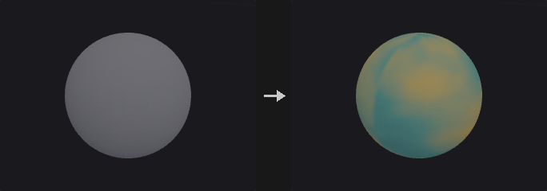

The main way to bring an image (for example a mask or color map generated by a diffusion model) back onto geometry. The image comes from a COP network, the UVs from a `uv` attribute on the geometry.

UVs live on vertices, so writing to points is ambiguous at UV seams, where one point has several UVs. The class decides what happens: **Vertex** uses the vertex UV directly (recommended, no ambiguity); **Point** uses the UV of the first incident vertex (not an average, since averaging u=0 and u=1 at a seam would sample the middle of the image); **Primitive** averages the UVs of all its vertices. The `info` output reports how many points lie on seams.

Bilinear sampling reconstructs the image exactly in the interior; the half-pixel at the borders is governed by the border mode. Remember to use sRGB to Linear when treating the image as numeric data.

**Inputs**

| Input | Type | Description |
|---|---|---|
| `geo` | GEOMETRY | Geometry with UVs that receives the attribute. |
| `cop` | COPIMAGE | Image to sample (COP image). |

**Outputs**

| Output | Type | Description |
|---|---|---|
| `geo` | GEOMETRY | Copy of the input with the sampled attribute. |
| `info` | STRING | Text summary: element count, component count, and the number of points on UV seams. |

**Parameters**

| Parameter | Type | Default | Description |
|---|---|---|---|
| Group `group` | string | *(empty)* | Group pattern limiting which elements are written. Others keep their current value (zero for a new attribute). |
| Class `class` | menu | Point | Attribute class that is written, which also selects how UVs are fetched. Vertex is the safest because UVs are stored on vertices. Options: Point (`point`), Vertex (`vertex`), Primitive (`prim`). |
| Texture Layer `layer` | string | `C` | Name of the image layer to sample, such as `C` for color. |
| Export Attribute `name` | string | `Cd` | Name of the attribute written. New attributes are created as floats. |

*Color*

| Parameter | Type | Default | Description |
|---|---|---|---|
| Color Channels `channels` | string | *(empty)* | Channels to keep: empty for all, or a comma-separated list of channel indices such as `0` or `0,2`. |
| Decode `decode` | menu | None | Color transform applied to the sampled values. Use sRGB to Linear when the image is used as a number (displacement, density, `pscale`), since an encoded 0.5 is only about 0.214 in linear terms. Options: None (`none`), sRGB to Linear (`srgb_to_linear`), Linear to sRGB (`linear_to_srgb`). |
| Scale `scale` | float | 1 | Multiplier applied to the sampled values (after decode). |
| Offset `offset` | float | 0 | Value added after the scale. |
| Blend `blend` | float [0.0..1.0] | 1 | Mix between the existing attribute value (0) and the sampled value (1). A missing attribute counts as 0, and component counts are broadcast to match. |

*Filter*

| Parameter | Type | Default | Description |
|---|---|---|---|
| Filter Type `filter` | menu | Bilinear | Bilinear interpolates between pixels; Closest takes the nearest pixel. Options: Bilinear (`bilinear`), Closest (`closest`). |
| Wrap `border` | menu | Clamp | Behaviour outside the image: Clamp repeats the edge pixels, Wrap tiles the image, Black returns zero. Options: Clamp (`clamp`), Wrap (`wrap`), Black (`black`). |

*UV*

| Parameter | Type | Default | Description |
|---|---|---|---|
| UV Attribute `uv_attrib` | string | `uv` | Name of the UV attribute. |
| UV Source `uv_from` | menu | Automatic | Where to read the UV attribute: Auto prefers the vertex attribute and falls back to the point attribute. Options: Automatic (`auto`), Vertex (`vertex`), Point (`point`). |
| UV Scale `uv_scale_u` `uv_scale_v` | float [-10000.0..10000.0] | 1, 1 | Multiplier on u and v before sampling, for tiling the image. The second value scales v. |
| UV Translate `uv_offset_u` `uv_offset_v` | float [-10000.0..10000.0] | 0, 0 | Offset added to u and v after scaling. The second value offsets v. |

**Compared with Houdini**

Also covers sampling an image layer in a COP network (Attribute from Layer, Geometry Attribute from Layer) since the image is taken from a COP input. UV scale and offset are built in so a texture can be tiled without a separate UV Transform.

---

### Attribute from Pieces (PCG)

<a id="pcg-attribfrompieces"></a>

`PCG_AttribFromPieces` · category `PCG/attribute` · Houdini: Attribute From Pieces (SOP)

Assigns each element or piece a variant from a weighted library and writes it as an attribute.

Chooses a **variant** for every element (or for every piece, when a piece attribute is given) and writes it to `output`. Connected to Copy to Points as its piece attribute, it gives "several rocks scattered by weight".

Variants come from the `library` input: each distinct value of `library_attribute` is one variant (in order of first appearance), weighted by `weight_attribute`. Without a library, the variants are the integers 0 to Count-1 and the weights are typed into Weights. Random choices use a hash keyed on the element's `id` (if present) or its number, or on the piece key, so they are stable when upstream elements are added or removed.

Modes:

- **Random**: weighted random.
- **Cycle**: variants in turn (element k gets variant k mod N); with Use ID Attribute the id value replaces k.
- **By Attribute** (Map Attribute): the variant is looked up from `input_attribute` according to Map Pieces From.
- **Patches**: points in the same Worley noise cell share a variant, chosen by weight.
- **Noise**: the noise value, mapped to 0..1, is quantized through the cumulative weights, so variants form coherent clusters.
- **VEXpression**: each line of Rules is `piece names : expression`; the first line whose expression is non-zero decides.

Order is affected by Piece Filter, Shuffle and Offset, which matters for Cycle, Automatic ranges and the index output. Elements that match no rule get Unmatched Piece. Copy Attributes aggregates library attributes per piece (with the promotion method) and writes them onto the elements that picked that piece. The `report` output lists how many elements each variant received.

**Inputs**

| Input | Type | Description |
|---|---|---|
| `geo` | GEOMETRY | Geometry whose elements receive variants. |
| `library` *(optional)* | GEOMETRY | Optional geometry that defines the variants (and their weights). Without it the variants are the integers 0 to Count-1. |

**Outputs**

| Output | Type | Description |
|---|---|---|
| `geo` | GEOMETRY | Copy of `geo` with the variant attribute (and optional index and copied attributes). |
| `report` | STRING | Text summary with the number of elements per variant, and the unmatched count in rule-based modes. |

**Parameters**

| Parameter | Type | Default | Description |
|---|---|---|---|
| Group `group` | string | *(empty)* | Group pattern limiting which elements get a variant. Others keep their value. |
| Attribute Class `attribute_class` | menu | Point | Class on which the variant attribute is written. Options: Point (`point`), Primitive (`prim`), Vertex (`vertex`). |
| Piece Attribute `piece_attribute` | string | *(empty)* | If set, elements sharing the same value of this attribute get the same variant (the piece is the unit that is assigned). Empty assigns per element. |
| Mode `mode` | menu | Random | How variants are chosen; see the node description. Options: Random (`random`), Cycle (`cycle`), Map Attribute (`by_attribute`), Patches (`patches`), Noise (`noise`), VEXpression (`vexpression`). |
| Number of Pieces `count` | int [1..] | 4 | Number of variants (0 to Count-1) when no library is connected. |
| Library Attribute `library_attribute` | string | `name` | Attribute on the library (primitives, or points if there are no primitives) whose distinct values are the variants. Used only with a library. |
| Piece Filter `piece_filter` | string | *(empty)* | Space-separated variant names to keep; empty keeps all. It is an error if nothing matches. |
| Copy Attributes `copy_attributes` | string | *(empty)* | Library attributes to copy onto elements, per piece (wildcards allowed). Requires a library. Piece values are combined with the Promotion Method; primitive attributes are read first, then point attributes of the piece's points. |
| Allow P Attribute `allow_p` | toggle | off | Allow `P` to be matched by Copy Attributes. *Disabled when copy_attributes = "".* |
| Promotion Method `promotion` | menu | First Match | How the values of a piece are combined for Copy Attributes. String attributes support only max, min, mode, median, first and last. Options: Maximum (`max`), Minimum (`min`), Average (`mean`), Mode (`mode`), Median (`median`), Sum (`sum`), Sum of Squares (`sum_squares`), Root Mean Square (`rms`), First Match (`first`), Last Match (`last`). *Disabled when copy_attributes = "".* |
| Output Attribute `output` | string | `variant` | Name of the variant attribute. A string attribute if the library values are strings, otherwise an integer. |
| Index Attribute `index_output` | string | *(empty)* | Optional name of an integer attribute that receives the variant's index in the (filtered and ordered) list. Empty writes nothing. |

*Pieces*

| Parameter | Type | Default | Description |
|---|---|---|---|
| Shuffle `shuffle` | toggle | off | Randomly reorder the variants using the seed. |
| Seed `rand_seed` | int [0..] | 0 | Seed for random choices, shuffle, Patches and Noise. |
| Offset `offset` | int | 0 | Rotate the variant order by this many places. |

*Source Points*

| Parameter | Type | Default | Description |
|---|---|---|---|
| ID Attribute `id_attribute` | string | `id` | Numeric attribute used instead of the element number by Cycle when Use ID Attribute is on. |
| Override Ptnum `use_id_attribute` | toggle | off | Make Cycle use `id_attribute` values instead of the element number. |
| Location Attribute `location_attribute` | string | `P` | Position attribute sampled for Patches and Noise. For pieces, the piece's mean position is used. *Hidden when mode ≠ patches mode ≠ noise.* |

*Patches / Noise*

| Parameter | Type | Default | Description |
|---|---|---|---|
| Element Size `element_size` | float [1e-06..] | 1 | Cell or noise feature size for Patches and Noise. *Hidden when mode ≠ patches mode ≠ noise.* |
| Element Scale `element_scale_x` `element_scale_y` `element_scale_z` | float [1e-06..] | 1, 1, 1 | Per-axis scale multiplied with the element size. *Hidden when mode ≠ patches mode ≠ noise.* |
| Offset `noise_offset_x` `noise_offset_y` `noise_offset_z` | float | 0, 0, 0 | Offset subtracted from the position before dividing by the size. *Hidden when mode ≠ patches mode ≠ noise.* |
| Noise Type `noise_type` | menu | Perlin | Noise basis for Noise mode. Options: Value (`value`), Perlin (`perlin`), Simplex (`simplex`), Worley Cellular F1 (`worley`), Worley Cellular F2-F1 (`worley_f2f1`). *Hidden when mode ≠ noise.* |
| Max Octaves `max_octaves` | int [1..16] | 1 | Octaves for Noise mode. Above 1 uses standard fractal summation with lacunarity 2. *Hidden when mode ≠ noise.* |
| Roughness `roughness` | float [0.0..1.0] | 0.5 | Amplitude falloff per octave for Noise mode. *Hidden when mode ≠ noise.* |

*Random*

| Parameter | Type | Default | Description |
|---|---|---|---|
| Weight Method `weight_method` | menu | Automatic (legacy) | Where weights come from. Auto reads the library's weight attribute (first occurrence of each variant) or, without a library, the Weights text. Uniform gives equal weights. Piece Weights uses the Weights text. Weight Attribute averages the weight attribute over all primitives of each variant (library required). Options: Automatic (legacy) (`auto`), Uniform Distribution (`uniform`), Piece Weights (`piece_weights`), Weight Attribute (`weight_attribute`). *Hidden when mode = cycle } { mode = vexpression } { mode = by_attribute map_from ≠ weighted_unit.* |
| Piece Weights `weights` | string | *(empty)* | Weights typed as numbers in variant order (`3 1 1 1`), or as `name:weight` pairs for Piece Weights, where unlisted pieces get weight 0. *Hidden when mode = cycle } { mode = vexpression } { mode = by_attribute map_from ≠ weighted_unit } { weight_method = uniform } { weight_method = weight_attribute.* |
| Weight Attribute `weight_attribute` | string | `weight` | Attribute on the library giving weights. Used with a library. *Hidden when mode = cycle } { mode = vexpression } { mode = by_attribute map_from ≠ weighted_unit } { weight_method = uniform } { weight_method = piece_weights.* |

*Map Attribute*

| Parameter | Type | Default | Description |
|---|---|---|---|
| Attribute `input_attribute` | string | *(empty)* | Attribute read by By Attribute mode: a 0..1 scalar for Weighted Unit, any numeric scalar for Automatic and Explicit, a string attribute for String. Pieces average their element values. *Hidden when mode ≠ by_attribute.* |
| Map Pieces From `map_from` | menu | Weighted 0-1 (legacy) | How By Attribute maps values to variants. Weighted Unit looks up the 0..1 value in the cumulative weights; Automatic splits the value range into equal parts, one per variant, ignoring weights; Explicit and String use Rules. Options: Weighted 0-1 (legacy) (`weighted_unit`), Automatic Ranges (`automatic`), Explicit Ranges (`explicit`), String Values (`string`). *Hidden when mode ≠ by_attribute.* |
| Rules `rules` | string | *(empty)* | Rules for Explicit, String and VEXpression, one per line as `piece [piece ...] : condition`. The condition is `min max` for Explicit, a wildcard pattern list for String and a wrangle expression for VEXpression. With several piece names on a line, one is picked at random. Earlier lines win. Lines starting with `#` are ignored. *Hidden when mode ≠ by_attribute mode ≠ vexpression } { mode = by_attribute map_from = weighted_unit } { mode = by_attribute map_from = automatic.* |
| Unmatched Piece `unmatched_piece` | string | *(empty)* | Variant assigned to elements that match no rule. Empty leaves them unassigned (empty string, or -1 for integers). *Hidden when mode ≠ by_attribute mode ≠ vexpression } { mode = by_attribute map_from = weighted_unit } { mode = by_attribute map_from = automatic.* |
| Unmatched Group `unmatched_group` | string | *(empty)* | Optional group that receives the elements that matched no rule. *Hidden when mode ≠ by_attribute mode ≠ vexpression } { mode = by_attribute map_from = weighted_unit } { mode = by_attribute map_from = automatic.* |

**Tips**

- Feed a noise attribute to By Attribute with Weighted Unit to get clustered variants.
- Use Piece Attribute to give a whole connected chunk the same variant.

---

### Attribute from Volume (PCG)

<a id="pcg-attribfromvolume"></a>

`PCG_AttribFromVolume` · category `PCG/attribute` · Houdini: Attribute from Volume (SOP), Volume Sample (SOP), VDB Sample Points (SOP)

Samples a dense volume at point positions or primitive centers and writes the value as an attribute.

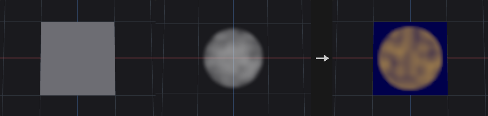

Looks up the volume at each point position (or primitive center) and stores the result. Modes: **Trilinear** interpolates between voxels, **Nearest** takes the closest voxel, **Gradient** writes a 3-component gradient vector (on an SDF this points along the surface normal direction). Outside the volume bounds, Clamp uses the value at the nearest edge, Constant writes Outside Value, and Keep does not write the element.

The volume must be a dense volume primitive (use Convert to make `volume_sdf` or `volume_fog`). A newly created attribute has one component, or three for Gradient. The `report` output gives the volume resolution and how many elements were sampled or outside.

**Inputs**

| Input | Type | Description |
|---|---|---|
| `geo` | GEOMETRY | Geometry whose points or primitives sample the volume. |
| `volume` | GEOMETRY | Geometry containing the dense volume primitive(s). |

**Outputs**

| Output | Type | Description |
|---|---|---|
| `geo` | GEOMETRY | Copy of `geo` with the sampled attribute. |
| `report` | STRING | Text summary: which volume, its resolution, number of sampled and outside elements. |

**Parameters**

| Parameter | Type | Default | Description |
|---|---|---|---|
| Group `group` | string | *(empty)* | Group pattern limiting which elements are sampled. Others keep their value. |
| Class `attribute_class` | menu | Point | Sample at point positions, or at primitive centers. Options: Point (`point`), Primitive (`prim`). |
| Volume Primitive `volume_select` | string | *(empty)* | Which volume to use: empty for the first, a number for the nth, or a name matched against the primitive `name` attribute. |
| Attribute `attribute` | string | `density` | Name of the attribute written. If it exists with a different component count it is replaced. |
| Sampling `mode` | menu | Trilinear | Trilinear interpolates, Nearest takes the closest voxel, Gradient samples the central-difference gradient (vector). Options: Trilinear (`trilinear`), Nearest (`nearest`), Gradient (`gradient`). |
| Outside Volume `outside` | menu | Clamp to Border | Behaviour for positions outside the volume: Clamp to the border value, write a constant, or keep the existing value (do not write). Options: Clamp to Border (`clamp`), Constant Value (`constant`), Keep Original (`keep`). |
| Outside Value `outside_value` | float | 0 | Value written for positions outside the volume when Outside is Constant. *Hidden when outside ≠ constant.* |

**Compared with Houdini**

Covers Attribute from Volume and Volume Sample.

---

### Attribute Interpolate (PCG)

<a id="pcg-attribinterpolate"></a>

`PCG_AttribInterpolate` · category `PCG/attribute` · Houdini: Attribute Interpolate (SOP)

Interpolates source geometry attributes onto points using the source primitive each point lies on.

Typically placed after Scatter or Ray: each point has `sourceprim` recording which primitive of `source` it belongs to. The node computes where the point lies in that primitive and interpolates the source attributes there.

By default the barycentric coordinates are **recovered from the point's position** within the primitive's triangles, which is exact for any polygon. A `(u, v)` pair is ambiguous for quads (the same pair is valid in both triangles of a quad), and scatter on quad meshes is the most common case; on such meshes a linear attribute interpolated via UV was off by up to 0.97 in tests while the position-based path was exact to about 1e-6. Turn on Use UV Attribute for Houdini's behaviour, where the UV attribute holds the coordinates and its third component selects the triangle inside the primitive.

Points whose `sourceprim` is out of range, or outside `group`, are unchanged.

**Inputs**

| Input | Type | Description |
|---|---|---|
| `geo` | GEOMETRY | Geometry (points) that receives the interpolated attributes. |
| `source` | GEOMETRY | Geometry providing the attributes and the primitives. |

**Outputs**

| Output | Type | Description |
|---|---|---|
| `geo` | GEOMETRY | Copy of `geo` with the interpolated attributes. |

**Parameters**

| Parameter | Type | Default | Description |
|---|---|---|---|
| Group `group` | string | *(empty)* | Group pattern limiting which elements are written. |
| Attribute Class `attribute_class` | menu | Point | Class on `geo` that is written (points or vertices). Options: Point (`point`), Vertex (`vertex`). |
| Attributes `attributes` | string | `*` | Names of attributes to interpolate, space separated, wildcards allowed (`*` for all). |
| Primitive Number Attribute `prim_attribute` | string | `sourceprim` | Integer attribute on `geo` giving the source primitive number for each element. It must exist. |
| Primitive UV Attribute `uv_attribute` | string | `sourceprimuv` | Attribute holding the primitive UV when Use UV Attribute is on. When off, coordinates come from the point position. |
| Use UV Attribute `use_uv_attribute` | toggle | off | Use the stored primitive UV (Houdini's method) instead of recovering barycentric coordinates from the position. |

---

### Attribute Mirror (PCG)

<a id="pcg-attribmirror"></a>

`PCG_AttribMirror` · category `PCG/attribute` · Houdini: Attribute Mirror (SOP)

Copies point attributes from one side of a plane to the mirrored points on the other side.

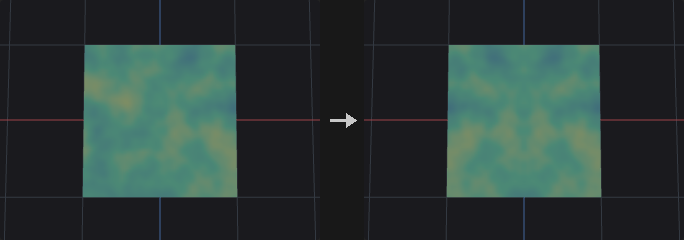

Defines a mirror plane by origin and normal direction. Points on the Source Side keep their values (points exactly on the plane are not modified). For every point on the other side, the position is mirrored across the plane and the attribute value is fetched there: **Closest Point** takes the value of the nearest source-side point; **Surface** interpolates on the source-side triangles with barycentric weights (requires triangles with all corners on the source side).

Vector attributes listed in Vectors are reflected through the plane; quaternion attributes listed in Quaternions are mirrored as H*R*H, which stays a proper rotation. String attributes are copied from the nearest point. Only point attributes are handled. `P` is never copied. The `report` output lists the attributes, the number of mirrored points and the number rejected by Max Distance.

**Inputs**

| Input | Type | Description |
|---|---|---|
| `geo` | GEOMETRY | Geometry whose point attributes are mirrored. |

**Outputs**

| Output | Type | Description |
|---|---|---|
| `geo` | GEOMETRY | Copy of the input with mirrored attribute values on the destination side. |
| `report` | STRING | Text summary: attributes mirrored, number of mirrored points and number too far. |

**Parameters**

| Parameter | Type | Default | Description |
|---|---|---|---|
| Group `group` | string | *(empty)* | Point group pattern limiting which destination (other side) points are written. |
| Attributes `attributes` | string | `Cd` | Point attributes to mirror, space separated, wildcards allowed. |
| Origin `origin_x` `origin_y` `origin_z` | float | 0, 0, 0 | A point on the mirror plane. |
| Direction `direction_x` `direction_y` `direction_z` | float | 1, 0, 0 | Normal of the mirror plane. Normalized internally; must not be zero. |
| Source Side `source_side` | menu | Positive | Which side of the plane supplies the values. Positive is the side the direction points to. Options: Positive (`positive`), Negative (`negative`). |
| Lookup Method `lookup` | menu | Closest Point | How the value at the mirrored position is found: nearest source point, or interpolation on the source surface. Options: Closest Point (`closest_point`), Closest Surface (`surface`). |
| Plane Tolerance `tolerance` | float [0.0..] | 1e-06 | Distance from the plane within which a point counts as on the plane and is used as a source. |
| Max Distance `max_distance` | float [0.0..] | 0 | Mirrored points whose lookup distance exceeds this are left unchanged. 0 means unlimited. |
| Vector Attributes `vectors` | string | `N v up` | Attributes (patterns) treated as vectors and reflected through the plane, for example `N v up`. |
| Quaternion Attributes `quaternions` | string | `orient` | Attributes (patterns) treated as orientation quaternions and mirrored as H*R*H. |

---

### Attribute Noise (PCG)

<a id="pcg-attribnoise"></a>

`PCG_AttribNoise` · category `PCG/attribute` · Houdini: Attribute Noise (SOP), Mountain (SOP)

Adds noise to attributes such as position, color or any numeric attribute.

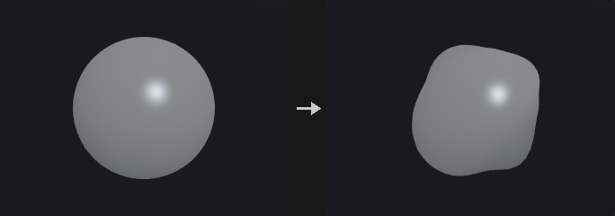

Noise is a pure function of position: lattice values come from a hash of integer cell coordinates, so the same world position always gives the same value regardless of point order or upstream edits, and two meshes meet seamlessly. Several noise bases and fractal modes are provided, with optional domain warping and a time axis for animation.

Processing order: sample position `(position + Offset + VEXpression) / Element Size`, optional warp, fractal noise in -1..1, Bias/Gain, Gamma, Contrast, remap ramp (all in 0..1 space so they stay valid when the amplitude changes), absolute and invert, mapping to the range, optional normalize to a target range over the selected elements, then the operation, clamping, unit length and blend. Elements outside `group` are unchanged.

With Noise Along Vector on, a single scalar noise is pushed along a direction attribute, typically `N`; a grid becomes a mountain. Fractal modes differ in where detail is added: Standard is evenly rough, while Terrain and Hybrid Terrain multiply octaves so high areas become rougher and valleys flatter.

**Inputs**

| Input | Type | Description |
|---|---|---|
| `geo` | GEOMETRY | Geometry whose attributes receive noise. |

**Outputs**

| Output | Type | Description |
|---|---|---|
| `geo` | GEOMETRY | Copy of the input with the noisy attributes. |

**Parameters**

| Parameter | Type | Default | Description |
|---|---|---|---|
| Group `group` | string | *(empty)* | Group pattern restricting which elements are adjusted. Elements outside the group keep their values. |
| Blend `blend` | float [0.0..1.0] | 1 | Blend between the original (0) and the noisy result (1). Ignored when Blend Attribute is set. |
| Blend Attribute `blend_attribute` | string | *(empty)* | Optional attribute giving the blend per element (first component, clamped to 0..1); replaces the constant Blend. |
| Attribute Type `attribute_type` | menu | Auto (from Attribute) | Auto uses the existing component count (new attributes named like `P`, `N`, `Cd`, `v`, `up` or `scale` get 3, others 1). Float uses one noise value spread over all components. Vector creates a 3-component attribute with independent noise per component. Options: Auto (from Attribute) (`auto`), Float (`float`), Vector (`vector`). |
| Attribute Names `attribute_names` | string | `P` | Attributes to add noise to, space separated, wildcards allowed. Names that do not exist yet are created. |
| Component Scope X `use_x` | toggle | on | Apply noise to the first component of 3-component attributes. |
| Component Scope Y `use_y` | toggle | on | Apply noise to the second component of 3-component attributes. |
| Component Scope Z `use_z` | toggle | on | Apply noise to the third component of 3-component attributes. |
| Attribute Class `attribute_class` | menu | Point | Attribute class that is modified. Options: Point (`point`), Vertex (`vertex`), Primitive (`prim`), Detail (`detail`). |
| Noise Along Vector `noise_along_vector` | toggle | off | Compute one scalar noise and push the attribute along a vector attribute instead of giving each component its own noise. With `N` this turns a grid into terrain. |
| Vector Attribute `vector_attribute` | string | `N` | Vector attribute that gives the push direction (normalized). Must have 3 components; compute it with Normal if missing. *Disabled when noise_along_vector is off.* |

*Noise Value*

| Parameter | Type | Default | Description |
|---|---|---|---|
| Range Values `range_values` | menu | Zero Centered | Value range of the noise before the operation. Zero Centered: -Amplitude to +Amplitude. Zero to One: 0 to Amplitude. One Centered: 1 +- Amplitude (for Multiply). Negative: -Amplitude to 0. Min/Max: from Min to Max. Min + Range Length: Min to Min + length. Middle +- Range Length: Middle - length to Middle + length. Options: Zero Centered (`zero_centered`), Positive (`zero_to_one`), One Centered (`one_centered`), Negative (`negative`), Min/Max (`min_max`), Min + Range Length (`min_range`), Middle ± Range Length (`middle_range`). |
| Operation `operation` | menu | Add | How the noise is combined with the existing value. Set Initial only writes when the attribute does not exist; Minimum and Maximum compare per component. For attributes that do not exist, Minimum and Maximum take the noise. Options: Add (`add`), Subtract (`subtract`), Multiply (`multiply`), Set Always (`set`), Set Initial (`set_initial`), Minimum (`minimum`), Maximum (`maximum`). |
| Amplitude `amplitude` | float | 0.25 | Size of the noise for the Zero Centered, Zero to One, One Centered and Negative ranges. *Hidden when range_values = min_max } { range_values = min_range } { range_values = middle_range.* |
| Min Value `min_value` | float | 0 | Lower end of the range for Min/Max and Min + Range Length. *Hidden when range_values ≠ min_max range_values ≠ min_range.* |
| Max Value `max_value` | float | 1 | Upper end of the range for Min/Max. *Hidden when range_values ≠ min_max.* |
| Middle Value `middle_value` | float | 0 | Centre of the range for Middle +- Range Length. *Hidden when range_values ≠ middle_range.* |
| Range Length `range_length` | float | 1 | Length parameter for Min + Range Length (full length) and Middle +- Range Length (extends this far on each side of Middle). *Hidden when range_values ≠ min_range range_values ≠ middle_range.* |

*Noise Value › Value Correction*

| Parameter | Type | Default | Description |
|---|---|---|---|
| Enable Remap Ramp `use_remap_ramp` | toggle | off | Reshape the noise with the remap ramp. Applied in the 0..1 noise space so it is independent of amplitude. |
| Remap Ramp `remap_ramp` | string | `0:0  0.5:0.25  1:1` | Ramp mapping noise value (horizontal, 0..1) to a new value (vertical). Can create plateaus and cliffs. Written as `position:value` pairs. *Disabled when use_remap_ramp is off.* |
| Ramp Mode `ramp_mode` | menu | Linear | Interpolation between ramp points. Options: Linear (`linear`), Smooth (`smooth`), Constant (`constant`). |
| Enable Bias / Gain `use_value_correction` | toggle | off | Apply Bias and Gain to the 0..1 noise value. |
| Bias `bias` | float [0.001..0.999] | 0.5 | Shifts the noise distribution toward lower or higher values (0.5 = no change). *Disabled when use_value_correction is off.* |
| Gain `gain` | float [0.001..0.999] | 0.5 | Pushes values toward the middle or the extremes (0.5 = no change). *Disabled when use_value_correction is off.* |
| Gamma `gamma` | float [0.001..100.0] | 1 | Gamma on the 0..1 noise value, `t^(1/gamma)`. Applied after Bias/Gain, skipped at 1. |
| Contrast `contrast` | float [0.0..100.0] | 1 | Contrast around 0.5 on the 0..1 noise value. Applied after gamma, skipped at 1. |

*Noise Value › Post-Process*

| Parameter | Type | Default | Description |
|---|---|---|---|
| Minimum `clamp_min` | float | 0 | Lower limit when Use Clamp Min is on. |
| Use Clamp Min `use_clamp_min` | toggle | off | Clamp the result from below. |
| Maximum `clamp_max` | float | 1 | Upper limit when Use Clamp Max is on. |
| Use Clamp Max `use_clamp_max` | toggle | off | Clamp the result from above. |

*Noise Value*

| Parameter | Type | Default | Description |
|---|---|---|---|
| Make Vectors Unit Length `make_unit_length` | toggle | off | Normalize 3-component results to length 1. |
| Recompute Normals `recompute_normals` | toggle | off | After modifying, recompute normals if the geometry already has an `N` attribute. |

*Noise Value › Post-Process*

| Parameter | Type | Default | Description |
|---|---|---|---|
| Absolute Value `post_absolute` | toggle | off | Fold the noise with an absolute value, producing sharp ridges where it crosses zero. |
| Invert `post_invert` | toggle | off | Negate the noise, turning valleys into ridges. |
| Normalize `use_normalize` | toggle | off | Stretch the noise of the selected elements exactly to the Normalize range. |
| Normalize Range `normalize_min` `normalize_max` | float | 0, 1 | Target range of normalization (first value = low end, second = high end). *Disabled when use_normalize is off.* |

*Noise Pattern*

| Parameter | Type | Default | Description |
|---|---|---|---|
| Noise Type `noise_type` | menu | Value | Noise basis. Value and Perlin are lattice noises, Simplex avoids axis-aligned artifacts, the Worley, Manhattan and Chebyshev types are distance-to-feature-point (cellular) noises with different metrics; the `*_f2f1` variants use second minus first nearest distance. Options: Value (`value`), Perlin (`perlin`), Simplex (`simplex`), Worley Cellular F1 (`worley`), Worley Cellular F2-F1 (`worley_f2f1`), Manhattan Cellular F1 (`manhattan`), Manhattan Cellular F2-F1 (`manhattan_f2f1`), Chebyshev Cellular F1 (`chebyshev`), Chebyshev Cellular F2-F1 (`chebyshev_f2f1`). |
| Location Attribute `location_attribute` | string | `P` | Position used to sample the noise (default `P`). Taken from the attribute class if present with 3 components, otherwise from the points (primitives use their center, detail the mean). |
| Element Size `element_size_x` `element_size_y` `element_size_z` | float [1e-06..] | 1, 1, 1 | Feature size (wavelength) per axis. Larger values give larger patterns; different values per axis stretch the noise. The sample position is divided by this. |
| Offset `offset_x` `offset_y` `offset_z` | float | 0, 0, 0 | Offset added to the sample position, to move the noise pattern. |
| Seed `rand_seed` | int [0..] | 0 | Seed that selects a different noise pattern. Noise is a function of position, so identical positions always give identical values. |

*Noise Pattern › Use VEXpression*

| Parameter | Type | Default | Description |
|---|---|---|---|
| Use Vexpression `use_vexpression` | toggle | off | Add the result of the expression to the sample offset. |
| VEXpression `vexpression` | string | `set(0, @P.y * 0.1, 0)` | Wrangle expression returning a vector per element, added to the sample position. It must return a vector, for example `set(0, @P.y * 0.1, 0)`. |

*Noise Pattern › Fractal*

| Parameter | Type | Default | Description |
|---|---|---|---|
| Fractal Type `fractal` | menu | None | Octave combination. Standard (fBm) sums octaves evenly; Terrain multiplies octaves so peaks get rougher and valleys flatter; Hybrid Terrain multiplies with weights clamped to 1, giving sharp ridges and flat valleys. Options: None (`none`), Standard (`standard`), Terrain (`terrain`), Hybrid Terrain (`hybrid_terrain`). |
| Max Octaves `octaves` | int [1..16] | 3 | Number of noise layers for fractal types other than None. *Hidden when fractal = none.* |
| Lacunarity `lacunarity` | float [1.0..16.0] | 2 | Frequency multiplier per octave. *Hidden when fractal = none.* |
| Roughness `roughness` | float [0.0..1.0] | 0.5 | Amplitude falloff per octave. *Hidden when fractal = none.* |
| Terrain Offset `fractal_offset` | float [-4.0..4.0] | 0.7 | Offset used by the Terrain and Hybrid Terrain types. *Hidden when fractal = none } { fractal = standard.* |

*Noise Pattern › Warping*

| Parameter | Type | Default | Description |
|---|---|---|---|
| Warp Distance `warp` | float | 0 | Distance in world units by which the sample position is displaced by another noise before sampling. 0 disables warping, and the next two parameters then have no effect. |
| Warp Element Size `warp_element_size` | float [1e-06..] | 1 | Feature size of the warp noise. |
| Warp Octaves `warp_octaves` | int [1..8] | 1 | Octaves of the warp noise. |

*Animation › Animation*

| Parameter | Type | Default | Description |
|---|---|---|---|
| Animate Noise `use_animation` | toggle | off | Add a time axis to the noise. The pattern evolves in place along this fourth dimension rather than sliding. |
| Time `noise_time` | float | 0 | Position along the time axis. |
| Pulse Duration `time_element_size` | float [1e-06..] | 1 | Feature size along the time axis; larger values make the evolution slower. |

**Compared with Houdini**

Covers Attribute Noise and Mountain (Noise Along Vector with `N`). In Middle +- Range Length the range extends Range Length to each side of Middle, which is different from the Attribute Adjust nodes where the length is the total width.

---

### Attribute Promote (PCG)

<a id="pcg-attribpromote"></a>

`PCG_AttribPromote` · category `PCG/attribute` · Houdini: Attribute Promote (SOP)

Moves attributes between point, vertex, primitive and detail classes, reducing values when several sources map to one target.

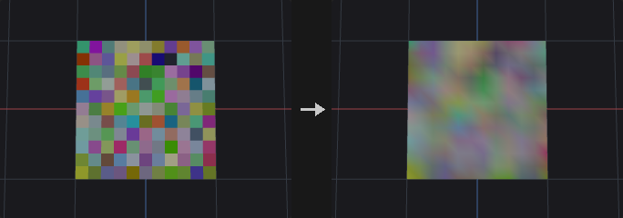

Works by first building a table of (source element, target element) pairs and then reducing each target's values with the chosen method. When expanding (for example point to vertex) each target has a single source, so the method has no effect; when reducing (vertex to point) it combines the values. This lets all class combinations share one code path.

If a piece attribute is given, values are reduced per piece instead of per target element: all target elements with the same piece value receive the same result. The piece attribute is read from the New Class and must be integer or string; it is ignored for detail targets.

`original_name` accepts name patterns (`uv*`, `* ^P`) to move several attributes at once. In the new name, `*` is replaced by the original attribute name, which allows batch renaming. Integer attributes stay integer and are rounded rather than truncated after averaging. String attributes can only use Mode, First Match and Last Match when values have to be combined.

**Inputs**

| Input | Type | Description |
|---|---|---|
| `geo` | GEOMETRY | Geometry whose attributes are promoted. |

**Outputs**

| Output | Type | Description |
|---|---|---|
| `geo` | GEOMETRY | Copy of the input with attributes on the new class. |

**Parameters**

| Parameter | Type | Default | Description |
|---|---|---|---|
| Original Name `original_name` | string | `Cd` | Names of the attributes to promote, space separated, wildcards and exclusions allowed. It is an error if nothing matches. |
| Original Class `original_class` | menu | Point | Class the attributes currently live on. Options: Point (`point`), Vertex (`vertex`), Primitive (`prim`), Detail (`detail`). |
| New Class `new_class` | menu | Primitive | Class to move them to. Options: Primitive (`prim`), Point (`point`), Vertex (`vertex`), Detail (`detail`). |
| Piece Attribute `piece_attribute` | string | `name` | Integer or string attribute on the new class that defines pieces. Used when Piece Attribute is on. *Hidden when new_class = detail.* |
| Use Piece `use_piece` | toggle | off | Reduce per piece (value of the piece attribute) instead of per target element. *Hidden when new_class = detail.* |
| Promotion Method `method` | menu | Average | How multiple source values are combined: average, maximum, minimum, sum, mode (most common value; ties give the smallest), median, sum of squares, root mean square, or the first or last value found. Options: Average (`average`), Maximum (`maximum`), Minimum (`minimum`), Sum (`sum`), Mode (`mode`), Median (`median`), Sum of Squares (`sum_of_squares`), Root Mean Square (`root_mean_square`), First Match (`first_match`), Last Match (`last_match`). |
| New Name `new_name` | string | *(empty)* | Name of the promoted attribute. A `*` is replaced by the original name. Used when Change New Name is on; otherwise the original name is kept. |
| Change New Name `change_new_name` | toggle | off | Give the promoted attribute a different name. |
| Delete Original `delete_original` | toggle | on | Remove the original attribute after promotion (unless the class and name stay the same). |

**Compared with Houdini**

Houdini's Array of All Values and Array of Unique Values methods are not available, because attributes here are always fixed-size arrays and cannot hold variable-length arrays.

---

### Attribute Randomize (PCG)

<a id="pcg-attribrandomize"></a>

`PCG_AttribRandomize` · category `PCG/attribute` · Houdini: Attribute Randomize (SOP)

Writes random values, directions or orientations into an attribute.

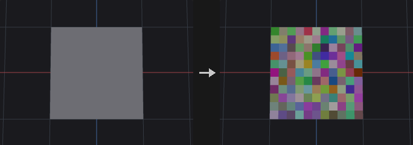

Used after scattering to add variation to `pscale`, `orient`, color and so on. The random stream is keyed on an id attribute when given, so inserting, deleting or sorting upstream points does not reshuffle the existing values.

Three modes: **Value** fills each component independently from a distribution; **Direction** produces unit vectors on a sphere, in a cone, in a disc or along a line, optionally with random length; **Orientation** produces quaternions, either a fully random rotation or a rotation about an axis by a random angle.

Directions are not made by randomizing each component and normalizing, which would favour the corners of the cube. Sphere and cone directions are uniform in the cosine of the polar angle, and fully random orientations use Shoemake's method, so they are uniform over all rotations (random Euler angles would cluster near the poles).

**Inputs**

| Input | Type | Description |
|---|---|---|
| `geo` | GEOMETRY | Geometry whose attribute is randomized. |

**Outputs**

| Output | Type | Description |
|---|---|---|
| `geo` | GEOMETRY | Copy of the input with the randomized attribute. |

**Parameters**

| Parameter | Type | Default | Description |
|---|---|---|---|
| Group `group` | string | *(empty)* | Group pattern restricting which elements are adjusted. Elements outside the group keep their values. |
| Attribute Class `attribute_class` | menu | Point | Attribute class that holds the attribute. Options: Point (`point`), Vertex (`vertex`), Primitive (`prim`), Detail (`detail`). |
| Attribute Name `name` | string | `pscale` | Name of the attribute to write. It is created if it does not exist. |
| Operation `combine` | menu | Set Value | How the random values merge with the existing ones. Multiply treats a missing attribute as 1 (not 0). Minimum and Maximum take the random value when the attribute is missing or has a different component count. Options: Set Value (`set`), Add Value (`add`), Multiply (`multiply`), Minimum (`minimum`), Maximum (`maximum`). |
| Global Scale `global_scale` | float | 1 | Multiplier applied to the generated values before the operation. Not applied to orientations, since scaling a quaternion is not a rotation. |

*Distribution*

| Parameter | Type | Default | Description |
|---|---|---|---|
| Value Type `mode` | menu | Value | Value generates numbers in each component; Direction generates unit vectors (optionally with random length); Orientation generates quaternions. Options: Value (`value`), Direction (`direction`), Orientation (`orient`). |

*Distribution › Value*

| Parameter | Type | Default | Description |
|---|---|---|---|
| Distribution `distribution` | menu | Uniform (Continuous) | Distribution of Value mode. Uniform is between Min and Max; Gaussian uses Mean and Standard Deviation; Power raises the uniform value to the exponent first (an exponent above 1 gives many small values and a few large ones); Constant writes Min; Two Values picks Max with the given probability and Min otherwise; Uniform Discrete steps from Min to Max by Step Size, both ends included; Exponential, Log-Normal and Cauchy are centred on Mean as the median; Custom Discrete picks from the value list; Inside Sphere is uniform inside the unit sphere (circle or ball depending on dimensions). Options: Uniform (Continuous) (`uniform`), Normal (Gaussian) (`gaussian`), Power (`power`), Constant Value (`constant`), Two Values (`two_values`), Uniform (Discrete) (`uniform_discrete`), Exponential (`exponential`), Log-Normal (`lognormal`), Cauchy-Lorentz (`cauchy`), Custom Discrete (`custom_discrete`), Inside Sphere (`inside_sphere`). *Hidden when mode ≠ value.* |
| Dimensions `dimensions` | int [1..4] | 1 | Number of components generated in Value mode (1 to 4). *Hidden when mode ≠ value.* |
| Min Value `min_x` `min_y` `min_z` `min_w` | float | 0, 0, 0, 0 | Lower end of the range per component. For Constant it is the value; for Two Values it is Value A. *Hidden when mode ≠ value } { distribution = gaussian } { distribution = exponential } { distribution = lognormal } { distribution = cauchy } { distribution = custom_discrete } { distribution = inside_sphere.* |
| Max Value `max_x` `max_y` `max_z` `max_w` | float | 1, 1, 1, 1 | Upper end of the range per component. For Two Values it is Value B. *Hidden when mode ≠ value } { distribution = constant } { distribution = gaussian } { distribution = exponential } { distribution = lognormal } { distribution = cauchy } { distribution = custom_discrete } { distribution = inside_sphere.* |
| Middle Value `mean` | float | 0.5 | Mean for Gaussian. For Exponential, Log-Normal and Cauchy it is the median. Log-Normal needs a positive value. *Hidden when mode ≠ value } { distribution ≠ gaussian distribution ≠ exponential distribution ≠ lognormal distribution ≠ cauchy.* |
| Scale Around Middle `stddev` | float [0.0..] | 0.25 | Standard deviation for Gaussian; spread in log space for Log-Normal; scale (gamma) for Cauchy. *Hidden when mode ≠ value } { distribution ≠ gaussian distribution ≠ lognormal distribution ≠ cauchy.* |
| Exponent `exponent` | float [0.01..100.0] | 2 | Exponent for the Power distribution. *Hidden when mode ≠ value } { distribution ≠ power.* |
| Probability of Value B `prob_b` | float [0.0..1.0] | 0.5 | Probability (0..1) of choosing Max (Value B) for Two Values. *Hidden when mode ≠ value } { distribution ≠ two_values.* |
| Step Size `step_size` | float [0.0..] | 1 | Step for Uniform Discrete. *Hidden when mode ≠ value } { distribution ≠ uniform_discrete.* |
| Values `value_list` | string | *(see panel)* | Values for Custom Discrete, one group per line (`min-max:step` expands to a series); append `w=weight` for the group's probability. *Hidden when mode ≠ value } { distribution ≠ custom_discrete.* |

*Distribution › Direction / Orient*

| Parameter | Type | Default | Description |
|---|---|---|---|
| Shape `shape` | menu | Sphere | Direction mode: Sphere is uniform on the sphere, Cone is inside a cone around the axis, Disc is perpendicular to the axis, Line is along the axis in either sense. Orientation mode: Sphere is a fully random rotation (uniform over all rotations); the others rotate randomly about the axis. Options: Sphere (`sphere`), Cone (`cone`), Disc (`disc`), Line (`line`). *Hidden when mode = value.* |
| Direction `axis_x` `axis_y` `axis_z` | float | 0, 1, 0 | Reference axis for the Cone, Disc and Line shapes and for rotations in Orientation mode. *Hidden when mode = value } { mode = orient shape = sphere.* |
| Cone Angle `cone_angle` | float [0.0..180.0] | 45 | Half-angle of the cone in degrees (Cone shape). *Hidden when mode ≠ direction } { shape ≠ cone.* |
| Angle Range `angle_min` `angle_max` | float [-3600.0..3600.0] | 0, 360 | Range of rotation angle about the axis in degrees, for Orientation mode with shapes other than Sphere (first value = minimum, second = maximum). *Hidden when mode ≠ orient } { shape = sphere.* |
| Length Range `length_min` `length_max` | float | 1, 1 | Range of the vector length for Direction mode (first = minimum, second = maximum). Equal values give unit vectors. *Hidden when mode ≠ direction.* |

*Options*

| Parameter | Type | Default | Description |
|---|---|---|---|
| Global Seed `rand_seed` | int [0..] | 0 | Seed of the random stream. |
| Seed Attribute `id_attribute` | string | *(empty)* | Optional numeric attribute whose first component is the random key instead of the element number. Results then do not change when upstream elements are added, removed or reordered. |

**Compared with Houdini**

Houdini's Constant, Two Values, Uniform (Discrete), Exponential, Log-Normal, Cauchy, Custom Discrete and Inside Sphere distributions reuse the Min, Max, Mean and Standard Deviation fields as described on the parameters.

---

### Attribute Rename (PCG)

<a id="pcg-attribrename"></a>

`PCG_AttribRename` · category `PCG/attribute` · Houdini: Attribute Rename (SOP), Group Rename (SOP)

Renames attributes or groups using old:new pairs, with wildcard support.

Each pair is written `old:new` (an `=` also works) and pairs are separated by spaces. A wildcard in the old name carries the matched part over to the `*` in the new name: `uv*:tex*` renames `uv1` to `tex1` and `uvSet` to `texSet`. Renaming a name that does not exist is an error that lists the available names. With Rename Groups on, group names are renamed instead of attributes (groups do not exist on the detail class).

**Inputs**

| Input | Type | Description |
|---|---|---|
| `geo` | GEOMETRY | Geometry with attributes or groups to rename. |

**Outputs**

| Output | Type | Description |
|---|---|---|
| `geo` | GEOMETRY | Copy of the input with the renamed attributes or groups. |

**Parameters**

| Parameter | Type | Default | Description |
|---|---|---|---|
| Class `attribute_class` | menu | Point | Class whose attributes (or groups) are renamed. Options: Point (`point`), Vertex (`vertex`), Primitive (`prim`), Detail (`detail`). |
| Rename `rename` | string | `old:new` | Rename pairs `old:new` separated by spaces. A `*` in the old name matches any text and is substituted into the new name. |
| Rename Groups `rename_groups` | toggle | off | Rename groups of the chosen class rather than attributes. |

**Compared with Houdini**

Covers Attribute Rename and Group Rename in one node.

---

### Attribute Reorient (PCG)

<a id="pcg-attribreorient"></a>

`PCG_AttribReorient` · category `PCG/attribute` · Houdini: Attribute Reorient (SOP)

Rotates vector and quaternion point attributes to follow a deformation between a rest and a deformed pose.

After a deformation, attributes such as `N`, `up`, `v` and `orient` still describe the undeformed shape. For each point the node estimates a local rotation from the one-ring neighbourhood of the point in the rest and deformed positions (Kabsch fit). Vector attributes (3 components) are rotated by it and orientation quaternions (4 components) are rotated by left multiplication. On a collinear neighbourhood (curves, end points) the roll about the tangent is undetermined, so the minimum rotation between the two tangents is used.

The attributes are read from the deformed geometry, or from the rest geometry if missing there. Both inputs must have the same point count. Other component counts and string attributes are skipped; `P` is never modified. The `report` output lists the processed attributes.

**Inputs**

| Input | Type | Description |
|---|---|---|
| `geo` | GEOMETRY | Deformed geometry. It receives the reoriented attributes. |
| `rest` | GEOMETRY | Geometry in the rest pose, with the same points and connectivity. |

**Outputs**

| Output | Type | Description |
|---|---|---|
| `geo` | GEOMETRY | Copy of the deformed geometry with rotated attributes. |
| `report` | STRING | Text summary of the attributes that were reoriented. |

**Parameters**

| Parameter | Type | Default | Description |
|---|---|---|---|
| Attributes `attributes` | string | `N up v orient` | Point attributes to reorient, space separated, wildcards allowed. Vectors rotate by the local rotation; quaternions are multiplied by it. |

---

### Attribute String Edit (PCG)

<a id="pcg-attribstringedit"></a>

`PCG_AttribStringEdit` · category `PCG/attribute` · Houdini: Attribute String Edit (SOP)

Finds and replaces text inside string attributes using substring, wildcard or regular-expression matching.

Edits the values of one or more string attributes (names separated by spaces, wildcards allowed). Modes: **Substring** replaces every occurrence of Find; **Wildcard** matches the whole string against a pattern containing `*`, and what each `*` captured is placed in order into the `*` of Replace (`piece*_old` with `chunk*` turns `piece12_old` into `chunk12`); **Regex** uses regular-expression substitution, where `\1` refers to groups. Values that do not match stay as they are. Only distinct values are processed, so large geometry with few names is fast. The `report` output summarizes the edits.

**Inputs**

| Input | Type | Description |
|---|---|---|
| `geo` | GEOMETRY | Geometry with string attributes. |

**Outputs**

| Output | Type | Description |
|---|---|---|
| `geo` | GEOMETRY | Copy of the input with edited strings. |
| `report` | STRING | Text summary of what was changed. |

**Parameters**

| Parameter | Type | Default | Description |
|---|---|---|---|
| Group `group` | string | *(empty)* | Group pattern limiting which elements are edited. *Hidden when attribute_class = detail.* |
| Class `attribute_class` | menu | Primitive | Class of the string attributes. Options: Primitive (`prim`), Point (`point`), Vertex (`vertex`), Detail (`detail`). |
| Attributes `attributes` | string | `name` | String attribute names to edit, space separated, wildcards allowed. |
| Match Mode `mode` | menu | Substring | How Find is interpreted: literal substring, whole-string wildcard pattern, or regular expression. Options: Substring (`substring`), Wildcard (`wildcard`), Regular Expression (`regex`). |
| Case Sensitive `case_sensitive` | toggle | on | Match upper and lower case as different characters. |
| Find `find` | string | *(empty)* | Text, pattern or regular expression to look for. |
| Replace `replace` | string | *(empty)* | Replacement text. In Wildcard mode `*` receives the text captured by the corresponding `*` in Find; in Regex mode `\1` refers to capture groups. |

---

### Attribute Transfer (PCG)

<a id="pcg-attribtransfer"></a>

`PCG_AttribTransfer` · category `PCG/attribute` · Houdini: Attribute Transfer (SOP), Group Transfer (SOP)

Transfers attributes and groups from a source geometry to a destination by spatial proximity.

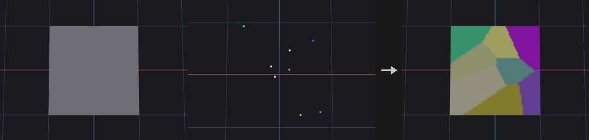

For each destination point, source points within `distance_threshold` are collected (the nearest `max_sample_count` of them, optionally only those with a matching `match_attribute` value). Their attribute values are averaged with the chosen kernel to give a **target value**. How much of that target replaces the original value is a separate quantity: an alpha derived from the distance of the *nearest* source point, which is 1 inside the threshold and falls to 0 over the last `blend_width` of distance. The result is `lerp(original, target, alpha)`. With Blend Width 0 this is a hard switch: reachable points are fully replaced, others untouched.

The two are separate so that smoothing (number of samples and kernel) and softness of the influence edge (blend width) can be tuned independently. Primitive attributes are matched by primitive centers. String attributes and groups cannot be averaged, so they take the value from the nearest source element (strings are left alone when alpha is below 0.5). `P` is not transferred. Detail attributes are copied as they are.

**Inputs**

| Input | Type | Description |
|---|---|---|
| `dest` | GEOMETRY | Geometry that receives the attributes. |
| `source` | GEOMETRY | Geometry the attributes come from. |

**Outputs**

| Output | Type | Description |
|---|---|---|
| `geo` | GEOMETRY | Copy of `dest` with the transferred attributes and groups. |

**Parameters**

*Attributes*

| Parameter | Type | Default | Description |
|---|---|---|---|
| Source Group `source_group` | string | *(empty)* | Point group pattern restricting which source points are used. |
| Destination Group `dest_group` | string | *(empty)* | Point group pattern restricting which destination points receive values. Primitive transfers consider only primitives whose points all lie in the group. |
| Primitives `prim_attributes` | string | *(empty)* | Primitive attribute name patterns to transfer. Empty transfers none. |
| Points `point_attributes` | string | `Cd` | Point attribute name patterns to transfer (wildcards and `^` exclusions allowed). `P` is always skipped. |
| Detail `detail_attributes` | string | *(empty)* | Detail attribute name patterns to copy. Empty copies none. |
| Point Groups `point_groups` | string | *(empty)* | Point group names (patterns) to transfer, taken from the nearest source point. |
| Primitive Groups `prim_groups` | string | *(empty)* | Primitive group names (patterns) to transfer, taken from the nearest source primitive. |

*Conditions*

| Parameter | Type | Default | Description |
|---|---|---|---|
| Distance Threshold `distance_threshold` | float [0.0..] | 1 | Maximum distance within which source elements are considered. Also the radius for the kernel weights. Must be above 0. |
| Blend Width `blend_width` | float [0.0..] | 0 | Width of the soft edge at the end of the threshold, in distance units. 0 gives a hard switch. |
| Max Sample Count `max_sample_count` | int [1..4096] | 1 | Number of nearest source elements that are averaged. 1 takes the single nearest, which can look blocky; more samples give a smoother result. |
| Kernel Function `kernel` | menu | Uniform | Weights used when averaging samples. Uniform weights all equally; Inverse Distance favors close ones; Tent falls linearly with distance to the threshold; Gaussian and Smooth fall off smoothly to zero at the threshold. Options: Uniform (`uniform`), Inverse Distance (`inverse_distance`), Tent (`tent`), Gaussian (`gaussian`), Wyvill (`smooth`). *Disabled when max_sample_count <= 1.* |
| Match Attribute `match_attribute` | string | *(empty)* | Optional attribute (same class on both sides). Only source elements whose value equals the destination element's value are considered. |

**Compared with Houdini**

Covers Attribute Transfer and Group Transfer. Vertex attributes are not transferred.

---

### Attribute Transfer by UV (PCG)

<a id="pcg-attribtransferbyuv"></a>

`PCG_AttribTransferByUV` · category `PCG/attribute` · Houdini: Attribute Transfer by UV (SOP)

Transfers attributes between geometries by matching UV coordinates instead of positions.

For each destination point or vertex the node finds the source UV triangle that contains its UV and interpolates the source attribute with the barycentric coordinates there. The two geometries may differ in topology and position as long as their UV layouts match: baked high-resolution colors can be moved to a low-resolution mesh, and transferring `P` wraps one geometry onto another via UV space.

Sources can be point, vertex or primitive attributes; strings take the value of the dominant corner. A transferred `N` is renormalized. Where a destination UV lies outside every UV island, Nearest uses the closest UV triangle (limited by Max Distance) and Keep leaves the element untouched. The `report` output includes the number of queries inside UV islands, resolved to the nearest triangle, missed, and falling into overlapping UV regions.

**Inputs**

| Input | Type | Description |
|---|---|---|
| `geo` | GEOMETRY | Destination geometry with UVs. |
| `source` | GEOMETRY | Source geometry with matching UV layout and the attributes to transfer. |

**Outputs**

| Output | Type | Description |
|---|---|---|
| `geo` | GEOMETRY | Copy of the destination with the transferred attributes. |
| `report` | STRING | Text summary with counts of inside, nearest, missed and overlapping queries. |

**Parameters**

| Parameter | Type | Default | Description |
|---|---|---|---|
| Group `group` | string | *(empty)* | Point group pattern limiting which destination points are written (applies to the Point class only). |
| Class `attribute_class` | menu | Point | Destination class that is written: points or vertices. Options: Point (`point`), Vertex (`vertex`). |
| Attributes `attributes` | string | `Cd` | Source attribute names to transfer, space separated, wildcards allowed. The UV attribute itself is excluded. Including `P` transfers positions. |
| UV Attribute `uv_attribute` | string | `uv` | Name of the UV attribute on the destination (vertex or point attribute with at least two components). |
| Source UV Attribute `source_uv` | string | *(empty)* | Name of the UV attribute on the source. Empty uses the same name as the destination. |
| Outside UV Islands `outside` | menu | Nearest Triangle | Behaviour for destination UVs outside all source UV islands: use the nearest source triangle, or leave the element unchanged. Options: Nearest Triangle (`nearest`), Keep Original (`keep`). |
| Max Distance `max_distance` | float [0.0..] | 0 | Largest allowed distance in UV space for the Nearest fallback. 0 means unlimited. *Hidden when outside = keep.* |

---

### Attribute Transform Extract (PCG)

<a id="pcg-attribtransformextract"></a>

`PCG_AttribTransformExtract` · category `PCG/attribute`

Computes one rigid transform per piece between a rest and an animated copy of the same geometry.

Both inputs must have identical topology. Points are grouped into pieces by the `name` style attribute (primitive attribute first, otherwise point attribute), and for each piece a rigid fit (rotation plus translation, no scaling) from rest to animated points is computed. Pieces with fewer than 3 points use translation only.

Two point clouds are produced, one point per piece: `template` has the piece center moved by the transform plus an `orient` quaternion, and `rest_points` has the rest piece center with an identity `orient`. Plug them into the template and rest inputs of Transform Pieces to make another geometry (for example high-resolution debris) follow each piece exactly. The piece key is copied onto both outputs. The `report` output gives the number of pieces and the largest fit error (RMS).

**Inputs**

| Input | Type | Description |
|---|---|---|
| `rest` | GEOMETRY | Geometry in the rest pose. |
| `animated` | GEOMETRY | Same geometry in the animated pose (same point count and topology). |

**Outputs**

| Output | Type | Description |
|---|---|---|
| `template` | GEOMETRY | One point per piece at the animated position, with an `orient` quaternion for the piece rotation. |
| `rest_points` | GEOMETRY | One point per piece at the rest center, with an identity `orient`. |
| `report` | STRING | Text summary with the piece count and the largest rigid-fit RMS error. |

**Parameters**

| Parameter | Type | Default | Description |
|---|---|---|---|
| Piece Attribute `piece_attribute` | string | `name` | Attribute on `rest` (primitive attribute, or else point attribute) that identifies the piece each element belongs to. |

**Compared with Houdini**

Piece-wise version of Extract Transform. For decomposing matrix attributes use Attribute Transform Extract (Houdini).

---

### Attribute Transform Extract · Houdini (PCG)

<a id="pcg-attribtransformextracthou"></a>

`PCG_AttribTransformExtractHou` · category `PCG/attribute` · Houdini: Attribute Transform Extract (SOP)

Decomposes 9- or 16-component matrix point attributes into translate, rotate and scale/shear/stretch attributes.

Splits matrix attributes (9 components = 3x3, 16 components = 4x4 with translation in the last row; same convention as Transform by Attribute) into separate attributes. Two decompositions are offered. **Polar** writes rotation as Euler angles (degrees) plus a symmetric `stretch` 3x3 matrix, with `H3 = Stretch * R`. **Crack** writes rotation, scale and shear, and is the inverse of what the Transform SOP builds for the chosen transform order. Translation is written only for 16-component matrices.

A rotation matrix has several equivalent Euler angle triples. The Euler filter picks, per point, the solution closest to a reference angle: the already filtered angle of its parent in the chosen hierarchy, or the Hint for points without a parent. Points outside `group` receive defaults (translation 0, rotation 0, scale 1, shear 0, identity stretch). If no attribute matches, the geometry passes through and the `report` explains why.

Output names are built as `prefix + matrix name + suffix`.

**Inputs**

| Input | Type | Description |
|---|---|---|
| `geo` | GEOMETRY | Geometry with matrix point attributes. |

**Outputs**

| Output | Type | Description |
|---|---|---|
| `geo` | GEOMETRY | Copy of the input with the decomposed attributes. |
| `report` | STRING | Text summary: matrices processed, attributes written, point and root counts. |

**Parameters**

| Parameter | Type | Default | Description |
|---|---|---|---|
| Group `group` | string | *(empty)* | Point group pattern limiting which points are decomposed. |

*Euler Filter*

| Parameter | Type | Default | Description |
|---|---|---|---|
| Hierarchy Source `hierarchy` | menu | None | Where parent points for the Euler filter come from. None filters against the Hint only; Topology uses the previous point along each primitive; Pieces / Points uses the previous selected point with the same piece attribute value. Options: None (`none`), Topology (`topology`), Pieces or Points (`pieces_points`). |
| Piece Attribute `piece_attribute` | string | `name` | Integer or string point attribute defining pieces for Pieces / Points. If missing or float, all points form one piece. *Hidden when hierarchy ≠ pieces_points.* |
| Hint `hint_x` `hint_y` `hint_z` | float | 0, 0, 0 | Reference Euler angles (degrees) used for points without a parent. |

*Transform*

| Parameter | Type | Default | Description |
|---|---|---|---|
| Decomposition `decomposition` | menu | Polar Decomposition | Polar writes Euler rotation and a stretch matrix; Crack writes rotation, scale and shear using the transform order. Options: Polar Decomposition (`polar`), Crack Transform (`crack`). |
| Transform Order `xform_order` | menu | Scale Rot Trans | Transform order assumed by Crack (for example SRT: scale, then rotate, then translate). Options: Scale Rot Trans (`srt`), Scale Trans Rot (`str`), Rot Scale Trans (`rst`), Rot Trans Scale (`rts`), Trans Scale Rot (`tsr`), Trans Rot Scale (`trs`). *Disabled when decomposition = polar.* |
| Rotation Order `rotate_order` | menu | Rx Ry Rz | Rotation order of the output Euler angles. Options: Rx Ry Rz (`xyz`), Rx Rz Ry (`xzy`), Ry Rx Rz (`yxz`), Ry Rz Rx (`yzx`), Rz Rx Ry (`zxy`), Rz Ry Rx (`zyx`). |
| Attributes `attributes` | string | `transform` | Matrix attributes to decompose, space separated, wildcards allowed. Only point attributes with 9 or 16 components are considered. |
| Translation Prefix `t_prefix` | string | *(empty)* | Prefix of the translation attribute name (16-component matrices only). |
| Translation Suffix `t_suffix` | string | `_t` | Suffix of the translation attribute name. |
| Rotation Prefix `r_prefix` | string | *(empty)* | Prefix of the rotation attribute name. |
| Rotation Suffix `r_suffix` | string | `_r` | Suffix of the rotation attribute name. |
| Stretch Prefix `stretch_prefix` | string | *(empty)* | Prefix of the stretch matrix attribute name (Polar). *Hidden when decomposition ≠ polar.* |
| Stretch Suffix `stretch_suffix` | string | `_stretch` | Suffix of the stretch matrix attribute name (Polar). *Hidden when decomposition ≠ polar.* |
| Scale Prefix `s_prefix` | string | *(empty)* | Prefix of the scale attribute name (Crack). *Hidden when decomposition ≠ crack.* |
| Scale Suffix `s_suffix` | string | `_s` | Suffix of the scale attribute name (Crack). *Hidden when decomposition ≠ crack.* |
| Shear Prefix `sh_prefix` | string | *(empty)* | Prefix of the shear attribute name (Crack). *Hidden when decomposition ≠ crack.* |
| Shear Suffix `sh_suffix` | string | `_sh` | Suffix of the shear attribute name (Crack). *Hidden when decomposition ≠ crack.* |

**Compared with Houdini**

Matrices are read in Houdini's convention (row vectors, translation in the fourth row of 16-component attributes), the same as everywhere else in the plugin. The rest/animated rigid fit per piece is the separate Attribute Transform Extract node.

---

### Cluster Points (PCG)

<a id="pcg-clusterpoints"></a>

`PCG_ClusterPoints` · category `PCG/attribute` · Houdini: Cluster (SOP), Cluster Points (SOP)

Groups points into clusters with k-means and writes a cluster index, cluster centers and optional averaged points or boxes.

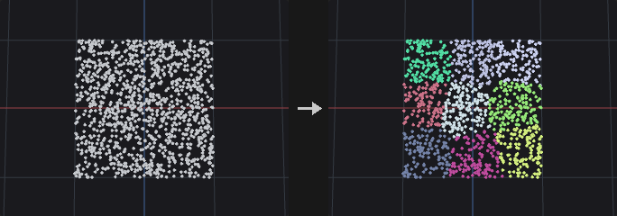

Runs k-means on the chosen attribute (default `P`, but color or any numeric attribute works) with k-means++ initialization; a fixed seed reproduces the result. Each point receives an integer cluster number in the attribute named `name`; if a cluster loses all its points the farthest point becomes its new center. Additional control attributes can be added to the feature vector, each multiplied by its own weight.

The main output is chosen by Output: the original points with the cluster attribute, one averaged point per cluster (position = mean, `size_attribute` = bounding box size including padding), both merged (in groups `clusterpoints` and `averagepoints`), or one bounding box per cluster. Cluster Filter keeps only listed clusters. The second output is always a point cloud of cluster centers with `cluster` and `count` attributes.

With Build Clusters off, no k-means is run: the existing integer attribute `name` defines the clusters. Points outside `group` get cluster -1 (or keep their previous value).

**Inputs**

| Input | Type | Description |
|---|---|---|
| `geo` | GEOMETRY | Points to cluster. |

**Outputs**

| Output | Type | Description |
|---|---|---|
| `geo` | GEOMETRY | Main result according to Output. |
| `centroids` | GEOMETRY | One point per cluster at the mean position, with `cluster` and `count` attributes. |
| `report` | STRING | Text summary: number of clusters, k-means iterations and total squared error. |

**Parameters**

| Parameter | Type | Default | Description |
|---|---|---|---|
| Group `group` | string | *(empty)* | Point group pattern limiting which points are clustered. |
| Output Attribute `name` | string | `cluster` | Name of the integer point attribute that receives the cluster number (also used as the existing attribute when Build Clusters is off). |
| Output `output` | menu | Cluster points | Cluster Points keeps the input points; Average Points gives one point per cluster; Both merges the two; Boxes creates a box per cluster. Options: Cluster points (`cluster_points`), Average points (`average_points`), Both (`both`), Boxes (`boxes`). |
| Color Output `color_output` | menu | Points | Points keeps colors unchanged. The two colored options assign a random `Cd` per cluster (there is no particle system, so both behave the same). Options: Points (`points`), Colored Points (`colored_points`), Colored Particles (`colored_particles`). |
| Cluster Filter `cluster_filter` | string | *(empty)* | Clusters to keep, written like point numbers (`3 4`, `3-6`). Points outside the chosen clusters are removed from the output. Empty keeps all. |
| Control Attribute `attribute` | string | `P` | Numeric point attribute whose values are clustered. *Disabled when build_clusters is off.* |
| Weight `weight` | float [0.0..] | 1 | Multiplier for the main attribute in the feature vector. *Disabled when build_clusters is off.* |
| Control Attribute 2 `control_attribute2` | string | *(empty)* | Optional second attribute added to the feature vector. *Disabled when build_clusters is off.* |
| Weight 2 `weight2` | float [0.0..] | 1 | Multiplier for the second control attribute. *Disabled when build_clusters is off.* |
| Control Attribute 3 `control_attribute3` | string | *(empty)* | Optional third attribute added to the feature vector. *Disabled when build_clusters is off.* |
| Weight 3 `weight3` | float [0.0..] | 1 | Multiplier for the third control attribute. *Disabled when build_clusters is off.* |

*Cluster Settings*

| Parameter | Type | Default | Description |
|---|---|---|---|
| Build Clusters `build_clusters` | toggle | on | Run k-means. When off, use the existing `name` attribute as the clustering. |
| Clusters `clusters` | int [1..] | 8 | Number of clusters (limited to the number of points). *Disabled when build_clusters is off.* |
| Seed `rand_seed` | int [0..] | 0 | Seed for the initial centers and random colors. *Disabled when build_clusters is off.* |
| Refinement Iterations `iterations` | int [1..10000] | 30 | Maximum number of k-means iterations. *Disabled when build_clusters is off.* |

*Averaging Settings*

| Parameter | Type | Default | Description |
|---|---|---|---|
| Copy Point Attributes from Cluster `copy_point_attributes` | toggle | off | Give averaged points the other point attributes of the cluster: numeric values averaged over the points nearest to the center, strings from the nearest point. *Hidden when output = cluster_points } { output = boxes.* |
| Max Sample Count `max_sample_count` | int [1..] | 10 | Number of points nearest to the center used for copied attributes. *Hidden when output = cluster_points } { output = boxes.* *Disabled when copy_point_attributes is off.* |
| Size Attribute Name `size_attribute` | string | `scale` | Name of the vector attribute holding the cluster bounding box size on averaged points. Empty writes none. *Hidden when output = cluster_points } { output = boxes.* |
| Padding Min `padding_min_x` `padding_min_y` `padding_min_z` | float | 0, 0, 0 | Amount the cluster bounding box is extended on the minimum side of each axis (Average Points and Boxes). *Hidden when output = cluster_points.* |
| Padding Max `padding_max_x` `padding_max_y` `padding_max_z` | float | 0, 0, 0 | Amount the cluster bounding box is extended on the maximum side of each axis. *Hidden when output = cluster_points.* |

**Compared with Houdini**

Combines Cluster and Cluster Points.

---

### Color (PCG)

<a id="pcg-color"></a>

`PCG_Color` · category `PCG/attribute` · Houdini: Color (SOP)

Sets colors with a constant, random values, per-attribute random colors, a ramp over a scalar attribute, or an HSV adjustment.

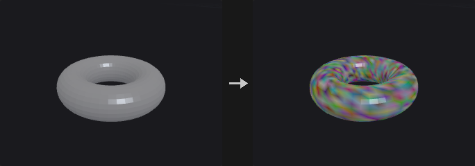

Writes a 3-component color attribute (default `Cd`) on selected elements; others keep their color (or white if the attribute is new).

- **Constant**: one color for all.
- **Random**: one random color per element, keyed on `id` if it exists or on the element number.
- **Random by Attribute**: the same attribute value gets the same color (for example color pieces by `name`).
- **Ramp by Attribute**: a scalar (or the length of a vector) attribute is normalized to 0..1 and looked up in the ramp. With Auto Range the range is the minimum and maximum over the selected elements.
- **Adjust**: modifies the existing colors in HSV (hue shift, saturation and value multipliers) and adds optional random variation; with an attribute set the variation is shared per piece.

**Inputs**

| Input | Type | Description |
|---|---|---|
| `geo` | GEOMETRY | Geometry to color. |

**Outputs**

| Output | Type | Description |
|---|---|---|
| `geo` | GEOMETRY | Copy of the input with the color attribute. |

**Parameters**

| Parameter | Type | Default | Description |
|---|---|---|---|
| Group `group` | string | *(empty)* | Group pattern limiting which elements are colored. |
| Class `attribute_class` | menu | Point | Class on which the color is written. Options: Point (`point`), Primitive (`prim`), Vertex (`vertex`). |
| Color Type `mode` | menu | Constant | How colors are produced; see the node description. Options: Constant (`constant`), Random (`random`), Random from Attribute (`random_by_attribute`), Ramp from Attribute (`ramp_by_attribute`), Adjust (HSV) (`adjust`). |
| Color `r` `g` `b` | float [0..100] | 1, 1, 1 | Color for Constant mode. *Hidden when mode ≠ constant.* |
| Seed `rand_seed` | int [0..] | 0 | Seed for random colors and random variation. *Hidden when mode = constant } { mode = ramp_by_attribute.* |
| Attribute `attribute` | string | *(empty)* | Attribute used by Random by Attribute (key), Ramp by Attribute (scalar value) and Adjust (piece key for shared random variation). *Hidden when mode = constant } { mode = random.* |
| Compute Range `auto_range` | toggle | on | Ramp by Attribute: use the minimum and maximum of the selected elements as the input range. When off, In Min and In Max are used. *Hidden when mode ≠ ramp_by_attribute.* |
| Range `in_min` `in_max` | float | 0, 1 | Manual input range for Ramp by Attribute (first value = minimum, second = maximum). *Hidden when mode ≠ ramp_by_attribute.* *Disabled when auto_range is on.* |
| Attribute Ramp `ramp` | string | `0:0,0,1 0.5:0,1,0 1:1,0,0` | Color ramp for Ramp by Attribute as `position:r,g,b` entries separated by spaces. *Hidden when mode ≠ ramp_by_attribute.* |
| Ramp Mode `ramp_mode` | menu | Linear | Interpolation between ramp points. Options: Linear (`linear`), Smooth (`smooth`), Constant (`constant`). |

*Adjust*

| Parameter | Type | Default | Description |
|---|---|---|---|
| Hue Shift `hue_shift` | float [-360..360] | 0 | Adjust mode: hue rotation in degrees. *Hidden when mode ≠ adjust.* |
| Saturation `saturation` | float [0..10] | 1 | Adjust mode: saturation multiplier. *Hidden when mode ≠ adjust.* |
| Value `value` | float [0..10] | 1 | Adjust mode: value (brightness) multiplier. *Hidden when mode ≠ adjust.* |
| Random Hue `random_hue` | float [0..360] | 0 | Adjust mode: random hue variation, up to plus or minus this many degrees. *Hidden when mode ≠ adjust.* |
| Random Saturation `random_saturation` | float [0..1] | 0 | Adjust mode: random saturation variation as a fraction of the saturation (0.2 = plus or minus 20 percent). *Hidden when mode ≠ adjust.* |
| Random Value `random_value` | float [0..1] | 0 | Adjust mode: random value variation as a fraction. *Hidden when mode ≠ adjust.* |

| Parameter | Type | Default | Description |
|---|---|---|---|
| Output Attribute `name` | string | `Cd` | Name of the color attribute written. |

**Compared with Houdini**

Combines the Color SOP with the HSV-adjust behaviour of Attribute Adjust Color. For the full Houdini Attribute Adjust Color semantics use Attribute Adjust Color.

---

### Distance along Geometry (PCG)

<a id="pcg-distancealonggeometry"></a>

`PCG_DistanceAlongGeometry` · category `PCG/attribute` · Houdini: Distance along Geometry (SOP)

Distance from start points measured along the surface (geodesic or along edges).

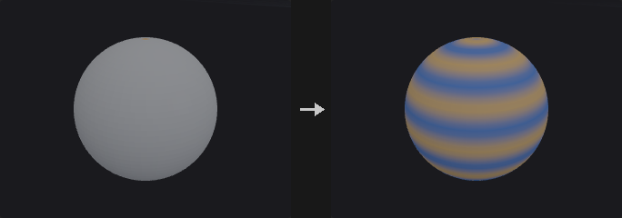

Measures how far every point is from the start points when travelling **on** the geometry, not through space: the distance around a sphere, along a winding road mesh, across a character's skin.

*Geodesic* uses the heat method: it diffuses heat from the start points for a short time, normalises the heat gradient and solves for a distance with that gradient. The result follows the surface smoothly. *Edges* finds the shortest path along edges; it is exact along edges but overestimates diagonals across faces (up to 41% across a quad grid).

Points not connected to any start point get -1.

**Inputs**

| Input | Type | Description |
|---|---|---|
| `geo` | GEOMETRY | Polygonal geometry (curves work with Edges). |

**Outputs**

| Output | Type | Description |
|---|---|---|
| `geo` | GEOMETRY | The input with the distance (and mask) attribute. |
| `report` | STRING | Sources, method, unreachable points and the largest distance. |

**Parameters**

| Parameter | Type | Default | Description |
|---|---|---|---|
| Start Points `start_points` | string | `0` | Point group or numbers the distance is measured from. |
| Method `method` | menu | Geodesic (Heat Method) | Geodesic (heat method: smooth, follows the surface) or Edges (shortest path along edges). Options: Geodesic (Heat Method) (`geodesic`), Edges (`edges`). |
| Heat Time `heat_time` | float [0.01..100.0] | 1 | Diffusion time of the heat method, in mean edge lengths squared. Larger values are smoother but less exact. *Hidden when method ≠ geodesic.* |
| Distance Attribute `distance_attribute` | string | `dist` | Point attribute the distance is written to. |
| Max Distance `max_distance` | float [0.0..] | 1 | Largest distance written; farther points get this value. *Disabled when use_max_distance is off.* |
| Max Distance `use_max_distance` | toggle | off | Clamp distances at Max Distance. |

*Mask*

| Parameter | Type | Default | Description |
|---|---|---|---|
| Output Mask `output_mask` | toggle | off | Also write a 0..1 mask: distance divided by Mask Radius, looked up in Mask Ramp. |
| Mask Attribute `mask_attribute` | string | `mask` | Point attribute the mask is written to. *Disabled when output_mask is off.* |
| Mask Radius `mask_radius` | float [0.0..] | 1 | Distance at which the ramp reaches its right end; farther points get the ramp's last value. *Disabled when output_mask is off.* |
| Mask Ramp `mask_ramp` | string | `0:1  1:0` | Ramp as position:value pairs over distance / Mask Radius. The default fades from 1 at the reference to 0 at Mask Radius. *Disabled when output_mask is off.* |
| Interpolation `ramp_mode` | menu | Linear | Interpolation between ramp keys. Options: Linear (`linear`), Smooth (`smooth`), Constant (`constant`). *Disabled when output_mask is off.* |

---

### Distance from Geometry (PCG)

<a id="pcg-distancefromgeometry"></a>

`PCG_DistanceFromGeometry` · category `PCG/attribute` · Houdini: Distance from Geometry (SOP)

Writes each point's distance to a reference geometry: to its surface, its edges, or its nearest point.

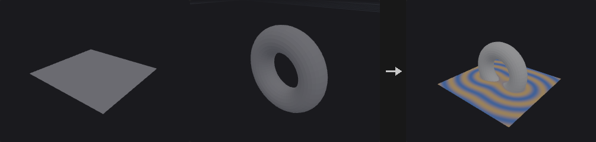

For every selected point the node finds the closest location on the reference geometry (second input) and writes the straight-line distance to a point attribute (`dist` by default).

*Surface* measures to the reference's polygons, *Edges* to its polygon edges and polylines (use it for curve networks), *Points* to its nearest point. With *Max Distance* on, farther points get the max value and the search stops there, which makes large inputs much faster.

The optional mask converts distance into a 0..1 falloff through a ramp, ready to drive colour, displacement or scattering density.

**Inputs**

| Input | Type | Description |
|---|---|---|
| `geo` | GEOMETRY | Points that receive the distance. |
| `reference` | GEOMETRY | Geometry the distance is measured to. |

**Outputs**

| Output | Type | Description |
|---|---|---|
| `geo` | GEOMETRY | The input with the distance (and mask) attribute. |
| `report` | STRING | Point count, metric and the distance range. |

**Parameters**

| Parameter | Type | Default | Description |
|---|---|---|---|
| Group `group` | string | *(empty)* | Only these points get a distance; the others keep 0 (or their existing value). |
| Reference Group `reference_group` | string | *(empty)* | Primitives (Surface, Edges) or points (Points) of the reference to measure to. Empty means all. |
| Distance Metric `metric` | menu | Surface | What on the reference counts: Surface (closest point on polygons), Edges (closest point on edges / curves) or Points (nearest point). Options: Surface (`surface`), Edges (`edges`), Points (`points`). |
| Distance Attribute `distance_attribute` | string | `dist` | Point attribute the distance is written to. |
| Max Distance `max_distance` | float [0.0..] | 1 | Largest distance written; farther points get this value. Also limits the search radius. *Disabled when use_max_distance is off.* |
| Max Distance `use_max_distance` | toggle | off | Clamp distances at Max Distance. |

*Mask*

| Parameter | Type | Default | Description |
|---|---|---|---|
| Output Mask `output_mask` | toggle | off | Also write a 0..1 mask: distance divided by Mask Radius, looked up in Mask Ramp. |
| Mask Attribute `mask_attribute` | string | `mask` | Point attribute the mask is written to. *Disabled when output_mask is off.* |
| Mask Radius `mask_radius` | float [0.0..] | 1 | Distance at which the ramp reaches its right end; farther points get the ramp's last value. *Disabled when output_mask is off.* |
| Mask Ramp `mask_ramp` | string | `0:1  1:0` | Ramp as position:value pairs over distance / Mask Radius. The default fades from 1 at the reference to 0 at Mask Radius. *Disabled when output_mask is off.* |
| Interpolation `ramp_mode` | menu | Linear | Interpolation between ramp keys. Options: Linear (`linear`), Smooth (`smooth`), Constant (`constant`). *Disabled when output_mask is off.* |

---

### Edge Transport (PCG)

<a id="pcg-edgetransport"></a>

`PCG_EdgeTransport` · category `PCG/attribute` · Houdini: Edge Transport (SOP)

Propagates or accumulates a point attribute along a tree grown from root points over the edges.

First a tree is built: **Network** runs shortest paths (edge length) from root points over all edges, each point attaching to its nearest root; **Curves** walks each polyline from its start (or from the end that lies in the root group); **Parent Attribute** takes parents from an integer point attribute. Then the Operation runs along the tree. Points that cannot be reached get value 0 and join the unreached group. The root of each point is written to the integer point attribute `transport_root`.

The first four operations are plain: **Distance** is the path length from the root, **Copy** passes the root value down, **Sum** adds the attribute along the path (including both ends), **Average** is the sum divided by the number of points on the path. The remaining ones follow Houdini: **Transport** takes the parent's value (root: zero or hold), **Transport from Root** uses the root's accumulated flow, **Total** sums ancestors' values without the point itself (root = 0), **Maximum** and **Minimum** take the extreme over the point and its ancestors. Integrate a Constant Value with Scale by Edge Length gives the distance along edges. Direction Backward goes from tips to roots and merges several children with the merge method. The `report` output gives reached, unreached and root counts.

**Inputs**

| Input | Type | Description |
|---|---|---|
| `geo` | GEOMETRY | Geometry with edges (polylines or meshes) and points to transport on. |

**Outputs**

| Output | Type | Description |
|---|---|---|
| `geo` | GEOMETRY | Copy of the input with the result attribute, `transport_root` and the unreached group. |
| `report` | STRING | Text summary of reached, unreached and root counts. |

**Parameters**

| Parameter | Type | Default | Description |
|---|---|---|---|
| Method `method` | menu | Edge Network | How the tree is built: shortest paths over the edge network, along curves, or from a parent attribute. Options: Edge Network (`network`), Each Curve (`curves`), Parent Attribute (`parent_attribute`). |
| Curve Group `curve_group` | string | *(empty)* | Primitive group pattern limiting which curves are walked (Curves method). Empty uses all. *Hidden when method ≠ curves.* |
| Point Group `point_group` | string | *(empty)* | Point group pattern limiting which points can take part (Network and Parent Attribute). Empty uses all. *Hidden when method = curves.* |
| Attribute `attribute` | string | *(empty)* | Numeric point attribute to transport. Not needed for Distance. *Hidden when operation = distance.* |
| Direction `direction` | menu | Forward | Forward goes from the roots toward the leaves; Backward goes from the leaves to the roots. Applies to the Houdini-style operations. Options: Forward (`forward`), Backward (`backward`). *Hidden when operation = distance } { operation = copy } { operation = sum } { operation = average.* |
| Parent Attribute `parent_attribute` | string | `parent` | Integer point attribute holding each point's parent point number (Parent Attribute method). Invalid or self references make the point a root. *Hidden when method ≠ parent_attribute.* |
| Root Choice `root_choice` | menu | Group | Network method: start from points in the root group, or from the first or last point (when unreached points remain, the lowest or highest remaining point becomes a new root). Options: Group (`group`), First Point (`first_point`), Last Point (`last_point`). *Hidden when method ≠ network.* |
| Root Group `root_group` | string | *(empty)* | Point group pattern for the roots. Network with Root Choice = Group requires it; for Curves it picks the end where each curve starts. *Hidden when method = parent_attribute } { method = network root_choice ≠ group.* |
| Operation `operation` | menu | Distance (PCG) | What is computed along the tree; see the node description. Distance, Copy, Sum and Average are the basic set; the rest follow Houdini. Options: Distance (PCG) (`distance`), Copy (PCG) (`copy`), Sum (PCG) (`sum`), Average (PCG) (`average`), Transport (`transport`), Transport from Root (`transport_from_root`), Total (`total`), Maximum (`maximum`), Minimum (`minimum`). |
| Normalization `normalization` | menu | Per-Component | Per Component normalizes every connected tree separately to 0..1, Global normalizes everything together. Used when Use Normalization is on. Options: Per-Component (`per_component`), Global (`global`). |
| Use Normalization `use_normalization` | toggle | off | Normalize the result to 0..1 per component of the output. |
| New Root Value `new_root_value` | menu | Zero | Value at root points for Transport operations: zero, or hold the root's own attribute value. Options: Zero (`zero`), Hold (`hold`). *Hidden when operation ≠ transport operation ≠ transport_from_root.* |
| Integrate a Constant Value `integrate_constant` | toggle | off | For Total: use 1 for every point instead of the attribute. *Hidden when operation ≠ total.* |
| Scale by Edge Length `scale_by_edge_length` | toggle | off | For the Houdini-style operations: multiply each step by the length of the edge to the parent. *Hidden when operation ≠ total.* |
| Edge Split Method `split_method` | menu | Copy | Forward direction when a point has several children: Copy gives each child the full value, Split divides it evenly. Options: Copy (`copy`), Split (`split`). *Hidden when operation = distance } { operation = copy } { operation = sum } { operation = average } { direction ≠ forward } { operation = maximum } { operation = minimum.* |
| Edge Merge Method `merge_method` | menu | Add | Backward direction when several children meet at a parent: add, or take the maximum or minimum. Options: Add (`add`), Maximum (`maximum`), Minimum (`minimum`). *Hidden when operation = distance } { operation = copy } { operation = sum } { operation = average } { direction ≠ backward } { operation = maximum } { operation = minimum.* |
| Output Attribute `output` | string | *(empty)* | Name of the output attribute. Empty writes back into `attribute` (or into `transport` for Distance). |
| Unreached Group `unreached_group` | string | `unreached` | Name of the point group that receives unreachable points. Empty creates no group. |

**Compared with Houdini**

The first four operations (Distance, Copy, Sum, Average) are this plugin's own and differ from Houdini: Sum includes the point itself, whereas Houdini's Total excludes it and sets the root to 0. Transport, Transport from Root, Total, Maximum and Minimum follow Houdini.

---

### Enumerate (PCG)

<a id="pcg-enumerate"></a>

`PCG_Enumerate` · category `PCG/attribute` · Houdini: Enumerate (SOP)

Writes sequence numbers to elements or pieces, as integers or formatted names.

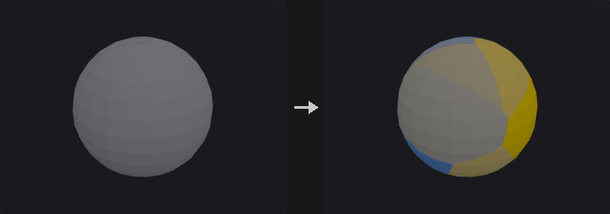

In **Elements** mode every selected element gets its index; with a piece attribute, numbering restarts in every piece. In **Pieces** mode every element gets the index of the piece it belongs to. The value is `Start + Step * index`. If Format is set (for example `piece_%d` or `%03d`) the value is written as a string, which is how the Name SOP is used; the format must contain exactly one integer placeholder. Pieces are ordered by first appearance or by sorted value. Elements outside `group` keep their value.

**Inputs**

| Input | Type | Description |
|---|---|---|
| `geo` | GEOMETRY | Geometry to number. |

**Outputs**

| Output | Type | Description |
|---|---|---|
| `geo` | GEOMETRY | Copy of the input with the numbering attribute. |

**Parameters**

| Parameter | Type | Default | Description |
|---|---|---|---|
| Group `group` | string | *(empty)* | Group pattern limiting which elements are numbered. |
| Group Type `attribute_class` | menu | Point | Class that is numbered. Options: Point (`point`), Primitive (`prim`), Vertex (`vertex`). |
| Piece Mode `mode` | menu | Elements | Elements numbers each element (restarting per piece if a piece attribute is set); Pieces gives every element its piece number. Options: Elements (`elements`), Pieces (`pieces`). |
| Piece Attribute `piece_attribute` | string | *(empty)* | Attribute whose distinct values define pieces. Empty means no pieces (Pieces mode then treats everything as one piece). |
| Piece Order `order` | menu | First Appearance | How pieces are numbered: by first appearance in the geometry, or by sorted attribute value. Options: First Appearance (`first_appearance`), Sorted by Value (`sorted`). *Hidden when mode = elements piece_attribute = "".* |
| Attribute `name` | string | `index` | Name of the attribute written. |
| Format `format` | string | *(empty)* | Optional format string with one integer placeholder such as `piece_%d` or `%03d`. If set, a string attribute is written. Empty writes integers. |
| Start Value `start` | int | 0 | Value of the first index. |
| Increment `step` | int | 1 | Increment between indices. |

**Compared with Houdini**

Covers Enumerate and the Name SOP (string format).

---

### Extract Centroid (PCG)

<a id="pcg-extractcentroid"></a>

`PCG_ExtractCentroid` · category `PCG/attribute` · Houdini: Extract Centroid (SOP)

Reduces each piece of geometry to a single point at its centroid.

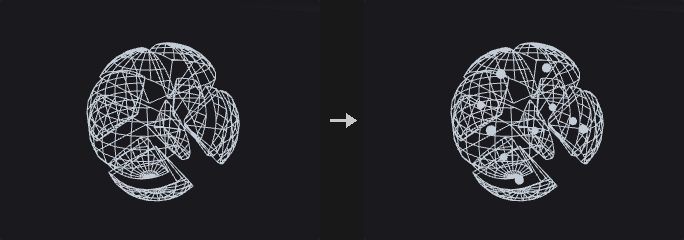

Splits the geometry into pieces (by attribute value, per primitive, per point, per connected component, or the whole geometry as one piece, using the same splitting as the For-Each loop) and computes a centroid per piece.

Center of Mass is **area weighted** (signed, using the face normal so concave faces cancel correctly) instead of averaging points, which would be biased toward finely tessellated areas: a box with one face subdivided 100 times and five single quads would otherwise shift toward the dense face. Bounding Box uses the center of the bounding box and Average Position the plain mean of the piece's points. Without faces, Center of Mass falls back to the point average.

Output as Points makes a new point cloud with one point per piece, carrying the piece value (the piece attribute, `sourceprim`, `sourcepoint` or `class`) and optionally attributes and groups transferred from the first element of each piece. Output as Attribute keeps the geometry and writes the centroid onto the pieces' own elements.

**Inputs**

| Input | Type | Description |
|---|---|---|
| `geo` | GEOMETRY | Geometry to reduce to centroids. |

**Outputs**

| Output | Type | Description |
|---|---|---|
| `geo` | GEOMETRY | Point cloud with one point per piece, or the input with a centroid attribute. |

**Parameters**

| Parameter | Type | Default | Description |
|---|---|---|---|
| Group `group` | string | *(empty)* | Group pattern limiting which elements take part. |
| Run Over `run_over` | menu | Pieces | How the geometry is split: by value of the piece attribute, per primitive, per point, by connected component, or as a single piece. Options: Pieces (`pieces`), Primitives (`primitives`), Points (`points`), Connectivity (`connectivity`), Detail (`detail`). |
| Piece Attribute `piece_attribute` | string | `name` | Attribute defining pieces for Pieces mode (scalar or string). *Hidden when run_over ≠ pieces.* |
| Piece Elements `piece_elements` | menu | Primitives | Whether Pieces mode reads the piece attribute from primitives or from points. Options: Primitives (`primitives`), Points (`points`). *Hidden when run_over ≠ pieces run_over ≠ connectivity.* |
| Method `method` | menu | Center of Mass | How the centroid is computed: area-weighted center of mass, center of the bounding box, or average of the points. Options: Center of Mass (`center_of_mass`), Bounding Box Center (`bounding_box`), Average Position (`average_position`). *Hidden when run_over = points.* |
| Output `output` | menu | Points | Points creates a new point per piece; Attribute writes the centroid to an attribute on the original elements. Options: Points (`points`), Attribute (`attribute`). |
| Centroid Attribute `attribute_name` | string | `centroid` | Name of the vector attribute for Attribute output. *Hidden when output ≠ attribute.* |
| Use Attribute Out `use_attrib_out` | toggle | on | Write the centroid attribute for Attribute output. When off, the geometry passes through unchanged. *Hidden when output ≠ attribute.* |

*Transfer*

| Parameter | Type | Default | Description |
|---|---|---|---|
| Use Transfer `use_transfer` | toggle | off | Enable transferring attributes and groups to the output points. *Hidden when output ≠ points.* |
| Transfer Attributes `transfer_attributes` | string | *(empty)* | Attribute name patterns copied from each piece's first element onto its output point (Points output). *Hidden when output ≠ points.* |
| Transfer Groups `transfer_groups` | string | *(empty)* | Group name patterns transferred in the same way. *Hidden when output ≠ points.* |

**Compared with Houdini**

Center of Mass is always the area centroid of the surface. Houdini computes the volume centroid for closed pieces; the two coincide for symmetric shapes but differ for asymmetric solid pieces.

---

### Measure (PCG)

<a id="pcg-measure"></a>

`PCG_Measure` · category `PCG/attribute` · Houdini: Measure (SOP)

Measures area, perimeter, volume or curvature of primitives or points and optionally visualizes the result as color.

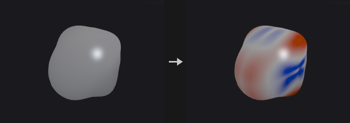

Writes the measured value as a float attribute (default name `area`, `perimeter`, `volume` or `curvature` according to the measurement). Area uses the Newell area vector, not a triangle fan with absolute values, which would double count folded parts of concave polygons. Volume uses the same formula with a cone from an arbitrary point, `V = 1/3 (area vector . v0)`, so the sum over a closed mesh equals the enclosed volume regardless of the reference point. Curvature is the mean curvature from the cotangent Laplacian, signed by the point normal; Gaussian curvature is the angle defect divided by area (flat areas 0, a sphere of radius r gives 1/r^2). Primitive curvature is the average over its corners.

Elements outside `group` get 0. With Accumulate = Total every element in the group receives the total instead of its own value.

When a color attribute name is given, values are mapped through a color ramp over the Visualized Range. By default this range is the **median plus or minus half of Width times the MAD** (median absolute deviation) rather than min/max, because a single degenerate element would otherwise squash the ramp to a single color; most elements then show contrast and outliers saturate at the ends, which is what you look for. Bake Range writes the normalized 0..1 value (scaled to the remap range) into the output attribute instead of the raw measurement.

**Inputs**

| Input | Type | Description |
|---|---|---|
| `geo` | GEOMETRY | Geometry to measure. |

**Outputs**

| Output | Type | Description |
|---|---|---|
| `geo` | GEOMETRY | Copy of the input with the measurement attribute, and optionally color, total and range group. |

**Parameters**

| Parameter | Type | Default | Description |
|---|---|---|---|
| Group `group` | string | *(empty)* | Group pattern limiting which elements are measured. Others get 0. |
| Element Type `element_type` | menu | Primitives | Measure primitives or points. Perimeter and Volume apply only to primitives. Options: Primitives (`primitives`), Points (`points`). |

*Measurement*

| Parameter | Type | Default | Description |
|---|---|---|---|
| Measure `measurement` | menu | Area | Quantity to measure. For points, area is the area associated with the point. Options: Area (`area`), Perimeter / Length (`perimeter`), Volume (`volume`), Curvature (Mean) (`curvature`), Curvature (Gaussian) (`gaussian_curvature`). |
| Accumulate `accumulate` | menu | Per Element | Per Element writes each element's own value; Total writes the sum over the group to all of its elements. Options: Per Element (`per_element`), Throughout (`total`). |
| Position Attribute `position_attribute` | string | `P` | Point attribute to use as position instead of `P` (it must have 3 components). |

*Visualized Range*

| Parameter | Type | Default | Description |
|---|---|---|---|
| Color Attribute `color_attribute` | string | *(empty)* | Name of the attribute to receive the visualization color. Empty creates no color and the other Visualized Range options have no effect. |
| Minimum `min_value` | float | -1 | Lower end of the visualized range when Use Min is on. |
| Use Min `use_min` | toggle | off | Override the lower end of the visualized range with Min. |
| Maximum `max_value` | float | 1 | Upper end of the visualized range when Use Max is on. |
| Use Max `use_max` | toggle | off | Override the upper end of the visualized range with Max. |
| Width `width` | float [0.0..] | 6 | Size of the automatic range in units of the width measure (the range is center +- width/2 times the spread). *Disabled when use_min is on use_max is on.* |
| Use Width `use_width` | toggle | on | Compute the range from center and width. When off, the range is the minimum and maximum of the values. |
| Width Multiplier `width_mode` | menu | x MAD | Spread measure used by Width: MAD (robust to outliers), standard deviation, or absolute (spread of 1). Options: x MAD (`mad`), x SD (`stddev`), x 1.0 (`absolute`). *Disabled when use_width is off } { use_min is on use_max is on.* |
| Center `center` | menu | Median | Center of the automatic range: median, mean or zero. Options: Median (`median`), Mean (`mean`), Fixed (0) (`zero`). *Disabled when use_width is off } { use_min is on use_max is on.* |
| Color Ramp `color_ramp` | menu | Blue-White-Red | Color scheme for the visualization. Custom uses the custom ramp text. Options: Blue-White-Red (`blue_white_red`), Grayscale (`grayscale`), Heat (`heat`), Custom (`custom`). |
| Custom Ramp `custom_ramp` | string | `0:0,0,0.5  0.5:0.9,0.9,0.9  1:0.8,0,0` | Custom color ramp as `position:r,g,b` entries separated by spaces. Used when Color Ramp is Custom. *Hidden when color_ramp ≠ custom.* |
| Ramp Interpolation `ramp_mode` | menu | Linear | Interpolation between ramp points. Options: Linear (`linear`), Smooth (`smooth`), Constant (`constant`). |

*Output*

| Parameter | Type | Default | Description |
|---|---|---|---|
| Attribute Name `attribute_name` | string | `area` | Name of the output attribute. Empty uses the default name of the measurement. |
| Total Attribute Name `total_attribute` | string | *(empty)* | Optional name of a detail attribute that receives the total over the group. |
| Range Group `range_group` | string | *(empty)* | Optional name of a group that receives the elements whose value lies inside the visualized range. |
| Bake Visualized Range Into Output `bake_range` | toggle | off | Write the value normalized to the visualized range, scaled to the remap range, into the output attribute instead of the raw measurement. |
| Remap Range `remap_min` `remap_max` | float | 0, 1 | Output range of the baked values (first value = value at the low end of the visualized range, second = at the high end). *Disabled when bake_range is off.* |

---

### Name (PCG)

<a id="pcg-name"></a>

`PCG_Name` · category `PCG/attribute` · Houdini: Name (SOP)

Writes a string attribute (default `name`) based on group membership, with an optional text replacement.

Two ways to assign names. With the default, Namings has one rule per line: `group : name`. The group can be a group name, wildcard, number list or expression, as in any group field; an empty group means all elements. Rules run in order and later rules overwrite earlier ones where groups overlap. Lines starting with `#` are disabled. With Name from Group on, every element is named after the group it belongs to (matching Group Mask); an element in several groups takes the last one in alphabetical order.

Afterwards a From to To substring replacement is applied to the whole attribute, replacing every occurrence or only the first. Unnamed elements keep their previous value (empty if the attribute is new). An existing numeric attribute with that name is replaced by a string attribute, noted in the `report`.

**Inputs**

| Input | Type | Description |
|---|---|---|
| `geo` | GEOMETRY | Geometry to name. |

**Outputs**

| Output | Type | Description |
|---|---|---|
| `geo` | GEOMETRY | Copy of the input with the string attribute. |
| `report` | STRING | Text summary: rules or groups used and number of elements named. |

**Parameters**

| Parameter | Type | Default | Description |
|---|---|---|---|
| Attribute `attribute` | string | `name` | Name of the string attribute to write. |
| Class `cls` | menu | Primitives | Class on which the attribute is written. Options: Primitives (`prim`), Points (`point`), Vertices (`vertex`). |
| Name from Group `name_from_group` | toggle | off | Name elements after the groups they belong to instead of using Namings. |
| Group Mask `group_mask` | string | `*` | Group name pattern selecting which groups are used when Name from Group is on. *Disabled when name_from_group is off.* |
| Namings `namings` | string | *(empty)* | One rule per line, `group : name`. Later rules overwrite earlier ones. Lines starting with `#` are disabled. *Hidden when name_from_group is on.* |

*String Editing*

| Parameter | Type | Default | Description |
|---|---|---|---|
| Global `global_replace` | toggle | on | Replace every occurrence of From; when off only the first occurrence in each value is replaced. |
| From `from_` | string | *(empty)* | Text to search for in the resulting values (plain substring, no wildcards). Empty skips the replacement. |
| To `to` | string | *(empty)* | Replacement text. |

**Compared with Houdini**

The numbered `piece_%d` style naming is done by Enumerate with its Format option.

---

### Normal (PCG)

<a id="pcg-normal"></a>

`PCG_Normal` · category `PCG/attribute` · Houdini: Normal (SOP)

Computes normals on points, vertices, primitives or the detail, with smoothing control.

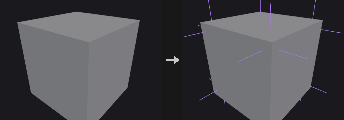

**Point** normals are smooth with one normal per point, so there can be no hard edges. **Vertex** normals have one normal per corner and are grouped by Cusp Angle, which is the only way to represent hard edges: a corner only accumulates neighbouring faces that deviate from its own face by less than the cusp angle (a cube at 60 degrees keeps all edges hard, a sphere stays smooth). **Primitive** normals are one per face, meant for copy and align computations rather than shading. **Detail** gives one normal for the whole geometry, the normalized sum of area normals.

Weighting decides how the face normals around a point or corner are averaged. Normals are written to the attribute named by Normal Name. With Compute Normals off, the node does not compute anything and only post-processes existing normals (Make Unit Length, Reverse).

**Inputs**

| Input | Type | Description |
|---|---|---|
| `geo` | GEOMETRY | Geometry to compute normals for. |

**Outputs**

| Output | Type | Description |
|---|---|---|
| `geo` | GEOMETRY | Copy of the input with the normal attribute. |

**Parameters**

| Parameter | Type | Default | Description |
|---|---|---|---|
| Group `group` | string | *(empty)* | Group pattern limiting which elements are computed. *Hidden when add_to = detail.* |
| Group Type `group_type` | menu | Guess from Group | How the group is interpreted. Guess reads it as a group of the class chosen in Add Normals to. A specific type reads the group in that class and expands it to the target class (touching elements count, for example a primitive group selects its points). Options: Guess from Group (`guess`), Points (`point`), Vertices (`vertex`), Primitives (`prim`), Edges (`edge`). *Hidden when add_to = detail.* |
| Override Normal `normal_name` | string | `N` | Name of the attribute the normals are written to. Empty means `N`. |
| Compute Normals `compute_normals` | toggle | on | Compute new normals. When off, only Make Unit Length and Reverse are applied to the existing attribute. |
| Add Normals to `add_to` | menu | Points | Class that receives the normals. Detail ignores the group. Options: Points (`point`), Vertices (`vertex`), Primitives (`prim`), Detail (`detail`). |
| Cusp Angle `cusp_angle` | float [0.0..180.0] | 60 | Vertex normals only: maximum angle in degrees between faces whose normals are merged at a corner. *Hidden when add_to ≠ vertex.* *Disabled when compute_normals is off.* |
| Weighting Method `weighting` | menu | By Face Area | How surrounding face normals are averaged: by face area, equally per corner, or by the corner angle of each face (a large and a thin triangle then count by their opening angle at the point). Options: By Face Area (`by_face_area`), Each Vertex Equally (`each_vertex_equally`), By Vertex Angle (`by_vertex_angle`). *Hidden when add_to = prim } { add_to = detail.* *Disabled when compute_normals is off.* |
| Keep Original Normal Where Computed Normal Is Zero `keep_zero` | toggle | off | Where the computed normal is a zero vector (isolated points, degenerate faces) keep the previous value instead. *Disabled when compute_normals is off.* |
| Make Normals Unit Length `make_unit` | toggle | off | Normalize existing normals in the group. Only takes effect when Compute Normals is off, since computed normals are already unit length. *Disabled when compute_normals is on.* |
| Reverse Normals `reverse` | toggle | off | Flip the normals in the group (done last). |

---

### Orient Along Curve (PCG)

<a id="pcg-orientalongcurve"></a>

`PCG_OrientAlongCurve` · category `PCG/attribute` · Houdini: Orient Along Curve (SOP)

Writes a rotation-minimizing frame (tangent, up and orientation quaternion) on the points of curves.

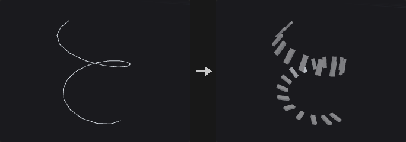

Builds a frame on every curve point by carrying the frame along the curve with the double reflection method, so it only twists where it must and does not flip at bends. It writes `N` (tangent, the +Z of Copy to Points), `up` (+Y) and `orient` (quaternion of the same frame, which Copy to Points prefers over `N` and `up`). Optional outputs are `side` (the X axis) and a curve-parameter attribute (normalized arc length 0..1), both off by default; any name left empty is not written.

On closed curves the twist accumulated going around the loop is spread evenly over the arc length so that the start and end frames match. Roll and twists rotate `up` about the tangent: `roll + (full_twists * 360 + partial_twist) * u` degrees, where `u` is the normalized arc length. Points on several curves take the frame from the last curve processed. Points not on a curve are left as they are.

**Inputs**

| Input | Type | Description |
|---|---|---|
| `geo` | GEOMETRY | Geometry with curves (polylines). |

**Outputs**

| Output | Type | Description |
|---|---|---|
| `geo` | GEOMETRY | Copy of the input with frame attributes on the curve points. |

**Parameters**

| Parameter | Type | Default | Description |
|---|---|---|---|
| Group `group` | string | *(empty)* | Primitive group pattern limiting which curves are processed. |

*Frame*

| Parameter | Type | Default | Description |
|---|---|---|---|
| Tangent Type `tangent_type` | menu | Average of Edges | How the tangent at a point is derived from its edges: average of the incoming and outgoing edge, the previous edge, or the next edge. Options: Average of Edges (`average`), Previous Edge (`previous`), Next Edge (`next`). |
| Reverse Direction `reverse` | toggle | off | Flip the tangent, so copies face toward the start of the curve. |
| Up Vector Type `up_mode` | menu | Minimal Rotation | Minimal Rotation starts from the Up vector at the first point and carries the frame forward. Constant orients every point toward the Up vector. Attribute uses the point attribute named by Up Attribute. Options: Minimal Rotation (`minimal_rotation`), Constant (`constant`), Attribute (`attribute`). |
| Up Vector `up_x` `up_y` `up_z` | float [-1..1] | 0, 1, 0 | Up vector used by Minimal Rotation (at the start) and Constant modes. *Hidden when up_mode = attribute.* |
| Up Vector Attribute `up_attribute` | string | `up` | Three-component point attribute giving the up direction in Attribute mode. *Hidden when up_mode ≠ attribute.* |
| Roll `roll` | float [-3600..3600] | 0 | Extra rotation of the up vector about the tangent, in degrees, applied equally along the curve. |
| Full Twists `full_twists` | int [-100..100] | 0 | Number of complete 360 degree twists added along the length of the curve. |
| Partial Twist `partial_twist` | float [-3600..3600] | 0 | Additional twist in degrees added along the length of the curve. |

*Output*

| Parameter | Type | Default | Description |
|---|---|---|---|
| Tangent Attribute `tangent_name` | string | `N` | Name of the tangent attribute. Empty skips it. |
| Up Attribute `up_name` | string | `up` | Name of the up attribute. Empty skips it. |
| Orientation Attribute `orient_name` | string | `orient` | Name of the orientation quaternion attribute. Empty skips it. |
| Side Attribute `side_name` | string | *(empty)* | Name of the optional side (X axis) attribute. Empty skips it. |
| Curve U Attribute `curveu_name` | string | *(empty)* | Name of the optional normalized arc length attribute. Empty skips it. |

**Compared with Houdini**

For a local frame that follows only the nearby edges, use PolyFrame instead; its curve normal is the Frenet normal and can flip.

---

### Point Velocity (PCG)

<a id="pcg-pointvelocity"></a>

`PCG_PointVelocity` · category `PCG/attribute` · Houdini: Point Velocity (SOP)

Computes point velocity (and optionally acceleration) from positions on neighbouring frames.

Finite differences between the current positions and those of the previous and/or next frame, with `dt = 1 / FPS`. **Backward** is `(P - P_prev) / dt`, **Forward** is `(P_next - P) / dt` and **Central** is `(P_next - P_prev) / (2 dt)`. Auto picks Central if both neighbouring frames are connected, otherwise whichever one is.

Points are matched to the other frames by point number or by an id attribute. Unmatched points get zero velocity and are added to the group `no_velocity`. If Compute Acceleration is on and both frames are connected, `accel = (P_next - 2P + P_prev) / dt^2` is written to the point attribute `accel`. The `report` output tells the method and the matched and unmatched counts.

**Inputs**

| Input | Type | Description |
|---|---|---|
| `geo` | GEOMETRY | Current frame geometry; receives the velocity. |
| `prev` *(optional)* | GEOMETRY | Optional geometry of the previous frame. |
| `next` *(optional)* | GEOMETRY | Optional geometry of the next frame. |

**Outputs**

| Output | Type | Description |
|---|---|---|
| `geo` | GEOMETRY | Copy of the current geometry with the velocity attribute and the `no_velocity` group. |
| `report` | STRING | Text summary: method, matched and unmatched points. |

**Parameters**

| Parameter | Type | Default | Description |
|---|---|---|---|
| Method `method` | menu | Automatic | Difference scheme. Backward needs `prev`, Forward needs `next`, Central needs both. Auto chooses from what is connected. Options: Automatic (`auto`), Central Difference (`central`), Backward Difference (`backward`), Forward Difference (`forward`). |
| Frames per Second `fps` | float [0.001..] | 24 | Frame rate that sets the time step `1 / fps`. Must be above 0. |
| Match Points By `match` | menu | Point Number | How points are paired between frames: by point number or by matching attribute values. Options: Point Number (`index`), Attribute (`attribute`). |
| ID Attribute `id_attribute` | string | `id` | Attribute present on both frames used for pairing when Match is By Attribute. *Hidden when match ≠ attribute.* |
| Compute Acceleration `compute_accel` | toggle | off | Also write the `accel` attribute. Requires both `prev` and `next`. |
| Velocity Attribute `v_attribute` | string | `v` | Name of the velocity attribute. |

---

### PolyFrame (PCG)

<a id="pcg-polyframe"></a>

`PCG_PolyFrame` · category `PCG/attribute` · Houdini: PolyFrame (SOP)

Writes a local frame (N, tangentu, tangentv) on points or primitives.

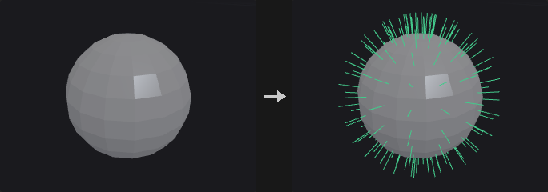

Each point or primitive gets a frame derived only from its immediate surroundings. `tangentu` comes from the chosen Style, `N` is the normal, and `tangentv = N x tangentu`. Degenerate cases (zero area, zero length, no UV change) write a zero vector, not NaN.

Styles for primitives: **Two Edges** uses the first edge as tangentu and the cross product of first and last edge as normal; **First Edge** uses the first edge with the Newell normal; **Centroid** points from the face center to the first vertex. For points on faces the corresponding values come from the incident face, averaged where needed. **UV** takes the direction of increasing `u` (the same definition as the tangent space of normal maps); **Attribute Gradient** takes the direction of steepest increase of a scalar point attribute within the face.

On curve points, `N` is the Frenet principal normal (pointing to the inside of the bend, undefined on straight segments and flipping at inflections). For a frame to place objects along a curve without flips use Orient Along Curve.

**Inputs**

| Input | Type | Description |
|---|---|---|
| `geo` | GEOMETRY | Geometry to compute frames on. |

**Outputs**

| Output | Type | Description |
|---|---|---|
| `geo` | GEOMETRY | Copy of the input with the frame attributes. |

**Parameters**

| Parameter | Type | Default | Description |
|---|---|---|---|
| Group `group` | string | *(empty)* | Group pattern limiting which primitives take part. |
| Entity `entity` | menu | Points | Write the frame on points or on primitives. Options: Points (`point`), Primitives (`prim`). |
| Style `style` | menu | Two Edges | How tangentu is derived; see the node description. Options: Two Edges (`two_edges`), First Edge (`first_edge`), Primitive Centroid (`centroid`), Texture UV (`uv`), Attribute Gradient (`attribute_gradient`). |
| UV Attribute `uv_attribute` | string | `uv` | UV attribute for the UV style (vertex or point attribute). *Hidden when style ≠ uv.* |
| Attribute Name `gradient_attribute` | string | *(empty)* | Scalar point attribute for the Attribute Gradient style. *Hidden when style ≠ attribute_gradient.* |
| Make Frame Orthogonal `orthogonal` | toggle | on | Make tangentu perpendicular to N. |
| Normal Name `n_name` | string | `N` | Name of the normal attribute. Empty skips it. |
| Tangent Name `tangentu_name` | string | `tangentu` | Name of the tangentu attribute. Empty skips it. |
| Bitangent Name `tangentv_name` | string | `tangentv` | Name of the tangentv attribute. Empty skips it. |

---

### Tangent Field (PCG)

<a id="pcg-tangentfield"></a>

`PCG_TangentField` · category `PCG/attribute` · Houdini: Tangent Field (SOP)

Computes the smoothest direction field with 1-, 2-, 4- or 6-fold symmetry on a surface.

Produces a field of unit tangent vectors on a polygon mesh that varies as little as possible from point to point. Symmetry sets the number of equivalent directions: 1 is an arrow, 2 a line, 4 a cross and 6 a snowflake; with symmetry above 1 each point stores one of the n equivalent directions. Neighbouring points are compared after parallel transport along the edge, and the field minimizing the total difference is found: a constrained linear solve when guides are present, otherwise the smallest eigenvector of the smoothness operator.

Guides come from a vector point attribute, or from the principal curvature directions (Align). Curvature alignment weighs by relative anisotropy, so isotropic regions such as spheres and planes get no imposed direction. Principal directions are lines (sign does not matter), so Align needs Symmetry of 2 or more. The smoothest field is found in a relaxed sense, which can leave pairs of cancelling singularities; guides or curvature alignment suppress them.

On closed surfaces singularities are unavoidable. The `report` output lists their count and the index sum (equal to `n * Euler characteristic`; on a sphere 2 for n = 1 and 8 for n = 4).

**Inputs**

| Input | Type | Description |
|---|---|---|
| `geo` | GEOMETRY | Polygon mesh to compute the field on. |

**Outputs**

| Output | Type | Description |
|---|---|---|
| `geo` | GEOMETRY | Copy of the input with the tangent attribute. |
| `report` | STRING | Text summary with the guided point count, singularity count and index sum. |

**Parameters**

| Parameter | Type | Default | Description |
|---|---|---|---|
| Symmetry `symmetry` | menu | 1 (Vector) | Number of equivalent directions per point: 1 arrow, 2 line, 4 cross, 6 snowflake. Options: 1 (Vector) (`1`), 2 (Line) (`2`), 4 (Cross) (`4`), 6 (Snowflake) (`6`). |
| Guide Attribute `guide_attribute` | string | *(empty)* | Optional vector point attribute whose tangential component guides the field. |
| Guide Weight `guide_weight` | float [0.0..] | 1 | Strength of the guide relative to smoothness. Higher values follow the guide more closely. *Disabled when guide_attribute = "" align = none.* |
| Align to Curvature `align` | menu | None | Align the field with the maximum or minimum principal curvature direction (on a cylinder, around the circumference or along the axis). Needs Symmetry of 2 or more. Options: None (`none`), Max Curvature (`max_curvature`), Min Curvature (`min_curvature`). *Disabled when symmetry = 1.* |
| Seed `rand_seed` | int [0..] | 0 | Seed for the starting vector of the eigenvector solver, which can change the field when several solutions are equally smooth. *Disabled when guide_attribute ≠ "" } { align ≠ none.* |
| Output Attribute `output` | string | `tangent` | Name of the point attribute that receives the field. |

---

### Wrangle (PCG)

<a id="pcg-wrangle"></a>

`PCG_Wrangle` · category `PCG/attribute` · Houdini: Attribute Combine (SOP), Attribute Expression (SOP), Attribute Swap (SOP), Attribute Wrangle (SOP), Rest Position (SOP)

Runs a short vectorized script over points, primitives, vertices or the detail, with VEX-style attribute syntax.

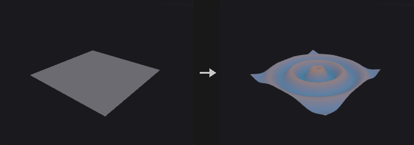

The code is not executed once per element. It runs **once for the whole geometry**, with `@P` being an array of shape (N, 3), and the script is Python/numpy with the VEX-like attribute shorthand: `@Cd`, `@P.y`, `@ptnum`, `@numpt`, `@primnum`, `@numprim`. Component access `.x .y .z .w` can be read and written. Type prefixes `f@` `i@` `v@` `s@` `2@` `3@` `4@` `p@` declare the type, and a typed assignment converts the value to it as in VEX (`i@id = @P.x * 10` truncates to integers, `v@c = 0.5` fills three components). `@group_name` reads and writes the group `name` of the Run Over class. `rand(x)`, `ch("name")` (and `chv`, `chi`, `chs`) are available, as are `np` and `math`.

Because the script is vectorized, per-element branching is written with numpy masks and `np.where` rather than `if`. If a group is set, the code still runs on all elements and the unselected rows are restored afterwards, so errors such as division by zero can still occur in unselected elements. Attributes that do not exist are created from the assigned shape.

The optional `geo1`, `geo2` and `geo3` inputs give access to other geometries by index in functions such as `point(1, "P", i)`, `npoints(2)` or `getbbox_size(3)`; without an index, input 0 is used. `ch("name")` in the code creates a custom parameter `name` on the node (type from the function: `ch`/`chf` float, `chi` integer, `chv` vector, `chs` string); see [`ch()` parameters](../concepts/wrangle.md#ch-parameters). The complete syntax is on [Wrangle syntax](../concepts/wrangle.md).

**Inputs**

| Input | Type | Description |
|---|---|---|
| `geo` | GEOMETRY | Geometry the code runs on (input 0). |
| `geo1` *(optional)* | GEOMETRY | Optional second geometry, input 1 in functions such as `point(1, ...)`. |
| `geo2` *(optional)* | GEOMETRY | Optional third geometry, input 2. |
| `geo3` *(optional)* | GEOMETRY | Optional fourth geometry, input 3. |

**Outputs**

| Output | Type | Description |
|---|---|---|
| `geo` | GEOMETRY | Copy of the input with the changes made by the code. |

**Parameters**

| Parameter | Type | Default | Description |
|---|---|---|---|
| Run Over `run_over` | menu | Point | Class whose elements `@` attributes refer to. In primitive context `@P` is the primitive center and is read-only. Options: Point (`point`), Primitive (`prim`), Vertex (`vertex`), Detail (`detail`). |
| Code `code` | string | `@P.y = sin(length(@P) * 0.5) * 2.0` | The script. Executed once over all elements with `@attribute` shorthand; see the node description. |
| Group `group` | string | *(empty)* | Group pattern limiting which elements keep the result. Others are restored to their original values. |
| Seed `rand_seed` | int [0..] | 0 | Seed for `rand()` in the script. |
| Ch Params `ch_params` | string | `{}` | Internal JSON text with the values of the node's custom parameters (vectors also per component), read with `ch()`. It is maintained by the frontend; do not edit by hand. |

**Compared with Houdini**

Replaces Attribute Wrangle, Attribute Expression, Attribute Combine, Attribute Swap and Rest Position through code. Unlike VEX the code is vectorized instead of run per element, so `if` and `for` over elements are written with numpy masks.

---
