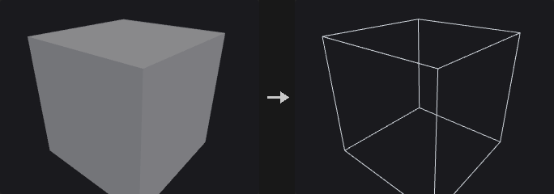

# Convert

Conversions between primitive types, volumes and other representations.

7 nodes.

[Back to the reference index](README.md)

## Contents

- [Convert Line (PCG)](#pcg-convertline) — Converts polygon edges into line primitives.
- [File Merge (PCG)](#pcg-filemerge) — Reads a numbered series of mesh files and merges them into one geometry.
- [From JSON (PCG)](#pcg-fromjson) — Builds points, boxes or curves, with attributes and groups, from a JSON text.
- [Geo to JSON (PCG)](#pcg-geotojson) — Exports attributes of points, primitives or the detail as a JSON text.
- [Import Mesh (PCG)](#pcg-importmesh) — Reads a mesh or point cloud file (OBJ, PLY, STL, GLB / glTF, LAS / LAZ) in pure Python.
- [Trace (PCG)](#pcg-trace) — Traces the iso-contours of an image into polyline curves.
- [Volume Rasterize Attributes (PCG)](#pcg-volumerasterizeattribs) — Splats points into volumes: a density fog plus a kernel-weighted average of chosen point attributes.

## Nodes

### Convert Line (PCG)

`PCG_ConvertLine` · category `PCG/convert` · Houdini: Convert Line (SOP)

Converts polygon edges into line primitives.

Every edge of the selected primitives becomes a two-point polyline. Shared edges are emitted once, deduplicated by point pair; emitting per face corner would double every interior edge, which looks identical as a wireframe but gives a cloth or spring solver two overlapping springs with doubled stiffness. Primitive attributes are taken from the first primitive that uses the edge; vertex attributes come from the corresponding half-edge.

With Connect Path on, edges are chained into the longest polylines possible instead of two-point segments: a walk continues through points of degree 2 and stops at points of any other degree. This is what makes Resample, Carve and Sweep treat the result as curves. Chains start at endpoints first and closed loops are handled afterwards, so an open chain is never split in the middle. When Compute Length is on the edge length is written to a primitive attribute.

**Inputs**

| Input | Type | Description |
|---|---|---|
| `geo` | GEOMETRY | Geometry whose primitives are converted. |

**Outputs**

| Output | Type | Description |
|---|---|---|
| `geo` | GEOMETRY | Line geometry. |

**Parameters**

| Parameter | Type | Default | Description |
|---|---|---|---|
| Group `group` | string | *(empty)* | Primitive group pattern; only these primitives are converted. |
| Keep Group Order `keep_group_order` | toggle | on | On: output edges follow the order in which they first appear in the geometry. Off: the output is sorted by point number. |
| Connect Path `connect_path` | toggle | off | Joins edges into long polylines, breaking at points whose degree is not 2. |
| Make Isolated Loops Closed `make_isolated_loops_closed` | toggle | off | Marks chains that form an isolated loop as closed polygons. Only has an effect with Connect Path on. *Disabled when connect_path is off.* |
| Remove Unused Points `remove_unused_points` | toggle | off | Deletes points that no longer belong to any output primitive. |
| Compute Length `length_attribute` | string | `restlength` | Name of the primitive attribute that receives the edge length. |
| Compute Length `compute_length` | toggle | on | Writes the length of each output line to the attribute named by Length Attribute. |

---

### File Merge (PCG)

`PCG_FileMerge` · category `PCG/convert` · Houdini: File Merge (SOP)

Reads a numbered series of mesh files and merges them into one geometry.

The `$SLICE` token in the file name (or the variable named by Merge Variable, also accepted as `${SLICE}`) is replaced in turn by each number of the Merge Range (start, end inclusive, increment; a negative increment counts down). The files are read in order and merged. `.npz` files are read as this plugin's geometry cache; other files go through the same format sniffing as Import Mesh with its default settings.

With Delete Points from Other Files, points whose `slice` point attribute differs from the current number are removed, which is useful for distributed simulations where each file also holds particles of other slices. Files without that attribute are left untouched. With Missing File set to No Geometry, absent files are skipped and listed in the report.

**Outputs**

| Output | Type | Description |
|---|---|---|
| `geo` | GEOMETRY | The merged geometry. |
| `report` | STRING | List of files read and files skipped. |

**Parameters**

| Parameter | Type | Default | Description |
|---|---|---|---|
| Geometry File `file` | string | `geo.$SLICE.npz` | File name pattern. It must contain `$SLICE` (or the variable named by Merge Variable). `.npz` is read as a geometry cache. |
| Reload Geometry `reload` | int [0..] | 0 | Change the number to force the files to be re-read. |
| Merge Range `merge_start` `merge_end` `merge_inc` | int | 0, 3, 1 | Merge Range: first number, last number (inclusive) and increment substituted for the variable. |
| Merge Variable `merge_variable` | string | `SLICE` | Name of the variable to substitute in the file name, without the `$`. |
| Delete Points from Other Files `delete_other` | toggle | off | Deletes points whose `slice` point attribute is different from the current file number. |
| Missing File `missing_file` | menu | Report Error | Report Error stops with an error when a file is absent. No Geometry skips the file and records it in the report. Options: Report Error (`error`), No Geometry (`no_geometry`). |

**Compared with Houdini**

Houdini's Load and Cache Length parameters are not present; ComfyUI caches by node inputs.

---

### From JSON (PCG)

`PCG_FromJSON` · category `PCG/convert`

Builds points, boxes or curves, with attributes and groups, from a JSON text.

The entry point for LLM / VLM driven layouts: the model emits structure (positions, bounding boxes, labels, categories) and this node turns it into geometry that downstream nodes (Copy to Points, PolyExtrude, Blast, Switch) can use.

Parsing is tolerant, because models rarely return clean JSON. Four stages are tried in order: parse directly, strip a markdown code fence, extract the first balanced `[...]` / `{...}` block, remove trailing commas. The stage that succeeded is reported in `info`, so a silent repair never goes unnoticed.

Modes: `points` makes one point per record (`pos`, `P` or `position`); `boxes` makes one rectangle (4 numbers) or box (6 numbers) per record, e.g. detection boxes or room layouts (box, then PolyExtrude gives walls); `curves` makes one polyline per record (`points` or `path`). Record keys are mapped to canonical names: `pos` / `position` / `translate` become `P`, `color` / `Cd` become `Cd` (hex strings such as `"#ff8800"` are understood when Hex Colors is on) and `label` / `type` / `tag` become `name`. Other keys are kept as they are: numbers become float attributes, fixed-length arrays become vectors, strings become string attributes. Attributes land on points in points mode and on primitives in the other modes.

Group By turns every distinct value of an attribute (usually `name`) into a group, so a classification from the model becomes usable groups.

Coordinates follow one rule for all modes. Two-component coordinates with Normalized on map 0..1 onto a Size sized area on the chosen plane (default xz ground plane); with Normalized off they are world units on that plane. Both are then offset by Center. Three-component coordinates are world coordinates plus Center. Flip V is for image space, where y points down.

**Outputs**

| Output | Type | Description |
|---|---|---|
| `geo` | GEOMETRY | Generated points, boxes or curves. |
| `records` | INT | Number of records parsed. |
| `info` | STRING | Summary: record, point and primitive counts, which parse stage was needed, attributes found, groups made and number of missing values that were filled. |

**Parameters**

| Parameter | Type | Default | Description |
|---|---|---|---|
| JSON `json_text` | string | *(see panel)* | The JSON text. A top-level array, or an object that contains one (see Path). |
| Record Path `path` | string | `auto` | When the top level is an object, the key that holds the record list, e.g. `items`. `auto` searches for it. |
| Output `mode` | menu | Points | What each record becomes: a point, a rectangle / box from its bounding box, or a polyline. Options: Points (`points`), Boxes (`boxes`), Curves (`curves`). |
| Group By Attribute `group_by` | string | `name` | Attribute whose distinct values each become a group. Empty creates no groups. |
| Parse Hex Colors `color_hex` | toggle | on | Interprets color strings such as `#ff8800` as `Cd`. |
| Plane `plane` | menu | XZ (Ground) | Plane that 2D coordinates are placed on; xz is the ground plane. Options: XZ (Ground) (`xz`), XY (`xy`), YZ (`yz`). |
| Normalized Coordinates `normalized` | toggle | on | On: 2D coordinates in 0..1 are mapped onto an area of Size on the plane. Off: they are world units on the plane. Three-dimensional coordinates are always world coordinates. |
| Size `size_u` `size_v` | float | 10, 10 | Width and height of the area that normalized 2D coordinates map onto. *Disabled when normalized is off.* |
| Center `center_x` `center_y` `center_z` | float | 0, 0, 0 | Offset added to all positions. |
| Flip V `flip_v` | toggle | off | Flips the second 2D coordinate (v becomes 1 - v when normalized, -v otherwise). Turn on for image space where y points down. |
| Height `height` | float | 0 | Boxes mode, rectangles from 2D boxes only. Offset of the rectangle along the normal of the chosen plane. *Hidden when mode ≠ boxes.* |

**Compared with Houdini**

There is no single Houdini equivalent; the closest is building points and curves with Add / Curve from external data.

---

### Geo to JSON (PCG)

`PCG_GeoToJSON` · category `PCG/convert`

Exports attributes of points, primitives or the detail as a JSON text.

Meant to show a language model the current layout so that it can propose a matching next step. It uses the same key conventions as From JSON, so geometry to JSON, edit by the model, and back through From JSON is a closed loop.

Only attributes are exported, never topology: thousands of vertex indices would only use up the model's context. Use Export Mesh or File Cache for full geometry. Vector attributes become arrays, scalars become numbers and strings stay strings.

When Limit truncates the output, the result becomes an object with `items`, `truncated: true` and `total`, so the model knows it does not see everything.

**Inputs**

| Input | Type | Description |
|---|---|---|
| `geo` | GEOMETRY | Geometry to export. |

**Outputs**

| Output | Type | Description |
|---|---|---|
| `json` | STRING | The JSON text. |
| `count` | INT | Number of elements of the chosen class in the geometry (before truncation). |

**Parameters**

| Parameter | Type | Default | Description |
|---|---|---|---|
| Class `class` | menu | Point | Attribute class to export, one record per point, per primitive, or a single record for the detail. Options: Point (`point`), Primitive (`prim`), Detail (`detail`). |
| Attributes `attribs` | string | *(empty)* | Attributes to export, separated by spaces or commas. Empty exports all attributes of the class. A name that does not exist is an error. |
| Max Records `limit` | int [0..] | 0 | Maximum number of records. 0 exports all of them. |
| Precision `precision` | int [0..15] | 6 | Decimal places that numeric values are rounded to. |
| Indent `indent` | int [0..8] | 0 | Indentation width for pretty printing. 0 produces compact single-line JSON. |

---

### Import Mesh (PCG)

`PCG_ImportMesh` · category `PCG/convert` · Houdini: File (SOP), Lidar Import (SOP)

Reads a mesh or point cloud file (OBJ, PLY, STL, GLB / glTF, LAS / LAZ) in pure Python.

Intended for the output of image-to-3D models, which usually have the right shape but poor topology: triangle soup, duplicate points, no UVs, uncontrolled face counts. A typical repair chain is Import Mesh, Fuse, Facet (recompute normals), PolyReduce, UV AutoSeams, UV Flatten, UV Layout, Export Mesh.

Nothing is triangulated on import: OBJ n-gons are preserved, which PolyReduce's quad preservation and Dissolve's coplanar merging need.

Several parameters fail silently when wrong. **Weld**: STL stores every triangle with its own three points, so without welding the point count triples and nothing is connected; Subdivide, PolyReduce, Connectivity and Normal cusp then quietly do nothing. `auto` welds STL only. **Up Axis** is never guessed: glTF is Y-up, OBJ / PLY / STL have no convention and Blender often exports Z-up, so you choose. **Format** `auto` looks at the file's magic bytes, not its extension; binary STL is recognised from its length (84 + 50 x triangle count) because its header often begins with "solid".

UVs are written to vertices, not points: OBJ `vt` indices are per corner (the same point can have different UVs on different faces, which is what a seam is), and glTF per-point UVs are expanded to vertices as well, matching the default class of all UV nodes in this plugin. A PLY without faces is read as a point cloud with every property kept as a point attribute, so 3D Gaussian Splatting files load directly (`opacity`, `scale_*`, `rot_*`, `f_dc_*`). With Splat Color on, the zero-order spherical harmonic coefficients become `Cd` using `C = 0.282095 * f_dc + 0.5`.

The `mesh` input accepts an in-memory mesh from another 3D plugin by duck typing: objects with `.vertices` / `.faces`, a dict with `vertices` and `faces`, or lists of those; torch tensors are converted. When it is connected, Filename is ignored, and Weld `on` welds while `auto` and `off` do not.

**LAS / LAZ** LiDAR point clouds: uncompressed `.las` (point formats 0-3 and 6-8) is read without any dependency; compressed `.laz` needs the optional `laspy` package (`pip install "laspy[lazrs]"`). Points get `intensity`, `classification`, `return_number`, `number_of_returns`, `scan_angle`, `user_data`, `point_source_id`, `gps_time` where present (Keep Extra Attributes), and `Cd` from RGB. Survey coordinates (hundreds of kilometres) do not fit float32 positions, so a cloud with any coordinate above 10 000 is moved to the rounded centre of its bounds and the offset is kept in the detail attribute `las_origin` (world = P + las_origin). LAS is Z-up: set Up Axis to Z-Up to Y-Up.

**Inputs**

| Input | Type | Description |
|---|---|---|
| `mesh` *(optional)* | MESH | In-memory mesh from another plugin (MESH type). Takes precedence over Filename. |

**Outputs**

| Output | Type | Description |
|---|---|---|
| `geo` | GEOMETRY | The imported geometry. |
| `points` | INT | Number of points. |
| `prims` | INT | Number of primitives. |
| `info` | STRING | Detected format, counts, welded point count, and which of UV / N / Cd were found. |

**Parameters**

| Parameter | Type | Default | Description |
|---|---|---|---|
| Geometry File `filename` | string | `mesh.glb` | Path of the file to read. Ignored when the mesh input is connected. The node re-reads the file when its modification time or size changes. |
| File Format `format` | menu | Automatic | File format; Automatic detects it from the content (LAS by its LASF signature). Options: Automatic (`auto`), OBJ (`obj`), PLY (`ply`), STL (`stl`), glTF (GLB) (`glb`), LAS / LAZ (LiDAR) (`las`). |
| Up Axis `up_axis` | menu | As Is | As Is keeps the file's coordinates. The other two options rotate positions and normals from Z-up to Y-up or from Y-up to Z-up. Options: As Is (`as_is`), Z-Up to Y-Up (`z_up_to_y_up`), Y-Up to Z-Up (`y_up_to_z_up`). |
| Scale `scale` | float | 1 | Uniform scale applied to positions after the up-axis rotation. |
| Reverse Winding `flip_winding` | toggle | off | Reverses the vertex order of all primitives, flipping their normals. |
| Weld Points `weld` | menu | Automatic (STL) | Merges coincident points. Auto welds STL files only; On welds always; Off never. Options: Automatic (STL) (`auto`), On (`on`), Off (`off`). |
| Weld Tolerance `weld_rel` | float [0.0..0.1] | 1e-05 | Weld tolerance relative to the bounding box size. *Hidden when weld = off.* |
| Merge Parts `merge_parts` | toggle | on | glTF only. On merges all primitives of the file into one geometry. Off reads only the first primitive. Parts are tagged with a `name` primitive attribute either way. |
| Splat Color `splat_color` | toggle | on | 3D Gaussian Splatting PLY: converts the `f_dc_*` coefficients into `Cd`. |
| Keep Extra Attributes `keep_extra_attribs` | toggle | on | PLY: keeps all additional properties of the file as point attributes. |

**Compared with Houdini**

Combines the roles of Houdini's File SOP (formats, up axis, scale) and parts of Lidar Import (point cloud PLY); only OBJ, PLY, STL and GLB are supported.

---

### Trace (PCG)

`PCG_Trace` · category `PCG/convert` · Houdini: Trace (SOP)

Traces the iso-contours of an image into polyline curves.

The one step on the image to geometry path that brings back topology: Attribute from Map only gives values, while Trace produces curves that can be extruded, swept or used as cutters. Line art, silhouettes and masks from image models become editable geometry.

The algorithm is Marching Squares with two points handled carefully. Saddle cells are ambiguous (the two segments could be connected or separate), and a wrong choice changes the topology, so the average of the four corners decides, which is exact for a bilinear field. Orientation is consistent: the side above the threshold is on the left, so outer contours are counter-clockwise (positive signed area) and holes are clockwise (negative), which PolyFill and PolyExtrude rely on.

Simplify is measured in image pixels, not world units, because it means how far the curve may deviate from the image and should not change with output size. Closed loops start the simplification from the farthest pair of points so a circle does not keep a spike at the start.

Output primitive attributes are `perimeter` and `area` (signed, in world units; open curves get 0 area) and the point attribute `uv`, which records where on the image each point came from and can be used with Attribute from Map to fetch colors.

**Inputs**

| Input | Type | Description |
|---|---|---|
| `cop` | COPIMAGE | Image to trace. |

**Outputs**

| Output | Type | Description |
|---|---|---|
| `curves` | GEOMETRY | Traced polylines (closed where the contour closes). |
| `count` | INT | Number of curves. |

**Parameters**

| Parameter | Type | Default | Description |
|---|---|---|---|
| Layer `layer` | string | `C` | Layer of the image to trace. |
| Channel `channel_mode` | menu | By Index (legacy) | How the scalar field is taken from the image. Index uses the channel number below; Mono uses Rec.709 luminance (the first channel if there are fewer than three); Red / Green / Blue / Alpha pick a channel (alpha counts as 1 if missing). Options: By Index (legacy) (`index`), Mono (`mono`), Red (`red`), Green (`green`), Blue (`blue`), Alpha (`alpha`). |
| Channel Index `channel` | int [0..63] | 0 | Channel index used when Channel is Index. *Hidden when channel_mode ≠ index.* |
| Threshold `threshold` | float | 0.5 | Iso-value. The contour separates pixels above it from pixels below it. |
| Invert `invert` | toggle | off | Traces the complement: the side below the threshold becomes the inside. |
| Boundary Color `boundary` | menu | None (open curves at border) | Value assumed outside the image. With a value set, a border of that value is added so shapes touching the image edge become closed. None leaves them open. Same as (0,0) takes the value of the bottom-left pixel. Options: None (open curves at border) (`none`), Black (`black`), White (`white`), Same as (0,0) (`same_as_00`), Custom (`custom`). |
| Boundary Value `boundary_value` | float | 0 | Value outside the image when Boundary Color is Custom. *Hidden when boundary ≠ custom.* |
| Simplify `simplify` | float [0.0..256.0] | 0.5 | Tolerance of Ramer-Douglas-Peucker simplification, in image pixels. 0 disables simplification. |
| Min Points `min_points` | int [2..] | 3 | Curves with fewer points than this after simplification are discarded. |
| Min Length `min_length` | float [0.0..] | 0 | Curves shorter than this (perimeter in world units) are discarded. 0 keeps everything. |
| Close Open Curves `close_open` | toggle | off | Marks all curves as closed, including open ones. |
| Step Size `step_size` | float [1e-06..] | 0.1 | Spacing in world units of the resampled points when Resample is on. |
| Resample Shapes `resample` | toggle | off | Resamples every curve to equal-length steps of Step Size. `perimeter` and `area` keep the values of the original contour. |
| Plane `plane` | menu | XY | Plane the curves are placed on. XY and XZ map the image up to Y and -Z respectively; ZX maps it to Z and Y. Options: XY (`xy`), XZ (`xz`), ZX (`zx`). |
| Size `size` | float [0.0001..] | 2 | World size of the image's longer side (or both sides if Keep Aspect is off). |
| Keep Aspect Ratio `keep_aspect` | toggle | on | Keeps the image aspect ratio; off stretches the image to Size x Size. |

*Placement*

| Parameter | Type | Default | Description |
|---|---|---|---|
| Height `height` | float | 0 | Offset of the curves along the normal of the plane. |
| Translate `center_x` `center_y` `center_z` | float | 0, 0, 0 | World position of the image center. |
| Rotate `rotate_x` `rotate_y` `rotate_z` | float [-360.0..360.0] | 0, 0, 0 | Rotation in degrees, around the Center, applied after scaling. |
| Scale `scale_x` `scale_y` `scale_z` | float | 1, 1, 1 | Scale per axis around the Center, applied before rotation. Negative values mirror and flip the sign of the area. |
| Add Point Texture `uv_attrib` | string | `uv` | Name of the point attribute that stores the image coordinate of each traced point. |
| Add UV `add_uv` | toggle | on | Writes the image coordinates of each point to the attribute named in UV Attribute. |

**Compared with Houdini**

Resample Shapes, Boundary Color and the Transform page follow Houdini's Trace parameters. Houdini's Trace produces faces; here the output is closed or open polylines, and use PolyFill to get faces.

---

### Volume Rasterize Attributes (PCG)

`PCG_VolumeRasterizeAttribs` · category `PCG/convert` · Houdini: Volume Rasterize Attributes (SOP)

Splats points into volumes: a density fog plus a kernel-weighted average of chosen point attributes.

Each point is a sphere of radius `pscale` x Radius Scale (or Radius when `pscale` is off or missing) with kernel weight `(1 - d/r)^2`. The output holds a fog volume named `density` (the sum of kernel weights times the point's density attribute, or 1 if the point has none) and one volume per requested attribute holding the kernel-weighted average, not the sum: two overlapping red points stay red. Texels with zero total weight are 0. Vector attributes are split into scalar volumes named `name.x`, `.y`, `.z` (`.w`).

Voxels are cubes aligned to world-space multiples of Voxel Size; the extent is the point bounding box grown by the largest radius. An error is raised if the grid would exceed 300^3 voxels, or if no point has a positive radius.

**Inputs**

| Input | Type | Description |
|---|---|---|
| `geo` | GEOMETRY | Points to rasterize. |

**Outputs**

| Output | Type | Description |
|---|---|---|
| `geo` | GEOMETRY | The volumes (density plus one per attribute component). |
| `report` | STRING | Resolution, volume count, point count and largest radius. |

**Parameters**

| Parameter | Type | Default | Description |
|---|---|---|---|
| Group `group` | string | *(empty)* | Point group pattern; only these points are splatted. |
| Attributes `attributes` | string | `Cd` | Point attributes to rasterize, separated by spaces. Must be numeric. |
| Voxel Size `voxel_size` | float [1e-05..] | 0.05 | Edge length of a voxel in world units. |
| Use pscale `use_pscale` | toggle | on | Takes each point's radius from `pscale` when present. |
| Radius `radius` | float [0.0..] | 0.1 | Radius used when Use pscale is off or the points have no `pscale`. |
| Radius Scale `radius_scale` | float [0.0..] | 1 | Multiplier on the radius. |
| Density Name `density_attribute` | string | `density` | Point attribute that weights each point's contribution to the density volume (1 if the attribute does not exist). The output volume is always called `density`. |

---
