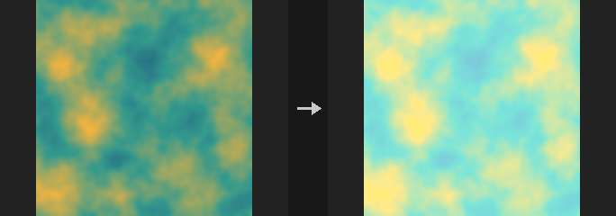
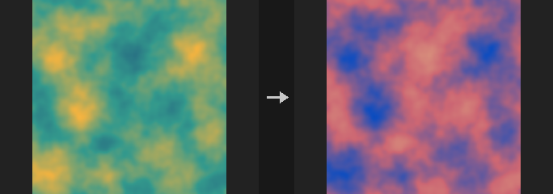
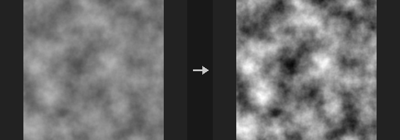
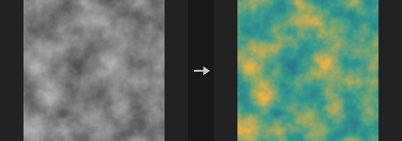
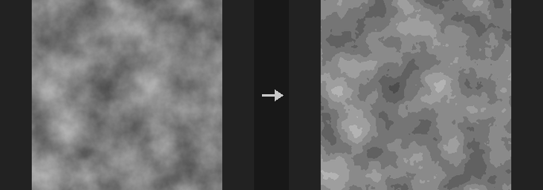
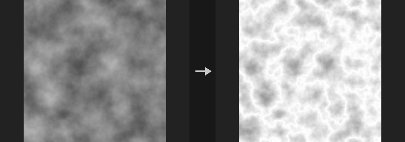
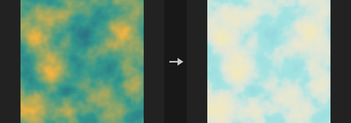
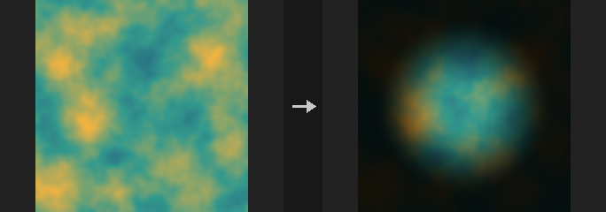

# Image: Color & Levels

Color correction, levels, remapping, keying.

15 nodes.

[Back to the reference index](README.md)

## Contents

- [COP Chroma Key (PCG)](#pcg-copchromakey) — Keys out a colour (green or blue screen) into a matte, with optional despill.
- [COP Clamp (PCG)](#pcg-copclamp) — Clamps values to a minimum and maximum.
- [COP Color Correct (PCG)](#pcg-copcolorcorrect) — Adjusts exposure, brightness, contrast, gamma, saturation and hue in one node.
- [COP Despill (PCG)](#pcg-copdespill) — Removes colour spill (for example green reflected on a subject) without producing an alpha matte.
- [COP Equalize (PCG)](#pcg-copequalize) — Shifts or scales the selected channels so that their measured minimum, maximum or average hits chosen target values.
- [COP Fit (PCG)](#pcg-copfit) — Remaps the measured minimum and maximum of each layer to a chosen output range and reports statistics.
- [COP Function (PCG)](#pcg-copfunction) — Applies a per-pixel unary function such as abs, pow, exp, log, sin, frac, step, smoothstep, mod or sigmoid.
- [COP Histogram (PCG)](#pcg-cophistogram) — Equalizes a layer's histogram or matches it to a reference image.
- [COP Invert (PCG)](#pcg-copinvert) — Inverts layer values as `Pivot - x`.
- [COP Levels (PCG)](#pcg-coplevels) — Remaps values with input range, gamma and output range.
- [COP Mono to RGB (PCG)](#pcg-copmonotorgb) — Maps a single-channel layer through a color ramp to produce an RGB false-color layer.
- [COP Quantize (PCG)](#pcg-copquantize) — Posterizes values into a fixed number of discrete steps.
- [COP Remap (PCG)](#pcg-copremap) — Maps values through a gradient lookup table.
- [COP Tone Map (PCG)](#pcg-coptonemap) — Compresses HDR values into the 0-1 range with a selectable tone-mapping curve.
- [COP Vignette (PCG)](#pcg-copvignette) — Darkens (or brightens) the image towards the edges with a soft radial falloff.

## Nodes

### COP Chroma Key (PCG)

<a id="pcg-copchromakey"></a>

`PCG_COPChromaKey` · category `PCG/cop` · Houdini: Chroma Key (COP)

Keys out a colour (green or blue screen) into a matte, with optional despill.

Three matte methods are available:

- `distance` (default, specific to this plugin): measures the distance to the key colour in the YCbCr chroma plane, normalised by luma, ignoring brightness, so shadows and highlights on a green screen are keyed out together. Tolerance and Softness control the transition.
- `chromakey`: Houdini's legacy Chromakey, with a hue, saturation and luminance range and Rolloff values that extend a soft edge beyond each range.
- `channel_separation`: Houdini's Channel Separation, which subtracts the maximum of the two other channels from the screen's main channel and applies Threshold and Width.

Despill is an extension: the amount by which the key colour's main channel exceeds the average of the other two is reduced. The matte is written to Alpha Layer (1 keeps the pixel, 0 removes it).

**Inputs**

| Input | Type | Description |
|---|---|---|
| `cop` | COPIMAGE | Image containing the colour layer to key. |

**Outputs**

| Output | Type | Description |
|---|---|---|
| `cop` | COPIMAGE | Image with the despilled colour and the matte layer. |

**Parameters**

| Parameter | Type | Default | Description |
|---|---|---|---|
| Layer `layer` | string | `C` | RGB layer to key. It needs at least three channels. |
| Method `method` | menu | Chroma Distance (PCG) | Algorithm for the matte: `distance` (chroma distance, plugin-specific), `chromakey` (Houdini legacy hue / saturation / luminance ranges) or `channel_separation` (main channel minus the others). Options: Chroma Distance (PCG) (`distance`), Chromakey (Legacy) (`chromakey`), Channel Separation (`channel_separation`). |
| Invert `invert` | toggle | off | Flips the matte. |

*Key*

| Parameter | Type | Default | Description |
|---|---|---|---|
| Screen Color `key_color` | string | `0 1 0` | RGB colour to remove. In `distance` mode it is the key colour; in `channel_separation` it is the screen colour. Despill finds the main channel from its largest component. |

| Parameter | Type | Default | Description |
|---|---|---|---|
| Tolerance `tolerance` | float [0..10] | 0.15 | `distance` method: chroma distance below which pixels are fully removed. *Hidden when method ≠ distance.* |
| Softness `softness` | float [0..10] | 0.1 | `distance` method: width of the transition from removed to kept beyond the tolerance. *Hidden when method ≠ distance.* |
| Hue `hue_min` `hue_max` | float [-360..720] | 90, 150 | `chromakey` method: hue range (min and max) in degrees that is keyed. If min is greater than max the range wraps around 360. *Hidden when method ≠ chromakey.* |
| Saturation `sat_min` `sat_max` | float [0..1] | 0.3, 1 | `chromakey` method: saturation range (min and max) that is keyed. *Hidden when method ≠ chromakey.* |
| Luminance Range `lum_min` `lum_max` | float [0..] | 0, 1 | `chromakey` method: luminance range (min and max) that is keyed. *Hidden when method ≠ chromakey.* |
| Threshold `threshold` | float [-10..10] | 0.5 | `channel_separation` method: matte value (0 = pure screen colour, 1 = no screen colour) at which pixels switch from removed to kept. *Hidden when method ≠ channel_separation.* |
| Width `width` | float [0..10] | 0 | `channel_separation` method: total width of the transition around Threshold (half on each side). 0 gives a hard threshold. *Hidden when method ≠ channel_separation.* |

*Rolloff*

| Parameter | Type | Default | Description |
|---|---|---|---|
| Hue `hue_rolloff` | float [0..180] | 10 | `chromakey` method: soft edge, in degrees, extending beyond the hue range. *Hidden when method ≠ chromakey.* |

| Parameter | Type | Default | Description |
|---|---|---|---|
| Saturation `sat_rolloff` | float [0..1] | 0.1 | `chromakey` method: soft edge extending beyond the saturation range. *Hidden when method ≠ chromakey.* |
| Luminance `lum_rolloff` | float [0..] | 0.1 | `chromakey` method: soft edge extending beyond the luminance range. *Hidden when method ≠ chromakey.* |
| Interpolation `interpolation` | menu | Linear | Shape of the soft edges for the `chromakey` and `channel_separation` methods. Options: Linear (`linear`), Ease In (`ease_in`), Ease Out (`ease_out`), Smooth (`smooth`), Gaussian (`gaussian`). *Hidden when method ≠ chromakey.* |

*Despill (PCG)*

| Parameter | Type | Default | Description |
|---|---|---|---|
| Despill Amount `despill` | float [0..2] | 1 | Strength of the despill. 0 turns it off. The key colour's main channel is reduced by this amount times its excess over the other two channels. Houdini's Chroma Key has no such option. |

*Visualize*

| Parameter | Type | Default | Description |
|---|---|---|---|
| Preview `show_matte` | toggle | off | Previews the key: the colour is multiplied by the matte and keyed-out areas are filled with Preview Color. |

| Parameter | Type | Default | Description |
|---|---|---|---|
| Preview Color `preview_color` | string | `1 0 1` | RGB colour shown in keyed-out areas when Show Matte is on. *Disabled when show_matte is off.* |
| Premultiply `premultiply` | toggle | off | Multiplies the output colour by the matte. |
| Output Layer `out_layer` | string | *(empty)* | Layer that receives the despilled colour. Empty overwrites the input layer. |
| Matte Layer `alpha_layer` | string | `alpha` | Layer that receives the matte. Empty means no matte is written. |

**Compared with Houdini**

The `distance` method and Despill do not exist in Houdini. Use COP Despill when only the spill removal is wanted.

**Tips**

- Raise Softness before Tolerance if the edge looks hard; raise Tolerance if shadows on the screen remain.

---

### COP Clamp (PCG)

<a id="pcg-copclamp"></a>

`PCG_COPClamp` · category `PCG/cop` · Houdini: Clamp (COP)

Clamps values to a minimum and maximum.

Limits every channel of the selected layers to the range Min to Max. Values are only changed by this node; most other COP nodes deliberately do not clamp, so this is the place to bring HDR values back into range.

**Inputs**

| Input | Type | Description |
|---|---|---|
| `cop` | COPIMAGE | Image to clamp. |

**Outputs**

| Output | Type | Description |
|---|---|---|
| `cop` | COPIMAGE | The clamped image. |

**Parameters**

| Parameter | Type | Default | Description |
|---|---|---|---|
| Layers `layers` | string | *(empty)* | Space-separated layer names to process. Empty processes every layer of the source. |
| Minimum `min` | float | 0 | Lower limit; smaller values are raised to it. |
| Maximum `max` | float | 1 | Upper limit; larger values are lowered to it. |

---

### COP Color Correct (PCG)

<a id="pcg-copcolorcorrect"></a>

`PCG_COPColorCorrect` · category `PCG/cop` · Houdini: Bright (COP), Color Correct (COP), Contrast (COP), Gamma (COP), HSV Adjust (COP)

Adjusts exposure, brightness, contrast, gamma, saturation and hue in one node.



Applies, in this order: exposure (multiply by 2^EV), brightness (add), contrast (scale around Pivot; 0.18 is mid grey in linear space), gamma (values above 1 brighten, the same direction as Levels), saturation (interpolates towards the Rec.709 luminance, so luminance is kept) and finally an HSV step (hue rotation, saturation multiplier, value multiplier). With a Mask Layer the result is blended back over the original. Alpha is not changed.

Saturation and the HSV step only apply to layers with at least three channels.

**Inputs**

| Input | Type | Description |
|---|---|---|
| `cop` | COPIMAGE | Image to correct. |

**Outputs**

| Output | Type | Description |
|---|---|---|
| `cop` | COPIMAGE | The corrected image. |

**Parameters**

| Parameter | Type | Default | Description |
|---|---|---|---|
| Layers `layers` | string | *(empty)* | Space-separated layer names to process. Empty processes every layer of the source. |
| Exposure `exposure` | float [-20..20] | 0 | Exposure in stops; the colour is multiplied by 2^Exposure. |
| Brightness (Offset) `brightness` | float [-10..10] | 0 | Value added to the colour. |
| Contrast `contrast` | float [0..10] | 1 | Contrast multiplier around Pivot. 1 does nothing. |
| Contrast Pivot `pivot` | float [-10..10] | 0.18 | Value that stays fixed when contrast changes. 0.18 is mid grey in linear colour. *Disabled when contrast = 1.* |
| Gamma `gamma` | float [0.01..10] | 1 | Gamma correction; values above 1 brighten. |
| Saturation `saturation` | float [0..10] | 1 | Saturation multiplier relative to luminance. 0 gives grey, 1 does nothing. |

*HSV*

| Parameter | Type | Default | Description |
|---|---|---|---|
| Hue Shift `hue_shift` | float [-360..360] | 0 | Hue rotation in degrees (HSV step). |
| Saturation Scale `hsv_saturation` | float [0..10] | 1 | Saturation multiplier in the HSV step. |
| Value Scale `hsv_value` | float [0..10] | 1 | Value multiplier in the HSV step. |

| Parameter | Type | Default | Description |
|---|---|---|---|
| Mask Layer `mask_layer` | string | *(empty)* | Optional layer used as a mask; the correction is blended in where the mask is 1. Empty applies it to the whole image. |

**Compared with Houdini**

Combines Color Correct, HSV Adjust, Bright, Contrast and Gamma into a single node.

---

### COP Despill (PCG)

<a id="pcg-copdespill"></a>

`PCG_COPDespill` · category `PCG/cop` · Houdini: Despill (COP)

Removes colour spill (for example green reflected on a subject) without producing an alpha matte.

The channel in which Spill Color is largest is limited to a ceiling built by mixing the other two channels with Bias; the part removed is the spill. Luminance can add the removed brightness back so the result is as bright as the input. The removed colour is written to a separate Spill Layer. Use COP Chroma Key when a matte is needed.

On pure colours (where the other two channels are equal) Bias has no visible effect.

**Inputs**

| Input | Type | Description |
|---|---|---|
| `cop` | COPIMAGE | Image containing the colour layer to despill. |

**Outputs**

| Output | Type | Description |
|---|---|---|
| `cop` | COPIMAGE | Image with the despilled colour and optional spill layer. |

**Parameters**

| Parameter | Type | Default | Description |
|---|---|---|---|
| Layer `layer` | string | `C` | RGB layer to despill. |
| Mask `mask` | float [0..1] | 1 | Blend amount between the original and despilled colour. 1 uses the despilled value everywhere. |
| Spill Color `spill_color` | string | `0 1 0` | The spill colour. Its largest channel is the one that is limited. |
| Bias `bias` | float [0..1] | 0.5 | How the ceiling is mixed from the other two channels. When removing green, 0 follows red and 1 follows blue. |
| Luminance `luminance` | float [0..10] | 0 | How much of the removed brightness is added back. 1 restores the original luminance. |
| Bias Layer `bias_layer` | string | *(empty)* | Optional single-channel layer multiplied per pixel into Bias. Empty means unused. |
| Mask Layer `mask_layer` | string | *(empty)* | Optional layer multiplied per pixel into Mask. Empty means unused. |
| Output Layer `out_layer` | string | *(empty)* | Name of the output layer. Empty overwrites the input layer. |
| Spill Layer `spill_layer` | string | `spill` | Layer that receives the removed colour. Empty writes nothing. |

**Compared with Houdini**

Matches Despill: it only removes spill and does not output alpha.

---

### COP Equalize (PCG)

<a id="pcg-copequalize"></a>

`PCG_COPEqualize` · category `PCG/cop` · Houdini: Equalize (COP)

Shifts or scales the selected channels so that their measured minimum, maximum or average hits chosen target values.

Measures the minimum, maximum and average of a luminance (chosen by `luminance_type`) and then moves all selected channels together to the target: stretch to Black/White, move the minimum to Black, move the maximum to White, move the average to Target Average, or scale so the maximum length hits White.

This is not histogram equalization; for that use COP Histogram.

**Inputs**

| Input | Type | Description |
|---|---|---|
| `cop` | COPIMAGE | Image containing the layer to equalize. |

**Outputs**

| Output | Type | Description |
|---|---|---|
| `cop` | COPIMAGE | Image with the equalized layer. |

**Parameters**

| Parameter | Type | Default | Description |
|---|---|---|---|
| Layer `layer` | string | `C` | Layer to equalize. |
| Mask `mask` | float [0..1] | 1 | Blend between the original and the new values; 1 uses only the new value. |
| Red `red` | toggle | on | Apply to the red channel. For single-channel layers this is the only switch that is read. |
| Green `green` | toggle | on | Apply to the green channel. |
| Blue `blue` | toggle | on | Apply to the blue channel. |
| Alpha `alpha` | toggle | on | Apply to the alpha channel. |
| Equalize By `equalize_by` | menu | Stretch to Black and White | What is matched: `stretch` maps min/max to Black/White; `min_to_black` and `max_to_white` move just that end; `average` moves the mean to Target Average; `max_length` scales the maximum length to White. Options: Stretch to Black and White (`stretch`), Move Minimum to Black (`min_to_black`), Move Maximum to White (`max_to_white`), Move Average to Value (`average`), Scale to Maximum Length (`max_length`). |
| Fit Method `fit_method` | menu | Shifting Values | Whether the adjustment is applied as an offset (shift) or as a multiplication (scale). Options: Shifting Values (`shift`), Scaling Values (`scale`). *Hidden when equalize_by = stretch } { equalize_by = max_length.* |
| Luminance Type `luminance_type` | menu | HDTV Luminance | How a pixel's brightness is computed for measuring: weighted luma formulas (SGI, NTSC, HDTV), channel average/max/min, vector magnitude, HSV components, or a single channel. Options: SGI Luminance (`sgi`), NTSC Luminance (`ntsc`), HDTV Luminance (`hdtv`), Average (`average`), Maximum Channel (`max`), Minimum Channel (`min`), Magnitude / Length (`magnitude`), Hue (`hue`), Saturation (`saturation`), Value (`value`), Red (`red`), Green (`green`), Blue (`blue`), Alpha (`alpha`). |
| Black `black` | float | 0 | Target value for the dark end. *Hidden when equalize_by ≠ stretch equalize_by ≠ min_to_black.* |
| White `white` | float | 1 | Target value for the bright end. *Hidden when equalize_by = min_to_black } { equalize_by = average.* |
| Target Average `target_average` | float | 0.5 | Target mean value when equalizing by average. *Hidden when equalize_by ≠ average.* |
| Active Layer `active_layer` | string | *(empty)* | Only pixels where this layer is above 0.5 contribute to the min/max/average measurement. Empty uses the whole image. |
| Mask Layer `mask_layer` | string | *(empty)* | Optional layer multiplied per pixel into Mask. Empty disables it. |
| Output Layer `out_layer` | string | *(empty)* | Name of the output layer. Empty overwrites the input layer. |

---

### COP Fit (PCG)

<a id="pcg-copfit"></a>

`PCG_COPFit` · category `PCG/cop`

Remaps the measured minimum and maximum of each layer to a chosen output range and reports statistics.

Rescales values so that the actual minimum and maximum found in the layer land on `out_min` and `out_max`. COP does not clamp values, so the real range of an image (noise in plus/minus 1, an SDF in hundreds of pixels, depth in metres) is often unknown; Fit is the quickest way to inspect it without knowing the range in advance. The second output is a one-line statistics text for the chosen layer.

By default all channels share one range, which preserves hue. With `per_channel` on, each channel is stretched on its own, which changes color relationships. A constant layer (min equal to max) is written as `out_min` without dividing by zero.

**Inputs**

| Input | Type | Description |
|---|---|---|
| `cop` | COPIMAGE | Image whose layers are remapped. |

**Outputs**

| Output | Type | Description |
|---|---|---|
| `cop` | COPIMAGE | Image with the remapped layers. |
| `stats` | STRING | Text report of the statistics of the layer named by Stats Layer. |

**Parameters**

| Parameter | Type | Default | Description |
|---|---|---|---|
| Layers `layers` | string | *(empty)* | Layers to remap. Empty means all layers; otherwise a space-separated list of layer names. |
| Output Range `out_min` `out_max` | float | 0, 1 | Target range (min, max) that the measured minimum and maximum are mapped to. |
| Per Channel `per_channel` | toggle | off | Stretch each channel to the full range separately. This changes the color relationships between channels. |
| Stats Layer `stats_layer` | string | `C` | Layer that the statistics report is computed for. |

---

### COP Function (PCG)

<a id="pcg-copfunction"></a>

`PCG_COPFunction` · category `PCG/cop` · Houdini: Function (COP)

Applies a per-pixel unary function such as abs, pow, exp, log, sin, frac, step, smoothstep, mod or sigmoid.

Equivalent of Function. The function is applied to every channel of the selected layers.

The node never produces NaN: log and sqrt of negative numbers give 0, and the reciprocal of 0 gives 0. A NaN would be smeared by a downstream blur and turn the whole image black with no visible source.

`pow` keeps the sign (`x^a` applied to the magnitude). `step` is 1 where `x >= a`. `smoothstep` runs from `a` to `b`. `mod` is `x mod a` (result has the sign of `a`; 0 when `a` is 0). `sigmoid` is the logistic function.

**Inputs**

| Input | Type | Description |
|---|---|---|
| `cop` | COPIMAGE | Image whose layers are transformed. |

**Outputs**

| Output | Type | Description |
|---|---|---|
| `cop` | COPIMAGE | Image with the function applied. |

**Parameters**

| Parameter | Type | Default | Description |
|---|---|---|---|
| Layers `layers` | string | *(empty)* | Layers to process. Empty means all layers; otherwise a space-separated list of layer names. |
| Function `function` | menu | Absolute | The function to apply per pixel. Options: Absolute (`abs`), Negate (`negate`), Square Root (`sqrt`), Power (`pow`), Exponential (`exp`), Natural Log (`log`), Sine (`sin`), Cosine (`cos`), Tangent (`tan`), Floor (`floor`), Ceiling (`ceil`), Round (`round`), Fractional Part (`frac`), Sign (`sign`), Step (`step`), Smooth Step (`smoothstep`), Clamp 0-1 (`clamp01`), Reciprocal (1/x) (`reciprocal`), Modulo (`mod`), Sigmoid (`sigmoid`). |
| A `a` | float | 1 | First function parameter: the exponent for pow, the threshold for step, the lower edge for smoothstep, the modulus for mod. Other functions ignore it. *Hidden when function ≠ pow function ≠ step function ≠ smoothstep function ≠ mod.* |
| B `b` | float | 1 | Upper edge for smoothstep. Other functions ignore it. *Hidden when function ≠ smoothstep.* |

---

### COP Histogram (PCG)

<a id="pcg-cophistogram"></a>

`PCG_COPHistogram` · category `PCG/cop`

Equalizes a layer's histogram or matches it to a reference image.

Works by rank rather than by binning, so the result is exact and has no bin steps. The mapping preserves order, and ties get their average rank, so flat color regions are not stretched into gradients (the classic histogram-equalization pitfall).

- **Equalize**: the values of each channel are spread evenly over that channel's own original [min, max].
- **Match Reference**: each channel takes the value found at the same quantile in the reference image. Useful for pulling a batch of AI-generated textures with inconsistent colors onto one reference. Matching an image to itself is the identity.

Channels are processed independently, so matching RGB will also pull hue toward the reference. To match only brightness, convert to luminance first. The node needs the CPU (sorting), so GPU layers are handled through numpy.

**Inputs**

| Input | Type | Description |
|---|---|---|
| `cop` | COPIMAGE | Image to process. |
| `reference` *(optional)* | COPIMAGE | Reference image for Match Reference mode. Required in that mode; ignored by Equalize. |

**Outputs**

| Output | Type | Description |
|---|---|---|
| `cop` | COPIMAGE | Input image with the listed layers remapped. |

**Parameters**

| Parameter | Type | Default | Description |
|---|---|---|---|
| Mode `mode` | menu | Equalize | Equalize flattens the distribution; Match Reference copies the reference's distribution. Options: Equalize (`equalize`), Match Reference (`match`). |
| Layers `layers` | string | `C` | Space-separated layers to process. Empty processes all layers. |
| Reference Layer `ref_layer` | string | *(empty)* | Layer of the reference image to match against. Empty uses the layer of the same name. *Hidden when mode ≠ match.* |
| Mask Layer `mask_layer` | string | *(empty)* | If set, only pixels inside the mask are changed (the reference always uses all of its pixels). |
| Amount `amount` | float [0.0..1.0] | 1 | Blend between the original (0) and the fully remapped result (1). |

---

### COP Invert (PCG)

<a id="pcg-copinvert"></a>

`PCG_COPInvert` · category `PCG/cop` · Houdini: Invert (COP)

Inverts layer values as `Pivot - x`.



Every value `x` becomes `Pivot - x`. The default pivot of 1 gives the usual photographic negative. The alpha channel (the fourth channel) is left alone unless Invert Alpha is enabled.

**Inputs**

| Input | Type | Description |
|---|---|---|
| `cop` | COPIMAGE | Image to invert. |

**Outputs**

| Output | Type | Description |
|---|---|---|
| `cop` | COPIMAGE | Image with the listed layers inverted. |

**Parameters**

| Parameter | Type | Default | Description |
|---|---|---|---|
| Layers `layers` | string | *(empty)* | Space-separated layers to process. Empty processes all layers. |
| Pivot `pivot` | float | 1 | The value `x` is subtracted from: `x -> Pivot - x`. |
| Invert Alpha `invert_alpha` | toggle | off | Also invert the alpha (fourth) channel. |

---

### COP Levels (PCG)

<a id="pcg-coplevels"></a>

`PCG_COPLevels` · category `PCG/cop`

Remaps values with input range, gamma and output range.



The classic Levels operation:

```
t   = (x - In Black) / (In White - In Black)
t   = t ^ (1 / Gamma)
out = Out Black + t * (Out White - Out Black)
```

The default settings are a bit-exact identity. Gamma uses the reciprocal exponent so that raising Gamma brightens the image, the Photoshop / Nuke / Houdini convention (the opposite of `pow(x, gamma)`).

Clamp Input is on by default; turn it off for SDFs, normals and HDR data. With clamping off, `t` can be negative, and a plain power of a negative number would give NaN, so the node uses `sign(t) * |t|^g` instead, which is continuous at 0, monotonic and odd-symmetric (for an SDF it compresses or stretches inside and outside symmetrically).

Setting Out Black to 1 and Out White to 0 inverts the values. For SDFs, Out Black 0 and Out White -1 negates them (swaps inside and outside).

**Inputs**

| Input | Type | Description |
|---|---|---|
| `cop` | COPIMAGE | Image to adjust. |

**Outputs**

| Output | Type | Description |
|---|---|---|
| `cop` | COPIMAGE | Image with the listed layers remapped. |

**Parameters**

| Parameter | Type | Default | Description |
|---|---|---|---|
| Layers `layers` | string | *(empty)* | Space-separated layers to process. Empty processes all layers. |
| Input Range `in_black` `in_white` | float | 0, 1 | Input range: the value mapped to 0 (first number) and to 1 (second number) before gamma. |
| Clamp Input `clamp_input` | toggle | on | Clamp the normalized input to 0-1 before applying gamma. Turn off for SDF, normal and HDR data. |
| Gamma `gamma` | float [0.001..100.0] | 1 | Gamma value. Above 1 brightens, below 1 darkens (the exponent is 1/Gamma). |
| Output Range `out_black` `out_white` | float | 0, 1 | Output range: the values that 0 and 1 are mapped to (first and second number). Swapping them inverts. |
| Clamp Output `clamp_output` | toggle | off | Clamp the result to the output range. |

---

### COP Mono to RGB (PCG)

<a id="pcg-copmonotorgb"></a>

`PCG_COPMonoToRGB` · category `PCG/cop` · Houdini: Mono to RGB (COP)

Maps a single-channel layer through a color ramp to produce an RGB false-color layer.



The value is normalized as `t = (v - Input Min) / (Input Max - Input Min)` (or the layer's own min and max with Compute Range), the ramp is evaluated at `t`, and the color is scaled into the Output Min..Output Max intensity range. With Scale by Value, the color is additionally multiplied by the unclamped `t`, so values beyond the range keep getting brighter. If Input Max equals Input Min, `t` is 0.

Outside Range decides what happens to `t` outside 0-1: Clamp at End holds the end colors; Repeat takes the fractional part (a value exactly at the top of the range still gets the last ramp color).

The ramp is written as `position:r,g,b` entries, for example `0:0,0,0  1:1,1,1`. If a Ramp Layer is given, colors are instead read along the horizontal middle row of that layer, with `t = 0` at the leftmost and `t = 1` at the rightmost pixel. To simply copy one channel into three, use COP Channel Convert.

**Inputs**

| Input | Type | Description |
|---|---|---|
| `cop` | COPIMAGE | Image containing the mono layer. |

**Outputs**

| Output | Type | Description |
|---|---|---|
| `cop` | COPIMAGE | Image with the RGB result in the output layer. |

**Parameters**

| Parameter | Type | Default | Description |
|---|---|---|---|
| Layer `layer` | string | `C` | Layer to map. For multichannel layers the first channel is used. |
| Compute Range `compute_range` | toggle | off | Use the layer's actual minimum and maximum as Input Min and Max. |
| Input Min `in_min` | float | 0 | Value that maps to the start of the ramp. *Disabled when compute_range is on.* |
| Input Max `in_max` | float | 1 | Value that maps to the end of the ramp. *Disabled when compute_range is on.* |
| Output Min `out_min` | float | 0 | Intensity that the ramp's 0 is scaled to. |
| Output Max `out_max` | float | 1 | Intensity that the ramp's 1 is scaled to. |
| Scale by Value `scale_by_value` | toggle | off | Multiply the color by the normalized value (not clamped). |
| Outside Range `outside` | menu | Clamp at End | Behaviour for values outside the input range: clamp at the end colors, or repeat the ramp. Options: Clamp at End (`clamp`), Repeat (`repeat`). |
| Ramp `ramp` | string | `0:0,0,0  1:1,1,1` | Color ramp as `position:r,g,b` entries separated by spaces, with positions from 0 to 1. *Disabled when ramp_layer ≠ "".* |
| Ramp Mode `ramp_mode` | menu | Linear | Interpolation between ramp entries: linear, smooth, or constant (stepped). Options: Linear (`linear`), Smooth (`smooth`), Constant (`constant`). |
| Ramp Layer `ramp_layer` | string | *(empty)* | If set, colors are taken from the middle row of this layer instead of the Ramp text. |
| Output Layer `out_layer` | string | *(empty)* | Name of the result layer. Empty overwrites the input layer. |

---

### COP Quantize (PCG)

<a id="pcg-copquantize"></a>

`PCG_COPQuantize` · category `PCG/cop` · Houdini: Quantize (COP)

Posterizes values into a fixed number of discrete steps.



Computes `round(x*(N-1))/(N-1)`, so the end points are preserved: Steps 2 gives {0, 1} and Steps 4 gives {0, 1/3, 2/3, 1}. A `floor(x*N)/N` formulation would never reach 1.0 and drop the brightest level.

Values outside the Range are not clamped; they continue to be quantized on the same grid. Quantizing an SDF therefore produces evenly spaced concentric bands, useful for contour lines. Useful as a step before cel shading or banded dithering.

**Inputs**

| Input | Type | Description |
|---|---|---|
| `cop` | COPIMAGE | Image to quantize. |

**Outputs**

| Output | Type | Description |
|---|---|---|
| `cop` | COPIMAGE | Quantized image. |

**Parameters**

| Parameter | Type | Default | Description |
|---|---|---|---|
| Layers `layers` | string | *(empty)* | Layers to process, space-separated. Empty processes all layers. |
| Steps `steps` | int [1..4096] | 4 | Number of discrete levels, end points included. |
| Rounding `mode` | menu | Round (Nearest) | Rounding applied to the scaled value: nearest, down or up. Options: Round (Nearest) (`round`), Floor (`floor`), Ceiling (`ceil`). *Disabled when steps = 1.* |
| Range `lo` `hi` | float | 0, 1 | Low and high end of the range that is divided into steps. |

---

### COP Remap (PCG)

<a id="pcg-copremap"></a>

`PCG_COPRemap` · category `PCG/cop` · Houdini: Remap (COP)

Maps values through a gradient lookup table.



The ramp uses the same syntax as COP Gradient and Attribute Fade, for example `0:0  0.5:1  1:0`, and the right of the colon may be `r,g,b`. The behaviour is chosen automatically from the number of ramp components.

A 1-component ramp is applied per channel, keeping the channel count; use it for grey curves, contrast and level compression. A multi-component ramp first reduces the image to a scalar t (first channel or Rec.709 luminance, see Mono Source) and then looks up that many channels. This is the greyscale to false-colour route, e.g. colouring SDFs, depth or noise, or turning a distance field into contour bands.

The lookup runs in NumPy, so on a GPU image there is a round trip; avoid it in per-frame hot spots.

**Inputs**

| Input | Type | Description |
|---|---|---|
| `cop` | COPIMAGE | Image to remap. |

**Outputs**

| Output | Type | Description |
|---|---|---|
| `cop` | COPIMAGE | Remapped image. |

**Parameters**

| Parameter | Type | Default | Description |
|---|---|---|---|
| Layers `layers` | string | *(empty)* | Layers to process, space-separated. Empty processes all layers. |
| Input Range `in_min` `in_max` | float | 0, 1 | Input value range corresponding to the ramp's 0 to 1. Values outside are clamped to the end colours. For SDFs use something like -20 / 20. |
| Remap Ramp `ramp` | string | `0:0  1:1` | Ramp as `position:value` stops. One component is a per-channel curve; `r,g,b` stops colourize a scalar. |
| Ramp Mode `ramp_mode` | menu | Linear | Interpolation between stops. Options: Linear (`linear`), Smooth (`smooth`), Constant (`constant`). |
| Mono Source `t_from` | menu | First Channel | How the scalar t is derived from a multi-channel layer. Only used when the ramp has several components. Options: First Channel (`value`), Luminance (`luminance`). |

---

### COP Tone Map (PCG)

<a id="pcg-coptonemap"></a>

`PCG_COPToneMap` · category `PCG/cop` · Houdini: Tone Map (COP)

Compresses HDR values into the 0-1 range with a selectable tone-mapping curve.



Applies exposure (`value x 2^Exposure`, negative values clamped to 0) and then one of the curves: Reinhard, Reinhard Extended (where `White` maps to 1), ACES (Narkowicz fit), Hable (Uncharted 2, with `White` as the white point) or Exposure Only, which just clamps. Only the RGB channels are changed; alpha is left alone. The result is clamped to 0-1.

Enable `Encode sRGB` only on images you are going to look at directly; leave it off for images that still go into compositing, since compositing expects linear values.

**Inputs**

| Input | Type | Description |
|---|---|---|
| `cop` | COPIMAGE | HDR image. |

**Outputs**

| Output | Type | Description |
|---|---|---|
| `cop` | COPIMAGE | The tone-mapped image. |

**Parameters**

| Parameter | Type | Default | Description |
|---|---|---|---|
| Layers `layers` | string | *(empty)* | Layers to process (space-separated names). Empty processes all layers. |
| Operator `op` | menu | ACES (Narkowicz Fit) | Tone-mapping curve. Exposure Only skips the curve and just clamps the exposed value to 0-1. Options: Reinhard (`reinhard`), Reinhard Extended (`reinhard_extended`), ACES (Narkowicz Fit) (`aces`), Hable (Uncharted 2) (`hable`), Exposure Only (Clamp) (`exposure_only`). |
| Exposure `exposure` | float [-20..20] | 0 | Exposure in stops applied before the curve (the value is multiplied by 2^Exposure). |
| White Point `white` | float [0.01..10000.0] | 4 | White point: the input value that maps to 1. Used by Reinhard Extended and Hable. *Hidden when op ≠ reinhard_extended op ≠ hable.* |
| Encode sRGB `encode_srgb` | toggle | off | Apply the sRGB transfer function after the curve. Turn on for images meant for viewing, off for images that continue into compositing. |

---

### COP Vignette (PCG)

<a id="pcg-copvignette"></a>

`PCG_COPVignette` · category `PCG/cop` · Houdini: Vignette (COP)

Darkens (or brightens) the image towards the edges with a soft radial falloff.



Multiplies the RGB channels by `1 - Amount x smoothstep(Radius - Softness, Radius, d)`, where `d` is the distance from `Center`. Distance is measured so that 1 is reached at the corners of a square image. With `Roundness` 1 the falloff is a circle based on the short side; with 0 it is an ellipse that follows the frame. Alpha is not changed.

**Inputs**

| Input | Type | Description |
|---|---|---|
| `cop` | COPIMAGE | Image to vignette. |

**Outputs**

| Output | Type | Description |
|---|---|---|
| `cop` | COPIMAGE | The vignetted image. |

**Parameters**

| Parameter | Type | Default | Description |
|---|---|---|---|
| Layers `layers` | string | *(empty)* | Layers to process (space-separated names). Empty processes all layers. |
| Amount `amount` | float [-10..10] | 0.5 | Strength of the darkening at full falloff. 1 fades to black; negative values brighten the edges. |
| Radius `radius` | float [0..10] | 0.75 | Distance from the centre at which the falloff is complete. |
| Softness `softness` | float [0..10] | 0.5 | Width of the transition zone, ending at the radius. Larger values give a gentler vignette that starts closer to the centre. |
| Roundness `roundness` | float [0..1] | 1 | 1 gives a circular vignette, 0 an elliptical one following the aspect ratio of the frame. |
| Center `center` | string | `0.5 0.5` | Centre of the vignette in UV (U and V, 0-1). |

---
