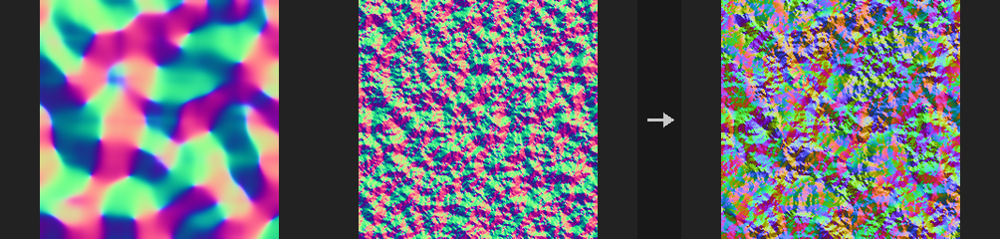
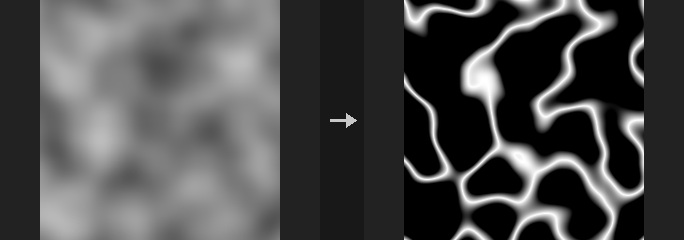
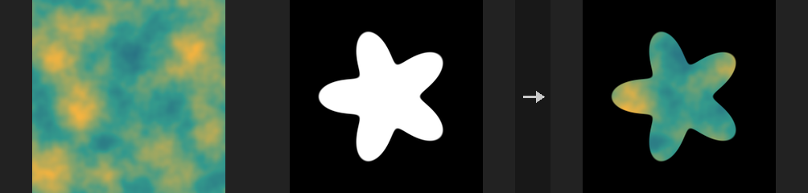
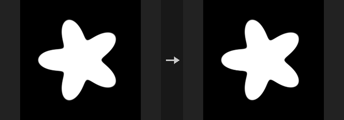
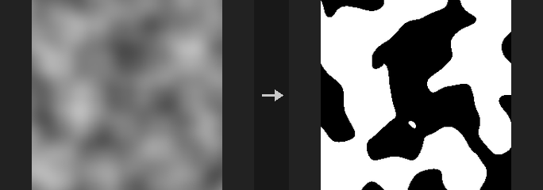
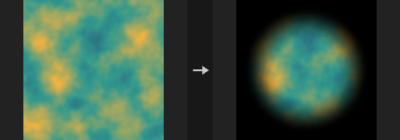

# Image: Compositing & Masks

Blending images and building masks.

10 nodes.

[Back to the reference index](README.md)

## Contents

- [COP Combine Normals (PCG)](#pcg-copcombinenormals) — Combines a base normal map and a detail normal map into one normal map.
- [COP Compare Mask (PCG)](#pcg-copcomparemask) — Compares two layers (or a layer and a constant) per pixel and outputs a 0..1 mask.
- [COP Composite (PCG)](#pcg-copcomposite) — Composites the foreground input over the background input with a choice of blend modes.
- [COP Drop Shadow (PCG)](#pcg-copdropshadow) — Builds a drop shadow from an alpha mask by offsetting, blurring and tinting it behind the original image.
- [COP Layer Combine (PCG)](#pcg-coplayercombine) — Combines the same layer from up to six inputs into one image, pixel by pixel.
- [COP Logic (PCG)](#pcg-coplogic) — Compares layers or combines them with boolean operations, producing a 0/1 mask.
- [COP Mask Combine (PCG)](#pcg-copmaskcombine) — Combines several masks into one, using a simple operation or a Houdini-style stack of blend modes.
- [COP Premultiply (PCG)](#pcg-coppremultiply) — Multiplies RGB by alpha, or divides it back out.
- [COP Select (PCG)](#pcg-copselect) — Compares two layers per pixel and picks one, or blends them smoothly by the difference.
- [COP Wipe (PCG)](#pcg-copwipe) — Transitions from image A to image B with a linear, radial, dissolve or crossfade wipe.

## Nodes

### COP Combine Normals (PCG)

`PCG_COPCombineNormals` · category `PCG/cop` · Houdini: Combine Normals (COP)

Combines a base normal map and a detail normal map into one normal map.

Both inputs must be signed normals (-1..1). The base layer is read from `cop`; the detail layer from the `detail` input, or from the same image if `detail` is not connected. Methods:

- `rnm` (default): Reoriented Normal Mapping. Rotates the detail into the base's frame, so detail on steep slopes follows the slope instead of being flattened.
- `whiteout`: adds xy, multiplies z. Cheap, but detail is weaker on steep slopes.
- `udn`: adds xy, takes z from the base. Even cheaper.
- `linear`: adds and renormalizes. Kept for comparison only: even flat detail tilts the base towards +z and weakens slopes.

With flat detail, `rnm`, `whiteout` and `udn` return the base unchanged (`linear` does not); with a flat base, `rnm` returns the detail unchanged. The result is always unit length. Amount scales the detail (0 means no detail).

**Inputs**

| Input | Type | Description |
|---|---|---|
| `cop` | COPIMAGE | Image holding the base (large-scale) normal layer. |
| `detail` *(optional)* | COPIMAGE | Optional image holding the detail normal layer. If not connected, the detail layer is taken from `cop`. |

**Outputs**

| Output | Type | Description |
|---|---|---|
| `cop` | COPIMAGE | Image with the combined normal layer. |

**Parameters**

| Parameter | Type | Default | Description |
|---|---|---|---|
| Base Layer `base_layer` | string | `N` | Name of the base normal layer in `cop`. |
| Detail Layer `detail_layer` | string | `N` | Name of the detail normal layer. Taken from the `detail` input if it is connected, otherwise from `cop`. |
| Method `method` | menu | Reoriented Normal Mapping | Blend method; see the description. `rnm` is the most accurate, `linear` the least. Options: Reoriented Normal Mapping (`rnm`), Whiteout (`whiteout`), UDN (`udn`), Linear (`linear`). |
| Detail Amount `amount` | float [0.0..16.0] | 1 | Strength of the detail normal. 0 removes the detail, 1 uses it fully, larger values exaggerate it. |
| Output Layer `out_layer` | string | `N` | Name of the output layer. |
| Keep Input Layers `keep_layers` | toggle | on | Keep the other layers of the input in the output. |

---

### COP Compare Mask (PCG)

`PCG_COPCompareMask` · category `PCG/cop` · Houdini: Compare (COP)

Compares two layers (or a layer and a constant) per pixel and outputs a 0..1 mask.

Compares A with B per pixel using the True If condition and writes a single-channel 0..1 mask. B is Layer B, or the Comparison Value when Layer B is empty. For multi-channel layers, Components decides whether all channels (minimum) or any channel (maximum) must pass.

Tolerance is two-sided for the equality tests (`equal`, `not_equal`) and one-sided for the strict and non-strict inequalities. Pixels that pass the comparison are always 1; Falloff shapes the pixels that fail it but lie within the tolerance: `none` cuts hard at the tolerance edge, `linear` ramps from 1 down to 0, `elendt` uses a smooth S-shaped curve (implemented here as smoothstep, so intermediate values differ slightly from Houdini). `not_equal` is the complement of `equal`.

To measure how different two images are (SSIM, PSNR) use COP Compare.

**Inputs**

| Input | Type | Description |
|---|---|---|
| `cop` | COPIMAGE | Image containing the layers to compare. |

**Outputs**

| Output | Type | Description |
|---|---|---|
| `cop` | COPIMAGE | Image with the mask layer added. |

**Parameters**

| Parameter | Type | Default | Description |
|---|---|---|---|
| Layer A `layer_a` | string | `C` | First layer (A). |
| Layer B `layer_b` | string | *(empty)* | Second layer (B). Empty compares A with Comparison Value instead. |
| Comparison Value `value` | float | 0 | Constant that A is compared against when Layer B is empty. *Disabled when layer_b ≠ "".* |
| Tolerance `tolerance` | float [0..] | 0 | Allowed difference within which the Falloff applies. Used for every comparison, including with Falloff `none` (a hard cut at the tolerance edge). *Disabled when tolerance_layer ≠ "".* |
| Tolerance Layer `tolerance_layer` | string | *(empty)* | Optional single-channel layer providing a per-pixel tolerance. When set it replaces Tolerance. |
| True If `true_if` | menu | Equal to each other (==) | Condition under which the mask is 1: A equal to, not equal to, greater than, greater or equal to, less than or less or equal to B. Options: Equal to each other (==) (`equal`), Not equal to each other (!=) (`not_equal`), A greater than B (>) (`greater`), A greater than or equal to B (>=) (`greater_equal`), B greater than A (<) (`less`), B greater than or equal to A (<=) (`less_equal`). |
| Components `components` | menu | True if All | For multi-channel layers: `all` requires every channel to pass, `any` requires at least one. Options: True if All (`all`), True if Any (`any`). |
| Falloff `falloff` | menu | None | Transition for pixels that fail the comparison but are within the tolerance: `none` is a hard cut, `linear` a linear ramp, `elendt` a smooth S curve. Options: None (`none`), Linear (`linear`), Elendt (`elendt`). |
| Output Layer `out_layer` | string | `mask` | Name of the mask layer. |

**Compared with Houdini**

Corresponds to Houdini's Compare node.

---

### COP Composite (PCG)

`PCG_COPComposite` · category `PCG/cop` · Houdini: Blend (COP)

Composites the foreground input over the background input with a choice of blend modes.

`over`, `atop`, `xor` and `under` are Porter-Duff operators and compute a new alpha: `C = (Cf*af + Cb*ab*(1-af)) / a`, `a = af + ab*(1-af)` for `over`. They work on non-premultiplied alpha, like ComfyUI images. All other modes (add, multiply, screen and so on) are component-wise functions of foreground and background; opacity and mask then interpolate between the background and the blended result. Treating `over` as an alpha interpolation would give the wrong alpha when both layers are semi-transparent.

If resolutions differ, the foreground is resampled to the background. Only single-channel layers are broadcast automatically (for example a mask onto RGB); a 3- versus 4-channel mismatch is not guessed. Values are never clamped, so `add` can give 1.7 and HDR, SDF and normal data survive; clamping only happens at COP Export.

The `mask` input is multiplied with Opacity when connected.

**Inputs**

| Input | Type | Description |
|---|---|---|
| `background` | COPIMAGE | Base image. Defines the output resolution. |
| `foreground` | COPIMAGE | Image composited on top of the background. |
| `mask` *(optional)* | COPIMAGE | Optional mask image. Its Mask Layer is multiplied with Opacity. |

**Outputs**

| Output | Type | Description |
|---|---|---|
| `cop` | COPIMAGE | The composite. |

**Parameters**

| Parameter | Type | Default | Description |
|---|---|---|---|
| Mode `mode` | menu | Over | Blend mode. `over`, `atop`, `xor` and `under` are alpha compositing operators; `replace` returns the foreground (Houdini's Blend); `darken` / `lighten` are minimum / maximum; `hypot` combines values as sqrt(a^2 + b^2); the remaining modes are the usual formulas. Options: Over (`over`), Add (`add`), Subtract (`subtract`), Difference (`difference`), Multiply (`multiply`), Divide (`divide`), Screen (`screen`), Overlay (`overlay`), SoftLight (`softlight`), Minimum (`darken`), Maximum (`lighten`), Atop (`atop`), Xor (`xor`), Blend (`replace`), Under (`under`), Hypot (`hypot`), Exclusion (`exclusion`), HardLight (`hardlight`), Dodge (`dodge`), Burn (`burn`). |
| Mask `opacity` | float [-10000.0..10000.0] | 1 | Amount of the blended result mixed in. When the mask input is connected, multiplied by the mask. |
| Swap FG and BG `swap` | toggle | off | Swaps the values of foreground and background before blending (the resolution still follows the first input). |
| Compare Lengths `compare_lengths` | toggle | off | For `darken` and `lighten`: choose the whole pixel with the smaller / larger vector length instead of comparing channel by channel. *Disabled when mode ≠ darken mode ≠ lighten.* |
| Red `channel_r` | toggle | on | Process the red channel. A disabled channel keeps the background value. |
| Green `channel_g` | toggle | on | Process the green channel. A disabled channel keeps the background value. |
| Blue `channel_b` | toggle | on | Process the blue channel. A disabled channel keeps the background value. |
| Alpha `channel_a` | toggle | on | Process the alpha channel. A disabled channel keeps the background value. |
| Background Layer `layer` | string | `C` | Background layer to composite onto. |
| Foreground Layer `foreground_layer` | string | *(empty)* | Layer of the foreground image to use. Empty uses the same name as Layer. |
| Mask Layer `mask_layer` | string | `mask` | Layer of the mask input to read. Only used when `mask` is connected. |
| Output Layer `output_layer` | string | *(empty)* | Name of the result layer. Empty overwrites Layer. |
| Keep Other Layers `keep_other_layers` | toggle | on | Copy the other layers of the background to the output. When off, only the result layer is output. |

**Compared with Houdini**

Compared with Houdini's Blend, Under, Hypot, Exclusion, HardLight, Dodge and Burn were added; Houdini's Blend is `replace` here, and Maximum / Minimum are `lighten` / `darken`. The Sharpen mode and the Hue, Saturation, Luminosity and Color modes are not implemented. Space, Border, Filter, Clip by Data Window and Crop to Content are not offered because images have no data window.

**Tips**

- Keep HDR data in the chain and clamp only at the end (COP Export or COP Clamp).

---

### COP Drop Shadow (PCG)

`PCG_COPDropShadow` · category `PCG/cop` · Houdini: Drop Shadow (COP)

Builds a drop shadow from an alpha mask by offsetting, blurring and tinting it behind the original image.

Takes the alpha (the 4th channel of `layer`, or a separate alpha layer), shifts it by an offset, blurs it, colors it and places it underneath the original image. The result is RGBA.

The node errors out if there is no alpha at all; it does not guess one.

**Inputs**

| Input | Type | Description |
|---|---|---|
| `cop` | COPIMAGE | Image containing the layer that casts the shadow. |

**Outputs**

| Output | Type | Description |
|---|---|---|
| `cop` | COPIMAGE | RGBA image: the original with the shadow composited underneath. |

**Parameters**

| Parameter | Type | Default | Description |
|---|---|---|---|
| Layer `layer` | string | `C` | Color layer to cast the shadow from and composite over. |
| Alpha Layer `alpha_layer` | string | *(empty)* | Layer whose first channel is the shadow alpha. Empty uses the 4th channel of `layer`, and errors if there is none. |
| Offset (Pixels) `offset` | string | `8 -8` | Shadow offset as two numbers `x y` in pixels. Positive y points up. |
| Blur `blur` | float [0..512] | 6 | Blur radius of the shadow in pixels. |
| Shadow Color `color` | string | `0 0 0` | Shadow color as space-separated RGB values. |
| Opacity `opacity` | float [0..1] | 0.7 | Overall opacity of the shadow, 0 to 1. |

---

### COP Layer Combine (PCG)

`PCG_COPLayerCombine` · category `PCG/cop` · Houdini: Layer Merge (COP)

Combines the same layer from up to six inputs into one image, pixel by pixel.

Reads the chosen layer from every connected input and combines them per pixel with Add, Average, Multiply, Min, Max or Over. Resolution follows the first connected input and the others are resampled to it; single-channel layers are broadcast to the channel count of the others.

Over places earlier inputs on top of later ones and only makes sense for RGBA; for non-RGBA layers the last input is copied. Houdini accepts any number of inputs; here there are six sockets, so chain two nodes if you need more.

This is not COP Layer Merge (PCG), which moves layers from one image into another without doing any pixel math.

**Inputs**

| Input | Type | Description |
|---|---|---|
| `source1` *(optional)* | COPIMAGE | First image to combine. Defines the output resolution when connected. |
| `source2` *(optional)* | COPIMAGE | Second image to combine. |
| `source3` *(optional)* | COPIMAGE | Third image to combine. |
| `source4` *(optional)* | COPIMAGE | Fourth image to combine. |
| `source5` *(optional)* | COPIMAGE | Fifth image to combine. |
| `source6` *(optional)* | COPIMAGE | Sixth image to combine. |

**Outputs**

| Output | Type | Description |
|---|---|---|
| `cop` | COPIMAGE | Copy of the first connected input with the combined result written to the output layer. |

**Parameters**

| Parameter | Type | Default | Description |
|---|---|---|---|
| Layer `layer` | string | `C` | Layer read from every input. |
| Operation `operation` | menu | Add | How the inputs are combined. Over layers the inputs front to back in socket order (source1 on top). Options: Add (`add`), Average (`average`), Multiply (`multiply`), Min (`min`), Max (`max`), Over (`over`). |
| Output Layer `out_layer` | string | *(empty)* | Name of the result layer. Empty overwrites Layer. |

**Compared with Houdini**

Corresponds to Houdini's Layer Merge COP (the one documented as cop/average). Space, Border, Filter, Clip by Data Window and Crop to Content are not implemented because they depend on data windows.

---

### COP Logic (PCG)

`PCG_COPLogic` · category `PCG/cop` · Houdini: Logic (COP)

Compares layers or combines them with boolean operations, producing a 0/1 mask.

Input A is a layer name; Input B is either a layer name or a constant number. Comparison operations (A > B, A >= B, A < B, A <= B, A = B, A != B) give 1 where true. Boolean operations (AND, OR, XOR, NOT A) treat any value above 0.5 as true. Equality uses Tolerance, since exact float equality almost never holds. For multichannel layers the result is 1 only where all channels satisfy the test. The output is a single channel.

**Inputs**

| Input | Type | Description |
|---|---|---|
| `cop` | COPIMAGE | Image containing the layers to compare. |

**Outputs**

| Output | Type | Description |
|---|---|---|
| `cop` | COPIMAGE | Image with the 0/1 mask added. |

**Parameters**

| Parameter | Type | Default | Description |
|---|---|---|---|
| Input A `a` | string | `C` | Name of the layer used as operand A. |
| Operation `op` | menu | A > B | Comparison or boolean operation. Options: A > B (`greater`), A ≥ B (`greater_equal`), A < B (`less`), A ≤ B (`less_equal`), A = B (`equal`), A ≠ B (`not_equal`), A AND B (`and`), A OR B (`or`), A XOR B (`xor`), NOT A (`not`). |
| Input B `b` | string | `0.5` | Operand B: a layer name or a constant number. Ignored by NOT A. *Disabled when op = not.* |
| Tolerance `tolerance` | float [0..] | 1e-06 | Allowed difference for equality tests (and the margin for >= and <=). *Hidden when op = greater } { op = less } { op = and } { op = or } { op = xor } { op = not.* |
| Output Layer `out_layer` | string | `mask` | Name of the mask layer. |

---

### COP Mask Combine (PCG)

`PCG_COPMaskCombine` · category `PCG/cop` · Houdini: Mask Combine (COP)

Combines several masks into one, using a simple operation or a Houdini-style stack of blend modes.

Only the first channel of each layer is used. Simple operations on the listed Mask Layers: Union is the maximum, Intersect the minimum, Add sums, Multiply multiplies, Subtract takes the first minus all others, Difference accumulates `|a - b|`, Screen is the soft union `1 - prod(1 - m)`, and Average takes the mean.

**Per-Layer Blend Modes (Houdini)** works like Houdini's node: the result starts at Starting Value and the rows of the Mask Layers stack are applied from top to bottom, each as `result = lerp(result, blend(result, layer), amount)`. Each row has the form `layer[.channel] mode amount`; the channel is `r g b a` or `x y z w` (default first channel), mode defaults to `blend` and amount to 1, and a row starting with `#` is disabled. Rows may also be separated with `;`. This mode ignores the simple Mask Layers list.

Post-processing is applied in this order: Fold (absolute value), Complement (`1 - x`), Clamp Minimum, Clamp Maximum, then Clamp 0-1.

**Inputs**

| Input | Type | Description |
|---|---|---|
| `cop` | COPIMAGE | Image containing the mask layers. |

**Outputs**

| Output | Type | Description |
|---|---|---|
| `cop` | COPIMAGE | Image with the combined mask in the output layer. |

**Parameters**

| Parameter | Type | Default | Description |
|---|---|---|---|
| Operation `op` | menu | Union (Max) | How the masks are combined. Options: Union (Max) (`union`), Intersect (Min) (`intersect`), Add (`add`), Multiply (`multiply`), Subtract (`subtract`), Difference (`difference`), Screen (`screen`), Average (`average`), Per-Layer Blend Modes (Houdini) (`layer_stack`). |
| Mask Layers `layers` | string | `C` | Space-separated mask layers for the simple operations (first channel only). Not used by the stack mode. *Hidden when op = layer_stack.* |
| Starting Value `starting_value` | float | 0 | Per-Layer Blend Modes only: value the result starts from before the first row. *Hidden when op ≠ layer_stack.* |
| Mask Layers `stack` | string | `mask add 1` | Per-Layer Blend Modes only: one row per layer, applied top to bottom as `layer[.channel] mode amount`. Modes: blend, add, subtract, multiply, divide, screen, hypot, difference, exclusion, maximum, minimum, overlay, softlight, hardlight, dodge, burn. A leading `#` disables the row. *Hidden when op ≠ layer_stack.* |

*Post Processing*

| Parameter | Type | Default | Description |
|---|---|---|---|
| Fold `fold` | toggle | off | Take the absolute value of the result. |
| Complement `complement` | toggle | off | Replace the result with `1 - x`. |
| Clamp Minimum `clamp_min` | float | 0 | Lower limit used when Use Clamp Min is on. |
| Use Clamp Min `use_clamp_min` | toggle | off | Apply Clamp Minimum. |
| Clamp Maximum `clamp_max` | float | 1 | Upper limit used when Use Clamp Max is on. |
| Use Clamp Max `use_clamp_max` | toggle | off | Apply Clamp Maximum. |
| Clamp 0-1 `clamp` | toggle | on | Clamp the final result to 0-1. |

| Parameter | Type | Default | Description |
|---|---|---|---|
| Output Layer `out_layer` | string | `mask` | Name of the result layer. |

**Compared with Houdini**

The Per-Layer Blend Modes option follows Houdini's multiparm; here it is written as multi-line text. Per-layer Channel Mix, Light Direction, Blur and Layer Remap, and the post-process Remap, Amplitude, Center, Contrast, Bias, Gain and Gamma are not implemented; add separate COP nodes before or after if needed.

---

### COP Premultiply (PCG)

`PCG_COPPremultiply` · category `PCG/cop` · Houdini: Premultiply (COP)

Multiplies RGB by alpha, or divides it back out.

Premultiply scales the colour channels by alpha. Unpremultiply divides them back; where alpha is 0 the result is 0 instead of NaN.

**Inputs**

| Input | Type | Description |
|---|---|---|
| `cop` | COPIMAGE | Image to convert. |

**Outputs**

| Output | Type | Description |
|---|---|---|
| `cop` | COPIMAGE | Converted image. |

**Parameters**

| Parameter | Type | Default | Description |
|---|---|---|---|
| Layer `layer` | string | `C` | Layer whose colour is converted. |
| Operation `mode` | menu | Premultiply | Multiply by alpha or divide by alpha. Options: Premultiply (`premultiply`), Unpremultiply (`unpremultiply`). |
| Alpha Layer `alpha_layer` | string | *(empty)* | Layer providing alpha. Empty uses the fourth channel of the layer itself. |

---

### COP Select (PCG)

`PCG_COPSelect` · category `PCG/cop` · Houdini: Compare and Blend (COP)

Compares two layers per pixel and picks one, or blends them smoothly by the difference.

For each pixel, chooses A or B based on the comparison: A greater, A less, brighter or darker by luminance, closer to a Value, or a key layer exceeding a Value. With Softness above 0 the choice becomes a smooth blend based on the difference. Optionally the selection mask is also written.

**Inputs**

| Input | Type | Description |
|---|---|---|
| `cop` | COPIMAGE | Image containing the A and B layers. |

**Outputs**

| Output | Type | Description |
|---|---|---|
| `cop` | COPIMAGE | Image with the result layer and optional selection mask. |

**Parameters**

| Parameter | Type | Default | Description |
|---|---|---|---|
| A Layer `a_layer` | string | `A` | First layer. |
| B Layer `b_layer` | string | `B` | Second layer. |
| Compare `op` | menu | A > B | Comparison used to choose between A and B. Options: A > B (`a_greater`), A < B (`a_less`), Brighter (Luminance) (`brighter`), Darker (Luminance) (`darker`), Closer to Value (`closer_to_value`), Key Layer > Value (`mask`). |
| Value `value` | float | 0.5 | Reference value for Closer to Value and Key Layer > Value. *Hidden when op ≠ closer_to_value op ≠ mask.* |
| Key Layer `key_layer` | string | *(empty)* | Layer compared against Value in Key Layer mode. *Hidden when op ≠ mask.* |
| Softness `softness` | float [0..] | 0 | 0 gives a hard switch; larger values blend smoothly according to the difference. |
| Output Layer `out_layer` | string | `result` | Name of the result layer. |
| Mask Output Layer `mask_layer` | string | `select_mask` | Name of the layer receiving the selection mask. Empty skips the mask. |

---

### COP Wipe (PCG)

`PCG_COPWipe` · category `PCG/cop` · Houdini: Wipe (COP)

Transitions from image A to image B with a linear, radial, dissolve or crossfade wipe.

The transition amount `T` runs from 0 (only A) to 1 (only B). At exactly 0 and 1 the result is bit-identical to A and B. The modes:

- **Linear**: a soft edge sweeps across the image in the direction of `Angle`.
- **Radial**: a circle grows from `Center`.
- **Dissolve**: each pixel switches at its own random threshold (seeded); larger softness blurs the threshold.
- **Crossfade**: a plain blend.

If B has a different resolution than A it is resampled to A first; only the first channels shared by both layers are used. The result takes the resolution and other layers of A.

**Inputs**

| Input | Type | Description |
|---|---|---|
| `a` | COPIMAGE | Image shown at T = 0. Also defines the resolution of the result. |
| `b` | COPIMAGE | Image shown at T = 1. |

**Outputs**

| Output | Type | Description |
|---|---|---|
| `cop` | COPIMAGE | The transitioned image. |

**Parameters**

| Parameter | Type | Default | Description |
|---|---|---|---|
| Layer `layer` | string | `C` | Layer to transition, taken from both inputs. |
| Wipe Type `mode` | menu | Linear | Wipe pattern: Linear edge, Radial circle, Dissolve noise threshold, or Crossfade. Options: Linear (`linear`), Radial (`radial`), Dissolve (`dissolve`), Crossfade (`crossfade`). |
| Transition `t` | float [0..1] | 0.5 | Transition amount. 0 gives A, 1 gives B. |
| Angle `angle` | float [-360..360] | 0 | Linear mode: direction in degrees in which the edge moves. *Hidden when mode ≠ linear.* |
| Center `center` | string | `0.5 0.5` | Radial mode: centre of the circle in UV (U and V, 0-1). *Hidden when mode ≠ radial.* |
| Softness `softness` | float [0..1] | 0.05 | Width of the soft transition (in UV for Linear and Radial; for Dissolve it controls how blurry the threshold is). *Hidden when mode = crossfade.* |
| Seed `rand_seed` | int [0..] | 0 | Dissolve mode: seed of the random thresholds. *Hidden when mode ≠ dissolve.* |
| Output Layer `out_layer` | string | *(empty)* | Destination layer. Empty writes the result back to `Layer`. |

---
