# Image: Filters

Blur, sharpen, edge detection, convolution, morphology.

25 nodes.

[Back to the reference index](README.md)

## Contents

- [COP Blur (PCG)](#pcg-copblur) — Applies a separable Gaussian blur to the selected layers.
- [COP Contour (PCG)](#pcg-copcontour) — Draws iso-lines of a value (contour lines) at regular intervals.
- [COP Convolve (PCG)](#pcg-copconvolve) — Convolves layers with a kernel written as numbers, a preset, or another image.
- [COP Corner Detect (PCG)](#pcg-copcornerdetect) — Detects corners with the Harris detector and marks them in a mask.
- [COP Defocus (PCG)](#pcg-copdefocus) — Blurs with a bokeh-shaped kernel, optionally driven by a depth layer.
- [COP Denoise TV (PCG)](#pcg-copdenoisetv) — Removes noise with total-variation (ROF) denoising while keeping step edges.
- [COP Derivative (PCG)](#pcg-copderivative) — Computes derivatives of a layer with central differences: gradient, Laplacian, divergence or curl.
- [COP Directional Blur (PCG)](#pcg-copdirectionalblur) — Blurs along a direction by averaging samples along a line, for motion blur or light streaks.
- [COP Dither (PCG)](#pcg-copdither) — Quantizes layers to a small number of levels using ordered, error-diffusion or random dithering.
- [COP Edge Detect (PCG)](#pcg-copedge) — Detects edges as the gradient magnitude of a layer, optionally also outputting the x/y gradients and direction.
- [COP Edge Detect Probe (PCG)](#pcg-copedgedetectprobe) — Finds edges by probing a neighbourhood for differing ids, depth jumps or normal creases, in the manner of Houdini's Edge Detect by Contour, Depth and Normal.
- [COP Erode / Dilate (PCG)](#pcg-copmorph) — Applies morphological operations (erode, dilate, open, close, gradient) with a square or round window.
- [COP Extrapolate Boundaries (PCG)](#pcg-copextrapolateboundaries) — Extends the valid interior of an image outward by copying nearest interior values, mainly to bleed texture edges.
- [COP Feather (PCG)](#pcg-copfeather) — Softens the edge of a mask with a smoothstep ramp based on the exact distance to the boundary.
- [COP Feather Slope (PCG)](#pcg-copfeatherslope) — Limits the maximum rate of change between neighbouring pixels by lifting dark pixels toward bright ones (or the reverse).
- [COP FFT (PCG)](#pcg-copfft) — Performs a forward or inverse Fourier transform, shows the magnitude spectrum, or filters frequencies.
- [COP Glow (PCG)](#pcg-copglow) — Adds a glow or star-shaped light streaks around the bright parts of an image.
- [COP Kuwahara (PCG)](#pcg-copkuwahara) — Smooths an image while keeping edges, giving a painterly look.
- [COP Median (PCG)](#pcg-copmedian) — Applies a median filter that removes speckle while preserving edges.
- [COP Pixelate (PCG)](#pcg-coppixelate) — Pixelates an image into square blocks.
- [COP SDF from Mask (PCG)](#pcg-copsdffrommask) — Converts a mask into a signed distance field, negative inside and positive outside.
- [COP SDF Ops (PCG)](#pcg-copsdfops) — Combines, offsets or converts signed distance fields.
- [COP Sharpen (PCG)](#pcg-copsharpen) — Sharpens with an unsharp mask.
- [COP Smooth Fill (PCG)](#pcg-copsmoothfill) — Fills unknown pixels with smooth values interpolated from the known ones.
- [COP Surface Dither (PCG)](#pcg-copsurfacedither) — Draws halftone dots attached to a UV parametrisation whose spacing stays near a fixed pixel size under scaling and perspective.

## Nodes

### COP Blur (PCG)

`PCG_COPBlur` · category `PCG/cop` · Houdini: Blur (COP)

Applies a separable Gaussian blur to the selected layers.

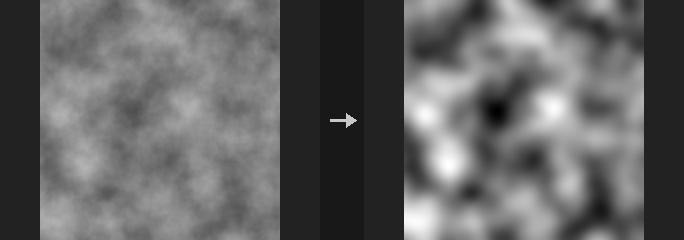

The blur is separable: a horizontal pass followed by a vertical pass, so the cost grows with the kernel width rather than its square. The kernel radius is `ceil(3*sigma)`, which keeps about 99.7% of the Gaussian energy; the truncated kernel is renormalised. Cutting at 2 sigma would lose about 4.6% and leave a visible hard rim on large soft glows.

A blur should preserve the average brightness, but only with the `wrap` border. `clamp` copies the edge pixels and `black` pads with zero, so both invent data outside the image and the mean shifts; this is the definition of those borders, not an error.

With Layers empty every layer is blurred. List layer names to blur colour but leave, for example, an SDF layer alone.

**Inputs**

| Input | Type | Description |
|---|---|---|
| `cop` | COPIMAGE | Image to blur. |

**Outputs**

| Output | Type | Description |
|---|---|---|
| `cop` | COPIMAGE | The blurred image. |

**Parameters**

| Parameter | Type | Default | Description |
|---|---|---|---|
| Layers `layers` | string | *(empty)* | Space-separated layer names to process. Empty processes every layer of the source. |
| Blur Size (Sigma) `sigma_pixels` | float [0.0..4096.0] | 2 | Standard deviation of the Gaussian in pixels. The kernel radius is ceil(3 x sigma). 0 leaves the image unchanged. |
| Border `border` | menu | Clamp (Streak Edges) | How pixels outside the image are treated: `clamp` repeats edge pixels, `wrap` tiles the image (preserves the mean, good for tileable textures), `black` pads with zero. Options: Clamp (Streak Edges) (`clamp`), Wrap (`wrap`), Constant (Black) (`black`). |

**Tips**

- Use `wrap` when blurring a tileable texture so the seams stay seamless.

---

### COP Contour (PCG)

`PCG_COPContour` · category `PCG/cop`

Draws iso-lines of a value (contour lines) at regular intervals.

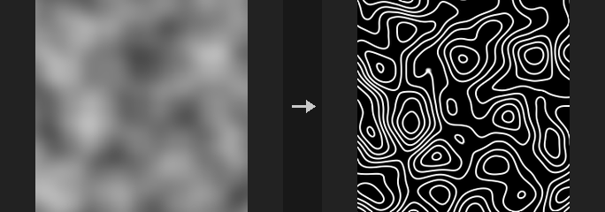

A line is drawn wherever the value of Layer crosses a multiple of Interval (shifted by Offset). The distance to the nearest line is measured in value units and divided by the local gradient magnitude, which converts it to a distance in pixels. As a result the line width is the same in pixels on steep and on flat areas; without this step lines on gentle slopes would smear into broad bands. The output is a single-channel layer between 0 and 1.

**Inputs**

| Input | Type | Description |
|---|---|---|
| `cop` | COPIMAGE | Image containing the height or value layer. |

**Outputs**

| Output | Type | Description |
|---|---|---|
| `cop` | COPIMAGE | Image with the contour line layer added. |

**Parameters**

| Parameter | Type | Default | Description |
|---|---|---|---|
| Layer `layer` | string | `C` | Layer whose first channel is contoured (for example a height field). |
| Contour Interval `interval` | float [1e-06..] | 0.1 | Spacing between contour lines in value units. Must be positive. |
| Offset `offset` | float | 0 | Shifts the lines: they are drawn at multiples of Interval plus this value. |
| Line Width (Pixels) `width` | float [0.01..64] | 1 | Line width in pixels. |
| Output Layer `out_layer` | string | `contour` | Name of the layer that receives the contour lines. |

**Compared with Houdini**

Corresponds to the contour mode of Houdini's Edge Detect.

---

### COP Convolve (PCG)

`PCG_COPConvolve` · category `PCG/cop` · Houdini: Convolve 3x3 (COP), Convolve Filter (COP)

Convolves layers with a kernel written as numbers, a preset, or another image.

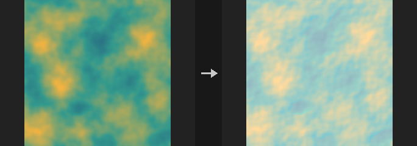

The kernel is n x n numbers (n odd), written one row per line. The first line written is the top row of the image. Presets: box, gaussian, sharpen, edge, emboss and Sobel X / Y. Kernels larger than 7 x 7 are computed with an FFT.

When the `kernel_cop` input is connected, a layer of that image (Kernel Layer) is used as the kernel instead. This is a true convolution: convolving a single-pixel impulse gives the kernel image itself. Preset and Kernel are then ignored. With Centered off, the origin is the bottom-left pixel of the kernel image.

The image is always padded by the kernel radius, so no wrap-around bleeding occurs with `clamp`, `black` or `mirror`.

**Inputs**

| Input | Type | Description |
|---|---|---|
| `cop` | COPIMAGE | Image to convolve. |
| `kernel_cop` *(optional)* | COPIMAGE | Optional image whose layer is used as the kernel. When connected, Preset and Kernel are not read. |

**Outputs**

| Output | Type | Description |
|---|---|---|
| `cop` | COPIMAGE | The convolved image. |

**Parameters**

| Parameter | Type | Default | Description |
|---|---|---|---|
| Layers `layers` | string | *(empty)* | Space-separated layer names to process. Empty processes every layer. |
| Kernel Preset `preset` | menu | Custom | Predefined kernel. `custom` uses the Kernel text. Ignored when `kernel_cop` is connected. Options: Custom (`custom`), Box 3×3 (`box3`), Gaussian 3×3 (`gaussian3`), Sharpen (`sharpen`), Edge Detect (`edge`), Emboss (`emboss`), Sobel X (`sobel_x`), Sobel Y (`sobel_y`). |
| Kernel `kernel` | string | *(see panel)* | The kernel as n x n numbers (n odd), rows on separate lines; the first row is the top of the image. Ignored when `kernel_cop` is connected or a preset is chosen. *Hidden when preset ≠ custom.* |
| Normalize Kernel `normalize` | toggle | off | Scales the kernel so its values sum to 1. A kernel whose sum is 0 (edge filters) is left alone. |
| Kernel Layer `kernel_layer` | string | `C` | Layer of the `kernel_cop` image used as the kernel. Only read when `kernel_cop` is connected. |
| Centered Kernel `centered` | toggle | on | Only with `kernel_cop`: when on, the centre of the kernel image is the origin so the result is not shifted; when off, the origin is the bottom-left pixel. |
| Border `border` | menu | Clamp (Streak Edges) | How pixels outside the image are treated: `clamp` repeats edge pixels, `wrap` tiles, `black` pads with zero, `mirror` reflects. Options: Clamp (Streak Edges) (`clamp`), Wrap (`wrap`), Constant (Black) (`black`), Mirror (`mirror`). |

**Compared with Houdini**

Covers Convolve 3x3 and Convolve Filter. Houdini's Padding option is not exposed: the image is always padded by the kernel radius (equivalent to Houdini's Padding on and large enough), so there is no wrap-around bleeding that Houdini shows with Padding off. Border has an extra `mirror` option.

---

### COP Corner Detect (PCG)

`PCG_COPCornerDetect` · category `PCG/cop` · Houdini: Corner Detect (COP)

Detects corners with the Harris detector and marks them in a mask.

Computes the structure tensor of the first channel of Layer, smoothed with a Gaussian of Sigma, and the Harris response `R = det - k * trace^2`. A pixel is marked 1 when its response is greater than Threshold times the maximum response and it is the local maximum within Radius pixels. The second output is the number of corners found.

**Inputs**

| Input | Type | Description |
|---|---|---|
| `cop` | COPIMAGE | Image containing the layer to analyse. |

**Outputs**

| Output | Type | Description |
|---|---|---|
| `cop` | COPIMAGE | Image with the corner mask layer added. |
| `count` | INT | Number of detected corners. |

**Parameters**

| Parameter | Type | Default | Description |
|---|---|---|---|
| Layer `layer` | string | `C` | Layer to analyse. Only its first channel is used. |
| Harris K `k` | float [0..0.25] | 0.05 | Harris sensitivity constant. Smaller values detect more corners and also respond to edges more. |
| Window Sigma `sigma` | float [0.1..64] | 1.5 | Standard deviation in pixels of the Gaussian that smooths the structure tensor. |
| Threshold `threshold` | float [0..1] | 0.01 | Minimum response as a fraction of the strongest response. |
| Suppression Radius `radius` | int [0..64] | 3 | Size in pixels of the neighbourhood within which a pixel must be the local maximum. |
| Output Layer `out_layer` | string | `corners` | Name of the layer that receives the corner mask (1 at corners). |
| Response Layer `response_layer` | string | *(empty)* | Optional layer that receives the raw Harris response. Empty writes nothing. |

---

### COP Defocus (PCG)

`PCG_COPDefocus` · category `PCG/cop` · Houdini: Bokeh (COP), Defocus (COP)

Blurs with a bokeh-shaped kernel, optionally driven by a depth layer.

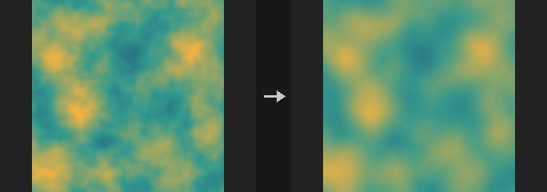

The image is convolved with an aperture-shaped kernel (disc, polygon or square) of Radius pixels. Without a Depth Layer the whole image uses the same radius.

With a Depth Layer the radius varies per pixel: pixels where `|depth - Focus| <= Focus Range` stay sharp, and beyond that the circle of confusion grows linearly over the Falloff distance up to Radius. The radius range is quantized into Levels steps; each step is convolved once and neighbouring steps are interpolated per pixel. The depth layer itself is not blurred.

Highlight Gain makes bright areas stand out: values above Highlight Threshold are boosted before blurring and mapped back with the exact inverse afterwards, so bright spots become distinct aperture-shaped discs instead of being averaged into grey.

**Inputs**

| Input | Type | Description |
|---|---|---|
| `cop` | COPIMAGE | Image to defocus. |

**Outputs**

| Output | Type | Description |
|---|---|---|
| `cop` | COPIMAGE | The defocused image. |

**Parameters**

| Parameter | Type | Default | Description |
|---|---|---|---|
| Layers `layers` | string | *(empty)* | Space-separated layer names to process. Empty processes every layer. |
| Blur Radius `radius` | float [0..256] | 6 | Maximum blur radius in pixels (the full circle of confusion). |
| Aperture Shape `shape` | menu | Disc | Aperture shape of the kernel: `disc`, `hexagon` (a regular polygon whose side count is Blades, 6 by default) or `square`. Options: Disc (`disc`), Polygon (Blades) (`hexagon`), Square (`square`). |
| Aperture Blades `blades` | int [3..16] | 6 | Number of aperture blades (polygon sides) of the `hexagon` shape. *Hidden when shape ≠ hexagon.* |
| Blade Rotation `rotation` | float [-360..360] | 0 | Rotation of the polygonal aperture in degrees. Only the `hexagon` shape is affected. *Hidden when shape ≠ hexagon.* |

*Depth*

| Parameter | Type | Default | Description |
|---|---|---|---|
| Depth Layer `depth_layer` | string | *(empty)* | Layer holding depth. Empty uses the same radius everywhere. |
| Focus Distance `focus` | float | 0.5 | Depth value that is in focus. *Disabled when depth_layer = "".* |
| Focus Range `focus_range` | float [0..] | 0.1 | Half-width of the depth range around Focus that stays perfectly sharp. *Disabled when depth_layer = "".* |
| Falloff `falloff` | float [0..] | 0.2 | Depth distance beyond the focus range over which the blur radius grows from 0 to Radius. *Disabled when depth_layer = "".* |
| Blur Levels `levels` | int [2..32] | 8 | Number of discrete blur radii used with a depth layer. More levels are smoother but slower. *Disabled when depth_layer = "".* |

*Highlights*

| Parameter | Type | Default | Description |
|---|---|---|---|
| Highlight Gain `highlight_gain` | float [0..100] | 0 | Strength with which highlights are boosted before blurring. 0 turns it off. |
| Highlight Threshold `highlight_threshold` | float [0..] | 1 | Brightness above which Highlight Gain applies. *Disabled when highlight_gain = 0.* |

| Parameter | Type | Default | Description |
|---|---|---|---|
| Border `border` | menu | Clamp (Streak Edges) | How pixels outside the image are treated: `clamp` repeats edge pixels, `wrap` tiles the image, `black` uses zero. Options: Clamp (Streak Edges) (`clamp`), Wrap (`wrap`), Constant (Black) (`black`). |

**Compared with Houdini**

Covers Defocus and Bokeh.

---

### COP Denoise TV (PCG)

`PCG_COPDenoiseTV` · category `PCG/cop` · Houdini: Denoise TVD (COP)

Removes noise with total-variation (ROF) denoising while keeping step edges.

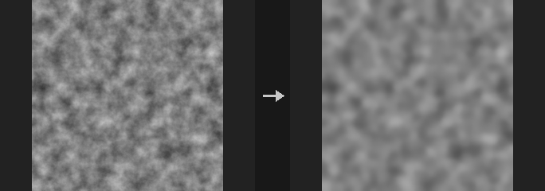

Solves the Rudin-Osher-Fatemi total-variation model with Chambolle's dual projection. Noise is flattened while sharp edges are preserved. Each channel is processed independently. Weight sets the strength: higher is flatter. The mean of the image is preserved exactly and a constant image is returned unchanged.

**Inputs**

| Input | Type | Description |
|---|---|---|
| `cop` | COPIMAGE | Image to denoise. |

**Outputs**

| Output | Type | Description |
|---|---|---|
| `cop` | COPIMAGE | The denoised image. |

**Parameters**

| Parameter | Type | Default | Description |
|---|---|---|---|
| Layers `layers` | string | *(empty)* | Space-separated layer names to process. Empty processes every layer. |
| Weight `weight` | float [0..100] | 0.1 | Denoising strength (the TV regularization weight). Higher values give flatter results; 0 returns the image unchanged. |
| Iterations `iterations` | int [1..5000] | 50 | Number of Chambolle iterations. More iterations converge closer to the exact solution. *Disabled when weight = 0.* |
| Compute `compute` | menu | Auto | Compute backend: `auto` uses the GPU for large images when available, `cpu` or `cuda` force one. Options: Auto (`auto`), CPU (`cpu`), CUDA (`cuda`). |

**Compared with Houdini**

Corresponds to Denoise TVD.

---

### COP Derivative (PCG)

`PCG_COPDerivative` · category `PCG/cop` · Houdini: Curl (COP), Derivative (COP), Laplacian (COP)

Computes derivatives of a layer with central differences: gradient, Laplacian, divergence or curl.

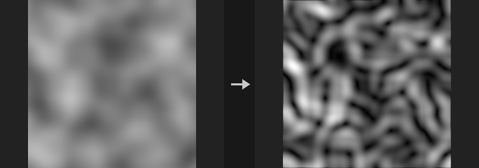

Derivatives are central differences in units of per pixel, multiplied by Scale.

- `dx`, `dy`, `gradient` (two channels) and `magnitude` use the first channel.
- `laplacian` uses a five-point stencil per channel.
- `divergence` turns a two-channel vector field into a scalar.
- `curl` on a one-channel layer gives `(df/dy, -df/dx)`, a divergence-free velocity field, which is how curl noise is made from a noise stream function. On a two-channel layer it gives the scalar curl `dv/dx - du/dy`.

If Out Layer is empty, the result is named layer_mode.

**Inputs**

| Input | Type | Description |
|---|---|---|
| `cop` | COPIMAGE | Image containing the layer to differentiate. |

**Outputs**

| Output | Type | Description |
|---|---|---|
| `cop` | COPIMAGE | Image with the derivative layer added. |

**Parameters**

| Parameter | Type | Default | Description |
|---|---|---|---|
| Layer `layer` | string | `C` | Layer to differentiate. |
| Mode `mode` | menu | Derivative X | Which derivative to compute; see the description. Options: Derivative X (`dx`), Derivative Y (`dy`), Gradient (`gradient`), Gradient Magnitude (`magnitude`), Laplacian (`laplacian`), Divergence (`divergence`), Curl (`curl`). |
| Scale `scale` | float | 1 | Multiplier applied to the result (the differences are per pixel). |
| Border `border` | menu | Clamp (Streak Edges) | How pixels outside the image are treated: `clamp` repeats edge pixels, `wrap` tiles the image, `black` uses zero. Options: Clamp (Streak Edges) (`clamp`), Wrap (`wrap`), Constant (Black) (`black`). |
| Output Layer `out_layer` | string | *(empty)* | Name of the output layer. Empty uses layer_mode. |

**Compared with Houdini**

Covers Derivative, Laplacian and Curl.

---

### COP Directional Blur (PCG)

`PCG_COPDirectionalBlur` · category `PCG/cop` · Houdini: Streak Blur (COP)

Blurs along a direction by averaging samples along a line, for motion blur or light streaks.

Each pixel averages bilinear samples along a line of Length pixels in the direction given by Angle (0 degrees points right, 90 degrees up). In `centered` mode the samples cover half the length on either side (motion blur). In `streak` mode the samples run from the pixel back along the line, so content smears one way, in the direction of Angle (light streaks, speed lines). A negative length reverses the direction. With Samples at 0 the node takes about one sample per pixel of length.

**Inputs**

| Input | Type | Description |
|---|---|---|
| `cop` | COPIMAGE | Image to blur. |

**Outputs**

| Output | Type | Description |
|---|---|---|
| `cop` | COPIMAGE | The blurred image. |

**Parameters**

| Parameter | Type | Default | Description |
|---|---|---|---|
| Layers `layers` | string | *(empty)* | Space-separated layer names to process. Empty processes every layer. |
| Length `length` | float [-4096..4096] | 20 | Length of the blur line in pixels. Negative values reverse the direction. |
| Angle `angle` | float [-360..360] | 0 | Direction in degrees; 0 is right, 90 is up. |
| Mode `mode` | menu | Centered | `centered`: half the length on each side of the pixel. `streak`: the whole length to one side only. Options: Centered (`centered`), Streak (One Side) (`streak`). |
| Samples `samples` | int [0..1024] | 0 | Number of samples along the line. 0 uses one per pixel of length. Fewer samples are faster but can show banding. |
| Border `border` | menu | Clamp (Streak Edges) | How pixels outside the image are treated: `clamp` repeats edge pixels, `wrap` tiles the image, `black` uses zero. Options: Clamp (Streak Edges) (`clamp`), Wrap (`wrap`), Constant (Black) (`black`). |
| Compute `compute` | menu | Auto | Compute backend: `auto` uses the GPU for large images when available, `cpu` or `cuda` force one. Options: Auto (`auto`), CPU (`cpu`), CUDA (`cuda`). |

**Compared with Houdini**

Corresponds to Streak Blur and can also be used as motion blur.

---

### COP Dither (PCG)

`PCG_COPDither` · category `PCG/cop`

Quantizes layers to a small number of levels using ordered, error-diffusion or random dithering.

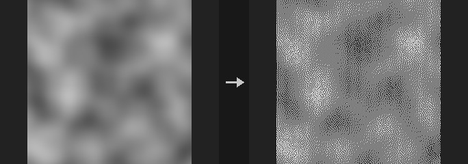

Equivalent of Surface Dither. Values are first clamped to 0-1, then reduced to `levels` evenly spaced steps with a dithering pattern that preserves the average brightness.

Bayer methods are ordered dithering: the pattern tiles and does not flicker in animation. Floyd-Steinberg is error diffusion, processed serially (scanline order, top to bottom), and is the closest to the original average brightness but slower on large images. White noise uses a random threshold per pixel.

**Inputs**

| Input | Type | Description |
|---|---|---|
| `cop` | COPIMAGE | Image to dither. |

**Outputs**

| Output | Type | Description |
|---|---|---|
| `cop` | COPIMAGE | Image with the selected layers quantized. |

**Parameters**

| Parameter | Type | Default | Description |
|---|---|---|---|
| Layers `layers` | string | *(empty)* | Layers to dither. Empty means all layers; otherwise a space-separated list of layer names. |
| Method `method` | menu | Ordered (Bayer 4×4) | Dither algorithm. `bayer4`/`bayer8` use a 4x4 or 8x8 Bayer matrix; `floyd_steinberg` diffuses the quantization error to neighbours; `white_noise` uses random thresholds. Options: Ordered (Bayer 4×4) (`bayer4`), Ordered (Bayer 8×8) (`bayer8`), Error Diffusion (Floyd-Steinberg) (`floyd_steinberg`), White Noise (`white_noise`). |
| Levels `levels` | int [2..256] | 2 | Number of output levels per channel (at least 2). 2 gives pure black and white. |
| Seed `rand_seed` | int [0..] | 0 | Seed for the White Noise method. Other methods ignore it. *Hidden when method ≠ white_noise.* |

---

### COP Edge Detect (PCG)

`PCG_COPEdge` · category `PCG/cop` · Houdini: Edge Detect (COP)

Detects edges as the gradient magnitude of a layer, optionally also outputting the x/y gradients and direction.

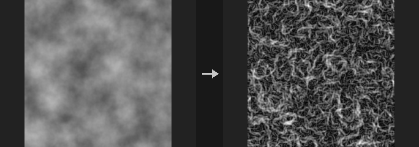

The main output is the gradient magnitude. With `components` on, three more layers `<out>_gx`, `<out>_gy` and `<out>_dir` (direction angle) are written as well.

**Kernels are normalized to true derivatives.** Raw integer Sobel kernels return 8 times the real gradient (Prewitt 6, Scharr 32). Left alone, switching kernels would change edge strength several-fold and every threshold would need retuning. Here every kernel is divided out, so on a linear ramp `f = a*x + b*y` the gx and gy outputs are exactly `a` and `b`. The consequence is that values look smaller than in tools using raw integer kernels. The Laplacian is not normalized; it is the plain second derivative sum, so `f = a*x^2` gives `2a`.

**Multi-channel layers are processed per channel**, and the magnitude is the root of the summed squares, not a grayscale conversion first. A red-green boundary with equal luminance would vanish after conversion. If you want luminance-based edges, put a COP Luminance in front.

**Inputs**

| Input | Type | Description |
|---|---|---|
| `cop` | COPIMAGE | Image containing the layer to analyze. |

**Outputs**

| Output | Type | Description |
|---|---|---|
| `cop` | COPIMAGE | Image with the edge layer added (and optionally the gradient components). |

**Parameters**

| Parameter | Type | Default | Description |
|---|---|---|---|
| Layer `layer` | string | `C` | Layer to detect edges on. |
| Method `method` | menu | Sobel | Derivative kernel: Sobel, Prewitt, Scharr, or Laplacian (second derivative). Options: Sobel (`sobel`), Prewitt (`prewitt`), Scharr (`scharr`), Laplacian (`laplacian`). |
| Scale `scale` | float [-10000.0..10000.0] | 1 | Final multiplier on the result. The default 1 gives the true per-pixel gradient; use roughly 4 to 10 to make faint edges visible. |
| Border `border` | menu | Clamp (Streak Edges) | How pixels outside the image are read at the borders: clamp, wrap or black. Options: Clamp (Streak Edges) (`clamp`), Wrap (`wrap`), Constant (Black) (`black`). |
| Output Components `components` | toggle | off | Also output the x gradient, y gradient and direction angle as extra layers (suffixes `_gx`, `_gy`, `_dir`). *Hidden when method = laplacian.* |
| Output Layer `out_layer` | string | `edge` | Name of the edge magnitude layer. |
| Keep Input Layers `keep_layers` | toggle | on | Keep the other input layers in the output; off outputs only the edge result. |

**Tips**

- Edge strength is a true per-pixel gradient, so a unit-range image rarely exceeds 1. Raise `scale` before thresholding for display.

---

### COP Edge Detect Probe (PCG)

`PCG_COPEdgeDetectProbe` · category `PCG/cop` · Houdini: Edge Detect by Contour (COP), Edge Detect by Depth (COP), Edge Detect by Normal (COP)

Finds edges by probing a neighbourhood for differing ids, depth jumps or normal creases, in the manner of Houdini's Edge Detect by Contour, Depth and Normal.

For every pixel, integer-offset neighbours inside a probe radius are examined. The radius is `thickness_scale` (multiplied by the optional thickness layer), not smaller than `min_probe_radius`, and capped at 64 pixels. A neighbour is on the line if its value differs from the pixel by more than `contour_tolerance` (Contour, Euclidean distance over channels, normally an id layer), if its depth differs by more than `depth_tolerance` in either direction (Depth), or if the dot product of the normalized normals is below `normal_tolerance` (Normal). The pixel's result is the strongest weight among such neighbours: 1 for immediate neighbours, falling off as a Gaussian of the distance with sigma = `edge_spread` times the radius, cut off at the radius.

This is separate from COP Contour (iso-lines) and from the lineart ControlNet packaging in Control Image. Houdini's documentation does not specify the algorithm in detail; this is the plugin's own definition. There is no camera, so tolerances are absolute values, and pixels outside the image repeat the edge pixel.

**Inputs**

| Input | Type | Description |
|---|---|---|
| `cop` | COPIMAGE | Image containing the id, depth or normal layer, and optionally a thickness layer. |

**Outputs**

| Output | Type | Description |
|---|---|---|
| `cop` | COPIMAGE | Image with the edge layer added. |

**Parameters**

| Parameter | Type | Default | Description |
|---|---|---|---|
| Detect By `kind` | menu | Contour (Edge Detect by Contour) | What counts as an edge: `contour` compares ids, `depth` compares depth values, `normal` compares normal directions. Options: Contour (Edge Detect by Contour) (`contour`), Depth (Edge Detect by Depth) (`depth`), Normal (Edge Detect by Normal) (`normal`). |
| Source Layer `layer` | string | `id` | Layer to analyze. Contour uses an id layer, Depth uses the first channel of a depth (Z) layer, Normal needs a 3-channel normal layer. |
| Thickness Layer `thickness_layer` | string | *(empty)* | Optional per-pixel thickness layer. Empty disables it; when connected, `thickness_scale` multiplies it to give the probe radius. |
| Thickness Scale `thickness_scale` | float [0..64] | 2 | Probe radius in pixels, or a multiplier of the thickness layer when one is given. |
| Edge Spread `edge_spread` | float [0..100] | 0.5 | Gaussian falloff of the line: sigma = Edge Spread times the probe radius. Larger values give a more solid line; 0 marks only pixels directly next to a discontinuity. |
| Blur `blur` | float [0..256] | 0 | Gaussian blur (sigma in pixels) applied to the input before detection. |
| Contour Tolerance `contour_tolerance` | float [0..] | 0.5 | Contour mode: minimum difference (Euclidean over channels) between a neighbour and the pixel for the neighbour to count as an edge. *Hidden when kind ≠ contour.* |
| Depth Tolerance `depth_tolerance` | float [0..] | 0.01 | Depth difference above which a neighbour counts as an edge in Depth mode. *Hidden when kind ≠ depth.* |
| Normal Tolerance `normal_tolerance` | float [-1..1] | 0.9 | Normal mode: neighbours whose normal dot product is below this value count as a crease. *Hidden when kind ≠ normal.* |
| Min Probe Radius `min_probe_radius` | float [0..64] | 1 | Lower limit for the probe radius in pixels, applied after the thickness layer. |
| Output Layer `out_layer` | string | `edges` | Name of the output edge layer. |

**Compared with Houdini**

Combines Edge Detect by Contour, by Depth and by Normal into one node selected by Kind. Without a camera or ray differentials, tolerances are absolute and not scaled by distance or slope.

---

### COP Erode / Dilate (PCG)

`PCG_COPMorph` · category `PCG/cop` · Houdini: Dilate Erode (COP)

Applies morphological operations (erode, dilate, open, close, gradient) with a square or round window.

Erode takes the local minimum and dilate the local maximum over the window, in pixels. On masks this shrinks or grows shapes; on height fields it flattens peaks or fills valleys. Open (erode then dilate) removes small specks, Close (dilate then erode) fills small holes, and Gradient (`dilate - erode`) gives an outline about twice the radius thick on binary masks.

The square window is separable (two 1D passes, cost proportional to the radius), the round one is not and costs one full-image minimum per offset in the window (197 at radius 8, 1257 at radius 20). For large radii use an SDF instead: COP SDF from Mask followed by subtracting the radius gives a dilation of any size at a cost that does not depend on the radius, and is identical to a disc dilation of a binary mask. Use this node for small fixes (radius up to about 8).

Border matters: Clamp copies the edge, so the image border does not take part in erosion; Constant (Black) treats the outside as 0, so erosion eats inward from all four edges.

**Inputs**

| Input | Type | Description |
|---|---|---|
| `cop` | COPIMAGE | Image to process. |

**Outputs**

| Output | Type | Description |
|---|---|---|
| `cop` | COPIMAGE | Processed image. |

**Parameters**

| Parameter | Type | Default | Description |
|---|---|---|---|
| Layers `layers` | string | *(empty)* | Space-separated layers to process. Empty processes all layers. |
| Operation `op` | menu | Erode | Operation to apply; see the description. Options: Erode (`erode`), Dilate (`dilate`), Open (`open`), Close (`close`), Gradient (Outline) (`gradient`). |
| Radius `radius` | int [0..64] | 2 | Window radius in pixels. For large radii prefer an SDF-based approach. |
| Shape `shape` | menu | Square | Window shape: square (fast, separable) or circle (slower). Options: Square (`box`), Circle (`disc`). |
| Border `border` | menu | Clamp | How pixels outside the image are treated. Options: Clamp (`clamp`), Wrap (`wrap`), Constant (Black) (`black`). |

**Compared with Houdini**

Corresponds to Houdini's Dilate Erode, extended with Open, Close and Gradient.

---

### COP Extrapolate Boundaries (PCG)

`PCG_COPExtrapolateBoundaries` · category `PCG/cop` · Houdini: Extrapolate Boundaries (COP)

Extends the valid interior of an image outward by copying nearest interior values, mainly to bleed texture edges.

The fill-area layer is split into inside and outside by `threshold` and `inner_side`. Outside pixels within Edge Padding (in image units) copy the nearest interior value; this can be pulled inward by Edge Offset and can restrict sampling to interior pixels only. Pixels beyond the padding are handled by `exterior`: left unchanged, set to black, or filled by diffusion.

This is distinct from COP Smooth Fill, which fills holes in a mask with three different algorithms.

Interior pixels are never changed. Errors if the fill-area layer has no interior pixels. A value exactly equal to the threshold counts as exterior.

**Inputs**

| Input | Type | Description |
|---|---|---|
| `cop` | COPIMAGE | Image containing the layers to extend and the fill-area layer. |

**Outputs**

| Output | Type | Description |
|---|---|---|
| `cop` | COPIMAGE | Image with the boundaries extrapolated. |

**Parameters**

| Parameter | Type | Default | Description |
|---|---|---|---|
| Source Layers `layers` | string | *(empty)* | Layers to extrapolate. Empty means all layers except the fill-area layer. |
| Fill Area Layer `fillarea_layer` | string | `mask` | Layer that defines the valid interior. |
| Mask `mask` | float [0..1] | 1 | Amount by which the new values are blended in (multiplied by the mask layer). |
| Mask Layer `mask_layer` | string | *(empty)* | Optional layer controlling the blend per pixel. Empty disables it. |
| Exterior `exterior` | menu | Unchanged | How pixels beyond Edge Padding are treated: `unchanged`, `black`, or `diffuse_fill` (smooth Laplace-style relaxation using the interior plus padding as known values). Options: Unchanged (`unchanged`), Black (`black`), Diffuse Fill (`diffuse_fill`). |
| Inner Side `inner_side` | menu | Above Threshold | Which side of the threshold is the interior. Options: Below Threshold (`below_threshold`), Above Threshold (`above_threshold`). |
| Threshold `threshold` | float | 0.5 | Value of the fill-area layer separating inside from outside. |
| Edge Padding `edge_padding` | float [0..] | 0.05 | Distance from the interior within which values are copied outward, in image units (the long side of the image is 2). |
| Edge Offset `edge_offset` | float [0..] | 0 | How far to step back inward from the nearest interior point before sampling. |
| Sample Only Present `sample_only_present` | toggle | on | On: bilinear sampling uses interior pixels only (weights renormalized, falling back to the nearest point), so exterior values such as black edges do not bleed in. Off: plain bilinear sampling, which blends smoothly with exterior values at the edge. |
| Diffuse Iterations `diffuse_iterations` | int [0..] | 50 | Number of diffusion iterations for the Diffuse Fill exterior mode. *Hidden when exterior ≠ diffuse_fill.* |

---

### COP Feather (PCG)

`PCG_COPFeather` · category `PCG/cop`

Softens the edge of a mask with a smoothstep ramp based on the exact distance to the boundary.

The mask is thresholded at 0.5 and the ramp of width `width` pixels follows the exact distance to the boundary. Unlike a Gaussian blur, thin strips do not fade overall and sharp corners are not rounded off. In `both` mode the boundary itself is always exactly 0.5.

In `inward` mode strips narrower than the width do get lighter overall; that is the literal meaning of softening inward only.

**Inputs**

| Input | Type | Description |
|---|---|---|
| `cop` | COPIMAGE | Image containing the mask layer. |

**Outputs**

| Output | Type | Description |
|---|---|---|
| `cop` | COPIMAGE | Image with the feathered mask. |

**Parameters**

| Parameter | Type | Default | Description |
|---|---|---|---|
| Mask Layer `layer` | string | `mask` | Mask layer to feather. |
| Feather Width (Pixels) `width` | float [0..1024] | 8 | Width of the transition in pixels. |
| Direction `direction` | menu | Both | Where the ramp is placed: `both` spreads it half inside and half outside the boundary, `inward` softens only inside the mask, `outward` only outside. Options: Both (`both`), Inward (`inward`), Outward (`outward`). |
| Output Layer `out_layer` | string | *(empty)* | Name of the output layer. Empty overwrites the input layer. |

---

### COP Feather Slope (PCG)

`PCG_COPFeatherSlope` · category `PCG/cop` · Houdini: Feather (COP)

Limits the maximum rate of change between neighbouring pixels by lifting dark pixels toward bright ones (or the reverse).

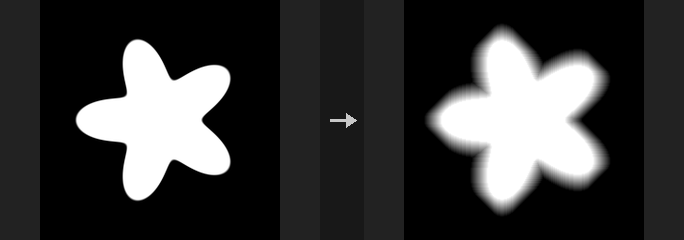

Equivalent of Houdini's Feather. With High to Low on, bright pixels stay fixed and the darker surroundings are raised until the slope limit is satisfied; with it off, dark pixels stay and bright ones are pushed down. The slope is given by the Feather Method (distance per unit change, or change per distance, in image units). The shape of the resulting islands comes from the sweep directions selected by `direction` (Diamond, Square, Octagon, Custom, Circle).

This differs from the older COP Feather, which applies a smoothstep by distance to the mask boundary.

**Inputs**

| Input | Type | Description |
|---|---|---|
| `cop` | COPIMAGE | Image containing the layer to feather. |

**Outputs**

| Output | Type | Description |
|---|---|---|
| `cop` | COPIMAGE | Image with the slope-limited layer. |

**Parameters**

| Parameter | Type | Default | Description |
|---|---|---|---|
| Source Layer `layer` | string | `mask` | Layer to process. |
| Mask `mask` | float [0..1] | 1 | Amount by which the new values are blended in (multiplied by the mask layer). |
| Mask Layer `mask_layer` | string | *(empty)* | Optional layer controlling the blend per pixel. Empty disables it. |
| Feather from High to Low `high_to_low` | toggle | on | On: bright pixels stay and dark pixels are raised. Off: dark pixels stay and bright pixels are lowered. |
| Include Border `include_border` | toggle | off | Take values from outside the image according to `border` (use Wrap for seamless textures). |
| Border `border` | menu | Constant (Black) | Rule for values outside the image. Layers carry no border metadata here, so it is set on the node; Clamp has no effect. Options: Clamp (`clamp`), Wrap (`wrap`), Constant (Black) (`black`), Mirror (`mirror`). *Disabled when include_border is off.* |
| Feather Direction `direction` | menu | Diamond | Shape of the feathered region by sweep directions. Circle is a 16-direction approximation (maximum deviation about 2.7%). Custom uses the sweep switches below. Options: Diamond (`diamond`), Square (`square`), Octagon (`octagon`), Custom (`custom`), Circle (`circle`). |
| -X `sweep_nx` | toggle | off | Custom direction: sweep toward -x. *Hidden when direction ≠ custom.* |
| +X `sweep_px` | toggle | on | Custom direction: sweep toward +x. *Hidden when direction ≠ custom.* |
| -Y `sweep_ny` | toggle | off | Custom direction: sweep toward -y. *Hidden when direction ≠ custom.* |
| +Y `sweep_py` | toggle | off | Custom direction: sweep toward +y. *Hidden when direction ≠ custom.* |
| -X-Y `sweep_nxny` | toggle | off | Custom direction: sweep along the (-x, -y) diagonal. *Hidden when direction ≠ custom.* |
| -X+Y `sweep_nxpy` | toggle | off | Custom direction: sweep along the (-x, +y) diagonal. *Hidden when direction ≠ custom.* |
| +X-Y `sweep_pxny` | toggle | off | Custom direction: sweep along the (+x, -y) diagonal. *Hidden when direction ≠ custom.* |
| +X+Y `sweep_pxpy` | toggle | off | Custom direction: sweep along the (+x, +y) diagonal. *Hidden when direction ≠ custom.* |
| Feather Method `method` | menu | Distance for Unit Change | How the slope is specified: `distance_for_unit_change` uses Distance, `change_per_distance` uses Change. Options: Distance for Unit Change (`distance_for_unit_change`), Change per Distance (`change_per_distance`). |
| Distance for Unit Change `distance` | float [1e-06..] | 0.1 | Distance over which the value may change by one unit, in image units (the long side is 2). Used by Distance for Unit Change. *Hidden when method ≠ distance_for_unit_change.* |
| Change per Distance `change` | float [0..] | 10 | Allowed change per unit distance. Used by Change per Distance. *Hidden when method ≠ change_per_distance.* |
| Output Layer `out_layer` | string | *(empty)* | Name of the output layer. Empty overwrites the input layer. |

---

### COP FFT (PCG)

`PCG_COPFFT` · category `PCG/cop` · Houdini: Fast Fourier Transform (COP), Filter Frequencies (COP)

Performs a forward or inverse Fourier transform, shows the magnitude spectrum, or filters frequencies.

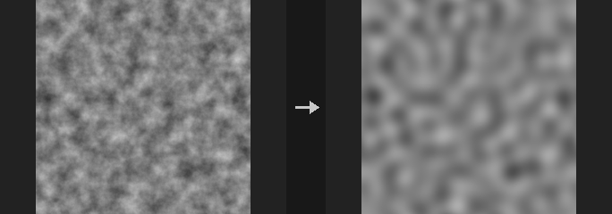

Covers Houdini's Fast Fourier Transform and Filter Frequencies. `forward` turns channel 0 into a 2-channel layer (real, imaginary) without normalization (the DC component is the sum of the pixels); `inverse` takes (real, imaginary) back to one real channel; `magnitude` outputs `log(1 + |F|)` per channel for viewing the spectrum; `filter` transforms, multiplies by a radial window and transforms back, per channel, with a cosine soft edge (a hard cutoff would ring).

Cutoffs are in cycles per image (image width = 1 cycle); the radial distance is elliptical, each axis scaled by its own size.

**Inputs**

| Input | Type | Description |
|---|---|---|
| `cop` | COPIMAGE | Image containing the layer to transform. |

**Outputs**

| Output | Type | Description |
|---|---|---|
| `cop` | COPIMAGE | Image with the transformed or filtered layer. |

**Parameters**

| Parameter | Type | Default | Description |
|---|---|---|---|
| Layer `layer` | string | `C` | Layer to transform. Forward uses only its first channel; Magnitude and Filter work on every channel. |
| Mode `mode` | menu | Forward | `forward` (to Re/Im), `inverse` (back to image), `magnitude` (log spectrum for display), or `filter` (frequency filtering in one step). Options: Forward (`forward`), Inverse (`inverse`), Magnitude Spectrum (`magnitude`), Filter Frequencies (`filter`). |
| Centered `centered` | toggle | on | Move the DC component to the image center (for viewing spectra). An inverse must use the same setting as the forward it undoes. Has no effect in Filter mode. *Hidden when mode = filter.* |

*Filter*

| Parameter | Type | Default | Description |
|---|---|---|---|
| Filter Type `filter` | menu | Low Pass | Filter type in Filter mode: pass low frequencies, pass high frequencies, pass a band, or remove a band. Options: Low Pass (`lowpass`), High Pass (`highpass`), Band Pass (`bandpass`), Band Stop (`bandstop`). *Hidden when mode ≠ filter.* |
| Cutoff `cutoff` | float [0..] | 8 | Cutoff frequency in cycles per image. For band-pass and band-stop this is the low end of the band. *Hidden when mode ≠ filter.* |
| High Cutoff `cutoff_high` | float [0..] | 32 | Upper frequency of the band, in cycles per image (band-pass and band-stop only). *Hidden when mode ≠ filter } { filter = lowpass } { filter = highpass.* |
| Softness `softness` | float [0..] | 2 | Width of the cosine soft edge around each cutoff, in cycles per image. *Hidden when mode ≠ filter.* |

| Parameter | Type | Default | Description |
|---|---|---|---|
| Output Layer `out_layer` | string | *(empty)* | Name of the output layer. Empty uses the layer name plus the mode; in Filter mode empty overwrites the input layer. |

---

### COP Glow (PCG)

`PCG_COPGlow` · category `PCG/cop` · Houdini: Glow (COP), Star Glow (COP)

Adds a glow or star-shaped light streaks around the bright parts of an image.

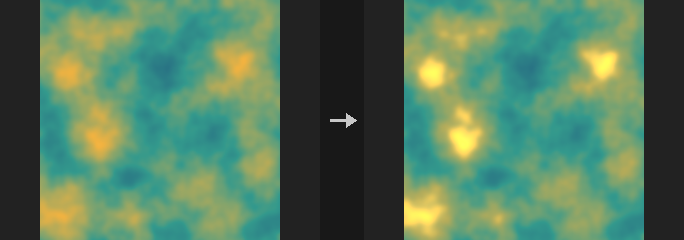

Covers Glow and Star Glow. Pixels brighter than `threshold` (with a soft knee, using the maximum of the first three channels) are extracted. In `glow` mode the extracted light is blurred at three scales (radius, half and quarter radius) and averaged; in `star` mode it is smeared along `rays` evenly spaced directions. The result times `intensity` is added back to the original. Alpha is left unchanged.

**Inputs**

| Input | Type | Description |
|---|---|---|
| `cop` | COPIMAGE | Image to add glow to. |

**Outputs**

| Output | Type | Description |
|---|---|---|
| `cop` | COPIMAGE | Image with the glow added. |

**Parameters**

| Parameter | Type | Default | Description |
|---|---|---|---|
| Layers `layers` | string | *(empty)* | Layers to process. Empty means all layers; otherwise a space-separated list of layer names. |
| Mode `mode` | menu | Glow | `glow` is a round multi-scale Gaussian glow; `star` is a directional streak glow. Options: Glow (`glow`), Star Glow (`star`). |
| Threshold `threshold` | float [0..] | 0.8 | Brightness above which light contributes to the glow. |
| Intensity `intensity` | float [0..1000.0] | 1 | Strength of the glow added back to the image. |
| Glow Radius `radius` | float [0..1024] | 12 | Size of the glow in pixels (Glow mode). Smaller scales at half and quarter size are mixed in. *Hidden when mode ≠ glow.* |

*Star*

| Parameter | Type | Default | Description |
|---|---|---|---|
| Number of Rays `rays` | int [1..32] | 4 | Number of streak directions (Star mode). *Hidden when mode ≠ star.* |
| Ray Length `ray_length` | float [0..4096] | 40 | Length of each streak in pixels (Star mode). *Hidden when mode ≠ star.* |
| Ray Angle `angle` | float [-360..360] | 45 | Rotation of the first streak direction in degrees (Star mode). *Hidden when mode ≠ star.* |

| Parameter | Type | Default | Description |
|---|---|---|---|
| Border `border` | menu | Clamp (Streak Edges) | How pixels outside the image are read while blurring: clamp, wrap or black. Options: Clamp (Streak Edges) (`clamp`), Wrap (`wrap`), Constant (Black) (`black`). |

---

### COP Kuwahara (PCG)

`PCG_COPKuwahara` · category `PCG/cop` · Houdini: Kuwahara Filter (COP)

Smooths an image while keeping edges, giving a painterly look.

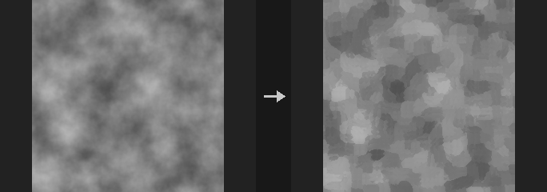

The classic Kuwahara filter: around each pixel the neighbourhood is split into four quadrants, and the pixel takes the mean of the quadrant with the lowest variance. Flat areas are smoothed, edges stay sharp, and larger radii give a stronger oil-paint look.

**Inputs**

| Input | Type | Description |
|---|---|---|
| `cop` | COPIMAGE | Image to filter. |

**Outputs**

| Output | Type | Description |
|---|---|---|
| `cop` | COPIMAGE | Filtered image. |

**Parameters**

| Parameter | Type | Default | Description |
|---|---|---|---|
| Layers `layers` | string | *(empty)* | Space-separated layers to process. Empty processes all layers. |
| Radius `radius` | int [1..64] | 4 | Quadrant size in pixels. Larger values smooth more and cost more time. |

---

### COP Median (PCG)

`PCG_COPMedian` · category `PCG/cop` · Houdini: Median (COP)

Applies a median filter that removes speckle while preserving edges.

Each pixel takes the median of its neighbourhood. This removes salt-and-pepper noise and small blotches on AI-generated masks without blurring edges. A constant image is unchanged, and every output value is one of the values present in the window.

The filter needs sorting, so it runs on the CPU (a GPU image makes a round trip) and costs roughly `O(N*k^2*log k)`: radius 2 is already visibly slower than a blur and radius 4 much slower. Do not use it as a blur; the radius is limited to 8.

**Inputs**

| Input | Type | Description |
|---|---|---|
| `cop` | COPIMAGE | Image to filter. |

**Outputs**

| Output | Type | Description |
|---|---|---|
| `cop` | COPIMAGE | Filtered image. |

**Parameters**

| Parameter | Type | Default | Description |
|---|---|---|---|
| Layers `layers` | string | *(empty)* | Space-separated layers to process. Empty processes all layers. |
| Radius `radius` | int [0..8] | 1 | Window radius in pixels (at most 8). 0 leaves the image unchanged. |
| Shape `shape` | menu | Square | Shape of the neighbourhood window. Options: Square (`box`), Circle (`disc`). |
| Border `border` | menu | Clamp | How pixels outside the image are treated. Options: Clamp (`clamp`), Wrap (`wrap`), Constant (Black) (`black`). |

---

### COP Pixelate (PCG)

`PCG_COPPixelate` · category `PCG/cop` · Houdini: Pixelate (COP)

Pixelates an image into square blocks.

Divides the image into Size x Size pixel blocks and fills each block with its average color or with the value at the block centre.

**Inputs**

| Input | Type | Description |
|---|---|---|
| `cop` | COPIMAGE | Image to pixelate. |

**Outputs**

| Output | Type | Description |
|---|---|---|
| `cop` | COPIMAGE | Pixelated image. |

**Parameters**

| Parameter | Type | Default | Description |
|---|---|---|---|
| Layers `layers` | string | *(empty)* | Space-separated layers to process. Empty processes all layers. |
| Pixel Size `size` | int [1..4096] | 8 | Block size in pixels. |
| Mode `mode` | menu | Average | Average fills each block with the mean of its pixels; Sample Center uses the single pixel at the block centre. Options: Average (`average`), Sample Center (`sample`). |

---

### COP SDF from Mask (PCG)

`PCG_COPSDFFromMask` · category `PCG/cop` · Houdini: Mono to SDF (COP)

Converts a mask into a signed distance field, negative inside and positive outside.

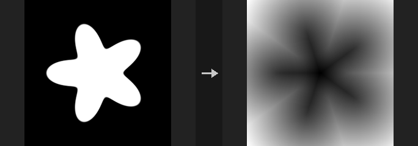

Distances are in pixels or in UV units (divided by the short edge, the same convention as COP Shape, so a baked Shape circle gives comparable values). The sign convention matches COP Shape. An SDF enables operations a black and white mask cannot: outlines (`|d| < w`) with sub-pixel exact, resolution-independent thickness; grow/shrink by `d - r` with r in pixels; feathering by `smoothstep(-w, w, d)`; union/intersect/subtract by min/max, which keep a valid distance field; and equidistant bands via Quantize.

Exact uses the Felzenszwalb lower-envelope algorithm (two 1D passes), which gives the true Euclidean distance; it is NumPy only. Jump Flooding is gather only and can run on GPU, but is approximate (a solid shape retains a ~0.19 px error that extra passes do not remove). On the CPU Exact is both faster and more accurate, so there is no reason to use JFA there.

Half-Pixel Correction: distances are measured between pixel centres, so a pixel touching the boundary reads 1.0 while the true boundary is at 0.5. Subtracting 0.5 fixes this near the boundary. It does not move the zero level set, so thresholding gives identical results either way; it only changes the numeric values.

**Inputs**

| Input | Type | Description |
|---|---|---|
| `cop` | COPIMAGE | Image containing the mask layer. |

**Outputs**

| Output | Type | Description |
|---|---|---|
| `cop` | COPIMAGE | Image with the SDF layer. |

**Parameters**

| Parameter | Type | Default | Description |
|---|---|---|---|
| Mask Layer `layer` | string | `mask` | Mask layer. Only the first channel is used. |
| Threshold `threshold` | float | 0.5 | Mask values above this are inside. |
| Method `mode` | menu | Exact (Felzenszwalb) | Exact is precise and faster on CPU; Jump Flooding is approximate but can run on GPU. Options: Exact (Felzenszwalb) (`exact`), Jump Flooding (JFA) (`jfa`). |
| Extra JFA Passes `jfa_plus` | int [0..8] | 2 | Extra refinement passes after the standard jump flooding passes. *Hidden when mode ≠ jfa.* |
| Sign `sign` | menu | Signed (Inside Negative) | Signed keeps both sides; Outside Only and Inside Only zero out the other side; Unsigned gives absolute distance. Options: Signed (Inside Negative) (`signed`), Outside Only (`outside`), Inside Only (`inside`), Unsigned (`unsigned`). |
| Units `units` | menu | Pixels | Pixels or UV units (divided by the short edge). Options: Pixels (`pixels`), UV (Short Edge) (`uv`). |
| Half-Pixel Correction `half_pixel` | toggle | on | Subtracts half a pixel from the distance for more accurate values at the boundary. The zero level set does not move. |
| Output Layer `out_layer` | string | `sdf` | Name of the SDF layer. |
| Keep Input Layers `keep_layers` | toggle | on | Keeps the input layers in the output. |

---

### COP SDF Ops (PCG)

`PCG_COPSDFOps` · category `PCG/cop` · Houdini: SDF Blend (COP), SDF to Mono (COP)

Combines, offsets or converts signed distance fields.

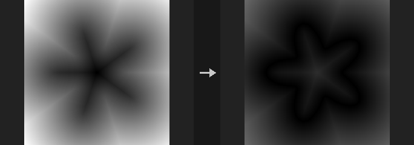

Union, Intersect and Subtract combine SDF A with SDF B; with a Smooth Radius above 0 a polynomial smooth version gives rounded transitions. Blend morphs between the two shapes. Offset grows (positive) or shrinks the shape and Onion turns it into a shell. The SDF to Mono operations turn the field into a mask: filled shape, outline, or falloff, with Width in the chosen Units.

**Inputs**

| Input | Type | Description |
|---|---|---|
| `cop` | COPIMAGE | Image containing the SDF layers. |

**Outputs**

| Output | Type | Description |
|---|---|---|
| `cop` | COPIMAGE | Image with the resulting layer. |

**Parameters**

| Parameter | Type | Default | Description |
|---|---|---|---|
| Operation `op` | menu | Union | Operation to perform. Options: Union (`union`), Intersect (`intersect`), Subtract (A − B) (`subtract`), Blend (Morph) (`blend`), Offset (`offset`), Onion (Shell) (`onion`), SDF to Mono: Fill (`to_fill`), SDF to Mono: Outline (`to_outline`), SDF to Mono: Falloff (`to_falloff`). |
| SDF A `a_layer` | string | `sdf` | First SDF layer. |
| SDF B `b_layer` | string | *(empty)* | Second SDF layer, for the operations that combine two shapes. *Hidden when op = offset } { op = onion } { op = to_fill } { op = to_outline } { op = to_falloff.* |
| Smooth Radius `smooth` | float [0..] | 0 | Rounding radius for union, intersect and subtract. 0 uses the sharp min/max. *Hidden when op ≠ union op ≠ intersect op ≠ subtract.* |
| Blend `t` | float [-10..10] | 0.5 | Mix amount between A and B for Blend. *Hidden when op ≠ blend.* |
| Distance `amount` | float | 0 | Offset: positive grows the shape. Onion: half of the shell thickness. *Hidden when op ≠ offset op ≠ onion.* |
| Width `width` | float [0..] | 0.01 | Width of the outline or falloff, in the chosen Units. *Hidden when op ≠ to_fill op ≠ to_outline op ≠ to_falloff.* |
| Units `units` | menu | UV (Short Edge) | Whether Width is in UV units (short edge) or pixels. Options: UV (Short Edge) (`uv`), Pixels (`pixels`). *Hidden when op ≠ to_fill op ≠ to_outline op ≠ to_falloff.* |
| Output Layer `out_layer` | string | `sdf_out` | Name of the layer that receives the result. |

---

### COP Sharpen (PCG)

`PCG_COPSharpen` · category `PCG/cop` · Houdini: Sharpen (COP)

Sharpens with an unsharp mask.

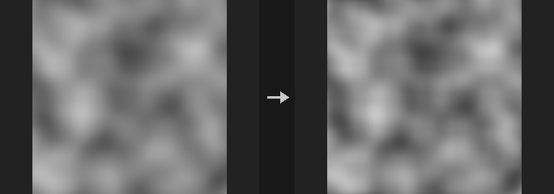

Computes `out = a + Amount * (a - blur(a, Sigma))`. Amount 0 is a bit-exact identity (the node is skipped), and a constant image is unchanged for any setting.

Sigma sets the scale of the detail being enhanced: 0.5 to 1 brings out texture, 3 to 5 brings out contours and volume. Amounts above 2 produce halos (overshoot) on strong edges; this is inherent in the method.

**Inputs**

| Input | Type | Description |
|---|---|---|
| `cop` | COPIMAGE | Image to sharpen. |

**Outputs**

| Output | Type | Description |
|---|---|---|
| `cop` | COPIMAGE | Sharpened image. |

**Parameters**

| Parameter | Type | Default | Description |
|---|---|---|---|
| Layers `layers` | string | *(empty)* | Layers to process, space-separated. Empty processes all layers. |
| Amount `amount` | float [-100.0..100.0] | 1 | Strength of the sharpening. Negative values blur. |
| Size (σ, Pixels) `sigma_pixels` | float [0.0..512.0] | 1 | Standard deviation of the blur used for the mask, in pixels. *Disabled when amount = 0.* |
| Border `border` | menu | Clamp (Streak) | How samples outside the image are handled. Options: Clamp (Streak) (`clamp`), Wrap (`wrap`), Constant (Black) (`black`). *Disabled when amount = 0.* |

---

### COP Smooth Fill (PCG)

`PCG_COPSmoothFill` · category `PCG/cop` · Houdini: Smooth Fill (COP)

Fills unknown pixels with smooth values interpolated from the known ones.

Pixels where the Known Mask Layer is above 0.5 are known; all other pixels are filled. Push-Pull uses an image pyramid and is fast. Laplace solves a harmonic membrane and is the smoothest. Nearest extrapolates ring by ring. Known pixels are left bit-exact.

**Inputs**

| Input | Type | Description |
|---|---|---|
| `cop` | COPIMAGE | Image containing the layers to fill and the known mask. |

**Outputs**

| Output | Type | Description |
|---|---|---|
| `cop` | COPIMAGE | Image with the unknown pixels filled. |

**Parameters**

| Parameter | Type | Default | Description |
|---|---|---|---|
| Layers `layers` | string | *(empty)* | Layers to fill, space-separated. Empty processes all layers. |
| Known Mask Layer `mask_layer` | string | `mask` | Layer marking known pixels (values above 0.5). |
| Method `mode` | menu | Push-Pull (Pyramid) | Fill method: pyramid push-pull, harmonic (Laplace) relaxation, or nearest-pixel extrapolation. Options: Push-Pull (Pyramid) (`pushpull`), Laplace (Harmonic) (`laplace`), Nearest (Extrapolate) (`nearest`). |
| Iterations `iterations` | int [0..] | 200 | Number of relaxation iterations of the Laplace solver. *Hidden when mode ≠ laplace.* |
| Rings `rings` | int [0..] | 0 | Number of pixel rings to extrapolate outward; 0 fills the entire image. *Hidden when mode ≠ nearest.* |

---

### COP Surface Dither (PCG)

`PCG_COPSurfaceDither` · category `PCG/cop` · Houdini: Surface Dither (COP)

Draws halftone dots attached to a UV parametrisation whose spacing stays near a fixed pixel size under scaling and perspective.

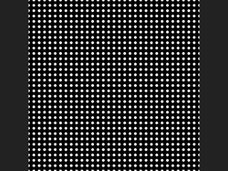

Surface Dither lays a grid of dots in pattern space (the UVs, scaled, rotated and offset) and picks a grid level per pixel from the screen-space derivative of that pattern space, so the on-screen dot spacing stays between `Density Scale / 2` and `Density Scale` pixels. When the level changes, the dots that must disappear (three out of four) shrink away during the last `Level Transition` fraction of the level, so zooming or foreshortening neither blurs the dots into grey nor makes them pop.

The result is either a coverage mask or a signed distance field (in pixels), written to `Output Layer`. Optionally it also writes the local cell UV, the level index and the relative dot scale as extra layers. If no UV layer is given, the texture UV of the pixel centre is used. Where the UVs have a seam (a jump), the derivative is huge and a very coarse level is chosen there.

This is a UV-attached halftone, not the screen-space quantisation dither (Bayer / error diffusion) of the plain Dither node.

**Inputs**

| Input | Type | Description |
|---|---|---|
| `cop` *(optional)* | COPIMAGE | Image whose layers supply the UV and dot-scale layers. Optional; without it an empty image of the given resolution is used. |

**Outputs**

| Output | Type | Description |
|---|---|---|
| `cop` | COPIMAGE | The input image plus the dither layer and any requested extra layers. |

**Parameters**

| Parameter | Type | Default | Description |
|---|---|---|---|
| UV Layer `uv_layer` | string | *(empty)* | Layer holding the UVs the dots are attached to. Empty uses the texture UV of each pixel centre. |
| Dot Scale Layer `dotscale_layer` | string | *(empty)* | Optional per-pixel multiplier for the dot size (first channel). Empty means 1. |
| Density Scale `density_scale` | float [0.01..4096] | 8 | Target on-screen dot spacing in pixels. The actual spacing varies between this value and half of it as the level blends. |
| Pattern Scale `pattern_scale` | float [1e-06..] | 1 | Uniform scale applied to the UVs before the dot grid is laid out. Larger values give more dots across the surface. |
| Pattern Scale XY `pattern_scale_xy` | string | `1 1` | Extra non-uniform scale (U and V) multiplied with `Pattern Scale`. |
| Pattern Offset `pattern_offset` | string | `0 0` | Offset (U and V) added to the pattern coordinates after scaling and rotation. |
| Pattern Rotate `pattern_rotate` | float [-3600..3600] | 0 | Rotation of the dot grid in degrees, applied before the offset. |
| Dot Scale `dot_scale` | float [0..100] | 0.5 | Dot size relative to the spacing. The dot radius is half of `Dot Scale` times the dot-scale layer times `Density Scale`, in pixels, so surviving dots keep their screen size across level changes. |
| Output Type `output_type` | menu | Mask | Mask gives a 0-1 coverage with a smooth edge; SDF gives the signed distance to the nearest dot edge in pixels (negative inside). Options: Mask (`mask`), SDF (`sdf`). |
| Iso Offset `iso_offset` | float | 0 | Shifts the iso-contour of the distance field, in pixels. Positive values make the dots larger. Does not affect level transitions. *Hidden when output_type ≠ mask.* |
| Smooth `smooth` | float [0..] | 1 | Width in pixels of the soft edge of the mask. Only used for the Mask output. *Hidden when output_type ≠ mask.* |
| Level Transition `level_transition` | float [0..1] | 0.5 | Fraction of each level (0-1) during which the dots that are about to vanish shrink away. 0 makes them disappear abruptly at the level change. |
| Dither Layer `out_layer` | string | `dither` | Layer that receives the mask or SDF. |
| UV Output Layer `uv_out_layer` | string | *(empty)* | Optional layer receiving the local coordinates inside the dot cell (0-1). Empty writes nothing. |
| Level Output Layer `level_layer` | string | *(empty)* | Optional layer receiving the integer level index per pixel. Empty writes nothing. |
| Scale Output Layer `scale_layer` | string | *(empty)* | Optional layer receiving the relative dot spacing (spacing divided by `Density Scale`, between 0.5 and 1). Empty writes nothing. |
| Resolution `resolution_x` `resolution_y` | int [1..16384] | 512, 512 | Output resolution (width, height) used when nothing is connected to the input. With an input, its resolution is used. |

**Compared with Houdini**

Custom dot shapes (the shape input and Shape Resolution) are not implemented; dots are always circles. Houdini does not document how seams in the UVs are handled, so the behaviour there is simply the derivative-based level choice described above.

**Tips**

- Feed a perspective-projected UV layer (for example from a rasterised mesh) to see the level selection at work.
- Output a `scale_layer` and use it to tint or debug where the level changes.

---
