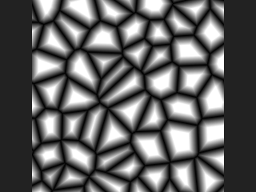
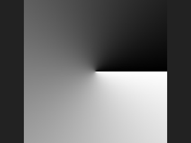
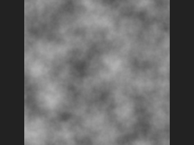
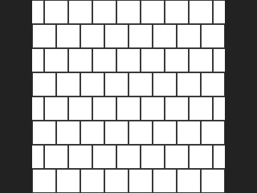
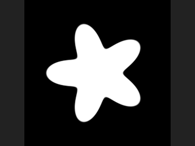
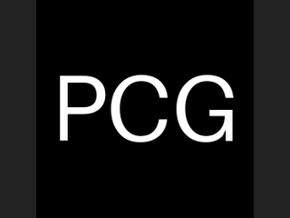
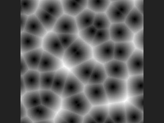

# Image: Generators

Noise, patterns, shapes, ramps and other image sources.

14 nodes.

[Back to the reference index](README.md)

## Contents

- [COP Cellular Noise (PCG)](#pcg-copcellularnoise) — Generates cellular (Voronoi-border) noise with adjustable gaps and bevels between cells.
- [COP Constant (PCG)](#pcg-copconstant) — Creates an image filled with a single constant colour.
- [COP Fill (PCG)](#pcg-copfill) — Fills a layer with a constant value, softly blended through an optional mask.
- [COP Fractal Sample (PCG)](#pcg-copfractalsample) — Layers a source image into itself at shrinking, rotating, jittered scales, like fractal noise whose basis function is an image.
- [COP Gradient (PCG)](#pcg-copgradient) — Generates a gradient (along u, v, a diagonal, radially or by angle) through a color ramp.
- [COP Noise (PCG)](#pcg-copnoise) — Generates a fractal noise image with optional tiling, animation and post-processing.
- [COP Noise Extra (PCG)](#pcg-copnoiseextra) — Generates Bubble, Crystal, Phasor, Curl, Curl 3D and Cloud noise.
- [COP Pattern (PCG)](#pcg-coppattern) — Generates procedural patterns: checkerboard, tiles, cells, UV grid, Julia/Mandelbrot, Chladni, knit and weave.
- [COP Position Map (PCG)](#pcg-coppositionmap) — Generates a layer storing a 3D position per pixel, for use as the reference position of 3D noise.
- [COP Random (PCG)](#pcg-coprandom) — Generates hash-based random values per pixel or per ID.
- [COP Shape (PCG)](#pcg-copshape) — Draws a shape as a signed distance field plus an anti-aliased mask.
- [COP Stereogram (PCG)](#pcg-copstereogram) — Creates a single-image autostereogram from a depth layer.
- [COP Text (PCG)](#pcg-coptext) — Renders text into an anti-aliased coverage mask, optionally composited over a layer.
- [COP Worley Noise (PCG)](#pcg-copworleynoise) — Generates Worley (cellular) noise and its feature-point, cell-border, center and ID layers.

## Nodes

### COP Cellular Noise (PCG)

`PCG_COPCellularNoise` · category `PCG/cop` · Houdini: Cellular Noise (COP), Cellular Noise 3D (COP)

Generates cellular (Voronoi-border) noise with adjustable gaps and bevels between cells.

Feature points are scattered on a lattice, each pixel finds its nearest point and the distance to the cell border. The noise value is `Amplitude * shape(border) + Shift`, followed by the Post Processing steps. In `absolute` shape mode Gap and Bevel are image-space distances; in `relative` mode they are fractions from 0 (cell border) to 1 (feature point). The shape is `clamp((border - gap) / bevel, 0, 1)`: Bevel 0 gives hard flat-topped cells, larger values give pointier tops.

Besides `noise` the node also writes `border` (distance to the cell border, positive inside the cell), `center` (position of the nearest feature point) and `id` (hash of the cell), each with the Prefix prepended. If a `cop` is connected, its resolution is used; with a Position Layer of 2 channels you get the 2D version, with 3 channels the 3D version.

**Inputs**

| Input | Type | Description |
|---|---|---|
| `cop` *(optional)* | COPIMAGE | Optional image. Its resolution is used, new layers are added to it, and it can provide a position layer. If not connected, a new image of the given resolution is created. |

**Outputs**

| Output | Type | Description |
|---|---|---|
| `cop` | COPIMAGE | Image with the noise layers (`noise`, `border`, `center`, `id`, each with the Prefix). |

**Parameters**

*Range*

| Parameter | Type | Default | Description |
|---|---|---|---|
| Amplitude `amplitude` | float | 1 | Multiplier applied to the shaped cell value. |
| Shift `shift` | float | 0 | Value added after the amplitude. |

*Pattern*

| Parameter | Type | Default | Description |
|---|---|---|---|
| Element Size `element_size` | float [1e-06..10000.0] | 0.1 | Average cell size in image units, where the image width is 1. |

| Parameter | Type | Default | Description |
|---|---|---|---|
| Element Scale `element_scale` | string | `1 1 1` | Per-axis scale of the cells (anisotropic stretching), one value per axis. |
| Jitter `jitter` | float [0.0..2.0] | 1 | How far feature points are moved from their lattice positions. 0 gives a regular grid; values above 1 move points beyond the search range and cause artefacts. |
| Jitter Scale `jitter_scale` | string | `1 1 1` | Per-axis multiplier of the jitter. |
| Lattice Type `lattice` | menu | Grid | Layout of the feature points: `rectangular` grid or `hexagonal` (2D only, cannot be tiled). Options: Grid (`rectangular`), Hexagonal (`hexagonal`). |
| Metric `metric` | menu | Euclidean | Distance function: `euclidean` (round cells), `manhattan` (diamond-like) or `chebyshev` (square-like). Options: Euclidean (`euclidean`), Manhattan (`manhattan`), Chebyshev (`chebyshev`). |
| Smooth Edge `smooth_edge` | float [0.0..10.0] | 0 | Rounds the cell borders; 0 keeps them sharp. *Hidden when metric ≠ euclidean.* |
| Offset `offset` | string | `0 0 0` | Shifts the pattern (X Y Z). |
| Tile `tile` | toggle | off | Makes the pattern repeat seamlessly. The cell count is round(Tile Size / Element Size), so Element Size is adjusted slightly. Rectangular lattice only. |
| Tile Size `tile_size` | string | `1 1 1` | Size of one repeat. For non-square images give it in proportion to the aspect ratio (image width is 1). *Disabled when tile is off.* |

*Shape*

| Parameter | Type | Default | Description |
|---|---|---|---|
| Mode `shape_mode` | menu | Absolute | `absolute`: Gap and Bevel are image-space distances. `relative`: they are ratios between the cell border (0) and the feature point (1). Options: Absolute (`absolute`), Relative (`relative`). |

| Parameter | Type | Default | Description |
|---|---|---|---|
| Gap `gap` | float [0.0..10000.0] | 0 | Shrinks the cells so a gap opens between them; large enough values make cells vanish. |
| Bevel `bevel` | float [0.0..10000.0] | 0.05 | Width of the falloff at the cell edge. 0 gives hard flat tops; larger values give pointier tops. |
| Pos Layer `pos_layer` | string | *(empty)* | Optional layer that supplies the sample positions when a `cop` is connected: 2 channels for 2D, 3 channels for the 3D version (world coordinates). Empty uses the pixel coordinates. |
| Seed `rand_seed` | int [0..] | 0 | Seed of the random feature points. |

*Post Processing*

| Parameter | Type | Default | Description |
|---|---|---|---|
| Fold `fold` | toggle | off | Post Processing: takes the absolute value (negative values become positive). |
| Complement `complement` | toggle | off | Post Processing: inverts the value (1 - x). |
| Bias `pp_bias` | float [0.0..1.0] | 0.5 | Post Processing: Perlin bias. 0.5 does nothing; below 0.5 pulls values towards 0, above 0.5 towards 1. |
| Gain `gain` | float [0.0..1.0] | 0.5 | Post Processing: Perlin gain. 0.5 does nothing; above 0.5 steepens the middle, below flattens it. |
| Gamma `gamma` | float [0.001..100.0] | 1 | Post Processing: raises the value to the power gamma, so values above 1 darken (as in the Houdini noise documentation). |
| Contrast `contrast` | float [-100.0..100.0] | 1 | Post Processing: scales the value around 0.5. |
| Clamp Minimum `clamp_min` | float | 0 | Post Processing: lower limit, used when Use Clamp Min is on. |
| Use Clamp Min `use_clamp_min` | toggle | off | Enables the lower clamp. |
| Clamp Maximum `clamp_max` | float | 1 | Post Processing: upper limit, used when Use Clamp Max is on. |
| Use Clamp Max `use_clamp_max` | toggle | off | Enables the upper clamp. |

| Parameter | Type | Default | Description |
|---|---|---|---|
| Layer Prefix `prefix` | string | *(empty)* | Text prepended to the output layer names (`noise`, `border`, `center`, `id`). |
| Resolution `resolution_x` `resolution_y` | int [1..16384] | 512, 512 | Width and height of the generated image. Used only when no `cop` is connected. |

**Compared with Houdini**

Covers Cellular Noise and Cellular Noise 3D. The ramp for Bevel (Bevel Ramp) is not implemented; the bevel is a linear ramp. The Houdini docs do not say whether Amplitude or Shift is applied first; here the value is multiplied first and then shifted. The Post Processing steps run in the order Fold, Complement, Bias, Gain, Gamma, Contrast, Clamp Min, Clamp Max.

---

### COP Constant (PCG)

`PCG_COPConstant` · category `PCG/cop` · Houdini: Constant (COP), Layer (COP)

Creates an image filled with a single constant colour.

Generates a flat colour image of the given resolution, typically as a base for compositing or as a mask backdrop. The layer has three channels (red, green, blue); enabling Use Alpha adds a fourth channel with the Alpha value. Values are not clamped, so negative and HDR values are allowed.

**Outputs**

| Output | Type | Description |
|---|---|---|
| `cop` | COPIMAGE | The constant image. |

**Parameters**

| Parameter | Type | Default | Description |
|---|---|---|---|
| Resolution `resolution_x` `resolution_y` | int [1..16384] | 512, 512 | Width and height of the image in pixels. |
| Color `red` `green` `blue` | float | 0, 0, 0 | Colour of the image as red, green and blue values (not clamped, HDR values are allowed). |
| Alpha `alpha` | float | 1 | Alpha value, used only when Use Alpha is on. |
| Alpha `use_alpha` | toggle | off | Outputs four channels (RGBA) instead of three. |
| Output Layer `layer` | string | `C` | Name of the layer that receives the colour. |
| Device `device` | menu | Auto | Compute backend. `auto` uses the GPU (through torch) for larger images when available and the CPU for small ones; `cpu` and `cuda` force torch on the CPU or GPU; `numpy` uses numpy; `exact` uses numpy in float64 for bit-exact results. Options: Auto (`auto`), CPU (`cpu`), CUDA (`cuda`), NumPy (`numpy`), Exact (float64) (`exact`). |

**Compared with Houdini**

Covers Houdini's Constant node and the constant-value use of Layer.

---

### COP Fill (PCG)

`PCG_COPFill` · category `PCG/cop` · Houdini: Fill (COP)

Fills a layer with a constant value, softly blended through an optional mask.

Equivalent of Fill. Every channel of the layer is replaced by the matching entry of `value`. If a mask layer is given, the constant is blended in proportionally to the mask (clamped to 0-1), so soft masks give soft edges; without a mask the whole layer is filled.

**Inputs**

| Input | Type | Description |
|---|---|---|
| `cop` | COPIMAGE | Image containing the layer to fill. |

**Outputs**

| Output | Type | Description |
|---|---|---|
| `cop` | COPIMAGE | Image with the layer filled. |

**Parameters**

| Parameter | Type | Default | Description |
|---|---|---|---|
| Layer `layer` | string | `C` | Layer to fill. |
| Fill Value `value` | string | `0 0 0` | Fill value as space-separated numbers, one per channel. If fewer numbers than channels are given, the last one is repeated. |
| Mask Layer `mask_layer` | string | *(empty)* | Optional mask layer (first channel, clamped to 0-1) controlling how much of the fill is applied. Empty fills everywhere. |
| Invert Mask `invert_mask` | toggle | off | Use 1 minus the mask, so the fill is applied where the mask is low. *Disabled when mask_layer = "".* |

---

### COP Fractal Sample (PCG)

`PCG_COPFractalSample` · category `PCG/cop` · Houdini: Fractal Sample (COP)

Layers a source image into itself at shrinking, rotating, jittered scales, like fractal noise whose basis function is an image.

Equivalent of Fractal Sample. Each octave samples the source layer with a scale of `lacunarity^octave`, an optional rotation (`angle`), jitter and random flips, around the image center. The octaves are weighted by `roughness^octave` and combined by the blend mode: Add, Subtract, Maximum or Over (Over only makes sense for RGBA). With one octave and no rotation or jitter the output equals the source.

Add and Subtract are normalized by the sum of the weights so that the value range matches the source. Samples first have `bias` subtracted (so the result is centered on 0), and `offset_with_bias` adds it back at the end. Over does not subtract bias.

Maintain Tileable rounds the lacunarity to an integer and the angle to multiples of 90 degrees; the source itself must already tile for the result to tile. The noise post-processing parameters (fold, complement, bias, gain, gamma, contrast, clamps) are then applied to the combined result in that order.

**Inputs**

| Input | Type | Description |
|---|---|---|
| `cop` | COPIMAGE | Image containing the source layer. |

**Outputs**

| Output | Type | Description |
|---|---|---|
| `cop` | COPIMAGE | Image with the fractal layer added. |

**Parameters**

| Parameter | Type | Default | Description |
|---|---|---|---|
| Source Layer `source_layer` | string | `C` | Layer used as the basis function for every octave. |
| Maintain Tileable `maintain_tileable` | toggle | off | Round lacunarity to an integer and the angle to multiples of 90 degrees. The source must already be tileable. |

*Fractal*

| Parameter | Type | Default | Description |
|---|---|---|---|
| Max Octaves `max_octaves` | int [1..16] | 4 | Number of octaves layered. |

| Parameter | Type | Default | Description |
|---|---|---|---|
| Lacunarity `lacunarity` | float [0.01..16.0] | 2 | Scale multiplier per octave: octave n samples the source at lacunarity^n times the frequency. |
| Roughness `roughness` | float [0.0..4.0] | 0.5 | Weight multiplier per octave; lower values make finer octaves weaker. |
| Bias `bias` | float | 0.5 | Midpoint subtracted from each sample before weighting. *Disabled when blend_mode = over.* |
| Offset with Bias `offset_with_bias` | toggle | on | Add the bias back after combining so the result is re-centered on the original midpoint. *Disabled when blend_mode = over.* |
| Blend Mode `blend_mode` | menu | Add | How octaves combine: Add, Subtract (first octave minus the rest), Maximum, or Over. Over only works with RGBA. Options: Add (`add`), Subtract (`subtract`), Maximum (`maximum`), Over (`over`). |
| Border `border` | menu | Wrap | Sampling outside the source image: tiled (wrap), edge pixel (clamp) or black. Options: Wrap (`wrap`), Clamp (`clamp`), Constant (Black) (`black`). |
| Filter `filter` | menu | Bilinear | Sampling filter: bilinear or nearest pixel. There is no area filtering, so strongly minified octaves can alias. Options: Bilinear (`bilinear`), Point (`point`). |

*Randomization*

| Parameter | Type | Default | Description |
|---|---|---|---|
| Seed `rand_seed` | int [0..] | 0 | Seed for jitter, random angles and random flips. |

| Parameter | Type | Default | Description |
|---|---|---|---|
| Jitter `jitter` | float [0.0..10.0] | 0 | Each octave gets a random uv offset in the range plus/minus Jitter. |
| Angle Mode `angle_mode` | menu | Per Octave | `per_octave` rotates by Angle times (octave + 1) cumulatively; `random` picks a random angle between -Angle and +Angle per octave. Options: Per Octave (`per_octave`), Random (`random`). |
| Angle `angle` | float [-360.0..360.0] | 0 | Rotation in degrees (see Angle Mode). |
| Random Flip X `random_flip_x` | toggle | off | Randomly mirror each octave horizontally. |
| Random Flip Y `random_flip_y` | toggle | off | Randomly mirror each octave vertically. |

*Post Processing*

| Parameter | Type | Default | Description |
|---|---|---|---|
| Fold `fold` | toggle | off | Take the absolute value of the result (post-process, applied first). |
| Complement `complement` | toggle | off | Invert the result as 1 minus value. |
| Bias `pp_bias` | float [0.0..1.0] | 0.5 | Perlin bias curve: 0.5 does nothing, below 0.5 pulls values toward 0, above 0.5 toward 1. |
| Gain `gain` | float [0.0..1.0] | 0.5 | Perlin gain curve; 0.5 does nothing. |
| Gamma `gamma` | float [0.001..100.0] | 1 | Raises the value to the power gamma; above 1 darkens. |
| Contrast `contrast` | float [-100.0..100.0] | 1 | Scales the result around 0.5. |
| Clamp Minimum `clamp_min` | float | 0 | Lower clamp value, used only when Use Clamp Min is on. |
| Use Clamp Min `use_clamp_min` | toggle | off | Enable the lower clamp. |
| Clamp Maximum `clamp_max` | float | 1 | Upper clamp value, used only when Use Clamp Max is on. |
| Use Clamp Max `use_clamp_max` | toggle | off | Enable the upper clamp. |

| Parameter | Type | Default | Description |
|---|---|---|---|
| Output Layer `out_layer` | string | `fractal` | Name of the output layer. |

**Compared with Houdini**

The weight normalization is the plugin's own choice, and the Houdini documentation's reference to gain "after weight and gain" is not implemented. Border offers clamp, wrap and black only; Filter offers bilinear and point only, with no area filtering. The optional per-pixel input layers for octaves, lacunarity and roughness are not supported.

---

### COP Gradient (PCG)

`PCG_COPGradient` · category `PCG/cop` · Houdini: Ramp (COP)

Generates a gradient (along u, v, a diagonal, radially or by angle) through a color ramp.

Equivalent of Ramp. The gradient position (0 to 1) is computed per pixel from the chosen direction and looked up in the ramp. The ramp uses the same text syntax as the geometry-side Attribute Fade and Measure ramps: space-separated `position:value` stops such as `0:0 0.5:1 1:0`, or multi-component values such as `0:0,0,0 1:1,0.5,0`. The number of components is taken from the first stop and sets the channel count of the layer.

Radial reaches 1 at a distance of 0.5 from the center; angular runs once around the center, from 0 to 1.

**Outputs**

| Output | Type | Description |
|---|---|---|
| `cop` | COPIMAGE | Image containing the gradient layer. |

**Parameters**

| Parameter | Type | Default | Description |
|---|---|---|---|
| Resolution `resolution_x` `resolution_y` | int [1..16384] | 512, 512 | Width and height of the generated image in pixels. |
| Ramp Type `direction` | menu | Linear V (Vertical) | Gradient geometry: `u` varies left to right, `v` bottom to top, `diagonal` along the direction given by Angle, `radial` by distance from the center, `angular` by angle around the center. Options: Linear V (Vertical) (`v`), Linear U (Horizontal) (`u`), Linear (Angle) (`diagonal`), Radial (`radial`), Angular (`angular`). |
| Angle `angle` | float [-3600.0..3600.0] | 0 | Direction of the gradient in degrees (Diagonal only). *Hidden when direction ≠ diagonal.* |
| Center `center_x` `center_y` | float [-10000.0..10000.0] | 0, 0 | Center of the gradient (Radial and Angular), as an offset in the image's centered coordinates. *Hidden when direction ≠ radial direction ≠ angular.* |
| Ramp `ramp` | string | `0:0  1:1` | Ramp stops as space-separated `position:value` pairs. A value may be several comma-separated components to produce a multi-channel layer. |
| Interpolation `ramp_mode` | menu | Linear | Interpolation between stops: linear, smooth, or constant (steps). Options: Linear (`linear`), Smooth (`smooth`), Constant (`constant`). |
| Output Layer `layer` | string | `C` | Name of the output layer. |
| Device `device` | menu | Auto | Compute backend: `auto` picks automatically, `cpu`/`numpy`/`cuda` force a backend, `exact` is the reference path. Options: Auto (`auto`), CPU (`cpu`), CUDA (`cuda`), NumPy (`numpy`), Exact (float64) (`exact`). |

---

### COP Noise (PCG)

`PCG_COPNoise` · category `PCG/cop` · Houdini: Fractal Noise (COP), Fractal Noise 3D (COP)

Generates a fractal noise image with optional tiling, animation and post-processing.

Each pixel is given a 3D coordinate (uv times Frequency, placed on the plane z = Offset z, plus Offset x and y), and the value comes from the same `fractal_noise` function used by the geometry-side Attribute Noise. The same world position therefore gets a bit-identical value in an image and on geometry, as long as the parameters match, which lets you bake a displacement map and displace geometry consistently.

Channels above 1 each use their own seed (`seed + k*7919`), which gives RGB noise or a 2D flow field in one node (Houdini's Per Component).

**Tiling**: Tile U wraps the u direction onto a circle, so the result tiles horizontally. Tile U and Tile V together give a seamless 2D tile (a flat torus in four dimensions, as does the Torus noise type, which is simplex noise with both tilings). Lacunarity does not need to be an integer for tiling.

**Animation**: Time Scale above 0 switches to 4D noise with the fourth coordinate `Time * Time Scale`. Loop Length (Frames) above 0 moves time around a circle in the (z, w) plane so that frame 0 and the loop length are identical, with a flow speed matching the non-looping case. Looping needs Time Scale above 0 and cannot be combined with Tile U or Tile V, and two-way tiling cannot be combined with Time Scale either (these would need a fifth dimension; the node raises an error instead of silently disabling one).

**Post processing** runs after Amplitude and Center in this order: Fold, Complement, Bias, Gain, Gamma, Contrast, Clamp Minimum, Clamp Maximum. Bias, Gain and Gamma act on negative values by odd extension (`sign(x) * |x|^p`) so no NaN appears.

**Outputs**

| Output | Type | Description |
|---|---|---|
| `cop` | COPIMAGE | New image with the noise in the output layer. |

**Parameters**

| Parameter | Type | Default | Description |
|---|---|---|---|
| Resolution `resolution_x` `resolution_y` | int [1..16384] | 512, 512 | Output width and height in pixels. |
| Channels `channels` | int [1..4] | 1 | Number of channels (1-4). Each channel is an independent noise with its own seed. |
| Output Layer `layer` | string | `C` | Name of the output layer. |

*Range*

| Parameter | Type | Default | Description |
|---|---|---|---|
| Amplitude `amplitude` | float | 1 | Multiplier applied to the noise. |
| Center `bias` | float | 0 | Center: constant added after the amplitude. |

*Pattern*

| Parameter | Type | Default | Description |
|---|---|---|---|
| Noise Type `noise_type` | menu | Value | Basis noise. Worley F1 is cellular distance to the nearest point, F2-F1 the difference of the two nearest distances. White is uncorrelated per-pixel random. Torus is simplex noise that tiles in both directions. Options: Value (`value`), Perlin (`perlin`), Simplex (`simplex`), Worley Cellular F1 (`worley`), Worley Cellular F2-F1 (`worley_f2f1`), White (Random) (`white`), Torus (`torus`). |
| Metric `metric` | menu | Euclidean | Distance metric for the Worley types. Worley F2-F1 with Manhattan searches two rings of neighbouring cells (125 instead of 27), because the second-nearest point can lie further out with that metric; it is about 4.6 times slower than the other combinations. Options: Euclidean (`euclidean`), Manhattan (`manhattan`), Chebyshev (`chebyshev`). *Hidden when noise_type ≠ worley noise_type ≠ worley_f2f1.* |
| Jitter `jitter` | float [0.0..2.0] | 1 | Worley types: how far feature points move inside their cells. 0 is a regular grid; above 1 the points leave the search range and artefacts appear (Houdini warns the same). *Hidden when noise_type ≠ worley noise_type ≠ worley_f2f1.* |
| Frequency `frequency` | float [0.0..] | 4 | Number of noise features across the image: uv is multiplied by this. It is the reciprocal of Houdini's Element Size. |
| Offset `offset_x` `offset_y` `offset_z` | float | 0, 0, 0 | Offset of the noise space (x, y, z). The z value selects the slice of the 3D noise. |
| Tile U `tile_u` | toggle | off | Make the noise seamless in the horizontal direction. Cannot be combined with Loop Length. *Disabled when noise_type = torus.* |

| Parameter | Type | Default | Description |
|---|---|---|---|
| Tile V `tile_v` | toggle | off | Make the noise seamless in the vertical direction. With Tile U, gives a fully seamless 2D tile. *Disabled when noise_type = torus.* |

*Pattern*

| Parameter | Type | Default | Description |
|---|---|---|---|
| Seed `rand_seed` | int [0..] | 0 | Seed of the noise. |

*Time*

| Parameter | Type | Default | Description |
|---|---|---|---|
| Time Scale `time_scale` | float [0.0..10000.0] | 0 | Speed of the animation along the fourth dimension. 0 gives static 3D noise and ignores Time and Loop Length. |
| Time `time` | float | 0 | Current time (frame) used for animation, multiplied by Time Scale. *Disabled when time_scale = 0.* |
| Loop Length (Frames) `loop_frames` | int [0..65536] | 0 | If above 0, the animation loops seamlessly after this many frames. Requires Time Scale above 0. *Disabled when time_scale = 0.* |

*Fractal*

| Parameter | Type | Default | Description |
|---|---|---|---|
| Fractal Type `fractal` | menu | None | Fractal combination of octaves. None uses a single octave (Max Octaves, Lacunarity and Roughness have no effect). Terrain and Hybrid Terrain give the multifractal variants used for terrain. Options: None (`none`), Standard (`standard`), Terrain (`terrain`), Hybrid Terrain (`hybrid_terrain`). |
| Max Octaves `octaves` | int [1..16] | 3 | Maximum number of octaves summed. *Hidden when fractal = none.* |
| Lacunarity `lacunarity` | float [0.0..16.0] | 2 | Frequency multiplier from one octave to the next. *Hidden when fractal = none.* |
| Roughness `roughness` | float [0.0..1.0] | 0.5 | Amplitude multiplier from one octave to the next. *Hidden when fractal = none.* |

*Post Processing*

| Parameter | Type | Default | Description |
|---|---|---|---|
| Fold `fold` | toggle | off | Post processing: take the absolute value. |
| Complement `complement` | toggle | off | Post processing: replace x with `1 - x`. |
| Bias `pp_bias` | float [0.0..1.0] | 0.5 | Post processing: Perlin bias. 0.5 leaves the values unchanged; below 0.5 pulls toward 0, above 0.5 toward 1. |
| Gain `gain` | float [0.0..1.0] | 0.5 | Post processing: Perlin gain. 0.5 leaves the values unchanged; above 0.5 steepens the middle, below 0.5 flattens it. |
| Gamma `gamma` | float [0.001..100.0] | 1 | Post processing: `x^gamma`. Above 1 darkens, following Houdini's noise documentation. |
| Contrast `contrast` | float [-100.0..100.0] | 1 | Post processing: scales values around 0.5. |
| Clamp Minimum `clamp_min` | float | 0 | Lower limit used when Use Clamp Min is on. |
| Use Clamp Min `use_clamp_min` | toggle | off | Apply the lower clamp. |
| Clamp Maximum `clamp_max` | float | 1 | Upper limit used when Use Clamp Max is on. |
| Use Clamp Max `use_clamp_max` | toggle | off | Apply the upper clamp. |

| Parameter | Type | Default | Description |
|---|---|---|---|
| Device `device` | menu | Auto | Compute backend. Auto uses the GPU when CUDA is available and the image has at least 256x256 pixels. GPU results are float32 and differ from the CPU float64 path by rounding (about 1e-6); Exact keeps float64 on the CPU for bit-identical agreement with the geometry side. Options: Auto (`auto`), CPU (`cpu`), CUDA (`cuda`), NumPy (`numpy`), Exact (float64) (`exact`). |

**Compared with Houdini**

Covers Houdini's Fractal Noise and Fractal Noise 3D. Tile U / Tile V and Torus are implemented by wrapping the noise coordinates onto circles in a higher dimension, so the Lacunarity does not have to be rounded to an integer as in Houdini.

---

### COP Noise Extra (PCG)

`PCG_COPNoiseExtra` · category `PCG/cop` · Houdini: Bubble Noise (COP), Cloud Noise 3D (COP), Crystal Noise (COP), Crystal Noise 3D (COP), Curl Noise (COP), Curl Noise 3D (COP), Phasor Noise (COP)

Generates Bubble, Crystal, Phasor, Curl, Curl 3D and Cloud noise.

A collection of additional noise types. Coordinates are normalized by the image width and keep the aspect ratio, so bubbles stay round. The 3D types slice the volume at the third Offset value (z); moving it animates the noise. If `cop` is connected, layers are added to it and its resolution is used; otherwise a new image is created with Resolution.

The main layer is the Output Layer; auxiliary layers are named `<Output Layer>_xxx`:
- **Bubble**: one sphere per cell with probability Density and radius Radius times 0.5-1 cell; the value is the cross-section height of the sphere at the slice. Overlaps take the maximum. Auxiliary: `_id`.
- **Crystal**: 3D Voronoi where every cell has a random tilted plane, producing facets with creases between cells. Auxiliary: `_id`, `_edge` (F2-F1, zero at creases).
- **Phasor**: Gabor-like noise with the phase of the complex sum of kernels only, so stripe contrast is uniform. Auxiliary: `_phase`, `_amplitude`.
- **Curl**: a divergence-free 2-channel velocity field derived from a simplex fractal potential (unit is per noise unit; multiply by Frequency / image width for per-pixel). Auxiliary: `_potential`.
- **Curl 3D**: 3-channel curl of three potentials, evaluated on the z slice. Note that (vx, vy) on a single slice are not divergence-free.
- **Cloud 3D**: simplex fractal turned into a 0-1 density by Coverage and Softness. Auxiliary: `_raw`.

Amplitude, Center and the post-processing block only affect the main layer, not the auxiliary ones.

**Inputs**

| Input | Type | Description |
|---|---|---|
| `cop` *(optional)* | COPIMAGE | Optional image to add the noise to. Its resolution is used. Not connected: a new image of the given Resolution is created. |

**Outputs**

| Output | Type | Description |
|---|---|---|
| `cop` | COPIMAGE | Image with the noise in the output layer and the auxiliary layers listed above. |

**Parameters**

| Parameter | Type | Default | Description |
|---|---|---|---|
| Noise Type `kind` | menu | Bubble | Noise type to generate. Options: Bubble (`bubble`), Crystal (`crystal`), Phasor (`phasor`), Curl (`curl`), Curl 3D (`curl_3d`), Cloud 3D (`cloud`). |

*Range*

| Parameter | Type | Default | Description |
|---|---|---|---|
| Amplitude `amplitude` | float | 1 | Multiplier applied to the main layer. |
| Center `center` | float | 0 | Constant added to the main layer after the amplitude. |

| Parameter | Type | Default | Description |
|---|---|---|---|
| Frequency `frequency` | float [0.001..10000.0] | 8 | Number of noise features across the image width. Reciprocal of Houdini's Element Size. |
| Offset `offset` | string | `0 0 0` | Offset of the noise space as three numbers. The third is the z slice for 3D types. |
| Octaves `octaves` | int [1..12] | 3 | Number of octaves for Curl, Curl 3D and Cloud 3D. *Hidden when kind = bubble } { kind = crystal } { kind = phasor.* |
| Seed `rand_seed` | int [0..] | 0 | Seed of the noise. |

*Bubble*

| Parameter | Type | Default | Description |
|---|---|---|---|
| Radius `radius` | float [0..1] | 0.8 | Bubble: maximum sphere radius in cells (0-1). *Hidden when kind ≠ bubble.* |
| Density `density` | float [0..1] | 0.7 | Bubble: probability that a cell contains a sphere. *Hidden when kind ≠ bubble.* |

*Crystal*

| Parameter | Type | Default | Description |
|---|---|---|---|
| Sharpness `sharpness` | float [0..100] | 1 | Crystal: slope of the facet planes. Higher values give stronger facets. *Hidden when kind ≠ crystal.* |
| Primary Metric `metric` | menu | Euclidean | Crystal: distance metric used to pick the cell. Options: Euclidean (`euclidean`), Manhattan (`manhattan`), Chebyshev (`chebyshev`). *Hidden when kind ≠ crystal.* |
| Jitter `jitter` | float [0.0..2.0] | 1 | Crystal: how far feature points move inside their cells. *Hidden when kind ≠ crystal.* |

*Phasor*

| Parameter | Type | Default | Description |
|---|---|---|---|
| Type `phasor_type` | menu | Phasor Wave | Phasor: what is shown in the main layer. Phasor Wave is a periodic function of the phase; Gabor Noise is the real part of the kernel sum; Intensity Field is the magnitude behind both. Options: Phasor Wave (`phasor_wave`), Gabor Noise (`gabor_noise`), Intensity Field (`intensity_field`). *Hidden when kind ≠ phasor.* |
| Periodic Function `periodic_function` | menu | Sine | Phasor Wave only: wave shape of the periodic function. Options: Sine (`sine`), Rectangle (`rectangle`), Saw (`saw`). *Hidden when kind ≠ phasor } { phasor_type ≠ phasor_wave.* |
| Stripe Frequency `stripe_freq` | float [0..64] | 2 | Phasor: number of stripes per cell. *Hidden when kind ≠ phasor.* |
| Angle `angle` | float [-360..360] | 0 | Phasor: stripe direction in degrees. *Hidden when kind ≠ phasor.* |
| Angle Spread `spread` | float [0..360] | 30 | Phasor: random deviation from the stripe direction, in degrees (plus or minus half of it). *Hidden when kind ≠ phasor.* |
| Kernels per Cell `kernels` | int [1..16] | 2 | Phasor: number of kernels per cell. More kernels give a more uniform pattern and cost more time. *Hidden when kind ≠ phasor.* |
| Direction Layer `direction_layer` | string | *(empty)* | Phasor: optional 2-channel vector layer of the connected image; stripes follow it instead of Angle. *Hidden when kind ≠ phasor.* |

*Cloud*

| Parameter | Type | Default | Description |
|---|---|---|---|
| Coverage `coverage` | float [0..1] | 0.5 | Cloud: fraction of space filled with cloud (0 empty, 1 full). *Hidden when kind ≠ cloud.* |
| Softness `softness` | float [0.001..1] | 0.2 | Cloud: width of the transition between empty and full density. *Hidden when kind ≠ cloud.* |
| Billow `billow` | toggle | off | Cloud: use the absolute value of the noise for puffier clumps. *Hidden when kind ≠ cloud.* |

*Post Processing*

| Parameter | Type | Default | Description |
|---|---|---|---|
| Fold `fold` | toggle | off | Post processing: take the absolute value. |
| Complement `complement` | toggle | off | Post processing: replace x with `1 - x`. |
| Bias `pp_bias` | float [0.0..1.0] | 0.5 | Post processing: Perlin bias. 0.5 leaves the values unchanged; below 0.5 pulls toward 0, above 0.5 toward 1. |
| Gain `gain` | float [0.0..1.0] | 0.5 | Post processing: Perlin gain. 0.5 leaves the values unchanged. |
| Gamma `gamma` | float [0.001..100.0] | 1 | Post processing: `x^gamma`. Above 1 darkens. |
| Contrast `contrast` | float [-100.0..100.0] | 1 | Post processing: scales values around 0.5. |
| Clamp Minimum `clamp_min` | float | 0 | Lower limit used when Use Clamp Min is on. |
| Use Clamp Min `use_clamp_min` | toggle | off | Apply the lower clamp. |
| Clamp Maximum `clamp_max` | float | 1 | Upper limit used when Use Clamp Max is on. |
| Use Clamp Max `use_clamp_max` | toggle | off | Apply the upper clamp. |

| Parameter | Type | Default | Description |
|---|---|---|---|
| Output Layer `out_layer` | string | `noise` | Name of the main output layer. |
| Resolution `resolution_x` `resolution_y` | int [1..16384] | 512, 512 | Output width and height. Used only when `cop` is not connected. |
| Compute `compute` | menu | Auto | Backend. Auto uses the GPU when available and the image is large enough. Options: Auto (`auto`), CPU (`cpu`), CUDA (`cuda`). |

**Compared with Houdini**

Covers Houdini's Bubble, Crystal (and 3D), Phasor, Curl (and 3D) and Cloud 3D noise COPs in one node. The core algorithms of Bubble, Cloud and Crystal are the plugin's own, because Houdini does not document their formulas; Crystal's Secondary metric group and Phasor's Wave Bias are not implemented.

---

### COP Pattern (PCG)

`PCG_COPPattern` · category `PCG/cop` · Houdini: Cell Pattern (COP), Checkerboard (COP), Chladni Cymatic Patterns (COP), Julia Fractal (COP), Knit (COP), Labs UV Grid Texture (COP), Tile Pattern (COP), Weave (COP)

Generates procedural patterns: checkerboard, tiles, cells, UV grid, Julia/Mandelbrot, Chladni, knit and weave.

One node for eight pattern types. The main layer is the Output Layer; helper layers are named `<Output Layer>_xxx` and are what you use for per-element coloring and bevelled normals. If `cop` is connected, layers are added to it and its resolution is used; otherwise a new image of the given Resolution is created. When the counts are whole numbers the patterns tile seamlessly.

Pattern types and their layers:
- **Checkerboard**: analytically antialiased 0/1; `_id`.
- **Tile Pattern**: bricks or tiles with a Gap and Bevel given as fractions of a tile's short side. Layers: main mask (gaps are 0), `_id`, `_height` (bevel), `_edge` (pixel distance to the gap), `_rand` (per tile), `_uv` (0-1 within the tile). Bond sets the brick layout; seamless tiling needs an even row count (American: a common multiple of Header Interval and 2) and a column count that is a whole multiple of the bond's row period.
- **Cell Pattern**: periodic Voronoi cells. Layers: main mask, `_id`, `_edge` (true pixel distance to the cell border, measured in pixel space), `_dist` (distance to the feature point, normalized by the short cell side), `_rand`.
- **UV Grid**: a UV checking image; cells are named from A1 at the bottom-left of UV space (v up), so a glance at the textured model shows mirroring or rotation. Layers: RGB main, `_id`, `_uv`.
- **Julia Fractal**: Julia or Mandelbrot with smooth iteration count; view width is 3/Zoom complex units. Layers: main (smooth iterations divided by Max Iterations), `_inside`, `_trap` (orbit trap).
- **Chladni Cymatics**: the standing-wave pattern of a square plate, `f = A*[cos(n*pi*x)cos(m*pi*y) +/- k*cos(m*pi*x)cos(n*pi*y)]`, where A is Amplitude and k is Amplitude Ratio. Sand collects on the nodal lines (f = 0). Layers: main, `_value` (signed shape).
- **Knit**: stockinette V-shaped loops. Layers: height, `_mask`, `_id`, `_leg` (0 left, 1 right), `_rand`.
- **Weave**: warp (vertical) and weft (horizontal) threads with half-round cross-section that undulate over and under at crossings. Layers: height, `_mask`, `_warp` (where the warp is on top), `_id`, `_rand`.

**Inputs**

| Input | Type | Description |
|---|---|---|
| `cop` *(optional)* | COPIMAGE | Optional image to add the pattern layers to. Its resolution is used. Needed as well for the Weave Custom pattern layer. |

**Outputs**

| Output | Type | Description |
|---|---|---|
| `cop` | COPIMAGE | Image with the pattern in the output layer and the helper layers described above. |

**Parameters**

| Parameter | Type | Default | Description |
|---|---|---|---|
| Pattern Type `kind` | menu | Checkerboard | Pattern type. Options: Checkerboard (`checker`), Tile Pattern (`tile`), Cell Pattern (`cell`), UV Grid (`uv_grid`), Julia Fractal (`julia`), Chladni Cymatics (`chladni`), Knit (`knit`), Weave (`weave`). |
| Tile Count `counts` | string | `8 8` | Number of columns and rows as two numbers (Checkerboard, Tile, Cell, UV Grid, Knit, Weave). Use whole numbers for seamless tiling. *Hidden when kind = julia } { kind = chladni.* |
| Gap `gap` | float [0..1] | 0.05 | Tile and Cell: gap between elements as a fraction of the short side of a tile or cell. *Hidden when kind ≠ tile kind ≠ cell.* |
| Seed `rand_seed` | int [0..] | 0 | Seed for random values (tile and cell random values, knit, weave). *Hidden when kind = checker } { kind = uv_grid } { kind = julia } { kind = chladni.* |

*Tile*

| Parameter | Type | Default | Description |
|---|---|---|---|
| Bond `bond` | menu | Row Offset (Custom) | Tile: brick layout. Row Offset shifts each row by the Row Offset value; the others are named brick bonds (header bricks show their short end and are half a stretcher long). Options: Row Offset (Custom) (`offset`), Stack Bond (`stack`), Stretcher Bond (`stretcher`), Header Bond (`header`), Flemish Bond (`flemish`), English Bond (`english`), American Bond (`american`). *Hidden when kind ≠ tile.* |
| Header Interval `header_interval` | int [1..1000] | 6 | American bond: one header row for every this many rows. *Hidden when kind ≠ tile } { bond ≠ american.* |
| Row Offset `offset` | float [-4..4] | 0.5 | Tile with Row Offset bond: how far each row is shifted, in tiles (0.5 is a running bond). *Hidden when kind ≠ tile.* *Disabled when bond ≠ offset.* |
| Bevel `bevel` | float [0..1] | 0.1 | Tile: bevel width as a fraction of the tile's short side, producing the `_height` layer. *Hidden when kind ≠ tile.* |

*Cell*

| Parameter | Type | Default | Description |
|---|---|---|---|
| Jitter `jitter` | float [0..1] | 1 | Cell: how far feature points move inside their cells. 0 is a regular grid. *Hidden when kind ≠ cell.* |
| Lattice Type `lattice` | menu | Grid | Cell: Grid places points in a square lattice; Hexagonal shifts every odd row by half a cell, giving hexagons (regular at a cell aspect of 2:sqrt(3)). Seamless tiling needs an even row count. Options: Grid (`grid`), Hexagonal (`hexagonal`). *Hidden when kind ≠ cell.* |
| Metric `cell_metric` | menu | Euclidean | Cell: distance metric. For Manhattan and Chebyshev the edge distance is approximated by (F2-F1)/2. Options: Euclidean (`euclidean`), Manhattan (`manhattan`), Chebyshev (`chebyshev`). *Hidden when kind ≠ cell.* |
| Density `density` | float [0.0..1.0] | 1 | Cell: fraction of cells kept. Cells whose random value is at or above it are removed from the main mask only. *Hidden when kind ≠ cell.* |
| Density Seed `density_seed` | int [0..] | 0 | Cell: seed for the density test, independent of Seed. *Hidden when kind ≠ cell.* *Disabled when density >= 1.* |

*Weave*

| Parameter | Type | Default | Description |
|---|---|---|---|
| Weave Type `weave` | menu | Plain (Checkerboard) | Weave: thread over-under pattern. Custom reads the up/down table from Pattern Layer. Options: Plain (Checkerboard) (`plain`), Twill 2/2 (`twill`), Satin (5-Harness) (`satin`), Custom (Pattern Layer) (`custom`). *Hidden when kind ≠ weave.* |
| Pattern Layer `weave_layer` | string | *(empty)* | Weave Custom: layer of the input image sampled at each crossing centre; a value above 0.5 means the warp (vertical) thread is on top. *Hidden when kind ≠ weave.* *Disabled when weave ≠ custom.* |
| Thread Width `thread_width` | float [0.05..1] | 0.8 | Weave: thread width as a fraction of the pitch; 1 minus the width is the gap. With Separate Row / Column Widths on, this controls only the warp threads (vertical). *Hidden when kind ≠ weave.* |
| Separate Row / Column Widths `separate_widths` | toggle | off | Weave: set the weft (horizontal) thread width separately. *Hidden when kind ≠ weave.* |
| Weft (Row) Width `weft_width` | float [0.05..1] | 0.8 | Weave: weft thread width, used when Separate Row / Column Widths is on. *Hidden when kind ≠ weave.* *Disabled when separate_widths is off.* |

*Julia*

| Parameter | Type | Default | Description |
|---|---|---|---|
| Fractal Type `fractal` | menu | Julia | Julia Fractal: render the Julia set or the Mandelbrot set. Options: Julia (`julia`), Mandelbrot (`mandelbrot`). *Hidden when kind ≠ julia.* |
| Julia Constant `c` | string | `-0.8 0.156` | Julia: the complex constant as two numbers (real, imaginary). *Hidden when kind ≠ julia } { fractal = mandelbrot.* |
| Center `center` | string | `0 0` | Julia: centre of the view in the complex plane, as two numbers. *Hidden when kind ≠ julia.* |
| Zoom `zoom` | float [1e-06..] | 1 | Julia: zoom factor. The view is 3/Zoom wide. *Hidden when kind ≠ julia.* |
| Max Iterations `iterations` | int [1..5000] | 100 | Julia: maximum number of iterations. *Hidden when kind ≠ julia.* |

*Chladni*

| Parameter | Type | Default | Description |
|---|---|---|---|
| Modes (n m) `modes` | string | `3 5` | Chladni: the mode numbers n and m as two numbers. Higher values give finer patterns. *Hidden when kind ≠ chladni.* |
| Sign `sign` | menu | Minus (−) | Chladni: sign of the second term, which changes the symmetry of the pattern. Options: Minus (−) (`-`), Plus (+) (`+`). *Hidden when kind ≠ chladni.* |
| Output Mode `chladni_output` | menu | Nodal Lines (Pixel Width) | Chladni: Nodal Lines (Pixel Width) draws lines of constant pixel width; Nodal Lines (Threshold) is white below the threshold and black above, with a soft edge; Absolute Value and Signed Value output the wave function itself. Options: Nodal Lines (Pixel Width) (`pixel_lines`), Nodal Lines (Threshold) (`nodal_lines`), Absolute Value (`absolute`), Signed Value (`signed`). *Hidden when kind ≠ chladni.* |
| Line Width `line_width` | float [0.1..64] | 1.5 | Chladni with Nodal Lines (Pixel Width): line width in pixels. *Hidden when kind ≠ chladni.* *Disabled when chladni_output ≠ pixel_lines.* |
| Threshold `threshold` | float [0.0..10000.0] | 0.1 | Chladni with Nodal Lines (Threshold): value of \|f\| above which the output is black. *Hidden when kind ≠ chladni.* *Disabled when chladni_output ≠ nodal_lines.* |
| Smoothing Width `smoothing_width` | float [0.0..10000.0] | 0.05 | Chladni with Nodal Lines (Threshold): width of the soft transition below the threshold. 0 gives a hard edge. *Hidden when kind ≠ chladni.* *Disabled when chladni_output ≠ nodal_lines.* |
| Amplitude `amplitude` | float [-10000.0..10000.0] | 1 | Chladni: scales the first wave and therefore the whole output. *Hidden when kind ≠ chladni.* |
| Amplitude Ratio `amplitude_ratio` | float [-10000.0..10000.0] | 1 | Chladni: weight of the second wave relative to the first. 1 is the plain formula. *Hidden when kind ≠ chladni.* |

*UV Grid*

| Parameter | Type | Default | Description |
|---|---|---|---|
| Tile Coloring Mode `tile_coloring` | menu | Hue (Columns) + Value Checker | UV Grid: how tile backgrounds are colored. Hue colors columns by hue with a value checker; Gradient runs from Tile Color 1 to 2 in cell order. Options: Hue (Columns) + Value Checker (`hue`), Uniform (`uniform`), Checker (`checker`), Gradient (`gradient`). *Hidden when kind ≠ uv_grid.* |
| Tile Color 1 `tile_color1` | string | `0.85 0.85 0.85` | UV Grid: first tile color (RGB, three numbers). *Hidden when kind ≠ uv_grid.* *Disabled when tile_coloring = hue.* |
| Tile Color 2 `tile_color2` | string | `0.6 0.6 0.6` | UV Grid: second tile color (RGB, three numbers). *Hidden when kind ≠ uv_grid.* *Disabled when tile_coloring = hue } { tile_coloring = uniform.* |
| Add Tile Outlines `outlines` | toggle | on | UV Grid: draw outlines between tiles. *Hidden when kind ≠ uv_grid.* |
| Outline Width `outline_width` | float [0.0..1000.0] | 1 | UV Grid: outline width in pixels. *Hidden when kind ≠ uv_grid.* *Disabled when outlines is off.* |
| Outline Color `outline_color` | string | `0.08 0.08 0.08` | UV Grid: outline color (RGB, three numbers). *Hidden when kind ≠ uv_grid.* *Disabled when outlines is off.* |
| Draw Markers `labels` | toggle | on | UV Grid: draw markers in the tiles. *Hidden when kind ≠ uv_grid.* |
| Marker Type `marker_type` | menu | Text | UV Grid: Text writes the cell name, Cross draws a cross, Arrow draws an arrow pointing to +v (shows rotation of the UVs). Options: Text (`text`), Cross (`cross`), Arrow (`arrow`). *Hidden when kind ≠ uv_grid.* *Disabled when labels is off.* |
| Text Mode `text_mode` | menu | Letters & Numbers | UV Grid Text markers: Letters & Numbers gives A1, B1 and so on; Coordinates gives `i,j` starting at 0,0 in the bottom-left. Options: Letters & Numbers (`letters`), Coordinates (`coordinates`). *Hidden when kind ≠ uv_grid.* *Disabled when labels is off } { marker_type ≠ text.* |
| Font `font` | string | *(empty)* | UV Grid text: font name or path. Empty uses the default font of Pillow. *Hidden when kind ≠ uv_grid.* *Disabled when labels is off } { marker_type ≠ text.* |
| Marker Size `marker_size` | float [0.0..10.0] | 0.32 | UV Grid: marker size relative to the short side of a tile. *Hidden when kind ≠ uv_grid.* *Disabled when labels is off.* |
| Marker Coloring Mode `marker_coloring` | menu | Uniform | UV Grid: how marker colors are chosen (uniform, checker, or gradient in cell order). Options: Uniform (`uniform`), Checker (`checker`), Gradient (`gradient`). *Hidden when kind ≠ uv_grid.* *Disabled when labels is off.* |
| Marker Color 1 `marker_color` | string | `0.05 0.05 0.05` | UV Grid: first marker color (RGB, three numbers). *Hidden when kind ≠ uv_grid.* *Disabled when labels is off.* |
| Marker Color 2 `marker_color2` | string | `1 1 1` | UV Grid: second marker color (RGB, three numbers). *Hidden when kind ≠ uv_grid.* *Disabled when labels is off } { marker_coloring = uniform.* |

| Parameter | Type | Default | Description |
|---|---|---|---|
| Output Layer `out_layer` | string | `pattern` | Name of the main output layer; helper layers use it as a prefix. |
| Resolution `resolution_x` `resolution_y` | int [1..16384] | 512, 512 | Output width and height in pixels. Used only when `cop` is not connected. |

**Compared with Houdini**

Covers Houdini's Checkerboard, Tile Pattern, Cell Pattern, Labs UV Grid Texture, Julia Fractal, Chladni Cymatic Patterns, Knit and Weave. Knit's geometry is the plugin's own construction.

---

### COP Position Map (PCG)

`PCG_COPPositionMap` · category `PCG/cop` · Houdini: Position Map (COP)

Generates a layer storing a 3D position per pixel, for use as the reference position of 3D noise.

Each axis is computed as `(P + Shift) * Cycles` and then folded back into the [-1, 1] range according to that axis' Border mode.

There is no camera: Position is `(image x, image y, 0)` and View Direction is `(0, 0, -1)`. Without a connected reference image the Resolution parameter sets the size.

**Inputs**

| Input | Type | Description |
|---|---|---|
| `size_ref` *(optional)* | COPIMAGE | Optional image whose resolution is used. |

**Outputs**

| Output | Type | Description |
|---|---|---|
| `cop` | COPIMAGE | Image with the position layer. |

**Parameters**

| Parameter | Type | Default | Description |
|---|---|---|---|
| Source Position `source_position` | menu | Position | Whether to store the pixel position or the view direction. Options: Position (`position`), View Direction (`view_direction`). |

*X*

| Parameter | Type | Default | Description |
|---|---|---|---|
| X Border `x_border` | menu | Extend | How X values outside [-1, 1] are folded back into range. Options: Clamp (`clamp`), Mirror (`mirror`), Wrap (`wrap`), Extend (`extend`). |

| Parameter | Type | Default | Description |
|---|---|---|---|
| X Shift `x_shift` | float | 0 | Offset added to X before scaling by Cycles. |
| X Cycles `x_cycles` | float | 1 | Multiplier applied to X after the shift. |

*Y*

| Parameter | Type | Default | Description |
|---|---|---|---|
| Y Border `y_border` | menu | Extend | How Y values outside [-1, 1] are folded back into range. Options: Clamp (`clamp`), Mirror (`mirror`), Wrap (`wrap`), Extend (`extend`). |

| Parameter | Type | Default | Description |
|---|---|---|---|
| Y Shift `y_shift` | float | 0 | Offset added to Y before scaling by Cycles. |
| Y Cycles `y_cycles` | float | 1 | Multiplier applied to Y after the shift. |

*Z*

| Parameter | Type | Default | Description |
|---|---|---|---|
| Z Border `z_border` | menu | Extend | How Z values outside [-1, 1] are folded back into range. Options: Clamp (`clamp`), Mirror (`mirror`), Wrap (`wrap`), Extend (`extend`). |

| Parameter | Type | Default | Description |
|---|---|---|---|
| Z Shift `z_shift` | float | 0 | Offset added to Z before scaling by Cycles. |
| Z Cycles `z_cycles` | float | 1 | Multiplier applied to Z after the shift. |
| Output Layer `out_layer` | string | `pos` | Name of the layer that receives the result. |
| Resolution `resolution_x` `resolution_y` | int [1..16384] | 512, 512 | Image size, used only when no reference image is connected. |

**Compared with Houdini**

There is no camera, so Camera Origin is not implemented.

---

### COP Random (PCG)

`PCG_COPRandom` · category `PCG/cop` · Houdini: Random Mono (COP), Random RGB (COP)

Generates hash-based random values per pixel or per ID.

Per pixel gives white noise; per ID gives the same value to every pixel sharing an ID, which colours each region of a segmentation image randomly. The hash makes results reproducible bit for bit. Without a connected image a new one is created at the Resolution (per-pixel only).

Shared Min/Max uses one range for all channels. Min/Max, Color Ramp and Specific Values are the three modes of Houdini's Random RGB and always output RGB (with Channels 4 the alpha is constantly 1).

**Inputs**

| Input | Type | Description |
|---|---|---|
| `cop` *(optional)* | COPIMAGE | Optional image providing resolution and, in ID mode, the ID layer. |

**Outputs**

| Output | Type | Description |
|---|---|---|
| `cop` | COPIMAGE | Image with the random layer. |

**Parameters**

*Range*

| Parameter | Type | Default | Description |
|---|---|---|---|
| Range Values `range_values` | menu | Min/Max (All Channels, PCG) | How the random value is mapped to output. Shared uses a single min/max for all channels; Min/Max sets per-component ranges; Color Ramp samples a ramp; Specific Values picks one of a list of colours. Options: Min/Max (All Channels, PCG) (`shared`), Min/Max (`min_max`), Color Ramp (`color_ramp`), Specific Values (`specific_values`). |

| Parameter | Type | Default | Description |
|---|---|---|---|
| Color Model `color_model` | menu | RGB | Whether Min and Max are RGB or HSV values. Options: RGB (`rgb`), HSV (`hsv`). *Hidden when range_values ≠ min_max.* |
| Value Range `min` `max` | float | 0, 1 | Minimum and maximum of the random range, shared by all channels. *Hidden when range_values ≠ shared.* |
| Min `range_min` | string | `0 0 0` | Lower bound. For RGB the three components; for HSV hue (degrees), saturation, value. *Hidden when range_values ≠ min_max.* |
| Max `range_max` | string | `1 1 1` | Upper bound, same layout as Min. For HSV the hue must be entered up to 360 explicitly. *Hidden when range_values ≠ min_max.* |
| Color Ramp `color_ramp` | string | `0:0,0,0  1:1,1,1` | Colour ramp as `position:r,g,b` stops. *Hidden when range_values ≠ color_ramp.* |
| Color Ramp Mode `color_ramp_mode` | menu | Linear | Interpolation between ramp stops. Options: Linear (`linear`), Smooth (`smooth`), Constant (`constant`). |
| Colors `colors` | string | `1 0 0; 0 1 0; 0 0 1` | List of `r g b [weight]` colours separated by semicolons. Colours with a lower weight are picked less often. *Hidden when range_values ≠ specific_values.* |
| Channels `channels` | menu | 1 (Mono) | Number of output channels. Outside Shared mode the output is RGB; 4 adds an alpha of constant 1. Options: 1 (Mono) (`1`), 3 (RGB) (`3`), 4 (RGBA) (`4`). |

*Random*

| Parameter | Type | Default | Description |
|---|---|---|---|
| Random Per `mode` | menu | Pixel | Pixel gives each pixel its own value; ID gives equal values to equal IDs and requires an input image with an ID layer. Options: Pixel (`pixel`), ID (`id`). |

| Parameter | Type | Default | Description |
|---|---|---|---|
| ID Layer `id_layer` | string | `id` | Layer holding the integer IDs. *Hidden when mode ≠ id.* |
| Seed `rand_seed` | int [0..] | 0 | Seed of the hash. |
| Zero Negative IDs `zero_negative_ids` | toggle | off | Outputs 0 for pixels with a negative ID. *Hidden when mode ≠ id.* |
| Output Layer `out_layer` | string | `random` | Name of the layer that receives the result. |
| Resolution `resolution_x` `resolution_y` | int [1..16384] | 512, 512 | Image size, used only when no image is connected. |

---

### COP Shape (PCG)

`PCG_COPShape` · category `PCG/cop` · Houdini: SDF Shape (COP)

Draws a shape as a signed distance field plus an anti-aliased mask.

The primary output is an SDF (negative inside, positive outside), not a black and white image; the mask is derived from it with a smoothstep. This matters: an SDF directly supports outlines (`|d| < w`), growing and shrinking (`d - r`) and bevels; anti-aliasing is analytic, with the edge width given in pixels so softness looks the same at any resolution; and min / max of two SDFs gives union / intersection while staying a valid distance field.

Coordinates are centred and normalized by the short edge: the short side spans [-0.5, 0.5] and the long side extends by the aspect ratio. A circle of radius 0.5 is therefore inscribed in the short side at any aspect, and never squashed into an ellipse.

Rectangles use the standard exact SDF. The star is not an exact SDF (a polar fold gives an approximation), which is fine for outlines and masks but visible with large offsets.

The layers are only produced if their names are not empty. If Color Layer is set, a 3-channel copy of the mask is written to it.

**Outputs**

| Output | Type | Description |
|---|---|---|
| `cop` | COPIMAGE | Image with the SDF layer, the mask layer and optionally a colour layer. |

**Parameters**

| Parameter | Type | Default | Description |
|---|---|---|---|
| Resolution `resolution_x` `resolution_y` | int [1..16384] | 512, 512 | Image size in pixels. |
| Shape Type `shape` | menu | Circle | Shape type. Options: Circle (`circle`), Rectangle (`box`), Rounded Rectangle (`rounded_box`), Line (Capsule) (`line`), Star (`star`), Polygon (`polygon`), Squircle (`squircle`), Trapezoid (`trapezoid`), Triangle (`triangle`), Diamond (`diamond`), Egg (`egg`), Moon (`moon`), Vesica (`vesica`), Cross (`cross`), Arch (`arch`), Arrow (`arrow`). |
| Center `center_x` `center_y` | float [-10000.0..10000.0] | 0, 0 | Centre of the shape in normalized coordinates. |
| Rotate `angle` | float [-3600.0..3600.0] | 0 | Rotation in degrees. |
| Shear `shear` | float [-10000.0..10000.0] | 0 | Horizontal shear in local coordinates, `x' = x + Shear * y`. |
| Uniform Scale `uniform_scale` | float [-10000.0..10000.0] | 1 | Scales the whole shape. |
| Radius `radius` | float [-10000.0..10000.0] | 0.35 | Main radius. For Line it is the half width of the line; for Moon, the outer circle radius; for Cross, the distance from centre to the arm ends. *Hidden when shape = box } { shape = rounded_box } { shape = trapezoid } { shape = triangle } { shape = diamond } { shape = arch } { shape = arrow.* *Disabled when shape = line separate_thickness is on.* |

*Circle*

| Parameter | Type | Default | Description |
|---|---|---|---|
| Arc `arc` | float [0.0..1.0] | 1 | 1 is a full circle; smaller values keep only a section of Arc x 360 degrees, with the opening facing down. *Hidden when shape ≠ circle.* |
| Thickness `thickness` | float [0.0..1.0] | 1 | 1 is solid; smaller values cut the circle into a ring whose width is Radius x Thickness. *Hidden when shape ≠ circle.* |
| Round Ends `round_ends` | toggle | off | Rounds the ends of an open arc or ring. *Hidden when shape ≠ circle.* *Disabled when arc >= 1 } { thickness >= 1.* |

*Box*

| Parameter | Type | Default | Description |
|---|---|---|---|
| Size `size_x` `size_y` | float [0.0..10000.0] | 0.35, 0.25 | Half width and half height. For Trapezoid: half length of the base and half height; for Arch: half width and half height of the rectangular part. *Hidden when shape ≠ box shape ≠ rounded_box shape ≠ trapezoid shape ≠ triangle shape ≠ diamond shape ≠ arch.* *Disabled when shape = triangle use_points is on.* |
| Corner Radius `corner` | float [0.0..10000.0] | 0.05 | Corner radius of the rounded rectangle. *Hidden when shape ≠ rounded_box.* *Disabled when separate_corners is on.* |
| Separate Controls `separate_corners` | toggle | off | Enables an individual radius for each corner. *Hidden when shape ≠ box shape ≠ rounded_box.* |
| Top Left `corner_tl` | float [0.0..1.0] | 0 | Top-left corner rounding, 0 to 1 as a fraction of the shorter half side. *Hidden when shape ≠ box shape ≠ rounded_box.* *Disabled when separate_corners is off.* |
| Top Right `corner_tr` | float [0.0..1.0] | 0 | Top-right corner rounding, 0 to 1 as a fraction of the shorter half side. *Hidden when shape ≠ box shape ≠ rounded_box.* *Disabled when separate_corners is off.* |
| Bottom Left `corner_bl` | float [0.0..1.0] | 0 | Bottom-left corner rounding, 0 to 1 as a fraction of the shorter half side. *Hidden when shape ≠ box shape ≠ rounded_box.* *Disabled when separate_corners is off.* |
| Bottom Right `corner_br` | float [0.0..1.0] | 0 | Bottom-right corner rounding, 0 to 1 as a fraction of the shorter half side. *Hidden when shape ≠ box shape ≠ rounded_box.* *Disabled when separate_corners is off.* |

*Star*

| Parameter | Type | Default | Description |
|---|---|---|---|
| Number of Sides `points` | int [3..64] | 5 | Number of points of the star or sides of the polygon. *Hidden when shape ≠ star shape ≠ polygon.* |
| Inner Radius `inner` | float [0.0..1.0] | 0.5 | Star inner radius as a fraction of the outer radius. *Hidden when shape ≠ star.* |

*Shape*

| Parameter | Type | Default | Description |
|---|---|---|---|
| Blend `squircle_blend` | float [0.25..1000.0] | 4 | Shape exponent: 2 is a circle, 1 a diamond, larger values approach a square. *Hidden when shape ≠ squircle.* |
| Top Length `trap_top` | float [0.0..10000.0] | 0.15 | Half length of the top edge of the trapezoid. *Hidden when shape ≠ trapezoid.* |
| Use Points `use_points` | toggle | off | Defines the triangle by three explicit points instead of Size. *Hidden when shape ≠ triangle.* |
| Point 0 `tri_p0` | string | `-0.3 -0.25` | First triangle vertex as `x y`. *Hidden when shape ≠ triangle.* *Disabled when use_points is off.* |
| Point 1 `tri_p1` | string | `0 0.3` | Second triangle vertex as `x y`. *Hidden when shape ≠ triangle.* *Disabled when use_points is off.* |
| Point 2 `tri_p2` | string | `0.3 -0.25` | Third triangle vertex as `x y`. *Hidden when shape ≠ triangle.* *Disabled when use_points is off.* |
| Roundness `roundness` | float [0.0..1.0] | 0.5 | Egg: 0 gives a pointed top, 1 a circle. Vesica: 1 is a circle, smaller values flatten it. *Hidden when shape ≠ egg shape ≠ vesica.* |
| Inner Radius `moon_inner` | float [0.0..10000.0] | 0.3 | Radius of the circle cut out of the moon. *Hidden when shape ≠ moon.* |
| Inner Offset `moon_offset` | float [-10000.0..10000.0] | 0.15 | Offset of the cut-out circle from the outer circle. *Hidden when shape ≠ moon.* |
| Cross Inset `cross_inset` | float [0.0..10000.0] | 0.15 | Arm inset of the cross; 0 gives a square. *Hidden when shape ≠ cross.* |
| Cross Bevel `cross_bevel` | float [0.0..10000.0] | 0 | Radius that rounds the inner corners of the cross. *Hidden when shape ≠ cross.* |

*Line*

| Parameter | Type | Default | Description |
|---|---|---|---|
| Start `line_ax` `line_ay` | float [-10000.0..10000.0] | -0.3, 0 | Start point of the line or arrow. *Hidden when shape ≠ line shape ≠ arrow.* |
| End `line_bx` `line_by` | float [-10000.0..10000.0] | 0.3, 0 | End point of the line or arrow. *Hidden when shape ≠ line shape ≠ arrow.* |
| Add Thickness `separate_thickness` | toggle | off | Gives the line different thicknesses at its two ends instead of using Radius. *Hidden when shape ≠ line.* |
| Start Thickness `start_thickness` | float [0.0..10000.0] | 0.1 | Full width of the line at its start. *Hidden when shape ≠ line.* *Disabled when separate_thickness is off.* |
| End Thickness `end_thickness` | float [0.0..10000.0] | 0.02 | Full width of the line at its end. *Hidden when shape ≠ line.* *Disabled when separate_thickness is off.* |

| Parameter | Type | Default | Description |
|---|---|---|---|
| Shaft Thickness `arrow_shaft` | float [0.0..10000.0] | 0.06 | Thickness of the arrow shaft. *Hidden when shape ≠ arrow.* |
| Head Thickness `arrow_head` | float [0.0..10000.0] | 0.2 | Thickness of the arrow head. *Hidden when shape ≠ arrow.* |
| Head Ratio `arrow_head_ratio` | float [0.0..1.0] | 0.3 | Arrow head length as a fraction of the total length. *Hidden when shape ≠ arrow.* |
| Edge Softness (Pixels) `softness_pixels` | float [0.0..10000.0] | 1.5 | Width of the mask's anti-aliased edge in pixels. *Disabled when mask_layer = "".* |
| Invert `invert` | toggle | off | Flips the inside and outside of the SDF (and therefore the mask). |
| SDF Layer `sdf_layer` | string | `sdf` | Name of the SDF layer. Empty skips it. |
| Mask Layer `mask_layer` | string | `mask` | Name of the mask layer. Empty skips the mask (and the colour layer). |
| Color Layer `color_layer` | string | *(empty)* | Name of a 3-channel layer receiving a copy of the mask. Empty skips it. *Disabled when mask_layer = "".* |
| Device `device` | menu | Auto | Compute backend. Exact computes in float64. Options: Auto (`auto`), CPU (`cpu`), CUDA (`cuda`), NumPy (`numpy`), Exact (float64) (`exact`). |

**Compared with Houdini**

Based on Houdini's SDF Shape, with the Shape Class level removed: all shapes are in one menu. Spiral, Wave, Fishscale, Octagon-dot, Horseshoe, Quadratic Circle and the Marker shapes are not implemented.

---

### COP Stereogram (PCG)

`PCG_COPStereogram` · category `PCG/cop` · Houdini: Auto Stereogram (COP)

Creates a single-image autostereogram from a depth layer.

Turns depth (0 far, 1 near) into a stereogram made of random dots or of a repeated pattern layer tiled at the strip width. The default is for parallel viewing; Cross-Eyed reverses it. Hidden surface removal is not done, so ghosting can appear at abrupt depth edges. A per-pixel separation layer in pixels is also written as `<Output Layer>_sep`.

**Inputs**

| Input | Type | Description |
|---|---|---|
| `cop` | COPIMAGE | Image containing the depth layer (and optional pattern layer). |

**Outputs**

| Output | Type | Description |
|---|---|---|
| `cop` | COPIMAGE | Image with the stereogram layer and its separation layer. |

**Parameters**

| Parameter | Type | Default | Description |
|---|---|---|---|
| Depth Layer `depth_layer` | string | `depth` | Depth layer, 0 far to 1 near. |
| Pattern Layer `pattern_layer` | string | *(empty)* | Layer tiled across the image as the repeating pattern. Empty uses random dots. |
| Strip Width (Pixels) `strip` | int [0..4096] | 0 | Width of the repeating strip in pixels. 0 uses image width / 8. |
| Depth Scale `depth_scale` | float [0..0.9] | 0.33 | How strongly depth changes the pixel separation. |
| Cross-Eyed `cross_eyed` | toggle | off | Produces a stereogram for cross-eyed viewing instead of parallel viewing. |
| Color Dots `color` | toggle | on | Uses coloured random dots instead of grey. *Disabled when pattern_layer ≠ "".* |
| Seed `rand_seed` | int [0..] | 0 | Seed of the random dots. *Disabled when pattern_layer ≠ "".* |
| Output Layer `out_layer` | string | `stereogram` | Name of the stereogram layer; separation goes to `<Output Layer>_sep`. |

---

### COP Text (PCG)

`PCG_COPText` · category `PCG/cop` · Houdini: Font (COP)

Renders text into an anti-aliased coverage mask, optionally composited over a layer.

Draws `Text` with FreeType anti-aliasing into `Output Layer` as a 0-1 coverage mask. `Position` is a UV point (V pointing up) and `Align` / `VAlign` choose which point of the text block is placed on it. Multi-line text is supported, with line distance set by `Line Spacing`.

If `Composite Layer` is set, `Color` is laid over that layer through the mask (a black layer is created if it does not exist yet). The font size is in pixels, so it does not follow resolution changes automatically.

The empty font uses the bundled Pillow font, which only has Latin characters; for other scripts give the file name of a system font that covers them.

**Inputs**

| Input | Type | Description |
|---|---|---|
| `cop` *(optional)* | COPIMAGE | Optional image to draw into. Without it a new image of the given resolution is created. |

**Outputs**

| Output | Type | Description |
|---|---|---|
| `cop` | COPIMAGE | The image with the text mask (and the composited layer, if requested). |

**Parameters**

| Parameter | Type | Default | Description |
|---|---|---|---|
| Text `text` | string | `Text` | The text to render. |
| Font `font` | string | *(empty)* | Font file name or path, for example a system font. Empty uses the bundled Latin-only font. |
| Font Size (Pixels) `size` | int [1..4096] | 64 | Font size in pixels. |
| Line Spacing `spacing` | float [0.1..10] | 1.2 | Line spacing multiplier for multi-line text. |
| Position (UV) `position` | string | `0.5 0.5` | Anchor point of the text block in UV (U and V, 0-1, V up). |
| Horizontal Align `align` | menu | Left | Horizontal alignment of the text block relative to the position, and of lines within it. Options: Left (`left`), Center (`center`), Right (`right`). |
| Vertical Align `valign` | menu | Center | Which vertical point of the text block is placed on the position. Options: Center (`center`), Top (`top`), Bottom (`bottom`). |
| Composite Layer `composite_layer` | string | *(empty)* | Layer to draw `Color` onto through the mask. Empty only writes the mask. |
| Text Color `color` | string | `1 1 1` | RGB color used when compositing. *Disabled when composite_layer = "".* |
| Output Layer `out_layer` | string | `text` | Layer that receives the coverage mask. |
| Resolution `resolution_x` `resolution_y` | int [1..16384] | 512, 512 | Output resolution (width, height) used when nothing is connected to the input. With an input, its resolution is used. |

---

### COP Worley Noise (PCG)

`PCG_COPWorleyNoise` · category `PCG/cop` · Houdini: Worley Noise (COP), Worley Noise 3D (COP)

Generates Worley (cellular) noise and its feature-point, cell-border, center and ID layers.

One feature point is placed in each cell of a lattice (jittered by `Jitter`) and every pixel measures distances to the nearest points. Five layers are written, named with `Prefix` plus:

- `dist1`: distance to the nearest feature point.
- `dist2`: distance to the second nearest point.
- `border`: distance to the nearest cell border, positive inside the cell. Exact for the Euclidean metric; for Manhattan and Chebyshev it is the estimate `(dist2 - dist1) / 2`.
- `center`: coordinates of the nearest feature point.
- `id`: hash of the cell holding the nearest point, as a signed integer.

Coordinates are normalised by image width (x = u, y = v x height/width). If an input is connected and `Pos Layer` is set, its values are used as coordinates: 2 channels give the 2D version, 3 channels the 3D version (Worley Noise 3D), for example world positions. The post-processing section (fold, complement, bias, gain, gamma, contrast, clamp) is applied only to `dist1` and `dist2`.

Distances are in image coordinates (times Element Size); with an anisotropic Element Scale they are measured before the stretch. The search covers a 5x5 (2D) or 5x5x5 (3D) neighbourhood of cells, which is sufficient for Jitter up to 1; larger jitter can give artefacts, as in Houdini.

**Inputs**

| Input | Type | Description |
|---|---|---|
| `cop` *(optional)* | COPIMAGE | Optional image. Provides the resolution and, with `Pos Layer`, the coordinates to evaluate the noise at. |

**Outputs**

| Output | Type | Description |
|---|---|---|
| `cop` | COPIMAGE | The input image (or a new one) plus the dist1, dist2, border, center and id layers. |

**Parameters**

*Pattern*

| Parameter | Type | Default | Description |
|---|---|---|---|
| Element Size `element_size` | float [1e-06..10000.0] | 0.1 | Size of one lattice cell in image units (image width = 1). Smaller values give more, smaller cells. |

| Parameter | Type | Default | Description |
|---|---|---|---|
| Element Scale `element_scale` | string | `1 1 1` | Per-axis scale (X, Y, Z) of the cells, for anisotropic cells. |
| Jitter `jitter` | float [0.0..2.0] | 1 | How far feature points move from the cell centre. 0 gives a regular grid; values above 1 move points out of the searched range and can create artefacts. |
| Jitter Scale `jitter_scale` | string | `1 1 1` | Per-axis multiplier (X, Y, Z) on the jitter. |
| Lattice Type `lattice` | menu | Rectangular | Rectangular cells, or a simplicial (triangular) lattice whose Voronoi cells are hexagons at zero jitter. Hexagonal is 2D only and cannot be combined with Tile. Options: Rectangular (`rectangular`), Simplical (Hexagonal) (`hexagonal`). |
| Metric `metric` | menu | Euclidean | Distance metric: Euclidean, Manhattan or Chebyshev. Options: Euclidean (`euclidean`), Manhattan (`manhattan`), Chebyshev (`chebyshev`). |
| Round Border `round_border` | float [0.0..10.0] | 0 | Rounds the cell borders by taking a smooth minimum over neighbouring cells with this smoothing amount (in cell units). 0 gives sharp borders. *Hidden when metric ≠ euclidean.* |
| Offset `offset` | string | `0 0 0` | Offset (X, Y, Z) of the noise pattern in image units. |
| Tile `tile` | toggle | off | Make the noise tile seamlessly. The number of cells per axis becomes `round(Tile Size / Element Size)` (at least 1) and the Element Size is adjusted to fit. |
| Tile Size `tile_size` | string | `1 1 1` | Size of the repeat (X, Y, Z) in image units. For non-square images give it in width-normalised units (width = 1). *Disabled when tile is off.* |
| Pos Layer `pos_layer` | string | *(empty)* | Optional layer in the input providing the coordinates: 2 channels for 2D, 3 channels for the 3D version. Empty uses the pixel coordinates. |
| Seed `rand_seed` | int [0..] | 0 | Seed of the feature point positions and IDs. |

*Post Processing*

| Parameter | Type | Default | Description |
|---|---|---|---|
| Fold `fold` | toggle | off | Post-processing: take the absolute value. |
| Complement `complement` | toggle | off | Post-processing: invert the value (1 - x). |
| Bias `pp_bias` | float [0.0..1.0] | 0.5 | Post-processing: Perlin bias. 0.5 has no effect; below 0.5 pulls values towards 0, above 0.5 towards 1. |
| Gain `gain` | float [0.0..1.0] | 0.5 | Post-processing: Perlin gain. 0.5 has no effect; above 0.5 steepens the mid-range and pushes values apart, below 0.5 flattens it. |
| Gamma `gamma` | float [0.001..100.0] | 1 | Post-processing: raises the value to this power. Above 1 darkens. |
| Contrast `contrast` | float [-100.0..100.0] | 1 | Post-processing: scales the value around 0.5. |
| Clamp Minimum `clamp_min` | float | 0 | Lower limit used when Use Clamp Min is on. |
| Use Clamp Min `use_clamp_min` | toggle | off | Clamp the post-processed value from below. |
| Clamp Maximum `clamp_max` | float | 1 | Upper limit used when Use Clamp Max is on. |
| Use Clamp Max `use_clamp_max` | toggle | off | Clamp the post-processed value from above. |

| Parameter | Type | Default | Description |
|---|---|---|---|
| Layer Prefix `prefix` | string | *(empty)* | Text prepended to the output layer names (`dist1`, `dist2`, `border`, `center`, `id`). |
| Resolution `resolution_x` `resolution_y` | int [1..16384] | 512, 512 | Output resolution (width, height) used when nothing is connected. With an input, its resolution is used. |

**Compared with Houdini**

Covers Worley Noise and Worley Noise 3D. Image coordinates are normalised by the image width. Houdini states that border is exact for all metrics; here it is exact only for Euclidean.

**Tips**

- Use `border` as a mask for cracks, or `id` to give every cell a random value (hash it in a Wrangle).

---
