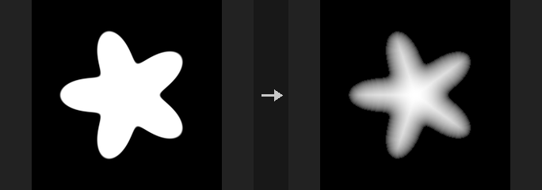
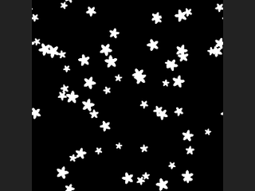
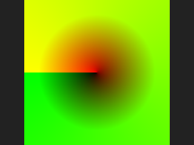

# Image: Geometry and Images

Rasterizing and baking geometry; turning images back into geometry.

16 nodes.

[Back to the reference index](README.md)

## Contents

- [COP Bake Textures (PCG)](#pcg-copbaketextures) — Bakes geometry attributes and, optionally, high-poly detail into textures laid out by the low-poly mesh's UVs.
- [COP Configure Stamps (PCG)](#pcg-copconfigurestamps) — Writes sprite attributes (scale, rotation, colour, alpha, stamp index) onto points for use by stamping nodes.
- [COP Geometry to Layer (PCG)](#pcg-copgeotolayer) — Converts volume primitives of a geometry into image layers by taking a slice, one voxel per pixel.
- [COP HeightField to Mesh (PCG)](#pcg-copheightfieldtomesh) — Converts a height layer into a Y-up grid mesh with one point per pixel center.
- [COP Integrate Volume (PCG)](#pcg-copintegratevolume) — Casts one ray per pixel through a volume primitive and integrates, transmits, or takes the minimum or maximum of its samples.
- [COP Layer from Attribute (PCG)](#pcg-coplayerfromattrib) — Writes a geometry attribute into an image, one element per pixel.
- [COP Layer To Points (PCG)](#pcg-coplayertopoints) — Turns pixels of an image layer into points, sampling chosen layers as point attributes.
- [COP Planar Inflate (PCG)](#pcg-copplanarinflate) — Inflates a mask into a height layer, like a pillow or soap bubble.
- [COP Point Generate (PCG)](#pcg-coppointgenerate) — Adds new points to a point cloud, with the count taken from parameters or from a count attribute.
- [COP Points From Blobs (PCG)](#pcg-coppointsfromblobs) — Converts each connected blob of a mask layer into one point with area, radius and bounding-box attributes.
- [COP Rasterize Curves (PCG)](#pcg-coprasterizecurves) — Draws the primitives of a geometry as anti-aliased lines into an image layer.
- [COP Rasterize Splats (PCG)](#pcg-coprasterizesplats) — Renders 3D Gaussian splat points orthographically onto a plane with front-to-back alpha compositing.
- [COP Scatter Shapes (PCG)](#pcg-copscattershapes) — Stamps copies of a shape into an image, either randomly scattered or placed from input geometry.
- [COP Triplanar (PCG)](#pcg-coptriplanar) — Projects a texture along the three axes using per-pixel world position and normal, blending by normal direction.
- [COP UV Shape (PCG)](#pcg-copuvshape) — Generates interior UV coordinates, UV stretch and a mask for a disk or annulus shape.
- [Render Pass (PCG)](#pcg-renderpass) — Rasterizes geometry through a camera into COP layers: depth, mask, normals and more.

## Nodes

### COP Bake Textures (PCG)

`PCG_COPBakeTextures` · category `PCG/cop` · Houdini: Bake Pre-Process (SOP), Bake Geometry Textures (COP), Bake Geometry Textures 2.0 (COP), Bake Pre-Process (COP)

Bakes geometry attributes and, optionally, high-poly detail into textures laid out by the low-poly mesh's UVs.

The low-poly geometry is rasterized in UV space. Each texel is traced back to its surface point, and the following layers are written: `P` and `N` (world position and normal; the point normal is interpolated, or computed if missing), `mask` (texel is covered by a triangle), `primid` (original primitive number), `tangent` (dP/du, orthogonalised against N), `bitangent` (the third axis of the same frame, with the uv layout's handedness, so detail computed per texel can be written into `normal_ts`'s frame exactly) and every point attribute listed in Attributes, interpolated barycentrically.

When a `high` mesh is connected, a ray is cast from each texel along +-N (or from the cage, see Tracing Mode) to find the high-poly surface. This adds `normal_ts` (high-poly normal expressed in the low-poly tangent space, unencoded -1..1), `displacement` (signed distance along N, positive when the high mesh is outside) and the High Attributes interpolated at the hit point. Optional passes are `worldnormal`, `position`, `occlusion`, `height` and `alpha`. All layers except `mask` are dilated outwards from the UV islands by Dilate texels to avoid mip-map bleeding.

The second output is a JSON report of the bake.

**Inputs**

| Input | Type | Description |
|---|---|---|
| `low` | GEOMETRY | Low-poly geometry. Its UV attribute defines the texture layout. |
| `high` *(optional)* | GEOMETRY | Optional high-poly geometry to bake detail from. Without it only the geometry-derived layers are written. |
| `cage` *(optional)* | GEOMETRY | Optional cage mesh for Tracing Mode `cage_mesh`. It must have the same point count and topology as the low-poly mesh. |

**Outputs**

| Output | Type | Description |
|---|---|---|
| `cop` | COPIMAGE | Image with the baked layers. |
| `report` | STRING | JSON text describing the bake. |

**Parameters**

*Tracer*

| Parameter | Type | Default | Description |
|---|---|---|---|
| Tracing Mode `tracing_mode` | menu | Surface Normal | How rays are cast to the high mesh: `surface_normal` shoots along +-N from the low-poly surface; `cage_mesh` shoots a one-directional ray from the matching cage point towards the low-poly point (needs `cage` and `high`); `single_mesh` casts no main ray and treats the low-poly mesh as the high mesh, which is only useful for passes such as occlusion (no `normal_ts` or `displacement`). Options: Surface Normal (`surface_normal`), Cage Mesh (`cage_mesh`), Single Mesh (low) (`single_mesh`). |
| Resolution `resolution_x` `resolution_y` | int [1..16384] | 512, 512 | Width and height of the baked image in pixels. |
| UV Attribute `uv_attrib` | string | `uv` | Name of the vertex or point UV attribute on the low-poly mesh. |
| Face Culling `face_culling` | menu | No Culling | Ignore main-ray hits on back faces (`back`) or front faces (`front`) of the high mesh. Options: No Culling (`none`), Back Faces (`back`), Front Faces (`front`). *Disabled when tracing_mode = single_mesh.* |
| Visibility Culling `visibility_culling` | menu | No Culling | Same idea for the secondary occlusion rays: ignore hits on back or front faces. Only affects the occlusion pass. Options: No Culling (`none`), Back Faces (`back`), Front Faces (`front`). *Disabled when occlusion is off.* |
| Max Ray Distance `max_distance` | float [0..] | 0 | Maximum ray distance along the normal. 0 means unlimited. Only used when `high` is connected. *Disabled when tracing_mode = single_mesh.* |
| Trace Both Sides `both_sides` | toggle | on | Cast rays both outwards (+N) and inwards (-N). Only used when `high` is connected. *Disabled when tracing_mode ≠ surface_normal.* |
| Ray Bias `ray_bias` | float | 0 | With `surface_normal` tracing, moves the ray origin this far along N. Displacement is still measured from the low-poly surface. *Disabled when tracing_mode ≠ surface_normal.* |
| Sample Multiplier `sample_multiplier` | float [0..64] | 1 | Multiplies the number of occlusion samples (Samples x Sample Multiplier). *Disabled when occlusion is off.* |
| Edge Padding `dilate` | int [0..1024] | 4 | Number of texels the layers are expanded beyond the UV islands. The `mask` layer is not expanded. |

*Texture Maps*

| Parameter | Type | Default | Description |
|---|---|---|---|
| Normal Space `normal_space` | menu | Signed (-1 to 1) | Encoding of `normal_ts`: `signed` keeps -1..1; `offset` stores n*0.5+0.5. Options: Signed (-1 to 1) (`signed`), Offset (0 to 1) (`offset`). |
| World Normal `world_normal` | toggle | off | Also output a `worldnormal` layer: the interpolated high-poly normal at the hit point (the low-poly N where nothing was hit or no high mesh is connected). |
| World Normal Space `world_normal_space` | menu | Signed (-1 to 1) | Encoding of `worldnormal`: `signed` keeps -1..1; `offset` stores n*0.5+0.5. Options: Signed (-1 to 1) (`signed`), Offset (0 to 1) (`offset`). *Hidden when world_normal is off.* |
| Position `position` | toggle | off | Also output a `position` layer: the world position of the hit point (the low-poly surface point where nothing was hit or no high mesh is connected). |
| Position Space `position_space` | menu | Absolute | `absolute` stores world positions; `relative` normalizes them by the bounding box of the low-poly mesh. Options: Absolute (`absolute`), Relative (`relative`). *Hidden when position is off.* |
| Bounding Box `bounding_box` | menu | Fit to Bounding Box | For relative positions: `fit` scales each axis to 0..1 separately; `uniform` uses the longest axis for all axes, centred at 0.5, so proportions are kept. Options: Fit to Bounding Box (`fit`), Fit to Uniform Box (No Stretching) (`uniform`). *Hidden when position is off } { position_space ≠ relative.* |
| Ambient Occlusion `occlusion` | toggle | off | Also output an `occlusion` layer: the fraction of cosine-weighted hemisphere rays from the hit point that are not blocked (1 is fully lit). Rays hit the high mesh, or the low mesh when no high mesh is connected or Tracing Mode is `single_mesh`. |
| Occlusion Samples `occlusion_samples` | int [1..4096] | 16 | Number of hemisphere rays per texel for the occlusion pass, before Sample Multiplier. *Hidden when occlusion is off.* |
| Max Distance `occlusion_max_distance` | float [0..] | 0 | Maximum distance of occlusion rays. 0 means unlimited. *Hidden when occlusion is off.* |
| Height `height` | toggle | off | Also output a `height` layer. |
| Height Space `height_space` | menu | True Displacement | `true_displacement` writes the signed displacement as is; `custom` remaps it so that Inner Distance becomes 0 and Outer Distance becomes 1 (not clamped). Options: True Displacement (`true_displacement`), Custom (`custom`). *Hidden when height is off.* |
| Inner Distance `inner_distance` | float | -0.1 | Displacement value mapped to 0 when Height Space is `custom`. *Hidden when height is off } { height_space ≠ custom.* |
| Outer Distance `outer_distance` | float | 0.1 | Displacement value mapped to 1 when Height Space is `custom`. *Hidden when height is off } { height_space ≠ custom.* |
| Alpha `alpha` | toggle | off | Also output an `alpha` layer: the low-poly UV coverage (same as `mask`). |
| Mask Out High Resolution Mesh `alpha_mask_high` | toggle | off | Alpha is 1 only for texels whose main ray hit the high mesh. *Hidden when alpha is off.* |
| Attributes `attribs` | string | *(empty)* | Space-separated point attributes of the low-poly mesh to bake into layers. |
| High Attributes `high_attribs` | string | *(empty)* | Space-separated point attributes of the high-poly mesh to bake, interpolated at the hit point. Only used when `high` is connected. |

**Compared with Houdini**

Covers Bake Geometry Textures (2.0) and Bake Pre-Process in one node. Tangent-space normals are written unencoded (-1..1) by default; encode them with COP Convert Normal if a game engine needs it.

**Tips**

- Keep Dilate at a few texels or more if the texture will be mip-mapped, otherwise island borders bleed.

---

### COP Configure Stamps (PCG)

`PCG_COPConfigureStamps` · category `PCG/cop` · Houdini: Configure Stamps (COP)

Writes sprite attributes (scale, rotation, colour, alpha, stamp index) onto points for use by stamping nodes.

Does not draw anything. It writes per-point attributes: `spritescale` (2 values), `spriterot` (degrees), `Cd` (colour), `blend` (alpha) and `stamp` (integer index of the stamp), and moves `P` with Jitter. Each property can be driven by a layer from the `layers` input, sampled at the point's position, and multiplied by a Mask amount, and can be randomized with Uniform, Variance or Min / Max modes. Randomness is a per-point hash of the point number and the relevant seed.

Points are mapped to layer uv using Plane and World Size (image width equals World Size, origin at the centre), the same convention as Layer to Points and Scatter Shapes. If any layer name is set, the `layers` input must be connected. A layer value blends the base value as `base * (1 + (layer - 1) * mask)`.

Details: Scale `percent_variance` multiplies by `1 + variance * r` and `min_max` by a random value between Min and Max; Stretch works the same per axis. Angle is `Angle + AngleLayer * 360 * mask + atan2(direction.y, direction.x) * direction mask`, then variance or min/max, and finally rounded to a multiple of Round To when that is above 0. Colour variance acts in HSV (hue wraps, saturation and value are clamped). Stamp selection: `cycle` uses point number modulo Stamp Count, `random` picks randomly, `layer_select` rounds layer value * (count - 1) and clamps.

**Inputs**

| Input | Type | Description |
|---|---|---|
| `points` | GEOMETRY | Points to receive the attributes. |
| `layers` *(optional)* | COPIMAGE | Optional image whose layers drive the properties. Required when any layer name field is filled in. |

**Outputs**

| Output | Type | Description |
|---|---|---|
| `points` | GEOMETRY | The points with `spritescale`, `spriterot`, `Cd`, `blend` and `stamp` set and `P` jittered. |

**Parameters**

| Parameter | Type | Default | Description |
|---|---|---|---|
| Seed `rand_seed` | int [0..] | 0 | Seed for the random jitter, scale, stretch and angle variation. |
| Plane `plane` | menu | XZ Plane | Plane in which the layers are projected onto the points: `xz` (top view), `xy` or `zy`. It also decides which two axes Jitter moves. Options: XZ Plane (`xz`), XY Plane (`xy`), ZY Plane (`zy`). |
| World Size `world_size` | float [1e-06..] | 1 | World width covered by the image width when sampling layers (origin at the centre). |

*Jitter*

| Parameter | Type | Default | Description |
|---|---|---|---|
| Jitter `jitter` | float [0..] | 0 | Random displacement of P in the two plane axes, in world units. Each point gets a random value in -1..1 multiplied by this. |
| Jitter Scale `jitter_scale` | string | `1 1` | Per-axis multiplier (X Y) of the random jitter. |
| Jitter Layer `jitter_layer` | string | *(empty)* | Optional layer (first two channels) added to the displacement, in world units. |
| Jitter Layer Mask `jitter_mask` | float | 1 | Amount of Jitter Layer that is added. *Disabled when jitter_layer = "".* |

*Scale*

| Parameter | Type | Default | Description |
|---|---|---|---|
| Scale `scale` | float [0..] | 1 | Uniform sprite scale. |
| Scale Mode `scale_mode` | menu | Uniform | `uniform`: the same scale for all points. `percent_variance`: scale varies by +-Scale Variance (as a fraction). `min_max`: scale is multiplied by a random value between Scale Min and Scale Max. Options: Uniform (`uniform`), Percent Variance (`percent_variance`), Min/Max (`min_max`). |
| Scale Variance `scale_variance` | float [0..1000.0] | 0 | Variation of scale in `percent_variance` mode; 0.2 means up to +-20%. *Hidden when scale_mode ≠ percent_variance.* |
| Min Value `scale_min` | float | 0.5 | Lower bound of the random multiplier in `min_max` mode. *Hidden when scale_mode ≠ min_max.* |
| Max Value `scale_max` | float | 1 | Upper bound of the random multiplier in `min_max` mode. *Hidden when scale_mode ≠ min_max.* |
| Scale Layer `scale_layer` | string | *(empty)* | Optional layer that modulates the scale at each point. |
| Scale Layer Mask `scale_mask` | float | 1 | Strength of the layer modulation. 0 ignores the layer, 1 multiplies the full layer value. *Disabled when scale_layer = "".* |

*Stretch*

| Parameter | Type | Default | Description |
|---|---|---|---|
| Stretch `stretch` | string | `1 1` | Non-uniform scale (X Y) applied on top of Scale. |
| Stretch Mode `stretch_mode` | menu | Uniform | `uniform`: no randomness. `variance`: each axis varies by +-Stretch Variance. `min_max`: each axis is multiplied by a random value between Stretch Min and Stretch Max. Options: Uniform (`uniform`), Variance (`variance`), Min/Max (`min_max`). |
| Stretch Variance `stretch_variance` | float [0..1000.0] | 0 | Variation of each stretch axis in `variance` mode. *Hidden when stretch_mode ≠ variance.* |
| Min Value `stretch_min` | float | 0.5 | Lower bound of the random multiplier in `min_max` mode. *Hidden when stretch_mode ≠ min_max.* |
| Max Value `stretch_max` | float | 1 | Upper bound of the random multiplier in `min_max` mode. *Hidden when stretch_mode ≠ min_max.* |
| Stretch Layer `stretch_layer` | string | *(empty)* | Optional layer that modulates the stretch. A single-channel layer is used for both axes. |
| Stretch Layer Mask `stretch_mask` | float | 1 | Strength of the layer modulation. *Disabled when stretch_layer = "".* |

*Angle*

| Parameter | Type | Default | Description |
|---|---|---|---|
| Angle `angle` | float | 0 | Base rotation in degrees. |
| Angle Mode `angle_mode` | menu | Uniform | `uniform`: no randomness. `variance`: adds a random value of up to +-Angle Variance degrees. `min_max`: multiplies the angle by a random value between Angle Min and Angle Max. Options: Uniform (`uniform`), Variance (`variance`), Min/Max (`min_max`). |
| Angle Variance `angle_variance` | float [0..] | 0 | Range of the random rotation in degrees in `variance` mode. *Hidden when angle_mode ≠ variance.* |
| Min Value `angle_min` | float | 0 | Lower bound of the random multiplier in `min_max` mode. *Hidden when angle_mode ≠ min_max.* |
| Max Value `angle_max` | float | 1 | Upper bound of the random multiplier in `min_max` mode. *Hidden when angle_mode ≠ min_max.* |
| Round To `round_to` | float [0..360] | 0 | Rounds the final angle to a multiple of this value in degrees. 0 means no rounding. |
| Angle Layer `angle_layer` | string | *(empty)* | Optional layer that adds to the angle: 0 gives 0 degrees, 1 gives 360 degrees. |
| Angle Layer Mask `angle_mask` | float | 1 | Strength of the angle layer. *Disabled when angle_layer = "".* |
| Direction Layer `direction_layer` | string | *(empty)* | Optional two-channel vector layer; the angle of the vector (atan2 of y and x) is added to the rotation. |
| Direction Layer Mask `direction_mask` | float | 1 | Strength of the direction contribution. *Disabled when direction_layer = "".* |

*Color and Blending*

| Parameter | Type | Default | Description |
|---|---|---|---|
| Sort Layer `sort_layer` | string | *(empty)* | Layer whose value is added to the coordinate perpendicular to the plane, a small offset that controls draw order. Used when Use Sort Layer is on. *Disabled when use_sort_layer is off.* |
| Use Sort Layer `use_sort_layer` | toggle | off | Enables the Sort Layer offset. |
| Color `color` | string | `1 1 1` | Base colour written to `Cd`. |
| Stamp Color `color_mode` | menu | Uniform | `uniform`: the same colour for all points. `variance`: random variation in hue, saturation and value. Options: Uniform (`uniform`), Variance (`variance`). |
| Color Seed `color_seed` | int [0..] | 0 | Seed for the colour and alpha variation. *Disabled when color_mode = uniform alpha_mode = uniform.* |
| Hue `hue_variance` | float [0..1] | 0 | Random hue change (as a fraction of the colour wheel) in `variance` mode. *Hidden when color_mode ≠ variance.* |
| Saturation `saturation_variance` | float [0..1] | 0 | Random saturation change in `variance` mode. *Hidden when color_mode ≠ variance.* |
| Value `value_variance` | float [0..1] | 0 | Random value (brightness) change in `variance` mode. *Hidden when color_mode ≠ variance.* |
| Color Layer `color_layer` | string | *(empty)* | Optional colour layer that multiplies the base colour. |
| Color Layer Mask `color_mask` | float | 1 | Strength of the colour layer. *Disabled when color_layer = "".* |

*Alpha*

| Parameter | Type | Default | Description |
|---|---|---|---|
| Alpha `alpha` | float [0..1] | 1 | Base opacity written to `blend`. |
| Stamp Alpha `alpha_mode` | menu | Uniform | `uniform`: the same alpha for all points. `variance`: random variation. Options: Uniform (`uniform`), Variance (`variance`). |
| Alpha Variance `alpha_variance` | float [0..1] | 0 | Random alpha change in `variance` mode (result is clamped to 0..1). *Hidden when alpha_mode ≠ variance.* |
| Alpha Layer `alpha_layer` | string | *(empty)* | Optional layer that modulates the alpha. |
| Alpha Layer Mask `alpha_mask` | float | 1 | Strength of the alpha layer. *Disabled when alpha_layer = "".* |

*Stamp Selection*

| Parameter | Type | Default | Description |
|---|---|---|---|
| Stamp Count `stamp_count` | int [1..] | 1 | Number of different stamps available for selection. |
| Mode `select_mode` | menu | Cycle | How the `stamp` index is chosen: `cycle` (point number modulo count), `random`, or `layer_select` (from a layer value, 0 = first stamp, 1 = last). Options: Cycle (`cycle`), Random (`random`), Layer Select (`layer_select`). |
| Select Seed `select_seed` | int [0..] | 0 | Seed of the random stamp choice. *Hidden when select_mode ≠ random.* |
| Select Layer `select_layer` | string | *(empty)* | Layer used by `layer_select` mode. Required for that mode. *Hidden when select_mode ≠ layer_select.* |

**Compared with Houdini**

Random-from-ramp options for colour and alpha are not implemented. Scatter Shapes in this plugin is a rasterizing stamp and reads `pscale` and `Cd`, not `spritescale`, so the attributes written here are meant for Stamp Points style nodes.

---

### COP Geometry to Layer (PCG)

`PCG_COPGeoToLayer` · category `PCG/cop` · Houdini: Geometry to Layer (COP)

Converts volume primitives of a geometry into image layers by taking a slice, one voxel per pixel.

Equivalent of Geometry to Layer. Each requested volume becomes one layer named after its primitive (`output<N>` if it has no name). 3D volumes are sliced in the chosen plane at the given offset, with one voxel mapped to one pixel. Names with a wildcard such as `vel.*` collect the matching volumes, sorted by name, into one multi-channel layer named without the `.*`.

All outputs must have the same resolution, since layers in one image share a resolution. With `optional` on, a requested volume that cannot be found is filled with the default value using the resolution of the `size_ref` image instead of raising an error.

**Inputs**

| Input | Type | Description |
|---|---|---|
| `geo` | GEOMETRY | Geometry containing the volume primitives to convert. |
| `size_ref` *(optional)* | COPIMAGE | Image whose resolution is used when an optional output is missing. |

**Outputs**

| Output | Type | Description |
|---|---|---|
| `cop` | COPIMAGE | Image with one layer per converted output. |

**Parameters**

| Parameter | Type | Default | Description |
|---|---|---|---|
| Slice `slice` | menu | XY Plane | Plane through the 3D volume: XY, YZ or ZX. Options: XY Plane (`xy`), YZ Plane (`yz`), ZX Plane (`zx`). |
| Slice Offset `slice_offset` | float | 0 | Position of the slice plane along its normal, in world coordinates. |
| Primitive Names `outputs` | string | *(empty)* | Space-separated list of what to convert: primitive names, volume indices, or wildcard names such as `vel.*` that are merged into one multi-channel layer. Empty converts every volume, one layer each. |
| Type `out_type` | menu | Auto | Channel layout of the layers: `auto` uses the number of matched volumes; `id` (1 channel, rounded to integers), `mono` (1), `uv` (2), `rgb` (3), `rgba` (4) truncate or pad with zeros. Options: Auto (`auto`), ID (`id`), Mono (`mono`), UV (`uv`), RGB (`rgb`), RGBA (`rgba`). |
| Optional `optional` | toggle | off | Do not error when a requested output is missing; fill it with the default value at the size of `size_ref`. |
| Default Value `default_value` | string | `0` | Value used for missing optional outputs. *Disabled when optional is off.* |

**Compared with Houdini**

VDB and camera primitives are not supported. The Slice Offset parameter is an extension; Houdini's node has no offset. Houdini outputs can have independent resolutions, while here all layers of one image share one.

---

### COP HeightField to Mesh (PCG)

`PCG_COPHeightfieldToMesh` · category `PCG/cop` · Houdini: Layer to Geometry (COP)

Converts a height layer into a Y-up grid mesh with one point per pixel center.

Each pixel center becomes a point; `step` thins the grid by taking every Nth pixel without resampling, so each point holds the exact pixel value. Mesh width is `world_size` and height is the layer value times `strength`.

v points toward -Z (north), so the height map reads correctly in a Houdini-style top view (X right, Z down). Points carry `uv` (pixel center, matching COP sampling) and `height`, so a later Scatter from Map or Attribute from Map lines up exactly with the terrain.

Point normals come from the height gradient (the same operator as COP Height to Normal), not from averaging mesh faces. Other layers can be carried over as point attributes.

**Inputs**

| Input | Type | Description |
|---|---|---|
| `cop` | COPIMAGE | Image containing the height layer and any layers to carry over. |

**Outputs**

| Output | Type | Description |
|---|---|---|
| `geo` | GEOMETRY | Grid mesh with `P`, `N`, `uv` and `height`. |

**Parameters**

| Parameter | Type | Default | Description |
|---|---|---|---|
| Height Layer `layer` | string | `C` | Height layer. |
| Height Scale `strength` | float [-10000.0..10000.0] | 1 | Height scale: layer value times Strength gives mesh height. |
| World Size `world_size` | float [1e-06..] | 1 | World-space width of the mesh. |
| Step `step` | int [1..1024] | 1 | Take every Nth pixel as a point, without resampling. At least 2 points per axis must remain. |
| Center at Origin `center` | toggle | on | Place the mesh center at the origin. |
| Compute Normals `normals` | toggle | on | Compute point normals from the height gradient. |
| Layers to Attributes `attribs` | string | *(empty)* | Space-separated layers to bring in as point attributes. Use `dst=src` to rename, for example `Cd=C erosion`. |

---

### COP Integrate Volume (PCG)

`PCG_COPIntegrateVolume` · category `PCG/cop` · Houdini: Integrate Volume (COP)

Casts one ray per pixel through a volume primitive and integrates, transmits, or takes the minimum or maximum of its samples.

For every pixel a view ray marches through the volume and produces one of:

- **Integral**: the line integral of density times step length.
- **Transmittance**: `exp(-integral)`.
- **Minimum / Maximum**: the smallest or largest raw sample value along the ray (not mapped through the density settings). A ray that never touches the volume gives +inf (minimum) or -inf (maximum).

By default the view is orthographic: the pixel centre in image coordinates (long side -1 to 1) gives the x, y of a ray that runs along +Z over the whole line, with no start cut-off. If the `layers` input is connected and View Origin or View Direction layer names are given, each pixel uses its own ray (starting at the origin, `t >= 0`); Min Depth and Max Depth layers restrict the ray to a distance range.

For Integral and Transmittance the sample is remapped as `(v - Min) / (Max - Min)`, clamped to 0-1 (Clamped Ramp) or wrapped to its fractional part (Periodic Ramp), then multiplied by Density Scale. The ray is clipped to the volume's bounding box and cut into slices of Integration Step Size, one sample per slice; the last slice may be shorter and is weighted by its real length. Several volumes selected at once (such as `vel.*`) become channels, each accumulated separately.

**Inputs**

| Input | Type | Description |
|---|---|---|
| `geo` | GEOMETRY | Geometry containing the volume primitive(s) to integrate. |
| `layers` *(optional)* | COPIMAGE | Optional image supplying per-pixel view origin, direction and depth-range layers. Without it the output uses Resolution and the default orthographic view. |

**Outputs**

| Output | Type | Description |
|---|---|---|
| `cop` | COPIMAGE | Image with the result in the output layer, one channel per integrated volume. It is added to `layers` when connected, otherwise a new image of the given Resolution. |

**Parameters**

| Parameter | Type | Default | Description |
|---|---|---|---|
| Volume `density` | string | *(empty)* | Which volume to integrate: a volume name, an index, or a name pattern such as `vel.*` (several volumes make a multichannel result). Empty uses the first volume. |
| Operation `operation` | menu | Integral | Quantity computed along each ray. Options: Integral (`integral`), Transmittance (`transmittance`), Minimum (`minimum`), Maximum (`maximum`). |

*Density*

| Parameter | Type | Default | Description |
|---|---|---|---|
| Density Scale `density_scale` | float [0..] | 1 | Multiplier applied to the remapped density (Integral and Transmittance only). *Disabled when operation = minimum } { operation = maximum.* |
| Min `density_min` | float | 0 | Sample value that maps to 0 before scaling. *Disabled when operation = minimum } { operation = maximum.* |
| Max `density_max` | float | 1 | Sample value that maps to 1 before scaling. Must differ from Min. *Disabled when operation = minimum } { operation = maximum.* |
| Ramp Mode `ramp_mode` | menu | No Ramp | How the remapped value is treated outside 0-1: left alone, clamped, or wrapped periodically. Only the clamp and wrap steps are implemented; there is no density ramp curve. Options: No Ramp (`none`), Clamped Ramp (`clamped`), Periodic Ramp (`periodic`). *Disabled when operation = minimum } { operation = maximum.* |

*Quality*

| Parameter | Type | Default | Description |
|---|---|---|---|
| Sample Jitter Scale `sample_jitter` | float [0..1] | 0 | Randomly shifts each sample inside its slice, as a fraction of the step, to hide banding. 0 samples at the slice centre. |
| Stratification Jitter Scale `stratification_jitter` | float [0..1] | 0 | Randomly shifts the start of the whole ray by up to half a step (at 1), decorrelating neighbouring rays. |
| Seed `rand_seed` | int [0..] | 0 | Seed for both jitters. *Disabled when sample_jitter = 0 stratification_jitter = 0.* |
| Integration Step Size `step_size` | float [1e-06..] | 0.01 | Length of each ray slice in volume space units. Smaller values are more accurate and slower. |
| Max Step Count `max_steps` | int [1..] | 4096 | Maximum number of slices per ray. |
| Transmittance Cutoff `transmittance_cutoff` | float [-1..1] | -1 | Stop marching a ray once its transmittance drops below this value (all channels must). -1 never stops early. *Disabled when operation = minimum } { operation = maximum.* |

*Rays*

| Parameter | Type | Default | Description |
|---|---|---|---|
| View Origin Layer `origin_layer` | string | *(empty)* | Layer in the `layers` input holding the ray origin per pixel. Empty uses the default orthographic view. |
| View Direction Layer `direction_layer` | string | *(empty)* | Layer in the `layers` input holding the ray direction per pixel (normalized by the node). Empty uses +Z. |
| Min Depth Layer `mindepth_layer` | string | *(empty)* | Layer in the `layers` input giving the ray distance at which integration starts. |
| Max Depth Layer `maxdepth_layer` | string | *(empty)* | Layer in the `layers` input giving the ray distance at which integration ends. |

| Parameter | Type | Default | Description |
|---|---|---|---|
| Resolution `resolution_x` `resolution_y` | int [1..16384] | 512, 512 | Output width and height in pixels. Used only when `layers` is not connected. |
| Output Layer `out_layer` | string | `result` | Name of the result layer. |

**Compared with Houdini**

Houdini works on VDB volumes; this node works on the plugin's dense volume primitives. The Density Ramp curve is not implemented (the ramp modes only clamp or wrap).

---

### COP Layer from Attribute (PCG)

`PCG_COPLayerFromAttrib` · category `PCG/cop` · Houdini: Layer from Attribute (COP)

Writes a geometry attribute into an image, one element per pixel.

Element k of the chosen attribute is stored in pixel k. The order is set by Data Ordering, or, if the `index` input is connected, every pixel reads the element number found in the Index Layer. The output layer has as many channels as the attribute has components; a detail attribute counts as one element.

With Resize Layer off, the resolution comes from `size_ref` (or Resolution when it is not connected) and the layer is added to `size_ref`. With Resize Layer on, the resolution is derived from the element count using Resize Shape and the output contains only this layer.

If there are more pixels than elements the extra pixels are 0; extra elements are dropped. Index values outside the attribute range (including negative) give 0. The `index` image must have the same resolution as the output.

**Inputs**

| Input | Type | Description |
|---|---|---|
| `geo` | GEOMETRY | Geometry that owns the attribute. |
| `size_ref` *(optional)* | COPIMAGE | Optional image that defines the output resolution; the result is added to it. |
| `index` *(optional)* | COPIMAGE | Optional image whose Index Layer gives, per pixel, which attribute element to read. |

**Outputs**

| Output | Type | Description |
|---|---|---|
| `cop` | COPIMAGE | Image with the attribute stored in the output layer. |

**Parameters**

| Parameter | Type | Default | Description |
|---|---|---|---|
| Class `attrib_class` | menu | Point | Attribute class to read from. Options: Point (`point`), Primitive (`prim`), Vertex (`vertex`), Detail (`detail`). |
| Attribute `attrib` | string | `Cd` | Name of the attribute. |
| Data Ordering `data_ordering` | menu | Bottom Left | Pixel order when no `index` is connected. Bottom Left fills from the bottom-left, left to right then upwards (the canonical COP order); Top Left starts at the top-left and goes downwards. Options: Bottom Left (`bottom_left`), Top Left (`top_left`). |
| Index Layer `index_layer` | string | *(empty)* | Layer of the `index` input to read element numbers from. Empty uses `C`. |
| Resize Layer `resize_layer` | toggle | off | Derive the resolution from the number of elements instead of using `size_ref` or Resolution. |
| Resize Shape `resize_shape` | menu | Power of 2 Square | Shape used with Resize Layer: a power-of-two square, the smallest square that fits, or a single row or column. Options: Power of 2 Square (`pow2_square`), Square (`square`), Single Row (`single_row`), Single Column (`single_column`). *Disabled when resize_layer is off.* |
| Resolution `resolution_x` `resolution_y` | int [1..16384] | 512, 512 | Output width and height in pixels. Used only when `size_ref` is not connected and Resize Layer is off. *Disabled when resize_layer is on.* |
| Output Layer `out_layer` | string | `attrib` | Name of the layer that receives the data. |

---

### COP Layer To Points (PCG)

`PCG_COPLayerToPoints` · category `PCG/cop` · Houdini: Layer to Points (COP)

Turns pixels of an image layer into points, sampling chosen layers as point attributes.

Each point also gets a `uv` attribute (its position on the image). Positions use the same plane + world mapping as HeightField to Mesh: the image width equals World Size, and Height Layer, if given, sets the coordinate on the axis perpendicular to the plane (Y for the XZ plane) to value times Height Scale. Layers listed in Layers to Attributes are sampled at each point's pixel and written as point attributes (`C` becomes `Cd`).

Methods:
- **One Point per Pixel**: a point at every pixel centre, thinned by Stride and filtered by Mask Layer (pixels where the mask is greater than Threshold are kept).
- **Scatter by Density**: Point Count random points, accepted in proportion to the Density Layer (uniform when empty). Positions are continuous inside the image, not only at pixel centres.
- **Houdini-style methods** read the Mask Layer as their source layer (empty uses `C`; the first channel is the value, except Non-Zero Pixels, which looks at all channels): *Non-Zero Pixels* gives a point for every non-zero pixel; *Count per Pixel* gives `floor(value)` points per pixel; *Unique Values* gives one point per distinct value, placed on the first pixel (lowest buffer offset) that holds it, optionally ignoring -1; *Count from First Pixel* and *Count from Last Pixel* take the total number of points from the first or last pixel's value. Those points are all at the origin because they have no pixel position, but `uv` and attributes come from the source pixel.

Output points are ordered by buffer offset `x + y*xres`, with row 0 at the bottom.

**Inputs**

| Input | Type | Description |
|---|---|---|
| `cop` | COPIMAGE | Image to read pixels from. |

**Outputs**

| Output | Type | Description |
|---|---|---|
| `geo` | GEOMETRY | Point geometry with `uv` and the requested attributes. |

**Parameters**

| Parameter | Type | Default | Description |
|---|---|---|---|
| Method `mode` | menu | One Point per Pixel | How points are chosen; see the description. Options: One Point per Pixel (`pixels`), Scatter by Density (`scatter`), Non-Zero Pixels (`nonzero`), Count per Pixel (`count_per_pixel`), Unique Values (`unique_values`), Count from First Pixel (`count_first`), Count from Last Pixel (`count_last`). |
| Mask Layer `mask_layer` | string | *(empty)* | One Point per Pixel: layer used as a mask (empty keeps all pixels). Houdini-style methods: the source layer (empty uses `C`). *Hidden when mode = scatter.* |
| Threshold `threshold` | float | 0.5 | Pixels whose mask value is greater than this are kept (One Point per Pixel). *Hidden when mode ≠ pixels.* *Disabled when mask_layer = "".* |
| Stride `stride` | int [1..4096] | 1 | Keep one pixel out of every Stride in each direction (One Point per Pixel). *Hidden when mode ≠ pixels.* |
| Jitter `jitter` | float [0..1] | 0 | Randomly displaces points inside their pixel (or stride cell) by up to this fraction. Not applied to Scatter or to the Count from First/Last methods. *Hidden when mode = scatter } { mode = count_first } { mode = count_last.* |
| Point Count `count` | int [0..] | 1000 | Number of points to scatter (Scatter by Density). A sparse density layer can yield fewer. *Hidden when mode ≠ scatter.* |
| Density Layer `density_layer` | string | *(empty)* | Layer giving the scatter density. Empty scatters uniformly. *Hidden when mode ≠ scatter.* |
| Ignore Minus One `ignore_minus_one` | toggle | on | Unique Values: do not create a point for the value -1. *Hidden when mode ≠ unique_values.* |
| Seed `rand_seed` | int [0..] | 0 | Seed for jitter and scattering. *Disabled when mode ≠ scatter jitter = 0 } { mode = count_first } { mode = count_last.* |
| Set Positions `set_positions` | toggle | on | When off, all points are placed at the origin (Height Layer is not read), while `uv` and attributes are still written. *Disabled when mode = count_first } { mode = count_last.* |
| Plane `plane` | menu | XZ Plane | Plane the image is laid on in 3D. Options: XZ Plane (`xz`), XY Plane (`xy`), ZY Plane (`zy`). *Disabled when set_positions is off } { mode = count_first } { mode = count_last.* |
| World Size `world_size` | float [1e-06..] | 1 | World width of the whole image. *Disabled when set_positions is off } { mode = count_first } { mode = count_last.* |
| Height Layer `height_layer` | string | *(empty)* | Layer used for the coordinate along the axis perpendicular to the plane. Empty leaves it at 0. *Disabled when set_positions is off } { mode = count_first } { mode = count_last.* |
| Height Scale `height_scale` | float | 1 | Multiplier applied to Height Layer values. *Disabled when height_layer = "" } { set_positions is off } { mode = count_first } { mode = count_last.* |
| Layers to Attributes `attribs` | string | `C` | Space-separated layers to sample into point attributes (`C` becomes `Cd`). Empty writes none. |
| Layer Attrib `layer_attrib` | string | *(empty)* | Name of an integer point attribute that receives the source pixel's value. Empty does not write it. |
| Index Attrib `index_attrib` | string | *(empty)* | Name of an integer point attribute that receives the source pixel offset `x + y*xres`. Empty does not write it. |

**Compared with Houdini**

The first two methods (One Point per Pixel, Scatter by Density) are specific to this plugin; the other five follow Houdini's Method menu.

---

### COP Planar Inflate (PCG)

`PCG_COPPlanarInflate` · category `PCG/cop` · Houdini: Planar Inflate (COP)

Inflates a mask into a height layer, like a pillow or soap bubble.

Pixels of the mask above 0.5 are inflated, and the result is normalized so the highest point equals Height. It is a good starting point for relief, bevelled text and normal maps. An empty mask gives an error.

- **Round**: a circular-arc profile `h = sqrt(2Rd - d^2) / R`, where d is the distance to the boundary and R the largest inner distance. Edges are vertical and the middle is a flat top, like a pillow.
- **Poisson (Soap Bubble)**: solves `laplacian(h) = -1` with h = 0 on the boundary, using a coarse-to-fine Jacobi solver.

**Inputs**

| Input | Type | Description |
|---|---|---|
| `cop` | COPIMAGE | Image containing the mask layer. |

**Outputs**

| Output | Type | Description |
|---|---|---|
| `cop` | COPIMAGE | Image with the height layer added. |

**Parameters**

| Parameter | Type | Default | Description |
|---|---|---|---|
| Mask Layer `layer` | string | `mask` | Mask layer. Pixels above 0.5 are inflated. |
| Profile `mode` | menu | Round | Shape of the profile; see the description. Options: Round (`round`), Poisson (Soap Bubble) (`poisson`). |
| Height `height` | float | 1 | Height of the highest point. |
| Iterations `iterations` | int [1..] | 200 | Poisson mode: Jacobi iterations per resolution level. More gives a more converged result. Round mode ignores it. *Hidden when mode = round.* |
| Output Layer `out_layer` | string | `height` | Name of the height layer. |

---

### COP Point Generate (PCG)

`PCG_COPPointGenerate` · category `PCG/cop` · Houdini: Point Generate (COP)

Adds new points to a point cloud, with the count taken from parameters or from a count attribute.

The number of new points comes from one of three sources:
- **Parameters**: `Number of Points + Points per Second * Time Step`. Any fractional part is rounded up or down at random according to Seed. The two terms are added, which is this plugin's reading of Houdini's behaviour.
- **Point Attribute**: each source point is copied `floor(count)` times (negative counts give none). Point attributes matching Copy Attributes are copied from the source point; all other attributes of the new points are 0.
- **Detail Attribute**: an integer detail attribute gives the count (floored; the fractional part is not randomized).

The source is `ref` when connected, otherwise `points`. New points sit at the origin unless `P` is copied. If `points` has an `id` attribute, new points continue the numbering from the detail attribute `nextid` (updated afterwards) when present, otherwise from `max(id) + 1`, with a step of the detail attribute `idstep` or 1. With Append Points on, the output is the input points (primitives are discarded) plus the new points.

**Inputs**

| Input | Type | Description |
|---|---|---|
| `points` *(optional)* | GEOMETRY | Point cloud the new points are added to. Optional. |
| `ref` *(optional)* | GEOMETRY | Optional geometry that supplies the count attribute and the attributes to copy. When not connected, `points` is used. |

**Outputs**

| Output | Type | Description |
|---|---|---|
| `points` | GEOMETRY | Points, with the new points appended (or only the new points when Append Points is off). |

**Parameters**

| Parameter | Type | Default | Description |
|---|---|---|---|
| Method `method` | menu | Parameters | Where the point count comes from. Options: Parameters (`parameters`), Point Attribute (`point_attribute`), Detail Attribute (`detail_attribute`). |
| Number of Points `number_of_points` | int [0..] | 10 | Parameters method: number of points to add. *Hidden when method ≠ parameters.* |
| Points per Second `points_per_second` | float [0..] | 0 | Parameters method: rate multiplied by Time Step and added to Number of Points. *Hidden when method ≠ parameters.* |
| Time Step `time_step` | float [0..] | 0.0416667 | Parameters method: time in seconds used with Points per Second. Houdini uses the simulation time step; there is no simulation here, so it is a parameter (default 1/24). *Hidden when method ≠ parameters.* *Disabled when points_per_second = 0.* |
| Seed `rand_seed` | int [0..] | 0 | Seed for the random rounding of a fractional count. *Hidden when method ≠ parameters.* |
| Count Attribute `count_attrib` | string | `count` | Name of the point or detail attribute that holds the count (Point Attribute and Detail Attribute methods). *Hidden when method = parameters.* |
| Copy Attributes `copy_attribs` | string | `*` | Point Attribute method: pattern of point attributes copied from the source points to their new copies. *Hidden when method ≠ point_attribute.* |
| Append Points `append_points` | toggle | on | Keep the input points and append the new points. When off, only the new points are output (with the input's attribute definitions). |

**Compared with Houdini**

Time Step is an explicit parameter because the plugin has no simulation time. Houdini's Layer to Points is a different node (see COP Layer To Points).

---

### COP Points From Blobs (PCG)

`PCG_COPPointsFromBlobs` · category `PCG/cop` · Houdini: Points from Blobs (COP)

Converts each connected blob of a mask layer into one point with area, radius and bounding-box attributes.

Thresholds the mask layer, labels its connected components and emits one point per blob at the blob's centroid. Each point carries `area` (pixels), `world_area`, `radius` (radius of the circle with the same area, usable directly as `pscale`), `blob_id` and the blob's bounding box. If a Value Layer is given, the mean of that layer inside the blob is written as an extra point attribute.

The second output is the number of blobs that survived the Min Area filter.

**Inputs**

| Input | Type | Description |
|---|---|---|
| `cop` | COPIMAGE | Image containing the mask layer (and optionally the value layer). |

**Outputs**

| Output | Type | Description |
|---|---|---|
| `geo` | GEOMETRY | Point cloud with one point per blob. |
| `count` | INT | Number of blobs (points). |

**Parameters**

| Parameter | Type | Default | Description |
|---|---|---|---|
| Mask Layer `layer` | string | `mask` | Layer used as the mask. |
| Threshold `threshold` | float | 0.5 | Pixels with a mask value above this are part of a blob. |
| Connectivity `connectivity` | menu | 8 (Include Diagonals) | Whether diagonal neighbours connect pixels into the same blob (8) or only edge neighbours (4). Options: 8 (Include Diagonals) (`8`), 4 (Edges Only) (`4`). |
| Min Area `min_area` | int [1..] | 1 | Blobs smaller than this many pixels are discarded. |
| Value Layer `value_layer` | string | *(empty)* | Optional layer whose mean inside each blob is written to the point as an attribute. Empty disables it. |
| Plane `plane` | menu | XZ Plane | World plane the image is mapped onto when computing point positions. Options: XZ Plane (`xz`), XY Plane (`xy`), ZY Plane (`zy`). |
| World Size `world_size` | float [1e-06..] | 1 | World-space size of the image along its longer side; scales positions, `world_area` and `radius`. |
| Height Layer `height_layer` | string | *(empty)* | Optional layer sampled at each centroid to set the point's height on the axis perpendicular to the plane. Empty keeps the points flat. |
| Height Scale `height_scale` | float | 1 | Multiplier applied to the sampled height. *Disabled when height_layer = "".* |

**Tips**

- Feed `radius` into a copy-to-points step as `pscale` to place a shape matching each blob's size.

---

### COP Rasterize Curves (PCG)

`PCG_COPRasterizeCurves` · category `PCG/cop` · Houdini: Layer from Curves (COP), Mask from Curves (COP), Rasterize Curves (COP)

Draws the primitives of a geometry as anti-aliased lines into an image layer.

Each primitive is drawn as a polyline with the given pixel width; the width can be multiplied per point by an attribute. With Fill enabled, closed curves are filled using the even-odd rule. A Rasterize Attribute is interpolated along the lines into an additional layer.

**Inputs**

| Input | Type | Description |
|---|---|---|
| `geo` | GEOMETRY | Geometry whose primitives are drawn. |
| `cop` *(optional)* | COPIMAGE | Optional image providing the resolution. |

**Outputs**

| Output | Type | Description |
|---|---|---|
| `cop` | COPIMAGE | Image with the curves layer. |

**Parameters**

| Parameter | Type | Default | Description |
|---|---|---|---|
| Width (Pixels) `width` | float [0..4096] | 2 | Line width in pixels. |
| Width Attribute `width_attrib` | string | *(empty)* | Point attribute (for example `pscale` or `width`) multiplied onto Width. Empty disables it. |
| Fill Closed Curves `fill` | toggle | off | Fills closed curves with the even-odd rule. Open curves are never filled. |
| Rasterize Attribute `attrib` | string | *(empty)* | Attribute interpolated along the lines into an extra layer named `<Output Layer>_<attribute>`. |

*Projection*

| Parameter | Type | Default | Description |
|---|---|---|---|
| Plane `plane` | menu | XZ Plane | World plane the geometry is projected onto. Options: XZ Plane (`xz`), XY Plane (`xy`), ZY Plane (`zy`). |
| Mapping `mapping` | menu | World Size (Centered) | World Size maps a centred square of the given size; Fit scales the geometry bounds to the image. Options: World Size (Centered) (`world`), Fit to Bounds (`fit`). |
| World Size `world_size` | float [1e-06..] | 1 | World-space extent mapped onto the image. *Hidden when mapping ≠ world.* |

| Parameter | Type | Default | Description |
|---|---|---|---|
| Output Layer `out_layer` | string | `curves` | Name of the layer that receives the result. |
| Resolution `resolution_x` `resolution_y` | int [1..16384] | 512, 512 | Image size, used only when no image is connected. |

---

### COP Rasterize Splats (PCG)

`PCG_COPRasterizeSplats` · category `PCG/cop` · Houdini: Rasterize GSplats (COP)

Renders 3D Gaussian splat points orthographically onto a plane with front-to-back alpha compositing.

Reads `P`, `scale`, `orient`, `Cd` and `opacity` from the points (missing attributes fall back to defaults), projects the Gaussians orthographically onto the chosen plane and composites them front to back. The result is an RGB layer plus an alpha layer named `<Output Layer>_alpha`. The second output is the number of splats drawn.

There is no perspective camera and no spherical harmonics, so this is meant for baking top-down views and textures.

**Inputs**

| Input | Type | Description |
|---|---|---|
| `geo` | GEOMETRY | Points carrying the Gaussian splat attributes. |
| `cop` *(optional)* | COPIMAGE | Optional image providing the resolution. |

**Outputs**

| Output | Type | Description |
|---|---|---|
| `cop` | COPIMAGE | Image with the colour layer and its alpha layer. |
| `count` | INT | Number of splats rendered. |

**Parameters**

*Projection*

| Parameter | Type | Default | Description |
|---|---|---|---|
| Plane `plane` | menu | XZ Plane | World plane the splats are projected onto. Options: XZ Plane (`xz`), XY Plane (`xy`), ZY Plane (`zy`). |
| Mapping `mapping` | menu | World Size (Centered) | World Size maps a centred square of the given size; Fit scales the geometry bounds to the image. Options: World Size (Centered) (`world`), Fit to Bounds (`fit`). |
| World Size `world_size` | float [1e-06..] | 1 | World-space extent mapped onto the image. *Hidden when mapping ≠ world.* |

| Parameter | Type | Default | Description |
|---|---|---|---|
| Scale Multiplier `scale_mult` | float [0..] | 1 | Multiplier on all splat sizes. |
| Opacity Multiplier `opacity_mult` | float [0..] | 1 | Multiplier on all splat opacities. |
| Cutoff (σ) `cutoff` | float [0.5..10] | 3 | Number of standard deviations at which each Gaussian is truncated. Lower is faster, higher is smoother. |
| Background Color `background` | string | `0 0 0` | Background colour as `r g b`. |
| Output Layer `out_layer` | string | `C` | Name of the colour layer; the alpha goes to `<Output Layer>_alpha`. |
| Resolution `resolution_x` `resolution_y` | int [1..16384] | 512, 512 | Image size, used only when no image is connected. |

---

### COP Scatter Shapes (PCG)

`PCG_COPScatterShapes` · category `PCG/cop` · Houdini: Scatter Shapes (COP), Scatter on Curves (COP), Stamp Points (COP)

Stamps copies of a shape into an image, either randomly scattered or placed from input geometry.

Without geometry, Count shapes are scattered at random; the Density Layer filters them by probability and Minimum Distance spaces them apart (as a fraction of the image width). With geometry connected, Spacing 0 puts one stamp on every point (`pscale` multiplies the size and `Cd` is used as the colour); Spacing above 0 takes evenly spaced points along the curves, and Align to Curve rotates each stamp along the tangent. Plane and Mapping control how geometry maps onto the image (XZ plus World Size matches HeightField to Mesh).

With Shape set to Stamp Input Layer, the Stamp Layer of the stamp input is used as the shape. Besides the main layer, `<Output Layer>_id`, `<Output Layer>_color` and `<Output Layer>_rand` are written. The second output is the number of stamps drawn.

**Inputs**

| Input | Type | Description |
|---|---|---|
| `cop` *(optional)* | COPIMAGE | Optional image providing the resolution (and canvas). |
| `stamp` *(optional)* | COPIMAGE | Optional image supplying the stamp layer when Shape is Stamp Input Layer. |
| `geo` *(optional)* | GEOMETRY | Optional geometry (points or curves) that defines the stamp positions. Without it, positions are random. |

**Outputs**

| Output | Type | Description |
|---|---|---|
| `cop` | COPIMAGE | Image with the scattered shapes layer and its id, colour and random helper layers. |
| `count` | INT | Number of stamps drawn. |

**Parameters**

| Parameter | Type | Default | Description |
|---|---|---|---|
| Shape `shape` | menu | Circle | Shape to stamp. Options: Circle (`circle`), Box (`box`), Ring (`ring`), Star (`star`), Triangle (`triangle`), Diamond (`diamond`), Stamp Input Layer (`layer`). |
| Stamp Layer `stamp_layer` | string | `C` | Layer of the stamp input to use. A 4-channel layer uses alpha as the shape and RGB as colour. *Hidden when shape ≠ layer.* |
| Size `size` | float [0..10] | 0.05 | Shape diameter as a fraction of the image width. |
| Size Randomness `size_random` | float [0..1] | 0.5 | Random variation of the size, 0 to 1. |
| Aspect Ratio `aspect` | float [0.01..100] | 1 | Width to height ratio of the shape. |
| Rotate `rotation` | float [-3600..3600] | 0 | Rotation in degrees. |
| Rotate Randomness `rotation_random` | float [0..360] | 180 | Random rotation range in degrees. |
| Edge Softness (Pixels) `softness` | float [0.01..64] | 1 | Edge softness in pixels. *Hidden when shape = layer.* |
| Blend Mode `blend` | menu | Maximum | How overlapping stamps combine: maximum, additive, or the newest drawn over the others. Options: Maximum (`max`), Add (`add`), Over (`over`). |
| Tileable (Wrap Edges) `tile` | toggle | on | Wraps stamps across the image edges so the result tiles. |
| Seed `rand_seed` | int [0..] | 0 | Seed for all randomness. |

*Random Scatter*

| Parameter | Type | Default | Description |
|---|---|---|---|
| Count `count` | int [0..] | 100 | Number of shapes scattered. Used only without geometry. |
| Density Layer `density_layer` | string | *(empty)* | Layer whose values act as the probability of keeping each scattered shape. Used only without geometry. |
| Minimum Distance `min_distance` | float [0..1] | 0 | Minimum spacing between scattered shapes as a fraction of the image width. Used only without geometry. |

*Geometry*

| Parameter | Type | Default | Description |
|---|---|---|---|
| Plane `plane` | menu | XZ Plane | World plane geometry is projected onto. Used only with geometry. Options: XZ Plane (`xz`), XY Plane (`xy`), ZY Plane (`zy`). |
| Mapping `mapping` | menu | World Size (Centered) | World Size maps a centred square of the given size; Fit scales the geometry bounds to the image. Options: World Size (Centered) (`world`), Fit to Bounds (`fit`). |
| World Size `world_size` | float [1e-06..] | 1 | World-space extent mapped onto the image. *Hidden when mapping ≠ world.* |
| Curve Spacing `spacing` | float [0..1] | 0 | 0 puts one stamp on every point. Above 0, stamps are placed at equal distances along curves. |
| Align to Curve `align_to_curve` | toggle | on | Rotates stamps to follow the curve tangent. *Disabled when spacing = 0.* |

| Parameter | Type | Default | Description |
|---|---|---|---|
| Output Layer `out_layer` | string | `shapes` | Name of the main layer. Helper layers `_id`, `_color` and `_rand` use it as a prefix. |
| Resolution `resolution_x` `resolution_y` | int [1..16384] | 512, 512 | Image size, used only when no image is connected. |

---

### COP Triplanar (PCG)

`PCG_COPTriplanar` · category `PCG/cop` · Houdini: Triplanar (COP), Triplanar Hex Tile (COP), Triplanar UV (COP)

Projects a texture along the three axes using per-pixel world position and normal, blending by normal direction.

Reads the world-space position `P` and world-space normal `N` per pixel (the layers produced by Render Pass). The texture is projected onto the YZ, XZ and XY planes using `P x Scale` as coordinates (always wrapping), and the three projections are blended with weights `|N|^Sharpness`, normalised to sum to 1. The texture period is `1 / Scale` world units.

With Hex on, every projection uses hex-tiling: three overlapping hex cells are blended, each with a random offset and a random rotation, which hides visible repetition. If `UV Layer` is set, an extra layer is written with the projected UVs (0-1) of the dominant axis.

**Inputs**

| Input | Type | Description |
|---|---|---|
| `cop` | COPIMAGE | Image containing the position and normal layers (and the texture layer if no source is connected). |
| `source` *(optional)* | COPIMAGE | Optional texture to project. Without it the texture is taken from the `Layer` of the main input. |

**Outputs**

| Output | Type | Description |
|---|---|---|
| `cop` | COPIMAGE | The input image plus the projected texture layer (and the UV layer if requested). |

**Parameters**

| Parameter | Type | Default | Description |
|---|---|---|---|
| Position Layer `p_layer` | string | `P` | Layer with the world-space position per pixel (the position channel of Render Pass). |
| Normal Layer `n_layer` | string | `N` | Layer with the world-space normal per pixel (use the world option in Render Pass). |
| Texture Layer `layer` | string | `C` | Texture layer to project. Taken from the source input if connected, otherwise from the main input. |
| Scale `scale` | float [1e-06..] | 1 | Multiplier on the position used as projection coordinates. Larger values make the texture repeat more often. |
| Blend Sharpness `sharpness` | float [0..64] | 4 | Exponent applied to the absolute normal components for blending. Higher values give narrower blend zones between the projections. |

*Hex Tiling*

| Parameter | Type | Default | Description |
|---|---|---|---|
| Hex Tiling `hex` | toggle | off | Use hex-tiling in each projection to break up repetition. |
| Max Rotation `hex_rotation` | float [0..180] | 180 | Maximum random rotation in degrees (plus or minus) applied to each hex cell. Only used with Hex. |
| Seed `rand_seed` | int [0..] | 0 | Seed for the random offsets and rotations of the hex cells. |

| Parameter | Type | Default | Description |
|---|---|---|---|
| Output Layer `out_layer` | string | `triplanar` | Layer that receives the blended result. |
| UV Output Layer `uv_layer` | string | *(empty)* | If not empty, also writes the projected UVs of the dominant axis to this layer. |

---

### COP UV Shape (PCG)

`PCG_COPUVShape` · category `PCG/cop` · Houdini: UV Shape (COP)

Generates interior UV coordinates, UV stretch and a mask for a disk or annulus shape.

Outputs where each pixel lies in the shape's own parametric coordinate system, so that a square image can be mapped into the shape with UV Sample. This is not the same as COP Shape, which outputs a signed distance field.

Coordinates are centred and normalised by the short side of the image (short side from -0.5 to 0.5), as in COP Shape. Three layers are written (empty name = not written):

- `uv`: two channels with the interior coordinates, by default in the range -1 to 1 as in Houdini.
- `uvscale`: how fast the UV changes per pixel (largest singular value of the Jacobian, measured in -1 to 1 units and clamped to `UV Filter Bound`); use it to pick a filter width in UV Sample.
- `mask`: 1 inside the shape and 0 outside, decided at the pixel centre without anti-aliasing.

The shape's UVs are first computed, then sheared (`u += Shear x v`), rotated by `Angle`, offset, and finally multiplied by the U and V scales. Border modes then fold values outside -1 to 1.

Disk modes: Linear (radial stretch to a square, most distortion on the diagonals), Polar (U = angle/pi, V = 2r - 1), Equal Area (area preserving concentric mapping), Squircle (little distortion near the axes), Elliptic Arc. Annulus modes: Polar (V linear in radius) and Log (V proportional to ln of the radius, which keeps cells conformal so they do not flatten towards the outside).

**Inputs**

| Input | Type | Description |
|---|---|---|
| `cop` *(optional)* | COPIMAGE | Optional image. Only provides the resolution; without it the given resolution is used. |

**Outputs**

| Output | Type | Description |
|---|---|---|
| `cop` | COPIMAGE | The input image plus the uv, uvscale and mask layers. |

**Parameters**

| Parameter | Type | Default | Description |
|---|---|---|---|
| Shapes `shape` | menu | Disk | Disk or annulus (ring). Options: Disk (`disk`), Annulus (`annulus`). |
| Mode `disk_mode` | menu | Linear | Mapping from disk to UV square: Linear stretches radially, Polar uses angle and radius as U and V, Equal Area preserves area, Squircle keeps the axes almost undistorted, Elliptic Arc maps a square grid to elliptic arcs. Options: Linear (`linear`), Polar (`polar`), Equal Area (`equal_area`), Squircle (`squircle`), Elliptic Arc (`elliptic_arc`). *Hidden when shape ≠ disk.* |
| Radius `radius` | float [1e-06..10000.0] | 0.4 | Radius of the disk, in short-side-normalised units (0.5 touches the short edges). *Hidden when shape ≠ disk.* |
| Mode `annulus_mode` | menu | Polar | Polar maps V linearly between the inner and outer radius; Log maps V logarithmically so UV cells keep their shape at every radius. Options: Polar (`polar`), Log (`log`). *Hidden when shape ≠ annulus.* |
| Inner Radius `inner_radius` | float [1e-06..10000.0] | 0.2 | Inner radius of the annulus. Must be greater than 0 and less than the outer radius. *Hidden when shape ≠ annulus.* |
| Outer Radius `outer_radius` | float [1e-06..10000.0] | 0.45 | Outer radius of the annulus. *Hidden when shape ≠ annulus.* |

*Transform*

| Parameter | Type | Default | Description |
|---|---|---|---|
| Offset `offset` | string | `0 0` | Offset (U and V) added to the UVs after shear and rotation. |
| Angle `angle` | float [-3600..3600] | 0 | Rotation of the UVs in degrees, around the UV origin. |
| Shear `shear` | float [-10000.0..10000.0] | 0 | Shear amount: `u += Shear x v`, applied before the rotation. |

*UV*

| Parameter | Type | Default | Description |
|---|---|---|---|
| UV Filter Bound `uv_filter_bound` | float [0.0..] | 4 | Upper limit for the values written to the uvscale layer. *Disabled when uvscale_layer = "".* |
| U Border `u_border` | menu | Clamp | How U values outside -1 to 1 are handled: Clamp, Mirror, Wrap (period 2), or Extend (left as they are). Options: Clamp (`clamp`), Mirror (`mirror`), Wrap (`wrap`), Extend (`extend`). |
| V Border `v_border` | menu | Clamp | How V values outside -1 to 1 are handled: Clamp, Mirror, Wrap (period 2), or Extend (left as they are). Options: Clamp (`clamp`), Mirror (`mirror`), Wrap (`wrap`), Extend (`extend`). |
| U Scale `u_scale` | float [-10000.0..10000.0] | 1 | Multiplier on U, applied after the transform and before the border. |
| V Scale `v_scale` | float [-10000.0..10000.0] | 1 | Multiplier on V, applied after the transform and before the border. |
| UV Range `uv_range` | menu | −1 to 1 (Houdini) | Range of the uv output: -1 to 1 as in Houdini, or 0 to 1, which is what this plugin's UV Sample expects. Options: −1 to 1 (Houdini) (`signed`), 0 to 1 (for UV Sample) (`unit`). |

| Parameter | Type | Default | Description |
|---|---|---|---|
| UV Layer `uv_layer` | string | `uv` | Layer for the UVs. Empty writes nothing. |
| UV Scale Layer `uvscale_layer` | string | `uvscale` | Layer for the UV stretch measure. Empty writes nothing. |
| Mask Layer `mask_layer` | string | `mask` | Layer for the inside mask (1 inside, 0 outside). Empty writes nothing. |
| Resolution `resolution_x` `resolution_y` | int [1..16384] | 512, 512 | Output resolution (width, height) used when nothing is connected. With an input, its resolution is used. |

**Compared with Houdini**

Only Disk (Linear, Polar, Equal Area, Squircle, Elliptic Arc) and Annulus (Polar, Log) are implemented. Disk Conformal, Square, Horseshoe, Spiral and Fishscale are not. The transform is applied before the U/V scale; Houdini does not state the order.

---

### Render Pass (PCG)

`PCG_RenderPass` · category `PCG/cop` · Houdini: Rasterize Geometry (COP)

Rasterizes geometry through a camera into COP layers: depth, mask, normals and more.

Renders geometry into raw (unclamped) data layers, which are the exact conditions a ControlNet needs, computed analytically instead of guessed. Packing into 0-1 is the job of Control Image, as that step is tied to the ControlNet conventions.

Layers written, depending on the pass toggles:

- `mask`: 1 where geometry was hit.
- `depth`: camera-space distance (scene units).
- `N`: unit normal, signed. In Camera space the third axis is -forward (+Z points to the viewer), so a face looking at the camera is (0, 0, 1), the classic light blue after packing.
- `P`: world-space position.
- `uv`: interpolated UV (from the vertex or point attribute).
- `id`: integer ID from a primitive attribute (string attributes are numbered in order of appearance); background is -1.
- `facing`: how much a surface faces the camera, `|N . forward|`.
- `C`: simple headlight shading for a quick look at the shape (not a final render).

Rasterization (scan conversion with a z-buffer) is O(covered pixels), much cheaper than ray casting, which matters for per-frame rendering. Triangles crossing the near plane are clipped. With `Far` > 0, triangles lying completely beyond it are dropped.

With camera mode Frame Geometry the distance or orthographic size is set automatically from the bounding sphere, so the object fills the image. If a camera is connected, all camera parameters on the node are ignored so that the render and later back-projection are guaranteed to use the same camera.

**Inputs**

| Input | Type | Description |
|---|---|---|
| `geo` | GEOMETRY | Geometry to render. |
| `cam` *(optional)* | PCGCAM | Optional camera. When connected, it overrides every camera setting on this node. |

**Outputs**

| Output | Type | Description |
|---|---|---|
| `cop` | COPIMAGE | Image with the selected pass layers. |
| `cam` | PCGCAM | The camera that was used (the connected one, or the one built from this node's settings). |

**Parameters**

| Parameter | Type | Default | Description |
|---|---|---|---|
| Group `group` | string | *(empty)* | Group pattern selecting the primitives to render. Empty renders all. |
| Resolution `resolution_x` `resolution_y` | int [8..16384] | 512, 512 | Output resolution (width, height). |
| Device `device` | menu | NumPy | Backend that holds the output image; Exact is float64 NumPy. Options: NumPy (`numpy`), Auto (`auto`), CPU (`cpu`), CUDA (`cuda`), Exact (float64) (`exact`). |

*Camera*

| Parameter | Type | Default | Description |
|---|---|---|---|
| Camera Mode `camera` | menu | Frame Geometry | Frame Geometry places the camera automatically to fit the bounding sphere (with Azim, Elev and Margin); Orbit uses elevation, azimuth and distance around the target; Look At uses the eye and target positions. Options: Frame Geometry (`frame`), Orbit (`orbit`), Look At (`look_at`). |
| Projection `projection` | menu | Perspective | Perspective or orthographic projection. Options: Perspective (`perspective`), Orthographic (`orthographic`). |
| Field of View `fov` | float [1.0..179.0] | 45 | Field of view in degrees for perspective projection. *Hidden when projection = orthographic.* |
| Ortho Width `ortho_size` | float [0.0001..] | 2 | Size of the view in scene units for orthographic projection (not used in Frame Geometry mode). *Hidden when projection = perspective } { camera = frame.* |
| Elevation `elev` | float [-89.9..89.9] | 25 | Camera elevation above the horizon in degrees (Frame Geometry and Orbit). *Hidden when camera = look_at.* |
| Azimuth `azim` | float [-3600.0..3600.0] | 35 | Camera azimuth around the target in degrees (Frame Geometry and Orbit). *Hidden when camera = look_at.* |
| Distance `distance` | float [0.0001..] | 5 | Camera distance from the target (Orbit). *Hidden when camera ≠ orbit.* |
| Frame Margin `margin` | float [0.5..10.0] | 1.15 | Frame Geometry: framing margin. 1 makes the bounding sphere touch the image edge. *Hidden when camera ≠ frame.* |
| Target `target_x` `target_y` `target_z` | float | 0, 0, 0 | Point the camera looks at (X, Y, Z). Used by Orbit and Look At. *Hidden when camera = frame.* |
| Eye `eye_x` `eye_y` `eye_z` | float | 0, 0, 5 | Camera position (X, Y, Z). Used by Look At. *Hidden when camera ≠ look_at.* |
| Near Clip `near` | float [1e-06..] | 0.01 | Near clipping distance. |
| Far Clip `far` | float [0.0..] | 0 | Far distance; triangles entirely beyond it are dropped. 0 disables far culling. |

*Passes*

| Parameter | Type | Default | Description |
|---|---|---|---|
| Depth `pass_depth` | toggle | on | Write the `depth` layer. If no pass is enabled, only the mask is rendered. |
| Mask `pass_mask` | toggle | on | Write the `mask` layer. |
| Normal `pass_normal` | toggle | on | Write the `N` layer. |
| Shaded Preview `pass_shade` | toggle | off | Write the `C` layer with simple shading. |

*Passes › More Passes*

| Parameter | Type | Default | Description |
|---|---|---|---|
| Position (P) `pass_position` | toggle | off | Write the world-space position `P`. |
| UV `pass_uv` | toggle | off | Write the `uv` layer from the UV attribute. The geometry needs that attribute (for example from UV Project). |
| Piece ID `pass_id` | toggle | off | Write the `id` layer from a primitive attribute. Fracture, cluster and connectivity nodes write suitable attributes. |
| Facing Ratio `pass_facing` | toggle | off | Write the `facing` layer. |

*Attributes*

| Parameter | Type | Default | Description |
|---|---|---|---|
| Normal Space `normal_space` | menu | Camera | Camera: normals in camera space (what ControlNet expects). World: world-space normals (for example for Triplanar). Options: Camera (`camera`), World (`world`). *Hidden when pass_normal is off pass_shade is off.* |
| Normal Source `normal_source` | menu | Auto (Point N or Face) | Auto uses the point `N` attribute if present and the face normal otherwise; Point interpolates point normals (computed if missing); Face uses flat face normals. Options: Auto (Point N or Face) (`auto`), Point (`point`), Face (`face`). *Hidden when pass_normal is off.* |
| ID Attribute `id_attribute` | string | `name` | Primitive attribute that provides the IDs for the `id` pass. *Hidden when pass_id is off.* |
| UV Attribute `uv_attribute` | string | `uv` | Vertex (or point) attribute used for the `uv` pass. *Hidden when pass_uv is off.* |
| Backface Culling `cull` | menu | None | Drop back-facing or front-facing triangles before rasterization, or none. Options: None (`none`), Back Faces (`back`), Front Faces (`front`). |

**Compared with Houdini**

Corresponds to Rasterize Geometry.

---
