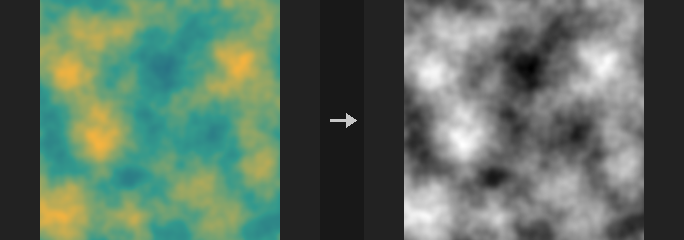
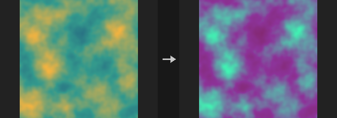

# Image: Channels & Layers

Channels, layers, conversions between data types.

13 nodes.

[Back to the reference index](README.md)

## Contents

- [Control Image (PCG)](#pcg-controlimage) — Packs a COP layer into a ComfyUI IMAGE and MASK following the conventions of ControlNet inputs.
- [COP Channel Convert (PCG)](#pcg-copchannelconvert) — Converts a layer between channel layouts such as mono, RGB, RGBA and UV.
- [COP Channel Join (PCG)](#pcg-copchanneljoin) — Joins all channels of several layers into one layer of at most four channels.
- [COP Channel Split (PCG)](#pcg-copchannelsplit) — Splits a layer into one single-channel layer per channel.
- [COP Convert Depth (PCG)](#pcg-copconvertdepth) — Converts between depth representations: camera z, distance to camera, disparity, normalized depth and camera-space position.
- [COP Convert Normal (PCG)](#pcg-copconvertnormal) — Converts normal maps between packed/signed encoding and OpenGL/DirectX conventions.
- [COP ID Convert (PCG)](#pcg-copidconvert) — Converts an integer ID layer into a mask, a normalized mono value or a signed distance field.
- [COP Layer Edit (PCG)](#pcg-coplayeredit) — Renames, copies, deletes or keeps layers of an image.
- [COP Layer Merge (PCG)](#pcg-coplayermerge) — Copies layers from image B into image A.
- [COP Luminance (PCG)](#pcg-copluminance) — Converts a layer to a single channel (luminance, average, HSV component, one channel, or custom weights).
- [COP Swizzle (PCG)](#pcg-copswizzle) — Rebuilds a layer from a pattern of channel letters and constants.
- [ID Masks (PCG)](#pcg-idmasks) — Splits an ID layer into a batch of masks, one per region.
- [Regional Prompt from COP (PCG)](#pcg-regionalprompt) — Builds region-based conditioning from COP mask layers and one prompt per region.

## Nodes

### Control Image (PCG)

`PCG_ControlImage` · category `PCG/cop` · Houdini: ID to RGB (COP)

Packs a COP layer into a ComfyUI IMAGE and MASK following the conventions of ControlNet inputs.

Converts a layer to the exact value convention a ControlNet expects. The conversion itself is mechanical; the conventions are what make it useful, because a wrong depth direction or an extra transfer curve gives images that ignore the control without any error. Per kind:

- **Depth**: inverse depth, near = white, as produced by MiDaS-style estimators (renderers give camera-space z where far is large, so it has to be reversed). By default the range is the min/max of the pixels inside the mask (relative depth, fits the object); fill `Near` / `Far` to keep it stable across an animation. Background is 0 (black = farthest); a value of 1 would make the model think something touches the lens.
- **Height**: top-down depth of a height field, high = white. Do not feed height to Depth, which reverses it (mountains become pits). `Near` / `Far` are the height range here; 0 = automatic. For a top-down view use the Normal kind with the tangent-space `N` from Height to Normal.
- **Normal**: packs `n x 0.5 + 0.5`, background (0.5, 0.5, 1). The normals must be camera-space (Render Pass default). The green channel convention differs between OpenGL (+Y up) and DirectX (+Y down) and between ControlNets; use the flip switches. A wrong choice shows as inverted bumps rather than a failure.
- **Line Art**: extracted from discontinuities of depth and normals instead of image edge detection: the mask gradient gives the outer silhouette, the depth gradient inner occlusion edges, the normal gradient creases. Cleaner than rendering and running Canny, which also picks up materials, noise and shading gradients, and silhouette and crease can be weighted separately.
- **Segmentation (ID)**: each ID gets a distinct color via a golden-angle hue sequence (random hues collide, equal steps need the count in advance).
- **Mask**, **Color**, **Raw**: the layer as grey, color, or unchanged.

COP values are linear while a VAE sees sRGB-like 0-1 values. Depth, normal, line art and ID are data and ControlNets are trained in the packed space, so no curve is applied; Color for img2img needs the sRGB curve. Image and mask are resized to the nearest multiple of `Align` (the latent is 1/8 resolution, so other sizes are silently rescaled somewhere), moving at most half the multiple. The output is flipped vertically, because COP row 0 is the bottom and IMAGE row 0 is the top.

**Inputs**

| Input | Type | Description |
|---|---|---|
| `cop` | COPIMAGE | Image containing the layer(s) to pack, typically from Render Pass. |

**Outputs**

| Output | Type | Description |
|---|---|---|
| `image` | IMAGE | The packed control image, shape (1, H, W, 3), values 0-1. |
| `mask` | MASK | Coverage mask from the mask layer (first channel, thresholded at 0.5), or all 1 if that layer does not exist. |

**Parameters**

| Parameter | Type | Default | Description |
|---|---|---|---|
| Control Type `kind` | menu | Depth (Near = White) | Which ControlNet convention to apply. Depth gives near = white inverse depth; Height gives high = white; Normal packs signed normals; Line Art draws silhouette and crease lines; Mask outputs the mask as grey; Segmentation (ID) colors each ID; Color and Raw pass the layer through. Options: Depth (Near = White) (`depth`), Normal (`normal`), Line Art (`lineart`), Mask (`mask`), Segmentation (ID) (`id`), Color (`color`), Raw (`raw`), Height (High = White) (`height`). |
| Layer `layer` | string | *(empty)* | Layer to pack. Empty uses the default for the kind: depth for Depth and Line Art, N for Normal, mask for Mask, id for ID, C for Color, Raw and Height. For Line Art this is the depth layer; the normal layer is set separately. |
| Mask Layer `mask_layer` | string | `mask` | Layer defining which pixels belong to the object. Also determines the MASK output; if the layer does not exist the mask is all 1. |
| Invert `invert` | toggle | off | Reverse the result (1 - value). For Depth this switches to far = white. *Hidden when kind = normal } { kind = id.* |

*Depth*

| Parameter | Type | Default | Description |
|---|---|---|---|
| Near `near` | float [0.0..] | 0 | Lower end of the normalised range. 0 = take the minimum inside the mask. For Height it is the lower height limit. *Hidden when kind ≠ depth kind ≠ height.* |
| Far `far` | float [0.0..] | 0 | Upper end of the normalised range. 0 = take the maximum inside the mask. For Height it is the upper height limit. *Hidden when kind ≠ depth kind ≠ height.* |
| Gamma `gamma` | float [0.05..20.0] | 1 | Gamma applied to the normalised depth or height; values above 1 brighten the mid-range. *Hidden when kind ≠ depth kind ≠ height.* |
| Background `background` | float [-10000.0..10000.0] | 0 | Value outside the mask for depth and height. 0 (black) means farthest. *Hidden when kind ≠ depth kind ≠ height.* |

*Normal*

| Parameter | Type | Default | Description |
|---|---|---|---|
| Flip Red (X) `flip_r` | toggle | off | Normal kind: invert the X (red) component before packing. *Hidden when kind ≠ normal.* |
| Flip Green (Y) `flip_g` | toggle | off | Normal kind: invert the Y (green) component. Switches between the OpenGL and DirectX normal-map conventions. *Hidden when kind ≠ normal.* |
| Flip Blue (Z) `flip_b` | toggle | off | Normal kind: invert the Z (blue) component. *Hidden when kind ≠ normal.* |

*Line Art*

| Parameter | Type | Default | Description |
|---|---|---|---|
| Normal Layer `normal_layer` | string | `N` | Line Art: layer with the normals used to find creases. *Hidden when kind ≠ lineart.* |
| Silhouette Weight `silhouette` | float [0.0..100.0] | 1 | Line Art: weight of the outer outline and the depth edges. 0 disables them. *Hidden when kind ≠ lineart.* |
| Crease Weight `crease` | float [0.0..100.0] | 1 | Line Art: weight of the normal discontinuities (creases). 0 disables them. *Hidden when kind ≠ lineart.* |
| Threshold `threshold` | float [0.0001..100.0] | 0.2 | Line Art: edge strength above which a line is drawn. *Hidden when kind ≠ lineart.* |
| Softness `softness` | float [0.0..10.0] | 0.5 | Line Art: width of the soft transition around the threshold, as a fraction of it. 0 gives hard 0/1 lines. *Hidden when kind ≠ lineart.* |
| Line Thickness `thickness` | int [1..32] | 1 | Line Art: line thickness in pixels (a square neighbourhood maximum). *Hidden when kind ≠ lineart.* |

*ID*

| Parameter | Type | Default | Description |
|---|---|---|---|
| Saturation `saturation` | float [0.0..1.0] | 0.65 | Segmentation: saturation of the ID colors. *Hidden when kind ≠ id.* |
| Value `value` | float [0.0..1.0] | 0.95 | Segmentation: brightness of the ID colors. *Hidden when kind ≠ id.* |

| Parameter | Type | Default | Description |
|---|---|---|---|
| Encode sRGB `srgb` | toggle | off | Apply the sRGB curve to the packed result. Leave off for control images; they are data. *Hidden when kind = color.* |
| Encode sRGB `color_srgb` | toggle | on | Color kind: apply the sRGB curve (needed for img2img). Turn off to output the linear values unchanged. *Hidden when kind ≠ color.* |
| Align Resolution To `align` | int [0..256] | 8 | Resize the output to the nearest multiple of this many pixels, because the latent is 1/8 resolution. 0 disables the alignment. |

**Compared with Houdini**

Its ID kind corresponds to Houdini's ID to RGB.

**Tips**

- Fix Near and Far for animations, otherwise the depth range changes from frame to frame.

---

### COP Channel Convert (PCG)

`PCG_COPChannelConvert` · category `PCG/cop` · Houdini: Mono to RGBA (COP), RGB to RGBA (COP), RGB to UV (COP), RGBA to RGB (COP), RGBA to UV (COP), UV to RGB (COP), UV to RGBA (COP)

Converts a layer between channel layouts such as mono, RGB, RGBA and UV.

One menu replaces Houdini's family of conversion nodes: mono to RGB / RGBA, RGB to RGBA, RGBA to RGB, RGB / RGBA to UV, UV to RGB / RGBA, and RGB to mono by luma, average or maximum.

If the source layer has fewer channels than the conversion needs, the node reports an error instead of silently padding with zeros, so a wrong connection (for example RGB treated as UV) does not travel downstream unnoticed. Extra channels are truncated. Channels that have to be created get Alpha when it is the alpha channel and Fill otherwise.

**Inputs**

| Input | Type | Description |
|---|---|---|
| `cop` | COPIMAGE | Image containing the layer to convert. |

**Outputs**

| Output | Type | Description |
|---|---|---|
| `cop` | COPIMAGE | Image with the converted layer. |

**Parameters**

| Parameter | Type | Default | Description |
|---|---|---|---|
| Layer `layer` | string | `C` | Name of the layer to convert. |
| Conversion `mode` | menu | Mono to RGB | Conversion to apply. `rgb_to_mono_luma` uses Rec.709 luma, `rgb_to_mono_average` the mean of R, G and B, `rgb_to_mono_max` the largest of the three. Options: Mono to RGB (`mono_to_rgb`), Mono to RGBA (`mono_to_rgba`), RGB to RGBA (`rgb_to_rgba`), RGBA to RGB (`rgba_to_rgb`), RGB to UV (`rgb_to_uv`), RGBA to UV (`rgba_to_uv`), UV to RGB (`uv_to_rgb`), UV to RGBA (`uv_to_rgba`), RGB to Mono (Luminance) (`rgb_to_mono_luma`), RGB to Mono (Average) (`rgb_to_mono_average`), RGB to Mono (Maximum) (`rgb_to_mono_max`). |
| Alpha `alpha` | float | 1 | Value written to the alpha channel when a conversion adds one (for example RGB to RGBA). *Hidden when mode ≠ mono_to_rgba mode ≠ rgb_to_rgba mode ≠ uv_to_rgba.* |
| Fill Value `fill` | float | 0 | Value written to any other new channel, for example the B channel in UV to RGB. *Hidden when mode ≠ uv_to_rgb mode ≠ uv_to_rgba.* |
| Output Layer `out_layer` | string | *(empty)* | Name of the output layer. Empty overwrites the input layer. |

**Compared with Houdini**

Covers Mono to RGBA, RGB to RGBA, RGBA to RGB, RGB to UV, RGBA to UV, UV to RGB and UV to RGBA. For luminance from RGB there is also COP Luminance.

---

### COP Channel Join (PCG)

`PCG_COPChannelJoin` · category `PCG/cop` · Houdini: Channel Join (COP)

Joins all channels of several layers into one layer of at most four channels.

Takes the layers listed in Layers in order and concatenates all their channels into a single layer. The usual use is joining three single-channel layers into an RGB layer. The total number of channels must not exceed four.

**Inputs**

| Input | Type | Description |
|---|---|---|
| `cop` | COPIMAGE | Image containing the layers to join. |

**Outputs**

| Output | Type | Description |
|---|---|---|
| `cop` | COPIMAGE | Image with the joined layer added. |

**Parameters**

| Parameter | Type | Default | Description |
|---|---|---|---|
| Input Layers `layers` | string | `C` | Space-separated layer names, joined in this order. The total channel count may be at most 4. |
| Output Layer `out_layer` | string | `joined` | Name of the resulting layer. |

---

### COP Channel Split (PCG)

`PCG_COPChannelSplit` · category `PCG/cop` · Houdini: Channel Split (COP)

Splits a layer into one single-channel layer per channel.

Each channel of Layer becomes its own layer named `layer.suffix`, for example `C.r`, `C.g`, `C.b`, `C.a`. Suffixes are taken in order from Suffixes; if there are more channels than suffixes the channel index is used.

**Inputs**

| Input | Type | Description |
|---|---|---|
| `cop` | COPIMAGE | Image containing the layer to split. |

**Outputs**

| Output | Type | Description |
|---|---|---|
| `cop` | COPIMAGE | Image with the per-channel layers added. |

**Parameters**

| Parameter | Type | Default | Description |
|---|---|---|---|
| Layer `layer` | string | `C` | Name of the layer to split. |
| Channel Suffixes `suffixes` | string | `r g b a` | Space-separated suffixes for the channels, in channel order. The output layer is named layer.suffix; missing suffixes fall back to the channel number. |
| Keep Input Layers `keep_layers` | toggle | on | Keep the original layers in the output. When off, only the new per-channel layers remain. |

---

### COP Convert Depth (PCG)

`PCG_COPConvertDepth` · category `PCG/cop` · Houdini: Convert Depth (COP)

Converts between depth representations: camera z, distance to camera, disparity, normalized depth and camera-space position.

Renderers usually give z depth along the view axis, ray tracers give the Euclidean distance to the camera, and depth ControlNets or monocular depth estimators use inverse depth (disparity). These differ by a per-pixel factor of `sqrt(1 + x^2 + y^2)`, which is more than 20% at the image edge for a 60 degree field of view. Connecting the wrong kind produces no error: objects near the edges are just pushed too far away.

`z_depth` is the camera-space z, `distance` the distance to the camera, `disparity` is 1/z, `normalized` is `(z - near) / (far - near)` with 0 at the near plane, and `position` (output only) is the camera-space point (x, y, z). The field of view is the vertical one, as in the Render Pass convention. Pixels outside the mask, or with a value of 0 or less when no mask layer is given, are written as 0.

**Inputs**

| Input | Type | Description |
|---|---|---|
| `cop` | COPIMAGE | Image containing the depth layer. |

**Outputs**

| Output | Type | Description |
|---|---|---|
| `cop` | COPIMAGE | Image with the converted layer. |

**Parameters**

| Parameter | Type | Default | Description |
|---|---|---|---|
| Depth Layer `layer` | string | `depth` | Name of the depth layer to convert. |
| From `from_kind` | menu | Z Depth | Representation of the input: camera z (`z_depth`), distance to the camera (`distance`), inverse depth (`disparity`) or `normalized` (needs a valid Near < Far). Options: Z Depth (`z_depth`), Distance to Camera (`distance`), Disparity (1/Z) (`disparity`), Normalized (Near to Far) (`normalized`). |
| To `to_kind` | menu | Distance to Camera | Representation of the output. `position` writes the camera-space (x, y, z) point and is available only as output. Options: Z Depth (`z_depth`), Distance to Camera (`distance`), Disparity (1/Z) (`disparity`), Normalized (Near to Far) (`normalized`), Camera-Space Position (`position`). |
| Vertical FOV `fov` | float [1..179] | 45 | Vertical field of view of the camera in degrees. *Hidden when from_kind ≠ distance to_kind ≠ distance to_kind ≠ position.* |
| Near / Far `near` `far` | float [0..] | 0, 0 | Near and far depth values used by `normalized`. For From = `normalized` Near must be less than Far. For To = `normalized`, leaving both at 0 uses the minimum and maximum of the masked pixels. *Hidden when from_kind ≠ normalized to_kind ≠ normalized.* |
| Mask Layer `mask_layer` | string | *(empty)* | Optional layer defining which pixels are valid (above 0.5). Empty uses all pixels that are finite and greater than 0. Pixels outside are written as 0. |
| Output Layer `out_layer` | string | *(empty)* | Name of the output layer. Empty overwrites the input layer. |

**Tips**

- Check which kind of depth your source delivers before using it with a depth ControlNet; z depth and distance differ visibly near the image edge.

---

### COP Convert Normal (PCG)

`PCG_COPConvertNormal` · category `PCG/cop` · Houdini: Convert Normal (COP)

Converts normal maps between packed/signed encoding and OpenGL/DirectX conventions.

Steps always run in this fixed order: decode, reconstruct z, flip, normalize, encode.

- `packed` vs `signed`: image files store normals as 0..1 colours, while inside this plugin normals are vectors in -1..1. A normal map read in from ComfyUI must go through packed to signed first.
- Flip Green switches between OpenGL (+Y up, used by this plugin) and DirectX (+Y down). Getting this wrong inverts bumps along one direction and raises no error.
- Reconstruct Z rebuilds z as `sqrt(1 - x^2 - y^2)` from the x and y channels only (two-channel BC5-style normal maps).

packed to signed to packed is an identity, and flipping twice restores the input exactly. Conversion between tangent space and world space is not supported because it needs a tangent frame per pixel, which the height-map chain does not have.

**Inputs**

| Input | Type | Description |
|---|---|---|
| `cop` | COPIMAGE | Image containing the normal layer. |

**Outputs**

| Output | Type | Description |
|---|---|---|
| `cop` | COPIMAGE | Image with the converted normal layer. |

**Parameters**

| Parameter | Type | Default | Description |
|---|---|---|---|
| Layer `layer` | string | `C` | Name of the normal layer to convert. |
| Input Encoding `decode` | menu | Packed (0 to 1) | Encoding of the input: `packed` (0..1 colours, as stored in files) or `signed` (-1..1 vectors). Options: Signed (-1 to 1) (`signed`), Packed (0 to 1) (`packed`). |
| Output Encoding `encode` | menu | Signed (-1 to 1) | Encoding of the output: `signed` (-1..1 vectors) or `packed` (0..1 colours). Options: Signed (-1 to 1) (`signed`), Packed (0 to 1) (`packed`). |
| Reconstruct Z `reconstruct_z` | toggle | off | Rebuild the z component from x and y (for two-channel normal maps). |
| Flip Red (X) `flip_red` | toggle | off | Inverts the red (X) channel of the vector. |
| Flip Green (Y) `flip_green` | toggle | off | Inverts the green (Y) channel, converting between OpenGL and DirectX conventions. |
| Normalize `normalize` | toggle | on | Renormalizes the vectors to unit length after the other steps. |
| Output Layer `out_layer` | string | `N` | Name of the output layer. |
| Keep Input Layers `keep_layers` | toggle | on | Keep the other layers of the input in the output. |

---

### COP ID Convert (PCG)

`PCG_COPIDConvert` · category `PCG/cop` · Houdini: ID to Mask (COP), ID to Mono (COP), ID to SDF (COP)

Converts an integer ID layer into a mask, a normalized mono value or a signed distance field.

Reads the first channel of the ID layer, rounded to integers.

- **Mask**: IDs listed in IDs become 1, everything else 0.
- **Mono**: the ID value itself. With Normalize it is mapped to 0-1 as (id - min) / (max - min).
- **SDF**: with IDs given, the signed distance (negative inside, positive outside, boundary at plus or minus half a pixel) of the union of the selected IDs; Invert uses the complement. With IDs empty (or `*`), each pixel gets its distance to the nearest pixel with a different ID, so the per-region interior distances are combined in one image. The SDF mode fails if the selection is empty or covers the whole image, because there is then no boundary.

**Inputs**

| Input | Type | Description |
|---|---|---|
| `cop` | COPIMAGE | Image containing the ID layer. |

**Outputs**

| Output | Type | Description |
|---|---|---|
| `cop` | COPIMAGE | Input image with the converted layer added. |

**Parameters**

| Parameter | Type | Default | Description |
|---|---|---|---|
| ID Layer `layer` | string | `id` | Layer holding the integer IDs. |
| Convert To `mode` | menu | Mask | Type of result: binary mask, mono value or signed distance field. Options: Mask (`mask`), Mono (`mono`), SDF (`sdf`). |
| IDs `ids` | string | `1` | IDs to select, as a space-separated list with ranges, e.g. `1 3 5-8`. In SDF mode, empty means distance to the other IDs. *Hidden when mode = mono.* |
| Invert `invert` | toggle | off | Invert the selection (Mask and SDF modes). *Hidden when mode = mono.* |
| Normalize `normalize` | toggle | on | Mono mode only: map the ID range to 0-1. *Hidden when mode ≠ mono.* |
| Output Layer `out_layer` | string | *(empty)* | Name of the result layer. Empty uses `<layer>_<mode>`. |

**Compared with Houdini**

One node covers Houdini's ID to Mask, ID to Mono and ID to SDF, selected with Convert To.

---

### COP Layer Edit (PCG)

`PCG_COPLayerEdit` · category `PCG/cop` · Houdini: Rename (COP)

Renames, copies, deletes or keeps layers of an image.

Edits the layer set of an image without touching pixel data. Renaming onto an existing name overwrites that layer. Keep Only fails if no layer would remain. Rename and Copy take space-separated `old=new` pairs; Delete and Keep Only take a list of layer names.

**Inputs**

| Input | Type | Description |
|---|---|---|
| `cop` | COPIMAGE | Image whose layers are edited. |

**Outputs**

| Output | Type | Description |
|---|---|---|
| `cop` | COPIMAGE | Image with the edited layer set. |

**Parameters**

| Parameter | Type | Default | Description |
|---|---|---|---|
| Operation `op` | menu | Rename | Rename moves layers to new names; Copy duplicates them under new names; Delete removes the listed layers; Keep Only removes all layers except the listed ones. Options: Rename (`rename`), Copy (`copy`), Delete (`delete`), Keep Only (`keep`). |
| Layers `spec` | string | `C=color` | For Rename and Copy: `old=new old2=new2`. For Delete and Keep Only: layer names separated by spaces. |

**Compared with Houdini**

Covers Houdini's Rename COP and adds copy, delete and keep operations in the same node.

---

### COP Layer Merge (PCG)

`PCG_COPLayerMerge` · category `PCG/cop`

Copies layers from image B into image A.

Adds the layers of B to A without doing any pixel math. If the resolutions differ, B is resampled to A's resolution; if the backends differ, B is moved to A's backend. Prefix is added to the incoming layer names, and with Overwrite Existing turned off, layers of A that have the same name are kept.

To combine the pixels of the same layer from several images, use COP Layer Combine instead.

**Inputs**

| Input | Type | Description |
|---|---|---|
| `a` | COPIMAGE | Image that receives the layers and defines the output resolution. |
| `b` | COPIMAGE | Image providing the layers to add. |

**Outputs**

| Output | Type | Description |
|---|---|---|
| `cop` | COPIMAGE | A with the layers of B added. |

**Parameters**

| Parameter | Type | Default | Description |
|---|---|---|---|
| Layers `layers` | string | *(empty)* | Space-separated layers to take from B. Empty takes all. |
| Prefix `prefix` | string | *(empty)* | Text added in front of the names of the layers coming from B. |
| Overwrite Existing `overwrite` | toggle | on | Replace layers of A that have the same name as an incoming layer. When off, A's layer is kept. |

---

### COP Luminance (PCG)

`PCG_COPLuminance` · category `PCG/cop` · Houdini: HeightField to Mono (COP), Mono (COP)

Converts a layer to a single channel (luminance, average, HSV component, one channel, or custom weights).

Reduces a layer to one channel stored as a new layer. The default HDTV operation is Rec.709 luminance (0.2126, 0.7152, 0.0722). COP data is linear, so weighting directly is correct; applying the same weights to sRGB-encoded values is a common mistake (decode first).

Other operations: SGI and NTSC use their own weights; Average, Maximum Channel and Minimum Channel use all existing channels (alpha included); Magnitude is the vector length (absolute value for one channel); Hue, Saturation and Value convert to HSV (hue in 0-1, not degrees); Red/Green/Blue/Alpha pick one channel, with missing channels filled by the usual expansion rules; Custom computes the weighted sum of the channels, optionally normalizing the weights in use to sum to 1.

Layers with fewer than three channels use their first channel instead of raising an error, so masks and SDFs can be passed through.

**Inputs**

| Input | Type | Description |
|---|---|---|
| `cop` | COPIMAGE | Image to convert. |

**Outputs**

| Output | Type | Description |
|---|---|---|
| `cop` | COPIMAGE | Image with the single-channel result added. |

**Parameters**

| Parameter | Type | Default | Description |
|---|---|---|---|
| Layer `layer` | string | `C` | Layer to convert. |
| Operation `operation` | menu | HDTV Luminance | How the channels are reduced to one. Options: SGI Luminance (`sgi`), NTSC Luminance (`ntsc`), HDTV Luminance (`hdtv`), Average (`average`), Maximum Channel (`max`), Minimum Channel (`min`), Magnitude / Length (`length`), Hue (`hue`), Saturation (`saturation`), Value (`value`), Red (`red`), Green (`green`), Blue (`blue`), Alpha (`alpha`), Custom (`custom`). |
| Weights `weights` | string | `0.2126 0.7152 0.0722 0` | Custom only: four space-separated weights for R, G, B, A. Only as many weights as the layer has channels are used. *Hidden when operation ≠ custom.* |
| Normalize Weights `normalize_weights` | toggle | off | Custom only: scale the weights in use so they sum to 1. *Hidden when operation ≠ custom.* |
| Output Layer `out_layer` | string | `lum` | Name of the result layer. |

**Compared with Houdini**

Corresponds to Houdini's Mono COP and its Operation menu; also covers HeightField to Mono.

---

### COP Swizzle (PCG)

`PCG_COPSwizzle` · category `PCG/cop` · Houdini: Channel Extract (COP), Channel Swap (COP)

Rebuilds a layer from a pattern of channel letters and constants.

Each character of `Pattern` produces one output channel, so the output has as many channels as the pattern has characters (1 to 4). Letters pick a channel of the source layer: `r g b a`, `x y z w` or `u v`. The characters `0` and `1` produce constant channels.

Examples: `bgr` swaps red and blue, `a` extracts alpha as a single-channel layer, `rrr1` turns a grey image into RGBA. A request for a channel the source layer does not have (for example `a` on a 3-channel layer) is an error.

**Inputs**

| Input | Type | Description |
|---|---|---|
| `cop` | COPIMAGE | Image containing the layer to swizzle. |

**Outputs**

| Output | Type | Description |
|---|---|---|
| `cop` | COPIMAGE | The input image with the swizzled layer written to the output layer. |

**Parameters**

| Parameter | Type | Default | Description |
|---|---|---|---|
| Layer `layer` | string | `C` | Source layer. |
| Channel Pattern `pattern` | string | `bgr` | One character per output channel: `r g b a`, `x y z w`, `u v` select a channel, `0` and `1` are constants. Up to four characters. |
| Output Layer `out_layer` | string | *(empty)* | Destination layer. Empty overwrites the source layer. |

**Compared with Houdini**

Combines Houdini's Channel Swap and Channel Extract in one pattern string.

**Tips**

- Use `a` with a different output layer to pull alpha out as a mask.

---

### ID Masks (PCG)

`PCG_IDMasks` · category `PCG/cop`

Splits an ID layer into a batch of masks, one per region.

ComfyUI MASKs are (B, H, W), so one mask per region is naturally a batch. Connecting it to ConditioningSetMask gives per-region prompts with geometrically exact borders instead of painted ones.

The IDs come from the `id` pass of Render Pass, which reads a primitive attribute such as `name`, `piece` or `cluster` (written by Voronoi Fracture, Voronoi Cluster, Convex Decompose, Connectivity). IDs are rounded to integers and sorted ascending. If there are more regions than `Max Regions`, the ones with the largest area are kept (not the highest IDs, which would cut away the main subject). Only pixels inside the mask layer are considered.

**Inputs**

| Input | Type | Description |
|---|---|---|
| `cop` | COPIMAGE | Image containing the ID layer, typically from Render Pass. |

**Outputs**

| Output | Type | Description |
|---|---|---|
| `masks` | MASK | Batch of masks, one per region, in ascending ID order. |
| `count` | INT | Number of masks in the batch. |
| `ids` | STRING | The region IDs, space-separated, in the same order as the masks. |

**Parameters**

| Parameter | Type | Default | Description |
|---|---|---|---|
| ID Layer `layer` | string | `id` | Layer with the region IDs. |
| Mask Layer `mask_layer` | string | `mask` | Only pixels where this layer is above 0.5 are considered. If the layer does not exist, all pixels with an ID of 0 or more are used. |
| Max Regions `max_regions` | int [1..4096] | 64 | Maximum number of masks. When exceeded, the regions with the largest area are kept. |

---

### Regional Prompt from COP (PCG)

`PCG_RegionalPrompt` · category `PCG/cop`

Builds region-based conditioning from COP mask layers and one prompt per region.

Replaces N CLIP Text Encode nodes, N Conditioning Set Mask nodes and N-1 Conditioning Combine nodes with one node. `Regions` has one line per region in the form `layer name: prompt`.

In Normalized mode the layers are already a partition (for example the output of Splat Map); they are used as they are and normalised only where they add up to more than 1. In Layered mode they are independent masks (several Mask by Feature, say), composited in written order so later lines overwrite earlier ones. The base prompt by default covers only what remains (Remainder), so all masks sum to exactly 1 everywhere.

This matters because ComfyUI averages masked conditioning weighted by the mask values. A pixel not covered by any condition has a prediction of 0, which shows as a blurry hole without any error. A base prompt without mask (Global) takes part everywhere and halves the strength of the regional prompts.

Masks are composited in COP orientation and flipped vertically at the output (the same boundary as Control Image), so they align pixel for pixel with depth or normal control images from the same COP. Regions that are empty are skipped. The `report` output lists the coverage per region.

**Inputs**

| Input | Type | Description |
|---|---|---|
| `clip` | CLIP | CLIP model used to encode the prompts. |
| `cop` | COPIMAGE | Image containing the region mask layers named in `Regions`. |

**Outputs**

| Output | Type | Description |
|---|---|---|
| `conditioning` | CONDITIONING | Combined conditioning with one masked entry per region plus the base. |
| `preview` | IMAGE | Image with every region colored (same palette as the ID kind of Control Image); the remainder is dark grey. |
| `masks` | MASK | Batch of the effective mask of every region, in written order. |
| `report` | STRING | Text summary: number of regions, mask coverage per region and the range of the mask sum. |

**Parameters**

| Parameter | Type | Default | Description |
|---|---|---|---|
| Base Prompt `base_prompt` | string | *(see panel)* | Prompt for the whole image or the remainder, depending on `Base`. |
| Regions `regions` | string | *(see panel)* | One region per line as `layer name: prompt`. The layer is read from the COP input. |
| Mask Mode `mode` | menu | Normalized (Partition) | Normalized: the layers already form a partition and are used as is. Layered: the layers are independent masks and later lines overwrite earlier ones. Options: Normalized (Partition) (`normalized`), Layered (Later Wins) (`layered`). |
| Base Coverage `base` | menu | Remainder | Remainder applies the base prompt only where the regions leave room; Global applies it to the whole image without a mask. Options: Remainder (`remainder`), Global (Unmasked) (`global`). |
| Feather `feather` | float [0.0..64.0] | 1 | Gaussian blur radius in pixels applied to each region mask first. 0 disables it. |
| Strength `strength` | float [0.0..10.0] | 1 | Strength of the regional conditioning. A Global base prompt is not multiplied by it. |

---
