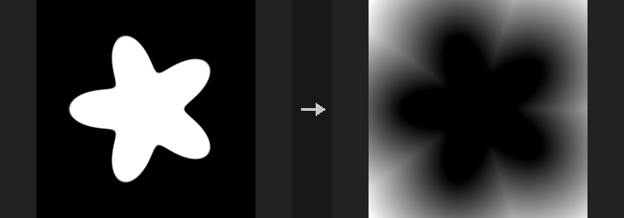
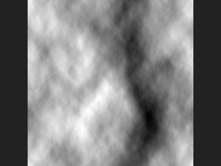
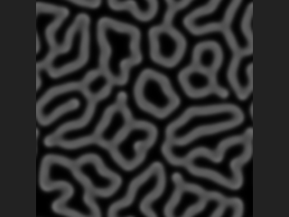
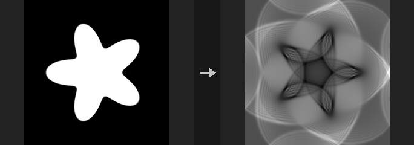
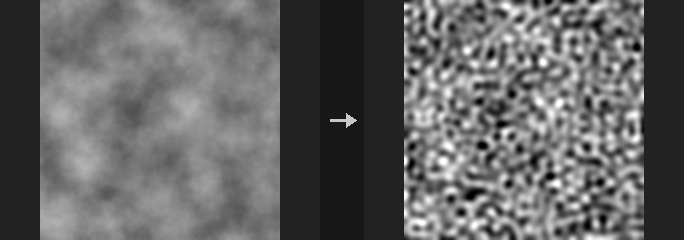

# Image: Simulation

Reaction-diffusion, fluids, solvers and other iterative image processes.

7 nodes.

[Back to the reference index](README.md)

## Contents

- [COP Eikonal (PCG)](#pcg-copeikonal) — Solves the eikonal equation to give the arrival time (or geodesic distance) from seed pixels through a speed field.
- [COP Flow Solve (PCG)](#pcg-copflowsolve) — Projects a 2-channel velocity layer to be divergence-free, or runs a stable-fluids simulation that advects density layers.
- [COP Ocean (PCG)](#pcg-copocean) — Evaluates an FFT ocean surface (Tessendorf) into height, displacement, normal and foam layers.
- [COP Reaction Diffusion (PCG)](#pcg-copreactiondiffusion) — Runs a reaction-diffusion simulation (Gray-Scott, multi-scale Turing or Maginu) for a number of steps.
- [COP Ripple (PCG)](#pcg-copripple) — Simulates 2D waves with a leapfrog wave-equation solver.
- [COP Solve Poisson (PCG)](#pcg-copsolvepoisson) — Solves the Poisson equation on the image.
- [COP Turing Patterns (PCG)](#pcg-copturingpatterns) — Repeatedly blurs and sharpens a layer to grow stripes and spots while keeping the large-scale shape of the input.

## Nodes

### COP Eikonal (PCG)

`PCG_COPEikonal` · category `PCG/cop` · Houdini: Eikonal (COP)

Solves the eikonal equation to give the arrival time (or geodesic distance) from seed pixels through a speed field.

Solves `|grad T| = 1/F` with a Godunov upwind scheme and fast sweeping, starting from the pixels of `seed_layer` that are above 0.5. The speed `F` is the speed layer multiplied by `speed`; a speed of 0 is a wall. With a constant speed of 1, the result is the geodesic distance in pixels around obstacles.

Unreachable pixels are written as -1. If an id layer name is given, the id of the nearest seed region (connected component of the seed mask) is propagated and written as well.

The scheme is first order: diagonal directions close to the seeds have the largest error (around 10% within a few pixels), falling to around 1% far away.

**Inputs**

| Input | Type | Description |
|---|---|---|
| `cop` | COPIMAGE | Image containing the seed layer and optionally a speed layer. |

**Outputs**

| Output | Type | Description |
|---|---|---|
| `cop` | COPIMAGE | Image with the arrival time layer (and id layer) added. |
| `report` | STRING | Text report with the number of sweeps and whether the solve converged. |

**Parameters**

| Parameter | Type | Default | Description |
|---|---|---|---|
| Seed Layer `seed_layer` | string | `mask` | Layer whose pixels above 0.5 are the starting points (time 0). Errors if no seed pixel exists. |
| Speed Layer `speed_layer` | string | *(empty)* | Optional layer giving a per-pixel speed multiplier; 0 marks a wall. Empty means speed is `speed` everywhere. |
| Speed `speed` | float [0..] | 1 | Global speed multiplier. |

*Solver*

| Parameter | Type | Default | Description |
|---|---|---|---|
| Max Sweeps `max_sweeps` | int [1..10000] | 60 | Maximum number of full sweep iterations. A point source typically converges in 2 to 3. |
| Tolerance `tolerance` | float [0..1] | 1e-06 | Convergence threshold: sweeping stops when the largest change falls below this. |

| Parameter | Type | Default | Description |
|---|---|---|---|
| Output Layer `out_layer` | string | `arrival` | Name of the arrival time layer. |
| ID Layer `id_layer` | string | *(empty)* | Name of an output layer holding the index of the nearest seed region. Empty skips it. |

---

### COP Flow Solve (PCG)

`PCG_COPFlowSolve` · category `PCG/cop` · Houdini: Flow Block Begin (COP), Flow Block End (COP), Flow Project Non-Divergent Multigrid (COP)

Projects a 2-channel velocity layer to be divergence-free, or runs a stable-fluids simulation that advects density layers.

Covers Flow Block Begin/End and Flow Project Non-Divergent Multigrid. Velocity is a 2-channel layer in pixels per step (v pointing up, like the rest of COP).

`project` performs one Helmholtz projection, turning any vector field into an incompressible flow. `simulate` runs Stam's stable fluids for `steps` iterations, each consisting of: add force, advect velocity, project, advect the density layers, then multiply by `1 - dissipation`.

Both edge modes are solved directly: Wrap uses an exact FFT projection; Clamp makes the borders walls using a mirrored extension and FFT, also exact. The velocity and density layers are written back under their original names, so the result can be fed into the next segment. The report states the maximum remaining divergence and where it was computed.

**Inputs**

| Input | Type | Description |
|---|---|---|
| `cop` | COPIMAGE | Image containing the velocity layer, density layers and optional force layer. |

**Outputs**

| Output | Type | Description |
|---|---|---|
| `cop` | COPIMAGE | Image with updated velocity and density layers. |
| `report` | STRING | Text report with the maximum divergence and the compute device. |

**Parameters**

| Parameter | Type | Default | Description |
|---|---|---|---|
| Velocity Layer `velocity_layer` | string | `vel` | 2-channel velocity layer in pixels per step. |
| Mode `mode` | menu | Simulate (Stable Fluids) | `project` only makes the velocity divergence-free; `simulate` advances the fluid for several steps. Options: Simulate (Stable Fluids) (`simulate`), Project Non-Divergent (`project`). |
| Density Layers `density_layers` | string | `density` | Space-separated layers carried along by the flow (any channel count). Used by Simulate. *Hidden when mode ≠ simulate.* |
| Steps `steps` | int [0..] | 10 | Number of simulation steps (Simulate only). *Hidden when mode ≠ simulate.* |
| Time Step `dt` | float [0..100] | 1 | Time step per simulation step, scaling forces and advection. *Hidden when mode ≠ simulate.* |
| Force Layer `force_layer` | string | *(empty)* | Optional layer whose first two channels are added to the velocity each step. Empty adds no force. *Hidden when mode ≠ simulate.* |
| Force Scale `force_scale` | float | 1 | Multiplier on the force layer. *Hidden when mode ≠ simulate.* *Disabled when force_layer = "".* |
| Dissipation `dissipation` | float [0..1] | 0 | Fraction of density removed per step; 0 keeps density constant. *Hidden when mode ≠ simulate.* |
| Boundary `edge` | menu | Wrap (Periodic) | Boundary condition: `wrap` is periodic, `clamp` makes the image borders walls. Options: Wrap (Periodic) (`wrap`), Closed (Walls) (`clamp`). |
| Tolerance (Unused) `tolerance` | float [1e-14..1] | 1e-08 | No longer has any effect, since both boundary modes are solved directly. Kept so older graphs stay compatible. |
| Compute `compute` | menu | Auto | Device: `auto` picks the GPU when it is worthwhile, otherwise `cpu` or `cuda` are forced. Options: Auto (`auto`), CPU (`cpu`), CUDA (`cuda`). |

**Tips**

- Run `project` on a hand-painted or noise-generated vector field to get a swirling, incompressible field, then feed it to COP Distort.

---

### COP Ocean (PCG)

`PCG_COPOcean` · category `PCG/cop` · Houdini: Ocean Evaluate (COP), Ocean Spectrum (COP)

Evaluates an FFT ocean surface (Tessendorf) into height, displacement, normal and foam layers.

Combines Houdini's Ocean Spectrum and Ocean Evaluate. A wave spectrum (Phillips or TMA) generates random complex amplitudes, which are advanced in time with the dispersion relation (deep water, or finite depth when Depth is above 0) and transformed with an inverse FFT. The result tiles seamlessly because the FFT is periodic. With the same seed, changing Time animates the surface; changing Amplitude only scales it (height proportional to the square root of the amplitude). With the default Amplitude the significant wave height is about `0.21*V^2/g` for a fully developed sea; Grid Size should be at least an order of magnitude larger than `V^2/g`, or the longest waves are cut off and the sea looks low.

Output layers, in metres, named after Output Layer:
- `<name>`: height.
- `<name>_disp`: 3-channel displacement (du, height, dv): horizontal choppy displacement along the image u and v directions plus vertical displacement, to push a mesh.
- `<name>_N`: tangent-space normal (u, v, up).
- `<name>_foam`: foam, where the displacement Jacobian drops below `1 - Foam Threshold`, mapped linearly to 0-1.

If `cop` is connected, layers are added to it and its resolution is used; otherwise Resolution applies. `report` lists the maximum wave height and the imaginary residual of the inverse FFT (should be 0).

**Inputs**

| Input | Type | Description |
|---|---|---|
| `cop` *(optional)* | COPIMAGE | Optional image to add the ocean layers to. Its resolution is used. Without it a new image of the given Resolution is created. |

**Outputs**

| Output | Type | Description |
|---|---|---|
| `cop` | COPIMAGE | Image with the ocean layers. |
| `report` | STRING | Text summary with the maximum wave height and the FFT imaginary residual. |

**Parameters**

| Parameter | Type | Default | Description |
|---|---|---|---|
| Grid Size `size` | float [0.01..] | 100 | Width of the whole image in metres (height follows the aspect ratio). |
| Depth `depth` | float [0..] | 0 | Water depth in metres. 0 means deep water. |
| Gravity `gravity` | float [0.01..1000.0] | 9.81 | Gravitational acceleration used by the dispersion relation and spectrum. |
| Resolution `resolution_x` `resolution_y` | int [1..16384] | 512, 512 | Output width and height in pixels. Used only when `cop` is not connected. |
| Time `time` | float | 0 | Time in seconds at which the surface is evaluated. |
| Loop Period `loop_period` | float [0..] | 0 | Period in seconds after which the animation repeats exactly (wave frequencies are quantized to multiples of 2*pi/period). 0 disables looping. |
| Seed `rand_seed` | int [0..] | 0 | Seed for the random wave amplitudes and phases. |

*Wind*

| Parameter | Type | Default | Description |
|---|---|---|---|
| Spectrum Type `spectrum_type` | menu | Phillips | Wave spectrum. Phillips is the classic Tessendorf spectrum; TMA is a depth-aware spectrum with a Hasselmann directional distribution (it ignores Amplitude and Wind Direction Bias). Options: Phillips (`phillips`), TMA (`tma`). |
| Wind Speed `wind_speed` | float [0.01..100] | 12 | Wind speed in metres per second. Sets the dominant wavelength (`V^2/g`). |
| Wind Direction `wind_direction` | float [-360..360] | 0 | Direction the wind blows, in degrees. |
| Swell `swell` | float [-10..10] | 0 | TMA only: negative values reduce directionality and add waves against the wind, positive values concentrate energy. *Hidden when spectrum_type ≠ tma.* |
| Fetch (km) `fetch_km` | float [0.001..] | 100 | TMA only: distance in kilometres over which the wind has blown, which sets how developed the sea is. *Hidden when spectrum_type ≠ tma.* |
| Wind Direction Bias `align` | float [0..32] | 2 | Phillips only: how strongly waves align with the wind. Higher values give more wind-aligned waves. *Hidden when spectrum_type ≠ phillips.* |
| Directional Movement `directional_movement` | float [0..1] | 0 | Phillips only: reduces waves travelling against the wind by a factor of `1 - value`. *Hidden when spectrum_type ≠ phillips.* |

*Waves*

| Parameter | Type | Default | Description |
|---|---|---|---|
| Distribution `distribution` | menu | Gaussian | Random distribution of the wave amplitudes (phases are always uniformly random). All four options have the same mean energy; they differ in distribution shape. Options: None (`none`), Uniform (`uniform`), Gaussian (`gaussian`), Log Normal (`log_normal`). |
| Amplitude `amplitude` | float [0..1] | 0.00088 | Phillips only: overall spectrum constant. Wave height scales with its square root. *Hidden when spectrum_type ≠ phillips.* |
| Min Wavelength `small_cut` | float [0..100] | 0.1 | Waves shorter than this length in metres are suppressed. |
| Chop `choppiness` | float [0..10] | 1 | Strength of the horizontal displacement that sharpens crests. |
| Foam Threshold `foam_threshold` | float [0.001..2] | 0.3 | Foam appears where the displacement Jacobian falls below `1 - threshold`; it is also the width over which foam ramps to 1. |

| Parameter | Type | Default | Description |
|---|---|---|---|
| Output Layer `out_layer` | string | `ocean` | Base name of the output layers (`<name>`, `<name>_disp`, `<name>_N`, `<name>_foam`). |

**Compared with Houdini**

One node replaces Houdini's Ocean Spectrum and Ocean Evaluate pair. The TMA directional spread is Hasselmann with Horvath's swell term; the sign handling of Swell (negative adds against-wind waves) is chosen by the plugin because the documentation is not specific.

---

### COP Reaction Diffusion (PCG)

`PCG_COPReactionDiffusion` · category `PCG/cop` · Houdini: Reaction-Diffusion Block Begin (COP), Reaction-Diffusion Block End (COP)

Runs a reaction-diffusion simulation (Gray-Scott, multi-scale Turing or Maginu) for a number of steps.

One node advances the simulation by Steps iterations. The state is stored in extra layers next to the output: `<Output Layer>_u` and `_v` for Gray-Scott, `_g` for Turing and `_a` / `_b` for Maginu. Feeding the output back into the input continues the run from that state (the seed layer is then ignored).

Gray-Scott presets are common feed/kill pairs; Feed Layer and Kill Layer allow per-pixel values. Maginu solves `A' = Da*lap(A) + alpha*(A - A^3) - B` and `B' = Db*lap(B) + beta*(A - gamma*B)`. Turing uses the listed activator radii. An optional boundary SDF restricts where the reaction takes place.

The second output is a text report of the run.

**Inputs**

| Input | Type | Description |
|---|---|---|
| `cop` *(optional)* | COPIMAGE | Optional image providing resolution, the seed layer, and the state to continue from. |

**Outputs**

| Output | Type | Description |
|---|---|---|
| `cop` | COPIMAGE | Image with the pattern layer and the state layers. |
| `report` | STRING | Text summary of the simulation run. |

**Parameters**

| Parameter | Type | Default | Description |
|---|---|---|---|
| Model `mode` | menu | Gray-Scott | Simulation model. Options: Gray-Scott (`gray_scott`), Turing (Multi-Scale) (`turing`), Kenjiro Maginu (`maginu`). |
| Steps `steps` | int [0..] | 1000 | Number of iterations performed by this node. |

*Gray-Scott*

| Parameter | Type | Default | Description |
|---|---|---|---|
| Preset `preset` | menu | Coral | Common Gray-Scott feed/kill pairs. Custom uses the Feed and Kill Rate values. Options: Coral (`coral`), Mitosis (`mitosis`), Spots (`spots`), Worms (`worms`), Maze (`maze`), Custom (`custom`). *Hidden when mode ≠ gray_scott.* |
| Feed Rate `feed` | float [0..0.2] | 0.055 | Gray-Scott feed rate F. Disabled when a Feed Layer is given. *Hidden when mode ≠ gray_scott } { preset ≠ custom.* *Disabled when feed_layer ≠ "".* |
| Kill Rate `kill` | float [0..0.2] | 0.062 | Gray-Scott kill rate k. Disabled when a Kill Layer is given. *Hidden when mode ≠ gray_scott } { preset ≠ custom.* *Disabled when kill_layer ≠ "".* |
| Diffusion U (A) `du` | float [0..1] | 1 | Diffusion rate of chemical U (A). *Hidden when mode = turing.* |
| Diffusion V (B) `dv` | float [0..1] | 0.5 | Diffusion rate of chemical V (B). *Hidden when mode = turing.* |
| Time Step `dt` | float [0.01..1] | 1 | Time step. Requires `max(Du, Dv) * dt <= 1` for stability. *Hidden when mode = turing.* |
| Boundary `edge` | menu | Wrap | Behaviour at the image border. Options: Wrap (`wrap`), Clamp (`clamp`). *Hidden when mode = turing.* |

*Initial State*

| Parameter | Type | Default | Description |
|---|---|---|---|
| Seed Layer `seed_layer` | string | *(empty)* | Layer whose values above 0.5 place chemical V (for Maginu, A = 1). Empty scatters Spot Count circles at random. Not read when continuing a run. *Hidden when mode = turing.* |
| Spot Count `spots` | int [0..] | 20 | Number of random seed circles. *Hidden when mode = turing.* *Disabled when seed_layer ≠ "".* |
| Spot Radius `spot_radius` | float [0.5..1000] | 4 | Radius of the seed circles in pixels. *Hidden when mode = turing.* *Disabled when seed_layer ≠ "".* |
| Seed `rand_seed` | int [0..] | 0 | Random seed for the initial state. *Disabled when mode = gray_scott seed_layer ≠ "".* |

*Spatial Variation*

| Parameter | Type | Default | Description |
|---|---|---|---|
| Feed Layer `feed_layer` | string | *(empty)* | Optional layer giving the feed rate per pixel. *Hidden when mode ≠ gray_scott.* |
| Kill Layer `kill_layer` | string | *(empty)* | Optional layer giving the kill rate per pixel. *Hidden when mode ≠ gray_scott.* |

*Turing*

| Parameter | Type | Default | Description |
|---|---|---|---|
| Scales (Radii) `scales` | string | `32 16 8 4` | Space-separated activation radii in pixels, any number of them. *Hidden when mode ≠ turing.* |
| Step Size `step_size` | float [0..1] | 0.02 | Update step size of the Turing model. *Hidden when mode ≠ turing.* |

*Kenjiro Maginu*

| Parameter | Type | Default | Description |
|---|---|---|---|
| Alpha α `maginu_alpha` | float [-1000.0..1000.0] | 1 | Alpha in `A' = Da*lap(A) + alpha*(A - A^3) - B`. *Hidden when mode ≠ maginu.* |
| Beta β `maginu_beta` | float [-1000.0..1000.0] | 0.5 | Beta in `B' = Db*lap(B) + beta*(A - gamma*B)`. *Hidden when mode ≠ maginu.* |
| Gamma γ `maginu_gamma` | float [-1000.0..1000.0] | 1.5 | Gamma in the equation for B. *Hidden when mode ≠ maginu.* |

*Reaction*

| Parameter | Type | Default | Description |
|---|---|---|---|
| Scale Multiplier `scale_multiplier` | float [0.0001..10000.0] | 1 | The reaction term is divided by this value: larger means slower reaction and bigger patterns. *Hidden when mode = turing.* |

*Boundary*

| Parameter | Type | Default | Description |
|---|---|---|---|
| Boundary SDF Layer `boundary_layer` | string | *(empty)* | SDF layer limiting where the reaction runs; the reaction happens where the SDF is at or below the threshold. Empty means unrestricted. *Hidden when mode = turing.* |
| Invert Boundary `invert_boundary` | toggle | off | Reverses which side of the boundary reacts. *Hidden when mode = turing.* *Disabled when boundary_layer = "".* |
| Boundary Threshold `boundary_threshold` | float | 0 | SDF value that separates reacting from non-reacting area. *Hidden when mode = turing.* *Disabled when boundary_layer = "".* |
| Boundary Smoothing `boundary_smoothing` | float [0..1024] | 0 | Softens the transition at the boundary. *Hidden when mode = turing.* *Disabled when boundary_layer = "".* |

*Output Correction*

| Parameter | Type | Default | Description |
|---|---|---|---|
| Normalize Model `normalize_model` | toggle | off | Normalizes the model output. *Hidden when mode = turing.* |
| Invert `invert_output` | toggle | off | Inverts the output values. *Hidden when mode = turing.* |
| Clamp Min `clamp_min` | float | 0 | Lower clamp value. *Hidden when mode = turing.* |
| Clamp Minimum `use_clamp_min` | toggle | off | Enables the lower clamp. *Hidden when mode = turing.* |
| Clamp Max `clamp_max` | float | 1 | Upper clamp value. *Hidden when mode = turing.* |
| Clamp Maximum `use_clamp_max` | toggle | off | Enables the upper clamp. *Hidden when mode = turing.* |

| Parameter | Type | Default | Description |
|---|---|---|---|
| Output Layer `out_layer` | string | `rd` | Name of the layer that receives the pattern; state layers use it as a prefix. |
| Resolution `resolution_x` `resolution_y` | int [1..16384] | 512, 512 | Image size, used only when no image is connected. |
| Compute `compute` | menu | Auto | Backend: Auto, CPU (NumPy) or CUDA. Options: Auto (`auto`), CPU (NumPy) (`cpu`), CUDA (`cuda`). |

**Tips**

- Chain several nodes, wiring each output into the next input, to continue a long simulation across runs.

---

### COP Ripple (PCG)

`PCG_COPRipple` · category `PCG/cop` · Houdini: Ripple Block Begin (COP), Ripple Block End (COP)

Simulates 2D waves with a leapfrog wave-equation solver.

Solves the 2D wave equation for Steps iterations. The Source Layer gives the initial displacement on the first run, or with a Drive Frequency keeps driving the source continuously with a sine. The Obstacle Layer defines walls. State is stored in `<Output Layer>`, `<Output Layer>_prev` and `<Output Layer>_t`; wire the output back in to continue the run.

Wave Speed is limited to 0.707 pixels per step, the CFL stability limit. The second output is a text report.

**Inputs**

| Input | Type | Description |
|---|---|---|
| `cop` *(optional)* | COPIMAGE | Optional image providing resolution, source, obstacles and the state of a previous run. |

**Outputs**

| Output | Type | Description |
|---|---|---|
| `cop` | COPIMAGE | Image with the wave height layer and state layers. |
| `report` | STRING | Text summary of the simulation run. |

**Parameters**

| Parameter | Type | Default | Description |
|---|---|---|---|
| Source Layer `source_layer` | string | `mask` | Layer used as initial displacement on the first run (or as the driven source). Ignored when no image is connected. |
| Obstacle Layer `obstacle_layer` | string | *(empty)* | Layer where values above 0.5 are walls. |

*Wave*

| Parameter | Type | Default | Description |
|---|---|---|---|
| Wave Speed `speed` | float [0..0.707] | 0.5 | Wave speed in pixels per step; at most 0.707 for stability. |
| Damping `damping` | float [0..1] | 0 | Energy loss per step; 0 means undamped. |
| Steps `steps` | int [0..] | 100 | Number of iterations performed by this node. |

*Drive*

| Parameter | Type | Default | Description |
|---|---|---|---|
| Drive Frequency `drive_frequency` | float [0..0.5] | 0 | When above 0, the source is driven by a sine at this frequency (cycles per step). *Disabled when source_layer = "".* |
| Drive Amplitude `drive_amplitude` | float | 1 | Amplitude of the driven source. *Disabled when drive_frequency = 0 } { source_layer = "".* |

*Boundary*

| Parameter | Type | Default | Description |
|---|---|---|---|
| Boundary `edge` | menu | Reflect | Border behaviour: reflect bounces waves back, wrap loops around, absorb damps waves in a border band. Options: Reflect (`reflect`), Wrap (`wrap`), Absorb (Sponge) (`absorb`). |
| Absorb Width `absorb_width` | int [1..4096] | 16 | Width of the absorbing band in pixels. *Hidden when edge ≠ absorb.* |

| Parameter | Type | Default | Description |
|---|---|---|---|
| Output Layer `out_layer` | string | `ripple` | Name of the wave layer; state layers use it as a prefix. |
| Resolution `resolution_x` `resolution_y` | int [1..16384] | 512, 512 | Image size, used only when no image is connected. |
| Compute `compute` | menu | Auto | Backend: Auto, CPU (NumPy) or CUDA. Options: Auto (`auto`), CPU (NumPy) (`cpu`), CUDA (`cuda`). |

---

### COP Solve Poisson (PCG)

`PCG_COPSolvePoisson` · category `PCG/cop` · Houdini: Solve Poisson (COP)

Solves the Poisson equation on the image.

Solves `lap(u) = f` with the five-point stencil and a pixel spacing of 1. With Input Type Gradient it solves `lap(u) = div(g)` instead, which reconstructs a height from a gradient field (for example slopes derived from normals), and enables gradient-domain editing and Poisson blending.

Periodic and Neumann boundaries are solved directly with an FFT (Neumann via mirror extension). Dirichlet uses conjugate gradients, preconditioned with the direct Neumann solve. The second output is a text report.

**Inputs**

| Input | Type | Description |
|---|---|---|
| `cop` | COPIMAGE | Image containing the input layer (and fixed pixel layers for Dirichlet). |

**Outputs**

| Output | Type | Description |
|---|---|---|
| `cop` | COPIMAGE | Image with the solution layer. |
| `report` | STRING | Text report of the solve. |

**Parameters**

| Parameter | Type | Default | Description |
|---|---|---|---|
| Input Layer `layer` | string | `rhs` | Layer holding the right-hand side: the Laplacian f, or a 2-channel gradient. |
| Input Type `source` | menu | Laplacian (f) | Whether the input layer is the Laplacian itself or a 2-channel gradient field. Options: Laplacian (f) (`laplacian`), Gradient (2-Channel) (`gradient`). |
| Boundary `boundary` | menu | Neumann (Mirror) | Neumann mirrors the image at the edge, Periodic wraps it, Dirichlet keeps chosen pixels at fixed values. Options: Neumann (Mirror) (`neumann`), Periodic (Wrap) (`periodic`), Dirichlet (Fixed Pixels) (`dirichlet`). |

*Dirichlet*

| Parameter | Type | Default | Description |
|---|---|---|---|
| Fixed Layer `fixed_layer` | string | *(empty)* | Layer where values above 0.5 mark pixels held fixed. *Hidden when boundary ≠ dirichlet.* |
| Value Layer `value_layer` | string | *(empty)* | Layer giving the values of the fixed pixels. Empty means 0. *Hidden when boundary ≠ dirichlet.* |
| Tolerance `tolerance` | float [1e-14..1] | 1e-08 | Convergence tolerance of the iterative solver. *Hidden when boundary ≠ dirichlet.* |
| Max Iterations `max_iterations` | int [1..] | 2000 | Iteration limit of the iterative solver. *Hidden when boundary ≠ dirichlet.* |

| Parameter | Type | Default | Description |
|---|---|---|---|
| Output Layer `out_layer` | string | `solution` | Name of the solution layer. |

---

### COP Turing Patterns (PCG)

`PCG_COPTuringPatterns` · category `PCG/cop` · Houdini: Turing Patterns (COP)

Repeatedly blurs and sharpens a layer to grow stripes and spots while keeping the large-scale shape of the input.

Each iteration blurs the current state `x` with the chosen filter and radius, then sharpens it with an unsharp mask of the same radius, and clamps to 0-1:

`b = Blur(x)`, `x = clip(b + Power * (b - Blur(b)), 0, 1)`

The start value is `Gain * source`. The unsharp step acts as a difference of Gaussians (activator minus inhibitor), which amplifies features with wavelength near `Radius`, and the clamp saturates them into two phases; larger `Power` gives more solid patterns. Because the iteration begins from the source, the large shapes of the input remain visible. The input is clamped to 0-1 during iteration, so HDR values are compressed.

The result is blended with the original by `Mask` (multiplied by the optional mask layer).

**Inputs**

| Input | Type | Description |
|---|---|---|
| `cop` | COPIMAGE | Image containing the layer to process. |

**Outputs**

| Output | Type | Description |
|---|---|---|
| `cop` | COPIMAGE | The input image with the patterned layer written to the output layer. |

**Parameters**

| Parameter | Type | Default | Description |
|---|---|---|---|
| Source Layer `layer` | string | `C` | Layer to process. All channels are processed independently. |
| Mask `mask` | float [0..1] | 1 | Blend amount of the result with the original (0-1), multiplied with the mask layer if given. |
| Mask Layer `mask_layer` | string | *(empty)* | Optional per-pixel mask layer. Empty means no mask layer. |
| Filter `filter` | menu | Gaussian | Box averages over a window of radius rounded to whole pixels; Gaussian uses a kernel with half-width equal to the radius and sigma of a third of it. Options: Box (`box`), Gaussian (`gaussian`). |
| Read Pixels outside Image `read_outside` | toggle | off | When off, only pixels inside the image are averaged (weights are renormalised at the edges). When on, pixels outside the image are read according to `Border`. |
| Border `border` | menu | Clamp | How pixels outside the image are produced when Read Pixels outside Image is on. Options: Clamp (`clamp`), Wrap (`wrap`), Constant (Black) (`black`), Mirror (`mirror`). *Disabled when read_outside is off.* |
| Units `units` | menu | Pixels | Unit of the radius: Pixels, or Image units (the long edge of the image is 2). Options: Image (`image`), Pixels (`pixels`). |
| Iterations `iterations` | int [0..10000] | 10 | Number of blur-and-sharpen rounds. More rounds give more developed patterns. |
| Radius `radius` | float [0..10000.0] | 4 | Blur radius, which sets the feature size of the pattern. |
| Power `power` | float [0..1000.0] | 2 | Sharpening strength. Higher values give crisper, more binary patterns. |
| Gain `gain` | float [-1000.0..1000.0] | 1 | Multiplier applied to the input before the first iteration. |
| Scale `scale` | string | `1 1` | Radius multiplier in X and Y (a pair). 0 disables blurring along that axis; unequal values give directional patterns. |
| Output Layer `out_layer` | string | *(empty)* | Destination layer. Empty overwrites the input layer. |

**Compared with Houdini**

The exact formula is the plugin's own interpretation of Houdini's blur-then-sharpen description. There is no per-pixel radius input layer and no per-channel RGBA toggles. This is distinct from the Turing option of Reaction Diffusion, which uses McCabe's multi-scale algorithm.

---
