# Image: Height Fields & Terrain

Height field generation, erosion, masks and terrain tools.

23 nodes.

[Back to the reference index](README.md)

## Contents

- [COP Curvature (PCG)](#pcg-copcurvature) — Computes surface curvature of a height field, positive on convex areas.
- [COP Erosion Filter (PCG)](#pcg-coperosion) — Adds erosion-like gullies and ridges to a height layer in a single, per-pixel pass; it is a filter, not a simulation.
- [COP Flow Accumulation (PCG)](#pcg-copflowaccumulation) — Computes how much upstream area drains through each pixel of a height field, and derives river, lake and flow direction layers from it.
- [COP Height to AO (PCG)](#pcg-copheighttoao) — Computes ambient occlusion from a height field, where 1 is unoccluded and 0 is fully dark.
- [COP Height to Caustics (PCG)](#pcg-copheighttocaustics) — Simulates the light patterns a water surface focuses onto the bottom, from a height field used as the water surface.
- [COP Height to Normal (PCG)](#pcg-copheighttonormal) — Converts a height layer into a tangent-space normal layer (signed, +Y up, OpenGL convention).
- [COP Height to Shadow (PCG)](#pcg-copheighttoshadow) — Casts sun shadows over a height field, optionally with soft edges.
- [COP HeightField Clip (PCG)](#pcg-cophfclip) — Clamps a height layer into a minimum/maximum range, optionally with a soft knee.
- [COP HeightField Cutout by Object (PCG)](#pcg-cophfcutoutbyobject) — Carves the terrain down to the bottom of a geometry, fills it up to its top, or both.
- [COP HeightField Erode (PCG)](#pcg-copheightfielderode) — Erodes a height layer with a grid water simulation (rain, flowing water, sediment transport) plus thermal slumping, and writes flow, water, sediment and debris masks.
- [COP HeightField from Depth (PCG)](#pcg-copheightfieldfromdepth) — Turns a single image's depth into a top-down height field, so a picture of a landscape can feed the terrain chain.
- [COP HeightField Hydraulic Erosion (PCG)](#pcg-cophydraulicerosion) — Erodes a height layer with simulated water droplets that carry and deposit sediment.
- [COP HeightField Mask by Feature (PCG)](#pcg-copmaskbyfeature) — Builds a mask from terrain features: slope, direction, height, curvature and occlusion.
- [COP HeightField Mask by Object (PCG)](#pcg-cophfmaskbyobject) — Projects a geometry vertically onto a height field and outputs a mask of where it covers, crosses, floats above or is buried below the ground.
- [COP HeightField Project (PCG)](#pcg-cophfproject) — Projects geometry down onto a height field, or, with no geometry connected, transforms the height field in 3D and projects it back.
- [COP HeightField Splat Map (PCG)](#pcg-copsplatmap) — Derives a set of grass, sediment, rock, snow and water material masks that sum to one from a terrain.
- [COP HeightField Stream Power Erosion (PCG)](#pcg-copstreampower) — Erodes a height layer by simulating the stream power law with an implicit solver.
- [COP HeightField Terrace (PCG)](#pcg-copterrace) — Turns a height layer into terraces with flat treads and steep risers.
- [COP HeightField Thermal Erosion (PCG)](#pcg-copthermalerosion) — Collapses slopes steeper than the angle of repose, moving material downhill and piling it up at the foot.
- [COP Mono to HeightField (PCG)](#pcg-copmonotoheightfield) — Converts a single-channel layer into a height layer by scaling and offsetting its values.
- [COP Normal to Height (PCG)](#pcg-copnormaltoheight) — Reconstructs a height layer from a normal map; the inverse of Height to Normal.
- [COP Slope & Aspect (PCG)](#pcg-copslope) — Computes slope, aspect and downhill direction from a height layer.
- [COP Strata (PCG)](#pcg-copstrata) — Adds tilted rock strata to a height layer as terraced layers with random hardness.

## Nodes

### COP Curvature (PCG)

`PCG_COPCurvature` · category `PCG/cop` · Houdini: Curvature (COP)

Computes surface curvature of a height field, positive on convex areas.

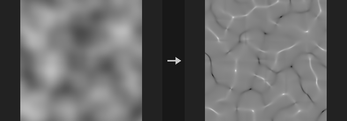

The height layer (multiplied by Strength) is treated as a surface over a world width of World Size. Curvature is in 1/world units and convex is positive (peaks and ridges above 0, pits and gullies below 0).

- `mean`: mean curvature.
- `gaussian`: Gaussian curvature (saddles are negative, independent of convexity).
- `profile`: curvature along the slope direction; negative where the slope steepens, positive where it flattens.
- `tangential`: curvature across the slope; positive on ridges, negative in gullies.
- `plan`: curvature of the contour lines; positive where flow diverges, negative where it converges.

To separate ridges from gullies use `tangential` or `plan` rather than elevation, which gives wrong results for gullies on high ground and ridges in low ground. Scale is a final multiplier: curvature scales with 1/R, so multiplying by a characteristic length gives a dimensionless value that is convenient as a mask. (profile + tangential) / 2 equals mean.

**Inputs**

| Input | Type | Description |
|---|---|---|
| `cop` | COPIMAGE | Image containing the height layer. |

**Outputs**

| Output | Type | Description |
|---|---|---|
| `cop` | COPIMAGE | Image with the curvature layer added. |

**Parameters**

| Parameter | Type | Default | Description |
|---|---|---|---|
| Height Layer `layer` | string | `C` | Height layer. |
| Height Scale `strength` | float [-10000.0..10000.0] | 1 | Height multiplier: layer value x Strength is the world height. |
| World Size `world_size` | float [1e-06..] | 1 | World width of the whole image. Pixel spacing is World Size divided by the image width. |
| Curvature Type `kind` | menu | Mean | Type of curvature; see the description. Options: Mean (`mean`), Gaussian (`gaussian`), Profile (`profile`), Tangential (`tangential`), Plan (`plan`). |
| Output Scale `scale` | float | 1 | Multiplier applied to the result. |
| Tileable (Wrap Edges) `tile` | toggle | off | Treat the image as tileable so derivatives wrap around the edges instead of being extrapolated. |
| Output Layer `out_layer` | string | `curvature` | Name of the output layer. |
| Keep Input Layers `keep_layers` | toggle | on | Keep the other layers of the input in the output. |

**Tips**

- Multiply with Scale by a characteristic length (for example World Size / 20) to get a dimensionless mask.

---

### COP Erosion Filter (PCG)

`PCG_COPErosion` · category `PCG/cop`

Adds erosion-like gullies and ridges to a height layer in a single, per-pixel pass; it is a filter, not a simulation.

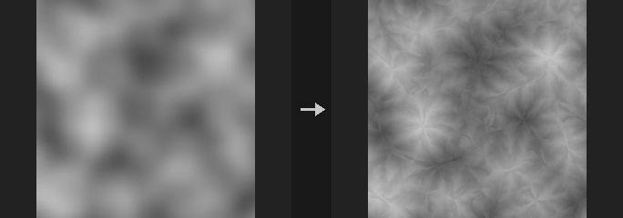

Produces a result that looks water-carved: channels running down slope and ridges, with fine rills branching off the walls of coarser ones. Each pixel is evaluated independently in one pass, and it runs on the GPU when one is available.

The idea follows Rune Skovbo Johansen's Advanced Terrain Erosion Filter (March 2026), re-implemented from its description.

**Compared with a real simulation it lacks** a continuous river network (a gully can end mid-slope), sediment deposition, and any dependence on upstream flow: gully depth depends only on local slope. For those you need flow accumulation, which is a different and much slower node.

The output overwrites the input height layer (so Height to Normal can follow without changes), and an extra `erosion` layer in [-1, 1] is written (ridges above 0, gullies below 0) for texture layering.

With `tile` on the result is seamless. With it off, `origin_x`/`origin_y` give the world position of the image's lower-left corner so tiles generated separately line up without seams.

**Inputs**

| Input | Type | Description |
|---|---|---|
| `cop` | COPIMAGE | Image containing the height layer. |

**Outputs**

| Output | Type | Description |
|---|---|---|
| `cop` | COPIMAGE | Image with the eroded height layer and the erosion mask layer. |

**Parameters**

| Parameter | Type | Default | Description |
|---|---|---|---|
| Height Layer `layer` | string | `C` | Height layer to erode. |
| Height Scale `strength` | float [-10000.0..10000.0] | 1 | Height scale: the height layer value times Strength gives the world height. Shared by all height-field nodes. |
| World Size `world_size` | float [1e-06..] | 1 | World-space width of the whole image; pixel spacing is World Size divided by the image width. Shared by all height-field nodes. |

*Erosion*

| Parameter | Type | Default | Description |
|---|---|---|---|
| Amplitude `amplitude` | float [0.0..10000.0] | 0.01 | Depth of the coarsest gullies in world units. Each finer octave is multiplied by Gain. |
| Wavelength `wavelength` | float [1.0..4096.0] | 48 | Spacing of the coarsest gullies in pixels. Each finer octave divides it by Lacunarity. |
| Octaves `octaves` | int [0..12] | 5 | Number of gully levels, from coarse to fine. |
| Lacunarity `lacunarity` | float [1.05..8.0] | 2 | Wavelength divider between successive octaves. |
| Gain `gain` | float [0.0..2.0] | 0.35 | Depth multiplier between successive octaves. The usual fractal value 0.5 with lacunarity 2 makes every level equally steep and fills the image with fine clutter, so the default is lower. |
| Steepness `steepness` | float [0.0..10000.0] | 2 | Slope mask sharpness: the slope is passed through an ease-out and used as a mask. Higher values let gentler slopes carve gullies. |
| Flow Blur `flow_blur` | float [0.0..4.0] | 0.25 | Before choosing the flow direction at each octave, the input slope is blurred by Flow Blur times that octave's wavelength. Fine noise in the input (typical for AI-generated height maps) otherwise makes large gullies zigzag within their own width and curl into worm shapes. It has almost no effect on smooth input. 0 matches the original method. |
| Seed `rand_seed` | int [0..] | 0 | Random seed for the gully pattern. |

*Fade*

| Parameter | Type | Default | Description |
|---|---|---|---|
| Fade `fade` | menu | By Altitude | How flat areas are treated: `altitude` fades flat areas into ridges (high) or gullies (low) depending on height; `none` leaves flat areas untouched. Options: By Altitude (`altitude`), None (`none`). |
| Height Range `height_min` `height_max` | float | 0, 0 | Height range (min, max) used by the altitude fade. If both are equal, the image's own min and max are used. Give explicit values when generating tiles, otherwise each tile uses its own range. *Hidden when fade ≠ altitude.* |

*Tiling*

| Parameter | Type | Default | Description |
|---|---|---|---|
| Tileable (Wrap Edges) `tile` | toggle | off | Make the result tile seamlessly. |
| Origin `origin_x` `origin_y` | float | 0, 0 | World position (x, y) of this image's lower-left corner, used when generating tiles. |

| Parameter | Type | Default | Description |
|---|---|---|---|
| Output Layer `out_layer` | string | `C` | Name of the eroded height output layer. |
| Erosion Mask Layer `mask_layer` | string | `erosion` | Name of the output layer in [-1, 1] (ridges above 0, gullies below 0). Empty skips it. |
| Keep Input Layers `keep_layers` | toggle | on | Keep the other input layers in the output. |

---

### COP Flow Accumulation (PCG)

`PCG_COPFlowAccumulation` · category `PCG/cop`

Computes how much upstream area drains through each pixel of a height field, and derives river, lake and flow direction layers from it.

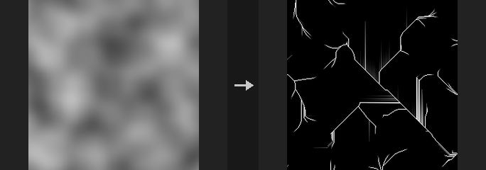

First the height field is pit-filled with Priority-Flood plus an epsilon: depressions become lakes and every pixel is guaranteed a lower neighbour, so water always reaches an outlet (by default the four image edges; with `tile` the single lowest point; a base layer restricts outlets to its marked pixels). Then water is passed downstream by one of three methods: D8 (steepest neighbour; rivers are one pixel wide lines at 0 and 45 degrees), Rho8 (randomized D8, unbiased in average direction, seeded by `rand_seed`) or MFD (split among all lower neighbours by slope to the power of `exponent`, giving sheet flow on slopes). Inside a filled lake the water follows the drowned valley: the flat lake surface only carries the tiny epsilon slope toward the spill point, which would draw ruler-straight lines and hatching, so lake pixels drain along the lowest original terrain under the water to the lake's exit.

Output layers: `flow` is the drainage area (in world units squared; resolution independent in channels), `river` is a river-network mask with a logarithmic soft transition around `river_area`, `lake` is the fill depth and `flow_dir` is the downstream direction (u, v). An empty layer name disables that output. A rain layer, if given, scales rainfall per pixel (e.g. more on windward slopes).

Water is conserved: the total leaving through the outlets equals the total rainfall, and the report states it. The pit filling is a sequential priority queue and runs on the CPU only (about 3 s for 1024x1024).

**Inputs**

| Input | Type | Description |
|---|---|---|
| `cop` | COPIMAGE | Image containing the height layer. |

**Outputs**

| Output | Type | Description |
|---|---|---|
| `cop` | COPIMAGE | Image with the flow, river, lake and direction layers added. |
| `report` | STRING | Text report including the water balance (rain in versus flow out). |

**Parameters**

| Parameter | Type | Default | Description |
|---|---|---|---|
| Height Layer `layer` | string | `C` | Height layer to route water over. |
| Height Scale `strength` | float [-10000.0..10000.0] | 1 | Height scale: height value times Strength gives world height. Shared by all height-field nodes. |
| World Size `world_size` | float [1e-06..] | 1 | World-space width of the whole image; pixel spacing is World Size divided by image width. Shared by all height-field nodes. |

*Flow*

| Parameter | Type | Default | Description |
|---|---|---|---|
| Flow Method `method` | menu | D8 | Flow routing: `d8` single steepest neighbour, `rho8` randomized D8, `mfd` multiple flow direction split by slope. Options: D8 (`d8`), Rho8 (Randomized D8) (`rho8`), MFD (Multiple Flow Directions) (`mfd`). |
| Slope Exponent `exponent` | float [0.1..20.0] | 1.1 | Slope exponent for MFD: higher values concentrate flow toward the steepest neighbour. *Hidden when method ≠ mfd.* |
| Seed `rand_seed` | int [0..] | 0 | Random seed for Rho8. *Hidden when method ≠ rho8.* |
| Fill Pits `fill_pits` | toggle | on | Fill depressions so they become lakes. If off, water that falls into a pit does not reach an outlet. |
| Tileable (Wrap Edges) `tile` | toggle | off | Use the lowest point of the whole image as the outlet instead of the four edges. |
| Outlet Layer `base_layer` | string | *(empty)* | Optional layer whose pixels above 0.5 are the outlets. Empty uses the four edges. |
| Rain Layer `rain_layer` | string | *(empty)* | Optional per-pixel rainfall amount. Empty means uniform rain. |

*River*

| Parameter | Type | Default | Description |
|---|---|---|---|
| River Layer `river_layer` | string | `river` | Name of the river mask layer. Empty disables it. |
| River Area `river_area` | float [1e-09..] | 0.002 | Drainage area (world units squared) around which the river mask transitions. *Disabled when river_layer = "".* |
| River Softness `river_softness` | float [0.01..5.0] | 0.5 | Width of the logarithmic soft transition of the river mask around River Area. *Disabled when river_layer = "".* |

*Output*

| Parameter | Type | Default | Description |
|---|---|---|---|
| Flow Layer `flow_layer` | string | `flow` | Name of the drainage area layer. Empty disables it. |
| Lake Depth Layer `lake_layer` | string | `lake` | Name of the lake depth layer (how deep each pit was filled). Empty disables it. |
| Flow Direction Layer `dir_layer` | string | `flow_dir` | Name of the downstream direction layer (u, v). Empty disables it. |
| Keep Input Layers `keep_layers` | toggle | on | Keep the other input layers in the output. |

---

### COP Height to AO (PCG)

`PCG_COPHeightToAO` · category `PCG/cop` · Houdini: Height to Ambient Occlusion (COP)

Computes ambient occlusion from a height field, where 1 is unoccluded and 0 is fully dark.

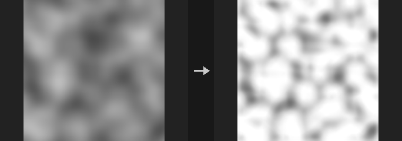

Horizon-based AO: from each pixel, `directions` rays are marched with `steps` samples out to `radius` pixels and the largest elevation angle above the pixel's tangent plane is found, converted to an occlusion and averaged over directions.

**Elevation is measured against the tangent plane, not the horizontal.** Measured against the horizontal, a whole slope would be occluded looking uphill, although an infinite slope has no occlusion physically. So any plane, however steep, gives exactly 1; convex shapes (peaks) give exactly 1; concave places (pits, gullies) are below 1 and darker with stronger curvature. Scaling height and world size together does not change the result, since only angles matter.

Cost is `directions x steps` full-image operations (64 by default). With `tile` off, samples outside the image do not contribute, so no dark rim appears along downhill edges.

**Inputs**

| Input | Type | Description |
|---|---|---|
| `cop` | COPIMAGE | Image containing the height layer. |

**Outputs**

| Output | Type | Description |
|---|---|---|
| `cop` | COPIMAGE | Image with the AO layer added. |

**Parameters**

| Parameter | Type | Default | Description |
|---|---|---|---|
| Height Layer `layer` | string | `C` | Height layer. |

*Height*

| Parameter | Type | Default | Description |
|---|---|---|---|
| Height Scale `strength` | float [-10000.0..10000.0] | 1 | Height scale: layer value times Strength gives world height. Shared by all height-field nodes. |
| World Size `world_size` | float [1e-06..] | 1 | World-space width of the whole image. Shared by all height-field nodes. |

*Quality*

| Parameter | Type | Default | Description |
|---|---|---|---|
| View Radius `radius` | float [0.5..4096.0] | 16 | Maximum search distance in pixels (must be above 0). |
| Sample Count `directions` | int [1..64] | 8 | Number of directions sampled around each pixel (up to 64). Cost grows with Directions times Steps. |
| Steps `steps` | int [1..64] | 8 | Number of samples along each direction (up to 64). |
| Intensity `intensity` | float [0.0..16.0] | 1 | Strength of the occlusion; higher values darken more. |
| Tileable (Wrap Edges) `tile` | toggle | off | Treat the image as periodic, for seamless textures. |

| Parameter | Type | Default | Description |
|---|---|---|---|
| Output Layer `out_layer` | string | `ao` | Name of the AO output layer. |
| Keep Input Layers `keep_layers` | toggle | on | Keep the other input layers in the output. |

---

### COP Height to Caustics (PCG)

`PCG_COPHeightToCaustics` · category `PCG/cop` · Houdini: Height to Caustics (COP)

Simulates the light patterns a water surface focuses onto the bottom, from a height field used as the water surface.

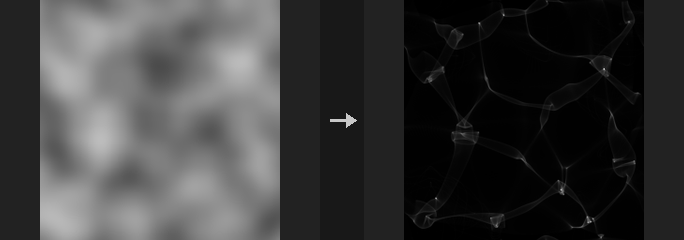

The output is 1 under a calm surface and above 1 where light is focused. It uses photon tracing: every pixel emits `supersample` squared photons, which are refracted by the surface normal (with the given index of refraction), travel to a floor at `depth`, and are splatted bilinearly into the four pixels around the landing point. This is more robust than inverting a Jacobian, because focal lines are exactly where the Jacobian is zero and an analytic approach would divide by zero there.

Properties: a calm surface gives exactly 1; with `tile` on, energy is conserved (the sum of all pixels equals the pixel count); a bump in the surface acts as a converging lens (above 1 directly below) and a dent as a diverging lens (below 1). With an IOR of 1 the image is about 1 everywhere. For oblique light, the shift caused by a calm surface is subtracted, so the pattern stays aligned with the surface above it. There is no Fresnel term, no absorption, and light is refracted once only.

The node runs on the CPU only, so results are deterministic (accumulation order matters for the last digits).

**Inputs**

| Input | Type | Description |
|---|---|---|
| `cop` | COPIMAGE | Image containing the water surface height layer. |

**Outputs**

| Output | Type | Description |
|---|---|---|
| `cop` | COPIMAGE | Image with the caustics layer added. |

**Parameters**

| Parameter | Type | Default | Description |
|---|---|---|---|
| Height Layer `layer` | string | `C` | Height layer used as the water surface. |

*Height*

| Parameter | Type | Default | Description |
|---|---|---|---|
| Height Scale `strength` | float [-10000.0..10000.0] | 1 | Height scale: layer value times Strength gives world height. Shared by all height-field nodes. |
| World Size `world_size` | float [1e-06..] | 1 | World-space width of the whole image. Shared by all height-field nodes. |

*Water*

| Parameter | Type | Default | Description |
|---|---|---|---|
| Water Depth `depth` | float [0.0..10000.0] | 0.1 | Depth of the floor below the surface, in world units. Deeper floors let the light focus further and spread more. |
| IOR `ior` | float [1.0..4.0] | 1.33 | Index of refraction of the water (about 1.33 for water). 1 means no refraction and therefore no caustics. |

*Light*

| Parameter | Type | Default | Description |
|---|---|---|---|
| Azimuth `azimuth` | float [-360.0..360.0] | 0 | Horizontal direction of the incoming light in degrees. Only matters for oblique light (elevation below 90). *Disabled when elevation >= 90.* |
| Elevation `elevation` | float [0.1..90.0] | 90 | Sun elevation in degrees; 90 is straight down. |

*Quality*

| Parameter | Type | Default | Description |
|---|---|---|---|
| Supersample `supersample` | int [1..8] | 2 | Photons per pixel along each axis; the total is Supersample squared. Higher is smoother and slower. |
| Tileable (Wrap Edges) `tile` | toggle | on | Treat the image as periodic. Recommended for seamless textures. With it off, photons landing outside the image are lost, and the output is normalized so a calm surface still gives 1 at the borders. |

| Parameter | Type | Default | Description |
|---|---|---|---|
| Output Layer `out_layer` | string | `caustics` | Name of the caustics output layer. |
| Keep Input Layers `keep_layers` | toggle | on | Keep the other input layers in the output. |

---

### COP Height to Normal (PCG)

`PCG_COPHeightToNormal` · category `PCG/cop` · Houdini: Height to Normal (COP)

Converts a height layer into a tangent-space normal layer (signed, +Y up, OpenGL convention).

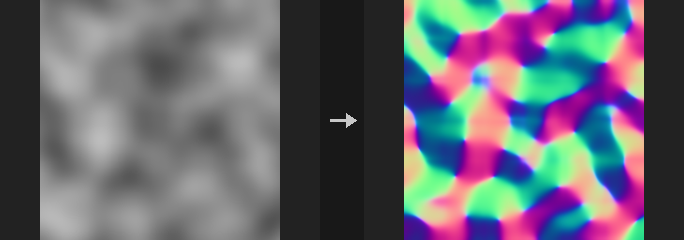

Computes `N = normalize(-dh/dx, -dh/dy, 1)` with derivatives in world units, written as a signed layer in [-1, 1] with +Y equal to +v. Use it to get a normal map from a grayscale height from a diffusion model or an albedo conversion. Follow it with COP Convert Normal (signed to packed) to export, or feed Control Image in normal mode for ControlNet.

Scale: height value times Strength is the world height and World Size is the world width of the whole image. The eight height-field nodes share this pair with the same defaults, so tuning it once keeps AO, shadow and caustics in the same world.

On a linear slope `h = a*x + b*y` every pixel, including the border ring, gets exactly `normalize(-a, -b, 1)`. One-sided differences are used at the border, because a clamp-padded central difference gives only half the slope in the outermost ring and would leave seams along the edges of a sloped tile.

Only channel 0 of a multi-channel layer is used; run COP Luminance first for color images.

**Inputs**

| Input | Type | Description |
|---|---|---|
| `cop` | COPIMAGE | Image containing the height layer. |

**Outputs**

| Output | Type | Description |
|---|---|---|
| `cop` | COPIMAGE | Image with the normal layer added. |

**Parameters**

| Parameter | Type | Default | Description |
|---|---|---|---|
| Height Layer `layer` | string | `C` | Height layer. Only its first channel is used. |
| Height Scale `strength` | float [-10000.0..10000.0] | 1 | Height scale: layer value times Strength gives world height. |
| World Size `world_size` | float [1e-06..] | 1 | World-space width of the whole image. |

*Derivatives*

| Parameter | Type | Default | Description |
|---|---|---|---|
| Method `method` | menu | Central Difference | Derivative operator: `central` is sharper and exactly inverts Normal to Height (exact mode); `sobel` adds smoothing and is steadier on noisy (AI-generated) heights. Options: Central Difference (`central`), Sobel (`sobel`). |
| Tileable (Wrap Edges) `tile` | toggle | off | Treat the image as periodic. Use for seamless textures. |

| Parameter | Type | Default | Description |
|---|---|---|---|
| Output Layer `out_layer` | string | `N` | Name of the normal output layer. |
| Keep Input Layers `keep_layers` | toggle | on | Keep the other input layers in the output. |

---

### COP Height to Shadow (PCG)

`PCG_COPHeightToShadow` · category `PCG/cop` · Houdini: Height to Shadow (COP)

Casts sun shadows over a height field, optionally with soft edges.

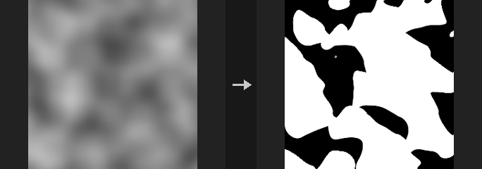

The output is a mask where 1 means in shadow. Turn on `invert` to get 1 for lit areas, which can be multiplied straight onto a color.

For each pixel, samples are taken toward the light up to `max_distance` pixels; if any sample's elevation angle exceeds the sun elevation, the pixel is in shadow. For a wall of height H the shadow length is exactly `H / tan(elevation)` in world scale, and at 90 degrees elevation there is no shadow.

Softness models the sun as a disc by its angular radius (a first-order approximation, not an area-light integral).

**Inputs**

| Input | Type | Description |
|---|---|---|
| `cop` | COPIMAGE | Image containing the height layer. |

**Outputs**

| Output | Type | Description |
|---|---|---|
| `cop` | COPIMAGE | Image with the shadow layer added. |

**Parameters**

| Parameter | Type | Default | Description |
|---|---|---|---|
| Height Layer `layer` | string | `C` | Height layer. |

*Height*

| Parameter | Type | Default | Description |
|---|---|---|---|
| Height Scale `strength` | float [-10000.0..10000.0] | 1 | Height scale: layer value times Strength gives world height. Shared by all height-field nodes. |
| World Size `world_size` | float [1e-06..] | 1 | World-space width of the whole image. Shared by all height-field nodes. |

*Light*

| Parameter | Type | Default | Description |
|---|---|---|---|
| Azimuth `azimuth` | float [-360.0..360.0] | 45 | Direction the light comes from, in degrees: 0 = from +u, 90 = from +v. |
| Elevation `elevation` | float [0.1..90.0] | 30 | Sun elevation angle above the horizon in degrees. |
| Softness `softness` | float [0.0..30.0] | 0 | Angular radius of the sun in degrees. 0 gives hard shadows. |

*Quality*

| Parameter | Type | Default | Description |
|---|---|---|---|
| Max Distance `max_distance` | float [1.0..4096.0] | 64 | How far toward the light each pixel searches, in pixels. |
| Step Size `step` | float [0.1..64.0] | 1 | Distance between samples along the search, in pixels. Each step is one full-image sampling. |
| Tileable (Wrap Edges) `tile` | toggle | off | Treat the image as periodic, for seamless textures. |

| Parameter | Type | Default | Description |
|---|---|---|---|
| Invert (1 = Lit) `invert` | toggle | off | Output 1 for lit and 0 for shadowed. |
| Output Layer `out_layer` | string | `shadow` | Name of the shadow output layer. |
| Keep Input Layers `keep_layers` | toggle | on | Keep the other input layers in the output. |

---

### COP HeightField Clip (PCG)

`PCG_COPHFClip` · category `PCG/cop` · Houdini: HeightField Clip (COP)

Clamps a height layer into a minimum/maximum range, optionally with a soft knee.

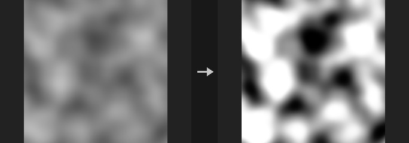

Equivalent of HeightField Clip. Heights are limited to [Min, Max] in the chosen mode, with `softness` giving a C1 continuous knee instead of a hard edge. A second layer `<out>_clipped` holds the amount that was changed. The height layer defaults to `C`, like the rest of the terrain nodes. An optional mask blends the clipped result back into the original height.

**Inputs**

| Input | Type | Description |
|---|---|---|
| `cop` | COPIMAGE | Image containing the height layer. |

**Outputs**

| Output | Type | Description |
|---|---|---|
| `cop` | COPIMAGE | Image with the clipped height layer and the `_clipped` difference layer. |

**Parameters**

| Parameter | Type | Default | Description |
|---|---|---|---|
| Layer `layer` | string | `C` | Height layer to clip. |
| Mask Layer `mask_layer` | string | *(empty)* | Optional mask layer (0 to 1) that blends the clipped result over the original height. Empty clips everywhere. |
| Clip `mode` | menu | Clip Below and Above | Which side is clipped: `both` limits to the range, `above` only lowers values over Max, `below` only raises values under Min. Options: Clip Below and Above (`both`), Clip Above (`above`), Clip Below (`below`). |
| Minimum Height `min` | float | 0 | Lower height limit. *Hidden when mode = above.* |
| Maximum Height `max` | float | 1 | Upper height limit. *Hidden when mode = below.* |
| Softness `softness` | float [0..] | 0 | Width of the smooth knee in height units. 0 gives a hard clamp. |
| Output Layer `out_layer` | string | *(empty)* | Name of the output layer. Empty overwrites the input layer; the change layer is written as `<name>_clipped`. |

---

### COP HeightField Cutout by Object (PCG)

`PCG_COPHFCutoutByObject` · category `PCG/cop`

Carves the terrain down to the bottom of a geometry, fills it up to its top, or both.

The height field lies in the xz plane, centered, with width `world_size`; world height is the layer value times `strength`. For every texel two vertical rays are shot (down and up) to find the top and bottom of the geometry in that column (the outermost two if several layers exist).

`carve` lowers the ground to the geometry's bottom where the geometry passes through the ground (geometry fully buried does not cut a hole). `fill` raises the ground to the geometry's top where the geometry rests on the ground (floating geometry does not pull the ground up). `both` carves then fills, so the geometry's solid part becomes the terrain. A layer `<out>_cut` marks the modified texels with 1, useful for texturing or scatter avoidance.

**Inputs**

| Input | Type | Description |
|---|---|---|
| `cop` | COPIMAGE | Image containing the height layer. |
| `geo` | GEOMETRY | Geometry (needs polygons) used as the cutting object. |

**Outputs**

| Output | Type | Description |
|---|---|---|
| `cop` | COPIMAGE | Image with the modified height layer and the `_cut` layer. |
| `report` | STRING | Text report of the operation. |

**Parameters**

| Parameter | Type | Default | Description |
|---|---|---|---|
| Height Layer `layer` | string | `C` | Height layer to modify. |
| Height Scale `strength` | float | 1 | Height scale: layer value times Strength gives world height. |
| World Size `world_size` | float [1e-06..] | 1 | Width of the height field in world units along x and z (centered on the origin). |
| Operation `mode` | menu | Carve (Cut Down) | `carve` digs terrain down to the object's bottom, `fill` builds terrain up to the object's top, `both` does both. Options: Carve (Cut Down) (`carve`), Fill (Raise Up) (`fill`), Carve and Fill (`both`). |
| Output Layer `out_layer` | string | *(empty)* | Name of the output layer. Empty overwrites the height layer; the change marker is written as `<name>_cut`. |

---

### COP HeightField Erode (PCG)

`PCG_COPHeightfieldErode` · category `PCG/cop` · Houdini: HeightField Erode (COP)

Erodes a height layer with a grid water simulation (rain, flowing water, sediment transport) plus thermal slumping, and writes flow, water, sediment and debris masks.

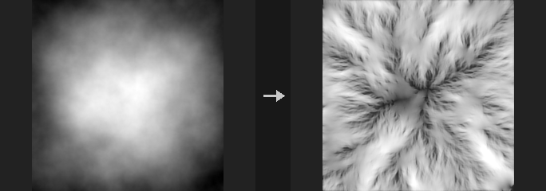

This is the model behind Houdini's HeightField Erode (Hydro). Every step, rain falls on every cell; water flows to the four neighbours through virtual pipes driven by the difference in terrain plus water height (Mei, Decaudin and Hu 2007); where it runs fast and deep it picks up material up to its carrying capacity (Capacity x slope x speed x depth), where it slows it deposits the excess; then part of it evaporates. Suspended sediment moves through the same pipes in the same proportion as the water, so material is conserved exactly. In the same step, slopes steeper than the Talus Angle slump: a fraction of the excess slides to the lower neighbours.

All parameters are in cells (the pixel size) and steps, so slopes are true slopes and the Talus Angle is a real angle. The same values carve proportionally finer gullies at a higher resolution, which suits Houdini's erode, upres, erode workflow: a few hundred steps at low resolution for the big valleys, a Resize up, then fewer steps for the detail.

Outputs: the eroded height, `flow` (where water ran: time-averaged speed times depth, normalized to 0-1, dendritic on slopes and solid in rivers), `water` (standing water at the end), `sediment` (net deposition by water: valley floors and fans), `debris` (net deposition by slumping: scree aprons, added onto an existing debris layer by default) and optionally `erosion` (net removal). Leave a name empty to skip an output.

Water and sediment drain off the image edges unless Tile is on. The report gives the terrain volume before and after and the sediment carried off the edges, which balance exactly. Compute = auto uses CUDA when available (float32); numpy takes about 0.25 s per step at 1024x1024.

**Inputs**

| Input | Type | Description |
|---|---|---|
| `cop` | COPIMAGE | Image containing the height layer. |

**Outputs**

| Output | Type | Description |
|---|---|---|
| `cop` | COPIMAGE | Image with the eroded height and the requested flow, water, sediment, debris and erosion layers. |
| `report` | STRING | Text summary: steps and device, terrain volume before and after, sediment carried off the edges, water drained and left standing. |

**Parameters**

| Parameter | Type | Default | Description |
|---|---|---|---|
| Height Layer `layer` | string | `C` | Layer holding the terrain height. |
| Height Scale `strength` | float [-10000.0..10000.0] | 1 | Height Scale: height value times this is world height. Must not be 0. Output is divided back to height units. |
| World Size `world_size` | float [1e-06..] | 1 | World width of the whole image; the pixel size (World Size / width) is the unit of every other parameter. |
| Iterations `iterations` | int [0..] | 200 | Number of simulation steps. |
| Rain `rain` | float [0.0..10.0] | 0.02 | Water added to every cell each step, in cells of depth. |
| Evaporation `evaporation` | float [0.0..1.0] | 0.02 | Fraction of the water that evaporates each step. Higher values keep water in the channels and shorten rivers. |
| Tileable (Wrap Edges) `tile` | toggle | off | Wrap the edges. Off: the outside is one cell lower and dry, so water and sediment drain off the image. |
| Hardness Layer `hardness_layer` | string | *(empty)* | Optional 0-1 layer; 1 is bedrock that neither erodes nor slumps. |
| Rain Layer `rain_layer` | string | *(empty)* | Optional per-cell rain multiplier (for example more rain on windward slopes). |

*Erosion*

| Parameter | Type | Default | Description |
|---|---|---|---|
| Sediment Capacity `capacity` | float [0.0..1000.0] | 1 | Carrying capacity factor: the water can hold Capacity x sin(tilt) x speed x min(depth, Max Depth) of material. |
| Erosion Rate `erode_rate` | float [0.0..1.0] | 0.1 | Fraction of the missing capacity picked up per step. |
| Deposition Rate `deposit_rate` | float [0.0..1.0] | 0.1 | Fraction of the excess sediment dropped per step. |
| Min Slope `min_slope` | float [0.0..10.0] | 0.03 | Lower limit of sin(tilt) in the capacity, so water on flat ground still carries some material. |
| Max Erosion Depth `max_depth` | float [0.001..1000.0] | 2 | Depth (cells) beyond which deeper water carries no more, so lakes do not dig their floors. |
| Flow Damping `damping` | float [0.0..1.0] | 0.9 | Fraction of last step's flux kept in each pipe: the momentum of the flow. |
| Bed Change Limit `bed_change_limit` | float [0.0..10.0] | 0 | Caps how far the bed moves per step to this fraction of the water depth; 0 turns it off. With a Capacity above about 3, erosion and flow amplify each other and slopes break up into ripples across the flow; 0.03 keeps Capacity 10 smooth while channels still cut at nearly full speed. |

*Thermal*

| Parameter | Type | Default | Description |
|---|---|---|---|
| Talus Angle `talus_angle` | float [0.0..89.9] | 52 | Slopes steeper than this angle slump. |
| Thermal Rate `thermal_rate` | float [0.0..1.0] | 0.05 | Fraction of the excess above the talus angle moved per step. 0 disables slumping. |

*Output*

| Parameter | Type | Default | Description |
|---|---|---|---|
| Output Layer `out_layer` | string | `C` | Layer for the eroded height. |
| Flow Layer `flow_layer` | string | `flow` | Layer for the 0-1 flow mask. Empty disables it. |
| Water Layer `water_layer` | string | `water` | Layer for the standing water depth at the end. Empty disables it. |
| Sediment Layer `sediment_layer` | string | `sediment` | Layer for net deposition by water. Empty disables it. |
| Debris Layer `debris_layer` | string | `debris` | Layer for net deposition by slumping. Empty disables it. |
| Accumulate onto Existing `accumulate_debris` | toggle | on | Add the debris onto an existing layer of the same name (from Thermal or Hydraulic Erosion) instead of replacing it. *Disabled when debris_layer = "".* |
| Erosion Layer `erosion_layer` | string | *(empty)* | Layer for net removal of material. Empty disables it. |
| Keep Input Layers `keep_layers` | toggle | on | Keep the input image's other layers in the output. |

*Advanced*

| Parameter | Type | Default | Description |
|---|---|---|---|
| Compute `compute` | menu | Auto | Where to compute: auto uses CUDA when available, cpu forces numpy. The result returns to the input's backend. Options: Auto (`auto`), CPU (`cpu`), CUDA (`cuda`). |

**Compared with Houdini**

Corresponds to HeightField Erode / Erode Hydro: grid water with sediment transport and thermal slumping in one solver, with flow, water, sediment and debris outputs. Houdini additionally separates bedrock from loose debris and has a precipitation spread, river bank and erodability-by-layer controls; parameters here are in cells and steps rather than Houdini's physical units.

**Tips**

- Erode, upres, erode: run it at a quarter resolution for the big valleys, Resize up, add a little noise, then run fewer steps at full resolution.
- Feed it terrain that already has a drainage network (Stream Power with uplift) for mountain ranges; on raw noise the water pools in every pit and fills them with sediment.
- The flow, sediment and debris layers are the masks for texturing: dark wet streaks, light valley floors, scree at the foot of slopes.
- For deep, sharp gullies raise Capacity to 5-10 and set Bed Change Limit to 0.03; without the limit the slopes turn into washboard ripples.

---

### COP HeightField from Depth (PCG)

`PCG_COPHeightfieldFromDepth` · category `PCG/cop`

Turns a single image's depth into a top-down height field, so a picture of a landscape can feed the terrain chain.

Intended workflow: an AI image of a valley, depth estimated by MoGe or Depth Anything, flattened here into a height field, then used with erosion, river networks, splat maps and mesh conversion.

**perspective** (landscape photos, AI perspective images): either connect `moge_geometry` (the core MoGeInference output, recommended; it supplies camera-space points, metric scale and a sky mask, so nothing is guessed), or connect `depth` (relative inverse depth from Depth Anything and similar, which is only known up to scale and offset: `z = 1/(d + shift)` is a guess and the FOV must be entered by hand; wrong guesses bend the terrain rather than scaling it). The ground plane is fitted with weights proportional to area (z squared) and the camera pitch is solved automatically. Points are rasterized top-down, a cell takes the mean height of the points that land in it, and unseen cells (behind mountains, sparse distant areas) are filled by push-pull. The `mask` layer marks the cells that were really measured; the filled values are guesses.

**top_down** (satellite images, AI orthographic maps): the depth is used directly as height, normalized to Relief times World Size.

Connect the original image to `image` to also get an `albedo` layer (the color projected top-down; MoGe supplies its own). The `world_size` output can be wired to the world size of the height-field family so scales match. The height layer is `C`.

**Inputs**

| Input | Type | Description |
|---|---|---|
| `depth` *(optional)* | IMAGE | Depth or disparity image (Depth Anything and similar). Required for top_down; optional in perspective when moge_geometry is connected. |
| `moge_geometry` *(optional)* | MOGE_GEOMETRY | MoGe geometry output (camera-space points, with scale and sky mask). Takes priority over depth in perspective mode. |
| `image` *(optional)* | IMAGE | Original color image; produces the `albedo` layer. Optional. |

**Outputs**

| Output | Type | Description |
|---|---|---|
| `cop` | COPIMAGE | Height field image: height in layer `C`, plus `mask` (measured cells, perspective only) and `albedo` when color is available. |
| `world_size` | FLOAT | World-space width of the generated height field, to wire into the world size parameters of other height-field nodes. |
| `report` | STRING | Text summary: source, number of points, coverage, world width, height range, up mode and camera pitch. |

**Parameters**

| Parameter | Type | Default | Description |
|---|---|---|---|
| Projection `mode` | menu | Perspective (Photo) | `perspective` lifts a perspective image into a ground-plane height field; `top_down` treats the depth as a top-down height map. Options: Perspective (Photo) (`perspective`), Top Down (Orthographic) (`top_down`). |
| Depth Type `depth_kind` | menu | Disparity (Inverse Depth) | Meaning of the depth image: `disparity` (inverse depth, near = bright) or `depth` (near = dark). Not used with moge_geometry in perspective mode. Options: Disparity (Inverse Depth) (`disparity`), Depth (`depth`). |
| Batch Index `batch_index` | int [0..4096] | 0 | Which image of the batch to use. |
| Resolution `resolution` | int [8..8192] | 512 | Resolution (width and height) of the generated height field. If the report shows low coverage, lower this or raise the depth map resolution. *Hidden when mode = top_down.* |
| Horizontal FOV `fov_x` | float [1.0..170.0] | 60 | Horizontal field of view in degrees. Only used when depth is connected without moge_geometry. *Hidden when mode = top_down.* |
| Up Vector `up` | menu | Fit Ground Plane | How the ground is determined: `fit_plane` fits a plane to the points and solves camera pitch; `camera_level` assumes the camera is level (more robust when a large depression in the foreground would tilt the fit). Options: Fit Ground Plane (`fit_plane`), Camera Level (`camera_level`). *Hidden when mode = top_down.* |
| Far Quantile `far_quantile` | float [0.05..1.0] | 0.95 | Discards the farthest fraction of points: only points up to this depth quantile are kept. Points near the horizon are sparse and inaccurate and would only stretch the grid into holes. *Hidden when mode = top_down.* |
| Fill Holes `fill_holes` | toggle | on | Fill cells with no measurement by push-pull interpolation. The filled values are guesses. *Hidden when mode = top_down.* |

*Disparity*

| Parameter | Type | Default | Description |
|---|---|---|---|
| Disparity Shift `shift` | float [0.0..10.0] | 0.05 | Offset in `z = 1 / (d + shift)` for converting disparity to depth. Only used when depth is connected. *Hidden when mode = top_down } { depth_kind = depth.* |
| Sky Threshold `sky` | float [0.0..1.0] | 0.02 | Pixels with disparity at or below this value are treated as sky and dropped. *Hidden when mode = top_down } { depth_kind = depth.* |

*Top Down*

| Parameter | Type | Default | Description |
|---|---|---|---|
| Relief `relief` | float [0.0..100.0] | 0.25 | Top Down mode: the height range as a fraction of World Size. *Hidden when mode = perspective.* |
| World Size `world_size` | float [1e-06..] | 1 | Top Down mode: world width of the output; perspective mode derives it from the points. *Hidden when mode = perspective.* |

| Parameter | Type | Default | Description |
|---|---|---|---|
| Dequantize 8-bit Depth `dequantize` | toggle | on | Smooth an 8-bit depth map back to continuous values before lifting. Depth Anything through comfyui_controlnet_aux delivers 256 levels; each level would lift to one arc on the ground, which shows as horizontal streaks and terraces in the far field. Every value stays within its own quantization bin, so silhouettes stay sharp. Has no effect on float depth or MoGe, and also applies in top_down mode. |

**Tips**

- Prefer moge_geometry over a plain depth map for perspective images; a guessed depth bends the terrain.
- Perspective mode needs ground running into the distance under a horizon. A figure, a portrait or a flat-coloured drawing has no ground to fit: the sky lifts as a wall at the back and the subject as a spike.

---

### COP HeightField Hydraulic Erosion (PCG)

`PCG_COPHydraulicErosion` · category `PCG/cop`

Erodes a height layer with simulated water droplets that carry and deposit sediment.

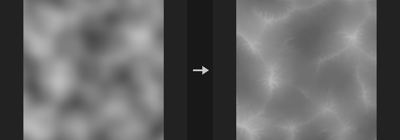

Droplets run downhill, pick up material where it is steep and fast, and drop it where the slope flattens, the water evaporates and the speed falls. Gullies, alluvial fans and flat basin floors grow this way. In the terrain chain this is the only node that actually transports sediment: the erosion filters only carve, thermal erosion only collapses to the angle of repose, and stream power only cuts.

The model is the droplet model of Beyer 2015, with parameter names following Sebastian Lague's implementation. A batch of droplets runs at the same time and their changes are scatter-added back. Because hundreds of droplets can join one channel in the same step, each cell is dug at most down to its lowest neighbour and built up at most slightly above its highest neighbour, so no pits or spikes form. Material beyond that limit stays on the droplet, and the books balance per droplet: the change in total terrain volume equals minus the material that left over the map edge (and any discarded sediment), as stated in `report`.

Output layers: the eroded height (Output Layer), net deposition (Deposit Layer, default `debris`, accumulated onto an existing layer of the same name, so thermal-erosion talus and alluvial deposit end up in one layer), optional net erosion, and wetness (water traffic above the background level, normalized to 0-1, useful as a river or gully mask). Leave a layer name empty to skip that output.

Height Scale and World Size give the world scale: height value times Height Scale is world height, and World Size is the world width of the whole image. Droplets per Pixel of 1 is roughly Lague's default amount.

**Inputs**

| Input | Type | Description |
|---|---|---|
| `cop` | COPIMAGE | Image containing the height layer. |

**Outputs**

| Output | Type | Description |
|---|---|---|
| `cop` | COPIMAGE | Image with the eroded height and the requested deposit, erosion and wetness layers. |
| `report` | STRING | Text summary: droplet count, eroded and deposited volume, sediment lost or dropped at end of life, outflow over the map edge, mass-balance residual and the device used. |

**Parameters**

| Parameter | Type | Default | Description |
|---|---|---|---|
| Height Layer `layer` | string | `C` | Layer holding the terrain height. |
| Height Scale `strength` | float [-10000.0..10000.0] | 1 | Height Scale: multiplies the height values to get world heights. Must not be 0. Output is divided back to height units. |
| World Size `world_size` | float [1e-06..] | 1 | World width of the whole image, used to convert pixels into world distances for slopes. |
| Tileable (Wrap Edges) `tile` | toggle | off | Treat the image as tileable: droplets wrap around the edges instead of leaving the map. |
| Hardness Layer `hardness_layer` | string | *(empty)* | Optional layer in 0-1 where 1 is bedrock that cannot be eroded. |
| Seed `rand_seed` | int [0..] | 0 | Seed for the random droplet start positions. |

*Erosion*

| Parameter | Type | Default | Description |
|---|---|---|---|
| Droplets per Pixel `droplets_per_pixel` | float [0.0..100.0] | 1 | Total number of droplets relative to the pixel count. More droplets give stronger, more developed erosion and a longer run time. |
| Max Lifetime `lifetime` | int [1..10000] | 30 | Maximum number of steps each droplet takes. |
| Erosion Rate `erode_rate` | float [0.0..1.0] | 0.3 | Fraction of the available capacity deficit that is eroded per step. |
| Deposition Rate `deposit_rate` | float [0.0..1.0] | 0.3 | Fraction of excess sediment that is deposited per step when the droplet carries more than it can. |

*Erosion › Droplet*

| Parameter | Type | Default | Description |
|---|---|---|---|
| Sediment Capacity `capacity` | float [0.0..1000.0] | 4 | Sediment capacity multiplier. Higher values let droplets carry more material before depositing. |
| Inertia `inertia` | float [0.0..0.99] | 0.05 | How much a droplet keeps its previous direction rather than following the slope. Higher values give smoother, straighter paths. |
| Min Slope `min_slope` | float [0.0..10.0] | 0.01 | Lower bound on the slope used in the capacity calculation, so droplets on flat ground still carry some material. |
| Evaporation Rate `evaporate` | float [0.0..0.99] | 0.01 | Fraction of its water a droplet loses per step. Higher values make droplets deposit sooner. |
| Gravity `gravity` | float [0.0..1000.0] | 4 | Acceleration of droplets on slopes. Higher values speed them up faster. |

*Erosion › Brush*

| Parameter | Type | Default | Description |
|---|---|---|---|
| Erosion Radius `radius` | float [1.0..32.0] | 3 | Erosion brush radius in pixels; material is removed over this area around the droplet. |
| Deposition Radius `deposit_radius` | float [0.0..32.0] | 0 | Deposition brush radius in pixels. 1 or less deposits bilinearly onto the four surrounding cells. |
| At End of Lifetime `end_mode` | menu | Spread Sediment | What happens to sediment still carried when a droplet's lifetime ends. Spread Sediment piles it up locally with a brush (limited like normal deposition); Discard Sediment throws it away as in the original algorithm. Options: Spread Sediment (`spread`), Discard Sediment (`lose`). |

*Output*

| Parameter | Type | Default | Description |
|---|---|---|---|
| Output Layer `out_layer` | string | `C` | Layer that receives the eroded height. Using the input layer's name overwrites it. |
| Deposit Layer `deposit_layer` | string | `debris` | Layer for net deposition (height units, 0 or more). Empty disables it. |
| Accumulate onto Existing `accumulate_deposit` | toggle | on | Add the new deposition to an existing layer of the same name instead of replacing it. *Disabled when deposit_layer = "".* |
| Erosion Layer `erosion_layer` | string | *(empty)* | Layer for net erosion (height units, 0 or more). Empty disables it. |
| Wetness Layer `wet_layer` | string | `wetness` | Layer for the wetness mask. Empty disables it. |
| Keep Input Layers `keep_layers` | toggle | on | Keep the other input layers in the output. |

*Advanced*

| Parameter | Type | Default | Description |
|---|---|---|---|
| Batch Size `batch` | int [1..] | 16384 | Number of droplets simulated at the same time. Larger is faster but deviates more from a strictly one-droplet-at-a-time algorithm. |
| Compute `compute` | menu | Auto | Backend. Auto uses the GPU when one is available and the image is at least 256x256, otherwise CPU. GPU runs in float32, so results differ from CPU at rounding level and, because droplet paths are sensitive to rounding, may differ visibly in detail. The result is returned on the original backend. Options: Auto (`auto`), CPU (`cpu`), CUDA (`cuda`). |

**Compared with Houdini**

Corresponds to HeightField Erode but implemented as a droplet (particle) model that transports sediment, not Houdini's solver. Parameter names follow the Lague implementation.

**Tips**

- Put it after thermal erosion: the `debris` layer then holds both talus and alluvial deposit, which the Splat Map node reads for sediment by default.
- Droplet paths are sensitive to rounding, so expect the same seed to look different on CPU and GPU.

---

### COP HeightField Mask by Feature (PCG)

`PCG_COPMaskByFeature` · category `PCG/cop` · Houdini: HeightField Mask by Feature (COP)

Builds a mask from terrain features: slope, direction, height, curvature and occlusion.

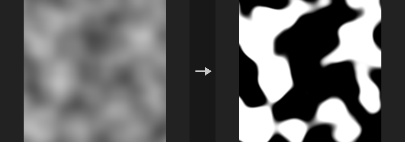

Each enabled criterion gives a 0-1 mask, and the enabled criteria are combined with Blend Mode (multiply by default, so all must hold). If no criterion is enabled the mask is all 1. Soft edges use smoothstep; a falloff of 0 gives a hard edge. Smooth Radius blurs the height first (world units) and all features are measured on the blurred height. Scale parameters (Height Scale, World Size) follow the same convention as the other height-layer nodes.

Typical uses: rock on slopes of 35 degrees or more, gravel in gullies, snow on north-facing slopes (a Goal Angle of 90 degrees means downhill points toward +v).

- **Slope**: angle in degrees between the surface and the horizontal.
- **Direction**: downhill direction within Angle Spread of the Goal Angle (0 degrees is +u, 90 degrees is +v). Flat ground has no direction and scores 0.
- **Height**: range in raw height values (Height Scale is not applied).
- **Curvature**: tangential curvature separates ridges from gullies without using elevation, which flips on high gullies and low ridges. The height is blurred by Blur Radius pixels first (pixel-level curvature is noise), then divided by a reference value: Reference Curvature if greater than 0 (per world unit; required for tiled generation), otherwise the 90th percentile of |curvature| of this image. Threshold 0 then splits ridges from gullies; higher values select only sharper features.
- **Occlusion**: 1 minus the height-to-AO result, so 0 is open and 1 is fully blocked.

**Inputs**

| Input | Type | Description |
|---|---|---|
| `cop` | COPIMAGE | Image containing the height layer. |

**Outputs**

| Output | Type | Description |
|---|---|---|
| `cop` | COPIMAGE | Image with the mask in the output layer. |

**Parameters**

| Parameter | Type | Default | Description |
|---|---|---|---|
| Height Layer `layer` | string | `C` | Layer holding the terrain height. |
| Height Scale `strength` | float [-10000.0..10000.0] | 1 | Height Scale: multiplies height values to get world heights, used for slope, curvature and occlusion. |
| World Size `world_size` | float [1e-06..] | 1 | World width of the whole image. |
| Tileable (Wrap Edges) `tile` | toggle | off | Treat the image as tileable (wrap at the edges). |
| Smooth Radius `smooth_radius` | float [0.0..] | 0 | Radius in world units used to blur the height before any feature is measured. 0 disables. |
| Blend Mode `blend_mode` | menu | Multiply | How multiple enabled criteria are combined. Add is not clamped, so the mask can exceed 1. Options: Multiply (`multiply`), Add (`add`), Average (`average`), Minimum (`minimum`), Maximum (`maximum`). |

*Slope*

| Parameter | Type | Default | Description |
|---|---|---|---|
| Mask by Slope `use_slope` | toggle | on | Enable the slope criterion. |
| Slope Range `slope_min` `slope_max` | float [0.0..90.0] | 20, 90 | Slope range in degrees: the mask is 1 between the two values. |
| Slope Falloff `slope_falloff` | float [0.0..90.0] | 5 | Width of the soft edge of the slope range, in degrees. |

*Direction*

| Parameter | Type | Default | Description |
|---|---|---|---|
| Mask by Direction `use_aspect` | toggle | off | Enable the direction criterion. |
| Goal Angle `aspect_dir` | float [-360.0..360.0] | 90 | Goal downhill direction in degrees (0 is +u, 90 is +v). |
| Angle Spread `aspect_spread` | float [0.0..180.0] | 45 | Allowed angular deviation from the goal direction, in degrees. |
| Direction Falloff `aspect_falloff` | float [0.0..180.0] | 15 | Width of the soft edge of the direction range, in degrees. |

*Height*

| Parameter | Type | Default | Description |
|---|---|---|---|
| Mask by Height `use_height` | toggle | off | Enable the height criterion. |
| Height Range `height_min` `height_max` | float | 0, 1 | Height range in raw height values: the mask is 1 between the two values. |
| Height Falloff `height_falloff` | float [0.0..] | 0 | Width of the soft edge of the height range, in height units. |

*Curvature*

| Parameter | Type | Default | Description |
|---|---|---|---|
| Mask by Curvature `curvature` | menu | Off | Select ridges (convex) or gullies (concave), or turn the curvature criterion off. Options: Off (`off`), Ridges (`ridges`), Gullies (`gullies`). |
| Threshold `curv_threshold` | float [-100.0..100.0] | 0 | Threshold on the normalized curvature. 0 splits ridges from gullies; positive values keep only sharper features. *Hidden when curvature = off.* |
| Falloff `curv_falloff` | float [0.0..100.0] | 0.3 | Width of the soft edge around the threshold, in normalized curvature. *Hidden when curvature = off.* |
| Blur Radius `curv_blur` | float [0.0..256.0] | 2 | Blur radius in pixels applied to the height before curvature is computed. *Hidden when curvature = off.* |
| Reference Curvature `curv_reference` | float [0.0..] | 0 | Curvature used for normalization, per world unit. 0 uses the 90th percentile of this image; set it explicitly when generating in tiles. *Hidden when curvature = off.* |

*Occlusion*

| Parameter | Type | Default | Description |
|---|---|---|---|
| Mask by Occlusion `use_occlusion` | toggle | off | Enable the occlusion criterion. |
| Occlusion Range `occ_min` `occ_max` | float [0.0..1.0] | 0.2, 1 | Occlusion range (0 open, 1 fully blocked): the mask is 1 between the two values. |
| Occlusion Falloff `occ_falloff` | float [0.0..1.0] | 0 | Width of the soft edge of the occlusion range. |
| Height Scale `occ_height_scale` | float [0.0..] | 1 | Extra multiplier on height for the occlusion calculation, to exaggerate occlusion. |
| View Radius `occ_radius` | float [1e-06..] | 0.1 | How far to look for occluders, in world units. |
| Step Scale `occ_step_scale` | float [0.01..] | 1 | Number of pixels per marching step (at most 64 steps are taken). |
| Sample Count `occ_samples` | int [1..64] | 8 | Number of directions sampled for occlusion. |

| Parameter | Type | Default | Description |
|---|---|---|---|
| Invert Mask `invert` | toggle | off | Invert the final mask. |
| Output Layer `out_layer` | string | `mask` | Name of the mask layer. |
| Keep Input Layers `keep_layers` | toggle | on | Keep the other layers of the input in the output. |

---

### COP HeightField Mask by Object (PCG)

`PCG_COPHFMaskByObject` · category `PCG/cop`

Projects a geometry vertically onto a height field and outputs a mask of where it covers, crosses, floats above or is buried below the ground.

Uses the same grid convention as HeightField Project: xz plane, centered, width `world_size`, world height equal to layer value times `strength`. Each texel's column is tested with rays from above and below to find the top and bottom of the geometry.

Modes: `footprint` is 1 wherever the geometry covers the column; `intersect` where the geometry passes through the ground (bottom at or below the ground and top at or above it); `above` where the geometry is entirely above the ground; `below` where it is entirely buried.

`feather` softens the mask outward by a world-space distance (exact distance with a smoothstep). `invert` flips the mask.

**Inputs**

| Input | Type | Description |
|---|---|---|
| `cop` | COPIMAGE | Image containing the height layer. |
| `geo` | GEOMETRY | Geometry (needs polygons) to project. |

**Outputs**

| Output | Type | Description |
|---|---|---|
| `cop` | COPIMAGE | Image with the mask layer added. |
| `report` | STRING | Text report of the operation. |

**Parameters**

| Parameter | Type | Default | Description |
|---|---|---|---|
| Mask Type `mode` | menu | Footprint | Which relation between object and ground is marked: footprint, intersect, above (floating) or below (buried). Options: Footprint (`footprint`), Intersecting Ground (`intersect`), Above Ground (`above`), Below Ground (`below`). |
| Height Layer `layer` | string | `C` | Height layer defining the ground. *Hidden when mode = footprint.* |
| Height Scale `strength` | float | 1 | Height scale: layer value times Strength gives world height. *Hidden when mode = footprint.* |
| World Size `world_size` | float [1e-06..] | 1 | Width of the height field in world units (centered on the origin). |
| Feather `feather` | float [0.0..] | 0 | Width of the outward soft edge in world units. 0 gives a hard mask. |
| Invert Mask `invert` | toggle | off | Invert the mask. |
| Output Layer `out_layer` | string | `mask` | Name of the output mask layer. |

---

### COP HeightField Project (PCG)

`PCG_COPHFProject` · category `PCG/cop` · Houdini: HeightField Project (COP), HeightField Transform 3D (COP)

Projects geometry down onto a height field, or, with no geometry connected, transforms the height field in 3D and projects it back.

Covers HeightField Project and HeightField Transform 3D. With `geo` connected, a ray is cast straight down from above each texel; the height of the hit, divided by `strength`, is combined into the layer according to `mode`. With no geometry, the height field itself is turned into a mesh, transformed with `translate`, `rotate` (Euler XYZ, degrees) and `scale` about its center, and projected back onto the same grid. The mode is then always Replace, so tilting, lifting or rotating a terrain is a true 3D transform and not an image-space warp.

`project` chooses which surface a ray takes: the highest hit, or the lowest (Minimum Height). If `max_height` is above 0, only geometry whose height value lies within plus/minus that value is projected. `mask` and `mask_layer` blend the result with the original height. `projection_only` outputs just the projected heights without compositing, and `hitmask_layer` writes a mask of the texels that were hit. The second output is a report with the number of hit texels.

The grid convention is the one of HeightField to Mesh: xz plane, centered, width `world_size`.

**Inputs**

| Input | Type | Description |
|---|---|---|
| `cop` | COPIMAGE | Image containing the height layer. |
| `geo` *(optional)* | GEOMETRY | Geometry to project from above. When disconnected, the node performs the 3D transform of the height field. |

**Outputs**

| Output | Type | Description |
|---|---|---|
| `cop` | COPIMAGE | Image with the projected height layer (and optional hit mask). |
| `report` | STRING | Text report with the number of hit texels. |

**Parameters**

| Parameter | Type | Default | Description |
|---|---|---|---|
| Height Layer `layer` | string | `C` | Height layer to project onto. |
| Project `project` | menu | Maximum Height | Which surface a ray picks: `maximum` the topmost, `minimum` the lowest. Options: Maximum Height (`maximum`), Minimum Height (`minimum`). |
| Max Projection Height `max_height` | float [0.0..] | 0 | If above 0, only geometry within this height range (as a height value, plus/minus) is projected. 0 means unlimited. |
| Mask `mask` | float [0.0..1.0] | 1 | Blend amount between original and result. When a mask layer is given, it is multiplied by it. *Disabled when projection_only is on.* |
| Mask Layer `mask_layer` | string | *(empty)* | Optional layer controlling the blend per pixel. *Disabled when projection_only is on.* |
| Blend Mode `mode` | menu | Maximum | How the projected height combines with the existing height (only with geometry connected): max, min, add, replace, multiply, or blend. Blend replaces the height where hit and leaves the rest; Replace fills misses with Fill Value. Without geometry the mode is fixed to Replace. Options: Maximum (`max`), Minimum (`min`), Add (`add`), Replace (`replace`), Blend (`blend`), Multiply (`multiply`). *Disabled when projection_only is on.* |
| Output Projection Only `projection_only` | toggle | off | Output only the projected heights, with misses set to Fill Value, without combining with the original height or the mask. |
| Fill Value `fill_value` | float | 0 | Value for texels that were not hit (with geometry, only used by Replace and Output Projection Only). |
| Height Scale `strength` | float | 1 | Height scale: layer value times Strength gives world height. |
| World Size `world_size` | float [1e-06..] | 1 | Width of the height field in world units (centered on the origin). |

*Transform 3D*

| Parameter | Type | Default | Description |
|---|---|---|---|
| Translate `translate` | string | `0 0 0` | Translation (x y z) applied in the 3D transform. Only used when no geometry is connected. |
| Rotate `rotate` | string | `0 0 0` | Rotation (x y z, Euler angles in degrees). Only used when no geometry is connected. |
| Scale `scale` | string | `1 1 1` | Scale (x y z) about the height field's center. Only used when no geometry is connected. |

| Parameter | Type | Default | Description |
|---|---|---|---|
| Output Layer `out_layer` | string | *(empty)* | Name of the output layer. Empty overwrites the height layer. |
| Hitmask Layer `hitmask_layer` | string | *(empty)* | Name of a layer that receives 1 where a ray hit and 0 elsewhere. Empty disables it. |

---

### COP HeightField Splat Map (PCG)

`PCG_COPSplatMap` · category `PCG/cop`

Derives a set of grass, sediment, rock, snow and water material masks that sum to one from a terrain.

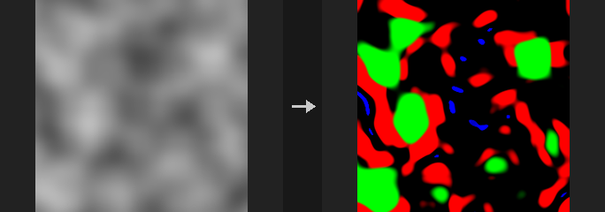

Produces masks that always add up to exactly 1 per pixel, for engine terrain layers, regional prompts or a segmentation ControlNet (use the id layer).

The layers are composited in order, later ones covering earlier ones: water over snow over rock over sediment over grass. Rock is steep slope. Snow is above the snow line and not too steep (steep faces cannot hold snow). Sediment comes from the debris layer (a thermal erosion output) or, without one, from low flat areas. Water comes from lake / river layers (flow accumulation outputs).

Height is normalized per image by default (a snow line of 0.75 is the top quarter); use Absolute when tiled generation must line up. Besides the masks, `<prefix>_id` holds the index of the dominant material and `<prefix>_rgba` packs rock, snow, sediment and water (grass is implied). The second output is a text report.

**Inputs**

| Input | Type | Description |
|---|---|---|
| `cop` | COPIMAGE | Image containing the height layer and optional debris and water layers. |

**Outputs**

| Output | Type | Description |
|---|---|---|
| `cop` | COPIMAGE | Image with the material masks. |
| `report` | STRING | Text report of the result. |

**Parameters**

| Parameter | Type | Default | Description |
|---|---|---|---|
| Height Layer `layer` | string | `C` | Layer holding the height. |
| Height Scale `strength` | float [-10000.0..10000.0] | 1 | Multiplier applied to the height values. |
| World Size `world_size` | float [1e-06..] | 1 | World-space width of the image, which relates height units to pixels. |
| Tileable (Wrap Edges) `tile` | toggle | off | Wraps the edges when computing slopes. |
| Height Mode `height_mode` | menu | Normalized (Per Image) | Normalized rescales height per image. Use Absolute so separately generated tiles match. Options: Normalized (Per Image) (`normalized`), Absolute (`absolute`). |

*Rock*

| Parameter | Type | Default | Description |
|---|---|---|---|
| Rock Angle `rock_angle` | float [0.0..90.0] | 38 | Slope in degrees above which rock appears. |
| Rock Falloff `rock_falloff` | float [0.0..45.0] | 6 | Width in degrees of the transition into rock. Also used for the slope transition of snow. |

*Snow*

| Parameter | Type | Default | Description |
|---|---|---|---|
| Snow Line `snow_line` | float | 0.75 | Height above which snow appears. |
| Snow Falloff `snow_falloff` | float [0.0..] | 0.08 | Height range of the snow transition. Also used for the height transition of sediment on low flats. |
| Snow Max Slope `snow_max_slope` | float [0.0..90.0] | 50 | Slope in degrees above which snow no longer sticks. |

*Sediment*

| Parameter | Type | Default | Description |
|---|---|---|---|
| Sediment Layer `sediment_layer` | string | `debris` | Layer used for sediment if present in the image. If missing or empty, sediment appears on low flat areas. |
| Sediment Reference `sediment_ref` | float [0.0..] | 0 | Value of the sediment layer that counts as full sediment. 0 picks it automatically (90th percentile of the positive values). *Disabled when sediment_layer = "".* |
| Flat Angle `flat_angle` | float [0.0..90.0] | 8 | Slope in degrees below which ground counts as flat. Used only without a sediment layer. |
| Sediment Max Height `sediment_height` | float | 0.3 | Maximum height at which flat ground becomes sediment. Used only without a sediment layer. |

*Water*

| Parameter | Type | Default | Description |
|---|---|---|---|
| Water Layers `water_layers` | string | `lake river` | Space-separated layer names. Names starting with `lake` are thresholded; others are clamped to 0..1. |
| Lake Threshold `lake_min` | float [0.0..] | 0.0001 | Value of a lake layer above which water appears. |
| Lake Falloff `lake_falloff` | float [0.0..] | 0 | Softness of the lake threshold; 0 is a hard threshold. |

| Parameter | Type | Default | Description |
|---|---|---|---|
| Output Prefix `prefix` | string | `splat` | Prefix of the output layers, for example `<prefix>_grass`, `_id`, `_rgba`. |
| Keep Input Layers `keep_layers` | toggle | on | Keeps the input layers in the output. |

---

### COP HeightField Stream Power Erosion (PCG)

`PCG_COPStreamPower` · category `PCG/cop`

Erodes a height layer by simulating the stream power law with an implicit solver.

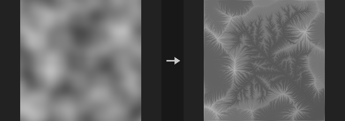

Solves `dh/dt = U - K * A^m * S` (uplift minus erodibility times drainage area to the m times slope) in the FastScape manner. Unlike an erosion filter, this is a simulation that recomputes flow routing every step, so large rivers cut deep while hillslopes barely change, and a continuous, hierarchical river network that reaches the outlets develops.

Two uses: with Uplift 0, carve valleys into existing terrain (tens of iterations); with Uplift above 0, build mountains from noise as uplift and erosion balance (hundreds of iterations). The Uplift Layer multiplies uplift (raise only the middle for a mountain range). Slope Diffusion rounds hillslopes and dulls ridges.

The implicit scheme is stable for any step size and creates no new pits (depressions are filled once at the start and lakes are filled as sediment). Outlets are fixed base level. D8 routing pulls rivers into straight lines at 0 and 45 degrees; Rho8 randomly picks diagonals each step, which is unbiased on average (reproducible with a fixed seed). Across the lakes filled at the start the water follows the drowned valley under the fill (as in Flow Accumulation) instead of the epsilon slope of pit filling, which used to draw ruler-straight rivers across every filled flat. CPU only, around 0.2 s per step at 512x512.

The second output is a text report. The Flow Layer receives the drainage area of the last step.

**Inputs**

| Input | Type | Description |
|---|---|---|
| `cop` | COPIMAGE | Image containing the height layer. |

**Outputs**

| Output | Type | Description |
|---|---|---|
| `cop` | COPIMAGE | Image with the eroded height and flow layer. |
| `report` | STRING | Text report of the run. |

**Parameters**

| Parameter | Type | Default | Description |
|---|---|---|---|
| Height Layer `layer` | string | `C` | Layer holding the height. |
| Height Scale `strength` | float [-10000.0..10000.0] | 1 | Multiplier applied to the height values. |
| World Size `world_size` | float [1e-06..] | 1 | World-space width of the image, which relates height units to pixels. |
| Iterations `iterations` | int [0..] | 100 | Number of simulation steps. |

*Erosion*

| Parameter | Type | Default | Description |
|---|---|---|---|
| Erodibility (K) `erodibility` | float [0.0..10.0] | 0.02 | K in the equation: how fast the terrain erodes. |
| Area Exponent (m) `area_exponent` | float [0.0..2.0] | 0.5 | m in the equation: how strongly drainage area deepens channels. |
| Slope Diffusion `diffusion` | float [0.0..0.25] | 0 | Slope diffusion that rounds hillslopes and blunts divides. |
| Flow Routing `routing` | menu | Rho8 (Randomized) | Flow routing: D8 or Rho8, which randomizes the diagonal choice to avoid straight 0/45 degree rivers. Options: D8 (`d8`), Rho8 (Randomized) (`rho8`). |
| Seed `rand_seed` | int [0..] | 0 | Seed for Rho8 routing. *Hidden when routing = d8.* |

*Uplift*

| Parameter | Type | Default | Description |
|---|---|---|---|
| Uplift `uplift` | float [0.0..10.0] | 0 | Constant uplift rate. 0 only erodes. |
| Uplift Layer `uplift_layer` | string | *(empty)* | Optional layer (0 to 1) multiplied onto Uplift. *Disabled when uplift = 0.* |

*Boundary*

| Parameter | Type | Default | Description |
|---|---|---|---|
| Tileable (Wrap Edges) `tile` | toggle | off | Wraps the edges so the terrain tiles. |
| Outlet Layer `base_layer` | string | *(empty)* | Layer where values above 0.5 are outlets (fixed base level). Empty uses the image edges. |

| Parameter | Type | Default | Description |
|---|---|---|---|
| Output Layer `out_layer` | string | `C` | Layer receiving the eroded height. |
| Flow Layer `flow_layer` | string | `flow` | Layer receiving the drainage area of the last step. Empty skips it. |

---

### COP HeightField Terrace (PCG)

`PCG_COPTerrace` · category `PCG/cop` · Houdini: HeightField Terrace (COP)

Turns a height layer into terraces with flat treads and steep risers.

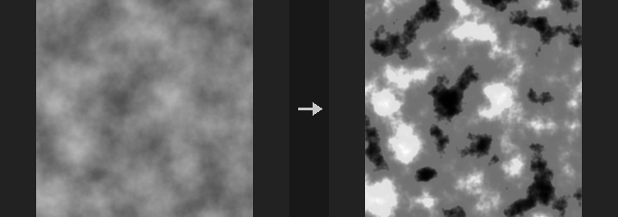

Works directly on the height values. Heights are divided into steps; the relative position `f` inside each step (0-1) is passed through the power function `f^p` with `p = 1 / (1 - Sharpness)`. At Sharpness 0 the function is the identity and the height is unchanged; towards 1 the treads become flat and the risers steep, and at 1 the result is a pure staircase.

The result is monotonic (high ground never ends up lower than low ground), the step boundaries at `Offset + k * Step` do not move, and the node only cuts, never fills (output is not higher than the input).

In Number of Terraces mode the step size is `(Max Height - Min Height) / Terraces` and terracing is limited to that range; in Step Size mode it applies to all heights unless Limit Range is on. Heights outside the range are left untouched. A mask layer (and/or the Mask value) blends between the original and the terraced height, for example to terrace only the steep slopes.

**Inputs**

| Input | Type | Description |
|---|---|---|
| `cop` | COPIMAGE | Image with the height layer. |

**Outputs**

| Output | Type | Description |
|---|---|---|
| `cop` | COPIMAGE | The image with the terraced height written as a single-channel layer. |

**Parameters**

| Parameter | Type | Default | Description |
|---|---|---|---|
| Height Layer `layer` | string | `C` | Height layer to terrace. Only its first channel is used. |
| Mask `mask` | float [0.0..1.0] | 1 | Blend amount from 0 (original) to 1 (fully terraced). If a mask layer is given, this multiplies it. |
| Mask Layer `mask_layer` | string | *(empty)* | Optional layer whose first channel (clamped to 0-1) controls the blend per pixel. Empty uses only the constant Mask value. |
| Method `method` | menu | Step Size | Step Size uses the height of each step directly; Number of Terraces divides the Min/Max range into the given number of equal steps. Options: Step Size (`step_size`), Number of Terraces (`num_terraces`). |
| Step Size `step` | float [1e-06..] | 0.1 | Height of one terrace step. Used by the Step Size method. *Hidden when method = num_terraces.* |
| Terraces `terraces` | int [1..] | 10 | Number of terraces between Min Height and Max Height. Used by the Number of Terraces method. *Hidden when method = step_size.* |
| Limit to Height Range `limit_range` | toggle | off | In Step Size mode, restrict terracing to the Min/Max height range. Number of Terraces always does this. *Hidden when method = num_terraces.* |
| Min Height `min_height` | float | 0 | Lower end of the terraced range. Steps start here (plus Offset). *Disabled when method = step_size limit_range is off.* |
| Max Height `max_height` | float | 1 | Upper end of the terraced range. Must be greater than Min Height when the range is used. *Disabled when method = step_size limit_range is off.* |
| Offset `offset` | float | 0 | Shifts all step boundaries up by this height. |
| Sharpness `sharpness` | float [0.0..1.0] | 0.7 | 0 leaves the height unchanged, values near 1 give flat treads with steep risers, 1 gives a hard staircase. |
| Random Step `random_step` | float [0.0..1.0] | 0 | Randomly shifts every step boundary by up to half of this fraction of the step height (0-1). Keeps the terraces monotonic. |
| Step Seed `rand_seed` | int [0..] | 0 | Seed for the random boundary shifts. *Disabled when random_step = 0.* |
| Output Layer `out_layer` | string | `C` | Layer that receives the terraced height. |
| Keep Input Layers `keep_layers` | toggle | on | Keep the other layers of the input image in the output. When off, the output contains only the terraced layer. |

**Compared with Houdini**

Follows HeightField Terrace's Step Size / Number of Terraces methods, Limit Range, Random Step and Mask. Sharpness is an addition of this plugin; Houdini does not document the riser profile. At the ends of the limited range there can be a step-like jump when the step size does not divide the range or Offset is non-zero; no extra transition is applied.

**Tips**

- Put a slope mask (for example Mask by Feature) in front and connect it as the mask layer to terrace only steep areas.

---

### COP HeightField Thermal Erosion (PCG)

`PCG_COPThermalErosion` · category `PCG/cop` · Houdini: HeightField Slump (COP)

Collapses slopes steeper than the angle of repose, moving material downhill and piling it up at the foot.

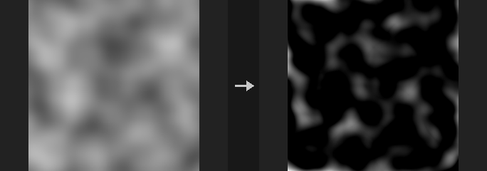

Thermal erosion (slumping): wherever the terrain is steeper than the talus angle, loose material slides downhill until the slope relaxes to that angle. It is different from the Erosion Filter node, which carves channels; this one flattens over-steep slopes and builds talus fans at their base. A common order is Erosion Filter followed by Thermal Erosion, to collapse the too-steep gully walls the filter produced.

Mass is conserved (the total height does not change). Terrain that is everywhere gentler than the talus angle is returned bit-identical, and a tall column collapses into a cone whose slope converges to the angle of repose. The cost is `Iterations` times the number of neighbours in full-image passes. With Compute on Auto, large images run on the GPU in float32 when one is available; the result is returned on the original backend.

The `Debris Source` menu selects between two models. With Whole Height the entire height value can slide (the classic thermal behaviour) and the debris layer receives the net deposit. With Debris Layer or Constant Depth (Houdini HeightField Slump semantics) the height is fixed bedrock and only the debris layer slides on top of it; when debris is slid away the bedrock is exposed, and the debris layer then holds the remaining debris thickness. In Granular mode the amount moved per step and cell is randomised.

A hardness layer marks bedrock that never moves.

**Inputs**

| Input | Type | Description |
|---|---|---|
| `cop` | COPIMAGE | Image containing the height layer (and optionally hardness and debris layers). |

**Outputs**

| Output | Type | Description |
|---|---|---|
| `cop` | COPIMAGE | The image with the eroded height layer and, if named, the debris layer. |

**Parameters**

| Parameter | Type | Default | Description |
|---|---|---|---|
| Height Layer `layer` | string | `C` | Height layer to erode. Only its first channel is used. |
| Height Scale `strength` | float [-10000.0..10000.0] | 1 | Height scale: height values times Strength give world height. Together with World Size this defines the slope. |
| World Size `world_size` | float [1e-06..] | 1 | World width of the image. Together with Strength it determines the real slope between pixels, which is compared with the talus angle. |
| Slump Mode `slump_mode` | menu | Smooth | Smooth moves material deterministically; Granular adds a random factor to the amount moved per step and cell (seeded by `Rand Seed`). Options: Smooth (`smooth`), Granular (`granular`). |
| Random Seed `rand_seed` | int [0..] | 0 | Seed for Granular mode. *Disabled when slump_mode = smooth.* |
| Debris Source `debris_source` | menu | Whole Height (Thermal) | Whole Height: the entire height can slide (thermal erosion). Debris Layer: only the thickness stored in the debris input layer slides over fixed bedrock. Constant Depth: a uniform debris thickness covers the terrain and slides over fixed bedrock. Options: Whole Height (Thermal) (`height`), Debris Layer (`layer`), Constant Depth (`constant`). |
| Debris Input Layer `debris_input` | string | `debris` | Layer holding the initial debris thickness. Used with the Debris Layer source. *Hidden when debris_source ≠ layer.* |
| Debris Scale `debris_scale` | float [0.0..] | 1 | Multiplier on the debris layer (Debris Layer source), or the debris thickness itself in height units (Constant Depth source). *Hidden when debris_source = height.* |
| Remove Debris from Input Height `remove_debris` | toggle | off | Subtract the debris from the height before the simulation, so the height becomes the bedrock without debris. *Hidden when debris_source = height.* |
| Add Debris to Output Height `add_debris` | toggle | on | Add the slid debris back into the output height. Turn off to output the bedrock only. *Hidden when debris_source = height.* |
| Repose Angle `talus_angle` | float [0.0..89.9] | 35 | Angle of repose in degrees. Slopes steeper than this collapse; lower values flatten more. |
| Spread Iterations `iterations` | int [0..] | 50 | Number of relaxation passes. More passes get closer to the angle of repose everywhere. 0 leaves the terrain unchanged. |
| Spread Rate `rate` | float [0.0..1.0] | 0.5 | Fraction (0-1) of the excess material moved per pass. Lower values are smoother and need more iterations. |
| Neighbours `neighbours` | menu | 8 (Include Diagonals) | Whether material may also flow along the diagonals (8) or only along the four edges (4). Edges-only produces more axis-aligned artefacts. Options: 8 (Include Diagonals) (`8`), 4 (Edges Only) (`4`). |
| Tileable (Wrap Edges) `tile` | toggle | off | Treat the image as periodic so material flows across opposite edges. |
| Hardness Layer `hardness_layer` | string | *(empty)* | Optional layer (0-1) marking bedrock. 1 means the terrain does not move at all there. |
| Output Layer `out_layer` | string | `C` | Layer that receives the eroded height. |
| Debris Layer `debris_layer` | string | `debris` | Layer that receives the debris: the net deposit in Whole Height mode, the remaining debris thickness in the other modes. Empty writes nothing. |
| Keep Input Layers `keep_layers` | toggle | on | Keep the other layers of the input image in the output. When off, only the written layers remain. |
| Compute `compute` | menu | Auto | Auto uses the GPU for large images when available; CPU forces NumPy; CUDA forces the GPU. Options: Auto (`auto`), CPU (NumPy) (`cpu`), CUDA (`cuda`). |

**Compared with Houdini**

Corresponds to HeightField Slump. The Debris Layer and Constant Depth sources follow its semantics (fixed bedrock, sliding debris). Whole Height is the plugin's original thermal behaviour.

**Tips**

- Run it after the Erosion Filter to relax steep gully walls.
- Use the debris layer as a mask to paint scree textures.

---

### COP Mono to HeightField (PCG)

`PCG_COPMonoToHeightField` · category `PCG/cop` · Houdini: Mono to HeightField (COP)

Converts a single-channel layer into a height layer by scaling and offsetting its values.

The height is `value * Height Scale + Height Offset` (scale first, then offset, so Offset is in final height units). Only the first channel of the layer is used. Layers have no type metadata in this plugin, so the result is recognised as a height field by its layer name; the default output name is `height`.

**Inputs**

| Input | Type | Description |
|---|---|---|
| `cop` | COPIMAGE | Image containing the mono layer. |

**Outputs**

| Output | Type | Description |
|---|---|---|
| `cop` | COPIMAGE | Image with the height layer added. |

**Parameters**

| Parameter | Type | Default | Description |
|---|---|---|---|
| Layer `layer` | string | `C` | Layer to convert. For multichannel layers the first channel is used. |
| Height Scale `height_scale` | float | 1 | Multiplier applied to the values. |
| Height Offset `height_offset` | float | 0 | Value added after scaling. |
| Output Layer `out_layer` | string | `height` | Name of the height layer. |

**Compared with Houdini**

Houdini also flags the layer's Type Info as height. Layers here carry no such flag; height layers are identified by naming convention.

---

### COP Normal to Height (PCG)

`PCG_COPNormalToHeight` · category `PCG/cop` · Houdini: Normal to Height (COP)

Reconstructs a height layer from a normal map; the inverse of Height to Normal.

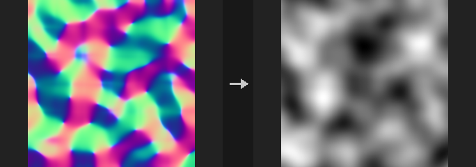

The output has zero mean. With the same Height Scale and World Size used for the forward conversion, the recovered height differs from the original only by a constant. Typical use: you only have a normal map (scan, bake, AI-generated) and need a height for displacement, parallax or terrain.

Two integrators, with a real trade-off:
- **Spectral (Frankot-Chellappa)**: robust for inconsistent normal maps (AI or hand-painted maps that do not correspond to any real surface), but it attenuates fine detail: undulations with a 16-pixel period come back at 97.5%, a 4-pixel period at 64%.
- **Exact**: a pixel-exact inverse of Height to Normal (central differences, tiled), but inconsistent input produces checkerboard patterns at high frequency. Use it when you convert back and forth inside your own chain.

With Tileable off, the edges are extended by mirroring (zero slope at the border), so the few pixels near the edge are approximate, and Exact is then worse than Spectral (the mirror seams are inconsistent and the exact method amplifies them). Use Exact with tiling and Spectral without.

Normals with z at or below 0.01 are clamped to avoid exploding slopes; `report` states how many were clamped.

**Inputs**

| Input | Type | Description |
|---|---|---|
| `cop` | COPIMAGE | Image containing the normal layer. |

**Outputs**

| Output | Type | Description |
|---|---|---|
| `cop` | COPIMAGE | Image with the height layer added. |
| `report` | STRING | Text summary, including how many pixels had their normal clamped. |

**Parameters**

| Parameter | Type | Default | Description |
|---|---|---|---|
| Normal Layer `layer` | string | `N` | Layer holding the tangent-space normals. |
| Height Scale `strength` | float [-10000.0..10000.0] | 1 | Height Scale: the scale used when the normals were created from a height (height times this is world height). The output is in height units. |
| World Size `world_size` | float [1e-06..] | 1 | World width of the whole image, used to convert normals to slopes. |

*Integration*

| Parameter | Type | Default | Description |
|---|---|---|---|
| Method `method` | menu | Spectral (Frankot-Chellappa) | Integration method; see the description. Use Exact with Tileable on and Spectral with it off. Options: Spectral (Frankot-Chellappa) (`spectral`), Exact (Inverse of Height to Normal) (`exact`). |
| Tileable (Wrap Edges) `tile` | toggle | off | Treat the image as tileable (wrap) instead of mirroring at the edges. |

| Parameter | Type | Default | Description |
|---|---|---|---|
| Output Layer `out_layer` | string | `height` | Name of the height layer. |
| Keep Input Layers `keep_layers` | toggle | on | Keep the other input layers in the output. |

---

### COP Slope & Aspect (PCG)

`PCG_COPSlope` · category `PCG/cop` · Houdini: Slope Direction (COP)

Computes slope, aspect and downhill direction from a height layer.

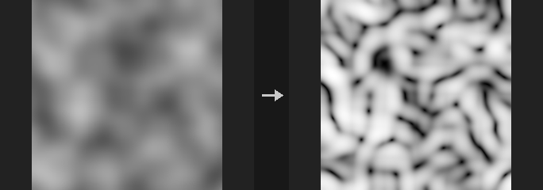

Writes up to three layers; leaving a layer name empty skips that layer. Slope is available in degrees (0 to 90), as a tangent (the gradient magnitude) or normalized to 0 to 1. Aspect is the downhill direction in degrees, with 0 pointing along +U and 90 along +V, and is 0 on flat areas. The downhill direction layer holds the unit vector (u, v) pointing downhill; wiring it into COP Distort drags pixels along the slope.

Slope and aspect are exact per pixel on inclined planes, and the derivatives use quadratic extrapolation at the borders, so even the boundary is exact on quadratic surfaces. The scale parameters match the other height-field nodes.

**Inputs**

| Input | Type | Description |
|---|---|---|
| `cop` | COPIMAGE | Image containing the height layer. |

**Outputs**

| Output | Type | Description |
|---|---|---|
| `cop` | COPIMAGE | Image with the slope, aspect and direction layers. |

**Parameters**

| Parameter | Type | Default | Description |
|---|---|---|---|
| Height Layer `layer` | string | `C` | Layer holding the height. |
| Height Scale `strength` | float [-10000.0..10000.0] | 1 | Multiplier applied to the height values. |
| World Size `world_size` | float [1e-06..] | 1 | World-space width of the image, which relates height units to pixels. |
| Tileable (Wrap Edges) `tile` | toggle | off | Wraps the edges when computing derivatives. |
| Slope Layer `slope_layer` | string | `slope` | Name of the slope layer. Empty skips it. |
| Slope Units `units` | menu | Degrees | Unit of the slope output. Options: Degrees (`degrees`), Tangent (Rise / Run) (`tangent`), Normalized (0-1) (`normalized`). *Disabled when slope_layer = "".* |
| Aspect Layer `aspect_layer` | string | `aspect` | Name of the downhill direction angle layer, in degrees. Empty skips it. |
| Downhill Direction Layer `dir_layer` | string | `slope_dir` | Name of the downhill unit vector layer. Empty skips it. |
| Keep Input Layers `keep_layers` | toggle | on | Keeps the input layers in the output. |

---

### COP Strata (PCG)

`PCG_COPStrata` · category `PCG/cop` · Houdini: HeightField Strata (COP)

Adds tilted rock strata to a height layer as terraced layers with random hardness.

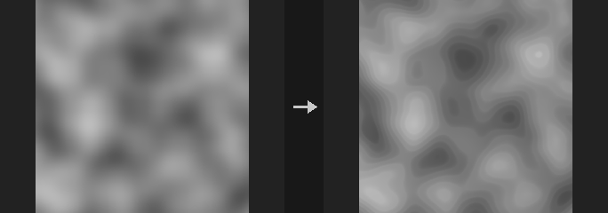

The layer plane is `height + Tilt * (u, v) + noise`. Each stratum gets a random hardness: hard layers have flat tops and steep steps. The result is mixed back by Strength. With Tilt, noise and randomness all 0 this is a plain terrace. A layer index is also written as `<Output Layer>_id`. Strata Offset shifts the layer boundaries, a Mask Layer multiplies Strength, and Output Strata Only outputs just the strata displacement (adding it to the height equals Strength 1).

**Inputs**

| Input | Type | Description |
|---|---|---|
| `cop` | COPIMAGE | Image containing the height layer. |

**Outputs**

| Output | Type | Description |
|---|---|---|
| `cop` | COPIMAGE | Image with the stratified height and the stratum id layer. |

**Parameters**

| Parameter | Type | Default | Description |
|---|---|---|---|
| Height Layer `layer` | string | `C` | Layer holding the height. |
| Mask `strength` | float [0..1] | 0.8 | Amount mixed back into the height (Houdini's Mask parameter). *Disabled when strata_only is on.* |
| Mask Layer `mask_layer` | string | *(empty)* | Optional layer multiplied onto Strength. *Disabled when strata_only is on.* |
| Output Strata Only `strata_only` | toggle | off | Outputs only the strata displacement. |
| Strata Size `spacing` | float [1e-06..] | 0.1 | Height of one stratum. |
| Strata Offset `strata_offset` | float | 0 | Shifts the layer boundaries. |
| Sharpness `sharpness` | float [0..0.999] | 0.7 | How steep the steps between layers are. |
| Hardness Randomness `hardness_random` | float [0..1] | 0.5 | Amount of random variation of hardness between strata. |
| Tilt (U V) `tilt` | string | `0 0` | Tilt of the layer planes along U and V as `u v`. |
| Noise Amount `noise_amount` | float | 0 | Amount of noise added to the layer plane. |
| Noise Frequency `noise_frequency` | float [0..10000.0] | 4 | Frequency of that noise. *Disabled when noise_amount = 0.* |
| Seed `rand_seed` | int [0..] | 0 | Seed shared by the noise and the per-stratum hardness. |
| Output Layer `out_layer` | string | *(empty)* | Layer receiving the result. Empty overwrites the input layer; the id goes to `<Output Layer>_id`. |

**Compared with Houdini**

Houdini's Strata lays 1D noise along tilted planes and combines it with the height by a Blend Mode. This node implements a different model, tilted terraces.

---
