# Image: Transform & Warp

Transforms, distortion, UV mapping and sampling.

32 nodes.

[Back to the reference index](README.md)

## Contents

- [COP Align (PCG)](#pcg-copalign) — Places an image onto the pixel grid of a reference image using stretch, fit, fill or no scaling.
- [COP Align Pixels (PCG)](#pcg-copalignpixels) — Snaps an image onto the pixel grid of a reference and then shifts it by whole pixels to align its edges.
- [COP Align Window (PCG)](#pcg-copalignwindow) — Moves and optionally scales an image so that its window lines up with a reference window or a target rectangle.
- [COP Bend (PCG)](#pcg-copbend) — Bends an image along a curved patch defined by corners, sides or a bend angle.
- [COP Chromatic Aberration (PCG)](#pcg-copchromaticaberration) — Offsets the colour channels radially so edges show colour fringes.
- [COP Copy Transform (PCG)](#pcg-copcopytransform) — Makes several transformed copies of the image and stacks them, each copy shifted, rotated and scaled further than the last.
- [COP Corner Pin (PCG)](#pcg-copcornerpin) — Warps an image so its four corners land on given positions, or rotates it like a 3D card seen by a pinhole camera.
- [COP Crop / Pad (PCG)](#pcg-copcrop) — Crops an image to a window, and pads it when the window extends beyond the image.
- [COP Distort (PCG)](#pcg-copdistort) — Warps an image per pixel by a vector image, so noise, hand-painted flow or motion vectors displace the pixels.
- [COP Flip (PCG)](#pcg-copflip) — Mirrors layers horizontally and/or vertically by reversing pixel indices.
- [COP Heat Distort (PCG)](#pcg-copheatdistort) — Distorts pixels with simplex noise that drifts over time, producing a heat-haze effect.
- [COP Heat Distort by Layer (PCG)](#pcg-copheatdistortbylayer) — Distorts pixels using an input noise layer (or direction layer), with optional curved tracing, streak blur and chromatic aberration.
- [COP Hex Tile (PCG)](#pcg-cophextile) — Breaks up visible tiling of a texture by laying it out on a hexagonal grid with a random offset and rotation per cell.
- [COP Lattice Deform (PCG)](#pcg-coplatticedeform) — Warps an image with a grid of control points that are offset in uv.
- [COP Lens Distort (PCG)](#pcg-coplensdistort) — Adds or removes radial lens distortion.
- [COP Mirror (PCG)](#pcg-copmirror) — Mirrors one half of an image onto the other, or reflects it across arbitrary mirror planes.
- [COP Polar (PCG)](#pcg-coppolar) — Resamples the whole image between Cartesian and polar layouts.
- [COP Polar Coords (PCG)](#pcg-coppolarcoords) — Converts UV coordinate values stored in a layer to angle and length layers, or back.
- [COP Refract from Height (PCG)](#pcg-coprefractfromheight) — Computes the 2-channel UV offset that a water-like height surface causes when viewing something below it.
- [COP Resize (PCG)](#pcg-copresize) — Resamples the image to a new resolution with bilinear filtering.
- [COP Retile (PCG)](#pcg-copretile) — Shuffles the image's tiles randomly or turns it into a seamlessly tileable image.
- [COP Space Transform (PCG)](#pcg-copspacetransform) — Converts coordinate values stored in a layer between Buffer, Pixel, Texture, Image and World spaces.
- [COP Sphere Sample (PCG)](#pcg-copspheresample) — Maps a lat-long image onto a sphere and renders it with a default camera.
- [COP Swirl (PCG)](#pcg-copswirl) — Warps an image with a swirl, pinch, bulge or bend distortion.
- [COP Tile (PCG)](#pcg-coptile) — Repeats the image in a grid, enlarging the output resolution.
- [COP Transform (PCG)](#pcg-coptransform) — Translates, rotates and scales an image around a pivot without changing its resolution.
- [COP Transform 3D (PCG)](#pcg-coptransform3d) — Places the image as a rectangle in 3D with a full Houdini transform and renders it back to the same raster.
- [COP UV Inverse (PCG)](#pcg-copuvinverse) — Inverts a UV mapping: turns an output-to-source UV map into a source-to-output one.
- [COP UV Map (PCG)](#pcg-copuvmap) — Generates a UV layer, either as a plain per-pixel UV ramp or as one 0-1 UV set per ID island.
- [COP UV Sample (PCG)](#pcg-copuvsample) — Samples a source image at per-pixel coordinates: UVs, or directions into a lat-long or mirror-ball map.
- [COP UV Transform (PCG)](#pcg-copuvtransform) — Scales, rotates and translates the values of a UV layer around a pivot.
- [COP Warp (PCG)](#pcg-copwarp) — Warps an image to another frame's position using a backward motion vector layer.

## Nodes

### COP Align (PCG)

`PCG_COPAlign` · category `PCG/cop`

Places an image onto the pixel grid of a reference image using stretch, fit, fill or no scaling.

Resamples `cop` so that it covers the resolution of `reference`. `stretch` fills the whole reference grid and ignores aspect ratio; `fit` keeps the aspect ratio and scales the image until it fits inside the reference (leaving empty bars); `fill` keeps the aspect ratio and scales until the reference is completely covered (cropping the overflow); `none` does not scale and simply centres the image.

This is a whole-image fit to the reference resolution. For rectangle-based alignment with Justify / Goal rules use COP Align Window, and for pixel-exact snapping use COP Align Pixels.

**Inputs**

| Input | Type | Description |
|---|---|---|
| `cop` | COPIMAGE | Image to place on the reference grid. |
| `reference` | COPIMAGE | Image whose resolution defines the output grid. |

**Outputs**

| Output | Type | Description |
|---|---|---|
| `cop` | COPIMAGE | The input image resampled onto the reference resolution. |

**Parameters**

| Parameter | Type | Default | Description |
|---|---|---|---|
| Fit `fit` | menu | Stretch | How the image is mapped to the reference rectangle: `stretch` ignores aspect ratio, `fit` keeps it and fits inside, `fill` keeps it and covers the whole reference, `none` does no scaling and centres the image. Options: Stretch (`stretch`), Fit (`fit`), Fill (`fill`), None (`none`). |
| Border `border` | menu | Black | What is sampled outside the source image (the empty bars of `fit`, the margins of `none`): `clamp` repeats the edge pixels, `wrap` tiles the image, `black` gives zero. Options: Clamp (`clamp`), Wrap (`wrap`), Black (`black`). |

**Compared with Houdini**

Does not mirror a single Houdini node; the Houdini Align and Align Pixels nodes are covered by COP Align Window and COP Align Pixels.

---

### COP Align Pixels (PCG)

`PCG_COPAlignPixels` · category `PCG/cop` · Houdini: Align Pixels (COP)

Snaps an image onto the pixel grid of a reference and then shifts it by whole pixels to align its edges.

Works in two steps. First the point of the source window chosen by Side X / Side Y is converted to pixel coordinates of the reference image and rounded to the nearest pixel corner; the source is then laid out from there at 1:1 pixel size, with no interpolation. Second, the snapped source is translated by whole pixels so that its Justify edge lands on the Goal edge of the target: the reference window, the source's original window, or a single Target Point. The offset is in pixels and is rounded.

The result lives on the reference grid (`size_ref`, or the source itself when it is not connected). Pixels outside it are discarded and uncovered pixels are zero. Because the image is never resampled, nothing is blurred.

**Inputs**

| Input | Type | Description |
|---|---|---|
| `source` | COPIMAGE | Image to snap and align. |
| `size_ref` *(optional)* | COPIMAGE | Optional reference image whose pixel grid is used for the output. If not connected, the source's own grid is used. |

**Outputs**

| Output | Type | Description |
|---|---|---|
| `cop` | COPIMAGE | The aligned image on the reference pixel grid. |

**Parameters**

| Parameter | Type | Default | Description |
|---|---|---|---|
| Layers `layers` | string | *(empty)* | Space-separated layer names to process. Empty processes every layer of the source. |

*Snapping*

| Parameter | Type | Default | Description |
|---|---|---|---|
| Side (X) `side_x` | menu | Min | Which point of the source window on X (`min`, `center`, `max`) is snapped to the reference pixel grid in the first step. Options: Min (`min`), Center (`center`), Max (`max`). |

| Parameter | Type | Default | Description |
|---|---|---|---|
| Side (Y) `side_y` | menu | Min | Which point of the source window on Y (`min`, `center`, `max`) is snapped to the reference pixel grid in the first step. Options: Min (`min`), Center (`center`), Max (`max`). |
| Justify with `justify_with` | menu | Reference Window | What the source is aligned to: the whole `reference` window, the `original` window the source occupied before snapping, or a single `target_point`. Options: Reference Window (`reference`), Original Window (`original`), Target Point (`target_point`). |
| Units `units` | menu | Pixels | Coordinate system of Target Point: `image` (-1..1 across the longer side, origin at the centre), `texture` (0..1), `pixels` (reference pixel coordinates) or `world` (same as `image`). Options: Image (`image`), Texture (`texture`), Pixels (`pixels`), World (`world`). *Disabled when justify_with ≠ target_point.* |
| Target Point `target_point` | string | `0 0` | Position (X Y) to align to when Justify With is `target_point`, in the units chosen by Units. It is a point, not a rectangle, so no resizing happens. *Disabled when justify_with ≠ target_point.* |

*Matching*

| Parameter | Type | Default | Description |
|---|---|---|---|
| Justify X `justify_x` | menu | Center | Which edge of the source rectangle on the X axis is moved onto the goal edge. `none` disables the X translation. Options: None (`none`), Min (`min`), Center (`center`), Max (`max`). |

| Parameter | Type | Default | Description |
|---|---|---|---|
| Goal X `goal_x` | menu | Same | Edge of the target on X the Justify edge is moved to. `same` uses the same edge as Justify X (min to min, center to center, max to max). Options: Same (`same`), Min (`min`), Center (`center`), Max (`max`). *Disabled when justify_x = none.* |
| Justify Y `justify_y` | menu | Center | Which edge of the source rectangle on the Y axis is moved onto the goal edge. `none` disables the Y translation. Options: None (`none`), Min (`min`), Center (`center`), Max (`max`). |
| Goal Y `goal_y` | menu | Same | Edge of the target on Y the Justify edge is moved to. `same` uses the same edge as Justify Y. Options: Same (`same`), Min (`min`), Center (`center`), Max (`max`). *Disabled when justify_y = none.* |
| Offset by `offset` | string | `0 0` | Extra shift (X Y) in pixels, applied after alignment and rounded to whole pixels. |

**Compared with Houdini**

There is no separate data window and display window; they are treated as one window. COP Align does something different (it fits the whole image into the reference resolution) and is kept as its own node.

---

### COP Align Window (PCG)

`PCG_COPAlignWindow` · category `PCG/cop` · Houdini: Align (COP)

Moves and optionally scales an image so that its window lines up with a reference window or a target rectangle.

The source rectangle is the full image window in image space. The target is either the window of `size_ref` (or the source's own window when it is not connected), or a rectangle you give with Target Point and Target Size. If Scale To Fit is on, the source is first scaled around its own centre to match the target; then it is translated per axis so that its Justify edge meets the target's Goal edge, and finally Offset is added. The result is rasterized onto the grid of `size_ref` (or the source) with the chosen filter; areas not covered are zero.

Target Point is the centre of the target rectangle and Target Size its width and height.

**Inputs**

| Input | Type | Description |
|---|---|---|
| `source` | COPIMAGE | Image to align. |
| `size_ref` *(optional)* | COPIMAGE | Optional reference image. It supplies the target window and the output pixel grid. If not connected, the source itself is used. |

**Outputs**

| Output | Type | Description |
|---|---|---|
| `cop` | COPIMAGE | The aligned image on the reference grid. |

**Parameters**

| Parameter | Type | Default | Description |
|---|---|---|---|
| Layers `layers` | string | *(empty)* | Space-separated layer names to process. Empty processes every layer of the source. |
| Justify with `justify_with` | menu | Reference Window | What the source is aligned to: the `reference` window (the size_ref image, or the source itself if none is connected) or a rectangle given by Target Point and Target Size. Options: Reference Window (`reference`), Target Point (`target_point`). |

*Target*

| Parameter | Type | Default | Description |
|---|---|---|---|
| Units `units` | menu | Image | Coordinate system used to read Target Point (and Target Size): `image` (-1..1 across the longer side, origin at the centre), `texture` (0..1 across each axis), `pixels` (pixel coordinates of the reference image) or `world` (treated the same as `image`). Options: Image (`image`), Texture (`texture`), Pixels (`pixels`), World (`world`). *Disabled when justify_with ≠ target_point.* |

| Parameter | Type | Default | Description |
|---|---|---|---|
| Target Point `target_point` | string | `0 0` | Centre (X Y) of the target rectangle when Justify With is `target_point`, in the units chosen by Units. *Disabled when justify_with ≠ target_point.* |
| Target Size `target_size` | string | `2 2` | Width and height (X Y) of the target rectangle when Justify With is `target_point`, in the units chosen by Units. Also used as the size to match when Scale To Fit is on. *Disabled when justify_with ≠ target_point.* |

*Matching*

| Parameter | Type | Default | Description |
|---|---|---|---|
| Justify X `justify_x` | menu | Center | Which edge of the source rectangle on the X axis is moved onto the goal edge. `none` disables the X translation. Options: None (`none`), Min (`min`), Center (`center`), Max (`max`). |

| Parameter | Type | Default | Description |
|---|---|---|---|
| Goal X `goal_x` | menu | Same | Edge of the target on X the Justify edge is moved to. `same` uses the same edge as Justify X. Options: Same (`same`), Min (`min`), Center (`center`), Max (`max`). *Disabled when justify_x = none.* |
| Justify Y `justify_y` | menu | Center | Which edge of the source rectangle on the Y axis is moved onto the goal edge. `none` disables the Y translation. Options: None (`none`), Min (`min`), Center (`center`), Max (`max`). |
| Goal Y `goal_y` | menu | Same | Edge of the target on Y the Justify edge is moved to. `same` uses the same edge as Justify Y. Options: Same (`same`), Min (`min`), Center (`center`), Max (`max`). *Disabled when justify_y = none.* |
| Offset by `offset` | string | `0 0` | Extra shift (X Y) in image space, added after the Justify / Goal translation. |
| Scale to Fit `scale_to_fit` | toggle | off | Scales the source around its centre so it matches the target rectangle before it is translated. |
| Uniform Scale `uniform_scale` | toggle | on | With Scale To Fit: use one scale factor for both axes, taken from the axis selected by Scale Axis, so the aspect ratio is preserved. When off, each axis is stretched to the target width and height independently. *Disabled when scale_to_fit is off.* |
| Scale Axis `scale_axis` | menu | Scale X | With Scale To Fit and Uniform Scale: which axis of the target (X = width, Y = height) the single scale factor is matched to. Options: Scale X (`x`), Scale Y (`y`). *Disabled when scale_to_fit is off } { uniform_scale is off.* |
| Filter `filter` | menu | Bilinear | Resampling filter used when the image is moved or scaled onto the output grid. `point` is nearest-neighbour; `bilinear` is the cheap smooth default; `box`, `bartlett`, `catmull_rom`, `mitchell` and `bspline` are the usual higher-order kernels (sharper to smoother). Options: Point (`point`), Bilinear (`bilinear`), Box (`box`), Bartlett (`bartlett`), Catmull-Rom (`catmull_rom`), Mitchell (`mitchell`), B-Spline (`bspline`). |

**Compared with Houdini**

There is no separate data window and display window, so Houdini's Data / Display window choices are merged into one. Whether the Houdini Target Point is a centre or a corner is not documented; here it is the centre of the target rectangle.

---

### COP Bend (PCG)

`PCG_COPBend` · category `PCG/cop` · Houdini: Bend (COP)

Bends an image along a curved patch defined by corners, sides or a bend angle.

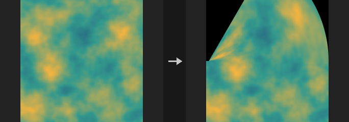

All positions are in image space (-1..1 across the longer side). The source image fills the patch with texture coordinates (s, t) in 0..1; for every output pixel the node solves for the source coordinate with a per-pixel Newton iteration. Pixels that fall outside the patch, or where no solution is found, are zero. Where the patch folds over itself only one solution is found.

`corners` builds each edge as a cubic Bezier from the corner points and two tangent handles per corner, blended into a Coons patch. `sides` uses the four corners plus the midpoint of each edge (each edge is a quadratic curve through its midpoint). `angle` bends the part of the image along Capture Direction, within Capture Length of the origin, into a circular arc with a total turn of Bend Angle. The part beyond follows rigidly and the part before stays put.

The output uses the grid of `size_ref`, or the source's own grid if it is not connected.

**Inputs**

| Input | Type | Description |
|---|---|---|
| `source` | COPIMAGE | Image to bend. |
| `size_ref` *(optional)* | COPIMAGE | Optional reference image that defines the output pixel grid. If not connected, the source's grid is used. |

**Outputs**

| Output | Type | Description |
|---|---|---|
| `cop` | COPIMAGE | The bent image. |

**Parameters**

| Parameter | Type | Default | Description |
|---|---|---|---|
| Layers `layers` | string | *(empty)* | Space-separated layer names to process. Empty processes every layer of the source. |
| Mode `mode` | menu | Corners | `corners`: four corners with tangent handles. `sides`: four corners with edge midpoints. `angle`: bend along a direction into a circular arc. Options: Corners (`corners`), Sides (`sides`), Angle (`angle`). |
| Filter `filter` | menu | Bilinear | Resampling filter used when the image is moved or scaled onto the output grid. `point` is nearest-neighbour; `bilinear` is the cheap smooth default; `box`, `bartlett`, `catmull_rom`, `mitchell` and `bspline` are the usual higher-order kernels (sharper to smoother). Options: Point (`point`), Bilinear (`bilinear`), Box (`box`), Bartlett (`bartlett`), Catmull-Rom (`catmull_rom`), Mitchell (`mitchell`), B-Spline (`bspline`). |

*Corners*

| Parameter | Type | Default | Description |
|---|---|---|---|
| Bottom Left `bottom_left` | string | `-1 -1` | Corners / Sides modes: image-space position of the patch's bottom-left corner. For an identity result on a non-square image enter (+-W/L, +-H/L), where L is the longer side, because the shorter side does not reach +-1. *Hidden when mode = angle.* |

| Parameter | Type | Default | Description |
|---|---|---|---|
| Bottom Right `bottom_right` | string | `1 -1` | Corners / Sides modes: image-space position of the bottom-right corner. *Hidden when mode = angle.* |
| Top Left `top_left` | string | `-1 1` | Corners / Sides modes: image-space position of the top-left corner. *Hidden when mode = angle.* |
| Top Right `top_right` | string | `1 1` | Corners / Sides modes: image-space position of the top-right corner. *Hidden when mode = angle.* |

*Corner Handles*

| Parameter | Type | Default | Description |
|---|---|---|---|
| Bottom Left U `bl_u` | string | `0.6666667 0` | Corners mode: tangent handle of the bottom-left corner along the bottom edge, as an offset relative to that corner. The default is one third of the edge, which gives straight edges. *Hidden when mode ≠ corners.* |

| Parameter | Type | Default | Description |
|---|---|---|---|
| Bottom Left V `bl_v` | string | `0 0.6666667` | Corners mode: tangent handle of the bottom-left corner along the left edge, as an offset relative to the corner. *Hidden when mode ≠ corners.* |
| Bottom Right U `br_u` | string | `-0.6666667 0` | Corners mode: tangent handle of the bottom-right corner along the bottom edge, as an offset relative to the corner. *Hidden when mode ≠ corners.* |
| Bottom Right V `br_v` | string | `0 0.6666667` | Corners mode: tangent handle of the bottom-right corner along the right edge, as an offset relative to the corner. *Hidden when mode ≠ corners.* |
| Top Left U `tl_u` | string | `0.6666667 0` | Corners mode: tangent handle of the top-left corner along the top edge, as an offset relative to the corner. *Hidden when mode ≠ corners.* |
| Top Left V `tl_v` | string | `0 -0.6666667` | Corners mode: tangent handle of the top-left corner along the left edge, as an offset relative to the corner. *Hidden when mode ≠ corners.* |
| Top Right U `tr_u` | string | `-0.6666667 0` | Corners mode: tangent handle of the top-right corner along the top edge, as an offset relative to the corner. *Hidden when mode ≠ corners.* |
| Top Right V `tr_v` | string | `0 -0.6666667` | Corners mode: tangent handle of the top-right corner along the right edge, as an offset relative to the corner. *Hidden when mode ≠ corners.* |

*Side Handles*

| Parameter | Type | Default | Description |
|---|---|---|---|
| Bottom `side_bottom` | string | `0 -1` | Sides mode: image-space midpoint of the bottom edge; the edge curve passes through this point. *Hidden when mode ≠ sides.* |

| Parameter | Type | Default | Description |
|---|---|---|---|
| Top `side_top` | string | `0 1` | Sides mode: image-space midpoint of the top edge. *Hidden when mode ≠ sides.* |
| Left `side_left` | string | `-1 0` | Sides mode: image-space midpoint of the left edge. *Hidden when mode ≠ sides.* |
| Right `side_right` | string | `1 0` | Sides mode: image-space midpoint of the right edge. *Hidden when mode ≠ sides.* |

*Capture*

| Parameter | Type | Default | Description |
|---|---|---|---|
| Bend Angle `bend_angle` | float [-3600..3600] | 45 | Angle mode: total turn in degrees over the capture length. The image bends towards the left of the capture direction for positive values. *Hidden when mode ≠ angle.* |

| Parameter | Type | Default | Description |
|---|---|---|---|
| Capture Origin `capture_origin` | string | `0 0` | Angle mode: image-space point where the bend starts. *Hidden when mode ≠ angle.* |
| Capture Direction `capture_direction` | string | `0 1` | Angle mode: direction (X Y) along which the bend is measured. Cannot be zero. *Hidden when mode ≠ angle.* |
| Capture Length `capture_length` | float [1e-06..] | 1 | Angle mode: length of the stretch, measured from the origin along the direction, that is bent into the arc. Must be positive. *Hidden when mode ≠ angle.* |
| Deform in Both Directions `both_directions` | toggle | off | Angle mode: also bend the part behind the origin, in the opposite direction. *Hidden when mode ≠ angle.* |
| Mask Layer `mask_layer` | string | *(empty)* | Name of an extra layer that receives a coverage mask (1 where the output pixel was found inside the patch). Empty means no mask is written. |

**Compared with Houdini**

The Houdini documentation only lists the parameters, so some choices are made here: tangent handles are offsets relative to their corner, and in Angle mode the bend goes to the left of the capture direction. COP Swirl in bend mode is a different effect (a bending twist around the centre) and is kept separate.

---

### COP Chromatic Aberration (PCG)

`PCG_COPChromaticAberration` · category `PCG/cop` · Houdini: Chromatic Aberration (COP)

Offsets the colour channels radially so edges show colour fringes.

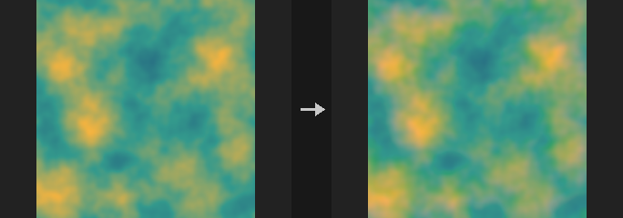

The red channel is scaled up around Center by 1 + Amount and the blue channel is scaled down by 1 - Amount, while green stays unchanged. This creates the coloured fringes that grow towards the edges of the image, like a lens with lateral chromatic aberration.

**Inputs**

| Input | Type | Description |
|---|---|---|
| `cop` | COPIMAGE | Image to process. |

**Outputs**

| Output | Type | Description |
|---|---|---|
| `cop` | COPIMAGE | Image with shifted colour channels. |

**Parameters**

| Parameter | Type | Default | Description |
|---|---|---|---|
| Layer `layer` | string | `C` | Colour layer to process. |
| Amount `amount` | float [-1..1] | 0.01 | Scale difference of the channels: red is magnified by 1 + Amount and blue by 1 - Amount. Negative values swap the direction. |
| Center `center` | string | `0.5 0.5` | Centre (X Y) of the scaling in 0..1 texture coordinates; 0.5 0.5 is the image centre. |
| Border `border` | menu | Clamp (Streak Edges) | How samples outside the image are handled: `clamp` repeats edge pixels, `wrap` tiles, `black` gives zero. Options: Clamp (Streak Edges) (`clamp`), Wrap (`wrap`), Constant (Black) (`black`). |

---

### COP Copy Transform (PCG)

`PCG_COPCopyTransform` · category `PCG/cop` · Houdini: Copy and Transform (COP)

Makes several transformed copies of the image and stacks them, each copy shifted, rotated and scaled further than the last.

Copy i (starting at 0) is translated by `i * Translate` in uv units, rotated by `i * Rotate` degrees around Pivot and scaled by `Scale^i` (multiplied per axis by Scale XY). Copies are combined with Op: `over_last` and `under` use Porter-Duff compositing and compute a proper alpha (layers without alpha are treated as fully opaque, so their whole frame covers what is below); `add` adds; `max` takes the larger value; `over` is the older mode in which copy 0 is on top and alpha is interpolated like a normal channel.

Fade makes later copies fainter: copy i is multiplied by `(1 - Fade)^i`. For `over_last` and `under` only alpha is faded.

**Inputs**

| Input | Type | Description |
|---|---|---|
| `cop` | COPIMAGE | Image to copy. |

**Outputs**

| Output | Type | Description |
|---|---|---|
| `cop` | COPIMAGE | The stacked copies. |

**Parameters**

| Parameter | Type | Default | Description |
|---|---|---|---|
| Layers `layers` | string | *(empty)* | Space-separated layer names to process. Empty processes every layer. |
| Total Number `copies` | int [1..1024] | 4 | Number of copies, including the untransformed first one. |

*Transform per Copy*

| Parameter | Type | Default | Description |
|---|---|---|---|
| Translate (UV) `translate` | string | `0.1 0` | Shift (U V) added per copy, in uv units (1 = image width / height). |
| Rotate `rotate` | float [-3600..3600] | 0 | Rotation in degrees added per copy around Pivot. |
| Scale `scale_xy` | string | `1 1` | Non-uniform scale factor (X Y) applied per copy; multiplied with Scale. The scale of copy i is the factor raised to the power i. |
| Uniform Scale `scale` | float [0.001..100] | 1 | Uniform scale factor applied per copy; copy i is scaled by Scale^i. |
| Pivot `pivot` | string | `0.5 0.5` | Pivot (U V) in 0..1 uv coordinates for rotation and scaling; 0.5 0.5 is the image centre. |

| Parameter | Type | Default | Description |
|---|---|---|---|
| Blend Method `op` | menu | Over (Legacy, First Copy on Top) | How copies are combined. `over_last`: later copies cover earlier ones (Houdini's Over). `under`: later copies go underneath (Houdini's Under). `over`: older mode with the first copy on top and alpha not composited properly. `add`: sum. `max`: maximum. Options: Over (Legacy, First Copy on Top) (`over`), Add (`add`), Maximum (`max`), Over (`over_last`), Under (`under`). |
| Fade per Copy `fade` | float [0..1] | 0 | Fraction by which each successive copy becomes fainter: copy i is multiplied by (1 - Fade)^i. 0 means no fading. |

**Compared with Houdini**

Corresponds to Copy and Transform. The `over` mode is kept for compatibility and differs from Houdini's Over; use `over_last` or `under` to match Houdini.

---

### COP Corner Pin (PCG)

`PCG_COPCornerPin` · category `PCG/cop` · Houdini: Corner Pin (COP)

Warps an image so its four corners land on given positions, or rotates it like a 3D card seen by a pinhole camera.

Both modes build a homography (a perspective transform), so straight lines stay straight. In `corners` mode you give the uv positions of the four output corners (bottom left, bottom right, top right, top left). In `rotate_3d` mode the image is treated as a card that is rotated in 3D by the given XYZ Euler angles in degrees and photographed by a pinhole camera with the given field of view; the four corner positions are computed from that and the same homography is used. If the card is rotated behind the camera an error is raised: reduce the angles or increase Distance.

**Inputs**

| Input | Type | Description |
|---|---|---|
| `cop` | COPIMAGE | Image to warp. |

**Outputs**

| Output | Type | Description |
|---|---|---|
| `cop` | COPIMAGE | The warped image. |

**Parameters**

| Parameter | Type | Default | Description |
|---|---|---|---|
| Layers `layers` | string | *(empty)* | Space-separated layer names to process. Empty processes every layer. |
| Mode `mode` | menu | Corner Pin | `corners`: place the corners directly. `rotate_3d`: rotate the image as a card in 3D and project it. Options: Corner Pin (`corners`), Rotate in 3D (`rotate_3d`). |
| Corners (UV) `corners` | string | `0 0 1 0 1 1 0 1` | `corners` mode: eight numbers, the output uv (U V) of the four corners in the order bottom left, bottom right, top right, top left. The default is the unmodified image. *Hidden when mode ≠ corners.* |

*3D*

| Parameter | Type | Default | Description |
|---|---|---|---|
| Rotate `rotate` | string | `0 0 0` | `rotate_3d` mode: rotation of the card around X, Y and Z in degrees. *Hidden when mode ≠ rotate_3d.* |
| Field of View `fov` | float [1..179] | 45 | `rotate_3d` mode: field of view of the pinhole camera in degrees. *Hidden when mode ≠ rotate_3d.* |
| Distance `distance` | float [0..] | 0 | `rotate_3d` mode: distance of the card from the camera. 0 uses the distance at which the unrotated card exactly fills the frame. *Hidden when mode ≠ rotate_3d.* |

| Parameter | Type | Default | Description |
|---|---|---|---|
| Border `border` | menu | Constant (Black) | What is shown where the warped image does not cover the frame: `black` gives zero, `clamp` repeats edge pixels, `wrap` tiles. Options: Constant (Black) (`black`), Clamp (Streak Edges) (`clamp`), Wrap (`wrap`). |

**Compared with Houdini**

Covers Corner Pin and the card rotation use of Transform 3D.

---

### COP Crop / Pad (PCG)

`PCG_COPCrop` · category `PCG/cop` · Houdini: Crop (COP)

Crops an image to a window, and pads it when the window extends beyond the image.

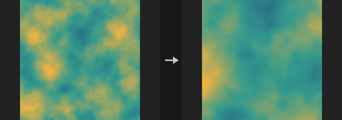

The origin is at the bottom left, as everywhere in COP. The window may extend outside the image: the outside is filled according to Border, so a negative X / Y with a larger resolution pads the image outward without another node. Parts that stay inside the image are copied bit for bit.

The window is given either as integer pixels (X, Y, Resolution) or, for other Units and Methods, through Corner and Extent. With Units `pixels` and Method `lower_left_size` the integer X, Y and Resolution fields are used; otherwise Corner and Extent are used and converted to pixels, rounding each corner to the nearest pixel edge. Pad Left / Right / Top / Bottom then grow the window outward.

Typical uses: cropping a 1024 x 1024 composition to 832 x 1216 before a diffusion pass, or extending a render with a black border to make an outpainting canvas.

**Inputs**

| Input | Type | Description |
|---|---|---|
| `cop` | COPIMAGE | Image to crop or pad. |

**Outputs**

| Output | Type | Description |
|---|---|---|
| `cop` | COPIMAGE | The cropped or padded image. |

**Parameters**

| Parameter | Type | Default | Description |
|---|---|---|---|
| Mode `mode` | menu | Discard and Reframe to Crop | `discard_reframe`: the output resolution becomes the window size. `discard`: the resolution stays the same; pixels outside the window are discarded and replaced according to Border, read from the part that remains. Options: Discard and Reframe to Crop (`discard_reframe`), Discard Cropped (`discard`). |
| Border `border` | menu | Clamp (Streak Edges) | What fills the parts of the window outside the image (or the discarded parts): `clamp` repeats edge pixels, `wrap` tiles, `black` gives zero, `mirror` reflects at the border. Options: Clamp (Streak Edges) (`clamp`), Wrap (`wrap`), Constant (Black) (`black`), Mirror (`mirror`). |
| Units `units` | menu | Pixels | Unit of Corner and Extent: `pixels`, `texture` (0..1 across the image), or `image` (-1..1 across the longer side with the origin at the image centre, so a square window stays square). Options: Pixels (`pixels`), Texture (`texture`), Image (`image`). |
| Method `method` | menu | Lower Left and Size | `lower_left_size`: Corner is the lower-left point and Extent is the size. `lower_left_upper_right`: Extent is the upper-right corner. Options: Lower Left and Size (`lower_left_size`), Lower Left and Upper Right (`lower_left_upper_right`). |
| Lower Left `x` `y` | int [-16384..16384] | 0, 0 | Lower-left corner (X Y) of the window in pixels, origin at the bottom left. May be negative to pad outward. Used with Units `pixels` and Method `lower_left_size`. *Hidden when units ≠ pixels } { method ≠ lower_left_size.* |
| Size `resolution_x` `resolution_y` | int [1..16384] | 512, 512 | Window width and height in pixels. Used with Units `pixels` and Method `lower_left_size`. *Hidden when units ≠ pixels } { method ≠ lower_left_size.* |
| Lower Left `corner` | string | `0 0` | Lower-left corner (X Y) of the window in the chosen Units. Used when Units or Method are not the default. *Hidden when units = pixels method = lower_left_size.* |
| Upper Right / Size `extent` | string | `1 1` | Size (X Y) of the window, or its upper-right corner when Method is `lower_left_upper_right`, in the chosen Units. Used when Units or Method are not the default. *Hidden when units = pixels method = lower_left_size.* |

*Pixel Padding*

| Parameter | Type | Default | Description |
|---|---|---|---|
| Left `pad_left` | int [0..16384] | 0 | Pixels added to the window on the left. |
| Right `pad_right` | int [0..16384] | 0 | Pixels added to the window on the right. |
| Top `pad_top` | int [0..16384] | 0 | Pixels added to the window at the top. |
| Bottom `pad_bottom` | int [0..16384] | 0 | Pixels added to the window at the bottom. |

**Compared with Houdini**

Houdini's Crop mode Reframe to Crop is not available, because layers here always equal the frame and cannot carry data outside it. Aspect Ratio, Extract Tile, Min / Max Resolution, Reset Pixel Origin and the geometry input are not implemented. Border has an additional `mirror` option.

**Tips**

- To pad an image, use a negative X / Y and a larger resolution, or use the Pad fields.

---

### COP Distort (PCG)

`PCG_COPDistort` · category `PCG/cop` · Houdini: Distort (COP)

Warps an image per pixel by a vector image, so noise, hand-painted flow or motion vectors displace the pixels.

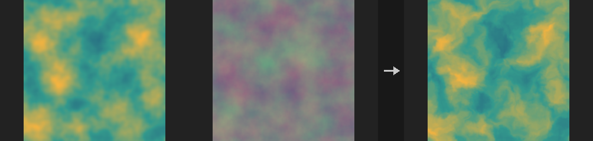

Computes `out[p] = cop[p + amount * field[p]]`. This is the general form of Houdini's Distort by Noise: wire a 2-channel COP Noise into `field` for noise distortion, a painted flow map for directional dragging, or a backward motion vector layer for a frame-to-frame warp.

The lookup is **backward**: the field says where in the input each output pixel fetches its value from, so the visual result is the opposite of "pushing pixels along the vector". The benefit is that no holes appear. For a forward-looking result use a negative `amount` (equivalent for small displacements, not for large ones).

If the field has a different resolution than the main input it is resampled to the main input first, as in Composite.

**Inputs**

| Input | Type | Description |
|---|---|---|
| `cop` | COPIMAGE | Image whose layers are warped. |
| `field` | COPIMAGE | Image that holds the 2-channel vector layer used as displacement. |

**Outputs**

| Output | Type | Description |
|---|---|---|
| `cop` | COPIMAGE | The warped image. |

**Parameters**

| Parameter | Type | Default | Description |
|---|---|---|---|
| Layers `layers` | string | *(empty)* | Layers of the main input to warp. Empty means all layers; otherwise a space-separated list of layer names. |
| Field Layer `field_layer` | string | `C` | Name of the 2-channel vector layer on the `field` input. |
| Amount `amount` | float [-10000.0..10000.0] | 0.05 | Scale applied to the vector before the lookup. Positive values fetch from `p + amount * field[p]`; negative values reverse the apparent direction. |
| Units `units` | menu | UV (1 = Full Size) | Unit in which the field vector is interpreted: UV (1 = full image size), pixels, or normalized (1 = half the image size). Options: UV (1 = Full Size) (`uv`), Pixels (`pixels`), Normalized (1 = Half Size) (`normalized`). |
| Filter `filter` | menu | Bilinear | Sampling filter for the lookup: smooth bilinear interpolation or nearest pixel. Options: Bilinear (`bilinear`), Closest (`closest`). |
| Border `border` | menu | Clamp (Streak Edges) | What a lookup outside the image returns: edge pixel (clamp), tiled (wrap) or black. Options: Clamp (Streak Edges) (`clamp`), Wrap (`wrap`), Constant (Black) (`black`). |

---

### COP Flip (PCG)

`PCG_COPFlip` · category `PCG/cop` · Houdini: Flip (COP)

Mirrors layers horizontally and/or vertically by reversing pixel indices.

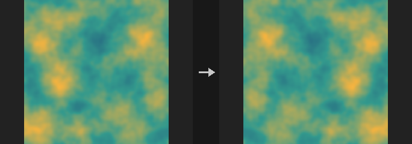

The flip reverses the index order directly, with no resampling, so it is bit-exact lossless. Vertical flips the v axis; since row 0 of a COP image is the bottom, this turns the image upside down. Enabling both is a 180 degree rotation, which is cheaper than a rotation in COP Transform (also lossless).

**Inputs**

| Input | Type | Description |
|---|---|---|
| `cop` | COPIMAGE | Image to flip. |

**Outputs**

| Output | Type | Description |
|---|---|---|
| `cop` | COPIMAGE | The flipped image. |

**Parameters**

| Parameter | Type | Default | Description |
|---|---|---|---|
| Layers `layers` | string | *(empty)* | Layers to flip. Empty means all layers; otherwise a space-separated list of layer names. |
| Flip Horizontal `horizontal` | toggle | on | Mirror left to right. |
| Flip Vertical `vertical` | toggle | off | Mirror top to bottom. |

---

### COP Heat Distort (PCG)

`PCG_COPHeatDistort` · category `PCG/cop` · Houdini: Heat Distort (COP)

Distorts pixels with simplex noise that drifts over time, producing a heat-haze effect.

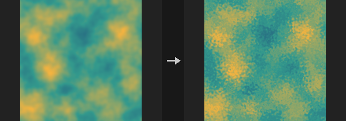

Equivalent of Heat Distort (the procedural one). Pixels are pushed by up to `amount` pixels using simplex noise that drifts in the given direction as time advances. If a field layer is given, the distortion is scaled by that layer's values, so it only acts where the layer is above 0 (for instance, the haze above a heat source). Wire the frame number into `time` for animation.

**Inputs**

| Input | Type | Description |
|---|---|---|
| `cop` | COPIMAGE | Image to distort (and optionally the field layer). |

**Outputs**

| Output | Type | Description |
|---|---|---|
| `cop` | COPIMAGE | The distorted image. |

**Parameters**

| Parameter | Type | Default | Description |
|---|---|---|---|
| Layers `layers` | string | *(empty)* | Layers to distort. Empty means all layers; otherwise a space-separated list of layer names. |
| Amount `amount` | float [-1024..1024] | 4 | Maximum displacement in pixels. |
| Element Size `scale` | float [0.0001..100] | 0.05 | Feature size of the noise in uv units. |
| Direction `direction` | float [-360..360] | 90 | Direction in degrees in which the noise drifts. |
| Speed `speed` | float [-1000.0..1000.0] | 1 | Drift speed; the actual offset is Time times Speed. |
| Time `time` | float | 0 | Animation time, normally the frame number. |
| Seed `rand_seed` | int [0..] | 0 | Seed of the noise. |
| Field Layer `field_layer` | string | *(empty)* | Optional layer that scales the distortion strength per pixel. Empty applies the distortion uniformly. |
| Border `border` | menu | Clamp | What a lookup outside the image returns: clamp, wrap or black. Options: Clamp (`clamp`), Wrap (`wrap`), Constant (Black) (`black`). |

**Compared with Houdini**

For distortion driven by an input noise layer, use COP Heat Distort by Layer instead.

---

### COP Heat Distort by Layer (PCG)

`PCG_COPHeatDistortByLayer` · category `PCG/cop` · Houdini: Heat Distort by Layer (COP)

Distorts pixels using an input noise layer (or direction layer), with optional curved tracing, streak blur and chromatic aberration.

Equivalent of Heat Distort by Layer. Instead of generating noise it uses a noise layer of the input. The displacement direction is the gradient of the noise (or an explicit 2-channel direction layer, if given) rotated by `angle`, then scaled: `displacement = scale * effect * Rot(angle) * direction` in image units (the long side is 2, +y up). The output samples the source at `p - displacement` with bilinear filtering.

`accurate` walks backward along the field in steps of about `step_pixels`, evaluating the field at each position, so curved fields give curved trajectories; off, a single straight step is taken. `streak_blur` averages samples along that path. `blur_source` blurs the source and mixes between sharp and blurred according to displacement magnitude relative to the maximum. `blur_noise` pre-blurs the noise before its gradient is taken. `chromatic` offsets red, green and blue by different multiples of the displacement (alpha follows green) on layers with at least 3 channels.

The formulas are not given in Houdini's documentation; the definitions here are the plugin's own.

**Inputs**

| Input | Type | Description |
|---|---|---|
| `cop` | COPIMAGE | Image containing the layers to distort, the noise layer, and optionally the effect, direction and mask layers. |

**Outputs**

| Output | Type | Description |
|---|---|---|
| `cop` | COPIMAGE | The distorted image. |

**Parameters**

| Parameter | Type | Default | Description |
|---|---|---|---|
| Source Layers `layers` | string | *(empty)* | Layers to distort. Empty means all layers except the noise, effect, direction and mask layers. |
| Noise Layer `noise_layer` | string | `noise` | Layer whose gradient drives the distortion (when no direction layer is given). |
| Effect Layer `effect_layer` | string | *(empty)* | Optional layer that scales the distortion strength per pixel. Empty means 1 everywhere. |
| Direction Layer `dir_layer` | string | *(empty)* | Optional 2-channel direction layer in image units. Empty uses the gradient of the noise layer. |
| Mask `mask` | float [0..1] | 1 | Blend amount between the original and distorted image; 1 uses only the distorted result. |
| Mask Layer `mask_layer` | string | *(empty)* | Optional layer controlling the blend per pixel. Empty disables it. |

*Distortion*

| Parameter | Type | Default | Description |
|---|---|---|---|
| Scale `scale` | float [-10000.0..10000.0] | 0.05 | Overall displacement strength: displacement = Scale times effect times the gradient, in image units. |
| Angle `angle` | float [-3600..3600] | 0 | Rotation of the direction vectors in degrees. 0 leaves the direction as is. |
| Accurate Distortion `accurate` | toggle | off | Trace a curved path backward through the field instead of one straight step. |
| Pixels per Step `step_pixels` | float [0.05..10000.0] | 1 | Length of each tracing step in pixels when Accurate Distortion or Streak Blur takes multiple steps. *Disabled when accurate is off streak_blur is off.* |
| Streak Blur `streak_blur` | toggle | off | Average samples along the displacement path to smear the image. |
| Scale by Timestep `scale_by_timestep` | toggle | off | Multiply the displacement by Timestep, so it behaves as a per-frame amount. |
| Timestep `timestep` | float [0..1000.0] | 0.0416667 | Time step used by Scale by Timestep. Houdini's `$FPS` is not available here, so it is set explicitly (default 1/24). *Disabled when scale_by_timestep is off.* |

*Blur Source*

| Parameter | Type | Default | Description |
|---|---|---|---|
| Blur Source `blur_source` | toggle | off | Blur the source image and blend the blurred version in proportion to the local displacement strength. |
| Blur Size `blur_source_size` | float [0..100] | 0.01 | Gaussian size of the source blur, in image units. *Disabled when blur_source is off.* |

*Blur Noise*

| Parameter | Type | Default | Description |
|---|---|---|---|
| Blur Noise `blur_noise` | toggle | off | Blur the noise layer before computing its gradient. |
| Blur Size `blur_noise_size` | float [0..100] | 0.01 | Gaussian size of the noise blur, in image units. *Disabled when blur_noise is off } { dir_layer ≠ "".* |

*Chromatic Aberration*

| Parameter | Type | Default | Description |
|---|---|---|---|
| Chromatic Aberration `chromatic` | toggle | off | Enable chromatic aberration: color channels are displaced by different amounts. |
| Scale `ca_scale` | float [-100..100] | 1 | Overall scale of the chromatic displacement. *Disabled when chromatic is off.* |
| Red `ca_red` | float [-100..100] | 1.2 | Displacement multiplier for the red channel. *Disabled when chromatic is off.* |
| Green `ca_green` | float [-100..100] | 1 | Displacement multiplier for the green channel (alpha follows it). *Disabled when chromatic is off.* |
| Blue `ca_blue` | float [-100..100] | 0.8 | Displacement multiplier for the blue channel. *Disabled when chromatic is off.* |

| Parameter | Type | Default | Description |
|---|---|---|---|
| Border `border` | menu | Clamp | What a lookup outside the image returns: clamp, wrap or black. Options: Clamp (`clamp`), Wrap (`wrap`), Constant (Black) (`black`). |

**Compared with Houdini**

The older COP Heat Distort generates its own simplex noise that drifts in time; this node takes the noise as an input layer. The default channel multipliers for chromatic aberration (1.2 / 1.0 / 0.8) are the plugin's choice, since Houdini's documentation does not give them.

---

### COP Hex Tile (PCG)

`PCG_COPHexTile` · category `PCG/cop` · Houdini: Hex Tile (COP)

Breaks up visible tiling of a texture by laying it out on a hexagonal grid with a random offset and rotation per cell.

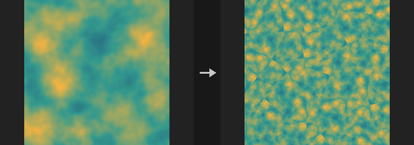

The plane is divided into a hexagonal grid. Each cell gets its own randomly offset and randomly rotated copy of the source texture, and the three copies that overlap at every pixel are blended with barycentric weights (hex-tiling after Mikkelsen 2022). The result hides the repetition of a tiling texture.

The weights are sharpened as `w^(1 + 8*contrast)` and renormalized, so a higher Blend Contrast gives narrower, less blurry seams between cells. The source texture should itself be tileable, because it is sampled with wrapping. If the `source` input is not connected, the Source Layer is read from `cop` itself.

**Inputs**

| Input | Type | Description |
|---|---|---|
| `cop` | COPIMAGE | Image whose resolution is used for the output (unless Resolution is set). Also supplies the Source Layer when `source` is not connected. |
| `source` *(optional)* | COPIMAGE | Optional image to take the texture from. When connected, the Source Layer is read from it instead of from `cop`. |

**Outputs**

| Output | Type | Description |
|---|---|---|
| `cop` | COPIMAGE | Image with the tiled result in the output layer. When Resolution differs from the input, the output contains only that layer at the new size. |

**Parameters**

| Parameter | Type | Default | Description |
|---|---|---|---|
| Source Layer `layer` | string | `C` | Layer to tile. Read from `source` when it is connected, otherwise from `cop`. |
| Tile Count `tiles` | float [0.01..1000] | 4 | Number of texture periods across the image width. |
| Max Rotation `rotation` | float [0..180] | 180 | Each hex cell is rotated by a random angle within plus or minus this many degrees. 0 disables rotation. |
| Blend Contrast `contrast` | float [0..1] | 0.6 | Sharpness of the blend between neighbouring cells. Higher values give narrower seams. |
| Seed `rand_seed` | int [0..] | 0 | Seed for the per-cell random offsets and rotations. |
| Resolution `xres` `yres` | int [0..16384] | 0, 0 | Output width and height in pixels. 0 follows the input image. |
| Output Layer `out_layer` | string | `hex` | Name of the layer that receives the result. |

**Tips**

- Use a tileable source texture; non-tileable input will show seams where the texture wraps.

---

### COP Lattice Deform (PCG)

`PCG_COPLatticeDeform` · category `PCG/cop` · Houdini: Lattice Deform (COP)

Warps an image with a grid of control points that are offset in uv.

A lattice of `(nx+1) x (ny+1)` control points is laid over the image, where Divisions sets the number of cells `nx ny`. Each control point has a uv offset, either typed in explicitly (Point Offsets) or generated randomly (Jitter). The offsets are bilinearly interpolated across the image, and the image is resampled by inverse mapping (each output pixel reads the input at minus its offset), which matches a forward warp for small offsets.

**Inputs**

| Input | Type | Description |
|---|---|---|
| `cop` | COPIMAGE | Image to warp. |

**Outputs**

| Output | Type | Description |
|---|---|---|
| `cop` | COPIMAGE | Warped image. |

**Parameters**

| Parameter | Type | Default | Description |
|---|---|---|---|
| Layers `layers` | string | *(empty)* | Space-separated layers to process. Empty processes all layers. |
| Divisions `divisions` | string | `4 4` | Number of lattice cells as two numbers, columns and rows (for example `4 4`, which gives 5 x 5 control points). |
| Point Offsets `offsets` | string | *(empty)* | Explicit uv offsets for the control points: two numbers per point, row by row from the bottom row of control points. Missing values are treated as 0. |
| Jitter `jitter` | float [0..1] | 0 | Amplitude of random uv offsets (uniform in plus or minus Jitter) added to the control points. 0 disables. |
| Seed `rand_seed` | int [0..] | 0 | Seed for the random jitter. *Disabled when jitter = 0.* |
| Border `border` | menu | Clamp | How samples that fall outside the image are handled: clamp to the edge, wrap around, or use black. Options: Clamp (`clamp`), Wrap (`wrap`), Constant (Black) (`black`). |

---

### COP Lens Distort (PCG)

`PCG_COPLensDistort` · category `PCG/cop` · Houdini: Lens Distort (COP)

Adds or removes radial lens distortion.

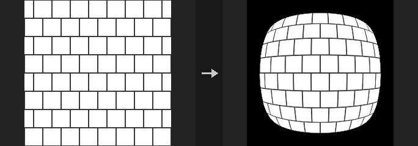

Applies the radial term of the Brown-Conrady model, `r_d = r * (1 + k1*r^2 + k2*r^4)`, where r is measured from the Center and normalized by half the image diagonal. A negative K1 gives barrel distortion, a positive K1 gives pincushion. Distort adds distortion to a clean image and Undistort removes it; the two round-trip. Very large |K1| values make the mapping non-monotonic and the Distort solver can then converge to the wrong root.

**Inputs**

| Input | Type | Description |
|---|---|---|
| `cop` | COPIMAGE | Image to process. |

**Outputs**

| Output | Type | Description |
|---|---|---|
| `cop` | COPIMAGE | Distorted or undistorted image. |

**Parameters**

| Parameter | Type | Default | Description |
|---|---|---|---|
| Layers `layers` | string | *(empty)* | Space-separated layers to process. Empty processes all layers. |
| Mode `mode` | menu | Distort | Distort applies the lens model; Undistort inverts it. Options: Distort (`distort`), Undistort (`undistort`). |
| Radial K1 `k1` | float [-2..2] | -0.1 | First radial coefficient. Below 0 is barrel, above 0 is pincushion. |
| Radial K2 `k2` | float [-2..2] | 0 | Second radial coefficient (fourth-power term). |
| Center `center` | string | `0.5 0.5` | Distortion centre in uv, as two numbers (`0.5 0.5` is the image centre). |
| Border `border` | menu | Constant (Black) | What is shown where the distorted lookup falls outside the image. Options: Constant (Black) (`black`), Clamp (`clamp`), Wrap (`wrap`). |

---

### COP Mirror (PCG)

`PCG_COPMirror` · category `PCG/cop` · Houdini: Mirror (COP)

Mirrors one half of an image onto the other, or reflects it across arbitrary mirror planes.

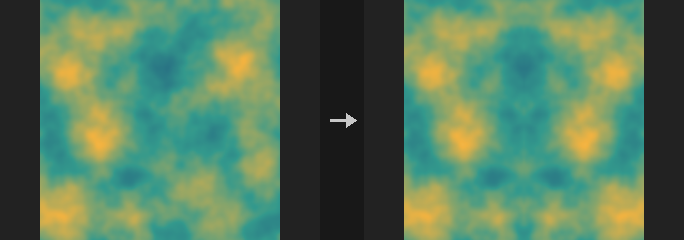

The four directional modes copy one side onto the other around Mirror Position: Left to Right copies the left half over the right half, and so on. Quad mirrors the bottom-left quarter onto the whole image. Position is a uv coordinate.

Number and Offset and Custom Mirror Planes are Houdini's two arbitrary-plane modes. A mirror plane is a line in image space (origin at the image centre, -1 to 1 spanning the longer side, square pixels). With Angle 0 and Offset 0 it is the vertical centre line and the left half is mirrored onto the right. A positive Offset moves the plane to the right, and Reverse swaps which side is the source. In Number and Offset, plane k has the angle `k * Angle` and all planes share Offset. In Custom, each line of Mirrors defines one plane as `angle offset [reverse]`. Planes are applied in sequence, each acting on the result of the previous ones, but the lookup is composed so the image is resampled only once. Those two modes ignore Mirror Position.

**Inputs**

| Input | Type | Description |
|---|---|---|
| `cop` | COPIMAGE | Image to mirror. |

**Outputs**

| Output | Type | Description |
|---|---|---|
| `cop` | COPIMAGE | Mirrored image. |

**Parameters**

| Parameter | Type | Default | Description |
|---|---|---|---|
| Layers `layers` | string | *(empty)* | Space-separated layers to process. Empty processes all layers. |
| Mode `mode` | menu | Left to Right | Mirroring method; see the description. Options: Left to Right (`left_to_right`), Right to Left (`right_to_left`), Bottom to Top (`bottom_to_top`), Top to Bottom (`top_to_bottom`), Quad (Four-Way) (`quad`), Number and Offset (`number_and_offset`), Custom Mirror Planes (`custom_planes`). |
| Mirror Position `position` | float [0..1] | 0.5 | Position of the mirror line in uv for the directional and quad modes. *Hidden when mode = number_and_offset } { mode = custom_planes.* |
| Number of Planes `planes` | int [1..64] | 1 | Number and Offset: how many mirror planes to apply. *Hidden when mode ≠ number_and_offset.* |
| Angle `angle` | float [-3600..3600] | 0 | Number and Offset: angle in degrees between consecutive planes; plane k uses `k * Angle`. 0 is the vertical centre line. *Hidden when mode ≠ number_and_offset.* |
| Offset `offset` | float [-10..10] | 0 | Number and Offset: shift of the planes in image space (-1 to 1 across the long side). Positive moves the plane to the right. *Hidden when mode ≠ number_and_offset.* |
| Reverse Mirror Plane Direction `reverse` | toggle | off | Number and Offset: swap the source and target sides of the planes. *Hidden when mode ≠ number_and_offset.* |
| Mirrors `plane_list` | string | `0 0` | Custom Mirror Planes: one plane per line, applied in order, as `angle offset [reverse 0/1]`. *Hidden when mode ≠ custom_planes.* |

---

### COP Polar (PCG)

`PCG_COPPolar` · category `PCG/cop`

Resamples the whole image between Cartesian and polar layouts.

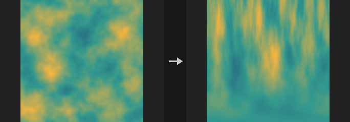

Cartesian to Polar unrolls a ring into a horizontal strip: U becomes the angle and V the radius. Polar to Cartesian rolls a strip back into a ring. The two directions are inverses of each other. The aspect ratio is preserved relative to the shorter image side.

This moves pixels. To only convert the coordinate values stored in a UV layer, use COP Polar Coords instead.

**Inputs**

| Input | Type | Description |
|---|---|---|
| `cop` | COPIMAGE | Image to remap. |

**Outputs**

| Output | Type | Description |
|---|---|---|
| `cop` | COPIMAGE | The remapped image. |

**Parameters**

| Parameter | Type | Default | Description |
|---|---|---|---|
| Layers `layers` | string | *(empty)* | Space-separated layer names to process. Empty processes all layers. |
| Conversion `direction` | menu | Cartesian to Polar | Conversion direction: unroll a ring into a strip, or roll a strip into a ring. Options: Cartesian to Polar (`to_polar`), Polar to Cartesian (`from_polar`). |
| Center `center` | string | `0.5 0.5` | Centre of the polar mapping as two UV values (`u v`). |
| Radius `radius` | float [0.001..100] | 0.5 | Radius of the ring in UV units that maps to the full V range. |
| Start Angle `angle` | float [-360..360] | 0 | Angle in degrees where the unrolled strip starts. |
| Border `border` | menu | Clamp | How samples outside the image are handled. Polar to Cartesian only distinguishes Constant (Black) from the other options. Options: Clamp (`clamp`), Wrap (`wrap`), Constant (Black) (`black`). |

**Compared with Houdini**

Unlike Houdini's UV to Polar / Polar to UV, which only convert coordinate values, this node resamples the image itself (equivalent to UV Map, then polar conversion, then UV Sample).

---

### COP Polar Coords (PCG)

`PCG_COPPolarCoords` · category `PCG/cop` · Houdini: Polar to UV (COP), UV to Polar (COP)

Converts UV coordinate values stored in a layer to angle and length layers, or back.

UV to Polar reads the `uv` layer and writes two single-channel layers, angle and length, measured around the Origin. Polar to UV does the inverse: it reads the angle and length layers (or the constants when a layer name is empty) and writes a `uv` layer.

Angle 0 points along +U and increases counter-clockwise. Angles come out in the range from 0 up to one full turn in the chosen units. Only coordinate values are converted; no pixels move.

**Inputs**

| Input | Type | Description |
|---|---|---|
| `cop` | COPIMAGE | Image holding the input layers. |

**Outputs**

| Output | Type | Description |
|---|---|---|
| `cop` | COPIMAGE | Image with the converted layers added. |

**Parameters**

| Parameter | Type | Default | Description |
|---|---|---|---|
| Direction `direction` | menu | UV to Polar | Which way to convert. Options: UV to Polar (`uv_to_polar`), Polar to UV (`polar_to_uv`). |
| Angle Units `angle_units` | menu | Circles (2pi) | Unit of the angle layer. Circles is one full turn = 1. Options: Radians (`radians`), Degrees (`degrees`), Circles (2pi) (`circles`). |
| UV Layer `uv_layer` | string | `uv` | UV to Polar reads this layer; Polar to UV writes it. |
| Angle Layer `angle_layer` | string | `angle` | UV to Polar writes this layer; Polar to UV reads it. Empty uses the Angle constant. |
| Length Layer `length_layer` | string | `length` | UV to Polar writes this layer; Polar to UV reads it. Empty uses the Length constant. |
| Angle `angle` | float | 0 | Constant angle used when no angle layer is named, in the selected units. *Hidden when direction = uv_to_polar.* *Disabled when angle_layer ≠ "".* |
| Length `length` | float | 1 | Constant length used when no length layer is named. *Hidden when direction = uv_to_polar.* *Disabled when length_layer ≠ "".* |
| Origin `origin` | string | `0 0` | Centre point as two UV values (`u v`) that angle and length are measured from. |

**Compared with Houdini**

Origin is an addition; Houdini always measures from UV (0, 0).

---

### COP Refract from Height (PCG)

`PCG_COPRefractFromHeight` · category `PCG/cop` · Houdini: Refract from Height (COP)

Computes the 2-channel UV offset that a water-like height surface causes when viewing something below it.

Looks through a height layer acting as a liquid surface and writes how far objects on the bottom appear shifted, as a 2-channel UV offset layer. Feeding it to COP Distort (Units = UV, Amount = 1, Field Layer = the output) produces an underwater distortion; the offset already says where the line of sight lands, and Distort samples backwards, so no negation is needed.

A flat surface gives exactly zero offset; with IOR 1 the offset is zero however much the surface moves; the offset is linear in Depth. There is no Fresnel and no absorption: this is a distortion field, not a render. If a Source Layer is given, the refracted image is also produced by sampling it with the offset.

**Inputs**

| Input | Type | Description |
|---|---|---|
| `cop` | COPIMAGE | Image containing the height layer and the optional source, normal and ground layers. |

**Outputs**

| Output | Type | Description |
|---|---|---|
| `cop` | COPIMAGE | Image with the offset layer (and the refracted layer if a source is given). |

**Parameters**

| Parameter | Type | Default | Description |
|---|---|---|---|
| Height Layer `layer` | string | `C` | Layer holding the surface height. |
| Source Layer `source_layer` | string | *(empty)* | Optional image layer to refract. Empty outputs only the offset. |
| Normal Layer `normal_layer` | string | *(empty)* | Optional normal layer. Empty derives normals from the height derivative. |
| Normal Type `normal_type` | menu | Signed (-1 to 1) | Encoding of the normal layer: signed is -1 to 1, offset is 0 to 1. Options: Signed (-1 to 1) (`signed`), Offset (0 to 1) (`offset`). *Disabled when normal_layer = "".* |
| Ground Layer `ground_layer` | string | *(empty)* | Optional height layer for the bottom. Empty uses a flat bottom at z = -Depth. |

*View*

| Parameter | Type | Default | Description |
|---|---|---|---|
| Directional `directional` | toggle | on | Uses a view direction (azimuth and altitude) instead of a view position. |
| View Azimuth `view_azimuth` | float [-3600..3600] | 0 | Horizontal viewing angle in degrees. *Hidden when directional is off.* |
| View Altitude `view_altitude` | float [0.01..90.0] | 90 | Viewing elevation in degrees; 90 looks straight down. *Hidden when directional is off.* |
| View Position `view_position` | string | `0 0 10` | Eye position in world coordinates `x y z`; x spans 0 to World Size across the image width and z points up. *Hidden when directional is on.* |

*Height*

| Parameter | Type | Default | Description |
|---|---|---|---|
| Height Scale `strength` | float [-10000.0..10000.0] | 1 | Multiplier applied to the height values. |
| Height Offset `height_offset` | float | 0 | Constant added to the height. |
| World Size `world_size` | float [1e-06..] | 1 | World-space width of the image, which relates height units to pixels. |

*Refraction*

| Parameter | Type | Default | Description |
|---|---|---|---|
| Depth `depth` | float [0.0..10000.0] | 0.1 | Distance from the surface to a flat bottom. |
| IOR `ior` | float [1.0..4.0] | 1.33 | Index of refraction of the medium (1.33 is water). |
| Tileable (Wrap Edges) `tile` | toggle | off | Wraps lookups at the edges so tiling input stays seamless. |

*Ground*

| Parameter | Type | Default | Description |
|---|---|---|---|
| Ground Offset `ground_offset` | float | 0 | Offset added to the ground layer. *Disabled when ground_layer = "".* |
| Ground Scale `ground_scale` | float | 1 | Multiplier applied to the ground layer. *Disabled when ground_layer = "".* |
| Ray Trace Iterations `ray_iterations` | int [0..256] | 8 | Number of iterations used to find where the refracted ray meets an uneven ground. *Disabled when ground_layer = "".* |

| Parameter | Type | Default | Description |
|---|---|---|---|
| Output Layer `out_layer` | string | `refract` | Name of the 2-channel UV offset layer. |
| Refract Output Layer `refract_out_layer` | string | `refracted` | Name of the refracted image layer. Used only with a Source Layer. *Disabled when source_layer = "".* |
| Keep Input Layers `keep_layers` | toggle | on | Keeps the input layers in the output. |

---

### COP Resize (PCG)

`PCG_COPResize` · category `PCG/cop` · Houdini: Resample (COP), Resize (COP)

Resamples the image to a new resolution with bilinear filtering.

Coordinates are converted using pixel centres: `x = (i+0.5)*W/W' - 0.5`, not the end-point-aligned `i*(W-1)/(W'-1)`. Pixels are cells with width, not points. Scaling 2 columns to 1 gives x = 0.5 (half of each) with centre alignment, whereas end-point alignment would sample only the left pixel.

The UV grid and Sample nodes use the same convention, so generating noise and then resizing matches generating the noise directly at the target size.

**Inputs**

| Input | Type | Description |
|---|---|---|
| `cop` | COPIMAGE | Image to resize. |

**Outputs**

| Output | Type | Description |
|---|---|---|
| `cop` | COPIMAGE | Resized image. |

**Parameters**

| Parameter | Type | Default | Description |
|---|---|---|---|
| Resolution `resolution_x` `resolution_y` | int [1..16384] | 512, 512 | Target width and height in pixels. |
| Border `border` | menu | Clamp (Streak) | How samples outside the source are handled: clamp repeats the edge pixels, wrap tiles the image, constant fills black. Options: Clamp (Streak) (`clamp`), Wrap (`wrap`), Constant (Black) (`black`). |

---

### COP Retile (PCG)

`PCG_COPRetile` · category `PCG/cop` · Houdini: Retile (COP)

Shuffles the image's tiles randomly or turns it into a seamlessly tileable image.

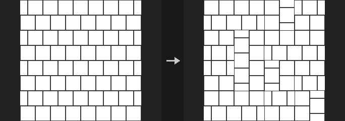

Shuffle cuts the image into a grid and rearranges the tiles randomly, optionally rotating them by multiples of 90 degrees and flipping them. Make Seamless cross-fades the image with a copy of itself shifted by half its size, weighted by the distance to the edge, so that the result tiles.

**Inputs**

| Input | Type | Description |
|---|---|---|
| `cop` | COPIMAGE | Image to retile. |

**Outputs**

| Output | Type | Description |
|---|---|---|
| `cop` | COPIMAGE | Retiled image. |

**Parameters**

| Parameter | Type | Default | Description |
|---|---|---|---|
| Layers `layers` | string | *(empty)* | Layers to process, space-separated. Empty processes all layers. |
| Mode `mode` | menu | Shuffle Tiles | Shuffle tiles randomly, or blend into a seamless tile. Options: Shuffle Tiles (`shuffle`), Make Seamless (`seamless`). |
| Tile Count `counts` | string | `4 4` | Number of tile columns and rows as two integers (`x y`). *Hidden when mode ≠ shuffle.* |
| Random Rotate `rotate` | toggle | on | Randomly rotates tiles by multiples of 90 degrees. Requires square tiles. *Hidden when mode ≠ shuffle.* |
| Random Flip `flip` | toggle | off | Randomly mirrors tiles. *Hidden when mode ≠ shuffle.* |
| Seed `rand_seed` | int [0..] | 0 | Seed of the random arrangement. *Hidden when mode ≠ shuffle.* |
| Blend Width `blend` | float [0.001..1] | 0.25 | Width of the transition band as a fraction of half the image. *Hidden when mode ≠ seamless.* |

---

### COP Space Transform (PCG)

`PCG_COPSpaceTransform` · category `PCG/cop` · Houdini: Space Transform (COP)

Converts coordinate values stored in a layer between Buffer, Pixel, Texture, Image and World spaces.

Converts the first two channels of a coordinate layer; a third channel is passed through unchanged. The source space is interpreted using the resolution of the source reference, and the destination space using the destination reference (the main image if a reference is not connected). Position applies the full affine conversion; Vector applies only the linear part, without translation. In Pixel space the centre of the first pixel is 0.5.

This is not the same as a vector transform (rotation, scale, matrices, tangent space).

**Inputs**

| Input | Type | Description |
|---|---|---|
| `cop` | COPIMAGE | Image containing the coordinate layer. |
| `src_ref` *(optional)* | COPIMAGE | Optional image whose resolution defines the source space. |
| `dst_ref` *(optional)* | COPIMAGE | Optional image whose resolution defines the destination space. |

**Outputs**

| Output | Type | Description |
|---|---|---|
| `cop` | COPIMAGE | Image with the converted coordinates. |

**Parameters**

| Parameter | Type | Default | Description |
|---|---|---|---|
| Coord Layer `layer` | string | `uv` | Layer holding the coordinates (at least 2 channels). |
| Vector Type `vector_type` | menu | Position | Position converts including translation; Vector (displacement, velocity) converts only the scale part. Options: Position (`position`), Vector/Displacement/Velocity (`vector`). |
| Source Space `src_space` | menu | Texture | Space the stored values are in. Buffer equals Pixel, World equals Image. Options: Buffer (`buffer`), Pixel (`pixel`), Texture (`texture`), Image (`image`), World (`world`). |
| Destination Space `dst_space` | menu | Image | Space to convert to. Options: Buffer (`buffer`), Pixel (`pixel`), Texture (`texture`), Image (`image`), World (`world`). |
| Output Layer `out_layer` | string | *(empty)* | Layer receiving the result. Empty overwrites the input layer. |

**Compared with Houdini**

There is no camera or pixel scale, so Buffer equals Pixel and World equals Image.

---

### COP Sphere Sample (PCG)

`PCG_COPSphereSample` · category `PCG/cop` · Houdini: Sphere Sample (COP)

Maps a lat-long image onto a sphere and renders it with a default camera.

The source is treated as a lat-long (equirectangular) map. With Celestial Sphere on, it is an infinitely distant sky dome affected only by Rotate, and the mask is all 1. With it off, it is a transformable unit sphere and the mask marks pixels where the camera ray hits the sphere.

There is no camera metadata: the camera looks along -Z, and with perspective projection it sits at `(0, 0, Camera Distance)`.

**Inputs**

| Input | Type | Description |
|---|---|---|
| `source` | COPIMAGE | Lat-long image to project. |
| `size_ref` *(optional)* | COPIMAGE | Optional image whose resolution is used for the output. |

**Outputs**

| Output | Type | Description |
|---|---|---|
| `cop` | COPIMAGE | Image with the sampled layer and mask. |

**Parameters**

| Parameter | Type | Default | Description |
|---|---|---|---|
| Source Layer `source_layer` | string | `C` | Lat-long layer to sample. |
| Filter `filter` | menu | Bilinear | Sampling filter. At unit footprint, Box equals Point and Bartlett equals Bilinear. Options: Point (`point`), Bilinear (`bilinear`), Box (`box`), Bartlett (`bartlett`), Catmull-Rom (`catmull_rom`), Mitchell (`mitchell`), B-Spline (`bspline`). |
| Transform Order `xform_order` | menu | Scale Rot Trans | Order in which scale, rotate and translate are applied. Options: Scale Rot Trans (`srt`), Scale Trans Rot (`str`), Rot Scale Trans (`rst`), Rot Trans Scale (`rts`), Trans Scale Rot (`tsr`), Trans Rot Scale (`trs`). *Disabled when celestial is on.* |
| Rotate Order `rotate_order` | menu | Rx Ry Rz | Order of the X, Y and Z rotations. Options: Rx Ry Rz (`xyz`), Rx Rz Ry (`xzy`), Ry Rx Rz (`yxz`), Ry Rz Rx (`yzx`), Rz Rx Ry (`zxy`), Rz Ry Rx (`zyx`). |
| Celestial Sphere `celestial` | toggle | off | Treats the source as an infinitely distant sky dome. Only Rotate applies. |
| Projection `projection` | menu | Perspective | Camera projection. Options: Perspective (`perspective`), Orthographic (`orthographic`). |
| Translate `translate` | string | `0 0 0` | Translation of the sphere as `x y z`. *Disabled when celestial is on.* |
| Rotate `rotate` | string | `0 0 0` | Rotation in degrees as `x y z`. |
| Scale `scale` | string | `1 1 1` | Non-uniform scale as `x y z`. *Disabled when celestial is on.* |
| Uniform Scale `uniform_scale` | float | 1 | Overall scale factor. *Disabled when celestial is on.* |
| Camera Distance `camera_distance` | float [1e-06..] | 2 | Distance of the perspective camera from the origin along +Z. *Disabled when projection ≠ perspective.* |
| Output Layer `out_layer` | string | `transform` | Name of the sampled colour layer. |
| Mask Layer `mask_layer` | string | `mask` | Name of the coverage mask layer. Empty skips it. |
| Resolution `resolution_x` `resolution_y` | int [1..16384] | 512, 512 | Output size, used only when no reference image is connected. |

**Compared with Houdini**

Camera Distance is an addition, since there is no camera metadata.

---

### COP Swirl (PCG)

`PCG_COPSwirl` · category `PCG/cop` · Houdini: Swirl (COP)

Warps an image with a swirl, pinch, bulge or bend distortion.

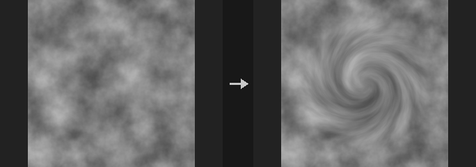

All four modes are inverse mappings: for every output pixel the node computes where in the input to sample. Distances are measured from `Center` in aspect-corrected UV units (height = 1).

- **Swirl**: inside `Radius`, rotates the content by `Amount` degrees, fading with `(1 - r/R)^2` so the rotation is strongest at the centre and zero at the radius.
- **Pinch / Bulge**: pulls the content towards the centre (pinch) or pushes it outwards (bulge) inside `Radius`, with the same quadratic falloff. `Amount` is clamped to 0-1, which keeps the mapping monotonic so nothing folds over.
- **Bend**: bends the image horizontally into an arc; `Amount` is the angle subtended by the full image width.

The warp is applied with bilinear resampling to the selected layers only; other layers are left untouched.

**Inputs**

| Input | Type | Description |
|---|---|---|
| `cop` | COPIMAGE | Image to distort. |

**Outputs**

| Output | Type | Description |
|---|---|---|
| `cop` | COPIMAGE | The distorted image. |

**Parameters**

| Parameter | Type | Default | Description |
|---|---|---|---|
| Layers `layers` | string | *(empty)* | Layers to warp (layer pattern). Empty warps all layers. |
| Mode `mode` | menu | Swirl | Swirl rotates, Pinch shrinks the centre, Bulge magnifies the centre, Bend curves the image into an arc. Options: Swirl (`swirl`), Pinch (`pinch`), Bulge (`bulge`), Bend (`bend`). |
| Amount `amount` | float [-3600..3600] | 90 | Swirl and Bend: angle in degrees (negative reverses the direction). Pinch and Bulge: strength from 0 to 1. |
| Radius `radius` | float [0..10] | 0.4 | Radius of influence in aspect-corrected UV units, measured from the centre. Not used by Bend. *Hidden when mode = bend.* |
| Center (UV) `center` | string | `0.5 0.5` | Centre of the effect in UV (U and V, 0-1). For Bend this is the point the arc is centred on. |
| Border `border` | menu | Clamp (Streak) | What is sampled when the warp reaches outside the image: Clamp repeats the edge pixels (streaks), Wrap tiles the image, Constant fills with black. Options: Clamp (Streak) (`clamp`), Wrap (`wrap`), Constant (Black) (`black`). |

**Tips**

- Use a Radius of 0.5 or more for a swirl that reaches the image edge.

---

### COP Tile (PCG)

`PCG_COPTile` · category `PCG/cop`

Repeats the image in a grid, enlarging the output resolution.

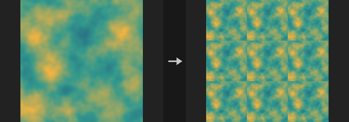

Copies the image `Tiles` times in X and Y; the output resolution becomes (width x tiles X, height x tiles Y). The copies are bit-exact, with no resampling.

With Mirror enabled, every odd column (or row) is flipped, which is the quickest way to turn any image into a seamlessly tiling one, at the cost of mirror symmetry in the result; directional content such as text or faces will give it away.

This is not the same as the Tile U option of the Noise node, which makes the noise function periodic without changing resolution; this node duplicates the picture and increases the resolution.

**Inputs**

| Input | Type | Description |
|---|---|---|
| `cop` | COPIMAGE | Image to repeat. |

**Outputs**

| Output | Type | Description |
|---|---|---|
| `cop` | COPIMAGE | The tiled image. |

**Parameters**

| Parameter | Type | Default | Description |
|---|---|---|---|
| Tile Count `tiles_x` `tiles_y` | int [1..64] | 2, 2 | Number of repetitions along X and Y (a pair: columns, rows). The output resolution is the input resolution multiplied by these. |
| Mirror Alternate Columns `mirror_u` | toggle | off | Flip every odd column horizontally so neighbouring copies meet seamlessly. |
| Mirror Alternate Rows `mirror_v` | toggle | off | Flip every odd row vertically so neighbouring copies meet seamlessly. |

---

### COP Transform (PCG)

`PCG_COPTransform` · category `PCG/cop` · Houdini: HeightField Transform 2D (COP), Transform 2D (COP)

Translates, rotates and scales an image around a pivot without changing its resolution.

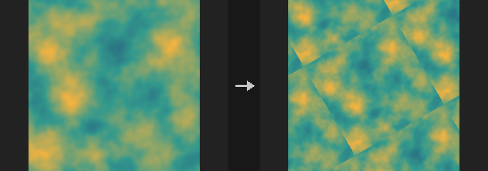

Applies scale first, then rotation, then translation, all around `Pivot`. The resolution stays the same; content moving outside the frame is handled by `Border`.

Rotation is done in an aspect-corrected space (normalised by the short side, as used by the COP Shape node), so a non-square image is not sheared when rotated: a circle rotated by 30 degrees matches an ellipse drawn rotated by 30 degrees. Rotation is counter-clockwise in degrees with V pointing up, which can look reversed compared with ComfyUI nodes that use V down; that is the coordinate convention, not a bug.

Multiples of 90 degrees are exact pixel moves (the angle snaps to exact 0 and +-1 values, giving the same result as `np.rot90`), and a pure integer-pixel translation is equivalent to `np.roll`.

Downscaling is not anti-aliased. At scale 0.25 each output pixel covers 4x4 input pixels but bilinear sampling reads only 2x2, giving moire. Blur first (sigma of about 0.5 / scale) when shrinking a lot.

Layers not selected are passed through untouched. Note for SDF layers: translation and rotation preserve distances but scaling does not, so a scaled SDF layer is no longer a correct SDF.

**Inputs**

| Input | Type | Description |
|---|---|---|
| `cop` | COPIMAGE | Image to transform. |

**Outputs**

| Output | Type | Description |
|---|---|---|
| `cop` | COPIMAGE | The transformed image, same resolution as the input. |

**Parameters**

| Parameter | Type | Default | Description |
|---|---|---|---|
| Layers `layers` | string | *(empty)* | Layers to transform (space-separated names). Empty transforms all; unlisted layers are passed through without resampling. |
| Translate `translate_x` `translate_y` | float [-10000.0..10000.0] | 0, 0 | Translation in X and Y, in the unit chosen by `Units`. |
| Rotate `rotate` | float | 0 | Rotation in degrees, counter-clockwise (V up). |
| Scale `scale_x` `scale_y` | float [-10000.0..10000.0] | 1, 1 | Scale in X and Y. Values above 1 enlarge the content. Must not be 0; negative values mirror. |
| Pivot `pivot_u` `pivot_v` | float [-10.0..10.0] | 0.5, 0.5 | Pivot of the rotation and scale in UV coordinates (0-1). Not affected by `Units`. |
| Translate Units `units` | menu | UV (0-1) | Unit of the translation: UV (1 = full image width/height), Pixels, or Normalized (NDC; 1 = half the image size, so -1 to 1 spans the image). Options: UV (0-1) (`uv`), Pixels (`pixels`), Normalized (NDC) (`normalized`). |
| Border `border` | menu | Clamp (Streak Edges) | What is sampled outside the image: Clamp repeats the edge pixels, Wrap tiles the image, Constant fills with black. Options: Clamp (Streak Edges) (`clamp`), Wrap (`wrap`), Constant (Black) (`black`). |
| Filter `filter` | menu | Bilinear | Bilinear interpolates; Closest picks the nearest pixel, keeping hard pixel edges. Options: Bilinear (`bilinear`), Closest (`closest`). |

**Compared with Houdini**

Covers both Transform 2D and HeightField Transform 2D.

---

### COP Transform 3D (PCG)

`PCG_COPTransform3D` · category `PCG/cop` · Houdini: Transform 3D (COP)

Places the image as a rectangle in 3D with a full Houdini transform and renders it back to the same raster.

The image is treated as a rectangle on the z = 0 plane, positioned in 3D with the full Houdini transform (transform order, rotate order, translate, rotate, scale, shear, uniform scale, pivot translate and rotate, invert), and then viewed with a default camera. The camera is orthographic by default; with Perspective on it becomes a perspective camera at distance `Camera Distance` on the Z axis. This corresponds to Houdini's Transform 3D with Rasterize enabled. Pixels that do not hit the plane (seen edge-on, or plane behind the camera) become 0.

Translation is in image space, where -1 to 1 spans the long edge of the image. Layers do not carry border metadata here, so Border Auto behaves like Clip: the image is sampled normally inside its rectangle and is 0 outside, with no bleeding of black into the edge. Constant fades edges to black through the filter kernel; Clamp and Mirror and Wrap extend the image.

This node is not the same as the four-corner mapping of Corner Pin.

**Inputs**

| Input | Type | Description |
|---|---|---|
| `cop` | COPIMAGE | Image to place in 3D. |

**Outputs**

| Output | Type | Description |
|---|---|---|
| `cop` | COPIMAGE | The rendered image, same resolution as the input. |

**Parameters**

| Parameter | Type | Default | Description |
|---|---|---|---|
| Layers `layers` | string | *(empty)* | Layers to transform (space-separated names). Empty transforms all. |
| Transform Order `xform_order` | menu | Scale Rot Trans | Order in which scale, rotate and translate are combined. Options: Scale Rot Trans (`srt`), Scale Trans Rot (`str`), Rot Scale Trans (`rst`), Rot Trans Scale (`rts`), Trans Scale Rot (`tsr`), Trans Rot Scale (`trs`). |
| Rotate Order `rotate_order` | menu | Rx Ry Rz | Order in which the three axis rotations are applied. Options: Rx Ry Rz (`xyz`), Rx Rz Ry (`xzy`), Ry Rx Rz (`yxz`), Ry Rz Rx (`yzx`), Rz Rx Ry (`zxy`), Rz Ry Rx (`zyx`). |
| Translate `translate` | string | `0 0 0` | Translation (X, Y, Z) in image space; -1 to 1 spans the long edge. |
| Rotate `rotate` | string | `0 0 0` | Rotation (X, Y, Z) in degrees. |
| Scale `scale` | string | `1 1 1` | Scale (X, Y, Z). Must not be 0 on any axis. |
| Shear `shear` | string | `0 0 0` | Shear amounts for the XY, XZ and YZ planes. |
| Uniform Scale `uniform_scale` | float | 1 | Uniform scale multiplied with `Scale`. |

*Pivot Transform*

| Parameter | Type | Default | Description |
|---|---|---|---|
| Pivot Translate `pivot` | string | `0 0 0` | Pivot translate (X, Y, Z): the point the scale and rotation are applied around. |

| Parameter | Type | Default | Description |
|---|---|---|---|
| Pivot Rotate `pivot_rotate` | string | `0 0 0` | Pivot rotation (X, Y, Z) in degrees, orienting the pivot frame. |
| Invert Transformation `invert` | toggle | off | Apply the inverse of the transform. |
| Perspective Camera `perspective` | toggle | off | Render with a perspective camera instead of an orthographic one. |
| Camera Distance `camera_distance` | float [1e-06..] | 2 | Distance of the perspective camera from the origin along Z. Only used when Perspective is on. This parameter is an addition of the plugin. *Disabled when perspective is off.* |
| Border `border` | menu | Auto | Edge handling. Auto behaves like Clip (no border metadata exists); Clip is 0 outside the rectangle; Constant fades to black; the others extend the image. Options: Auto (`auto`), Constant (`constant`), Clamp (`clamp`), Mirror (`mirror`), Wrap (`wrap`), Clip (`clip`). |
| Filter `filter` | menu | Box | Reconstruction filter used for resampling. Options: Point (`point`), Bilinear (`bilinear`), Box (`box`), Bartlett (`bartlett`), Catmull-Rom (`catmull_rom`), Mitchell (`mitchell`), B-Spline (`bspline`). |

**Compared with Houdini**

Only the Rasterize mode of Houdini's Transform 3D is implemented. Metadata-only transforms (which change no pixels) and Crop to Content are not available, because layers have no data window. `Camera Distance` is an addition.

---

### COP UV Inverse (PCG)

`PCG_COPUVInverse` · category `PCG/cop` · Houdini: UV Inverse (COP)

Inverts a UV mapping: turns an output-to-source UV map into a source-to-output one.

The input UV layer maps each output pixel to a UV position in a source image. This node computes the inverse. Every output pixel splats its own pixel-centre UV onto the source pixel it points to; if several fall into the same source pixel they are averaged. Source pixels that nothing points to are filled by push-pull (if `Fill` is on). A coverage layer named `<Output Layer>_mask` (1 where a pixel was hit, before filling) is written as well.

The inverse only makes sense where the map is roughly one-to-one and not much sparser than the source; the coverage layer tells you where that holds.

**Inputs**

| Input | Type | Description |
|---|---|---|
| `cop` | COPIMAGE | Image containing the UV layer. |

**Outputs**

| Output | Type | Description |
|---|---|---|
| `cop` | COPIMAGE | The image with the inverse UV layer and its coverage mask. |

**Parameters**

| Parameter | Type | Default | Description |
|---|---|---|---|
| UV Layer `layer` | string | `uv` | Layer holding the mapping from output pixels to source UVs (first two channels). |
| Source Resolution `source_res` | string | `0 0` | Resolution of the source image (width, height) as two numbers. `0 0` uses the resolution of the input. |
| Fill Holes (Push-Pull) `fill` | toggle | on | Fill source pixels that no output pixel maps to, using push-pull. When off those pixels stay 0. |
| Output Layer `out_layer` | string | `uv_inverse` | Name of the inverse UV layer. The coverage mask is written to a second layer named with `_mask` appended. |

---

### COP UV Map (PCG)

`PCG_COPUVMap` · category `PCG/cop` · Houdini: UV Map (COP), UV Map by ID (COP)

Generates a UV layer, either as a plain per-pixel UV ramp or as one 0-1 UV set per ID island.

**UV Map** (identity) writes the UV of every pixel centre, which you can scale, rotate (around 0.5, 0.5) and offset. **UV Map by ID** maps the bounding box of each ID (value greater than 0 in `ID Layer`) to its own 0-1 range, so every segmented region can carry a complete texture. Pixels with ID 0 get UV 0 (and uvscale 0).

`UV Space` selects the coordinate system of the result: Texture is 0 to 1, Image is -1 to 1 across the long edge, Pixel counts pixels from 0.5 at the first pixel centre. By ID supports only Texture and Image. The values then go through `(uv + Shift) x Cycles` and are folded back into the space's range according to the border mode. An optional `uvscale` layer holds the effective scale factor relative to the identity map (the largest singular value of the Jacobian, including Scale, Cycles and the island scaling).

In by-ID mode, `ID Mode` can output island statistics instead of local UVs: bounding box centre, minimum corner, maximum corner or size (measured in the chosen UV space; no shift, cycles or border are applied, and the uvscale is 1). With `Connected` on, ID regions that are not connected (4-neighbour) count as separate islands.

**Inputs**

| Input | Type | Description |
|---|---|---|
| `cop` *(optional)* | COPIMAGE | Optional image. In by-ID mode it supplies the ID layer; otherwise it only provides the resolution. |

**Outputs**

| Output | Type | Description |
|---|---|---|
| `cop` | COPIMAGE | The input image plus the UV layer (and the uvscale layer if requested). |

**Parameters**

| Parameter | Type | Default | Description |
|---|---|---|---|
| Mode `mode` | menu | UV Map | UV Map outputs a UV for every pixel; UV Map by ID maps each ID island's bounding box to 0-1. Options: UV Map (`identity`), UV Map by ID (`by_id`). |
| UV Space `uv_space` | menu | Texture | Coordinate space of the output: Texture 0 to 1; Image -1 to 1 across the long edge; Pixel with the first pixel centre at 0.5. UV Map by ID only supports Texture and Image. Options: Texture (`texture`), Image (`image`), Pixel (`pixel`). |
| ID Layer `id_layer` | string | `id` | Layer with integer IDs (first channel, rounded). Used by UV Map by ID. *Hidden when mode ≠ by_id.* |
| Output `id_mode` | menu | UV Map | What UV Map by ID outputs: UV Map gives the relative position inside the island; Center, Minimum, Maximum and Size give the island's bounding box statistics. Options: UV Map (`uv_map`), Center (`center`), Minimum (`minimum`), Maximum (`maximum`), Size (`size`). *Hidden when mode ≠ by_id.* |
| Fit `fit` | menu | Fit (Keep Aspect) | How the island is mapped to the texture range (Texture space only): Fit keeps the aspect ratio and centres the shorter side, Stretch fills the whole 0-1 range. In Image space the aspect ratio is always kept. Options: Fit (Keep Aspect) (`fit`), Stretch (`stretch`). *Hidden when mode ≠ by_id.* *Disabled when uv_space = image } { auto_scale is off } { id_mode ≠ uv_map.* |
| Auto Scale `auto_scale` | toggle | on | Scale the UVs to the bounding box of the island. When off, UVs are not scaled: in Texture space the origin is the bottom-left of the bounding box, in Image space its centre, measured in whole-image units. *Hidden when mode ≠ by_id.* *Disabled when id_mode ≠ uv_map.* |
| Zero Negative IDs `zero_negative_ids` | toggle | on | Treat negative IDs as 0 (no island). When off, negative IDs form islands too. *Hidden when mode ≠ by_id.* |
| Split Disconnected Islands `connected` | toggle | off | Split an ID into separate islands wherever its pixels are not connected. When off, all pixels with the same ID are one island. *Hidden when mode ≠ by_id.* |
| Translate `offset` | string | `0 0` | UV Map mode: offset (U and V) added to the UVs, in Texture units. *Hidden when mode ≠ identity.* |
| Rotate `rotate` | float [-3600..3600] | 0 | UV Map mode: counter-clockwise rotation in degrees around (0.5, 0.5). *Hidden when mode ≠ identity.* |
| Scale `scale` | string | `1 1` | UV Map mode: scale (U and V) of the UVs around (0.5, 0.5), applied before rotation. *Hidden when mode ≠ identity.* |

*Border*

| Parameter | Type | Default | Description |
|---|---|---|---|
| U Border `u_border` | menu | Extend | How U values outside the range of the space are folded back: Clamp, Mirror, Wrap, or Extend (leave them as they are). Options: Clamp (`clamp`), Mirror (`mirror`), Wrap (`wrap`), Extend (`extend`). *Disabled when mode = by_id id_mode ≠ uv_map.* |

| Parameter | Type | Default | Description |
|---|---|---|---|
| U Shift `u_shift` | float | 0 | Added to U before cycling: `(U + Shift) x Cycles`. *Disabled when mode = by_id id_mode ≠ uv_map.* |
| U Cycles `u_cycles` | float | 1 | Number of times the U range repeats; U is multiplied by this after the shift and then folded by the border mode. *Disabled when mode = by_id id_mode ≠ uv_map.* |
| V Border `v_border` | menu | Extend | How V values outside the range of the space are folded back: Clamp, Mirror, Wrap, or Extend (leave them as they are). Options: Clamp (`clamp`), Mirror (`mirror`), Wrap (`wrap`), Extend (`extend`). *Disabled when mode = by_id id_mode ≠ uv_map.* |
| V Shift `v_shift` | float | 0 | Added to V before cycling: `(V + Shift) x Cycles`. *Disabled when mode = by_id id_mode ≠ uv_map.* |
| V Cycles `v_cycles` | float | 1 | Number of times the V range repeats. *Disabled when mode = by_id id_mode ≠ uv_map.* |
| Output Layer `out_layer` | string | `uv` | Layer that receives the UVs. |
| UV Scale Layer `uvscale_layer` | string | *(empty)* | Optional layer receiving the effective UV scale factor. Empty writes nothing. |
| Resolution `resolution_x` `resolution_y` | int [1..16384] | 512, 512 | Output resolution (width, height) used when nothing is connected. With an input, its resolution is used. |

**Compared with Houdini**

Covers both UV Map and UV Map by ID. The default border mode Extend leaves values unfolded; Houdini's default is not documented.

---

### COP UV Sample (PCG)

`PCG_COPUVSample` · category `PCG/cop` · Houdini: UV Sample (COP)

Samples a source image at per-pixel coordinates: UVs, or directions into a lat-long or mirror-ball map.

Reads a coordinate layer from the main input and looks up the `Source` image at those positions with bilinear filtering; the result has the resolution of the main input. If no source is connected the node samples the main input itself.

- **UV**: the coordinate layer has 2 channels (0-1 UV).
- **Lat-Long**: the layer holds 3-channel directions (a normal or reflection vector); the source is an equirectangular environment map, Y up.
- **Mirror Ball**: same directions, the source is a photograph of a mirror ball.

**Inputs**

| Input | Type | Description |
|---|---|---|
| `cop` | COPIMAGE | Image containing the UV or direction layer; also sets the output resolution. |
| `source` *(optional)* | COPIMAGE | Image to sample. Optional; defaults to the main input. |

**Outputs**

| Output | Type | Description |
|---|---|---|
| `cop` | COPIMAGE | The input image plus the sampled layer. |

**Parameters**

| Parameter | Type | Default | Description |
|---|---|---|---|
| Mode `mode` | menu | UV | UV looks up with 2D UVs; Lat-Long and Mirror Ball convert 3D directions to the matching environment map layout first. Options: UV (`uv`), Lat-Long (Direction) (`latlong`), Mirror Ball (Direction) (`mirror_ball`). |
| Coordinate Layer `uv_layer` | string | `uv` | Coordinate layer: 2-channel UV in UV mode, 3-channel direction (for example the normal or a reflection vector) in the other modes. |
| Source Layer `source_layer` | string | `C` | Layer of the source image to sample. |
| Border `border` | menu | Wrap | What is sampled outside the 0-1 range: Wrap tiles, Clamp repeats the edge pixels, Constant fills with black. Options: Wrap (`wrap`), Clamp (Streak Edges) (`clamp`), Constant (Black) (`black`). |
| Output Layer `out_layer` | string | `sampled` | Layer that receives the sampled result. |

---

### COP UV Transform (PCG)

`PCG_COPUVTransform` · category `PCG/cop` · Houdini: UV Transform (COP)

Scales, rotates and translates the values of a UV layer around a pivot.

Changes the UV values stored in a layer, not the image: values are scaled around `Pivot`, then rotated counter-clockwise, then translated. With Wrap on, the fractional part is taken afterwards so the result stays within 0-1. Because it transforms coordinates, feeding the result to a sampler moves the sampled texture in the opposite sense (translating UVs by +0.1 shifts the texture by -0.1).

**Inputs**

| Input | Type | Description |
|---|---|---|
| `cop` | COPIMAGE | Image containing the UV layer. |

**Outputs**

| Output | Type | Description |
|---|---|---|
| `cop` | COPIMAGE | The image with the transformed UV layer. |

**Parameters**

| Parameter | Type | Default | Description |
|---|---|---|---|
| UV Layer `layer` | string | `uv` | UV layer to transform (first two channels). |
| Translate `translate` | string | `0 0` | Translation (U and V) added after scaling and rotation. |
| Rotate `rotate` | float [-3600..3600] | 0 | Rotation in degrees, counter-clockwise, around the pivot. Order: scale, rotate, translate. |
| Scale `scale` | string | `1 1` | Scale (U and V) around the pivot. |
| Pivot `pivot` | string | `0.5 0.5` | Pivot point (U and V) for scaling and rotation. |
| Wrap (Fractional Part) `wrap` | toggle | off | Keep only the fractional part of the result so UVs stay in 0-1. |
| Output Layer `out_layer` | string | *(empty)* | Destination layer. Empty overwrites the UV layer. |

---

### COP Warp (PCG)

`PCG_COPWarp` · category `PCG/cop`

Warps an image to another frame's position using a backward motion vector layer.

Backward warp: `out[p] = image[p + motion[p]]`, so every output pixel fetches its value from where it came from. The motion layer must therefore be `motion_bwd` (the vectors on the next frame's grid pointing back to the previous frame). Feeding forward motion produces a reversed warp that looks nearly right for small displacements and only shows wrong smearing when animated, which is why the layer name defaults to `motion_bwd`.

A typical use is temporal consistency: warp the previous frame (for example an AI-generated image) to the current frame's position and use it as the img2img init or ControlNet reference. The image and the motion layer must have the same resolution. Only the selected layer is warped; the other layers of the input are kept unchanged.

**Inputs**

| Input | Type | Description |
|---|---|---|
| `cop` | COPIMAGE | Image whose layer is warped. |
| `motion` | COPIMAGE | Image containing the backward motion vector layer (for example from Render Pass with motion output). |

**Outputs**

| Output | Type | Description |
|---|---|---|
| `cop` | COPIMAGE | The input image with the warped layer. |

**Parameters**

| Parameter | Type | Default | Description |
|---|---|---|---|
| Layer `layer` | string | `C` | Layer to warp. |
| Motion Layer `motion_layer` | string | `motion_bwd` | Layer with the motion vectors (two channels). Must be backward motion. |
| Motion Units `units` | menu | Pixels | Unit of the motion vectors: Pixels, Normalized (NDC, 1 = half the image size) or UV (1 = full image size). Options: Pixels (`pixels`), Normalized (NDC) (`normalized`), UV (0-1) (`uv`). |
| Border `edge` | menu | Clamp (Streak Edges) | What is read outside the image: Clamp repeats the edge pixels, Constant fills black, Wrap tiles. Options: Clamp (Streak Edges) (`clamp`), Constant (Black) (`black`), Wrap (`wrap`). |
| Filter `filter` | menu | Bilinear | Bilinear interpolates; Closest picks the nearest pixel. Options: Bilinear (`bilinear`), Closest (`closest`). |
| Device `device` | menu | NumPy | Backend that holds the output image; Exact is float64 NumPy. Options: NumPy (`numpy`), Auto (`auto`), CPU (`cpu`), CUDA (`cuda`), Exact (float64) (`exact`). |

---
