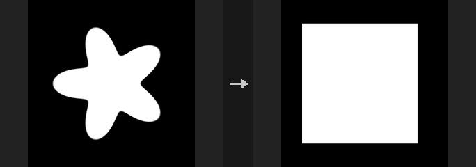
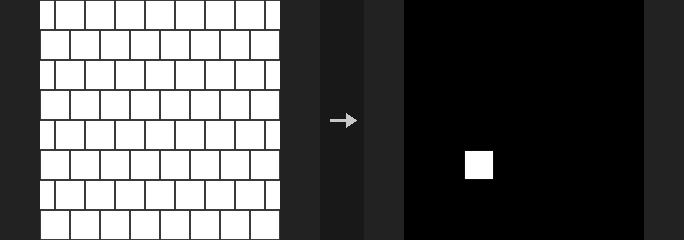
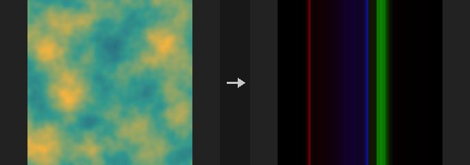
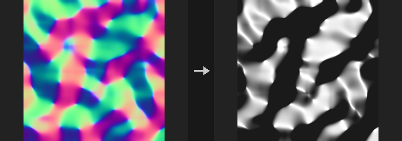
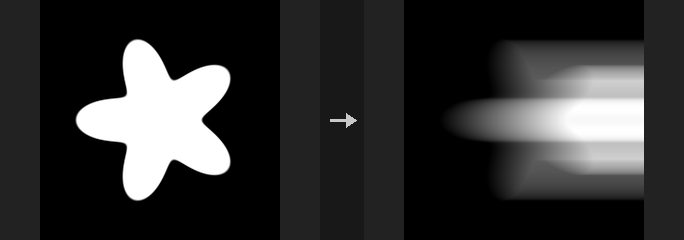
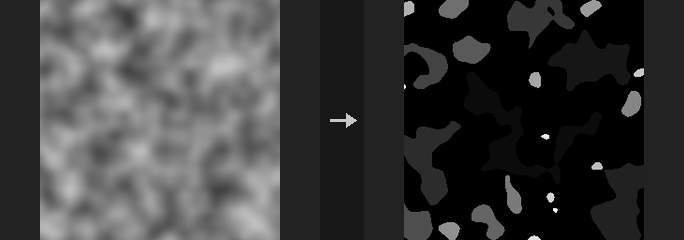
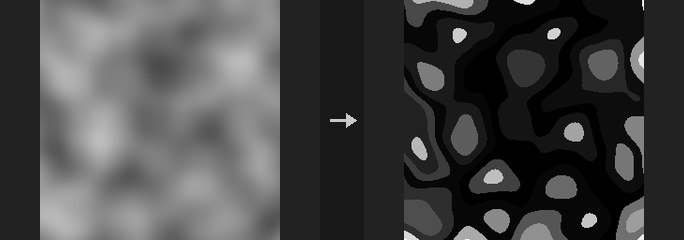
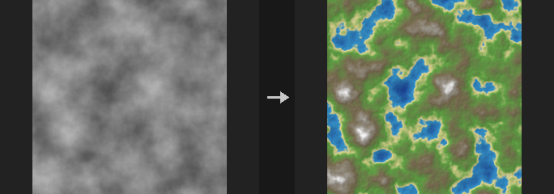
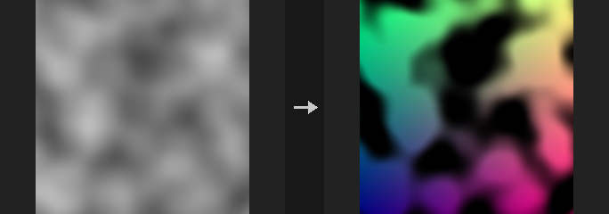

# Image: Analysis, I/O & Utility

Statistics, import / export, sequences, devices and wrangles.

28 nodes.

[Back to the reference index](README.md)

## Contents

- [COP Bounding Rect (PCG)](#pcg-copboundingrect) — Finds the bounding rectangle of a mask, or one rectangle per id, and writes it as a fill layer plus a JSON report.
- [COP Compare (PCG)](#pcg-copcompare) — Measures the difference between two images with MAE, RMSE, PSNR and SSIM and writes a diff layer and an SSIM map.
- [COP Contact Sheet (PCG)](#pcg-copcontactsheet) — Arranges the frames of a sequence into a grid image, optionally labelled with frame numbers.
- [COP Export (PCG)](#pcg-copexport) — Converts a COP layer to a ComfyUI IMAGE and MASK for previewing, saving or any node that takes an IMAGE.
- [COP Flood Fill (PCG)](#pcg-copfloodfill) — Selects the connected region around a seed whose values are close to the seed value and outputs it as a mask.
- [COP HeightField Tile Splice (PCG)](#pcg-coptilesplice) — Reassembles a sequence of tiles from Tile Split into one image, blending the overlap zones.
- [COP HeightField Tile Split (PCG)](#pcg-coptilesplit) — Cuts an image into a grid of overlapping tiles and outputs them as a sequence.
- [COP Histogram Plot (PCG)](#pcg-cophistogramplot) — Draws a layer's histogram as an image and outputs the raw bucket counts.
- [COP Illegal Pixel (PCG)](#pcg-copillegalpixel) — Finds NaN, infinite or rule-matching pixels and fixes, highlights or isolates them.
- [COP Import (PCG)](#pcg-copimport) — Converts a ComfyUI IMAGE into a COP image so it can enter a COP chain.
- [COP Info (PCG)](#pcg-copinfo) — Reports the torch and CUDA environment and, if an image is connected, its resolution, layers and backend.
- [COP Light (PCG)](#pcg-coplight) — Lights an image using tangent-space normals with a directional or point light.
- [COP Prefix Sum (PCG)](#pcg-copprefixsum) — Computes running sums of pixel values along U or V, or a 2D summed-area table.
- [COP Segment by Connectivity (PCG)](#pcg-copsegment) — Labels the connected regions of a mask with an integer ID layer.
- [COP Segment By Value (PCG)](#pcg-copsegmentbyvalue) — Assigns IDs to pixels by their value range, optionally splitting disconnected areas.
- [COP Sequence Clips (PCG)](#pcg-copsequenceclips) — Joins ranges of one or more image sequences end to end into a new sequence.
- [COP Sequence Ops (PCG)](#pcg-copsequenceops) — Reverses, shifts, loops, retimes or blends image sequences.
- [COP Statistics (PCG)](#pcg-copstatistics) — Computes per-layer, per-channel statistics and counts non-finite values.
- [COP Time Pack (PCG)](#pcg-coptimepack) — Samples a sequence at several moments in time and packs the frames into one multi-layer image.
- [COP To Device (PCG)](#pcg-coptodevice) — Moves an image to a chosen compute backend (NumPy, torch CPU, CUDA or exact float64).
- [COP Vector Math (PCG)](#pcg-copvectormath) — Performs per-pixel vector operations such as dot, cross, length, normalize and arithmetic between layers or constants.
- [COP Vector Transform (PCG)](#pcg-copvectortransform) — Rotates, scales or re-bases the vectors stored in a layer (normals, velocities, directions).
- [COP Visualize (PCG)](#pcg-copvisualize) — Renders a height layer through a color ramp (with hillshade and contours) or a velocity layer as hue, streaks or arrows.
- [COP Wrangle (PCG)](#pcg-copwrangle) — Runs VEX-style per-pixel code on the whole image at once.
- [COP Write File (PCG)](#pcg-copwritefile) — Writes image layers to disk as PNG, EXR or RAW files, with channel packing, remapping and terrain tiling.
- [Sequence Export (PCG)](#pcg-sequenceexport) — Converts a COP sequence into a ComfyUI IMAGE batch and a MASK batch, one entry per frame.
- [Sequence Import (PCG)](#pcg-sequenceimport) — Converts a ComfyUI IMAGE batch into a COP sequence, one frame per batch entry.
- [Sequence Pick (PCG)](#pcg-sequencepick) — Picks one frame from a COP sequence by index, wrapping around out-of-range indices.

## Nodes

### COP Bounding Rect (PCG)

`PCG_COPBoundingRect` · category `PCG/cop` · Houdini: Bounding Rectangle (COP)

Finds the bounding rectangle of a mask, or one rectangle per id, and writes it as a fill layer plus a JSON report.

Takes the axis-aligned bounding box of all pixels where Layer is above Threshold. With Per ID on, Layer is read as an id image instead and every integer id above 0 gets its own rectangle. The rectangle is expanded by Padding pixels and clipped to the image.

The output layer Out Layer holds the filled rectangles: 1 inside the box, or the id value in Per ID mode. The `rects` output is a JSON list with one entry per box, containing `id`, `pixels` (x0, y0, x1, y1, inclusive, y pointing up) and `uv` (u0, v0, u1, v1, measured to pixel edges, not centres). Empty masks produce no box.

**Inputs**

| Input | Type | Description |
|---|---|---|
| `cop` | COPIMAGE | Image containing the mask or id layer. |

**Outputs**

| Output | Type | Description |
|---|---|---|
| `cop` | COPIMAGE | The input image with the rectangle fill layer added. |
| `rects` | STRING | JSON text listing each rectangle in pixel and uv coordinates. |

**Parameters**

| Parameter | Type | Default | Description |
|---|---|---|---|
| Mask Layer `layer` | string | `mask` | Layer to analyse, a mask or (with Per ID) an id image. |
| Per ID `per_id` | toggle | off | Treat Layer as an id image and create one rectangle for each id above 0, instead of one for the thresholded mask. |
| Threshold `threshold` | float | 0.5 | Pixels with a value above this belong to the mask. Not used in Per ID mode. *Hidden when per_id is on.* |
| Padding (Pixels) `padding` | int [0..4096] | 0 | Number of pixels the rectangle is grown on every side (clipped to the image). |
| Output Layer `out_layer` | string | `rect` | Name of the layer that receives the filled rectangle(s). |

---

### COP Compare (PCG)

`PCG_COPCompare` · category `PCG/cop` · Houdini: Error (COP)

Measures the difference between two images with MAE, RMSE, PSNR and SSIM and writes a diff layer and an SSIM map.

Compares Layer A of `a` with Layer B of `b` and reports MAE, RMSE, PSNR, SSIM and the maximum absolute difference. Typical uses are comparing generated images against a reference, comparing a workflow before and after a parameter change, or producing a score for automatic selection. SSIM looks at local structure and is less sensitive to a global brightness shift; PSNR and RMSE compare raw pixel values.

SSIM uses the standard settings from the original paper: a Gaussian window with sigma 1.5 (11 x 11), K1 = 0.01, K2 = 0.03. Data Range is the width of the value range (1 for 0..1 images). Borders are clamped; many implementations only average over windows fully inside the image, so small differences against other tools are normal.

If `b` has a different resolution it is resampled to `a` first. The image output gets a per-pixel difference layer and an SSIM map layer.

**Inputs**

| Input | Type | Description |
|---|---|---|
| `a` | COPIMAGE | First image (the reference grid). |
| `b` | COPIMAGE | Second image. Resampled to the resolution of `a` if the sizes differ. |

**Outputs**

| Output | Type | Description |
|---|---|---|
| `cop` | COPIMAGE | Image `a` with the diff and SSIM layers added. |
| `report` | STRING | Text summary with SSIM, PSNR, RMSE, MAE and maximum difference. |
| `ssim` | FLOAT | SSIM as a float (1 means identical). |
| `psnr` | FLOAT | PSNR in dB as a float. Identical images give infinity, which is capped at 999 on this output. |
| `json` | STRING | All metrics as JSON; infinite PSNR appears as `inf` here. |

**Parameters**

| Parameter | Type | Default | Description |
|---|---|---|---|
| Layer A `layer_a` | string | `C` | Layer of `a` to compare. |
| Layer B `layer_b` | string | *(empty)* | Layer of `b` to compare. Empty uses the same name as Layer A. |
| Data Range `data_range` | float [1e-09..] | 1 | Width of the value range of the images, used by SSIM and PSNR. 1 for images in 0..1. |
| Difference Layer `out_diff` | string | `diff` | Name of the per-pixel difference layer. |
| SSIM Layer `out_ssim` | string | `ssim` | Name of the SSIM map layer. |
| Keep Input Layers `keep_layers` | toggle | on | Keep the original layers of `a` in the output. |

**Compared with Houdini**

Corresponds loosely to Houdini's Error node, but adds SSIM and PSNR. For a per-pixel comparison mask use COP Compare Mask.

---

### COP Contact Sheet (PCG)

`PCG_COPContactSheet` · category `PCG/cop` · Houdini: Contact Sheet (COP)

Arranges the frames of a sequence into a grid image, optionally labelled with frame numbers.

The first frame is placed top left and frames follow row by row. All frames are resampled to the size of the first frame multiplied by Scale. Columns can be chosen automatically so that the grid is close to square. Each tile gets Padding pixels of background around it, and with Labels on the frame number (starting at 0) is drawn in the top left corner of the tile.

**Inputs**

| Input | Type | Description |
|---|---|---|
| `seq` | COPSEQUENCE | Sequence of images (frames) to arrange. |

**Outputs**

| Output | Type | Description |
|---|---|---|
| `cop` | COPIMAGE | The contact sheet image. |

**Parameters**

| Parameter | Type | Default | Description |
|---|---|---|---|
| Layer `layer` | string | `C` | Layer of each frame to use. The output contains this layer only. |
| Columns `columns` | int [0..1024] | 0 | Number of columns. 0 chooses automatically so the grid is close to square. |
| Padding (Pixels) `padding` | int [0..1024] | 4 | Space in pixels between tiles and around the border of the sheet. |
| Frame Scale `scale` | float [0.01..16] | 1 | Size of each tile relative to the first frame. All frames are resized to the first frame's size times Scale. |
| Background Color `background` | string | `0 0 0` | Background colour of the sheet. |
| Frame Labels `labels` | toggle | on | Draws the frame number on each tile. |
| Font `font` | string | *(empty)* | Font used for the labels. Empty uses the default font. *Disabled when labels is off.* |
| Label Size `label_size` | int [0..1024] | 0 | Label height in pixels. 0 uses one tenth of the tile height. *Disabled when labels is off.* |

---

### COP Export (PCG)

`PCG_COPExport` · category `PCG/cop`

Converts a COP layer to a ComfyUI IMAGE and MASK for previewing, saving or any node that takes an IMAGE.

Because IMAGE is conventionally 0-1, values are clamped by default. SDFs, normals and displacement naturally contain negative values or values above 1 and would turn all black or all white, so clamping can be switched off with `mode`.

Channel handling: a 1-channel layer is replicated to gray, a 4-channel layer drops its alpha (ComfyUI carries alpha as a separate MASK), and a 2-channel layer gets a zero third channel.

`normalize` is a data-dependent mapping: it changes with the input frame. It is good for inspection and not for exporting assets.

**Inputs**

| Input | Type | Description |
|---|---|---|
| `cop` | COPIMAGE | Image containing the layers to export. |

**Outputs**

| Output | Type | Description |
|---|---|---|
| `image` | IMAGE | ComfyUI IMAGE built from the selected layer. |
| `mask` | MASK | ComfyUI MASK taken from channel 0 of the mask layer, clamped to 0-1; all ones if that layer does not exist. |

**Parameters**

| Parameter | Type | Default | Description |
|---|---|---|---|
| Layer `layer` | string | `C` | Layer to export as the IMAGE. |
| Range Mode `mode` | menu | Clamp 0-1 | Range handling: `clamp` clips to 0-1 (normal color layers); `raw` outputs values unchanged; `signed` maps [-1, 1] to [0, 1] (normals, signed noise); `normalize` stretches this image's min/max to fill 0-1 (SDFs, height fields). Options: Clamp 0-1 (`clamp`), Raw (`raw`), Normalize (Min / Max) (`normalize`), Signed (-1 to 1 → 0 to 1) (`signed`). |
| Mask Layer `mask_layer` | string | `mask` | Layer whose channel 0 becomes the MASK output (clamped to 0-1 regardless of mode). If the layer is missing, the mask is all ones. |

---

### COP Flood Fill (PCG)

`PCG_COPFloodFill` · category `PCG/cop` · Houdini: Fill Connected (COP)

Selects the connected region around a seed whose values are close to the seed value and outputs it as a mask.

Equivalent of Fill Connected. Starting from the seed (a uv position or a seed layer), every connected pixel whose value differs from the seed value by no more than `tolerance` is selected. The result is a mask layer. The second output is the number of selected pixels.

**Inputs**

| Input | Type | Description |
|---|---|---|
| `cop` | COPIMAGE | Image containing the layer to flood. |

**Outputs**

| Output | Type | Description |
|---|---|---|
| `cop` | COPIMAGE | Image with the selection mask layer added. |
| `count` | INT | Number of selected pixels. |

**Parameters**

| Parameter | Type | Default | Description |
|---|---|---|---|
| Layer `layer` | string | `C` | Layer whose values are compared against the seed value. |
| Seed Position (UV) `seed_uv` | string | `0.5 0.5` | Seed position as two numbers `u v` (0 to 1). Ignored when a seed layer is given. *Disabled when seed_layer ≠ "".* |
| Seed Layer `seed_layer` | string | *(empty)* | Optional layer whose pixels above 0.5 are the seeds. When set, Seed UV is not used. |
| Tolerance `tolerance` | float [0..] | 0.1 | Maximum allowed difference from the seed value for a pixel to be included. |
| Connectivity `connectivity` | menu | 4 Neighbours | Which neighbours count as connected: 4 (edge neighbours) or 8 (including diagonals). Options: 4 Neighbours (`4`), 8 Neighbours (`8`). |
| Output Layer `out_layer` | string | `fill_mask` | Name of the output mask layer. |

---

### COP HeightField Tile Splice (PCG)

`PCG_COPTileSplice` · category `PCG/cop` · Houdini: HeightField Tile Splice (SOP)

Reassembles a sequence of tiles from Tile Split into one image, blending the overlap zones.

Puts the tiles of a sequence back together using the same `Columns`, `Rows` and `Overlap` that were used to split them. In the overlap bands neighbouring tiles are blended with a smoothstep whose weights sum to 1 everywhere, so tiles that were processed separately join without visible seams. `Feather` sets how much of the overlap band is used as the transition. If the tiles were not changed, the spliced result is identical, pixel for pixel, to the original image.

**Inputs**

| Input | Type | Description |
|---|---|---|
| `seq` | COPSEQUENCE | Sequence of tiles, in the order produced by Tile Split (bottom-left tile first, rows of columns). |

**Outputs**

| Output | Type | Description |
|---|---|---|
| `cop` | COPIMAGE | The reassembled image. |

**Parameters**

| Parameter | Type | Default | Description |
|---|---|---|---|
| Tile Count `columns` `rows` | int [1..256] | 2, 2 | Number of tile columns and rows (a pair). Must match the values used in Tile Split. |
| Tile Overlap `overlap` | int [0..4096] | 16 | Overlap in pixels. Must match the value used in Tile Split. |
| Blend Width `feather` | float [0.0..1.0] | 1 | Fraction of the overlap band used for the transition (0-1). 0 gives a hard cut between tiles. *Disabled when overlap = 0.* |

**Compared with Houdini**

Corresponds to HeightField Tile Splice, working on COP images.

---

### COP HeightField Tile Split (PCG)

`PCG_COPTileSplit` · category `PCG/cop` · Houdini: HeightField Tile Split (SOP)

Cuts an image into a grid of overlapping tiles and outputs them as a sequence.

Divides the image into `Columns` x `Rows` tiles. Each tile extends by `Overlap` pixels on every side that has a neighbour (the outer image edges get no extra border). The tiles are output as a sequence ordered from the bottom-left tile, first along X then along Y. They can be processed separately and put back together with Tile Splice using the same settings.

**Inputs**

| Input | Type | Description |
|---|---|---|
| `cop` | COPIMAGE | Image to split. |

**Outputs**

| Output | Type | Description |
|---|---|---|
| `seq` | COPSEQUENCE | Sequence of tiles, bottom-left first, row by row. |
| `tiles` | INT | Number of tiles in the sequence. |

**Parameters**

| Parameter | Type | Default | Description |
|---|---|---|---|
| Tile Count `columns` `rows` | int [1..256] | 2, 2 | Number of tile columns and rows (a pair). |
| Tile Overlap `overlap` | int [0..4096] | 16 | Extra pixels each tile carries on every side that borders another tile. The image outline gets no padding. |

**Compared with Houdini**

Corresponds to HeightField Tile Split, working on COP images.

---

### COP Histogram Plot (PCG)

`PCG_COPHistogramPlot` · category `PCG/cop` · Houdini: Histogram (COP)

Draws a layer's histogram as an image and outputs the raw bucket counts.

Each bucket value is the number of pixels in the bucket divided by the number of counted pixels, multiplied by Scale. A value equal to Maximum goes into the last bucket, NaN is never counted, and the counted-pixel total does not depend on how many values were discarded as outside the range.

Plot modes:
- **Colored Bars**: a horizontal color ramp whose color at each column is the share of each channel in that bucket.
- **Separate Bars**: one grayscale band per channel, red at the bottom and alpha (if present) at the top.
- **Graph**: a bar chart where the share sets the bar height (full image height = 1); the channels are drawn in their own channels, so R, G and B bars overlap.

The second output `counts` is the raw data: width equals Buckets, height 5, rows from bottom to top are R, G, B, A counts, and the top row holds the number of counted pixels in its first column. To equalize or match histograms use COP Histogram instead.

**Inputs**

| Input | Type | Description |
|---|---|---|
| `cop` | COPIMAGE | Image whose layer is analysed. |

**Outputs**

| Output | Type | Description |
|---|---|---|
| `cop` | COPIMAGE | Input image with the histogram picture added as a new layer. |
| `counts` | COPIMAGE | Raw counts image, Buckets wide and 5 high: rows R, G, B, A from the bottom, and the counted-pixel total in the top row, first column. |

**Parameters**

| Parameter | Type | Default | Description |
|---|---|---|---|
| Layer `layer` | string | `C` | Layer to analyse. |
| Mode `mode` | menu | Colored Bars | How the histogram is drawn; see the description. Options: Colored Bars (`colored_bars`), Separate Bars (`separate_bars`), Graph (`graph`). |
| Buckets `buckets` | int [1..65536] | 256 | Number of histogram buckets (width of the `counts` image). |
| Minimum `min` | float | 0 | Value mapped to the first bucket. |
| Maximum `max` | float | 1 | Value mapped to the last bucket. Must be greater than Minimum. |
| Outside Values `outside` | menu | Discard | What to do with values outside Minimum..Maximum: Discard ignores them, Clamp counts them in the first or last bucket. Options: Discard (`discard`), Clamp (`clamp`). |
| Scale `scale` | float [0..] | 10 | Multiplier applied to each bucket's share of the total pixels. |
| Red `red` | toggle | on | Include the red channel. For a single-channel layer this one switch controls it. |
| Green `green` | toggle | on | Include the green channel. |
| Blue `blue` | toggle | on | Include the blue channel. |
| Alpha `alpha` | toggle | on | Include the alpha channel. |
| Active Layer `active_layer` | string | *(empty)* | If set, only pixels where this layer is 0.5 or greater are counted. Empty counts the whole image. |
| Output Layer `out_layer` | string | `histogram` | Name of the layer that receives the histogram picture. |

---

### COP Illegal Pixel (PCG)

`PCG_COPIllegalPixel` · category `PCG/cop` · Houdini: Illegal Pixel (COP)

Finds NaN, infinite or rule-matching pixels and fixes, highlights or isolates them.

Replace is the plugin's original behaviour: NaN, +Inf and -Inf are replaced by the values you give, and negative values can optionally be clamped to 0. The other four modes follow Houdini's Illegal Pixels menu: Blend fills bad pixels with the average of the surrounding good pixels, Zero clears them, Highlight paints them with the Highlight Color, and Isolate keeps only bad pixels and clears the rest.

In those four modes a pixel counts as bad when any channel matches Detect (NaN, Infinite, both, or a Custom rule using Rule and Value). They ignore the replacement values and Clamp Negative.

The `report` output is a JSON string with counts per layer: NaN, +Inf, -Inf (and negative) component counts in Replace mode, and the number of flagged pixels (not components) in the other modes.

**Inputs**

| Input | Type | Description |
|---|---|---|
| `cop` | COPIMAGE | Image to check. |

**Outputs**

| Output | Type | Description |
|---|---|---|
| `cop` | COPIMAGE | Image with the offending pixels fixed or marked. |
| `report` | STRING | JSON text with the number of problems found per layer. |

**Parameters**

| Parameter | Type | Default | Description |
|---|---|---|---|
| Layers `layers` | string | *(empty)* | Space-separated layers to process. Empty processes all layers. |
| Illegal Pixels `mode` | menu | Fix by Replacing Values (PCG) | What to do with bad pixels. Replace (plugin-specific) substitutes fixed values; the others match Houdini's menu. Options: Fix by Replacing Values (PCG) (`replace`), Fix by Blending Surrounding Pixels (`blend`), Fix by Zeroing (`zero`), Show with Highlight (`highlight`), Show by Isolating (`isolate`). |
| Highlight Color `highlight_color` | string | `1 0 0` | Color used by Highlight mode, as space-separated numbers (for example `1 0 0`). *Hidden when mode ≠ highlight mode ≠ isolate.* |
| Detect `detect` | menu | NaN and Infinite Values | What counts as an illegal pixel in the Houdini-style modes. Options: NaN Values (`nan`), Infinite Values (`inf`), NaN and Infinite Values (`nan_inf`), Custom (`custom`). *Hidden when mode = replace.* |
| Rule `rule` | menu | Less Than | Comparison used when Detect is Custom. Options: Less Than (`less`), Less Than or Equal (`less_equal`), Greater Than (`greater`), Greater Than or Equal (`greater_equal`), Equal (`equal`). *Hidden when mode = replace } { detect ≠ custom.* |
| Value `value` | float | 0 | Comparison value used when Detect is Custom. *Hidden when mode = replace } { detect ≠ custom.* |
| Replace NaN With `nan` | float | 0 | Replace mode: value that replaces NaN. *Hidden when mode ≠ replace.* |
| Replace +Inf With `pos_inf` | float | 1 | Replace mode: value that replaces +Inf. *Hidden when mode ≠ replace.* |
| Replace −Inf With `neg_inf` | float | 0 | Replace mode: value that replaces -Inf. *Hidden when mode ≠ replace.* |
| Clamp Negative Values `clamp_negative` | toggle | off | Replace mode: also clamp negative values to 0. *Hidden when mode ≠ replace.* |

**Compared with Houdini**

The Replace option and its three replacement values are specific to this plugin; Houdini has no equivalent.

---

### COP Import (PCG)

`PCG_COPImport` · category `PCG/cop`

Converts a ComfyUI IMAGE into a COP image so it can enter a COP chain.

Takes the output of a sampler, Load Image or any IMAGE socket and stores one image of the batch as a COP layer.

This node flips the vertical axis once. ComfyUI and PIL put row 0 at the top, while COP puts row 0 at the bottom (v points up, consistent with UVs and Houdini). Import and Export are the only nodes in the plugin that flip, so you never need to flip an image inside a chain; if a result looks upside down, check that you did not insert an extra flip.

**Inputs**

| Input | Type | Description |
|---|---|---|
| `image` | IMAGE | ComfyUI IMAGE (batch of height x width x channels). |

**Outputs**

| Output | Type | Description |
|---|---|---|
| `cop` | COPIMAGE | COP image with the chosen batch entry in the output layer. |

**Parameters**

| Parameter | Type | Default | Description |
|---|---|---|---|
| Output Layer `layer` | string | `C` | Name of the layer that receives the image. |
| Batch Index `batch_index` | int [0..4096] | 0 | Which image of the batch to import. Values beyond the batch size use the last image. |
| Device `device` | menu | Auto | Compute backend for the layer. Auto uses the GPU if CUDA is available and the image has at least 256x256 pixels. NumPy is the CPU float32 path; Exact keeps float64 on the CPU, which is slowest but bit-identical to the geometry side. Options: Auto (`auto`), CPU (`cpu`), CUDA (`cuda`), NumPy (`numpy`), Exact (float64) (`exact`). |

---

### COP Info (PCG)

`PCG_COPInfo` · category `PCG/cop`

Reports the torch and CUDA environment and, if an image is connected, its resolution, layers and backend.

Outputs a short text describing the torch version, whether CUDA is available and which GPU it is, the size thresholds Auto uses (pixel count and VRAM budget), and, when `cop` is connected, the image's resolution, layers, the backend they live on and an estimate of memory use. The same text is printed to the ComfyUI console.

It exists to answer "is my COP actually running on the GPU?". Auto silently falls back to CPU when the image is too small, no CUDA build of torch is installed, or the VRAM budget is exceeded; this node makes that visible.

**Inputs**

| Input | Type | Description |
|---|---|---|
| `cop` *(optional)* | COPIMAGE | Optional image to describe. Without it only the environment is reported. |

**Outputs**

| Output | Type | Description |
|---|---|---|
| `info` | STRING | Multi-line status text. |

---

### COP Light (PCG)

`PCG_COPLight` · category `PCG/cop` · Houdini: Light (COP)

Lights an image using tangent-space normals with a directional or point light.

Shades the image from a tangent-space normal layer (Z up, as produced by a height-to-normal conversion). The result is `Albedo * (Ambient + diffuse * color * intensity * lit) + specular * color * intensity * lit`, using Lambert diffuse and a Blinn-Phong highlight with the viewer looking straight down.

A **Directional** light is defined by Azimuth (the direction the light comes from: 0 degrees from +u, 90 degrees from +v) and Elevation, the same convention as Height to Shadow. A **Point** light sits above Light Position (uv) at Light Height (as a fraction of the image width), so the direction differs per pixel; no inverse-square falloff is applied.

With Shadows on and a Height Layer given, directional lights use Height to Shadow; point lights march from every pixel toward the light and are shadowed when terrain rises above the line of sight.

**Inputs**

| Input | Type | Description |
|---|---|---|
| `cop` | COPIMAGE | Image containing the normal layer (and optionally albedo and height layers). |

**Outputs**

| Output | Type | Description |
|---|---|---|
| `cop` | COPIMAGE | Image with the lit result in the output layer. |

**Parameters**

| Parameter | Type | Default | Description |
|---|---|---|---|
| Normal Layer `normal_layer` | string | `N` | Layer with tangent-space normals. |
| Albedo Layer `albedo_layer` | string | *(empty)* | Layer used as surface color. Empty uses white. |

*Light*

| Parameter | Type | Default | Description |
|---|---|---|---|
| Light Type `light_type` | menu | Directional | Directional (parallel rays) or Point (light at a position). Options: Directional (`directional`), Point (`point`). |
| Azimuth `azimuth` | float [-360..360] | 135 | Directional: horizontal direction the light comes from, in degrees. *Hidden when light_type ≠ directional.* |
| Elevation `elevation` | float [0..90] | 45 | Directional: angle of the light above the horizon in degrees. 90 is straight down. *Hidden when light_type ≠ directional.* |
| Light Position `position` | string | `0.5 0.5` | Point: light position in uv, as two numbers. *Hidden when light_type ≠ point.* |
| Light Height `light_height` | float [0..100] | 0.5 | Point: height of the light above the image plane, in units of image width. *Hidden when light_type ≠ point.* |
| Light Color `color` | string | `1 1 1` | Light color as three space-separated numbers. |
| Intensity `intensity` | float [0..] | 1 | Multiplier on the light color. |
| Ambient `ambient` | float [0..10] | 0.1 | Constant ambient term multiplied by the albedo. |

*Material*

| Parameter | Type | Default | Description |
|---|---|---|---|
| Specular `specular` | float [0..100] | 0 | Strength of the Blinn-Phong highlight. 0 disables it. |
| Exponent `shininess` | float [1..4096] | 32 | Phong exponent; higher values give a tighter highlight. *Disabled when specular = 0.* |

*Shadows*

| Parameter | Type | Default | Description |
|---|---|---|---|
| Shadows `shadows` | toggle | off | Cast shadows. Requires a Height Layer. Directional lights use Height to Shadow; point lights march per pixel toward the light. |
| Height Layer `height_layer` | string | *(empty)* | Height layer used for shadows. *Disabled when shadows is off.* |
| Height Scale `strength` | float | 1 | Height Scale: multiplies height values to get world heights (shadows only). *Disabled when shadows is off.* |
| World Size `world_size` | float [1e-06..] | 1 | World width of the image (shadows only). *Disabled when shadows is off.* |

| Parameter | Type | Default | Description |
|---|---|---|---|
| Output Layer `out_layer` | string | `lit` | Name of the layer that receives the lit image. |

---

### COP Prefix Sum (PCG)

`PCG_COPPrefixSum` · category `PCG/cop` · Houdini: Prefix Sum (COP)

Computes running sums of pixel values along U or V, or a 2D summed-area table.

Accumulates values along rows, columns, or both. Both gives an integral image (summed-area table), from which the sum over any rectangle needs only four lookups. Reverse directions accumulate from the opposite edge.

**Inputs**

| Input | Type | Description |
|---|---|---|
| `cop` | COPIMAGE | Image to accumulate. |

**Outputs**

| Output | Type | Description |
|---|---|---|
| `cop` | COPIMAGE | Image of accumulated values. |

**Parameters**

| Parameter | Type | Default | Description |
|---|---|---|---|
| Layers `layers` | string | *(empty)* | Layers to process, space-separated. Empty processes all layers. |
| Direction `direction` | menu | U (Along Rows) | Accumulation direction. U runs along rows, V along columns, Both builds a summed-area table. Options: U (Along Rows) (`u`), V (Along Columns) (`v`), Both (Summed-Area Table) (`both`), U Reverse (`u_reverse`), V Reverse (`v_reverse`). |
| Exclusive `exclusive` | toggle | off | Excludes the pixel itself from its sum, so the first value is 0. |
| Integrate (× Pixel Size) `integrate` | toggle | off | Multiplies by the pixel width so the result is an integral per UV unit. |

---

### COP Segment by Connectivity (PCG)

`PCG_COPSegment` · category `PCG/cop` · Houdini: Segment by Connectivity (COP)

Labels the connected regions of a mask with an integer ID layer.

Writes an ID layer where 0 is background and 1..K number the regions in order of decreasing area. The numbering is deterministic (area descending, then by position), so the same mask always yields the same IDs. Connect the result to an ID mask step to get one mask per region, for example to split an AI segmentation image into separate regions.

Regions below Minimum Area are merged into the background, which removes stray specks. With Tileable on, opposite edges are connected, so a region crossing the seam of a seamless texture counts as one. The algorithm works on runs with a union-find structure, so the Python loop count is the number of runs, not pixels. NumPy only.

The outputs are the region count and a text report.

**Inputs**

| Input | Type | Description |
|---|---|---|
| `cop` | COPIMAGE | Image containing the mask layer. |

**Outputs**

| Output | Type | Description |
|---|---|---|
| `cop` | COPIMAGE | Image with the ID layer. |
| `count` | INT | Number of regions found. |
| `report` | STRING | Text summary of the regions. |

**Parameters**

| Parameter | Type | Default | Description |
|---|---|---|---|
| Mask Layer `layer` | string | `mask` | Mask layer. |
| Threshold `threshold` | float | 0.5 | Mask values above this are foreground. |
| Connectivity `connectivity` | menu | 8 (Include Diagonals) | Whether diagonal neighbours connect pixels (8) or only edge neighbours (4). Options: 8 (Include Diagonals) (`8`), 4 (Edges Only) (`4`). |
| Minimum Area (Pixels) `min_area` | int [0..] | 0 | Regions smaller than this many pixels are merged into the background. |
| Tileable (Wrap Edges) `tile` | toggle | off | Connects the left/right and top/bottom edges. |
| Output Layer `out_layer` | string | `id` | Name of the ID layer. |
| Keep Input Layers `keep_layers` | toggle | on | Keeps the input layers in the output. |

---

### COP Segment By Value (PCG)

`PCG_COPSegmentByValue` · category `PCG/cop` · Houdini: Mono to ID (COP), Segment by Value (COP)

Assigns IDs to pixels by their value range, optionally splitting disconnected areas.

Values are grouped into equal bins, fixed-size steps or one group per unique value. With Split Disconnected, areas of the same group that are not connected receive different IDs. The second output is the number of regions.

Cast to Integer is Houdini's Mono to ID (Cast): the value is truncated directly to an integer ID, with no renumbering and no connectivity analysis.

**Inputs**

| Input | Type | Description |
|---|---|---|
| `cop` | COPIMAGE | Image containing the layer to segment. |

**Outputs**

| Output | Type | Description |
|---|---|---|
| `cop` | COPIMAGE | Image with the ID layer. |
| `count` | INT | Number of regions. |

**Parameters**

| Parameter | Type | Default | Description |
|---|---|---|---|
| Layer `layer` | string | `C` | Layer to segment. |
| Segment By `mode` | menu | Equal Bins | How values are grouped: equal-width bins over the value range, a fixed step size, one group per distinct value, or a plain cast to integer. Options: Equal Bins (`bins`), Fixed Step (`step`), Unique Values (`unique`), Cast to Integer (Mono to ID) (`cast`). |
| Bin Count `bins` | int [1..65536] | 8 | Number of equal bins. *Hidden when mode ≠ bins.* |
| Step Size `step` | float [0..] | 0.1 | Width of each group. *Hidden when mode ≠ step.* |
| Split Disconnected `connected` | toggle | on | Splits areas of the same group that are not connected into separate IDs. *Hidden when mode = cast.* |
| Connectivity `connectivity` | menu | 8 (Include Diagonals) | Whether diagonal neighbours count as connected (8) or only edge neighbours (4). Options: 8 (Include Diagonals) (`8`), 4 (Edges Only) (`4`). *Hidden when mode = cast.* *Disabled when connected is off.* |
| Output Layer `out_layer` | string | `id` | Name of the ID layer. |

---

### COP Sequence Clips (PCG)

`PCG_COPSequenceClips` · category `PCG/cop` · Houdini: Sequence (COP)

Joins ranges of one or more image sequences end to end into a new sequence.

Each clip is a start frame and a frame count. Clip k is taken from input k; if there are more clips than inputs, the last input is reused. Clips are placed back to back. The second output is the resulting frame count.

**Inputs**

| Input | Type | Description |
|---|---|---|
| `seq` | COPSEQUENCE | First sequence. |
| `seq2` *(optional)* | COPSEQUENCE | Second sequence, used by the second clip. |
| `seq3` *(optional)* | COPSEQUENCE | Third sequence, used by the third clip. |
| `seq4` *(optional)* | COPSEQUENCE | Fourth sequence, used by the fourth clip. |

**Outputs**

| Output | Type | Description |
|---|---|---|
| `seq` | COPSEQUENCE | Joined sequence. |
| `frames` | INT | Number of frames in the output. |

**Parameters**

| Parameter | Type | Default | Description |
|---|---|---|---|
| Clips `clips` | string | *(empty)* | Clips as `start count` pairs separated by semicolons. Empty uses all of the first input. |
| Output Start Frame `output_start_frame` | int | 0 | Frame number at which the joined sequence starts. |

**Compared with Houdini**

Equivalent to Houdini's Sequence node, not Sequence Import.

---

### COP Sequence Ops (PCG)

`PCG_COPSequenceOps` · category `PCG/cop` · Houdini: Reverse (COP), Sequence Blend (COP), Time Blend (COP), Time Loop (COP), Time Shift (COP)

Reverses, shifts, loops, retimes or blends image sequences.

Reverse plays the sequence backwards. Time Shift moves it by a number of frames, holding or looping outside the range. Time Loop makes a seamless loop by cross-fading the tail with the head. Retime resamples to a target frame count with linear interpolation. Sequence Blend mixes frame by frame with a second sequence. The second output is the output frame count.

**Inputs**

| Input | Type | Description |
|---|---|---|
| `seq` | COPSEQUENCE | Input sequence. |
| `other` *(optional)* | COPSEQUENCE | Second sequence, used by Sequence Blend. |

**Outputs**

| Output | Type | Description |
|---|---|---|
| `seq` | COPSEQUENCE | Processed sequence. |
| `frames` | INT | Number of frames in the output. |

**Parameters**

| Parameter | Type | Default | Description |
|---|---|---|---|
| Operation `op` | menu | Reverse | Operation to apply. Options: Reverse (`reverse`), Time Shift (`shift`), Time Loop (Crossfade) (`loop`), Retime (Time Blend) (`retime`), Sequence Blend (`blend`). |
| Shift (Frames) `offset` | int | 0 | Number of frames to shift. *Hidden when op ≠ shift.* |
| Outside Range `edge` | menu | Hold | What happens outside the original range: hold the end frame, or loop around. Options: Hold (`hold`), Loop (`loop`). *Hidden when op ≠ shift.* |
| Crossfade Frames `blend` | int [1..] | 4 | Number of frames over which the end is cross-faded into the start. *Hidden when op ≠ loop.* |
| Output Frames `frames` | int [1..] | 24 | Target number of frames after retiming. *Hidden when op ≠ retime.* |
| Blend Weight `weight` | float [0..1] | 0.5 | Blend amount toward the other sequence. Requires the other input. *Hidden when op ≠ blend.* |

---

### COP Statistics (PCG)

`PCG_COPStatistics` · category `PCG/cop` · Houdini: Statistics (COP)

Computes per-layer, per-channel statistics and counts non-finite values.

Reports min, max, mean, standard deviation (population, divided by N) and percentiles for every channel, together with the number of non-finite values. NaN and inf are excluded from the statistics but always reported, because a single NaN usually shows up far downstream as a black pixel or a fully NaN image.

Outputs are `json` (all numbers), `report` (readable text) and `value`, one chosen number that can be wired to other nodes, for example as a score. With a Mask Layer only pixels inside the mask are counted. The image passes through unchanged.

**Inputs**

| Input | Type | Description |
|---|---|---|
| `cop` | COPIMAGE | Image to analyse. |

**Outputs**

| Output | Type | Description |
|---|---|---|
| `cop` | COPIMAGE | The input image, unchanged. |
| `json` | STRING | All statistics as JSON. |
| `report` | STRING | Human-readable statistics. |
| `value` | FLOAT | The single statistic selected by Value Layer, Value Channel and Value Statistic. |

**Parameters**

| Parameter | Type | Default | Description |
|---|---|---|---|
| Layers `layers` | string | *(empty)* | Layers to analyse, space-separated. Empty analyses all layers. |
| Mask Layer `mask_layer` | string | *(empty)* | If set, only pixels inside the mask are counted. |
| Percentiles `percentiles` | string | `1 50 99` | Space-separated percentile values, any number. 50 is always added. |
| Value Layer `value_layer` | string | `C` | Layer that the `value` output is taken from. |
| Value Channel `value_channel` | int [0..64] | 0 | Channel index used for the `value` output. |
| Value Statistic `value_stat` | menu | Mean | Statistic used for the `value` output. Options: Mean (`mean`), Std Dev (`std`), Min (`min`), Max (`max`), Median (P50) (`p50`). |

---

### COP Time Pack (PCG)

`PCG_COPTimePack` · category `PCG/cop` · Houdini: Time Pack (COP)

Samples a sequence at several moments in time and packs the frames into one multi-layer image.

Samples the sequence at times `Range Start`, `Range Start + Step`, ... up to `Range End`. In Relative mode the range is offset by `Frame`; in Absolute mode the range values are frame numbers. Units can be frames or seconds (seconds are converted with `FPS`, since this plugin has no scene frame rate).

Each sample becomes a set of layers in the output, with the sample index (counted from 0) added to the layer name as a prefix (`0_C`) or a suffix (`C_0`). Times between two frames are linearly interpolated between them; times outside the sequence use the first or last frame.

**Inputs**

| Input | Type | Description |
|---|---|---|
| `seq` | COPSEQUENCE | Image sequence to sample. |

**Outputs**

| Output | Type | Description |
|---|---|---|
| `cop` | COPIMAGE | A single image containing the layers of all samples. |

**Parameters**

| Parameter | Type | Default | Description |
|---|---|---|---|
| Mode `mode` | menu | Relative | Relative: the range is measured from `Frame`. Absolute: the range values are frame numbers. Options: Relative (`relative`), Absolute (`absolute`). |
| Frame `frame` | float | 0 | Current frame, used as the origin in Relative mode (Houdini takes this from the scene's current frame). *Hidden when mode ≠ relative.* |
| Units `units` | menu | Frames | Unit of the range and step: frames, or seconds converted with `FPS`. Options: Frames (`frames`), Seconds (`seconds`). |
| FPS `fps` | float [0.001..10000.0] | 24 | Frames per second used to convert seconds to frames. Only relevant when the units are seconds. *Hidden when units ≠ seconds.* |
| Range `range_start` `range_end` | float | -1, 1 | Start and end of the sampled range (a pair), for example -1 and 1 for the previous, current and next frame. |
| Step `step` | float [1e-06..] | 1 | Time between samples, in the chosen units. |
| Add Time As `add_time_as` | menu | Suffix | Whether the sample index is added to the layer names as a prefix or suffix. Options: Prefix (`prefix`), Suffix (`suffix`). |
| Layers `layers` | string | *(empty)* | Layers to pack (space-separated names). Empty packs all layers. |

**Compared with Houdini**

Only the By Frame method is implemented.

**Tips**

- The number of samples is capped; raise Step if the node reports too many samples.

---

### COP To Device (PCG)

`PCG_COPToDevice` · category `PCG/cop`

Moves an image to a chosen compute backend (NumPy, torch CPU, CUDA or exact float64).

Normally not needed: the device chosen on a generator decides where the whole chain runs, and filters and composites follow their input. It is useful when the first half of a chain runs fast on the GPU but a later node only has a CPU implementation, when you want to compare the results of two backends in one workflow, or when GPU memory is tight and you want to bring an intermediate result back to main memory.

Moving has a cost: one full-image transfer of height x width x channels x 4 bytes (a 2048x2048 four-channel image is about 67 MB). Avoid bouncing back and forth in the middle of a chain. Compositing nodes automatically move their second input to the device of the first, so you do not need this node for that.

**Inputs**

| Input | Type | Description |
|---|---|---|
| `cop` | COPIMAGE | Image to move. |

**Outputs**

| Output | Type | Description |
|---|---|---|
| `cop` | COPIMAGE | The same image on the target device. |

**Parameters**

| Parameter | Type | Default | Description |
|---|---|---|---|
| Device `device` | menu | NumPy | Target backend. NumPy is plain CPU arrays; Auto picks the best available; CPU and CUDA are torch backends; Exact uses float64 on the CPU for reference-quality results. Options: NumPy (`numpy`), Auto (`auto`), CPU (`cpu`), CUDA (`cuda`), Exact (float64) (`exact`). |

---

### COP Vector Math (PCG)

`PCG_COPVectorMath` · category `PCG/cop` · Houdini: Cross Product (COP), Dot Product (COP)

Performs per-pixel vector operations such as dot, cross, length, normalize and arithmetic between layers or constants.

Computes `A op B` per pixel. `A` is a layer name; `B` is either a layer name or a constant such as `0 0 1`. If the channel counts differ, a single-channel B is broadcast; otherwise both are cut to the smaller channel count.

Dot, Length and Distance output a single channel. Cross requires 3 channels. Divide returns 0 where the divisor is 0. Reflect computes `A - 2 (A . n) n` with B taken as the normal (normalised). Lerp blends from A to B by `T`.

**Inputs**

| Input | Type | Description |
|---|---|---|
| `cop` | COPIMAGE | Image containing the operand layers. |

**Outputs**

| Output | Type | Description |
|---|---|---|
| `cop` | COPIMAGE | The input image plus the result layer. |

**Parameters**

| Parameter | Type | Default | Description |
|---|---|---|---|
| Input A Layer `a` | string | `N` | First operand: the name of a layer. |
| Operation `op` | menu | Dot Product | Operation to perform. Add, Subtract, Multiply, Divide, Minimum and Maximum work per component. Options: Dot Product (`dot`), Cross Product (`cross`), Length (`length`), Normalize (`normalize`), Add (`add`), Subtract (`subtract`), Multiply (`multiply`), Divide (`divide`), Minimum (`min`), Maximum (`max`), Distance (`distance`), Reflect (`reflect`), Lerp (`lerp`). |
| Input B `b` | string | `0 0 1` | Second operand: a layer name or a constant (for example `0 0 1`). For Reflect it is the normal. *Disabled when op = length } { op = normalize.* |
| Bias (T) `t` | float | 0.5 | Blend factor for Lerp (0 gives A, 1 gives B). Not used by other operations. *Hidden when op ≠ lerp.* |
| Output Layer `out_layer` | string | `out` | Layer that receives the result. |

**Compared with Houdini**

Corresponds to Dot Product and Cross Product; the other operations are additions of this plugin.

---

### COP Vector Transform (PCG)

`PCG_COPVectorTransform` · category `PCG/cop` · Houdini: Vector Transform (COP), Vector Transform 2D (COP)

Rotates, scales or re-bases the vectors stored in a layer (normals, velocities, directions).

Transforms the vector values of a layer, not the image itself. Modes:

- **Rotate 2D**: rotates the first two components counter-clockwise around Z by `Angle`.
- **Rotate 3D**: Euler rotation in degrees, X first, then Y, then Z.
- **Scale**: component-wise scale.
- **Matrix (3x3)**: multiplies each vector by a 3x3 matrix (`v' = M v`, row-major, 9 numbers).
- **Tangent to World / World to Tangent**: builds a tangent frame (TBN) per pixel from `Normal Layer`. If no tangent layer is given, the tangent is +X projected onto the tangent plane, which matches the +U direction of Height to Normal (a different reference axis is used where the normal is parallel to X).

Channels beyond those transformed (such as alpha) are kept.

**Inputs**

| Input | Type | Description |
|---|---|---|
| `cop` | COPIMAGE | Image containing the vector layer (and the normal/tangent layers for the tangent modes). |

**Outputs**

| Output | Type | Description |
|---|---|---|
| `cop` | COPIMAGE | The image with the transformed vector layer. |

**Parameters**

| Parameter | Type | Default | Description |
|---|---|---|---|
| Vector Layer `layer` | string | `N` | Vector layer to transform. |
| Transform `mode` | menu | Rotate 2D | Transformation to apply. Options: Rotate 2D (`rotate_2d`), Rotate 3D (`rotate_3d`), Scale (`scale`), Matrix (3×3) (`matrix`), Tangent to World (`tangent_to_world`), World to Tangent (`world_to_tangent`). |
| Angle `angle` | float [-3600..3600] | 0 | Rotate 2D: angle in degrees, counter-clockwise around Z. *Hidden when mode ≠ rotate_2d.* |
| Rotate `rotate` | string | `0 0 0` | Rotate 3D: Euler angles (X, Y, Z) in degrees, applied X first, then Y, then Z. *Hidden when mode ≠ rotate_3d.* |
| Scale `scale` | string | `1 1 1` | Scale mode: scale factors (X, Y, Z). *Hidden when mode ≠ scale.* |
| Matrix `matrix` | string | `1 0 0 0 1 0 0 0 1` | Matrix mode: nine numbers, row-major, applied as `v' = M v`. *Hidden when mode ≠ matrix.* |
| Normal Layer `normal_layer` | string | `N` | Tangent modes: layer with the surface normal used to build the tangent frame. *Hidden when mode ≠ tangent_to_world mode ≠ world_to_tangent.* |
| Tangent Layer `tangent_layer` | string | *(empty)* | Tangent modes: optional tangent layer. Empty projects +X onto the tangent plane. *Hidden when mode ≠ tangent_to_world mode ≠ world_to_tangent.* |
| Output Layer `out_layer` | string | *(empty)* | Destination layer. Empty overwrites the input layer. |

**Compared with Houdini**

Covers Vector Transform, Vector Transform 2D and the tangent/world part of Space Transform.

---

### COP Visualize (PCG)

`PCG_COPVisualize` · category `PCG/cop` · Houdini: HeightField Visualize (COP), Visualize Velocity (COP)

Renders a height layer through a color ramp (with hillshade and contours) or a velocity layer as hue, streaks or arrows.

Writes a displayable color layer. **Height Ramp** maps the height through a color ramp between `Lo` and `Hi` (both 0 = use the layer's own minimum and maximum), optionally multiplied by a hillshade term and darkened along contour lines. **Velocity** modes need a 2-channel layer:

- **HSV**: hue encodes direction (+U is red, counter-clockwise) and brightness the speed times `Scale`, clamped to 1.
- **LIC**: line integral convolution (Cabral-Leedom): white noise is averaged along the flow line `LIC Length` steps in both directions, so the texture streaks along the flow.
- **Arrows**: one arrow per `Arrow Spacing` pixels, length proportional to speed times `Scale`, capped to the cell size.

For Height Ramp, `Mode` selects how values outside Lo-Hi are handled and `Tint by` lets another layer provide the color while hillshade and contours still come from the height layer.

**Inputs**

| Input | Type | Description |
|---|---|---|
| `cop` | COPIMAGE | Image containing the height or velocity layer. |

**Outputs**

| Output | Type | Description |
|---|---|---|
| `cop` | COPIMAGE | The input image plus the visualisation layer. |

**Parameters**

| Parameter | Type | Default | Description |
|---|---|---|---|
| Layer `layer` | string | `C` | Height layer (first channel) or velocity layer (two channels, X and Y). |
| Visualization `mode` | menu | Height Ramp | Height Ramp colours a height field. The Velocity modes visualise a 2D vector field as hue, line-integral-convolution streaks or arrows. Options: Height Ramp (`height_ramp`), Velocity (HSV) (`velocity_hsv`), Velocity (LIC) (`velocity_lic`), Velocity (Arrows) (`velocity_arrows`). |
| Tint by `tint_by` | menu | Height | Height Ramp only. Height colours the height itself; Color uses the tint layer directly as the color; Mask runs the first channel of the tint layer through the ramp. Options: Height (`height`), Color (`color`), Mask (`mask`). *Hidden when mode ≠ height_ramp.* |
| Tint Layer `tint_layer` | string | *(empty)* | Layer used by Tint by Color or Mask. Required for those two options. *Hidden when mode ≠ height_ramp } { tint_by = height.* |
| Mode `range_mode` | menu | Clamped Ramp | Height Ramp only. Clamped holds the end colors outside Lo-Hi; Periodic repeats the ramp; No Ramp outputs plain grey of the normalised value without clamping. Options: Clamped Ramp (`clamped`), Periodic Ramp (`periodic`), No Ramp (`no_ramp`). *Hidden when mode ≠ height_ramp.* *Disabled when tint_by = color.* |
| Color Ramp `ramp` | menu | Terrain | Color ramp used for Height Ramp. Options: Terrain (`terrain`), Grayscale (`gray`), Viridis (`viridis`), Heat (`heat`). *Hidden when mode ≠ height_ramp.* *Disabled when tint_by = color } { range_mode = no_ramp.* |
| Input Range `lo` `hi` | float | 0, 0 | Lower and upper value of the ramp range (a pair). Both 0 uses the minimum and maximum of the tinted layer. *Hidden when mode ≠ height_ramp.* *Disabled when tint_by = color.* |
| Hillshade `hillshade` | float [0..1] | 0.5 | Strength (0-1) of the shaded-relief term multiplied onto the color. 0 disables it. *Hidden when mode ≠ height_ramp.* |
| Contour Interval `contour_interval` | float [0..] | 0 | Distance in height units between contour lines. 0 draws none. *Hidden when mode ≠ height_ramp.* |
| Velocity Scale `scale` | float [0..] | 1 | Velocity modes: multiplier on the speed for brightness (HSV) or arrow length (Arrows). *Hidden when mode = height_ramp } { mode = velocity_lic.* |
| LIC Length `lic_length` | int [1..1000] | 20 | LIC mode: number of integration steps taken along the flow in each direction. Longer gives longer streaks. *Hidden when mode ≠ velocity_lic.* |
| Seed `rand_seed` | int [0..] | 0 | Seed of the noise used by LIC mode. *Hidden when mode ≠ velocity_lic.* |
| Arrow Spacing `arrow_spacing` | int [2..4096] | 16 | Arrows mode: distance between arrows, in pixels. *Hidden when mode ≠ velocity_arrows.* |
| Output Layer `out_layer` | string | `vis` | Layer that receives the visualisation. |

**Compared with Houdini**

Combines HeightField Visualize and Visualize Velocity. Houdini outputs coloured geometry; this node outputs an image.

---

### COP Wrangle (PCG)

`PCG_COPWrangle` · category `PCG/cop` · Houdini: Python Snippet (COP), Wrangle (COP)

Runs VEX-style per-pixel code on the whole image at once.

The code uses the same function library as the geometry Wrangle. Layers are read and written as attributes: `@C`, `@mask`, `@N.x`; `@u` and `@v` are the 0-1 pixel coordinates (V pointing up), `@x` and `@y` the pixel coordinates and `@res` the resolution. Assigning to a layer that does not exist creates it.

The code is evaluated once for the entire image with array operations, not once per pixel, so an `if` statement has to be written as `where(cond, a, b)`.

Example: `@mask = smoothstep(0.3, 0.6, @C.x)`.

`ch("name")` in the code creates a custom parameter on the node (see [`ch()` parameters](../concepts/wrangle.md#ch-parameters)); its value is read when the image is computed.

**Inputs**

| Input | Type | Description |
|---|---|---|
| `cop` | COPIMAGE | Image whose layers the code reads and writes. |

**Outputs**

| Output | Type | Description |
|---|---|---|
| `cop` | COPIMAGE | The image after the code has run. |

**Parameters**

| Parameter | Type | Default | Description |
|---|---|---|---|
| Code `code` | string | `@C = @C * 2` | The snippet. Use `@name` for layers, `@u @v @x @y @res` for coordinates, and `where()` instead of `if`. |
| Seed `rand_seed` | int [0..] | 0 | Seed for random functions used in the code. |
| Ch Params `ch_params` | string | `{}` | Internal JSON text with the values of the node's custom parameters, read in the code with `ch()`, `chv()`, `chi()` and `chs()`. It is maintained by the frontend; do not edit by hand. |
| Rows Per Pass `rows_per_pass` | int [0..65536] | 0 | Run the code on bands of this many rows instead of the whole image at once, to bound memory on large images with many noise() calls. Only for code that is purely per pixel: anything that looks at all pixels at once (counts, sums, the image maximum) would see one band. 0 runs on the whole image. |

**Compared with Houdini**

Covers Wrangle and Python Snippet. The code runs vectorised over the whole image, not once per pixel, so there are no per-pixel branches.

---

### COP Write File (PCG)

`PCG_COPWriteFile` · category `PCG/cop` · Houdini: ROP Image Output (COP)

Writes image layers to disk as PNG, EXR or RAW files, with channel packing, remapping and terrain tiling.

Writes into the ComfyUI output directory with pure NumPy encoders (no OpenEXR or OpenCV needed). `Channels` lists one source per output channel, separated by spaces: a layer name (for example `albedo`) gives its channels, `ao roughness metallic` packs three single-channel layers into RGB (an ORM map), `N.x N.y N.z` picks components, and constants such as `1` or `0.5` are allowed. At most four channels.

Before a PNG or RAW 16 is written, `Remap` brings values into 0-1: Clamp, Signed (-1..1 to 0..1, for normals), Normalize (stretches the whole image's min..max to full range) or Range (a given In Min..In Max). Normalize uses one range for the full image, so when you export tiles they all share it; the range is written to the sidecar `.json` next to the files. `Encode` sRGB applies the sRGB curve to the first three channels (for albedo). EXR and RAW 32 are written as floats without encoding; with Remap Clamp the values are written unchanged.

Tiles splits the image in X x Y files; with `Shared Edge` neighbouring tiles share their border row or column of pixels (the terrain tile convention), which requires (width - 1) to be divisible by the X tile count (and likewise for height). In the file name `{index}` is replaced by `Index`, `{tx}` and `{ty}` by the tile coordinates and `{tile}` by `ty x tiles X + tx`; `{tx:02}` pads to two digits.

The first output is a JSON report (files, channels, range and so on); the second is an 8-bit preview of what was written.

**Inputs**

| Input | Type | Description |
|---|---|---|
| `cop` | COPIMAGE | Image whose layers are written. |

**Outputs**

| Output | Type | Description |
|---|---|---|
| `report` | STRING | JSON text describing what was written: files, format, channel sources, remap range, tiling and sidecar path. |
| `preview` | IMAGE | Preview image (first three channels of the written data, as 0-1 values). |

**Parameters**

| Parameter | Type | Default | Description |
|---|---|---|---|
| Output File `filename` | string | `pcg/tex/texture_{index}` | Path relative to the ComfyUI output directory, without extension. May contain `{index}`, `{tx}`, `{ty}` and `{tile}`. |
| Index `index` | int [0..] | 0 | Value substituted for `{index}` in the file name. |
| Channels `channels` | string | `C` | One source per output channel, space-separated: layer names, components such as `N.x`, or constants. For example `ao roughness metallic` for an ORM pack. |
| File Format `format` | menu | PNG | PNG, OpenEXR or RAW (.r16 / .r32, little-endian without a header, as used by terrain tools). Options: PNG (`png`), OpenEXR (`exr`), RAW (.r16 / .r32) (`raw`). |
| Bit Depth `bit_depth` | menu | 8-bit | PNG: 8 or 16 bit. EXR: 16 is half float and 32 is full float. RAW: 16 or 32 bit. PNG cannot be 32 bit, EXR cannot be 8 bit and RAW cannot be 8 bit. Options: 8-bit (`8`), 16-bit (`16`), 32-bit Float (`32`). |
| Encoding `encode` | menu | Linear | Linear writes values unchanged; sRGB applies the sRGB curve (for albedo). Has no effect on float formats. Options: Linear (`linear`), sRGB (`srgb`). *Hidden when format = exr } { format = raw bit_depth = 32.* |
| Normal Y `normal_y` | menu | +Y (OpenGL) | +Y is the OpenGL convention; -Y flips the second channel for the DirectX convention. Options: +Y (OpenGL) (`+y`), -Y (DirectX) (`-y`). |
| Remap `remap` | menu | Clamp 0-1 | How values are brought into 0-1: Clamp, Signed (-1..1 to 0..1), Normalize (whole-image min/max), or Range (In Min to In Max). For EXR and RAW 32, Clamp writes the floats unchanged. Options: Clamp 0-1 (`clamp`), Signed (-1 to 1) (`signed`), Normalize (Min / Max) (`normalize`), Range (`range`). |

*Range*

| Parameter | Type | Default | Description |
|---|---|---|---|
| Input Range `in_min` `in_max` | float | 0, 1 | Range used when Remap is Range: the value written as 0 and the value written as the maximum. *Hidden when remap ≠ range.* |

| Parameter | Type | Default | Description |
|---|---|---|---|
| Value Scale `value_scale` | float | 1 | Only recorded in the report and sidecar: layer value times Value Scale gives real-world units (for example metres for a height map). |
| Write Sidecar JSON `sidecar` | toggle | on | Write a `.json` file beside the image(s) recording format, channel sources, remap range, tiling and source size, so a 16-bit height map can be decoded later. |

*Tiles*

| Parameter | Type | Default | Description |
|---|---|---|---|
| Tiles `tiles_x` `tiles_y` | int [1..256] | 1, 1 | Number of tile files along X and Y (a pair). |
| Shared Edge `shared_edge` | toggle | off | Neighbouring tiles share their edge row or column of pixels (terrain tiling convention). Requires (size - 1) to be divisible by the tile count. |

**Compared with Houdini**

Corresponds to ROP Image Output. Image row 0 is at the bottom in a COP layer (V up) and is flipped when written.

---

### Sequence Export (PCG)

`PCG_SequenceExport` · category `PCG/cop`

Converts a COP sequence into a ComfyUI IMAGE batch and a MASK batch, one entry per frame.

Each frame becomes one batch entry, so the output can drive video-style ComfyUI workflows. In Normalize mode the minimum and maximum are computed over the whole sequence, not per frame. Per-frame normalisation makes brightness jump from frame to frame (a static object seems to breathe) and is hard to notice because every single frame looks fine; depth sequences are especially sensitive, because an approaching object would be rescaled back to its previous appearance.

The mask batch takes the first channel of the mask layer of every frame (clamped to 0-1); frames without that layer output a mask of all 1. Frames are flipped vertically from COP orientation (row 0 at the bottom) to IMAGE orientation.

**Inputs**

| Input | Type | Description |
|---|---|---|
| `seq` | COPSEQUENCE | Sequence of COP frames. |

**Outputs**

| Output | Type | Description |
|---|---|---|
| `images` | IMAGE | IMAGE batch (frames, H, W, 3). |
| `masks` | MASK | MASK batch (frames, H, W). |
| `frames` | INT | Number of frames. |

**Parameters**

| Parameter | Type | Default | Description |
|---|---|---|---|
| Layer `layer` | string | `C` | Layer exported as the image. |
| Range Mode `mode` | menu | Clamp 0-1 | Clamp limits to 0-1; Raw writes values unchanged; Normalize stretches the min/max over the whole sequence to 0-1; Signed maps -1..1 to 0..1. Options: Clamp 0-1 (`clamp`), Raw (`raw`), Normalize (Whole Sequence) (`normalize`), Signed (-1 to 1 → 0 to 1) (`signed`). |
| Mask Layer `mask_layer` | string | `mask` | Layer providing the MASK for each frame. Frames lacking it get an all-1 mask. |

---

### Sequence Import (PCG)

`PCG_SequenceImport` · category `PCG/cop`

Converts a ComfyUI IMAGE batch into a COP sequence, one frame per batch entry.

Each entry of the batch becomes one COP frame holding the image data in a single layer. The vertical flip from IMAGE orientation (row 0 at the top) to COP orientation (row 0 at the bottom) happens in this node only.

**Inputs**

| Input | Type | Description |
|---|---|---|
| `images` | IMAGE | IMAGE batch (B, H, W, C); B becomes the number of frames. |

**Outputs**

| Output | Type | Description |
|---|---|---|
| `seq` | COPSEQUENCE | Sequence of COP frames. |
| `frames` | INT | Number of frames. |

**Parameters**

| Parameter | Type | Default | Description |
|---|---|---|---|
| Layer `layer` | string | `C` | Name of the layer each frame is written to. |
| Device `device` | menu | NumPy | Backend that holds the output images; Exact is float64 NumPy. Options: NumPy (`numpy`), Auto (`auto`), CPU (`cpu`), CUDA (`cuda`), Exact (float64) (`exact`). |

---

### Sequence Pick (PCG)

`PCG_SequencePick` · category `PCG/cop`

Picks one frame from a COP sequence by index, wrapping around out-of-range indices.

Returns frame `index mod frame count`. An index beyond the end wraps around instead of raising an error, because while scrubbing the index in a preview going out of range is normal and an error would interrupt the whole chain.

**Inputs**

| Input | Type | Description |
|---|---|---|
| `seq` | COPSEQUENCE | Sequence of COP frames. |

**Outputs**

| Output | Type | Description |
|---|---|---|
| `cop` | COPIMAGE | The selected frame. |
| `frames` | INT | Number of frames in the sequence. |

**Parameters**

| Parameter | Type | Default | Description |
|---|---|---|---|
| Frame Index `index` | int [0..] | 0 | Frame number to pick (zero based). Values beyond the last frame wrap around (index mod frame count). |

---
