# Deform

Nodes that move points without changing topology.

16 nodes.

[Back to the reference index](README.md)

## Contents

- [Blend Shapes (PCG)](#pcg-blendshapes) — Blends point attributes between a base shape and up to four same-topology target shapes.
- [Bulge (PCG)](#pcg-bulge) — Pushes points outward inside the influence of a magnet geometry to create a bulge.
- [DeltaMush (PCG)](#pcg-deltamush) — Smooths a deformed mesh while restoring the fine detail of its rest shape.
- [Displace from Map (PCG)](#pcg-displacefrommap) — Displaces points along their normal or a fixed vector using values sampled from an image at the point UVs.
- [Fractal (PCG)](#pcg-fractal) — Roughens a surface by midpoint displacement.
- [Lattice (PCG)](#pcg-lattice) — Deforms geometry with a lattice using free-form deformation.
- [Lattice From Bound (PCG)](#pcg-latticefrombound) — Creates a grid of control points around the bounding box of the input, for use with Lattice.
- [Magnet (PCG)](#pcg-magnet) — Transforms points inside the influence of a magnet geometry, weighted by falloff.
- [Path Deform (PCG)](#pcg-pathdeform) — Bends geometry along a curve.
- [Point Deform (PCG)](#pcg-pointdeform) — Deforms high-resolution geometry using the motion of a low-resolution point cloud.
- [Soft Peak (PCG)](#pcg-softpeak) — Pushes a group of points along their normals, with nearby points following by a soft falloff.
- [Soft Transform (PCG)](#pcg-softtransform) — Transforms a group of points and lets nearby points follow with a soft falloff.
- [Spherify (PCG)](#pcg-spherify) — Pushes the selected points onto a sphere.
- [Topo Transfer (PCG)](#pcg-topotransfer) — Fits the wiring of one mesh onto the shape of another.
- [Transform Pieces (PCG)](#pcg-transformpieces) — Moves pieces of a fragmented geometry onto the matching points of a template, such as RBD output or a skeleton.
- [Twist / Bend / Taper (PCG)](#pcg-deform) — Twists, bends, tapers, squashes or shears points along a chosen axis.

## Nodes

### Blend Shapes (PCG)

`PCG_BlendShapes` · category `PCG/deform` · Houdini: Blend Shapes (SOP)

Blends point attributes between a base shape and up to four same-topology target shapes.

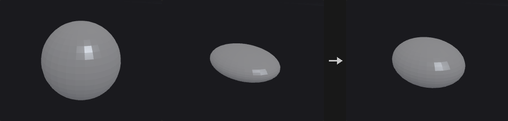

Mixes the listed point attributes (default `P N`) of geometries that share the same topology. *Additive* computes `base + sum(w_i * (target_i - base))`, so weights may go outside 0..1 and several shapes can be stacked. *Sequential* uses one Blend value that travels base, target 1, target 2, and so on; 1.5 is halfway between target 1 and target 2. Slots are counted by number, so an unconnected slot holds the previous shape.

If `N` is blended it is renormalized afterwards. Points can be matched by point number or by an `id` point attribute, which allows shapes whose point order has been shuffled.

**Inputs**

| Input | Type | Description |
|---|---|---|
| `base` | GEOMETRY | Base shape. Provides the topology and every attribute that is not blended. |
| `target1` | GEOMETRY | First target shape. |
| `target2` *(optional)* | GEOMETRY | Optional second target shape. |
| `target3` *(optional)* | GEOMETRY | Optional third target shape. |
| `target4` *(optional)* | GEOMETRY | Optional fourth target shape. |

**Outputs**

| Output | Type | Description |
|---|---|---|
| `geo` | GEOMETRY | The base shape with the blended attributes. |
| `report` | STRING | Text summary of the blend. |

**Parameters**

| Parameter | Type | Default | Description |
|---|---|---|---|
| Blend Mode `mode` | menu | Additive (Differencing) | *Additive (Differencing)* adds weighted offsets from the base per target. *Sequential Blend* walks through the shapes in order with a single Blend value. Options: Additive (Differencing) (`additive`), Sequential Blend (`sequential`). |
| Blend 1 `weight1` | float [-10.0..10.0] | 1 | Weight of target 1 (Additive mode). May be negative or above 1. *Hidden when mode ≠ additive.* |
| Blend 2 `weight2` | float [-10.0..10.0] | 0 | Weight of target 2 (Additive mode). Has no effect when target2 is not connected. *Hidden when mode ≠ additive.* |
| Blend 3 `weight3` | float [-10.0..10.0] | 0 | Weight of target 3 (Additive mode). Has no effect when target3 is not connected. *Hidden when mode ≠ additive.* |
| Blend 4 `weight4` | float [-10.0..10.0] | 0 | Weight of target 4 (Additive mode). Has no effect when target4 is not connected. *Hidden when mode ≠ additive.* |
| Blend `blend` | float [0.0..4.0] | 0 | Position along the shape sequence (Sequential mode): 0 is the base, 1 is target 1, 1.5 is halfway between targets 1 and 2. An empty slot holds the previous shape. *Hidden when mode ≠ sequential.* |
| Attributes to Blend `attributes` | string | `P N` | Space-separated list of point attributes to blend. `N` is renormalized after blending. |
| Match By `match` | menu | Point Number | How points of the targets are paired with the base: by point number, or by the value of the `id` point attribute so point order does not need to agree. Options: Point Number (`point_number`), Point Attribute id (`id`). |

---

### Bulge (PCG)

`PCG_Bulge` · category `PCG/deform` · Houdini: Bulge (SOP)

Pushes points outward inside the influence of a magnet geometry to create a bulge.

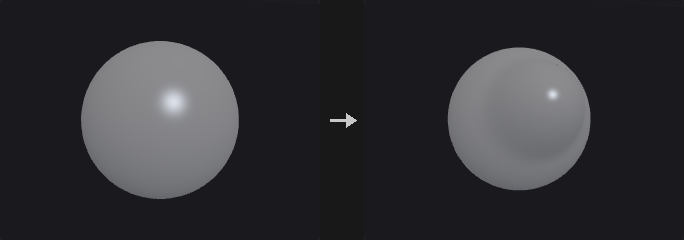

The second input acts as a magnet. With *Points* magnets every magnet point has a spherical influence of radius `pscale * Radius`; with *Surface* magnets the influence is based on the distance to the magnet surface. Points of the first input inside the influence are displaced by `Magnitude * weight`, where the weight comes from the falloff ramp. The displacement runs along the point normal or directly away from the magnet.

Normals are recomputed afterwards when the input has `N`. The falloff weight can optionally be written to a point attribute.

**Inputs**

| Input | Type | Description |
|---|---|---|
| `geo` | GEOMETRY | Geometry to deform. |
| `magnet` | GEOMETRY | Geometry whose points (as spheres) or surface define the influence. |

**Outputs**

| Output | Type | Description |
|---|---|---|
| `geo` | GEOMETRY | The deformed geometry. |
| `report` | STRING | Text summary of the operation. |

**Parameters**

| Parameter | Type | Default | Description |
|---|---|---|---|
| Group `group` | string | *(empty)* | Point group pattern limiting which points are deformed. Empty means all points. |
| Magnitude `magnitude` | float | 0.5 | Displacement distance at full weight. Negative values pull points inward. |
| Direction `direction` | menu | Along Normal | *Along Normal* moves points along their `N`; *Away from Magnet* moves them radially away from the magnet. Options: Along Normal (`normal`), Away from Magnet (`radial`). |

*Influence*

| Parameter | Type | Default | Description |
|---|---|---|---|
| Magnet Type `magnet_type` | menu | Points (Spheres) | *Points (Spheres)* gives every magnet point a spherical influence; *Surface* measures the distance to the magnet's surface. Options: Points (Spheres) (`points`), Surface (`surface`). |
| Radius `radius` | float [0.0..] | 1 | Radius of the influence. With point magnets it is multiplied by `pscale` when that option is on. |
| Scale Radius by pscale `use_pscale` | toggle | on | Multiplies the radius by each magnet point's `pscale`. Only applies to point magnets. *Hidden when magnet_type = surface.* |
| Falloff `ramp` | string | `0:0  1:1` | Falloff curve given as space-separated `position:value` pairs. The curve is evaluated at `1 - distance/radius`, so position 1 is at the magnet and position 0 at the edge of the radius; the default `0:0  1:1` is full weight at the magnet fading to zero. |
| Ramp Mode `ramp_mode` | menu | Smooth | Interpolation between ramp keys: smooth, linear or constant steps. Options: Smooth (`smooth`), Linear (`linear`), Constant (`constant`). |

| Parameter | Type | Default | Description |
|---|---|---|---|
| Recompute Normals `update_normals` | toggle | on | Recomputes `N` after deforming. Has an effect only when the input has `N`. |
| Output Weight Attribute `weight_attribute` | string | *(empty)* | Name of a point attribute to receive the falloff weight. Empty means nothing is written. |

---

### DeltaMush (PCG)

`PCG_DeltaMush` · category `PCG/deform` · Houdini: DeltaMush (SOP)

Smooths a deformed mesh while restoring the fine detail of its rest shape.

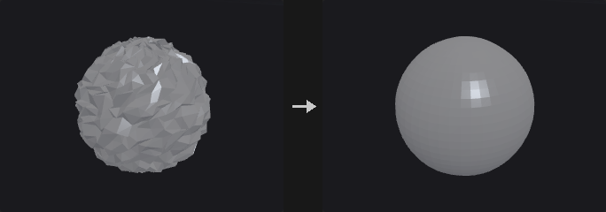

Takes the deformed geometry and a rest version with the same topology. Both are smoothed; the detail lost by smoothing the rest shape is recorded in a local frame on the smoothed surface and reapplied to the smoothed deformed shape. Local damage from the deformation is smoothed away, while the detail returns as it looked in the rest pose. For rigid motion of the whole mesh the result equals the deformed input exactly.

A point attribute can be used as a mask to control how much of the correction each point receives.

**Inputs**

| Input | Type | Description |
|---|---|---|
| `geo` | GEOMETRY | The deformed geometry. |
| `rest` | GEOMETRY | The same geometry before deformation. Must have the same topology. |

**Outputs**

| Output | Type | Description |
|---|---|---|
| `geo` | GEOMETRY | The mushed geometry. |
| `report` | STRING | Text summary of the operation. |

**Parameters**

| Parameter | Type | Default | Description |
|---|---|---|---|
| Iterations `iterations` | int [0..1000] | 10 | Number of smoothing iterations. More iterations remove more of the deformation artifacts. |
| Step Size `step` | float [0.0..1.0] | 0.5 | Step size of each smoothing iteration, from 0 (no movement) to 1. |
| Pin Border Points `pin_boundary` | toggle | on | Keeps points on open borders fixed while smoothing. |
| Mask Attribute `mask_attribute` | string | *(empty)* | Point attribute giving, per point, how much of the correction to use. Empty means 1 everywhere. |

---

### Displace from Map (PCG)

`PCG_DisplaceFromMap` · category `PCG/deform`

Displaces points along their normal or a fixed vector using values sampled from an image at the point UVs.

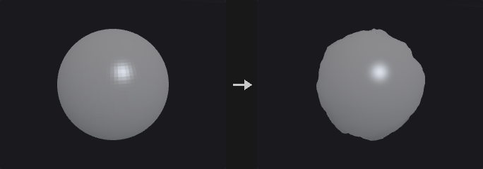

Samples one channel of a COP layer at each point's UV and moves the point by `(value - Midpoint) * Amount` along the direction. This is the standard height-map or displacement-map workflow. Midpoint is the value that causes no movement: 0 for height maps whose lowest value is 0, 0.5 for displacement maps where 0.5 means flat.

The node does not recompute normals, so `N` is out of date after displacement. Append a Facet (or another normal-computing node) downstream if you need correct shading or further normal-based displacement. As with Attribute from Map, the image is read as numbers, so enable the sRGB decode when the data was stored as sRGB.

**Inputs**

| Input | Type | Description |
|---|---|---|
| `geo` | GEOMETRY | Geometry to displace. Needs UVs. |
| `cop` | COPIMAGE | Image to sample. |

**Outputs**

| Output | Type | Description |
|---|---|---|
| `geo` | GEOMETRY | The displaced geometry. |

**Parameters**

| Parameter | Type | Default | Description |
|---|---|---|---|
| Group `group` | string | *(empty)* | Point group pattern limiting which points are displaced. Empty means all points. |
| Layer `layer` | string | `C` | Name of the image layer to sample. |
| Channel `channel` | int [0..63] | 0 | Index of the channel of the layer to use as the scalar value. |
| Decode `decode` | menu | None | Color space conversion applied to the sampled value. Height data is normally *None*; use *sRGB to Linear* for values stored as sRGB. Options: None (`none`), sRGB to Linear (`srgb_to_linear`), Linear to sRGB (`linear_to_srgb`). |
| Filter `filter` | menu | Bilinear | *Bilinear* interpolates between texels; *Closest* uses the nearest texel. Options: Bilinear (`bilinear`), Closest (`closest`). |
| Border `border` | menu | Clamp (Streak Edges) | Behavior for UVs outside 0..1: repeat the edge pixels, wrap around, or read black. Options: Clamp (Streak Edges) (`clamp`), Wrap (`wrap`), Constant (Black) (`black`). |
| Amount `amount` | float | 0.1 | Displacement distance for a sampled value one unit above Midpoint. |
| Midpoint `midpoint` | float | 0 | Sampled value that produces no displacement. |

*Direction*

| Parameter | Type | Default | Description |
|---|---|---|---|
| Direction `direction` | menu | Along Normal | *Along Normal* uses the normal attribute; *Fixed Vector* uses one direction for all points. Options: Along Normal (`normal`), Fixed Vector (`vector`). |
| Direction `dir_x` `dir_y` `dir_z` | float | 0, 1, 0 | The fixed displacement direction. *Hidden when direction ≠ vector.* |
| Normal Attribute `normal_attrib` | string | `N` | Name of the normal attribute. If the geometry does not have it, normals are computed on the fly (and not written back). *Hidden when direction ≠ normal.* |

*UV*

| Parameter | Type | Default | Description |
|---|---|---|---|
| UV Attribute `uv_attrib` | string | `uv` | Name of the UV attribute. |
| UV Source `uv_from` | menu | Auto | Where the UVs are read from. *Auto* picks vertex UVs when present, otherwise point UVs. Options: Auto (`auto`), Vertex (`vertex`), Point (`point`). |
| UV Scale `uv_scale_u` `uv_scale_v` | float [-10000.0..10000.0] | 1, 1 | Scale applied to the UVs before sampling (U, V). |
| UV Offset `uv_offset_u` `uv_offset_v` | float [-10000.0..10000.0] | 0, 0 | Offset added to the UVs before sampling (U, V). |

---

### Fractal (PCG)

`PCG_Fractal` · category `PCG/deform` · Houdini: Fractal (SOP)

Roughens a surface by midpoint displacement.

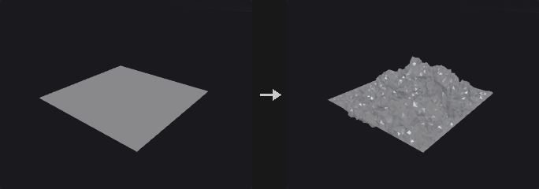

Each division level subdivides linearly, and only the points newly created in that level are pushed randomly along the normal (or a fixed vector) by up to `Scale * Roughness^level`. The first level therefore moves most and each following level moves less, which gives a fractal-looking surface.

With *Fixed Boundary* the new points on open borders are not moved, so adjacent tiles stay seamless.

**Inputs**

| Input | Type | Description |
|---|---|---|
| `geo` | GEOMETRY | Surface to roughen. |

**Outputs**

| Output | Type | Description |
|---|---|---|
| `geo` | GEOMETRY | The subdivided, displaced surface. |
| `report` | STRING | Text summary of the operation. |

**Parameters**

| Parameter | Type | Default | Description |
|---|---|---|---|
| Divisions `divisions` | int [0..6] | 3 | Number of subdivision levels. |
| Roughness `roughness` | float [0.0..2.0] | 0.5 | Factor by which the displacement of each level is multiplied relative to the previous one. |
| Scale `scale` | float | 0.2 | Maximum displacement of the first level. |
| Seed `rand_seed` | int [0..] | 0 | Seed of the random displacement. |
| Fixed Boundary `fixed_boundary` | toggle | on | Does not move new points on open borders. |
| Direction `direction` | menu | Use Normals | *Use Normals* displaces along the surface normal; *Fixed Vector* uses a single direction. Options: Use Normals (`normal`), Fixed Vector (`vector`). |
| Vector `vector_x` `vector_y` `vector_z` | float | 0, 1, 0 | The fixed displacement direction. *Hidden when direction ≠ vector.* |

---

### Lattice (PCG)

`PCG_Lattice` · category `PCG/deform` · Houdini: Lattice (SOP)

Deforms geometry with a lattice using free-form deformation.

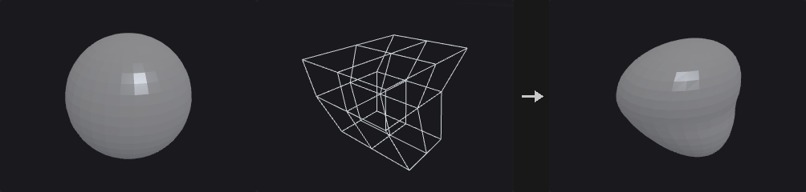

The geometry follows a control lattice that you move. Rest positions come from the `rest` attribute stored on the lattice points (as created by Lattice From Bound), or from the optional rest_lattice input.

*Trilinear* is local: each point only looks at the 8 control points of the cell it is in. *Bezier* is a global Sederberg-Parry Bernstein volume, smooth everywhere and well suited to large shape changes with 2 to 4 cells. Both have linear precision: when the whole lattice undergoes an affine transform, the geometry transforms exactly the same way. Normals are corrected with the inverse transpose Jacobian.

**Inputs**

| Input | Type | Description |
|---|---|---|
| `geo` | GEOMETRY | Geometry to deform. |
| `lattice` | GEOMETRY | The moved (deformed) control lattice. |
| `rest_lattice` *(optional)* | GEOMETRY | Optional lattice in the rest state. When missing, the `rest` attribute of the lattice is used. |

**Outputs**

| Output | Type | Description |
|---|---|---|
| `geo` | GEOMETRY | The deformed geometry. |

**Parameters**

| Parameter | Type | Default | Description |
|---|---|---|---|
| Group `group` | string | *(empty)* | Point group pattern limiting which points are deformed. Empty means all points. |
| Interpolation `interpolation` | menu | Trilinear (Local) | *Trilinear (Local)* uses only the surrounding cell; *Bezier (Global)* uses all control points for a smoother result. Options: Trilinear (Local) (`trilinear`), Bezier (Global) (`bezier`). |
| Points Outside Lattice `outside` | menu | Deform (Extrapolate) | What happens to points outside the rest lattice: *Deform (Extrapolate)* continues the deformation, *Keep Unchanged* leaves them in place. Options: Deform (Extrapolate) (`deform`), Keep Unchanged (`keep`). |

---

### Lattice From Bound (PCG)

`PCG_LatticeFromBound` · category `PCG/deform`

Creates a grid of control points around the bounding box of the input, for use with Lattice.

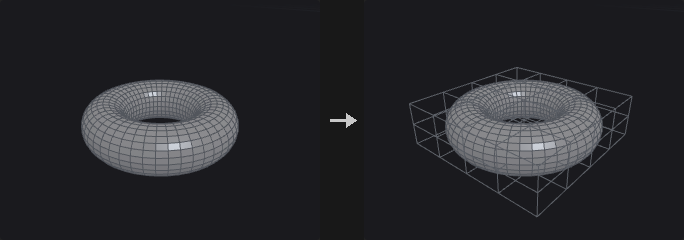

Places `(nx+1)(ny+1)(nz+1)` control points on the bounding box of the input (connected with grid lines for easy viewing), each with a `rest` attribute. Move the points with any nodes, then connect the result to the lattice input of the Lattice node. Do not delete or merge points, since their order defines the lattice.

**Inputs**

| Input | Type | Description |
|---|---|---|
| `geo` | GEOMETRY | Geometry whose bounding box defines the lattice. |

**Outputs**

| Output | Type | Description |
|---|---|---|
| `lattice` | GEOMETRY | The control lattice points with `rest` positions. |

**Parameters**

| Parameter | Type | Default | Description |
|---|---|---|---|
| Divisions `divisions_x` `divisions_y` `divisions_z` | int [1..64] | 2, 2, 2 | Number of cells along each axis. Control points are `(nx+1)(ny+1)(nz+1)`. |
| Padding `padding` | float [0.0..] | 0 | Expands the bounding box on every side before the lattice is built. |

---

### Magnet (PCG)

`PCG_Magnet` · category `PCG/deform` · Houdini: Magnet (SOP)

Transforms points inside the influence of a magnet geometry, weighted by falloff.

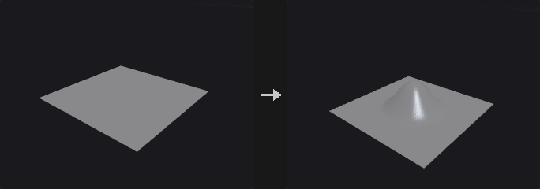

The influence region works as in Bulge: each magnet point is a sphere of radius `pscale * Radius`, or the distance to the magnet surface is used. Points inside are transformed by the Translate, Rotate and Scale parameters scaled by the weight: translation multiplied by the weight, rotation angle multiplied by the weight, and scale interpolated from 1 to the scale value. The transform is applied around the magnet centroid, the origin or a custom pivot. Interpolation is applied to the parameters, not to the result, so a rotation does not collapse the radius.

**Inputs**

| Input | Type | Description |
|---|---|---|
| `geo` | GEOMETRY | Geometry to deform. |
| `magnet` | GEOMETRY | Geometry that defines the influence region. |

**Outputs**

| Output | Type | Description |
|---|---|---|
| `geo` | GEOMETRY | The deformed geometry. |
| `report` | STRING | Text summary of the operation. |

**Parameters**

| Parameter | Type | Default | Description |
|---|---|---|---|
| Group `group` | string | *(empty)* | Point group pattern limiting which points are deformed. Empty means all points. |
| Translate `translate_x` `translate_y` `translate_z` | float | 0, 0.5, 0 | Translation at full weight. |
| Rotate `rotate_x` `rotate_y` `rotate_z` | float | 0, 0, 0 | Rotation in degrees at full weight; the applied angle is multiplied by the weight. |
| Scale `scale_x` `scale_y` `scale_z` | float | 1, 1, 1 | Scale at full weight; the applied scale is interpolated from 1 with the weight. |
| Pivot Location `pivot_mode` | menu | Magnet Centroid | Center of the rotation and scale: the centroid of the magnet, the world origin, or a custom point. Options: Magnet Centroid (`magnet_center`), Origin (`origin`), Custom (`custom`). |
| Pivot `pivot_x` `pivot_y` `pivot_z` | float | 0, 0, 0 | Custom pivot position. *Hidden when pivot_mode ≠ custom.* |

*Influence*

| Parameter | Type | Default | Description |
|---|---|---|---|
| Magnet Type `magnet_type` | menu | Points (Spheres) | *Points (Spheres)* gives every magnet point a spherical influence; *Surface* uses the distance to the magnet's surface. Options: Points (Spheres) (`points`), Surface (`surface`). |
| Radius `radius` | float [0.0..] | 1 | Radius of the influence. With point magnets it is multiplied by `pscale` when that option is on. |
| Scale Radius by pscale `use_pscale` | toggle | on | Multiplies the radius by each magnet point's `pscale`. Only applies to point magnets. *Hidden when magnet_type = surface.* |
| Falloff `ramp` | string | `0:0  1:1` | Falloff curve given as space-separated `position:value` pairs. The curve is evaluated at `1 - distance/radius`, so position 1 is at the magnet and position 0 at the edge of the radius; the default `0:0  1:1` is full weight at the magnet fading to zero. |
| Ramp Mode `ramp_mode` | menu | Smooth | Interpolation between ramp keys: smooth, linear or constant steps. Options: Smooth (`smooth`), Linear (`linear`), Constant (`constant`). |

| Parameter | Type | Default | Description |
|---|---|---|---|
| Output Weight Attribute `weight_attribute` | string | *(empty)* | Name of a point attribute to receive the weight. Empty means nothing is written. |

---

### Path Deform (PCG)

`PCG_PathDeform` · category `PCG/deform` · Houdini: Path Deform (SOP)

Bends geometry along a curve.

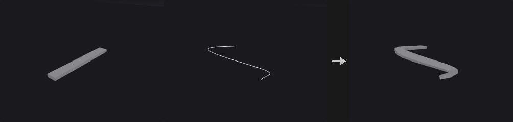

Lays one axis of the input (Deform Axis, +Z by default) along the curve in the second input: the coordinate on that axis becomes a distance along the curve, the other two coordinates become offsets in the curve's frame there. Frames are rotation-minimising, so long shapes don't twist unless Roll or Twist ask for it.

With *Stretch to Curve* the input's length along the axis is fitted to the curve; without it the axis coordinate is used as arc length directly (times Scale). Offset slides the shape along the curve. Past the curve's ends the shape continues straight along the end tangent.

A coarse curve gives a faceted bend; resample it for smooth results.

**Inputs**

| Input | Type | Description |
|---|---|---|
| `geo` | GEOMETRY | Geometry to deform. |
| `curve` | GEOMETRY | Curve to follow (the first curve primitive). |

**Outputs**

| Output | Type | Description |
|---|---|---|
| `geo` | GEOMETRY | The deformed geometry. |
| `report` | STRING | Point count, curve length and points beyond the curve's ends. |

**Parameters**

| Parameter | Type | Default | Description |
|---|---|---|---|
| Group `group` | string | *(empty)* | Only these points are deformed. |
| Curve Group `curve_group` | string | *(empty)* | Which curve primitive of the second input to follow; the first one in the group is used. |
| Deform Axis `deform_axis` | menu | +Z | Axis of the input that is laid along the curve. Options: +Z (`+z`), -Z (`-z`), +X (`+x`), -X (`-x`), +Y (`+y`), -Y (`-y`). |
| Stretch to Curve `stretch_to_curve` | toggle | on | Fit the input's extent along the deform axis to the whole curve. |
| Scale Along Curve `scale` | float [-10000.0..10000.0] | 1 | Scale along the curve. |
| Offset `offset` | float | 0 | Slide along the curve, in world units (or a fraction of the curve length). |
| Offset as Fraction of Length `offset_as_fraction` | toggle | off | Read Offset as a fraction of the curve length. |
| Cross Scale `cross_scale` | float [-10000.0..10000.0] | 1 | Scale of the two cross-section axes. |
| Roll `roll` | float [-36000.0..36000.0] | 0 | Rotate the shape about the curve, in degrees. |
| Twist `twist` | float [-36000.0..36000.0] | 0 | Extra rotation that grows to this many degrees at the curve's end. |
| Up Vector `up_mode` | menu | Minimal Rotation | Minimal Rotation (the frame is carried along without twisting) or Constant (each frame faces the Up vector). Options: Minimal Rotation (`minimal_rotation`), Constant (`constant`). |
| Up `up_x` `up_y` `up_z` | float | 0, 1, 0 | Up vector: the start of the frame (Minimal Rotation) or the direction every frame faces (Constant). |

---

### Point Deform (PCG)

`PCG_PointDeform` · category `PCG/deform` · Houdini: Point Deform (SOP)

Deforms high-resolution geometry using the motion of a low-resolution point cloud.

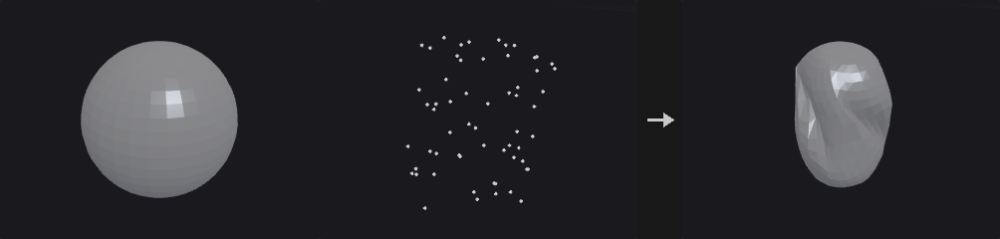

`rest` holds the original positions of the low-res points and `deformed` the deformed positions (same point count and order). Each point of the input geometry is weighted against its nearest Max Points low-res points; the kernel radius is the distance to the (k+1)-th nearest point so weights stay continuous when neighbors change.

In *Rigid* mode the local rigid transform of every low-res point is estimated (Kabsch) and blended, so a pure rotation of the low-res cloud rotates the high-res geometry exactly and normals rotate with it. *Translate Only* blends just the displacements: cheaper, but it distorts under rotation.

**Inputs**

| Input | Type | Description |
|---|---|---|
| `geo` | GEOMETRY | High-resolution geometry to deform. |
| `rest` | GEOMETRY | Low-resolution points in their original state. |
| `deformed` | GEOMETRY | The same low-resolution points after deformation. Must match rest in count and order. |

**Outputs**

| Output | Type | Description |
|---|---|---|
| `geo` | GEOMETRY | The deformed geometry. |
| `report` | STRING | Text summary of the operation. |

**Parameters**

| Parameter | Type | Default | Description |
|---|---|---|---|
| Group `group` | string | *(empty)* | Point group pattern limiting which points are deformed. Empty means all points. |
| Max Points `max_points` | int [1..256] | 8 | Number of nearest low-res points that influence each point. |
| Deformation `mode` | menu | Rigid (Local Frames) | *Rigid (Local Frames)* blends local rigid transforms (rotates correctly); *Translate Only* blends displacement vectors only. Options: Rigid (Local Frames) (`rigid`), Translate Only (`translate`). |

---

### Soft Peak (PCG)

`PCG_SoftPeak` · category `PCG/deform` · Houdini: Soft Peak (SOP)

Pushes a group of points along their normals, with nearby points following by a soft falloff.

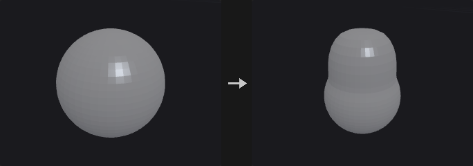

The points in Group are the handle: each is pushed along its normal by Distance. Other points within Soft Radius follow, weighted by a falloff computed with the same soft selection as Soft Transform (straight-line distance, distance along edges, or number of edge steps). Normals are computed on the fly if the input has none.

With the *Attribute* metric there is no handle group: distances come from a point attribute, and Group only restricts which points may move (empty means all points). With *Translate Along Lead Normal* each point moves along the normal of its nearest handle point rather than its own, which pushes out a translated block instead of a mushroom shape.

**Inputs**

| Input | Type | Description |
|---|---|---|
| `geo` | GEOMETRY | Geometry to deform. |

**Outputs**

| Output | Type | Description |
|---|---|---|
| `geo` | GEOMETRY | The deformed geometry. |
| `report` | STRING | Text summary of the operation. |

**Parameters**

| Parameter | Type | Default | Description |
|---|---|---|---|
| Group `group` | string | *(empty)* | The points that are pushed (the handle). With the Attribute metric it can be left empty to allow all points to move. |
| Mask Attribute `mask_attribute` | string | `mask` | Name of the point attribute used as a mask when Use Mask is on. |
| Use Mask `use_mask` | toggle | off | Scales the displacement by the value of the mask attribute (0 means no movement, 1 full movement). |
| Distance `distance` | float | 0.2 | Distance to push along the point normal. |
| Soft Radius `radius` | float [0.0..] | 1 | Radius of the soft region around the handle. |
| Distance Metric `metric` | menu | Radius | How distance to the handle is measured. *Radius*: straight-line distance (works on point clouds but spreads across gaps). *Edge Steps*: number of edge hops. *Edge*: distance along edges (needs connectivity). *Attribute*: distance read from a point attribute. *Radius with Connectivity* is straight-line distance but only for points connected to the handle by a path of edges inside the radius. Options: Radius (`euclidean`), Edge Steps (`steps`), Edge (`distance`), Attribute (`attribute`), Radius with Connectivity (deprecated) (`radius_with_connectivity`). |
| Distance Attribute `distance_attribute` | string | `dist` | Name of the point attribute holding the distance when the metric is Attribute. *Hidden when metric ≠ attribute.* |
| Apply Rolloff `apply_rolloff` | toggle | on | On: the attribute is treated as a raw distance and attenuated by the soft type within the radius. Off: the attribute value is used directly as the weight. *Hidden when metric ≠ attribute.* |
| Lead Point Attribute `lead_point_attribute` | string | `lead` | Integer point attribute holding for each point the number of its lead (handle) point, or -1 for itself. Used with the Attribute metric and Translate Along Lead Normal. *Hidden when metric ≠ attribute.* *Disabled when translate_along_lead_normal is off.* |
| Translate Along Lead Normal `translate_along_lead_normal` | toggle | off | Moves each point along the normal of its nearest handle point instead of its own normal. |
| Soft Type `soft_type` | menu | Ramp (PCG) | Falloff shape. *Ramp (PCG)* uses the Soft Falloff curve; *Linear*, *Quadratic* and *Cubic* are fixed shapes (Cubic can have its end tangents set); *Metaball* uses a metaball kernel. Options: Ramp (PCG) (`ramp`), Linear (`linear`), Quadratic (`quadratic`), Cubic (`cubic`), Metaball (`metaball`). |
| Tangent Angles `tangent_far` `tangent_near` | float [-89.0..89.0] | 0, 0 | Tangent angles in degrees for the Cubic falloff: the first value acts at the far end of the radius, the second at the handle. With both at 0 it is a smoothstep. *Hidden when soft_type ≠ cubic.* |
| Kernel Function `kernel` | menu | Links | Metaball kernel function. Options: Links (`links`), RenderMan (`renderman`), Hart (`hart`). *Hidden when soft_type ≠ metaball.* |
| Soft Falloff `ramp` | string | `0:0  1:1` | Falloff curve given as space-separated `position:value` pairs. The curve is evaluated at `1 - distance/radius`, so position 1 is at the handle and position 0 at the edge of the radius. *Hidden when soft_type ≠ ramp.* |
| Ramp Mode `ramp_mode` | menu | Smooth | Interpolation between ramp keys: smooth, linear or constant steps. Options: Smooth (`smooth`), Linear (`linear`), Constant (`constant`). |
| Recompute Normals `update_normals` | toggle | on | Recomputes `N` after deforming. Has an effect only when the input has `N`. |
| Output Weight Attribute `weight_attribute` | string | *(empty)* | Name of a point attribute to receive the falloff weight. Empty means nothing is written. |

---

### Soft Transform (PCG)

`PCG_SoftTransform` · category `PCG/deform` · Houdini: Soft Transform (SOP)

Transforms a group of points and lets nearby points follow with a soft falloff.

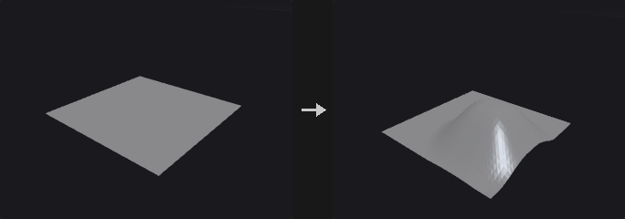

Houdini's soft-selection drag as a reproducible node. The Group is the handle: weight 1 inside it, falling off with distance to 0 at Soft Radius. An empty group selects all points, which makes the node an ordinary transform.

The parameters are interpolated, not the result. Blending `P` with the transformed `P` by the weight is wrong for rotation, because the point travels along a chord and the radius shrinks (by almost 30% at weight 0.5 in a test case). Here each point builds its own matrix from `angle * w`, `translation * w`, `lerp(1, scale, w)` and `shear * w`, so rotation radius is preserved. Pivot Rotate orients the pivot's frame and is not weighted.

The distance metric decides how the falloff spreads. Straight-line distance works on point clouds but leaks through gaps (a separate piece across a gap is also affected); the edge-based metrics only spread across connected geometry. By default the pivot is the centroid of the handle group.

**Inputs**

| Input | Type | Description |
|---|---|---|
| `geo` | GEOMETRY | Geometry to transform. |

**Outputs**

| Output | Type | Description |
|---|---|---|
| `geo` | GEOMETRY | The transformed geometry. |

**Parameters**

| Parameter | Type | Default | Description |
|---|---|---|---|
| Group `group` | string | *(empty)* | The handle points, with weight 1. Empty means all points, so the node is a plain transform. |
| Transform Order `xform_order` | menu | Scale Rot Trans | Order in which scale, rotate and translate are applied. Options: Scale Rot Trans (`srt`), Scale Trans Rot (`str`), Rot Scale Trans (`rst`), Rot Trans Scale (`rts`), Trans Scale Rot (`tsr`), Trans Rot Scale (`trs`). |
| Rotate Order `rotate_order` | menu | Rx Ry Rz | Order of the X, Y, Z rotations. Options: Rx Ry Rz (`xyz`), Rx Rz Ry (`xzy`), Ry Rx Rz (`yxz`), Ry Rz Rx (`yzx`), Rz Rx Ry (`zxy`), Rz Ry Rx (`zyx`). |
| Translate `tx` `ty` `tz` | float | 0, 0, 0 | Translation at full weight; the applied amount is multiplied by the weight. |
| Rotate `rx` `ry` `rz` | float [-3600..3600] | 0, 0, 0 | Rotation in degrees at full weight; the applied angle is multiplied by the weight. |
| Scale `sx` `sy` `sz` | float | 1, 1, 1 | Scale at full weight; the applied scale is interpolated from 1 with the weight. |
| Shear `shear_xy` `shear_xz` `shear_yz` | float | 0, 0, 0 | Shear at full weight (XY, XZ, YZ); multiplied by the weight. |

*Pivot*

| Parameter | Type | Default | Description |
|---|---|---|---|
| Pivot at Group Centroid `use_group_center` | toggle | on | Uses the centroid of the handle group as the pivot. |
| Pivot `pivot_x` `pivot_y` `pivot_z` | float | 0, 0, 0 | Pivot position when not using the group centroid. *Disabled when use_group_center is on.* |

| Parameter | Type | Default | Description |
|---|---|---|---|
| Pivot Rotate `prx` `pry` `prz` | float [-3600..3600] | 0, 0, 0 | Orientation of the pivot's frame, in degrees. It is not weighted. |
| Normals `normals` | menu | Transform (Jacobian) | How normals are handled. *Transform (Jacobian)* corrects them for the deformation; *Leave Unchanged* does nothing; *Recompute Point Normals* recomputes point normals for all points when the input has `N`; *Recompute Affected Normals* recomputes only the moved points. Options: Transform (Jacobian) (`jacobian`), Leave Unchanged (`none`), Recompute Point Normals (`recompute_point`), Recompute Affected Normals (`recompute_affected`). |
| Preserve Normal Length `preserve_normal_length` | toggle | off | Keeps the original length of the normals when transforming by Jacobian. Otherwise they are normalized. *Hidden when normals ≠ jacobian.* |
| Soft Radius `radius` | float [0.0..] | 1 | Radius of the soft region around the handle. |
| Distance Metric `metric` | menu | Radius | How distance to the handle is measured. *Radius*: straight-line distance. *Edge Steps*: number of edge hops. *Edge*: distance along edges. *Attribute*: distance read from a point attribute (no handle, Group only restricts which points may move). *Radius with Connectivity*: straight-line distance, but only for points connected to the handle by a path of edges inside the radius. Options: Radius (`euclidean`), Edge Steps (`steps`), Edge (`distance`), Attribute (`attribute`), Radius with Connectivity (deprecated) (`radius_with_connectivity`). |
| Distance Attribute `distance_attribute` | string | `dist` | Name of the point attribute holding the distance when the metric is Attribute. *Hidden when metric ≠ attribute.* |
| Apply Rolloff `apply_rolloff` | toggle | on | On: the attribute is treated as a raw distance and attenuated by the soft type within the radius. Off: the attribute value is used directly as the weight. *Hidden when metric ≠ attribute.* |
| Soft Type `soft_type` | menu | Ramp (PCG) | Falloff shape. *Ramp (PCG)* uses the Soft Falloff curve; *Linear*, *Quadratic* and *Cubic* are fixed shapes; *Metaball* uses a metaball kernel. Options: Ramp (PCG) (`ramp`), Linear (`linear`), Quadratic (`quadratic`), Cubic (`cubic`), Metaball (`metaball`). |
| Tangent Angles `tangent_far` `tangent_near` | float [-89.0..89.0] | 0, 0 | Tangent angles in degrees for the Cubic falloff: the first value acts at the far end of the radius, the second at the handle. With both at 0 it is a smoothstep. *Hidden when soft_type ≠ cubic.* |
| Kernel Function `kernel` | menu | Links | Metaball kernel function. Options: Links (`links`), RenderMan (`renderman`), Hart (`hart`). *Hidden when soft_type ≠ metaball.* |
| Soft Falloff `falloff_ramp` | string | `0:0  1:1` | Falloff curve given as space-separated `position:value` pairs. The curve is evaluated at `1 - distance/radius`, so position 1 is at the handle and position 0 at the edge of the radius. *Hidden when soft_type ≠ ramp.* |
| Ramp Mode `ramp_mode` | menu | Linear | Interpolation between ramp keys: smooth, linear or constant steps. Options: Linear (`linear`), Smooth (`smooth`), Constant (`constant`). |
| Output Falloff Attribute `falloff_attribute` | string | *(empty)* | Name of a point attribute to receive the falloff weight. Empty means nothing is written. |

---

### Spherify (PCG)

`PCG_Spherify` · category `PCG/deform`

Pushes the selected points onto a sphere.

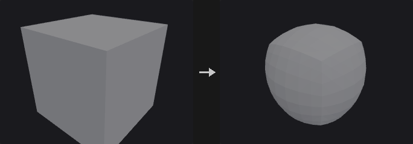

Computes `P' = lerp(P, C + normalize(P - C) * R, Amount)`. With Radius 0 the radius is the average distance of the selected points to the center, which changes volume least; the center defaults to the centroid of the selected points. Amount 0 is exactly the identity and amount 1 puts all points on the sphere.

Use it with Group to spherify only part of a shape.

**Inputs**

| Input | Type | Description |
|---|---|---|
| `geo` | GEOMETRY | Geometry to deform. |

**Outputs**

| Output | Type | Description |
|---|---|---|
| `geo` | GEOMETRY | The deformed geometry. |

**Parameters**

| Parameter | Type | Default | Description |
|---|---|---|---|
| Group `group` | string | *(empty)* | Point group pattern selecting the points to deform. Empty means all points. |
| Amount `amount` | float [-10.0..10.0] | 1 | Blend between the original position (0) and the sphere (1). Values outside 0..1 extrapolate. |
| Radius `radius` | float [0.0..] | 0 | Radius of the sphere. 0 uses the average distance from the selected points to the center. |

*Center*

| Parameter | Type | Default | Description |
|---|---|---|---|
| Specify Center `use_center` | toggle | off | Uses the Center parameter. When off, the centroid of the selected points is used. |
| Center `center_x` `center_y` `center_z` | float | 0, 0, 0 | Center of the sphere. |

| Parameter | Type | Default | Description |
|---|---|---|---|
| Update Normals `normals` | menu | Transform by Jacobian | *Transform by Jacobian* corrects the normals; *Don't Update* leaves them. Options: Transform by Jacobian (`jacobian`), Don't Update (`none`). |

---

### Topo Transfer (PCG)

`PCG_TopoTransfer` · category `PCG/deform` · Houdini: Topo Transfer (SOP)

Fits the wiring of one mesh onto the shape of another.

Moves the points of `geo` onto the surface of `target` while keeping the original topology. First the meshes are aligned: with a similarity transform from landmark pairs when enough are available, otherwise by bounding box. Then it iterates: project the points onto the target surface and smooth the displacement field. The smoothing fades out over the iterations and the last iteration is a pure projection, so all points end on the target, the point density is preserved and faces do not flip.

Landmarks are an integer point attribute present on both meshes; points with equal values (0 or greater) are paired, and paired points are pinned in every iteration.

**Inputs**

| Input | Type | Description |
|---|---|---|
| `geo` | GEOMETRY | The mesh whose topology is kept. |
| `target` | GEOMETRY | The mesh whose shape is matched. |

**Outputs**

| Output | Type | Description |
|---|---|---|
| `geo` | GEOMETRY | The input topology fitted onto the target shape. |
| `report` | STRING | Text summary of the operation. |

**Parameters**

| Parameter | Type | Default | Description |
|---|---|---|---|
| Landmark Attribute `landmark_attribute` | string | `landmark` | Name of the integer point attribute on both meshes that pairs points. Equal values of 0 or more form a pair, and pairs are pinned every iteration. |
| Rigid Pre-Alignment `prealign` | toggle | on | Aligns the mesh to the target before iterating: with a similarity transform when there are at least 3 landmark pairs, otherwise by bounding box. |
| Iterations `iterations` | int [1..1000] | 20 | Number of project-and-smooth iterations. |
| Smoothing Steps `smoothing` | int [0..1000] | 10 | Number of smoothing passes on the displacement field per iteration at the start; this decreases linearly to 0 by the last iteration, which is a pure projection. |
| Smoothing Strength `stiffness` | float [0.0..1.0] | 0.5 | Strength of each smoothing pass, from 0 to 1. Has no effect when Smoothing Steps is 0. *Disabled when smoothing = 0.* |

---

### Transform Pieces (PCG)

`PCG_TransformPieces` · category `PCG/deform` · Houdini: Transform Pieces (SOP)

Moves pieces of a fragmented geometry onto the matching points of a template, such as RBD output or a skeleton.

The input is split into pieces by the `name` attribute (primitive attribute first, point attribute if the primitive one does not exist). Each piece is transformed by the instance attributes of the template point with the same name: `P`, `orient`, `N` + `up`, `scale`, `pscale`, `pivot` and `transform`, interpreted as in Copy to Points. Pieces without a matching template point are left alone and listed in the report.

With a rest input, the piece transform is the template composed with the inverse of the rest (for RBD exports and bones). Without it, the piece is first centered and then placed on the template point.

**Inputs**

| Input | Type | Description |
|---|---|---|
| `geo` | GEOMETRY | The pieces to move. |
| `template` | GEOMETRY | Points carrying the transform of each piece (position, orientation, scale...). |
| `rest` *(optional)* | GEOMETRY | Optional points describing the rest transform of each piece. The piece transform becomes template times inverse rest. |

**Outputs**

| Output | Type | Description |
|---|---|---|
| `geo` | GEOMETRY | The transformed pieces. |
| `report` | STRING | Text summary, including pieces that found no template point. |

**Parameters**

| Parameter | Type | Default | Description |
|---|---|---|---|
| Attribute Mode `attribute_mode` | menu | Match by Attribute | *Match by Attribute* pairs a piece with the template point that has the same attribute value. *Index by Attribute* treats an integer attribute value as the template point number. Options: Match by Attribute (`match`), Index by Attribute (`index`). |
| Attribute `piece_attribute` | string | `name` | Name of the attribute that identifies pieces. It is read from primitives first, then from points. |
| Invert Transformation `invert_transformation` | toggle | off | Applies the inverse of the transform, moving pieces from the template back to their rest placement. |
| Center Pieces (No Rest) `center_pieces` | toggle | on | Without a rest input, moves the center of each piece to the origin before transforming. Turn off for Houdini's behavior. *Disabled when invert_transformation is on.* |
| Attributes to Transform `attributes_to_transform` | string | `N up v` | Space-separated attributes transformed along with `P`. An attribute named `N` is transformed as a normal; other three-component attributes as vectors. `P` is always transformed. |
| Copy Template Attributes `copy_template_attributes` | toggle | off | Copies attributes and groups from the template points onto the pieces. |
| Attributes to Copy `attributes_to_copy` | string | `*` | Pattern of template attributes to copy. *Disabled when copy_template_attributes is off.* |
| Groups to Copy `groups_to_copy` | string | *(empty)* | Pattern of template groups to copy. *Disabled when copy_template_attributes is off.* |

**Compared with Houdini**

*Center Pieces* is an addition: when no rest input is connected, each piece is centered at the origin first. Turn it off to get Houdini's behavior.

---

### Twist / Bend / Taper (PCG)

`PCG_Deform` · category `PCG/deform` · Houdini: Bend (SOP), Twist (SOP)

Twists, bends, tapers, squashes or shears points along a chosen axis.

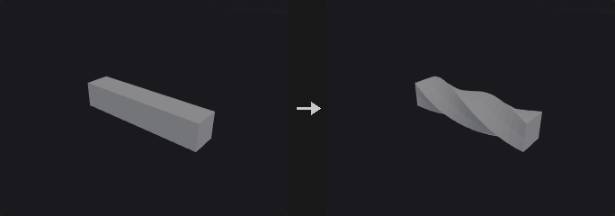

A purely per-point position function: topology and attributes are untouched, so it can be chained freely. For each point a normalized parameter `t` along the primary axis is computed, and the deformation amount is a function of `t`.

Outside the capture region (t < 0 or t > 1) the deformation continues rigidly: for Bend the extra length is carried along the end tangent, so that part stays straight and keeps its length instead of collapsing onto the end plane. Bend is numerically stable for tiny angles (it is written in a sinc form), and zero Angle / Scale 1 / Shear 0 give exactly the identity. *Squash and Stretch* preserves volume within the region: the axis is multiplied by Scale and the other directions by 1/sqrt(Scale).

The secondary axis (Up) decides which way a bend goes and which way a shear pushes; when it is parallel to the primary axis another direction is chosen automatically. Normals, if present, are corrected with the inverse transpose of a finite-difference Jacobian rather than recomputed, so curves and point clouds work and hard edges are preserved.

**Inputs**

| Input | Type | Description |
|---|---|---|
| `geo` | GEOMETRY | Geometry to deform. |

**Outputs**

| Output | Type | Description |
|---|---|---|
| `geo` | GEOMETRY | The deformed geometry. |

**Parameters**

| Parameter | Type | Default | Description |
|---|---|---|---|
| Group `group` | string | *(empty)* | Point group pattern limiting which points are deformed. Empty means all points. |
| Operation `op` | menu | Twist | *Twist* rotates slices around the axis, *Bend* curves the axis, *Linear Taper* scales the cross section along the axis, *Squash and Stretch* scales along the axis with a volume-preserving compensation, *Shear* offsets points sideways proportional to position along the axis. Options: Twist (`twist`), Bend (`bend`), Linear Taper (`taper`), Squash and Stretch (`squash`), Shear (`shear`). |
| Primary Axis `axis` | menu | X | Primary axis along which the deformation is applied. Options: X (`x`), Y (`y`), Z (`z`). |
| Secondary Axis (Up) `up_x` `up_y` `up_z` | float | 0, 1, 0 | Secondary axis direction: the direction in which Bend curves and Shear pushes. Switches automatically if parallel to the primary axis. *Hidden when op = twist } { op = taper } { op = squash.* |
| Pivot `pivot_x` `pivot_y` `pivot_z` | float | 0, 0, 0 | A point the deformation axis passes through. Its component along the primary axis has no effect, because the capture range is in absolute coordinates. |
| Angle `angle` | float [-36000.0..36000.0] | 45 | Twist or bend angle in degrees, across the capture region. *Hidden when op = taper } { op = squash } { op = shear.* |
| Scale `amount` | float [0.0001..10000.0] | 0.5 | For Linear Taper, the scale at the end of the region; for Squash and Stretch, the scale along the axis (cross directions get 1/sqrt). *Hidden when op = twist } { op = bend } { op = shear.* |
| Shear `shear_b` `shear_c` | float [-10000.0..10000.0] | 0, 0 | Shear displacement at the end of the region, along the secondary direction (first value) and the third direction (second value). *Hidden when op ≠ shear.* |

*Capture*

| Parameter | Type | Default | Description |
|---|---|---|---|
| Capture Region `use_range` | toggle | off | Limits the deformation to the capture range below. When off, the range is the actual extent of the selected points along the axis. |
| Range (Start / End) `range_start` `range_end` | float | 0, 1 | Start and end of the capture region as absolute coordinates on the primary axis. |

| Parameter | Type | Default | Description |
|---|---|---|---|
| Normals `normals` | menu | Transform (Jacobian) | *Transform (Jacobian)* corrects the normals for the deformation; *Leave Unchanged* does not touch them. Options: Transform (Jacobian) (`jacobian`), Leave Unchanged (`none`). |

**Compared with Houdini**

Combines the Twist and Bend SOPs and adds taper, squash and shear in one node.

---
