# Generate

Primitives, curves, terrain and other nodes that create geometry from nothing.

24 nodes.

[Back to the reference index](README.md)

## Contents

- [Add (PCG)](#pcg-add) — Creates points from typed coordinates, connects points into polygons, or strips a mesh down to its points.
- [Ballistic Path (PCG)](#pcg-ballisticpath) — Fires a projectile from each point and outputs its trajectory as a polyline.
- [Box (PCG)](#pcg-box) — Creates a box as polygons or as a lattice of points.
- [Circle (PCG)](#pcg-circle) — Creates a circle, ellipse or arc as a polygon or a curve.
- [Cross Section Surface (PCG)](#pcg-crosssectionsurface) — Builds a smooth Gordon surface through a net of section and guide curves.
- [Cross Section Surface · Houdini (PCG)](#pcg-crosssectionsurfacehou) — Skins a surface through cross-section curves using their existing points, like Houdini's Cross Section Surface.
- [Curve (PCG)](#pcg-curve) — A curve drawn in the viewport, like Houdini's Curve SOP.
- [Extract Silhouette (PCG)](#pcg-extractsilhouette) — Extracts the silhouette of a mesh as projected outlines or as a contour on the surface.
- [Font (PCG)](#pcg-font) — Creates text geometry from a TrueType or OpenType font as outlines, faces or extruded solids.
- [Grid (PCG)](#pcg-grid) — Creates a flat grid of points, polygons or lines.
- [IsoOffset (PCG)](#pcg-isooffset) — Converts geometry to an offset isosurface, an SDF volume or a fog volume.
- [IsoSurface (PCG)](#pcg-isosurface) — Extracts a polygon surface or volume from an implicit function evaluated on a grid.
- [L-System (PCG)](#pcg-lsystem) — Grows a branching structure by rewriting a premise string with rules and drawing it with a 3D turtle.
- [Line (PCG)](#pcg-line) — Creates a straight line with evenly spaced points.
- [Platonic Solids (PCG)](#pcg-platonicsolids) — Creates a Platonic solid or a soccer ball.
- [PolyLoft (PCG)](#pcg-polyloft) — Connects existing curves into a surface or lines using their own points.
- [PolyWire (PCG)](#pcg-polywire) — Builds tubes along every edge of a curve network, with closed joints at branches.
- [Revolve (PCG)](#pcg-revolve) — Spins a profile curve around an axis to create a surface of revolution.
- [Skin (PCG)](#pcg-skin) — Skins a surface across a set of cross-section curves.
- [Sphere (PCG)](#pcg-sphere) — Creates a sphere as a latitude/longitude mesh or a subdivided icosahedron.
- [Sweep (PCG)](#pcg-sweep) — Sweeps a cross section along backbone curves to make tubes, ribbons or custom profiles.
- [Torus (PCG)](#pcg-torus) — Creates a torus.
- [Tube (PCG)](#pcg-tube) — Creates a tube, cylinder or cone with optional end caps.
- [Volume (PCG)](#pcg-volume) — Creates a constant-value volume.

## Nodes

### Add (PCG)

`PCG_Add` · category `PCG/generate` · Houdini: Add (SOP), Point Generate (SOP)

Creates points from typed coordinates, connects points into polygons, or strips a mesh down to its points.

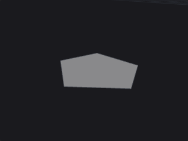

Covers the three jobs of Houdini's Add SOP, all of which change point/primitive membership rather than positions: creating points, wiring points into polygons or polylines, and discarding primitives while keeping the points.

Operations run in Houdini's order: *Delete Geometry But Keep the Points*, then append the new points, then build polygons, then the cleanup. New points are appended after the existing ones, so every polygon-building method can reference both input points and new points by number. With no input connected the node is a pure generator.

The panel differs from Houdini in one way: points and polygons are not multiparms. Points are typed into a multiline text box, one per line (`x y z`, separated by spaces, commas or semicolons; lines may contain `#` comments; two numbers imply `z = 0`, a fourth number is ignored). Polygons by pattern are also one per line. Point-number lists keep their order and repeats, because winding matters: `3 1 2` and `1 2 3` are different faces. Out-of-range point numbers raise an error rather than being skipped. Primitives with fewer than three corners are always created open.

**Inputs**

| Input | Type | Description |
|---|---|---|
| `geo` *(optional)* | GEOMETRY | Optional geometry to add to. Leave unconnected to generate geometry from scratch. |

**Outputs**

| Output | Type | Description |
|---|---|---|
| `geo` | GEOMETRY | The input with the new points and polygons added. |

**Parameters**

*Points*

| Parameter | Type | Default | Description |
|---|---|---|---|
| Delete Geometry But Keep the Points `keep_points` | toggle | off | Deletes all primitives of the input but keeps every point with its point attributes and groups. Vertex and primitive attributes disappear with the primitives. |
| Points `points` | string | *(empty)* | New points, one per line as `x y z`. They are appended after the existing points. |

*Polygons › Polygons by Pattern*

| Parameter | Type | Default | Description |
|---|---|---|---|
| Use Pattern `use_pattern` | toggle | off | Enables creating polygons from explicit point-number lists. |
| Pattern `pattern` | string | `0-3` | One polygon per line, as a list of point numbers. Supports single numbers, closed ranges (`0-9`), ranges with a step (`0-20:3`) and negative numbers counted from the end. Order and repeats are preserved. Text after `#` is a comment. |
| Closed `pattern_closed` | toggle | on | Makes the polygons from the pattern closed faces. When off they are open polylines. |

*Polygons › Polygons by Group*

| Parameter | Type | Default | Description |
|---|---|---|---|
| Use Group `use_group` | toggle | off | Enables creating polygons from a point group. |
| Group `group` | string | *(empty)* | Point group pattern. The selected points, in point-number order, are the source of the polygons. |
| Add `group_mode` | menu | All Points | How the selected points are split into polygons. *All Points* makes one polygon from the whole group; *Groups of N Points* cuts the list into consecutive chunks of N; *Skip Every Nth Point* takes points 0, N, 2N... of the group as one polygon; *Each Point Separately* makes one single-point primitive per point. Options: All Points (`all_points`), Groups of N Points (`groups_of_n`), Skip Every Nth Point (`every_nth`), Each Point Separately (`each_point`). |
| N `group_n` | int [1..] | 2 | The N used by *Groups of N Points* and *Skip Every Nth Point*. *Hidden when group_mode = all_points } { group_mode = each_point.* |
| Closed `group_closed` | toggle | off | Makes the polygons from the group closed. When off they are open polylines. |

*Polygons › Polygons by Attribute*

| Parameter | Type | Default | Description |
|---|---|---|---|
| Use Attribute `use_attribute` | toggle | off | Enables creating polygons from a point attribute. |
| Attribute Name `attribute` | string | `class` | Name of a scalar or string point attribute. Points sharing the same value are connected, in point-number order, into one primitive per distinct value (sorted by value). Vector attributes are rejected. |
| Closed `attribute_closed` | toggle | off | Makes the polygons from the attribute closed. When off they are open polylines. |

*Polygons › Remove*

| Parameter | Type | Default | Description |
|---|---|---|---|
| Use Remove `use_remove` | toggle | off | Enables the cleanup options below. |
| Remove Repeated Points `remove_repeated` | toggle | on | Removes a vertex when it refers to the same point as the previous vertex of the same primitive (including the wrap-around of closed primitives). |
| Remove Unused Points `remove_unused` | toggle | off | Deletes points that no primitive references. |

**Compared with Houdini**

Points and polygons are entered as multiline text instead of multiparm blocks, because ComfyUI cannot add or remove widgets dynamically without breaking saved workflows.

---

### Ballistic Path (PCG)

`PCG_BallisticPath` · category `PCG/generate` · Houdini: Ballistic Path (SOP)

Fires a projectile from each point and outputs its trajectory as a polyline.

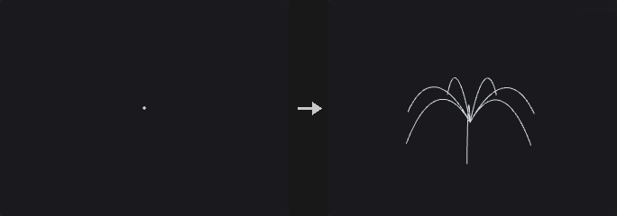

Each selected point becomes the start of a ballistic trajectory under constant gravity with optional linear air drag (an analytic solution, not a simulation). The result is one open polyline per point, sampled at a fixed number of points.

In the *Free* launch method the initial velocity comes from a vector point attribute and the path runs for the given life. The two *Targeted* methods take points from the second input as targets, paired with the launch points by point number, and solve for the initial velocity: either for a given flight time, or for a given launch elevation angle. Launch points whose target is missing or cannot be reached with that angle are skipped and counted in the report.

Optionally the path is cut where it falls below a ground height measured along gravity, or at its first hit on the collision geometry (found by ray casting the path segments and refining the hit within the segment). The output carries the source point attributes on every path point, plus `time` and `v` (velocity) on points and `srcpoint` on primitives. The `report` output counts paths, unreachable targets, ground hits and collision hits.

**Inputs**

| Input | Type | Description |
|---|---|---|
| `geo` | GEOMETRY | Launch points. Each selected point starts one path. |
| `targets` *(optional)* | GEOMETRY | Target points for the two Targeted launch methods, paired with the launch points by point number. Not used by the Free method. |
| `collision` *(optional)* | GEOMETRY | Optional geometry that terminates a path at its first hit. |

**Outputs**

| Output | Type | Description |
|---|---|---|
| `geo` | GEOMETRY | The trajectory polylines. |
| `report` | STRING | Text summary: number of paths, unreachable targets, ground hits and collision hits. |

**Parameters**

*General*

| Parameter | Type | Default | Description |
|---|---|---|---|
| Group `group` | string | *(empty)* | Point group pattern selecting which points launch a projectile. Empty means all points. |
| Launch Method `mode` | menu | Free (Velocity Attribute) | *Free* uses the velocity attribute; *Targeted: Life* solves the initial velocity so the projectile reaches its target after the given flight time; *Targeted: Initial Angle* fixes the launch elevation angle and solves speed and flight time to reach the target (unreachable targets are skipped). Options: Free (Velocity Attribute) (`velocity`), Targeted: Life (`target_time`), Targeted: Initial Angle (`target_angle`). |
| Velocity Attribute `v_attribute` | string | `v` | Name of the vector point attribute holding the initial velocity. *Hidden when mode ≠ velocity.* |
| Life `duration` | float [0.0..] | 2 | Length of the flight in seconds for the Free method (a ground or collision hit can shorten it). *Hidden when mode ≠ velocity.* |
| Life `flight_time` | float [0.0..] | 1 | Time in seconds the projectile takes to reach its target. Must be greater than zero. *Hidden when mode ≠ target_time.* |
| Initial Angle `launch_angle` | float [-89.0..89.0] | 45 | Elevation angle in degrees above the horizontal plane (perpendicular to gravity) used to solve for the launch velocity. *Hidden when mode ≠ target_angle.* |

*Projectile Properties*

| Parameter | Type | Default | Description |
|---|---|---|---|
| Drag `drag` | float [0.0..100.0] | 0 | Linear air drag coefficient. Zero gives a pure parabola. |
| Gravity `gravity_x` `gravity_y` `gravity_z` | float | 0, -9.8, 0 | Gravity acceleration vector. It also defines the horizontal plane and the ground direction, so it must not be zero. |
| Points per Path `samples` | int [2..] | 32 | Number of points on each path. Houdini derives this from FPS times duration; here you set it directly. |

*Basic Collision*

| Parameter | Type | Default | Description |
|---|---|---|---|
| Clip Below Height `ground_height` | float | 0 | Height along the gravity direction below which the path is cut; the end point lands exactly on this height. Only used when Ground is on. |
| Ground `ground` | toggle | off | Cuts each path where it crosses the ground height. |

**Compared with Houdini**

The number of path points is set directly (Points per Path) instead of FPS times life. Air drag is linear and solved analytically.

**Tips**

- With collision connected, the path is cut at the first hit even when Ground is off.

---

### Box (PCG)

`PCG_Box` · category `PCG/generate` · Houdini: Box (SOP)

Creates a box as polygons or as a lattice of points.

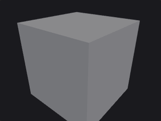

Generates an axis-aligned box of the given size, then applies the rotation and uniform scale around its center. With *Axis Divisions* of 2 on each axis every face is one quad, as in Houdini; larger values add points along that axis.

**Outputs**

| Output | Type | Description |
|---|---|---|
| `geo` | GEOMETRY | The generated box. |

**Parameters**

| Parameter | Type | Default | Description |
|---|---|---|---|
| Primitive Type `prim_type` | menu | Polygon | *Polygon* builds the faces. *Points* outputs only the lattice points on the shell, with no faces. Options: Polygon (`polygon`), Points (`points`). |
| Size `size_x` `size_y` `size_z` | float [0.0..] | 1, 1, 1 | Box size along X, Y and Z. |
| Center `cx` `cy` `cz` | float | 0, 0, 0 | Center of the box. |
| Rotate `rx` `ry` `rz` | float [-3600..3600] | 0, 0, 0 | Rotation of the box in degrees (X, Y, Z). |
| Uniform Scale `uniform_scale` | float [0.0..] | 1 | Scale applied to the whole box in addition to Size. |
| Axis Divisions `div_x` `div_y` `div_z` | int [2..512] | 2, 2, 2 | Number of points along each axis (X, Y, Z). 2 means one quad per face, matching Houdini. |

---

### Circle (PCG)

`PCG_Circle` · category `PCG/generate` · Houdini: Circle (SOP)

Creates a circle, ellipse or arc as a polygon or a curve.

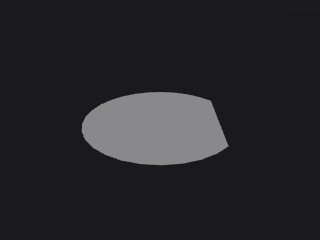

Generates a circle with two radii (so ellipses are possible) lying in the chosen plane, then applies an optional Euler rotation, the uniform scale and the center offset. Circles are often used as Sweep cross sections or PolyExtrude inputs, which is why the output winding can be reversed: with the wrong direction all normals point inward.

The arc options turn the circle into an arc: an open arc, a closed arc (arc plus a chord), or a sliced arc (arc plus two radii back to the center, a pie slice).

**Outputs**

| Output | Type | Description |
|---|---|---|
| `geo` | GEOMETRY | The generated circle or arc. |

**Parameters**

| Parameter | Type | Default | Description |
|---|---|---|---|
| Primitive Type `prim_type` | menu | Polygon | Output type: a polygon, a NURBS curve or a Bezier curve. Options: Polygon (`polygon`), NURBS Curve (`nurbs_curve`), Bezier Curve (`bezier_curve`). |
| Orientation `orientation` | menu | XY Plane | The plane the circle lies in before the rotation is applied. Options: XY Plane (`xy`), YZ Plane (`yz`), ZX Plane (`zx`). |
| Reverse Output `reverse` | toggle | off | Reverses the winding direction of the output. |
| Radius `radius_x` `radius_y` | float [0.0..] | 1, 1 | Radii along the two axes of the plane. Different values give an ellipse. |
| Center `cx` `cy` `cz` | float | 0, 0, 0 | Center of the circle. |

*Rotate*

| Parameter | Type | Default | Description |
|---|---|---|---|
| Use Rotate `use_rotate` | toggle | off | Enables the Rotate parameter. |
| Rotate `rx` `ry` `rz` | float [-3600..3600] | 0, 0, 0 | Euler rotation in degrees applied after the orientation. |

| Parameter | Type | Default | Description |
|---|---|---|---|
| Uniform Scale `uniform_scale` | float [0.0..] | 1 | Uniform scale applied to the whole circle. |
| Divisions `divisions` | int [3..4096] | 12 | Number of points around the circle. Curve output is converted from this polygon. |

*Spline*

| Parameter | Type | Default | Description |
|---|---|---|---|
| Use Spline `use_spline` | toggle | off | Enables the Order parameter for curve output. When off, curves use order 4. *Hidden when prim_type = polygon.* |
| Order `order` | int [2..11] | 4 | Order of the NURBS or Bezier curve. Used only when Use Spline is on and the primitive type is a curve. *Hidden when prim_type = polygon.* |

*Arc*

| Parameter | Type | Default | Description |
|---|---|---|---|
| Use Arc `use_arc` | toggle | off | Turns the circle into an arc. |
| Arc Type `arc_type` | menu | Open Arc | *Open Arc* is a plain open curve; *Closed Arc* closes it with a chord; *Sliced Arc* closes it with two radii through the center. Options: Open Arc (`open_arc`), Closed Arc (`closed_arc`), Sliced Arc (`sliced_arc`). |
| Arc Angles `arc_start` `arc_end` | float [-3600..3600] | 0, 360 | Start and end angle of the arc in degrees. |

---

### Cross Section Surface (PCG)

`PCG_CrossSectionSurface` · category `PCG/generate`

Builds a smooth Gordon surface through a net of section and guide curves.

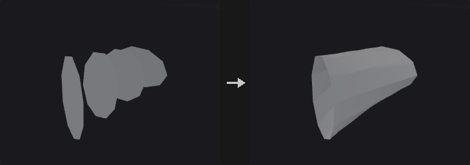

Weaves the *sections* curves and the optional *guides* curves into a net and builds a Gordon surface: the two curve families are each lofted, the results are added, and the tensor-product interpolation at the intersections is subtracted. The surface passes exactly through every curve in the net. Without guides it is simply a loft along the sections.

If the curves are closed the surface is closed in that direction. The output is a quad mesh with a point `uv` attribute.

**Inputs**

| Input | Type | Description |
|---|---|---|
| `sections` | GEOMETRY | Curves forming the first family (cross sections). |
| `guides` *(optional)* | GEOMETRY | Optional curves crossing the sections. Without them the node lofts along the sections. |

**Outputs**

| Output | Type | Description |
|---|---|---|
| `geo` | GEOMETRY | The quad mesh surface. |
| `report` | STRING | Text summary of the operation. |

**Parameters**

| Parameter | Type | Default | Description |
|---|---|---|---|
| Cross Section Group `group` | string | *(empty)* | Primitive group pattern selecting which curves of the sections input are used. |
| Interpolation `interpolation` | menu | Cubic (Catmull-Rom) | *Cubic (Catmull-Rom)* gives a smooth surface; *Linear* interpolates piecewise linearly. Options: Cubic (Catmull-Rom) (`cubic`), Linear (`linear`). |
| Divisions `divisions_s` `divisions_t` | int [1..1024] | 8, 8 | Subdivisions of the output. The first value is per segment along a section; the second is per segment between sections. |

**Compared with Houdini**

Different from the Houdini node: this one resamples and interpolates a Gordon surface from two curve families. The node 'Cross Section Surface · Houdini' follows Houdini's behaviour of connecting existing points.

---

### Cross Section Surface · Houdini (PCG)

`PCG_CrossSectionSurfaceHou` · category `PCG/generate` · Houdini: Cross Section Surface (SOP)

Skins a surface through cross-section curves using their existing points, like Houdini's Cross Section Surface.

Follows Houdini's behaviour: like a Sweep with only cross sections. Each cross-section curve is one row of the grid and its c-th point is column c. The surface is built from the existing points of the curves, with no resampling or interpolation, so all cross sections must have the same number of points (otherwise the node errors). If the cross sections are closed the result is a tube; with *Close Implicit Backbone Curve* the last section also connects back to the first.

*Surface Type* chooses what is built over the grid: points, rows, columns, both, quads or several triangulations. End caps can be a single polygon, a grid (hemisphere, cone or dish shaped via Scale and Roundness) or, for closed backbones, a side polygon. Single Polygon and Grid caps need closed cross sections and an open backbone; Side Single Polygon needs a closed backbone and open cross sections.

UVs can be computed with the same switches as Houdini (length weighting, normalization, seamless wrapping, flipping, scaling); on polygon output they are stored on vertices. Row/column numbers and the cross-section number can be written to attributes whose names you set; an empty name writes nothing.

**Inputs**

| Input | Type | Description |
|---|---|---|
| `geo` | GEOMETRY | Curves to use as cross sections, in primitive order. |

**Outputs**

| Output | Type | Description |
|---|---|---|
| `geo` | GEOMETRY | The skinned surface, plus end caps if requested. |
| `report` | STRING | Text summary of the operation. |

**Parameters**

| Parameter | Type | Default | Description |
|---|---|---|---|
| Reverse Cross Sections `reverse_cross_sections` | toggle | off | Reverses the point order of the cross sections, which flips the surface orientation. |
| End Cap Type `end_cap_type` | menu | None | *None* leaves the ends open. *Single Polygon* closes each end with one n-gon. *Grid* fills each end with a grid that can be domed or dished. *Side Single Polygon* caps the open seam of a closed backbone. Options: None (`none`), Single Polygon (`single_polygon`), Grid (`grid`), Side Single Polygon (`side_single_polygon`). |
| Cap Divisions `cap_divisions` | int [1..1000] | 3 | Number of divisions of the grid end caps. *Hidden when end_cap_type ≠ grid.* |
| Triangular Poles `triangular_poles` | toggle | off | Uses triangles at the pole of the grid cap instead of quads. *Hidden when end_cap_type ≠ grid.* |
| End Cap Scale `end_cap_scale` | float | 1 | How far the pole of the cap is lifted out, as a multiple of the bounding-circle radius of the end section. Negative values dish the cap inward. *Hidden when end_cap_type ≠ grid.* |
| End Cap Roundness `end_cap_roundness` | float [-10.0..10.0] | 1 | 0 gives a pointed cone, 1 a round quarter-circle profile; negative values reverse the curvature. *Hidden when end_cap_type ≠ grid.* |
| End Caps Group `end_caps_group` | string | *(empty)* | Name of the primitive group created for the end caps. Empty means no group is made. *Hidden when end_cap_type = none.* |
| Ensure Unique Seam Vertices `unique_seam_vertices` | toggle | off | Gives closed row or column curves an extra vertex at the seam so that u = 0 and u = 1 are separate. Only available for Rows, Columns and Rows and Columns surface types. *Disabled when surface_type ≠ rows surface_type ≠ columns surface_type ≠ rows_and_columns.* |
| Swap Rows and Columns `swap_rows_cols` | toggle | off | Swaps the roles of rows and columns, so the cross sections become columns. |
| Close Implicit Backbone Curve `close_backbone` | toggle | off | Connects the last cross section back to the first, closing the surface along the backbone. |
| Override Any Existing UVs `override_uvs` | toggle | off | When off, an existing point attribute `uv` on open cross sections is carried over for U instead of being recomputed. *Disabled when compute_uvs is off.* |
| Length-Weighted UVs `length_weighted_uvs` | toggle | on | Spaces the computed UVs by curve length instead of evenly by point index. *Disabled when compute_uvs is off.* |
| Normalize Computed Us `normalize_u` | toggle | on | Normalizes the computed U coordinates to 0..1. *Disabled when compute_uvs is off.* |
| Normalize Computed Vs `normalize_v` | toggle | off | Normalizes the computed V coordinates to 0..1. *Disabled when compute_uvs is off.* |
| Make Computed Us Wrap Seamlessly `wrap_u` | toggle | on | Rounds the computed U range so it wraps seamlessly. Unavailable when U is normalized. *Disabled when compute_uvs is off } { normalize_u is on.* |
| Make Computed Vs Wrap Seamlessly `wrap_v` | toggle | on | Rounds the computed V range so it wraps seamlessly. Unavailable when V is normalized. *Disabled when compute_uvs is off } { normalize_v is on.* |
| Use Max Cross Section Length for Proportional Scale `use_max_length` | toggle | off | Uses the longest cross section as the common length for proportional UV scale. Only applies when U is normalized and V is not. *Disabled when compute_uvs is off } { normalize_u is off } { normalize_v is on.* |
| Flip Computed Us `flip_u` | toggle | on | Flips the computed U coordinates. *Disabled when compute_uvs is off.* |
| UV Scale `uv_scale_u` `uv_scale_v` | float | 1, 1 | Scale applied to the computed U and V coordinates. *Disabled when compute_uvs is off.* |
| Point Row Attribute `point_row_attrib` | string | *(empty)* | Name of a point attribute that receives the row number. Empty means not written. |
| Point Col Attribute `point_col_attrib` | string | *(empty)* | Name of a point attribute that receives the column number. Empty means not written. |
| Prim Row Attribute `prim_row_attrib` | string | *(empty)* | Name of a primitive attribute that receives the row number. Empty means not written. |
| Prim Col Attribute `prim_col_attrib` | string | *(empty)* | Name of a primitive attribute that receives the column number. Empty means not written. |
| Cross Section Num Attribute `cross_section_num_attrib` | string | *(empty)* | Name of an attribute that receives the number of the cross section. Empty means not written. |

*Cross Section*

| Parameter | Type | Default | Description |
|---|---|---|---|
| Cross Section Group `group` | string | *(empty)* | Primitive group pattern selecting which curves are used as cross sections. Empty means all. |

*Surface*

| Parameter | Type | Default | Description |
|---|---|---|---|
| Surface Type `surface_type` | menu | Quadrilaterals | What to build over the grid of points: only points, row curves, column curves, both, or a quad or triangle mesh. The triangle options differ in how each quad is split (alternating or reversed diagonals). Options: Points (`points`), Rows (`rows`), Columns (`columns`), Rows and Columns (`rows_and_columns`), Triangles (`triangles`), Quadrilaterals (`quads`), Alternating Triangles (`alt_triangles`), Reverse Triangles (`reverse_triangles`). |

*UV Coordinates*

| Parameter | Type | Default | Description |
|---|---|---|---|
| Compute UVs `compute_uvs` | toggle | off | Computes UV coordinates for the surface. The other UV options apply only when this is on. |

*Attributes*

| Parameter | Type | Default | Description |
|---|---|---|---|
| From Cross Sections `from_cross_sections` | string | `*` | Attribute pattern naming which attributes to copy from the cross sections. Point attributes are taken from the source points; primitive attributes from the cross section of that row. |

**Compared with Houdini**

Matches the Houdini node. The separate node *Cross Section Surface (PCG)* is a different algorithm (Gordon surface with resampling and interpolation).

---

### Curve (PCG)

`PCG_Curve` · category `PCG/generate` · Houdini: Curve (SOP)

A curve drawn in the viewport, like Houdini's Curve SOP.

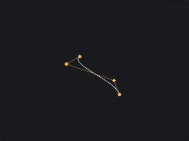

Select the node and draw in the viewport: click to add points, drag points to move them, Ctrl + click a segment to insert a point, Delete over a point to remove it, and click the first point to close the curve. Points land on the displayed geometry when the click hits it, otherwise on a construction plane (see [Drawing curves](../concepts/viewing-and-export.md#drawing-curves)).

The points are stored as text in **Points**, one `x, y, z` per line, so the curve is saved with the workflow and can be edited by hand. Houdini's coordinate style `x,y,z x,y,z` on one line and `;` as a separator are also accepted; missing components are 0.

With fewer than two points the output is just the point (or nothing). **Close Curve** needs at least three points.

**Outputs**

| Output | Type | Description |
|---|---|---|
| `geo` | GEOMETRY | The curve. |

**Parameters**

| Parameter | Type | Default | Description |
|---|---|---|---|
| Primitive Type `prim_type` | menu | Polygon | *Polygon*: a polyline, or a closed polygon with Close Curve. *NURBS*: the points are control points of a clamped uniform NURBS curve. *Bezier*: the points are control points of a piecewise Bezier curve; if their number does not fit whole segments they are resampled by chord length, as in Convert. Options: Polygon (`polygon`), NURBS (`nurbs`), Bezier (`bezier`). |
| Close Curve `closed` | toggle | off | Close the curve. For NURBS and Bezier the curve returns to its first point (the knot vector stays clamped, it is not made periodic). |
| Reverse `reverse` | toggle | off | Reverse the point order. |
| Order `order` | int [2..11] | 4 | Order of the NURBS / Bezier curve (4 = cubic), clamped to the number of points. *Hidden when prim_type = polygon.* |
| Points `points` | string | *(empty)* | The curve's points, one `x, y, z` per line. Written by the viewport drawing tool. |

**Compared with Houdini**

Covers Curve SOP's drawing, moving, inserting, deleting and closing, with Polygon, NURBS and Bezier primitive types. Tangent handles, per-point weights, the Bezier sub-modes (corner / smooth) and editing several curves in one node are not implemented. The points are kept as text in a parameter, like the old Curve SOP's Coordinates.

---

### Extract Silhouette (PCG)

`PCG_ExtractSilhouette` · category `PCG/generate` · Houdini: Extract Silhouette (SOP)

Extracts the silhouette of a mesh as projected outlines or as a contour on the surface.

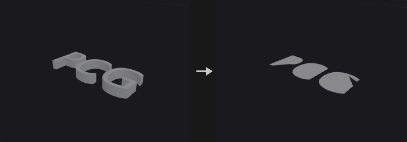

*Projected Outline* projects the geometry along Direction onto the plane through Origin and computes the exact boundary of the projected area (candidate silhouette edges are intersected and clipped, and segments are kept based on coverage on both sides). The result is closed polylines, with outer loops counter-clockwise and holes clockwise, carrying the primitive attributes `hole` and `area`.

*Contour on Mesh* finds the boundary of the front-facing region on the mesh itself and leaves it in 3D.

**Inputs**

| Input | Type | Description |
|---|---|---|
| `geo` | GEOMETRY | Mesh to take the silhouette of. |

**Outputs**

| Output | Type | Description |
|---|---|---|
| `geo` | GEOMETRY | The silhouette curves. |
| `report` | STRING | Text summary of the operation. |

**Parameters**

| Parameter | Type | Default | Description |
|---|---|---|---|
| Group `group` | string | *(empty)* | Primitive group pattern limiting which primitives take part. Empty means all. |
| Mode `mode` | menu | Projected Outline | *Projected Outline* flattens onto a plane; *Contour on Mesh* stays on the surface in 3D. Options: Projected Outline (`outline`), Contour on Mesh (`contour`). |
| Direction `direction_x` `direction_y` `direction_z` | float | 0, -1, 0 | Viewing direction. |
| Origin `origin_x` `origin_y` `origin_z` | float | 0, 0, 0 | A point on the projection plane (Projected Outline only). *Hidden when mode = contour.* |
| Remove Inline Points `simplify` | toggle | on | Removes points lying on a straight line between their neighbors (Projected Outline only). *Hidden when mode = contour.* |
| Include Unshared Edges `include_boundary` | toggle | on | Also includes unshared edges (open mesh borders) in the contour (Contour on Mesh only). *Hidden when mode = outline.* |

---

### Font (PCG)

`PCG_Font` · category `PCG/generate` · Houdini: Font (SOP)

Creates text geometry from a TrueType or OpenType font as outlines, faces or extruded solids.

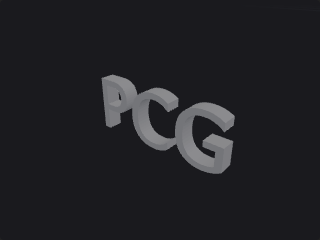

Reads vector glyph outlines from a ttf, otf or ttc font file and builds the text in the XY plane facing +Z. *Outline* gives closed contours (with a `hole` primitive attribute), *Faces* fills them with a constrained Delaunay triangulation that keeps holes, and *Extruded* adds a back face and side walls to make a watertight solid. Primitives carry `char`, `char_index` and `line` attributes.

The Font field accepts a path, a file name (e.g. `arial`, `msyh`) or a family name; empty uses arial or DejaVuSans. Characters missing from the main font are looked up in the fallback fonts in order. Size is the em height.

**Outputs**

| Output | Type | Description |
|---|---|---|
| `geo` | GEOMETRY | The text geometry. |
| `report` | STRING | Text summary of the operation, including font resolution. |

**Parameters**

| Parameter | Type | Default | Description |
|---|---|---|---|
| Type `mode` | menu | Faces | *Outline* is closed contours only; *Faces* is a filled flat mesh; *Extruded* is a closed solid with front, back and side walls. Options: Outline (`outline`), Faces (`faces`), Extruded (`extrude`). |
| Font File `font` | string | *(empty)* | Font path, file name or family name. Empty uses arial or DejaVuSans. |
| Text `text` | string | `PCG` | The text to generate. Line breaks start new lines. |
| Horizontal Alignment `halign` | menu | Left | Horizontal alignment of the lines relative to the origin. Options: Left (`left`), Center (`center`), Right (`right`). |
| Vertical Alignment `valign` | menu | Baseline | Vertical alignment relative to the origin: at the baseline of the first line, or the top, center or bottom of the text block. Options: Baseline (`baseline`), Top (`top`), Center (`center`), Bottom (`bottom`). |
| Font Size `size` | float [0.0..] | 1 | Font size, the em height. |
| Tracking `tracking` | float [-1.0..10.0] | 0 | Extra spacing between characters. |
| Line Spacing `line_spacing` | float [0.0..10.0] | 1 | Multiplier for the distance between lines. |
| Curve Segments `curve_segments` | int [1..64] | 6 | Number of line segments each quadratic or cubic Bezier segment of the glyph outline is split into (Houdini's Level of Detail). |
| Extrude Depth `depth` | float [0.0..] | 0.2 | Extrusion depth. Only used in Extruded mode. *Hidden when mode ≠ extrude.* |
| Fallback Fonts `fallback` | string | *(see panel)* | Space-separated font names tried in order for characters the main font lacks. |

---

### Grid (PCG)

`PCG_Grid` · category `PCG/generate` · Houdini: Grid (SOP)

Creates a flat grid of points, polygons or lines.

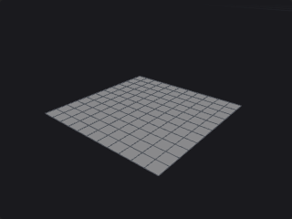

Generates a rectangular grid in the chosen plane, then rotates and translates it. *Rows* and *Columns* count points, not cells, as in Houdini, so 21 x 21 gives 20 x 20 quads. Connectivity selects between quads, two triangle layouts, lines along rows and/or columns, or points only.

**Outputs**

| Output | Type | Description |
|---|---|---|
| `geo` | GEOMETRY | The generated grid. |

**Parameters**

| Parameter | Type | Default | Description |
|---|---|---|---|
| Connectivity `connectivity` | menu | Quadrilaterals | *Rows* and *Columns* make one polyline per row or column; *Alternating Triangles* flips the diagonal from cell to cell; *Points* outputs only points. Options: Quadrilaterals (`quadrilaterals`), Rows (`rows`), Columns (`columns`), Rows and Columns (`rows_and_columns`), Triangles (`triangles`), Alternating Triangles (`alternating_triangles`), Points (`points`). |
| Orientation `plane` | menu | ZX Plane | The plane in which the grid lies before rotation. Options: ZX Plane (`zx`), XY Plane (`xy`), YZ Plane (`yz`). |
| Size `size_x` `size_z` | float [0.001..] | 10, 10 | Grid size. The first value is the column direction and the second the row direction: X / Z on the ZX plane, X / Y on the XY plane, Z / Y on the YZ plane. |
| Center `center_x` `center_y` `center_z` | float | 0, 0, 0 | Center of the grid. |
| Rotate `rx` `ry` `rz` | float [-3600..3600] | 0, 0, 0 | Rotation in degrees (X, Y, Z). |
| Rows `rows` | int [2..4096] | 21 | Number of points in the row direction (not cells). |
| Columns `cols` | int [2..4096] | 21 | Number of points in the column direction (not cells). |

---

### IsoOffset (PCG)

`PCG_IsoOffset` · category `PCG/generate` · Houdini: IsoOffset (SOP)

Converts geometry to an offset isosurface, an SDF volume or a fog volume.

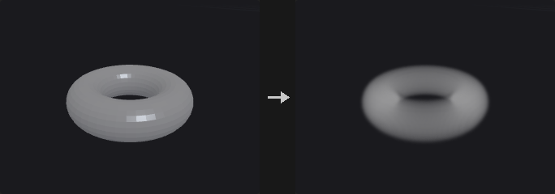

Samples the distance to the input geometry on a grid and outputs the isosurface at the given offset, or the field as a volume. *Ray Intersect* computes an exact signed distance (sign from pseudo-normals and flood fill, not rays); *Minimum* gives an unsigned distance; the other modes use point clouds or implicit boxes and spheres.

The grid is defined by the sampling options and the bounds, which are the bounding box of the input, the bounding box of the optional bound input, or user values. Note that division counts are grid points; in Houdini they are voxels.

**Inputs**

| Input | Type | Description |
|---|---|---|
| `geo` | GEOMETRY | Geometry to offset. |
| `bound` *(optional)* | GEOMETRY | Optional geometry whose bounding box defines the sampling bounds. |

**Outputs**

| Output | Type | Description |
|---|---|---|
| `geo` | GEOMETRY | The isosurface mesh or the volume. |

**Parameters**

| Parameter | Type | Default | Description |
|---|---|---|---|
| Output `output` | menu | Iso Surface | *Iso Surface* outputs a polygon surface; *Fog Volume* and *SDF Volume* output a volume. Options: Iso Surface (`iso_surface`), Fog Volume (`fog`), SDF Volume (`sdf`). |
| Mode `mode` | menu | Ray Intersect | How distance is computed. *Ray Intersect*: exact signed distance. *Minimum*: unsigned distance. *Point Cloud*: treats the input as points. *Implicit Box* / *Implicit Sphere*: uses a box or sphere as the implicit shape. Options: Ray Intersect (`ray_intersect`), Minimum (`minimum`), Point Cloud (`point_cloud`), Implicit Box (`implicit_box`), Implicit Sphere (`implicit_sphere`). |
| Name `name` | string | *(empty)* | Name of the output volume. Not used for polygon output. *Hidden when output = iso_surface.* |
| Uniform Sampling `uniform_sampling` | menu | Max Axis+Divs | How the grid resolution is chosen: a number of grid points along the longest or a specific axis, a voxel size, or separate counts for each axis. Options: Max Axis+Divs (`max_axis`), X Axis+Divs (`x_axis`), Y Axis+Divs (`y_axis`), Z Axis+Divs (`z_axis`), By Size (`by_size`), Non Uniform (`non_uniform`). |
| Uniform Sampling Divs `uniform_divs` | int [2..1024] | 30 | Number of grid points along the axis chosen by Uniform Sampling (not voxels). *Hidden when uniform_sampling = by_size } { uniform_sampling = non_uniform.* |
| Sampling Divs `divs_x` `divs_y` `divs_z` | int [2..1024] | 30, 30, 30 | Number of grid points along X, Y and Z for non-uniform sampling. *Hidden when uniform_sampling ≠ non_uniform.* |
| Div Size `div_size` | float [1e-06..] | 0.1 | Voxel edge length for sampling by size. *Hidden when uniform_sampling ≠ by_size.* |
| Override Bounds `override_bounds` | toggle | off | Uses the Minimum and Maximum Bound instead of the bounds of the input. Use the bound input otherwise if connected. |
| Minimum Bound `min_x` `min_y` `min_z` | float | -1, -1, -1 | Lower corner of the overridden bounds. *Disabled when override_bounds is off.* |
| Maximum Bound `max_x` `max_y` `max_z` | float | 1, 1, 1 | Upper corner of the overridden bounds. *Disabled when override_bounds is off.* |
| Pad Bounds `pad_bounds` | toggle | off | Grows the bounds so the offset surface is not clipped. |
| Offset `offset` | float | 0 | Distance of the isosurface from the input; positive grows outward. |
| Invert Sign `invert_sign` | toggle | off | Flips the sign of the field, swapping inside and outside. |

**Compared with Houdini**

Division counts are numbers of grid points rather than voxels. The Convert node's volume SDF and fog modes are unchanged and separate.

---

### IsoSurface (PCG)

`PCG_IsoSurface` · category `PCG/generate` · Houdini: IsoSurface (SOP)

Extracts a polygon surface or volume from an implicit function evaluated on a grid.

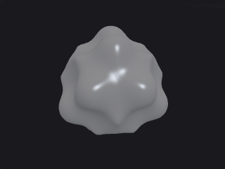

Evaluates the implicit function (wrangle syntax: `@P`, `@P.x`; `$X $Y $Z` are also accepted) at the grid points of the bounding box and extracts the surface where the function equals the Iso Value, using surface nets (quads, positive outside and negative inside). *Project to Isosurface* then refines each vertex onto the true isosurface with Newton iterations along the numerical gradient, and *Compute Normals* writes `N` from the gradient. The volume output outputs the sampled field directly.

**Outputs**

| Output | Type | Description |
|---|---|---|
| `geo` | GEOMETRY | The extracted surface or volume. |
| `report` | STRING | Text summary of the operation. |

**Parameters**

| Parameter | Type | Default | Description |
|---|---|---|---|
| Implicit Function `expression` | string | `length(@P) - 1` | The implicit function. Surfaces appear where it equals the Iso Value; positive values are outside. |
| Iso Value `iso` | float | 0 | The value of the function that defines the surface. |
| Min Bound `bound_min_x` `bound_min_y` `bound_min_z` | float | -1.5, -1.5, -1.5 | Lower corner of the box in which the function is evaluated. |
| Max Bound `bound_max_x` `bound_max_y` `bound_max_z` | float | 1.5, 1.5, 1.5 | Upper corner of the evaluation box. |
| Divisions `divisions_x` `divisions_y` `divisions_z` | int [1..1024] | 48, 48, 48 | Number of grid divisions along X, Y and Z. Higher values give more detail and more cost. |
| Output Type `output` | menu | Polygons | *Polygons* extracts a quad mesh; *Volume* outputs the sampled field. Options: Polygons (`polygons`), Volume (`volume`). |
| Project to Isosurface `project` | toggle | on | Moves vertices onto the exact isosurface using Newton iteration on the numerical gradient. *Hidden when output = volume.* |
| Compute Normals `normals` | toggle | on | Writes `N` from the gradient of the function. *Hidden when output = volume.* |

---

### L-System (PCG)

`PCG_LSystem` · category `PCG/generate` · Houdini: L-System (SOP)

Grows a branching structure by rewriting a premise string with rules and drawing it with a 3D turtle.

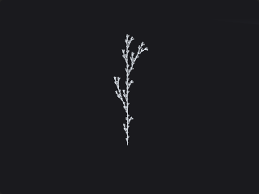

The premise is rewritten for the given number of generations using the rules, then the resulting string is interpreted by a 3D turtle to produce lines. Rules are one per line, e.g. `F=F[+F]F[-F]F`. Writing several rules for the same character and prefixing each with a weight in parentheses makes them stochastic.

Turtle symbols: `F` draws a line, `f` moves without drawing, `+` `-` turn left/right, `&` `^` pitch down/up, `\` `/` roll, `|` turns around, `[` `]` open and close a branch, `!` makes the line thinner, `"` makes it shorter, and `J K L M` place leaf points. Leaf points are added to the point group `leaves` and carry `N`, `up`, `orient` and `name`.

Points carry `width`, `generation` (the generation in which the segment appeared) and `depth`. If the rewritten string grows beyond Max Symbols the node raises an error instead of truncating.

**Outputs**

| Output | Type | Description |
|---|---|---|
| `geo` | GEOMETRY | The branch curves and leaf points. |
| `report` | STRING | Text summary of the operation. |

**Parameters**

*Geometry*

| Parameter | Type | Default | Description |
|---|---|---|---|
| Generations `generations` | int [0..30] | 4 | How many times the rules are applied to the premise. |
| Step Size `step` | float [0.0..] | 1 | Length of an `F` step. |
| Step Size Scale `step_scale` | float [0.0..10.0] | 0.9 | Factor by which the step length is multiplied by each `"` symbol. |
| Thickness `width` | float [0.0..] | 0.1 | Initial line thickness, written to the `width` attribute. |
| Thickness Scale `width_scale` | float [0.0..10.0] | 0.7 | Factor by which the thickness is multiplied by each `!` symbol. |
| Angle `angle` | float [-360.0..360.0] | 25.7 | Turning angle in degrees used by the turn, pitch and roll symbols. |
| Variance `angle_variance` | float [0.0..180.0] | 0 | Maximum random offset in degrees added to every turn. |
| Gravity `gravity` | float [-10.0..10.0] | 0 | Bends branches downward; larger values make them droop more. |
| Random Seed `rand_seed` | int [0..] | 0 | Seed for stochastic rules and angle variance. |
| Max Symbols `max_symbols` | int [1..] | 2000000 | Upper limit on the rewritten string length; exceeding it is an error. |

*Rules*

| Parameter | Type | Default | Description |
|---|---|---|---|
| Premise `premise` | string | `F` | The starting string. |
| Rules `rules` | string | `F=F[+F]F[-F]F` | One rewrite rule per line in the form `X=replacement`. Several rules for the same character with a leading `(weight)` are chosen randomly in proportion to their weights. |

---

### Line (PCG)

`PCG_Line` · category `PCG/generate` · Houdini: Line (SOP)

Creates a straight line with evenly spaced points.

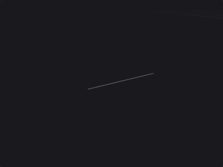

Generates a polyline starting at Origin, running along Direction for the given Length, with the given number of points.

**Outputs**

| Output | Type | Description |
|---|---|---|
| `geo` | GEOMETRY | The generated line. |

**Parameters**

| Parameter | Type | Default | Description |
|---|---|---|---|
| Origin `origin_x` `origin_y` `origin_z` | float | 0, 0, 0 | Start point of the line. |
| Direction `dx` `dy` `dz` | float | 0, 1, 0 | Direction of the line. |
| Length `length` | float [0.0..] | 1 | Length of the line. |
| Points `points` | int [2..] | 2 | Number of points on the line, at least 2. |

---

### Platonic Solids (PCG)

`PCG_PlatonicSolids` · category `PCG/generate` · Houdini: Platonic Solids (SOP)

Creates a Platonic solid or a soccer ball.

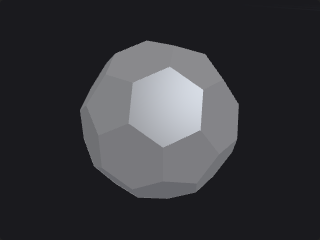

Generates a tetrahedron, cube, octahedron, dodecahedron, icosahedron or soccer ball (truncated icosahedron) with outward-facing faces and shared points (watertight). Radius is the circumscribed sphere radius. The primitive attribute `sides` stores the number of edges of each face (on the soccer ball, 5 for the black patches and 6 for the white ones). The octahedron and dodecahedron are built as duals, and the soccer ball by truncating the icosahedron at one third of each edge.

**Outputs**

| Output | Type | Description |
|---|---|---|
| `geo` | GEOMETRY | The generated solid. |

**Parameters**

| Parameter | Type | Default | Description |
|---|---|---|---|
| Solid Type `solid` | menu | Icosahedron | Which solid to create. Options: Tetrahedron (`tetrahedron`), Cube (`cube`), Octahedron (`octahedron`), Dodecahedron (`dodecahedron`), Icosahedron (`icosahedron`), Soccer Ball (`soccer_ball`). |
| Center `center_x` `center_y` `center_z` | float | 0, 0, 0 | Center of the solid. |
| Radius `radius` | float [0.0..] | 1 | Radius of the circumscribed sphere. |

---

### PolyLoft (PCG)

`PCG_PolyLoft` · category `PCG/generate` · Houdini: PolyLoft (SOP)

Connects existing curves into a surface or lines using their own points.

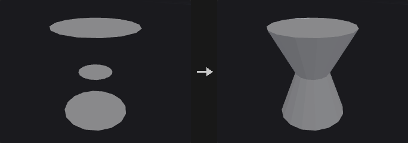

No points are created. *Faces* builds surfaces between adjacent curves: quads when the curves have the same number of points, otherwise triangles zippered by arc length. *Cross Lines* connects the i-th point of each curve into lines across the curves, and *Grid Lines* produces those lines plus the original curves. *Wrap Last to First* also connects the last curve to the first.

**Inputs**

| Input | Type | Description |
|---|---|---|
| `geo` | GEOMETRY | Curves to loft between, in primitive order. |

**Outputs**

| Output | Type | Description |
|---|---|---|
| `geo` | GEOMETRY | The lofted surface or lines. |
| `report` | STRING | Text summary of the operation. |

**Parameters**

| Parameter | Type | Default | Description |
|---|---|---|---|
| Group `group` | string | *(empty)* | Primitive group pattern selecting the curves to use. Empty means all. |
| Form `form` | menu | Faces | *Faces* creates polygons between the curves; *Cross Lines* creates polylines across them; *Grid Lines* creates a net of cross lines and original curves. Options: Faces (`faces`), Cross Lines (`cross_lines`), Grid Lines (`grid_lines`). |
| Wrap Last to First `wrap` | toggle | off | Connects the last curve back to the first. |
| Keep Original Primitives `keep_original` | toggle | on | Keeps the input curves in the output alongside the new primitives. Not used by Grid Lines, which always includes them. *Hidden when form = grid_lines.* |

---

### PolyWire (PCG)

`PCG_PolyWire` · category `PCG/generate` · Houdini: PolyWire (SOP), Wireframe (SOP)

Builds tubes along every edge of a curve network, with closed joints at branches.

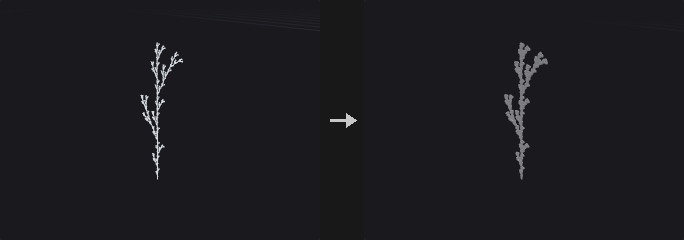

Puts a tube on every edge of the input's polylines and polygons. Unlike Sweep, which works one curve at a time, PolyWire treats the edges as a network: shared points are joined, so branching structures (trees, L-systems, wire frames, road graphs) come out as one connected set of tubes.

The network is cut into chains at ends and junctions; each chain gets a tube with rotation-minimising frames. Junctions and sharp bends get a sphere of the wire radius so branches have no gaps, and open ends get round or flat caps. The radius can come from point attributes (`width` as a diameter, `pscale` as a radius).

**Inputs**

| Input | Type | Description |
|---|---|---|
| `geo` | GEOMETRY | Curves and / or polygons whose edges get wires. |

**Outputs**

| Output | Type | Description |
|---|---|---|
| `geo` | GEOMETRY | The tubes. |
| `report` | STRING | Chains, joints and the size of the result. |

**Parameters**

| Parameter | Type | Default | Description |
|---|---|---|---|
| Group `group` | string | *(empty)* | Primitives whose edges get wires. |
| Wire Radius `radius` | float [0.0..] | 0.05 | Tube radius when Radius From is Wire Radius. *Disabled when radius_from ≠ constant.* |
| Radius From `radius_from` | menu | Wire Radius | Constant Wire Radius, or per point from `width` (diameter) or `pscale` (radius). Options: Wire Radius (`constant`), Point width (diameter) (`width`), Point pscale (radius) (`pscale`). |
| Divisions `divisions` | int [3..256] | 8 | Number of sides around each tube. |
| End Caps `end_caps` | menu | Round | How open ends are closed: Round (half sphere), Flat (a polygon) or not at all. Options: Round (`round`), Flat (`flat`), None (`none`). |
| Joint Spheres `joints` | toggle | on | Add spheres at junctions and sharp bends so the tubes meet without gaps. |
| Joint Angle `joint_angle` | float [0.0..180.0] | 45 | Bends sharper than this (in degrees) inside a chain also get a sphere. *Disabled when joints is off.* |
| Carry Point Attributes `carry_attributes` | toggle | on | Copy the curve's point attributes (such as Cd) to the tube points made from each curve point. |

---

### Revolve (PCG)

`PCG_Revolve` · category `PCG/generate` · Houdini: Revolve (SOP)

Spins a profile curve around an axis to create a surface of revolution.

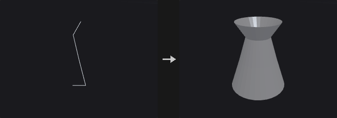

A full 360 degree revolution does not duplicate the first column of points. Profile points lying on the axis are placed only once, so a half circle becomes a sphere with a single point at each pole and triangles there, with no zero-area faces. A closed profile gives a torus-like surface. For partial revolutions, *End Caps* closes the profile at the ends. A profile drawn from bottom to top on the positive side of the axis produces outward normals; use Reverse Normals otherwise.

When a UV attribute name is given, `uv` is written with u as the fraction of the angle swept and v as the fraction of the profile arc length.

**Inputs**

| Input | Type | Description |
|---|---|---|
| `geo` | GEOMETRY | Profile curves to revolve. |

**Outputs**

| Output | Type | Description |
|---|---|---|
| `geo` | GEOMETRY | The surface of revolution. |

**Parameters**

| Parameter | Type | Default | Description |
|---|---|---|---|
| Group `group` | string | *(empty)* | Primitive group pattern selecting which curves are revolved. Empty means all. |
| Surface Type `surface` | menu | Quadrilaterals | Builds the surface from quads or from triangles. Options: Quadrilaterals (`quads`), Triangles (`triangles`). |
| Origin `origin_x` `origin_y` `origin_z` | float | 0, 0, 0 | A point on the revolution axis. |
| Direction `axis_x` `axis_y` `axis_z` | float [-1..1] | 0, 1, 0 | Direction of the revolution axis. |
| Start / End Angle `start_angle` `end_angle` | float [-3600..3600] | 0, 360 | Start and end angle of the revolution in degrees. 0 to 360 is a full turn. |
| Divisions `divisions` | int [1..4096] | 16 | Number of divisions around the axis. |
| End Caps `end_caps` | toggle | off | Closes the ends of the surface. Only has an effect when the revolution is less than 360 degrees and the profile is closed. |
| Reverse Normals `reverse` | toggle | off | Flips the surface normals. |
| UV Attribute `uv_attribute` | string | `uv` | Name of the UV attribute to write. Empty means no UVs are written. |

---

### Skin (PCG)

`PCG_Skin` · category `PCG/generate` · Houdini: Skin (SOP)

Skins a surface across a set of cross-section curves.

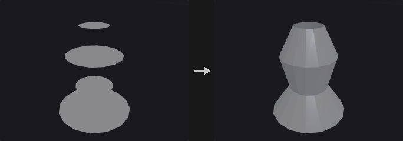

Cross sections are sorted by primitive number and a strip of faces is built between each adjacent pair; if the sections themselves are closed the surface also closes around in the U direction. Output can be polygons or a NURBS surface.

Unlike Houdini, which errors when the sections have different point counts, *Auto Resample* (on by default) aligns them automatically, since sections often come from different sources. Turn it off for Houdini's strict behaviour.

**Inputs**

| Input | Type | Description |
|---|---|---|
| `geo` | GEOMETRY | Cross-section curves. |

**Outputs**

| Output | Type | Description |
|---|---|---|
| `geo` | GEOMETRY | The skinned surface. |

**Parameters**

| Parameter | Type | Default | Description |
|---|---|---|---|
| Group `group` | string | *(empty)* | Primitive group pattern selecting which curves take part. Empty means all. |
| Output Type `output` | menu | Polygons | Polygon mesh or NURBS surface. Options: Polygons (`polygons`), NURBS Surface (`nurbs`). |
| Connectivity `connectivity` | menu | Quadrilaterals | Builds the polygon surface from quads or triangles. Options: Quadrilaterals (`quads`), Triangles (`triangles`). *Hidden when output = nurbs.* |
| V Wrap `v_wrap` | toggle | off | Connects the last section back to the first. *Hidden when output = nurbs.* |
| Keep Primitives `keep_primitives` | toggle | off | Keeps the input curves in the output. |

*Alignment*

| Parameter | Type | Default | Description |
|---|---|---|---|
| Auto Resample `auto_resample` | toggle | on | Resamples sections with different point counts so they line up. Houdini would raise an error. |
| Resample To `resample_to` | int [0..] | 0 | Point count to resample to. 0 uses the point count of the section that has the most points. |

*NURBS*

| Parameter | Type | Default | Description |
|---|---|---|---|
| Use NURBS Opts `use_nurbs_opts` | toggle | off | Enables the V Order parameter for NURBS output. *Hidden when output = polygons.* |
| V Order `v_order` | int [2..11] | 4 | Order of the NURBS surface in the V direction (across sections). *Hidden when output = polygons.* |

*Grouping*

| Parameter | Type | Default | Description |
|---|---|---|---|
| Use Every N `use_every_n` | toggle | off | Skin only every Nth section instead of all of them. |
| Skin Every N Sections `every_n` | int [2..4096] | 2 | Use every Nth section. |

**Compared with Houdini**

Auto Resample is an addition: Houdini requires all sections to have the same number of points.

---

### Sphere (PCG)

`PCG_Sphere` · category `PCG/generate` · Houdini: Sphere (SOP)

Creates a sphere as a latitude/longitude mesh or a subdivided icosahedron.

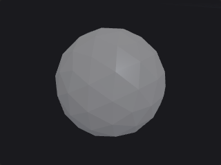

*Polygon Mesh* is a UV sphere with Rows by Columns points and a single point at each pole. *Polygon* is a subdivided icosahedron, whose triangles are uniform in size and which has no poles; each edge is split into Frequency segments for `20 * f^2` triangles. Radii can differ per axis for ellipsoids.

**Outputs**

| Output | Type | Description |
|---|---|---|
| `geo` | GEOMETRY | The generated sphere. |

**Parameters**

| Parameter | Type | Default | Description |
|---|---|---|---|
| Primitive Type `prim_type` | menu | Polygon Mesh | *Polygon Mesh* is a latitude/longitude sphere; *Polygon* is a subdivided icosahedron. Options: Polygon Mesh (`polygon_mesh`), Polygon (`polygon`). |
| Radius `radius_x` `radius_y` `radius_z` | float [0.0..] | 1, 1, 1 | Radius along X, Y and Z. |
| Center `center_x` `center_y` `center_z` | float | 0, 0, 0 | Center of the sphere. |
| Rotate `rx` `ry` `rz` | float [-3600..3600] | 0, 0, 0 | Rotation in degrees (X, Y, Z). |
| Uniform Scale `radius` | float [0.0..] | 1 | Uniform scale applied to the radii. |
| Orientation `orientation` | menu | Y Axis | The axis the poles point along. Options: Y Axis (`y`), X Axis (`x`), Z Axis (`z`). |
| Frequency `frequency` | int [1..64] | 2 | Number of segments per icosahedron edge, giving `20 * f^2` triangles. *Hidden when prim_type ≠ polygon.* |
| Rows `rows` | int [3..1024] | 16 | Number of points in the latitude direction, including the two poles. *Hidden when prim_type ≠ polygon_mesh.* |
| Columns `cols` | int [3..1024] | 24 | Number of points around the equator. *Hidden when prim_type ≠ polygon_mesh.* |

---

### Sweep (PCG)

`PCG_Sweep` · category `PCG/generate` · Houdini: Sweep (SOP)

Sweeps a cross section along backbone curves to make tubes, ribbons or custom profiles.

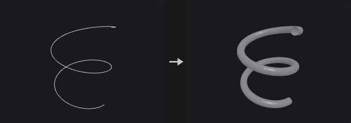

Each backbone curve gets a frame using rotation-minimizing frames, so the section does not twist at bends. The cross section's plane comes from its own principal axis, so sections from Circle, Carve and other nodes work whatever plane they were drawn in. Sections are either built in (round tube, square tube, ribbon) or taken from the second input.

At turns the section is stretched by `1/cos(half turn angle)` so the tube keeps its apparent thickness; Max Stretch limits this at sharp corners. Scale can vary from start to end of the curve and can follow the point `pscale`; rotation options add roll and twisting. Output can be faces, lines (rows or columns) or points. Rows, columns and points have no end caps.

**Inputs**

| Input | Type | Description |
|---|---|---|
| `backbone` | GEOMETRY | Curves to sweep along. |
| `cross` *(optional)* | GEOMETRY | Optional cross-section curves, used when Surface Shape is *Second Input Cross Sections*. |

**Outputs**

| Output | Type | Description |
|---|---|---|
| `geo` | GEOMETRY | The swept surface. |

**Parameters**

*Surface*

| Parameter | Type | Default | Description |
|---|---|---|---|
| Curve Group `group` | string | *(empty)* | Primitive group pattern selecting which backbone curves are swept. Empty means all. |
| Surface Shape `shape` | menu | Round Tube | Cross-section shape. *Second Input Cross Sections* uses a curve from the cross input; the other options are built in. Options: Round Tube (`round_tube`), Square Tube (`square_tube`), Ribbon (`ribbon`), Second Input Cross Sections (`second_input`). |
| Surface Type `surface_type` | menu | Quadrilaterals | What to build: faces (quads, triangles, alternating triangles), rows (one polyline loop per cross section), columns (polylines along the backbone), both, or points only. Options: Quadrilaterals (`quads`), Triangles (`triangles`), Alternating Triangles (`alternating_triangles`), Rows (`rows`), Columns (`columns`), Rows and Columns (`rows_and_columns`), Points (`points`). |
| Columns `cols` | int [3..512] | 8 | Number of points around a round tube. *Hidden when shape = square_tube } { shape = ribbon.* |
| Radius `radius` | float [0.0..] | 0.1 | Radius of the built-in section. Also used as a fallback round tube when Second Input is selected but no cross section is connected. |

*Surface › End Caps*

| Parameter | Type | Default | Description |
|---|---|---|---|
| End Caps `end_caps` | toggle | off | Closes the ends of the tube. |
| End Cap Type `end_cap_type` | menu | Single Polygon | *Single Polygon* is one n-gon per end. *Grid* fills the end with a quad grid; it needs an even number of section points, otherwise it falls back to a single polygon. Options: Single Polygon (`single_polygon`), Grid (`grid`). *Disabled when end_caps is off.* |
| End Cap Group `cap_group` | string | `endcaps` | Name of the primitive group that receives the end cap polygons. |

*Scale › Scale*

| Parameter | Type | Default | Description |
|---|---|---|---|
| Use Scale `use_scale` | toggle | off | Enables the scale options. |
| Scale Start / End `scale_start` `scale_end` | float [0.0..] | 1, 1 | Scale at the start and at the end of each backbone, interpolated by arc length. |
| Apply pscale Along Curve `use_pscale` | toggle | on | Multiplies the scale by the `pscale` point attribute of the backbone. This option is only read when Use Scale is on; with Use Scale off, `pscale` is always applied. |

*Rotation › Rotation*

| Parameter | Type | Default | Description |
|---|---|---|---|
| Use Rotation `use_rotation` | toggle | off | Enables the rotation options. |
| Up Vector `up_x` `up_y` `up_z` | float | 0, 1, 0 | Up vector used to orient the first frame. Needs Use Rotation. |
| Roll `roll` | float [-3600..3600] | 0 | Rotates the cross section around the backbone, in degrees. |
| Full Twists `full_twists` | float [-100..100] | 0 | Number of complete turns the section makes from start to end. |
| Partial Twist `partial_twist` | float [-3600..3600] | 0 | Additional twist from start to end, in degrees. |

*Cross Sections › Cross Section*

| Parameter | Type | Default | Description |
|---|---|---|---|
| Use Cross Opts `use_cross_opts` | toggle | off | Enables the cross section options. |
| Cross Section Group `cross_group` | string | *(empty)* | Primitive group pattern selecting which curve of the cross input to use (the first in the group). Needs Use Cross Opts. *Hidden when shape ≠ second_input.* |
| Reverse Cross Sections `reverse_cross` | toggle | off | Reverses the point order of the cross section, flipping the face orientation. Needs Use Cross Opts. |

*Cross Sections › Turns*

| Parameter | Type | Default | Description |
|---|---|---|---|
| Stretch Around Turns `stretch_around_turns` | toggle | on | Stretches the section at turns so the thickness looks constant. Without it the inside of a bend is pinched. |
| Max Stretch `max_stretch` | float [1.0..] | 10 | Upper limit of the stretch factor at sharp turns. |

*UVs and Attributes › UV*

| Parameter | Type | Default | Description |
|---|---|---|---|
| Compute UVs `use_uv` | toggle | off | Writes UV coordinates. |
| UV Attribute `uv_attrib` | string | `uv` | Name of the UV attribute. |

**Compared with Houdini**

Also covers the uses of PolyWire and Wireframe (round-tube sweep of curves).

**Tips**

- A circle created with the Circle node makes a good second-input cross section; use Reverse Cross Sections if the faces point inward.

---

### Torus (PCG)

`PCG_Torus` · category `PCG/generate` · Houdini: Torus (SOP)

Creates a torus.

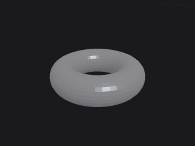

Rows is the number of segments around the cross section and Columns the number of segments around the main circle. Both directions are periodic, so no duplicate end points are created (a duplicated ring would produce zero-area quads and undefined normals at the seam). This differs from Grid and Tube, where Rows/Columns count points rather than segments. The torus comes with periodic `uv`.

**Outputs**

| Output | Type | Description |
|---|---|---|
| `geo` | GEOMETRY | The generated torus. |

**Parameters**

| Parameter | Type | Default | Description |
|---|---|---|---|
| Orientation `plane` | menu | ZX Plane | The plane the main circle lies in. Options: ZX Plane (`zx`), XY Plane (`xy`), YZ Plane (`yz`). |
| Radius `radius` `section_radius` | float [0.0..] | 1, 0.3 | Radius of the main circle (first value) and of the cross section (second value). |
| Rows `rows` | int [3..1024] | 12 | Number of segments around the cross section (not points). |
| Columns `cols` | int [3..1024] | 24 | Number of segments around the main circle. |

*Center*

| Parameter | Type | Default | Description |
|---|---|---|---|
| Center `center_x` `center_y` `center_z` | float | 0, 0, 0 | Center of the torus. |

---

### Tube (PCG)

`PCG_Tube` · category `PCG/generate` · Houdini: Tube (SOP)

Creates a tube, cylinder or cone with optional end caps.

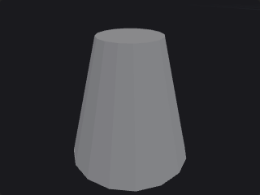

A tube along the chosen axis with separate bottom and top radii (a cone when one is zero). The radius scale multiplies both. Rows and Columns count points: rows along the height and columns around the circumference.

**Outputs**

| Output | Type | Description |
|---|---|---|
| `geo` | GEOMETRY | The generated tube. |

**Parameters**

| Parameter | Type | Default | Description |
|---|---|---|---|
| Orientation `orientation` | menu | Y Axis | The axis the tube runs along. Options: Y Axis (`y`), X Axis (`x`), Z Axis (`z`). |
| End Caps `caps` | toggle | on | Closes the ends with caps. |
| Center `center_x` `center_y` `center_z` | float | 0, 0, 0 | Center of the tube. |
| Rotate `rx` `ry` `rz` | float [-3600..3600] | 0, 0, 0 | Rotation in degrees (X, Y, Z). |
| Radius `radius1` `radius2` | float [0.0..] | 1, 1 | Radius at the bottom end (first value) and at the top end (second value). |
| Radius Scale `radius_scale` | float [0.0..] | 1 | Scale applied to both radii. |
| Height `height` | float [0.0..] | 2 | Length of the tube along its axis. |
| Rows `rows` | int [2..1024] | 2 | Number of points along the height. |
| Columns `cols` | int [3..1024] | 16 | Number of points around the circumference. |

---

### Volume (PCG)

`PCG_Volume` · category `PCG/generate` · Houdini: Volume (SOP)

Creates a constant-value volume.

Generates a volume sampled on a grid whose first and last grid points sit on the corners of the box. If the optional bound input is connected, its bounding box (expanded by Bounds Padding) defines the extent instead of Center and Size. A positive Voxel Size computes the resolution as extent divided by voxel size (voxels are cubes); otherwise Resolution is used. *Fog Volume* marks the field as a density (positive inside); when off it is an SDF.

**Inputs**

| Input | Type | Description |
|---|---|---|
| `bound` *(optional)* | GEOMETRY | Optional geometry whose bounding box defines the extent. |

**Outputs**

| Output | Type | Description |
|---|---|---|
| `geo` | GEOMETRY | The generated volume. |

**Parameters**

| Parameter | Type | Default | Description |
|---|---|---|---|
| Name `name` | string | *(empty)* | Name of the volume. |
| Initial Value `value` | float | 0 | Value every voxel is initialized to. |
| Fog Volume `fog` | toggle | off | Marks the volume as a fog (density) field. When off it is an SDF. |
| Center `center_x` `center_y` `center_z` | float | 0, 0, 0 | Center of the volume. Not used when the bound input is connected. |
| Size `size_x` `size_y` `size_z` | float [1e-06..] | 1, 1, 1 | Size of the volume. Not used when the bound input is connected. |
| Voxel Size `voxel_size` | float [0.0..] | 0 | Edge length of the cubic voxels. When greater than 0 the resolution follows from it and Resolution is ignored. |
| Resolution `res_x` `res_y` `res_z` | int [2..1024] | 32, 32, 32 | Number of grid points along X, Y and Z. *Disabled when voxel_size > 0.* |
| Bounds Padding `padding` | float [0.0..] | 0 | Expands the bounding box of the bound input on all sides. Only used when bound is connected. |

---
