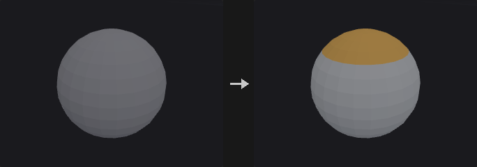
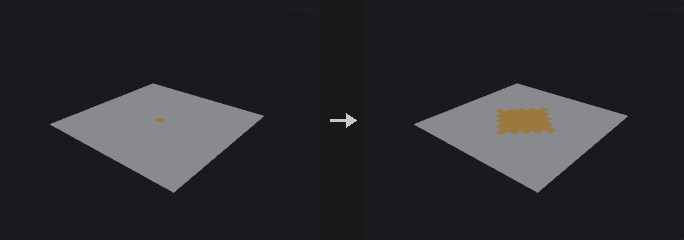
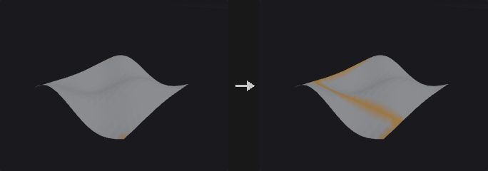
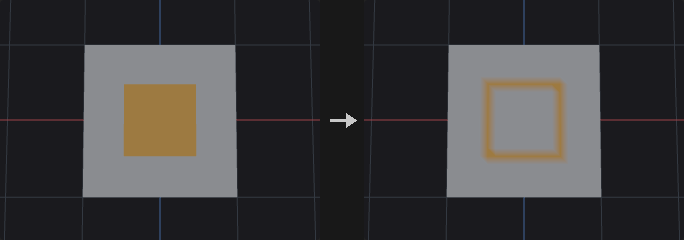
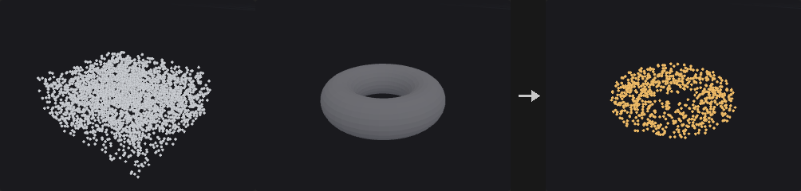
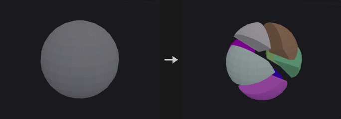

# Groups

Create, combine and convert groups.

11 nodes.

[Back to the reference index](README.md)

## Contents

- [Edge Group Promote (PCG)](#pcg-edgegrouppromote) — Converts an edge group to a point or primitive group, or a point or primitive group to an edge group.
- [Group Combine (PCG)](#pcg-groupcombine) — Combines several groups into one using a set-algebra expression.
- [Group Create (PCG)](#pcg-groupcreate) — Creates a group by stacking independent filters (bounding box, normal, edges, random) on a base selection.
- [Group Delete (PCG)](#pcg-groupdelete) — Deletes groups by name, with wildcards, from points, vertices, primitives and edges.
- [Group Edges (PCG)](#pcg-groupedges) — Creates a real edge group from edge angle, length, boundary and random rules.
- [Group Expand (PCG)](#pcg-groupexpand) — Grows or shrinks a point or primitive group along the topology.
- [Group Find Path (PCG)](#pcg-groupfindpath) — Finds shortest paths or boundary loops between points and writes them as an edge group.
- [Group from Attribute Boundary (PCG)](#pcg-groupfromattribboundary) — Creates a group at the places where an attribute value changes.
- [Group Inside (PCG)](#pcg-groupinside) — Groups the points or primitives that lie inside a second piece of geometry.
- [Group Promote (PCG)](#pcg-grouppromote) — Converts a group between point, primitive, edge and vertex classes.
- [Partition (PCG)](#pcg-partition) — Creates one group for every distinct value of an attribute.

## Nodes

### Edge Group Promote (PCG)

`PCG_EdgeGroupPromote` · category `PCG/group`

Converts an edge group to a point or primitive group, or a point or primitive group to an edge group.

Four conversions: edge to point, edge to primitive, point to edge and primitive to edge. The result is written to a group of the target class. If no new name is given the source name is reused, and if that is empty the group is called `promoted`.

**Inputs**

| Input | Type | Description |
|---|---|---|
| `geo` | GEOMETRY | Geometry that holds the source group. |

**Outputs**

| Output | Type | Description |
|---|---|---|
| `geo` | GEOMETRY | Geometry with the converted group added. |

**Parameters**

| Parameter | Type | Default | Description |
|---|---|---|---|
| Group `source` | string | *(empty)* | Name or pattern of the group to convert. |
| Conversion `direction` | menu | Edges to Points | Which classes are converted from and to. Options: Edges to Points (`edge->point`), Edges to Primitives (`edge->prim`), Points to Edges (`point->edge`), Primitives to Edges (`prim->edge`). |
| New Name `target` | string | *(empty)* | Name of the new group. Empty reuses the source group name. |
| Interior Edges Only `interior_only` | toggle | off | Only for primitive to edge: keep only interior edges, those shared by two primitives that are both in the group. When off, every edge of a selected primitive is included. *Hidden when direction ≠ "prim->edge".* |

---

### Group Combine (PCG)

`PCG_GroupCombine` · category `PCG/group` · Houdini: Group Combine (SOP)

Combines several groups into one using a set-algebra expression.

The expression uses `|` (union), `&` (intersection), `-` (difference), `^` (symmetric difference) and `!` (complement), with arbitrarily nested parentheses. Precedence follows Python sets: `!` binds tightest, then `-`, `&`, `^`, `|`. Group names may contain wildcards, and `*` stands for the whole set.

Example: `(top & selected) - border`. The group type can be point, primitive, vertex or edge.

**Inputs**

| Input | Type | Description |
|---|---|---|
| `geo` | GEOMETRY | Geometry that holds the groups to combine. |

**Outputs**

| Output | Type | Description |
|---|---|---|
| `geo` | GEOMETRY | Geometry with the combined group added. |
| `report` | STRING | Text summary of the operation. |

**Parameters**

| Parameter | Type | Default | Description |
|---|---|---|---|
| Group Type `group_type` | menu | Points | Element class of the groups in the expression and of the output group. Options: Points (`point`), Primitives (`prim`), Vertices (`vertex`), Edges (`edge`). |
| Group `output_group` | string | `combined` | Name of the group that receives the result. |
| Expression `expression` | string | `a & b` | Set expression over group names: `\|` union, `&` intersection, `-` difference, `^` symmetric difference, `!` complement, parentheses allowed. Names may use wildcards; `*` means all elements. |

---

### Group Create (PCG)

`PCG_GroupCreate` · category `PCG/group` · Houdini: Group (SOP), Group Expression (SOP), Group Range (SOP)

Creates a group by stacking independent filters (bounding box, normal, edges, random) on a base selection.

A base set, empty meaning everything, starts the selection. It accepts group names, indices, ranges and `@` expressions. The Bounding Box, Normal, Edges and Random sections are each switched on separately. The first, second and fourth intersect with the running selection, and the edge rule can either union into it or intersect with it. The result is finally merged with any existing group of the same name according to the initial merge mode.

When only *Include by Edges* is enabled and the base group is empty, the selection starts from the empty set instead of everything.

**Inputs**

| Input | Type | Description |
|---|---|---|
| `geo` | GEOMETRY | Geometry to create the group on. |

**Outputs**

| Output | Type | Description |
|---|---|---|
| `geo` | GEOMETRY | Geometry with the new group. |

**Parameters**

| Parameter | Type | Default | Description |
|---|---|---|---|
| Group Name `name` | string | `group1` | Name of the group to create. |
| Group Type `cls` | menu | Points | Element class of the group: points, primitives or vertices. Options: Points (`point`), Primitives (`prim`), Vertices (`vertex`). |
| Initial Merge `merge` | menu | Replace Existing | How the result combines with an existing group of the same name. When no such group exists, all options behave like Replace. Options: Replace Existing (`replace`), Union with Existing (`union`), Intersect with Existing (`intersect`), Subtract from Existing (`subtract`). |

*Base Group*

| Parameter | Type | Default | Description |
|---|---|---|---|
| Base Group `base` | string | *(empty)* | Starting set, as a group pattern. Empty means no restriction. The filters below intersect with it; the edge section is added on top at the end. |

*Keep in Bounding Regions › Bounding Region*

| Parameter | Type | Default | Description |
|---|---|---|---|
| Enable `use_bbox` | toggle | off | Enable the bounding box filter. |
| Size `sx` `sy` `sz` | float [0.0..] | 1, 1, 1 | Size of the bounding box along X, Y and Z. |
| Center `cx` `cy` `cz` | float | 0, 0, 0 | Centre of the bounding box. |
| Include Partially Contained Entities `bbox_partial` | toggle | off | For primitives and vertices: count an element if any one of its points is inside the box. When off, all of its points must be inside. *Hidden when cls = point.* |

*Keep by Normals › Normals*

| Parameter | Type | Default | Description |
|---|---|---|---|
| Enable `use_normal` | toggle | off | Enable the normal direction filter. |
| Direction `dir_x` `dir_y` `dir_z` | float | 0, 0, 1 | Direction that the normals are compared against. |
| Spread Angle `spread` | float [0.0..180.0] | 180 | Maximum angle in degrees between the normal and the direction. 180 accepts everything. |
| Include Normals Matching Opposite Direction `both_dirs` | toggle | off | Also accept normals pointing in the opposite direction. |

*Include by Edges › Edges*

| Parameter | Type | Default | Description |
|---|---|---|---|
| Enable `use_edges` | toggle | off | Enable the edge filter. |
| Combine `edge_combine` | menu | Include (Union) | *Include* matches Houdini: elements selected by the edge rules go into the group regardless of the other sections. *Keep* is an addition of this plugin and intersects the edge selection with the earlier result. Options: Include (Union) (`include`), Keep (Intersect) (`keep`). |
| Edge Angle `use_angle` | toggle | on | Select edges by the angle between the normals of their two neighbouring faces. Combined by union with *Unshared Edges*. |
| Min Edge Angle `min_angle` | float [0.0..180.0] | 20 | Lower bound of the edge angle in degrees. *Disabled when use_angle is off.* |
| Max Edge Angle `max_angle` | float [0.0..180.0] | 180 | Upper bound of the edge angle in degrees. *Disabled when use_angle is off.* |
| Unshared Edges `unshared` | toggle | off | Select boundary edges, those with only one adjacent face. Combined by union with the angle rule. |

*Keep by Random Chance › Random*

| Parameter | Type | Default | Description |
|---|---|---|---|
| Enable `use_random` | toggle | off | Enable random selection. |
| Global Seed `rand_seed` | int [0..] | 0 | Seed of the random selection. |
| Percent `percent` | float [0.0..100.0] | 50 | Percentage of the elements that are picked. |

---

### Group Delete (PCG)

`PCG_GroupDelete` · category `PCG/group` · Houdini: Group Delete (SOP)

Deletes groups by name, with wildcards, from points, vertices, primitives and edges.

Each of the four fields takes a list of group names for its element class. Wildcards are supported: `extrude*` matches every group starting with `extrude`, and `* ^keep` means all groups except `keep`. Edge groups are handled too.

A field left empty leaves that class untouched, also when *Delete Unselected* is on, where an empty field does not mean everything.

**Inputs**

| Input | Type | Description |
|---|---|---|
| `geo` | GEOMETRY | Geometry holding the groups. |

**Outputs**

| Output | Type | Description |
|---|---|---|
| `geo` | GEOMETRY | Geometry with the matching groups removed. |

**Parameters**

| Parameter | Type | Default | Description |
|---|---|---|---|
| Point Groups `point` | string | *(empty)* | Names or patterns of point groups to delete. Empty leaves point groups untouched. |
| Vertex Groups `vertex` | string | *(empty)* | Names or patterns of vertex groups to delete. Empty leaves vertex groups untouched. |
| Primitive Groups `prim` | string | *(empty)* | Names or patterns of primitive groups to delete. Empty leaves primitive groups untouched. |
| Edge Groups `edge` | string | *(empty)* | Names or patterns of edge groups to delete. Empty leaves edge groups untouched. |
| Delete Unselected `delete_non_selected` | toggle | off | Invert the selection: delete the groups that do not match. Classes with an empty field are still not touched. |

---

### Group Edges (PCG)

`PCG_GroupEdges` · category `PCG/group`

Creates a real edge group from edge angle, length, boundary and random rules.

Corresponds to the Edges section of Houdini's Group Create, but outputs an actual edge group. The group is stored as pairs of points, not edge indices, because edge indices are derived from the topology and change after delete, merge or fuse, so a group based on indices would silently point to different edges.

All enabled rules (angle, length, unshared, random) must hold at the same time for an edge to be selected. Without any rule enabled, every edge of the base set is selected.

**Inputs**

| Input | Type | Description |
|---|---|---|
| `geo` | GEOMETRY | Geometry whose edges are to be grouped. |

**Outputs**

| Output | Type | Description |
|---|---|---|
| `geo` | GEOMETRY | Geometry with the new edge group. |

**Parameters**

| Parameter | Type | Default | Description |
|---|---|---|---|
| Group Name `name` | string | `edges1` | Name of the edge group. |
| Initial Merge `merge` | menu | Replace Existing | How the result combines with an existing edge group of the same name. Options: Replace Existing (`replace`), Union with Existing (`union`), Intersect with Existing (`intersect`), Subtract from Existing (`subtract`). |
| Base Group `base` | string | *(empty)* | Edge group pattern giving the starting set of edges. Empty means all edges. |

*Angle*

| Parameter | Type | Default | Description |
|---|---|---|---|
| Edge Angle `use_angle` | toggle | on | Select edges by the angle between the normals of their adjacent faces. |
| Min Edge Angle `min_angle` | float [0.0..180.0] | 20 | Lower bound of the edge angle in degrees. |
| Max Edge Angle `max_angle` | float [0.0..180.0] | 180 | Upper bound of the edge angle in degrees. |

*Length*

| Parameter | Type | Default | Description |
|---|---|---|---|
| Edge Length `use_length` | toggle | off | Select edges by length. |
| Length Range `min_length` `max_length` | float [0.0..] | 0, 1e+06 | Minimum and maximum edge length of the range, as two values. |

| Parameter | Type | Default | Description |
|---|---|---|---|
| Unshared Edges `unshared` | toggle | off | Only edges on the boundary, those with a single adjacent face. |

*Random*

| Parameter | Type | Default | Description |
|---|---|---|---|
| Use Random `use_random` | toggle | off | Keep only a random subset of the edges that passed the other rules. |
| Global Seed `rand_seed` | int [0..] | 0 | Seed of the random selection. |
| Percent `percent` | float [0.0..100.0] | 50 | Percentage of edges that are picked. |

---

### Group Expand (PCG)

`PCG_GroupExpand` · category `PCG/group` · Houdini: Group Expand (SOP)

Grows or shrinks a point or primitive group along the topology.

Two measures are available. *Topology Steps* hops across a number of edges and is tied to mesh density: on a subdivided mesh, expanding by 3 steps covers half the distance it did before. *Edge Distance* accumulates edge length, giving a geodesic distance that is independent of density. This is not Euclidean distance: two pieces of geometry that touch in space but are not connected are infinitely far apart, so the selection on either side of a wall never bleeds across.

Shrinking is an expansion of the complement followed by an inversion (morphological erosion). The outer boundary of the geometry is not eroded, because the complement only contains elements that really are not in the group and there is nothing outside the geometry. This matches Houdini but differs from image erosion.

*Output Falloff* also writes a 0 to 1 distance falloff attribute, so no separate Attribute Fade is needed.

**Inputs**

| Input | Type | Description |
|---|---|---|
| `geo` | GEOMETRY | Geometry that holds the group. |

**Outputs**

| Output | Type | Description |
|---|---|---|
| `geo` | GEOMETRY | Geometry with the expanded or shrunk group, and optionally the falloff attribute. |

**Parameters**

| Parameter | Type | Default | Description |
|---|---|---|---|
| Group Type `cls` | menu | Points | Element class of the group: points or primitives. Options: Points (`point`), Primitives (`prim`). |
| Base Group `group` | string | *(empty)* | Group pattern to expand or shrink. |
| Output Group `output_group` | string | *(empty)* | Name of the result group. If empty, the input group is overwritten in place, which requires `Base Group` to be a plain group name (not a range or `@` expression). |
| Operation `mode` | menu | Expand | Expand grows the group outward; Shrink erodes it. Options: Expand (`expand`), Shrink (`shrink`). |
| Measure `metric` | menu | Topology Steps | *Topology Steps* counts edge hops; *Edge Distance* uses the accumulated edge length along the surface. Options: Topology Steps (`steps`), Edge Distance (Geodesic) (`distance`). |
| Steps / Distance `radius` | float [0.0..] | 1 | Number of edge hops for Topology Steps, or the accumulated edge length for Edge Distance. |

*Falloff*

| Parameter | Type | Default | Description |
|---|---|---|---|
| Output Falloff `output_falloff` | toggle | off | Also write a falloff attribute: 1 inside the original group, decreasing linearly to 0 at the Steps / Distance value. |
| Falloff Attribute `falloff_attribute` | string | `falloff` | Name of the falloff attribute. |

---

### Group Find Path (PCG)

`PCG_GroupFindPath` · category `PCG/group` · Houdini: Group Find Path (SOP)

Finds shortest paths or boundary loops between points and writes them as an edge group.

Writes an edge group, plus a point group of the same name, on the source geometry; no new geometry is created.

In *Shortest Path* mode the points are visited in the order they are written (for example `12 40 7`), with a shortest path between each consecutive pair. With *Close Path* the path also returns to the first point. *Boundary Loop* writes, for each given point, the entire boundary loop it sits on, such as the rim of an opening or a hole. *Start/End Pairs* pairs the points two by two (1st with 2nd, 3rd with 4th and so on) and builds one path per pair; the number of points must be even.

The cost of an edge is its length by default, optionally scaled by a point cost attribute. Collision groups block points from being used by the path (end points excepted).

**Inputs**

| Input | Type | Description |
|---|---|---|
| `geo` | GEOMETRY | Mesh to search paths on. |

**Outputs**

| Output | Type | Description |
|---|---|---|
| `geo` | GEOMETRY | Input geometry with the path edge group and point group added. |
| `report` | STRING | Text summary with the number of paths and the number that were unreachable. |

**Parameters**

| Parameter | Type | Default | Description |
|---|---|---|---|
| Base Group `points` | string | *(empty)* | Point numbers (in order) or a point group. Shortest Path needs at least two points; Boundary Loop needs one point on the boundary. |
| Path Type `mode` | menu | Paths through Each Base Group Element in Order | *Shortest Path* chains the points in order, *Boundary Loop* selects the open boundary loop of each point, *Start/End Pairs* makes one path per consecutive pair. Options: Paths through Each Base Group Element in Order (`shortest_path`), Boundary Loop (PCG) (`boundary_loop`), Paths between Start/End Pairs in Base Group (`start_end_pairs`). |
| Close Path `close` | toggle | off | Return to the starting point. For Start/End Pairs each pair returns along a second path. With only two points this closes a loop only if *Avoid Self Intersection* is also on. *Hidden when mode = boundary_loop.* |
| Avoid Self Intersection `avoid_self_intersection` | toggle | off | Later segments avoid the points already used by earlier segments (end points excepted). With *Close Path* this finds a return route that does not retrace the outbound one. *Hidden when mode = boundary_loop.* |
| Use Edge Length as Cost `use_length` | toggle | on | Use the edge length as cost. When off, every edge costs the same. *Hidden when mode = boundary_loop.* |
| Point Cost Attribute `cost_attribute` | string | *(empty)* | Optional point attribute that makes edges more expensive: the edge cost is multiplied by 1 + Cost Weight x the average of the attribute at the edge's two points. *Hidden when mode = boundary_loop.* |
| Cost Weight `cost_weight` | float | 1 | Weight of the cost attribute in that multiplier. *Hidden when mode = boundary_loop.* *Disabled when cost_attribute = "".* |
| Collision Group `collision_group` | string | *(empty)* | Point group the path may not pass through (end points excepted). Empty means no restriction. *Hidden when mode = boundary_loop.* |
| Contain within Collision Group `contain_within_collision` | toggle | off | Invert the collision group: the path may only run through points in the group. *Hidden when mode = boundary_loop.* *Disabled when collision_group = "".* |
| Group Name `group_name` | string | `path` | Name of the edge group and of the point group that receive the path. |

---

### Group from Attribute Boundary (PCG)

`PCG_GroupFromAttribBoundary` · category `PCG/group` · Houdini: Group from Attribute Boundary (SOP)

Creates a group at the places where an attribute value changes.

The attribute class decides what counts as a change. For a primitive attribute, edges between neighbouring faces with different values. For a vertex attribute, edges where the corners on the two sides differ, which finds UV seams. For a point attribute, edges whose two end points differ.

The output group can be an edge group, the points of those edges, or the faces next to them. Unshared (open boundary) edges can be included as well.

**Inputs**

| Input | Type | Description |
|---|---|---|
| `geo` | GEOMETRY | Geometry that carries the attribute. |

**Outputs**

| Output | Type | Description |
|---|---|---|
| `geo` | GEOMETRY | Geometry with the boundary group added. |
| `report` | STRING | Text summary of the operation. |

**Parameters**

| Parameter | Type | Default | Description |
|---|---|---|---|
| Attribute Class `attribute_class` | menu | Primitive | Class of the attribute that is compared: primitive, vertex or point. Options: Primitive (`prim`), Vertex (`vertex`), Point (`point`). |
| Attribute `attribute` | string | `name` | Name of the attribute to compare. |
| Tolerance `tolerance` | float [0.0..] | 1e-05 | How much numeric attribute values may differ before they count as different. |
| Include Unshared Edges `include_unshared` | toggle | off | Also include open boundary edges, those with only one adjacent face. |
| Group Type `group_type` | menu | Edges | What the group contains: the boundary edges, their points, or the primitives next to them. Options: Edges (`edges`), Points (`points`), Primitives (`prims`). |
| Group Name `group_name` | string | `boundary` | Name of the group to create. |

---

### Group Inside (PCG)

`PCG_GroupInside` · category `PCG/group`

Groups the points or primitives that lie inside a second piece of geometry.

Equivalent to the Bounding Object option of Houdini's Group SOP, but using the actual closed surface of the second input. The test is ray parity: a ray is cast from the point, the surface crossings are counted, and an odd count means inside. Since the ray caster only returns the nearest hit, the ray is restarted from just past each hit until nothing is hit.

A ray that grazes an edge or vertex may count 0 or 2 crossings and flip the parity, which is common on axis-aligned meshes. Several unrelated oblique directions therefore vote on the result; with three directions, grazing all of them at once is negligible. The directions avoid small integer ratios so they do not hit cube vertices exactly.

**Inputs**

| Input | Type | Description |
|---|---|---|
| `geo` | GEOMETRY | Geometry whose points or primitives are tested. |
| `volume` | GEOMETRY | Closed geometry that defines the inside. |

**Outputs**

| Output | Type | Description |
|---|---|---|
| `geo` | GEOMETRY | Input geometry with the group added. |

**Parameters**

| Parameter | Type | Default | Description |
|---|---|---|---|
| Group Name `group_name` | string | `inside` | Name of the group to create. |
| Entity `cls` | menu | Points | Whether points or primitives are tested. Options: Points (`point`), Primitives (`prim`). |
| Invert `invert` | toggle | off | Group the elements outside instead of inside. |
| Ray Directions `ray_directions` | int [1..3] | 3 | Number of oblique rays that vote on inside or outside. 1 is fastest, 3 is the most robust against rays that graze edges. |

**Tips**

- The second input must be a closed surface; open meshes give unreliable parity.

---

### Group Promote (PCG)

`PCG_GroupPromote` · category `PCG/group` · Houdini: Group Promote (SOP)

Converts a group between point, primitive, edge and vertex classes.

One *Convert From / To* menu replaces Houdini's two separate dropdowns, so the available conversions are listed as pairs. The conversion rules differ per direction.

Two defaults are opposite to Houdini so that existing graphs keep their behaviour: *Keep Original Group* is on, and *Include Only Elements Entirely Contained* is on, which means a point group only produces the primitives whose points are all in the group.

The result can alternatively be written as a 0/1 integer attribute instead of a group.

**Inputs**

| Input | Type | Description |
|---|---|---|
| `geo` | GEOMETRY | Geometry that holds the source group. |

**Outputs**

| Output | Type | Description |
|---|---|---|
| `geo` | GEOMETRY | Geometry with the converted group (or attribute) added. |

**Parameters**

| Parameter | Type | Default | Description |
|---|---|---|---|
| Group `name` | string | `group1` | Name of the source group. |
| Convert From / To `direction` | menu | Points to Primitives | Source class and target class of the conversion, for example point to primitive. *prim_to_prim* just copies the group under a new name, which is only useful together with the boundary option. Options: Points to Primitives (`point_to_prim`), Primitives to Points (`prim_to_point`), Points to Edges (`point_to_edge`), Points to Vertices (`point_to_vertex`), Primitives to Edges (`prim_to_edge`), Primitives to Vertices (`prim_to_vertex`), Edges to Points (`edge_to_point`), Edges to Primitives (`edge_to_prim`), Edges to Vertices (`edge_to_vertex`), Vertices to Points (`vertex_to_point`), Vertices to Primitives (`vertex_to_prim`), Vertices to Edges (`vertex_to_edge`), Primitives to Primitives (`prim_to_prim`). |
| New Name `new_name` | string | *(empty)* | Name of the converted group. Empty reuses the original group name. |
| Keep Original Group `keep_original` | toggle | on | Keep the source group. Houdini defaults to off. |
| Include Only Elements on the Boundary `only_boundary` | toggle | off | Only include elements on the boundary of the group. Supported only when starting from a primitive group. |
| Include Unshared Edges `include_unshared` | toggle | on | With the boundary option: also include unshared (open boundary) edges. *Disabled when only_boundary is off.* |
| Include All Unshared Curve Edges `include_curve_unshared` | toggle | off | With the boundary option: also include all unshared edges of curves. *Disabled when only_boundary is off.* |
| Include Only Elements Entirely Contained in Original Group `only_full` | toggle | on | For point to primitive, point to edge and edge to primitive: only include elements whose points (or edges) are all in the source group. Houdini defaults to off. *Hidden when direction ≠ point_to_prim direction ≠ point_to_edge direction ≠ edge_to_prim.* *Disabled when only_boundary is on.* |
| Include Only Primitives Sharing an Edge with Original Group `share_edge` | toggle | off | For point to primitive: only include primitives that share an edge with the original group. *Hidden when direction ≠ point_to_prim.* *Disabled when only_boundary is on.* |
| Output as Integer Attribute `as_attribute` | toggle | off | Write a 0/1 integer attribute instead of a group. Not supported when the target is edges. |

---

### Partition (PCG)

`PCG_Partition` · category `PCG/group` · Houdini: Partition (SOP)

Creates one group for every distinct value of an attribute.

Each different value of the attribute gets its own group. The group name is the rule with `$ATTR` replaced by the value. Characters that cannot appear in a group name (the decimal point and minus sign of floats, and other special characters in strings) are replaced, and a name that would start with a digit is prefixed with an underscore.

**Inputs**

| Input | Type | Description |
|---|---|---|
| `geo` | GEOMETRY | Geometry that carries the attribute. |

**Outputs**

| Output | Type | Description |
|---|---|---|
| `geo` | GEOMETRY | Geometry with the new groups. |
| `report` | STRING | Text summary of the groups that were created. |

**Parameters**

| Parameter | Type | Default | Description |
|---|---|---|---|
| Entity `attribute_class` | menu | Primitives | Class of the attribute and of the groups created: primitive, point or vertex. Options: Primitives (`prim`), Points (`point`), Vertices (`vertex`). |
| Attribute `attribute` | string | `name` | Name of the attribute whose values define the groups. |
| Rule `rule` | string | `grp_$ATTR` | Group name template. `$ATTR` is replaced by the attribute value; one group per distinct value. |

---
