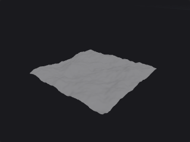

# Image

Bridges between ComfyUI images and the plugin.

1 nodes.

[Back to the reference index](README.md)

## Contents

- [Heightfield from Image (PCG)](#pcg-heightfieldfromimage) — Builds a displaced grid whose height comes from the brightness of an image.

## Nodes

### Heightfield from Image (PCG)

`PCG_HeightfieldFromImage` · category `PCG/image`

Builds a displaced grid whose height comes from the brightness of an image.

Bridges image generation and geometry: the height map can come from any ComfyUI sampler. The image is sampled bilinearly at `resolution` x `resolution` grid points, brightness is the average of the RGB channels, and the point's Y is that brightness times Height. The grid lies in the XZ plane. Point normals are computed, and the raw brightness is stored in the point attribute `height`. Only the first image of a batch is used.

**Inputs**

| Input | Type | Description |
|---|---|---|
| `image` | IMAGE | Height map; brightness is the mean of RGB. |

**Outputs**

| Output | Type | Description |
|---|---|---|
| `geo` | GEOMETRY | Displaced grid with normals and a `height` point attribute. |

**Parameters**

| Parameter | Type | Default | Description |
|---|---|---|---|
| Size `size_x` `size_z` | float [0.001..] | 100, 100 | Size of the grid along X and Z in world units. |
| Height Scale `height` | float | 20 | Multiplier applied to the brightness (0..1) to get the displacement along Y. Negative values invert. |
| Grid Resolution `resolution` | int [2..2049] | 129 | Number of points along each side of the grid. |

---
