# Modify

Modeling operations: extrude, bevel, boolean, clip, fuse, remesh, subdivide and friends.

76 nodes.

[Back to the reference index](README.md)

## Contents

- [Blast (PCG)](#pcg-blast) — Deletes the elements in a group, or keeps only those elements.
- [Blast by Attribute (PCG)](#pcg-blastbyattribute) — Deletes points or primitives by comparing a single-valued attribute against a threshold, range or band, or just groups the hits.
- [Boolean (PCG)](#pcg-boolean) — Combines two closed meshes with a union, intersection, subtraction, shatter or seam operation.
- [Boolean Fracture (PCG)](#pcg-booleanfracture) — Cuts the first input into separate pieces using the second input as the cutting geometry.
- [Bound (PCG)](#pcg-bound) — Builds a bounding box, bounding sphere or minimum-volume oriented box around the geometry.
- [Carve (PCG)](#pcg-carve) — Cuts a curve at parametric positions or extracts points along it.
- [Circle from Edges (PCG)](#pcg-circlefromedges) — Rearranges each closed edge loop in a group into a perfect circle.
- [Circle Spline (PCG)](#pcg-circlespline) — Creates a smooth curve through the input points by blending circular arcs fitted to each three neighbouring points.
- [Clean (PCG)](#pcg-clean) — Repairs a polygon mesh by fusing points, removing degenerate and duplicate faces, fixing non-manifold edges and orientation, and dropping small pieces.
- [Clip (PCG)](#pcg-clip) — Cuts geometry with a plane and keeps the part below it, above it, or both.
- [Convert (PCG)](#pcg-convert) — Converts primitives between polygon, polyline, point, NURBS, Bezier and volume representations.
- [Convex Decompose (PCG)](#pcg-convexdecompose) — Splits a concave solid into a set of convex pieces (approximate convex decomposition).
- [Convex Hull (PCG)](#pcg-convexhull) — Builds the 3D convex hull of the input points.
- [Crease (PCG)](#pcg-crease) — Writes a fractional crease weight onto edges for later subdivision.
- [Curve Fillet (PCG)](#pcg-curvefillet) — Rounds polyline corners with circular arcs.
- [Curve Intersect (PCG)](#pcg-curveintersect) — Finds intersections between curves and outputs points, split curves, or Houdini-style cut and extract results.
- [Delete (PCG)](#pcg-delete) — Deletes points, primitives or edges chosen by group, number, bounding volume, normal, degeneracy, random chance or an expression.
- [Dissolve (PCG)](#pcg-dissolve) — Removes selected edges and merges the faces on either side of them into one.
- [Divide (PCG)](#pcg-divide) — Triangulates or splits faces into convex polygons, cuts them into bricks, merges shared edges, or computes the dual.
- [Edge Collapse (PCG)](#pcg-edgecollapse) — Collapses each connected run of selected edges into a single point at the run's center.
- [Edge Divide (PCG)](#pcg-edgedivide) — Inserts points on selected edges and optionally connects them to split the faces.
- [Edge Equalize (PCG)](#pcg-edgeequalize) — Evens out edge lengths along edge chains, either by redistributing points along the polyline or by Houdini's target-length methods.
- [Edge Straighten (PCG)](#pcg-edgestraighten) — Pulls each open chain of selected edges into a straight line, keeping its end points fixed.
- [Ends (PCG)](#pcg-ends) — Closes, opens, unrolls or rolls curves.
- [Exploded View (PCG)](#pcg-explodedview) — Moves fracture pieces apart from each other so cuts can be inspected.
- [Extract Transform (PCG)](#pcg-extracttransform) — Computes the best-fit transform from a reference geometry to a deformed or moved copy of it.
- [Facet (PCG)](#pcg-facet) — Runs a fixed chain of topology cleanup and hard-edge options: unique points, consolidate, orient, cusp, inline and degenerate removal, normals.
- [Fracture Detail (PCG)](#pcg-fracturedetail) — Adds noise to the cut (interior) faces of fracture pieces while keeping the pieces fitting together.
- [Fuse (PCG)](#pcg-fuse) — Snaps nearby points together (to each other, to a grid, or to a target) and optionally welds them into single points.
- [Intersection Analysis (PCG)](#pcg-intersectionanalysis) — Places a point wherever triangles or polylines pass through each other and records their sources.
- [Join (PCG)](#pcg-join) — Connects the selected polylines in order into one polyline, bridging gaps with straight segments.
- [Loop Cut (PCG)](#pcg-loopcut) — Inserts a complete edge loop through quads, starting from seed edges.
- [Match Axis (PCG)](#pcg-matchaxis) — Rotates geometry by the smallest rotation that takes one axis direction onto another.
- [Match Size (PCG)](#pcg-matchsize) — Moves and scales geometry to fit a reference box, and can stash the transform so it can be undone later.
- [Merge (PCG)](#pcg-merge) — Combines up to six geometries into one.
- [Mirror (PCG)](#pcg-mirror) — Mirrors geometry about a plane, optionally keeping the original and welding the seam.
- [Peak (PCG)](#pcg-peak) — Moves points along their normals by a distance.
- [Point Jitter (PCG)](#pcg-pointjitter) — Adds random displacement to points.
- [Point Split (PCG)](#pcg-pointsplit) — Splits points whose vertices carry different values of a vertex attribute into separate points.
- [Poly Bridge (PCG)](#pcg-polybridge) — Builds a surface of polygons between two loops of edges, such as a tunnel or handle.
- [PolyBevel (PCG)](#pcg-polybevel) — Bevels edges of polygon geometry with an optional rounded, chamfered, solid or crease profile.
- [PolyDoctor (PCG)](#pcg-polydoctor) — Detects and optionally repairs common polygon problems, writing validity flags.
- [PolyExpand2D (PCG)](#pcg-polyexpand2d) — Offsets a planar curve network inward and outward by a constant distance.
- [PolyExtrude (PCG)](#pcg-polyextrude) — Extrudes polygons along their normals, a fixed direction or a spine curve, with inset, twist and divisions.
- [PolyFill (PCG)](#pcg-polyfill) — Closes open boundary loops with new polygons.
- [PolyPath (PCG)](#pcg-polypath) — Joins polylines whose end points touch into the longest possible curves, without creating any edges.
- [PolyReduce (PCG)](#pcg-polyreduce) — Reduces triangle or point count with quadric error edge collapse.
- [PolySpline (PCG)](#pcg-polyspline) — Converts polylines into smooth spline curves sampled as polylines.
- [Primitive (PCG)](#pcg-primitive) — Transforms each selected primitive around its own center and offsets it along its normal.
- [Primitive Split (PCG)](#pcg-primitivesplit) — Splits shared points so that primitives with different attribute values no longer share them.
- [Ray (PCG)](#pcg-ray) — Projects points onto collision geometry by ray casting or by nearest surface point.
- [Refine (PCG)](#pcg-refine) — Inserts, removes or subdivides points along curves at parametric positions.
- [Remesh (PCG)](#pcg-remesh) — Rebuilds a triangle mesh with uniform, isotropic triangles of a target edge length.
- [Remesh to Grid (PCG)](#pcg-remeshtogrid) — Rebuilds a surface as a closed all-quad mesh from a voxelised signed distance field.
- [Resample (PCG)](#pcg-resample) — Resamples curves into evenly spaced points by length or segment count.
- [Reverse (PCG)](#pcg-reverse) — Reorders the vertices of primitives: reverse, swap U/V or shift.
- [Shrinkwrap (PCG)](#pcg-shrinkwrap) — Wraps geometry in a single closed manifold shell by rolling a sphere over it from outside.
- [Smooth (PCG)](#pcg-smooth) — Applies Laplacian smoothing to points and other attributes.
- [Sort (PCG)](#pcg-sort) — Reorders points and primitives by position, attribute, expression or other criteria without changing the shape.
- [Split (PCG)](#pcg-split) — Splits geometry into the part in a group and the part outside it.
- [Subdivide (PCG)](#pcg-subdivide) — Subdivides polygon meshes with Catmull-Clark, Loop or bilinear schemes.
- [Switch (PCG)](#pcg-switch) — Passes through one of up to eight inputs, chosen by index or expression, evaluating only the selected branch.
- [Switch-If (PCG)](#pcg-switchif) — Outputs one of two inputs depending on whether a set of tests passes.
- [Thicken (PCG)](#pcg-thicken) — Gives open surfaces a thickness with a second skin and side walls.
- [Transform (PCG)](#pcg-transform) — Translates, rotates, scales and shears points with a Houdini-style transform and pivot.
- [Transform by Attribute (PCG)](#pcg-transformbyattrib) — Transforms geometry by matrix attributes, per detail, point or primitive.
- [Triangulate 2D (PCG)](#pcg-triangulate2d) — Builds a Delaunay or constrained Delaunay triangulation of points lying in a plane.
- [Volume Blur (PCG)](#pcg-volumeblur) — Blurs volumes with a Gaussian or box filter, or reduces neighbourhoods with min, max, median and similar operators.
- [Volume Mix (PCG)](#pcg-volumemix) — Combines volumes of two inputs on the grid of the first, with arithmetic, blending or SDF boolean operations.
- [Volume Resample (PCG)](#pcg-volumeresample) — Changes the resolution of volumes while keeping their bounding box.
- [Volume Reshape SDF (PCG)](#pcg-volumereshapesdf) — Dilates, erodes, opens, closes or redistances signed distance field volumes.
- [Volume Smooth SDF (PCG)](#pcg-volumesmoothsdf) — Smooths SDF volumes with mean, median, mean curvature flow or Laplacian flow filters.
- [Volume Wrangle (PCG)](#pcg-volumewrangle) — Runs wrangle code with each voxel as one element.
- [Voronoi Cluster (PCG)](#pcg-voronoicluster) — Groups Voronoi pieces into larger clusters and optionally glues each cluster into one piece.
- [Voronoi Fracture (PCG)](#pcg-voronoifracture) — Cuts geometry into pieces around seed points, with interior caps, piece names and attributes.
- [Voronoi Split (PCG)](#pcg-voronoisplit) — Cuts a surface along the Voronoi cell borders of the cell points.

## Nodes

### Blast (PCG)

`PCG_Blast` · category `PCG/modify` · Houdini: Blast (SOP)

Deletes the elements in a group, or keeps only those elements.

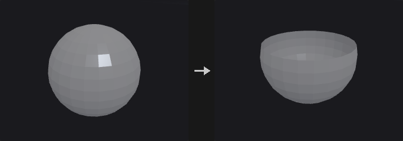

Removes the points or primitives selected by the group pattern. With *Delete Non Selected* the selection is inverted and only the group is kept.

**Inputs**

| Input | Type | Description |
|---|---|---|
| `geo` | GEOMETRY | Geometry to delete from. |

**Outputs**

| Output | Type | Description |
|---|---|---|
| `geo` | GEOMETRY | Geometry with the selected (or non-selected) elements removed. |

**Parameters**

| Parameter | Type | Default | Description |
|---|---|---|---|
| Group `group` | string | *(empty)* | Group pattern selecting the elements to delete. An empty pattern deletes nothing, even when *Delete Non Selected* is on. |
| Group Type `cls` | menu | Points | Whether the group pattern refers to points or primitives. Options: Points (`point`), Primitives (`prim`). |
| Delete Non Selected `keep_selected` | toggle | off | Inverts the operation: delete everything that is not in the group and keep the group. |

---

### Blast by Attribute (PCG)

`PCG_BlastByAttribute` · category `PCG/modify` · Houdini: Blast by Attribute (SOP)

Deletes points or primitives by comparing a single-valued attribute against a threshold, range or band, or just groups the hits.

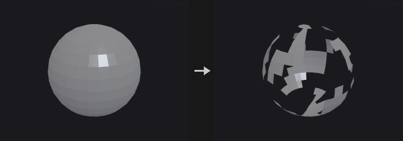

Tests a scalar numeric attribute on each element and either deletes the elements that match or, with *Output = Group*, leaves the geometry intact and puts the matching elements into a new group.

Modes:
- *Threshold*: matches elements whose value is strictly below the threshold (equal values stay).
- *Range*: matches `min <= value <= max`.
- *Width*: matches values inside `[center - width/2, center + width/2]`.

*Invert* flips the match. Elements outside the *Group* are never tested, and *Invert* does not touch them either. Vector attributes are rejected with an error.

**Inputs**

| Input | Type | Description |
|---|---|---|
| `geo` | GEOMETRY | Geometry to test. |

**Outputs**

| Output | Type | Description |
|---|---|---|
| `geo` | GEOMETRY | Geometry with matching elements deleted, or the unchanged geometry plus the output group. |

**Parameters**

| Parameter | Type | Default | Description |
|---|---|---|---|
| Group `group` | string | *(empty)* | Group pattern restricting which elements are tested. Empty means all elements of the chosen class. |
| Run Over `cls` | menu | Points | Whether to test point or primitive attributes. Options: Points (`point`), Primitives (`prim`). |
| Attribute Name `attribute` | string | `pscale` | Name of a single-valued numeric attribute. |
| Output `output` | menu | Blast | *Blast* deletes the matching elements. *Group* keeps the geometry and writes the matches to *Output Group*. Options: Blast (`blast`), Group (`group`). |
| Mode `mode` | menu | Threshold | How the attribute value is compared: against one threshold, an inclusive min/max range, or a band given by center and width. Options: Threshold (`threshold`), Range (`range`), Width (`width`). |
| Invert `invert` | toggle | off | Inverts the match within the group, so the elements that would have matched are kept and the others are selected. |
| Threshold `threshold` | float | 0.5 | Elements with a value strictly lower than this match; equal values do not. *Hidden when mode ≠ threshold.* |
| Min `min` | float | 0 | Lower bound of the inclusive matching range. *Hidden when mode ≠ range.* |
| Max `max` | float | 1 | Upper bound of the inclusive matching range. *Hidden when mode ≠ range.* |
| Center `center` | float | 0.5 | Center of the matching band. *Hidden when mode ≠ width.* |
| Width `width` | float [0.0..] | 0.2 | Total width of the band; elements within half of this distance from *Center* match. *Hidden when mode ≠ width.* |
| Output Group `output_group` | string | `group1` | Name of the group created when *Output* is *Group*. *Hidden when output ≠ group.* |
| Remove Unused Points `remove_unused_points` | toggle | on | After deleting primitives, also remove points no remaining primitive uses. Only relevant when running over primitives and deleting. *Hidden when output = group } { cls = point.* |

**Compared with Houdini**

The defaults of the numeric parameters are the plugin's own choice, since the SideFX documentation does not state them. Vector attributes are an error here.

---

### Boolean (PCG)

`PCG_Boolean` · category `PCG/modify` · Houdini: Boolean (SOP), Intersection Stitch (SOP)

Combines two closed meshes with a union, intersection, subtraction, shatter or seam operation.

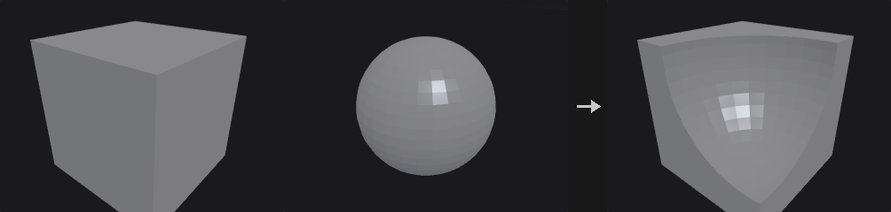

Boolean operations on polygon meshes, backed by the `manifold3d` library rather than a hand-written implementation: robust booleans need exact predicates, coplanar handling, re-triangulation of intersection curves and winding-number classification, and a failure would crash on the user's model.

Both inputs must be **closed manifold meshes**. When they are not, the node reports the reason and where to look.

With *Detriangulate* on, adjacent triangles whose normals differ by less than *Coplanar Tolerance* are merged back into one polygon. Optional output groups mark where each piece of the result came from.

*Shatter* outputs three pieces: A intersect B, A minus B and B minus A, sharing no points (separate them with connectivity). *Seam* outputs only the intersection curve as open polylines. A set treated as *Surface* is thickened into a closed shell by extruding it against its normals (the original faces stay in place), and after the operation only the faces lying on the original surface are kept.

Point, vertex and primitive attributes and groups of A and B are carried to the result. Each output triangle finds the input face it was cut from; floating-point point and vertex attributes are interpolated barycentrically inside that face, integer and string values and group membership come from the nearest corner, and primitive attributes and groups come from the face. An attribute that exists on only one input is 0 (or an empty string) on the other input's faces; when A and B use the same name with a different type or size, A's version is kept. Edge groups are not carried, because the edges are cut.

**Inputs**

| Input | Type | Description |
|---|---|---|
| `a` | GEOMETRY | First operand (set A). |
| `b` | GEOMETRY | Second operand (set B). |

**Outputs**

| Output | Type | Description |
|---|---|---|
| `geo` | GEOMETRY | Result of the Boolean operation. |

**Parameters**

*Set A*

| Parameter | Type | Default | Description |
|---|---|---|---|
| Treat As `treat_a` | menu | Solid | Whether set A is treated as a solid volume or as a surface. Options: Solid (`solid`), Surface (`surface`). |

*Set B*

| Parameter | Type | Default | Description |
|---|---|---|---|
| Treat As `treat_b` | menu | Solid | Whether set B is treated as a solid volume or as a surface. Options: Solid (`solid`), Surface (`surface`). |

| Parameter | Type | Default | Description |
|---|---|---|---|
| Operation `operation` | menu | Subtract | Which Boolean operation to perform. *Shatter* outputs A∩B, A−B and B−A as three separate pieces; *Seam* outputs only the intersection curve as polylines. Options: Subtract (`subtract`), Union (`union`), Intersect (`intersect`), Shatter (`shatter`), Seam (`seam`). |
| Sub-Operation `direction` | menu | A Minus B | For *Subtract*: A minus B, B minus A, or both results. Options: A Minus B (`a-b`), B Minus A (`b-a`), Both (`both`). *Hidden when operation ≠ subtract.* |

*Surface*

| Parameter | Type | Default | Description |
|---|---|---|---|
| Surface Shell `use_surface_opts` | toggle | off | Enables *Shell Thickness* for surface operands. When off, the default thickness 0.01 is used. *Hidden when treat_a = solid treat_b = solid.* |
| Shell Thickness `shell_thickness` | float [1e-05..] | 0.01 | Thickness of the closed shell that a surface operand is extruded into against its normals so it can take part in the Boolean. *Hidden when treat_a = solid treat_b = solid.* *Disabled when use_surface_opts is off.* |

*Detriangulate*

| Parameter | Type | Default | Description |
|---|---|---|---|
| Detriangulate `detriangulate` | toggle | on | Merge nearly coplanar adjacent triangles back into larger polygons. *Hidden when operation = seam.* |
| Coplanar Tolerance `coplanar_tolerance` | float [0.0..90.0] | 0.5 | Adjacent triangles whose normals differ by less than this angle (degrees) are merged into one face. *Hidden when operation = seam.* *Disabled when detriangulate is off.* |

*Output Groups*

| Parameter | Type | Default | Description |
|---|---|---|---|
| Output Groups `use_out_groups` | toggle | off | Create primitive and edge groups describing where the result's faces came from. *Hidden when operation = seam.* |
| A Inside B `a_inside_b` | string | `ainsideb` | Group of faces that come from A and are enclosed by B. Empty means the group is not created. *Hidden when operation = seam.* *Disabled when use_out_groups is off.* |
| A Outside B `a_outside_b` | string | `aoutsideb` | Group of faces that come from A and lie outside B. *Hidden when operation = seam.* *Disabled when use_out_groups is off.* |
| B Inside A `b_inside_a` | string | `binsidea` | Group of faces that come from B and are enclosed by A. In A minus B this is the ring of the cut. *Hidden when operation = seam.* *Disabled when use_out_groups is off.* |
| B Outside A `b_outside_a` | string | `boutsidea` | Group of faces that come from B and lie outside A. *Hidden when operation = seam.* *Disabled when use_out_groups is off.* |
| B Polygons `b_polys` | string | `bpolys` | Group of all faces that come from B. *Hidden when operation = seam.* *Disabled when use_out_groups is off.* |
| A-B Seams `seam_group` | string | `abseams` | Edge group containing the intersection curve of A and B. *Hidden when operation = seam.* *Disabled when use_out_groups is off.* |

**Compared with Houdini**

The *B Polygons* output group does not exist on the Houdini node; it is an addition of this plugin. The node also stands in for part of Intersection Stitch.

---

### Boolean Fracture (PCG)

`PCG_BooleanFracture` · category `PCG/modify` · Houdini: Boolean Fracture (SOP)

Cuts the first input into separate pieces using the second input as the cutting geometry.

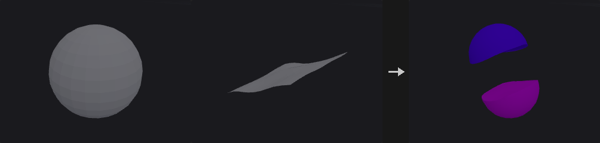

The cutter splits the geometry into one piece per connected component. Each piece gets a name (a prefix plus a number, or appended to the existing name), a piece attribute, interior and exterior face groups, interior and exterior seam edge groups, optional groups for pieces and faces inside a solid cutter, and interior and exterior normals.

When the cutter is treated as a *Surface*, each connected sheet is extruded along its average normal into a half-space and then used in the Boolean. The sheet must therefore pass entirely through the object and must not fold back along its average normal.

The backend is `manifold3d`, which requires closed manifold input. Point and vertex attributes are not carried over; primitive attributes and primitive groups are carried over from the source primitive.

**Inputs**

| Input | Type | Description |
|---|---|---|
| `geo` | GEOMETRY | Geometry to fracture. |
| `cutter` | GEOMETRY | Cutting geometry, interpreted according to *Treat Cutting Geometry As*. |

**Outputs**

| Output | Type | Description |
|---|---|---|
| `geo` | GEOMETRY | The fractured pieces. |
| `report` | STRING | Text summary of the operation. |

**Parameters**

| Parameter | Type | Default | Description |
|---|---|---|---|
| Group `group` | string | *(empty)* | Group pattern restricting which primitives of the first input are fractured. |

*Pieces*

| Parameter | Type | Default | Description |
|---|---|---|---|
| Name Attribute `name_mode` | menu | Overwrite | *Overwrite* replaces the `name` attribute with prefix plus piece number; *Append* adds the piece number to the existing name. Options: Overwrite (`overwrite`), Append (`append`). |
| Fracture Namespace `fracture_namespace` | string | *(empty)* | Text inserted into the name when appending. *Hidden when name_mode ≠ append.* |
| Piece Prefix `piece_prefix` | string | `piece` | Prefix of the generated piece names. |
| Compute Interior Normals `compute_interior_normals` | toggle | on | Compute normals on the newly created interior (cut) faces. |
| Interior Cusp Angle `interior_cusp_angle` | float [0.0..180.0] | 40 | Cusp angle in degrees for the interior normals: edges sharper than this stay hard. *Disabled when compute_interior_normals is off.* |
| Exterior Normals `exterior_normals` | menu | Preserve Existing Normals | What to do with normals on the original outside faces: keep, recompute, or leave them alone. Options: Preserve Existing Normals (`preserve`), Recompute Normals (`recompute`), Do Not Compute Normals (`none`). |
| Exterior Cusp Angle `exterior_cusp_angle` | float [0.0..180.0] | 60 | Cusp angle in degrees used when recomputing exterior normals. *Disabled when exterior_normals = none.* |

*Output Attributes*

| Parameter | Type | Default | Description |
|---|---|---|---|
| Attribute Name Prefix `attribute_prefix` | string | *(empty)* | Prefix added to the names of the attributes this node writes. |
| Primitive Piece `piece_attribute` | string | `piece` | Name of the primitive attribute holding the piece index. |
| Copy Cutting Surface Attributes `copy_cutter_attributes` | string | *(empty)* | Primitive attributes of the cutter (wildcards allowed) that are copied onto the interior faces. |

*Output Groups*

| Parameter | Type | Default | Description |
|---|---|---|---|
| Interior Group `interior_group` | string | `inside` | Name of the primitive group of faces created by the cut. |
| Exterior Group `exterior_group` | string | `outside` | Name of the primitive group of faces that were on the original outside. |
| Merge with Existing Groups `merge_groups` | toggle | on | Merge the output groups with existing groups of the same name instead of replacing them. |
| Interior Seams `interior_seams` | string | *(empty)* | Name of the edge group along the border of the interior faces. Empty means not created. |
| Exterior Seams `exterior_seams` | string | *(empty)* | Name of the edge group along the border of the exterior faces. Empty means not created. |
| Pieces Inside Cutting Geometry `pieces_inside` | string | *(empty)* | Name of the group holding pieces that lie inside a solid cutter. Only used with a solid cutter. *Hidden when treat_cutter ≠ solid.* |
| Surface Inside Cutting Geometry `surface_inside` | string | *(empty)* | Name of the group holding faces that lie inside a solid cutter. Only used with a solid cutter. *Hidden when treat_cutter ≠ solid.* |

*Boolean Settings*

| Parameter | Type | Default | Description |
|---|---|---|---|
| Treat Cutting Geometry As `treat_cutter` | menu | Surface | *Surface* extrudes each connected cutter sheet into a half-space; *Solid* uses the cutter as a closed volume. Options: Surface (`surface`), Solid (`solid`). |
| Detriangulate `detriangulate` | menu | All Polygons | Which polygons are merged back after triangulation: all, only the unchanged ones, or none. Options: All Polygons (`all`), Only Unchanged Polygons (`unchanged`), No Polygons (`none`). |

**Compared with Houdini**

With a surface cutter, a sheet that only cuts partway into the object still severs it here, because the sheet is extruded into a half-space. In Houdini it would not.

---

### Bound (PCG)

`PCG_Bound` · category `PCG/modify` · Houdini: Bound (SOP)

Builds a bounding box, bounding sphere or minimum-volume oriented box around the geometry.

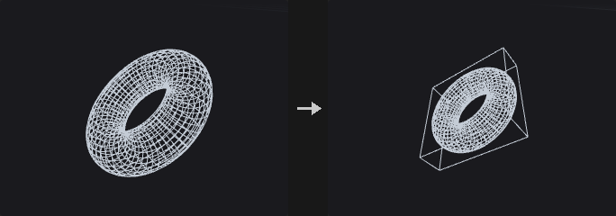

Modes:
- *Bounding Box*: axis-aligned box. Fastest, but it becomes very loose when the object is tilted. A thin rod tilted 45 degrees has an axis-aligned box about 11 times the volume of its oriented box.
- *Bounding Sphere*: rotation invariant, cheap for coarse rejection. It starts from Ritter's algorithm, tightens it by moving toward the farthest point, and finally enlarges the radius so every point is covered.
- *Oriented Bounding Box*: minimum-volume OBB. The optimum always has one face flush with a face of the convex hull, so only hull face normals are tried, each followed by a 2D rotating-calipers fit. Only hull vertices take part, so a 50,000 point cloud may need only a few dozen.

The output carries detail attributes `bound_center`, `bound_size`, `bound_rot` (3x3 matrix, row-major) and `bound_volume`. `bound_rot` can be used to straighten the object or align something else to it: its rows are the box axes, so in Houdini's row-vector convention it maps box-local directions to world space, and [Transform by Attribute (PCG)](modify.md#pcg-transformbyattrib) with Invert Transform (after moving `bound_center` to the origin) straightens the object.

**Inputs**

| Input | Type | Description |
|---|---|---|
| `geo` | GEOMETRY | Geometry to enclose. |

**Outputs**

| Output | Type | Description |
|---|---|---|
| `geo` | GEOMETRY | The bounding shape with the bound_* detail attributes. |

**Parameters**

| Parameter | Type | Default | Description |
|---|---|---|---|
| Group `group` | string | *(empty)* | Group pattern restricting which points are bounded. Empty means all. |
| Bounding Type `mode` | menu | Bounding Box | Type of bounding shape: axis-aligned box, sphere or oriented box. Options: Bounding Box (`box`), Bounding Sphere (`sphere`), Oriented Bounding Box (`oriented`). |
| Uniform Padding `uniform_padding` | float | 0 | Expands the shape outward by this amount on every side. Added to *Padding*. |
| Padding `padding_x` `padding_y` `padding_z` | float | 0, 0, 0 | Per-axis expansion on each side. For the sphere the largest of the three components is used; negative values do not shrink it. |
| Divisions `divisions_x` `divisions_y` `divisions_z` | int [2..4096] | 2, 2, 2 | Number of points per axis on the generated box (minimum 2). *Hidden when mode = sphere.* |
| Columns `sphere_cols` | int [3..4096] | 24 | Number of columns of the generated sphere mesh. *Hidden when mode ≠ sphere.* |
| Rows `sphere_rows` | int [2..4096] | 16 | Number of rows of the generated sphere mesh. *Hidden when mode ≠ sphere.* |
| Max Hull Normals `max_normals` | int [1..65536] | 256 | When the convex hull has more faces than this, only the largest faces' normals are tried, which gives an approximate optimum. *Hidden when mode ≠ oriented.* |
| Hull Tolerance `tolerance` | float [1e-12..1.0] | 1e-06 | Tolerance used when computing the convex hull for the oriented box. *Hidden when mode ≠ oriented.* |

---

### Carve (PCG)

`PCG_Carve` · category `PCG/modify` · Houdini: Carve (SOP)

Cuts a curve at parametric positions or extracts points along it.

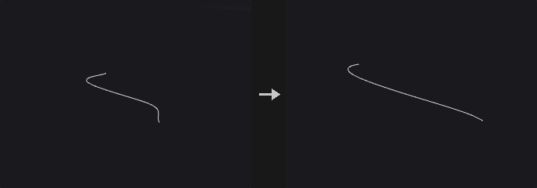

Keeps or extracts a portion of a curve between two U positions. NURBS and Bezier curves are cut by knot insertion, so the result is still a curve of the same type (subdividing into a polyline would lose that and block further degree changes or carving). Polygons and polylines are interpolated linearly by vertex parameter, and the end points land exactly on the requested positions.

In *Cut* mode, enabling only *Second U* keeps the part from 0 to *Second U*, because the disabled end is the curve end point.

Bidirectional U/V carving of surfaces is not implemented.

**Inputs**

| Input | Type | Description |
|---|---|---|
| `geo` | GEOMETRY | Curves to carve. |

**Outputs**

| Output | Type | Description |
|---|---|---|
| `geo` | GEOMETRY | The carved curves or extracted points. |

**Parameters**

| Parameter | Type | Default | Description |
|---|---|---|---|
| Group `group` | string | *(empty)* | Group pattern selecting the primitives to carve. |
| First U `first_u` | float [0.0..1.0] | 0.25 | Parametric position (0 to 1) of the first cut. |
| Use First U `use_first_u` | toggle | on | Enables the first cut. When off, the curve start is used. |
| Second U `second_u` | float [0.0..1.0] | 0.75 | Parametric position (0 to 1) of the second cut. |
| Use Second U `use_second_u` | toggle | off | Enables the second cut. When off, the curve end is used. |
| Use Arc Length `relative_arc_length` | toggle | off | Interprets U by arc length proportion instead of by vertex or knot parameter. |
| Operation `mode` | menu | Cut | *Cut* keeps part of the curve. *Extract* produces one point at each enabled U position (the curve's isoparametric point). Options: Cut (`cut`), Extract (`extract`). |

*Keep*

| Parameter | Type | Default | Description |
|---|---|---|---|
| Keep `use_keep` | toggle | on | Enables the keep options. *Hidden when mode = extract.* |
| Keep Inside `keep_inside` | toggle | on | Keep the part between the two U positions. *Hidden when mode = extract.* |
| Keep Outside `keep_outside` | toggle | off | Keep the parts before the first and after the second U position. *Hidden when mode = extract.* |

**Compared with Houdini**

Carving of surfaces in U/V is not implemented, only curves.

---

### Circle from Edges (PCG)

`PCG_CircleFromEdges` · category `PCG/modify` · Houdini: Circle from Edges (SOP)

Rearranges each closed edge loop in a group into a perfect circle.

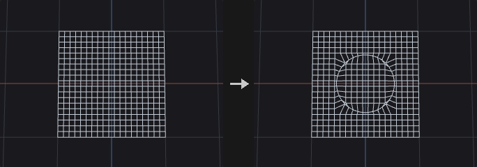

For every closed loop of the edge group, the center is the average of its points and the plane is defined by the loop's Newell normal. Point order along the loop is preserved. Open chains are skipped.

*Even Spacing* distributes the points at equal angles, choosing the phase that moves the points the least. *Rotate* then turns the whole circle about its normal.

**Inputs**

| Input | Type | Description |
|---|---|---|
| `geo` | GEOMETRY | Geometry containing the edge loops. |

**Outputs**

| Output | Type | Description |
|---|---|---|
| `geo` | GEOMETRY | Geometry with the loops moved onto circles. |
| `report` | STRING | Text summary, including skipped loops. |

**Parameters**

| Parameter | Type | Default | Description |
|---|---|---|---|
| Group `edges` | string | *(empty)* | Edge group pattern. Each closed loop in it becomes a circle; open chains are skipped. |
| Radius Type `radius_mode` | menu | Average | How the circle radius is derived from the loop: average, minimum or maximum distance of its points from the center, or a custom value. Options: Average (`average`), Minimum (`min`), Maximum (`max`), Custom (`custom`). |
| Radius `radius` | float [0.0..] | 1 | The circle radius when *Radius Type* is *Custom*. *Hidden when radius_mode ≠ custom.* |
| Even Spacing `even_spacing` | toggle | on | Distribute points at equal angles around the circle. |
| Rotate `rotate` | float [-360.0..360.0] | 0 | Rotation of the circle about its own normal, in degrees. |

---

### Circle Spline (PCG)

`PCG_CircleSpline` · category `PCG/modify` · Houdini: Circle Spline (SOP)

Creates a smooth curve through the input points by blending circular arcs fitted to each three neighbouring points.

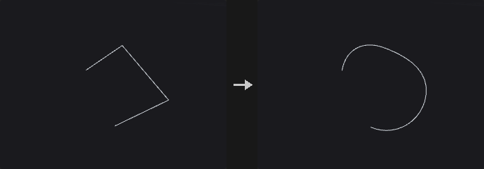

The arcs through each triple of adjacent points are blended pairwise with weight `w = sin^2(pi*t/2)`. The curve passes through every point, and at each point its tangent and curvature equal those of the circle through the previous, current and next points (G2). If all points lie on one circle the result is that circle; where three points are collinear it is a straight line. Each segment gets *Segment Divisions* samples and the other numeric point attributes are interpolated linearly along the segment.

*Helix* fits a helix through each triple instead of a circle, with the axis chosen by *Helix Type*. A point string attribute `splinetype` (`circle` or `helix`) can override the type for the segment centered on that point. *Adjust by Pseudo-Arclength* keeps the point count but redistributes points evenly by arc length.

**Inputs**

| Input | Type | Description |
|---|---|---|
| `geo` | GEOMETRY | Points (or curve points) to interpolate. |

**Outputs**

| Output | Type | Description |
|---|---|---|
| `geo` | GEOMETRY | The generated curve. |
| `report` | STRING | Text summary of the operation. |

**Parameters**

| Parameter | Type | Default | Description |
|---|---|---|---|
| Group `group` | string | *(empty)* | Group pattern selecting the points to use. |
| Spline Type `spline_type` | menu | Circle | Fit circles or helices through each three points. Options: Circle (`circle`), Helix (`helix`). |
| Override Spline Type with Attribute `override_with_attrib` | toggle | off | Reads the string point attribute `splinetype` (`circle` or `helix`) to decide the type of the segment centered on each point. |
| Helix Type `helix_type` | menu | Directional | How the helix axis is chosen: directional, balanced or blended. Options: Directional (`directional`), Balanced (`balanced`), Blended (`blended`). *Disabled when spline_type ≠ helix override_with_attrib is off.* |
| Adjust by Pseudo-Arclength `adjust_arclength` | toggle | off | Redistributes the points along the curve by approximate arc length without changing their number. |
| Arclength Samples `arclength_samples` | int [0..1000] | 4 | Number of samples used for the arc length estimate. *Disabled when adjust_arclength is off.* |
| Segment Divisions `divisions` | int [1..1024] | 8 | Number of samples per segment between two adjacent points. |
| Output Curveu `curveu_name` | string | `curveu` | Name of the output attribute holding the curve U parameter. |
| Use Curveu `use_curveu` | toggle | off | Write the curve U attribute. |
| Output Tangent `tangent_name` | string | `tangentu` | Name of the output tangent attribute. |
| Use Tangent `use_tangent` | toggle | off | Write the tangent attribute. |

**Compared with Houdini**

Houdini's Hybrid and Ellipse spline types are not implemented, because their definitions are not documented.

---

### Clean (PCG)

`PCG_Clean` · category `PCG/modify` · Houdini: Clean (SOP)

Repairs a polygon mesh by fusing points, removing degenerate and duplicate faces, fixing non-manifold edges and orientation, and dropping small pieces.

Runs a fixed sequence of steps: fuse points within the distance, remove degenerate primitives, remove duplicate faces (regardless of start vertex and winding), make manifold, consistently orient polygons, delete small pieces, remove unused points. The report output states how much each step changed.

Make Manifold keeps the two largest faces on an edge shared by more than two faces and splits bow-tie points.

**Inputs**

| Input | Type | Description |
|---|---|---|
| `geo` | GEOMETRY | Mesh to clean. |

**Outputs**

| Output | Type | Description |
|---|---|---|
| `geo` | GEOMETRY | The cleaned mesh. |
| `report` | STRING | Text report with the number of elements changed by each step. |

**Parameters**

| Parameter | Type | Default | Description |
|---|---|---|---|
| Fuse Distance `fuse_distance` | float [0.0..] | 0 | Points closer than this distance are merged. 0 disables point merging. |
| Remove Degenerate Primitives `remove_degenerate` | toggle | on | Remove degenerate primitives. |
| Delete Overlap Polygons `remove_duplicates` | toggle | on | Keep only one of several faces using the same set of points, regardless of start vertex and winding. |
| Make Manifold `make_manifold` | toggle | off | For edges shared by more than two faces keep the two with the largest area, and split bow-tie points. |
| Orient Polygons `orient` | toggle | off | Make the winding of connected polygons consistent. |
| Delete Small Pieces `min_piece_prims` | int [0..] | 0 | Connected pieces with fewer primitives than this are deleted. 0 disables. |
| Remove Unused Points `remove_unused` | toggle | on | Remove points that no primitive uses. |

**Compared with Houdini**

Combines Clean with the repairs of PolyDoctor.

---

### Clip (PCG)

`PCG_Clip` · category `PCG/modify` · Houdini: Clip (SOP), Knife (SOP)

Cuts geometry with a plane and keeps the part below it, above it, or both.

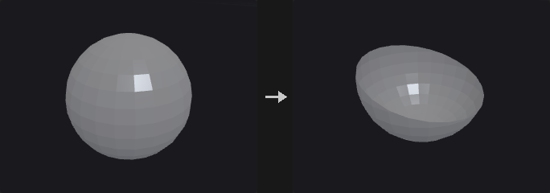

The plane passes through `origin + distance * direction` and has `direction` as its normal. With *Keep = All Primitives* both halves are kept and simply separated along the plane; feed the result into Connectivity or a For-Each loop to process each half on its own.

Wherever the plane cuts an edge a new point is created, and every attribute on it is interpolated from the two end points: position, normals, UVs, point groups and edge groups all carry over.

Concave polygons are ear-clipped into triangles before cutting (Sutherland-Hodgman gives self-intersecting results on concave polygons), so cut concave faces come out as triangles. To get large faces back, follow with Divide using *Remove Shared Edges*. Primitives outside the group are passed through untouched.

**Inputs**

| Input | Type | Description |
|---|---|---|
| `geo` | GEOMETRY | Geometry to cut. |

**Outputs**

| Output | Type | Description |
|---|---|---|
| `geo` | GEOMETRY | The clipped geometry. |

**Parameters**

| Parameter | Type | Default | Description |
|---|---|---|---|
| Group `group` | string | *(empty)* | Group pattern of primitives to cut. Primitives outside the group are kept unchanged. |
| Clip Attribute `clip_attribute` | string | `P` | Point attribute whose first three components define the position that is tested against the plane. The default `P` cuts by position; another attribute such as UV can be used instead. |
| Keep `keep` | menu | Primitives Below the Plane | Which side to keep. *Below* is the side behind the plane normal, *Above* the front side, *All* keeps both halves, split along the plane. Options: Primitives Below the Plane (`below`), Primitives Above the Plane (`above`), All Primitives (`both`). |
| Orient Plane with `orient` | menu | Direction | Define the plane with a direction (plus origin) or with a translate/rotate transform. Options: Direction (`direction`), Transform (`transform`). |
| Direction `dir_x` `dir_y` `dir_z` | float | 0, 1, 0 | Normal of the clipping plane. Need not be normalized, but must not be zero. *Hidden when orient = transform.* |
| Translate `translate_x` `translate_y` `translate_z` | float | 0, 0, 0 | A point on the plane (before *Distance* is applied) when oriented by transform. *Hidden when orient = direction.* |
| Rotate `rotate_x` `rotate_y` `rotate_z` | float | 0, 0, 0 | Rotation in degrees that turns (0,1,0) into the plane normal, applied in X, Y, Z order. *Hidden when orient = direction.* |
| Distance `distance` | float | 0 | Offset of the plane along its normal. |
| Snapping Tolerance `snap_tolerance` | float [0.0..] | 0 | Points within this distance of the plane are first moved onto it, then the cut is made. Only points of cut primitives are moved. 0 disables snapping. |
| Fill Polygons along Clipping Plane `fill` | toggle | off | Closes the cut with new faces along the plane. With *Keep = All* each side gets its own cap. |
| Split Connectivity `split_connectivity` | toggle | off | With *Keep = All*, the upper and lower halves no longer share the points on the cut. *Hidden when keep ≠ both.* |

*Origin*

| Parameter | Type | Default | Description |
|---|---|---|---|
| Origin `use_origin` | toggle | off | Enables a custom origin for the plane when oriented by direction. *Hidden when orient = transform.* |
| Origin `origin_x` `origin_y` `origin_z` | float | 0, 0, 0 | Point the plane passes through (before *Distance* is applied). *Hidden when orient = transform.* |

*Output Groups*

| Parameter | Type | Default | Description |
|---|---|---|---|
| Create Groups `use_out_groups` | toggle | off | Create the output groups below. |
| Above Primitives `above_group` | string | `above` | Primitive group of the faces on the upper side after cutting. |
| Below Primitives `below_group` | string | `below` | Primitive group of the faces on the lower side after cutting. |
| Clipped Edges `seam_group` | string | `clipseam` | Edge group of the edges lying on the cut, handy for a following bevel or edge-to-primitive promotion. |
| Clipped Primitives `clipped_group` | string | *(empty)* | Primitive group of the remaining faces that were actually cut. Empty means not created. |
| Filled Polygons `fill_group` | string | *(empty)* | Primitive group of the cap faces created by *Fill*. Empty means not created. *Disabled when fill is off.* |

**Compared with Houdini**

The base normal (0,1,0) and the X-Y-Z rotation order for *Transform* orientation are not documented by SideFX; this node assumes them. Also covers the planar use of Knife.

**Tips**

- Use *Keep = All Primitives* followed by Connectivity to cut an object apart and process each part individually.

---

### Convert (PCG)

`PCG_Convert` · category `PCG/modify` · Houdini: Convert (SOP), Convert Volume (SOP)

Converts primitives between polygon, polyline, point, NURBS, Bezier and volume representations.

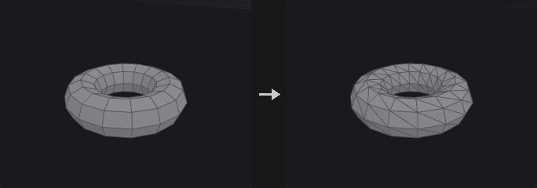

Changes the primitive type of the selected geometry. Splines are tessellated to polygons or polylines using the *Divisions* setting, and polygons can be fitted into NURBS or Bezier curves and surfaces. The volume targets rasterize the geometry into a signed-distance (SDF) or fog volume.

NURBS support is limited to **uniform clamped knot vectors**; arbitrary non-uniform knots are not supported, because attributes here are fixed-size arrays and a per-primitive variable-length knot vector does not fit. Uniform clamped covers everything the Houdini Convert SOP produces.

**Inputs**

| Input | Type | Description |
|---|---|---|
| `geo` | GEOMETRY | Geometry to convert. |

**Outputs**

| Output | Type | Description |
|---|---|---|
| `geo` | GEOMETRY | The converted geometry. |

**Parameters**

| Parameter | Type | Default | Description |
|---|---|---|---|
| Group `group` | string | *(empty)* | Group pattern selecting the primitives to convert. |
| Convert To `convert_to` | menu | Triangles | Target representation. Options: Triangles (`triangles`), Polygon (`polygons`), Polyline (`polylines`), Points (`points`), NURBS Curve (`nurbs_curve`), NURBS Surface (`nurbs_surface`), Bezier Curve (`bezier_curve`), Bezier Surface (`bezier_surface`), Volume (SDF) (`volume_sdf`), Volume (Fog) (`volume_fog`). |

*Divisions*

| Parameter | Type | Default | Description |
|---|---|---|---|
| Use Tessellation `use_tessellation` | toggle | on | Enables the *Divisions* setting; when off a default tessellation is used. *Hidden when use_tessellation is on.* |
| Divisions `u_divs` `v_divs` | int [2..512] | 16, 16 | Number of subdivisions per span when converting splines to polygons. The second value (V) only matters for surfaces. *Hidden when convert_to = nurbs_curve } { convert_to = nurbs_surface } { convert_to = bezier_curve } { convert_to = bezier_surface } { convert_to = volume_sdf } { convert_to = volume_fog.* |

*NURBS*

| Parameter | Type | Default | Description |
|---|---|---|---|
| Use NURBS Opts `use_nurbs_opts` | toggle | on | Enables the NURBS/Bezier order and interpolation settings. *Hidden when use_nurbs_opts is on.* |
| U Order `u_order` | int [2..11] | 4 | Curve order (degree + 1) in U for NURBS and Bezier targets. *Hidden when convert_to ≠ nurbs_curve convert_to ≠ nurbs_surface convert_to ≠ bezier_curve convert_to ≠ bezier_surface.* |
| V Order `v_order` | int [2..11] | 4 | Curve order in V for surface targets. *Hidden when convert_to ≠ nurbs_surface convert_to ≠ bezier_surface.* |
| Interpolate Through Hulls `interpolate_through_hulls` | toggle | off | Make the resulting spline pass through the input points instead of using them as control points. *Hidden when convert_to ≠ nurbs_curve convert_to ≠ nurbs_surface convert_to ≠ bezier_curve convert_to ≠ bezier_surface.* |

*Volume*

| Parameter | Type | Default | Description |
|---|---|---|---|
| Use Volume `use_volume` | toggle | on | Enables the volume resolution, radius and padding settings. *Hidden when use_volume is on.* |
| Volume Resolution `vol_res_x` `vol_res_y` `vol_res_z` | int [2..512] | 48, 48, 48 | Voxel resolution of the generated volume along each axis. *Hidden when convert_to ≠ volume_sdf convert_to ≠ volume_fog.* |
| Point Radius `vol_radius` | float [0.0..10000.0] | 0 | Radius given to each point when producing a fog volume. 0 picks a value automatically from the point spacing. *Hidden when convert_to ≠ volume_fog.* |
| Padding `vol_pad` | float [0.0..2.0] | 0.15 | Extra space around the geometry bounds included in the volume. *Hidden when convert_to ≠ volume_sdf convert_to ≠ volume_fog.* |

| Parameter | Type | Default | Description |
|---|---|---|---|
| Volume Offset `iso` | float | 0 | Offset applied to the volume surface level when converting from volumes. *Hidden when convert_to = volume_sdf } { convert_to = volume_fog.* |

**Compared with Houdini**

NURBS are limited to uniform clamped knots. The volume options approximate parts of Convert VDB and VDB from Polygons.

---

### Convex Decompose (PCG)

`PCG_ConvexDecompose` · category `PCG/modify` · Houdini: Convex Decomposition (SOP)

Splits a concave solid into a set of convex pieces (approximate convex decomposition).

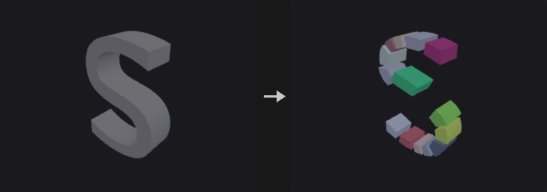

A convex hull only gives the outer skin of a shape, and for an L, a bowl or a chair that smooths away exactly what makes the shape. Physics engines handle convex bodies fast and concave ones slowly or not at all, hence the decomposition.

**Concavity is measured by volume**: `1 - solid volume / hull volume`. It is exactly 0 for a convex piece and tells how much air the hull would add. (Defining it as the distance from the most concave point to the hull would let a negligible spike make the whole object look very concave.)

**Each split minimizes the sum of the two child hull volumes.** Candidates are three axes times *Split Candidates* minus 1 positions; each is really cut and both hulls computed. By default the axes are those of the oriented bounding box, not the world axes; world axes cut a tilted L badly, and the OBB axes also make the result rotation covariant.

**Max Pieces is a global budget, not a depth limit.** A heap ordered by absolute concave volume always splits the worst piece first. After each cut the pieces are split into connected components, so a cut across the opening of a U does not leave one piece whose hull fills the gap.

Output modes: *Convex Hulls* replaces each piece by its hull (what collision proxies need; total volume is at least the original). *Exact Pieces* keeps the cut solids, whose total volume equals the original exactly.

**Max Hull Points** caps the vertex count of each hull for engine collision. 32 points (at most 60 triangles) usually stays within a few centimetres of a 2 m rock.

**Inputs**

| Input | Type | Description |
|---|---|---|
| `geo` | GEOMETRY | Closed solid to decompose. |

**Outputs**

| Output | Type | Description |
|---|---|---|
| `geo` | GEOMETRY | The convex pieces, tagged with the piece and name attributes. |

**Parameters**

| Parameter | Type | Default | Description |
|---|---|---|---|
| Output `mode` | menu | Convex Hulls | *Convex Hulls* replaces each piece by its convex hull; *Exact Pieces* keeps the actual cut solids (volume is conserved). Options: Convex Hulls (`hull`), Exact Pieces (`exact`). |
| Max Concavity `max_concavity` | float [0.0..1.0] | 0.05 | Residual concavity (1 - volume / hull volume) a piece is allowed to keep before it is split further. |
| Max Pieces `max_pieces` | int [1..4096] | 32 | Global budget for the number of pieces. |
| Max Hull Points `max_hull_points` | int [0..4096] | 0 | Vertex budget for each hull in *Convex Hulls* mode; 0 = no limit. Engines limit convex colliders (Unity rejects more than 255 triangles) and simulate small hulls faster. The points are chosen greedily, like a quickhull stopped early: start from a tetrahedron and keep adding the vertex farthest outside the current hull. The reduced hull uses a subset of the full hull's vertices, so it never grows; what it cuts off is at most the distance of the farthest vertex left out. *Disabled when mode = exact.* |

*Search*

| Parameter | Type | Default | Description |
|---|---|---|---|
| Split Candidates `resolution` | int [2..64] | 8 | Number of candidate cut positions tried per axis. |
| Split Axes `split_axes` | menu | Oriented (OBB) | Cut along the axes of the oriented bounding box, or along the world axes. Options: Oriented (OBB) (`oriented`), World Axes (`world`). |
| Min Piece Fraction `min_fraction` | float [0.0..0.5] | 0.02 | Smallest fraction of the volume a piece may have; avoids slivers. |
| Cap Type `cap_mode` | menu | N-gon | How the cut faces are built in *Exact Pieces* mode: single n-gon, fan or triangles. Options: N-gon (`ngon`), Fan (`fan`), Triangles (`triangles`). *Disabled when mode = hull.* |
| Tolerance `tolerance` | float [1e-09..1.0] | 1e-05 | Geometric tolerance for the hull and cutting computations. |

| Parameter | Type | Default | Description |
|---|---|---|---|
| Piece Attribute `piece_attribute` | string | `piece` | Name of the primitive attribute holding the piece index. |
| Name Attribute `name_attribute` | string | `name` | Name of the primitive string attribute holding the piece name. |
| Name Prefix `name_prefix` | string | `convex` | Prefix of the piece names. |

---

### Convex Hull (PCG)

`PCG_ConvexHull` · category `PCG/modify`

Builds the 3D convex hull of the input points.

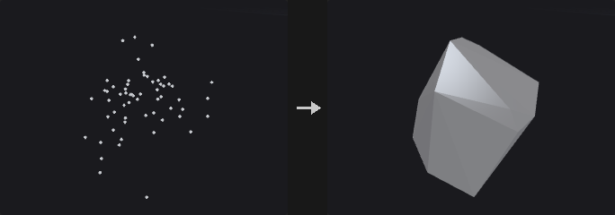

Useful for collision proxies, for wrapping a point cloud into a solid, for the exact answer to how much space a set of points occupies, and as the basis of the oriented mode of Bound.

The algorithm is quickhull: each round takes the farthest outside point as a new vertex, deletes the faces visible from it and joins the horizon to it with new faces. Visible faces are found by flood-filling over adjacency from the starting face, not by scanning all faces, because a full scan can report a nearly coplanar far face as visible because of floating point noise and break the horizon into two loops.

Degenerate input does not raise an error but drops a dimension: coplanar points give a polygon, collinear points a line segment, coincident points a single point.

**Inputs**

| Input | Type | Description |
|---|---|---|
| `geo` | GEOMETRY | Points or geometry whose points are wrapped. |

**Outputs**

| Output | Type | Description |
|---|---|---|
| `geo` | GEOMETRY | The convex hull. |

**Parameters**

| Parameter | Type | Default | Description |
|---|---|---|---|
| Group `group` | string | *(empty)* | Group pattern selecting the points to wrap. Empty means all points. |
| Merge Coplanar Faces `merge_coplanar_faces` | toggle | on | Merge coplanar triangles into polygons (a cube becomes 6 quads, not 12 triangles). Turn it off when a pure triangle mesh is needed, e.g. for a collision proxy. |
| Tolerance `tolerance` | float [1e-12..1.0] | 1e-06 | Distance beyond a face at which a point counts as outside. Points are stored as float32, so values near 1e-9 would treat quantization noise as real bulges and create zero-area slivers. |

**Compared with Houdini**

Degenerate input (coplanar, collinear or coincident points) produces a polygon, line or point, where Houdini returns empty geometry.

---

### Crease (PCG)

`PCG_Crease` · category `PCG/modify` · Houdini: Crease (SOP)

Writes a fractional crease weight onto edges for later subdivision.

Writes the weight into the vertex attribute `creaseweight` (or the attribute you name). For every selected edge, the half-edge start vertex on both sides of the edge is written. Subdivide reads this attribute for semi-sharp creases: with a weight of 1 or more the edge is sharp for that round, values between 0 and 1 blend, and the weight decreases by 1 each subdivision round.

**Inputs**

| Input | Type | Description |
|---|---|---|
| `geo` | GEOMETRY | Geometry with edges to crease. |

**Outputs**

| Output | Type | Description |
|---|---|---|
| `geo` | GEOMETRY | Geometry with the crease attribute set. |
| `report` | STRING | Text summary of what was changed. |

**Parameters**

| Parameter | Type | Default | Description |
|---|---|---|---|
| Group `edges` | string | *(empty)* | Edge group pattern. Empty means all edges. |
| Operation `mode` | menu | Set | How the weight combines with the existing value: set it, add to it, multiply it, or take the maximum. Options: Set (`set`), Add (`add`), Multiply (`multiply`), Maximum (`max`). |
| Crease Weight `weight` | float [0.0..100.0] | 2 | The crease weight. |
| Crease Attribute `attribute` | string | `creaseweight` | Name of the vertex attribute that stores the weight. Subdivide reads it for semi-sharp creases. |

---

### Curve Fillet (PCG)

`PCG_CurveFillet` · category `PCG/modify`

Rounds polyline corners with circular arcs.

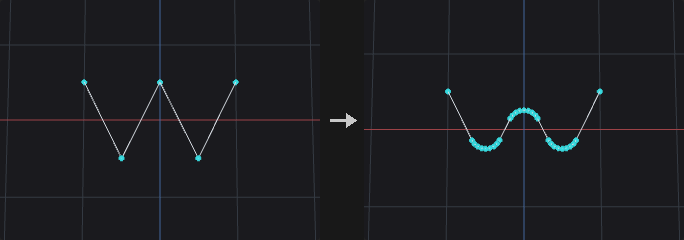

Replaces the selected corners of polylines with circular arcs of the given radius, tangent to both neighbouring segments. With *Limit Radius* the arc shrinks where a segment is too short to fit it, so neighbouring fillets never overlap.

Closed polylines and polygons have every point treated as a corner; open curves keep their end points. Nearly straight corners are left alone. The arc points copy the corner's point attributes.

**Inputs**

| Input | Type | Description |
|---|---|---|
| `geo` | GEOMETRY | Curves (and closed polygons) to fillet. |

**Outputs**

| Output | Type | Description |
|---|---|---|
| `geo` | GEOMETRY | The rounded curves. |
| `report` | STRING | Number of corners rounded and the new point count. |

**Parameters**

| Parameter | Type | Default | Description |
|---|---|---|---|
| Group `group` | string | *(empty)* | Curves (primitives) to fillet. |
| Corner Points `points` | string | *(empty)* | Corner points to round. Empty means all corners. |
| Radius `radius` | float [0.0..] | 0.1 | Radius of the arcs. |
| Divisions `divisions` | int [1..512] | 6 | Number of segments per arc. |
| Limit Radius `limit_radius` | toggle | on | Shrink the arc where the neighbouring segments are shorter than the arc needs. |
| Include Closed Curves `include_closed` | toggle | on | Also round closed polylines and polygons. |

---

### Curve Intersect (PCG)

`PCG_CurveIntersect` · category `PCG/modify` · Houdini: Curve Intersect (SOP)

Finds intersections between curves and outputs points, split curves, or Houdini-style cut and extract results.

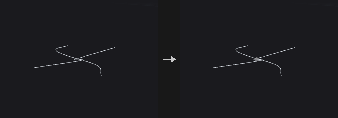

Intersects curves pairwise. With *Plane* set to XZ, XY or YZ the test is made on the projection onto that plane (a road network is intersected from above); *3D* requires two segments to actually come within *Tolerance* of each other.

Output modes:
- *Intersection Points*: only the intersection points, carrying `prim_a`, `prim_b`, `u_a` and `u_b` (the two primitives and their curve parameters).
- *Split Curves*: cuts the curves at the intersections, with the intersection points shared, so the result is a connected network that Find Shortest Path can walk directly. The intersection points go into *Point Group*.
- *Cut* and *Extract* follow the Houdini Method semantics: intersect between the left curves (selected by *Group*) and the right curves (*Cutter Group*; they come from the second input *cutter*, or from the main geometry when it is not connected). *Cut* cuts both sides into segments and keeps the odd or even numbered ones as chosen; *Extract* outputs the intersection points (*Affect* chooses left, right or both, and *Keep Original* keeps the curves).

**Inputs**

| Input | Type | Description |
|---|---|---|
| `geo` | GEOMETRY | Curves to intersect (the left side). |
| `cutter` *(optional)* | GEOMETRY | Optional second set of curves for the right side of *Cut* and *Extract*. If not connected, the right curves are taken from the main geometry using *Cutter Group*. |

**Outputs**

| Output | Type | Description |
|---|---|---|
| `geo` | GEOMETRY | Intersection points, split curves, or the cut/extract result depending on *Output*. |
| `report` | STRING | Text summary of the operation. |

**Parameters**

| Parameter | Type | Default | Description |
|---|---|---|---|
| Face Group `group` | string | *(empty)* | Group pattern selecting the curves to test (the left side for *Cut* and *Extract*). |
| Cutter Group `cutter_group` | string | *(empty)* | Group pattern selecting the right-side curves for *Cut* and *Extract*. *Hidden when output = points } { output = split.* |
| Intersect In `plane` | menu | XZ Plane (Top) | Projection plane for the test, or *3D* for a true 3D proximity test. Options: 3D (`3d`), XZ Plane (Top) (`xz`), XY Plane (`xy`), YZ Plane (`yz`). |
| Tolerance `tolerance` | float [0.0..] | 0.0001 | Maximum distance between two curves for them to count as intersecting. |
| Find All Intersections `find_all` | toggle | on | Find every intersection between a pair of curves. When off, only the closest one per pair is taken (it does not need to be within *Tolerance*). *Hidden when output = points } { output = split.* |
| Self Intersections `self_intersect` | toggle | on | Also test each curve against itself. *Hidden when output = cut } { output = extract.* |
| Output `output` | menu | Split Curves | What to produce: points, split curves, or the Houdini-style *Cut* / *Extract* between a left and a right set. Options: Intersection Points (`points`), Split Curves (`split`), Cut (Houdini Method) (`cut`), Extract (Houdini Method) (`extract`). |
| Intersection Group `point_group` | string | `intersections` | Name of the point group that receives the intersection points in *Split Curves* mode. *Hidden when output ≠ split.* |
| Left-face Pieces `left_pieces` | menu | Keep All | Which of the pieces cut from the left curves to keep: all, odd-numbered, even-numbered or none. Options: Keep All (`keep_all`), Keep Odd-numbered Ones (`keep_odd`), Keep Even-numbered Ones (`keep_even`), Keep None (`keep_none`). *Hidden when output ≠ cut.* |
| Right-face Pieces `right_pieces` | menu | Keep All | Which of the pieces cut from the right curves to keep: all, odd-numbered, even-numbered or none. Options: Keep All (`keep_all`), Keep Odd-numbered Ones (`keep_odd`), Keep Even-numbered Ones (`keep_even`), Keep None (`keep_none`). *Hidden when output ≠ cut.* |
| Affect `affect` | menu | Left Input | Which side the *Extract* result is applied to. Options: Left Input (`left`), Right Input (`right`), Both Inputs (`both`). *Hidden when output ≠ extract.* |
| Keep Original `keep_original` | toggle | off | Keep the original curves in the *Extract* output. *Hidden when output ≠ extract.* |

---

### Delete (PCG)

`PCG_Delete` · category `PCG/modify` · Houdini: Delete (SOP), Point Delete (COP)

Deletes points, primitives or edges chosen by group, number, bounding volume, normal, degeneracy, random chance or an expression.

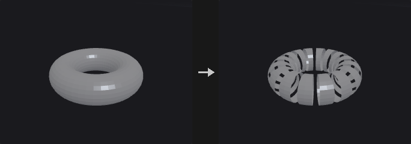

Where Blast deletes by group, Delete covers conditions a group pattern cannot express: every Nth element, everything outside a box, faces pointing away from a direction.

The filters combine as an **intersection**: `group AND number AND bounding volume AND normal AND expression`, and a disabled filter selects everything. So first pick an area with the group, then delete every third element in it; turning on another filter narrows the selection and never widens it.

With no filter enabled and an empty group the node **does nothing**, since treating an empty group as everything would wipe the whole geometry. When *Entity* is *Edges*, only the group is honoured and the filter sections below do not apply; the end points of the selected edges are deleted.

**Inputs**

| Input | Type | Description |
|---|---|---|
| `geo` | GEOMETRY | Geometry to delete from. |

**Outputs**

| Output | Type | Description |
|---|---|---|
| `geo` | GEOMETRY | Geometry with the selected elements removed. |

**Parameters**

| Parameter | Type | Default | Description |
|---|---|---|---|
| Group `group` | string | *(empty)* | Group pattern, intersected with the filters below. With every filter off and the group empty nothing is deleted. For *Edges* this is an edge group. |
| Entity `entity` | menu | Points | Whether points, primitives or edges are deleted. For edges only the group is used. Options: Points (`point`), Primitives (`prim`), Edges (`edge`). |
| Operation `operation` | menu | Delete Selected | *Delete Selected* removes the selection; *Delete Non-Selected* keeps only the selection. Options: Delete Selected (`delete_selected`), Delete Non-Selected (`keep_selected`). |
| Keep Points `keep_points` | toggle | off | When deleting primitives, keep their points in the geometry. *Hidden when entity = point } { entity = edge.* |
| Delete Unused Groups `delete_unused_groups` | toggle | off | Remove groups that have no members left after the deletion. |

*Number › Number*

| Parameter | Type | Default | Description |
|---|---|---|---|
| Enable `use_number` | toggle | off | Enables the filter by element number. |
| Operation `number_mode` | menu | Delete by Pattern (Every Nth) | *Every Nth* hits every Nth element starting at *Start*; *Range* takes the first N of every M within the range; *Pattern* uses a number pattern. Options: Delete by Pattern (Every Nth) (`every_nth`), Delete by Range (`range`), Delete by Pattern (`pattern`). |
| Pattern `number_pattern` | string | `!*` | Number pattern: `0 5 12`, `0-20`, `0-20:3`, `!3-5` or `*`. *Hidden when number_mode ≠ pattern.* |
| Start `number_start` | int [0..] | 0 | First element number of the filtered range. *Hidden when number_mode = pattern.* |
| End `number_end` | int [-1..] | -1 | Last element number of the filtered range. -1 means up to the end. *Hidden when number_mode = pattern.* |
| Select _ of _ `select_num` `select_of` | int [1..65536] | 1, 1 | Take the first N (left value) of every M (right value) elements in the range. *Hidden when number_mode ≠ range.* |
| Every `number_step` | int [1..65536] | 2 | Starting from *Start*, every how many elements one is hit. *Hidden when number_mode ≠ every_nth.* |

*Bounding Volume › Bounding Volume*

| Parameter | Type | Default | Description |
|---|---|---|---|
| Enable `use_volume` | toggle | off | Enables the bounding volume filter. |
| Bounding Type `volume_type` | menu | Bounding Box | Shape of the volume: box or sphere. Options: Bounding Box (`box`), Bounding Sphere (`sphere`). |
| Center `center_x` `center_y` `center_z` | float | 0, 0, 0 | Center of the bounding volume. |
| Size `size_x` `size_y` `size_z` | float | 1, 1, 1 | Size of the bounding box along each axis. *Hidden when volume_type ≠ box.* |
| Radius `radius` | float [0.0..] | 1 | Radius of the bounding sphere. *Hidden when volume_type ≠ sphere.* |
| Invert `volume_invert` | toggle | off | Select the elements outside the volume instead of inside. |

*Normal › Normal*

| Parameter | Type | Default | Description |
|---|---|---|---|
| Enable `use_normal` | toggle | off | Enables the normal filter. |
| Direction `direction_x` `direction_y` `direction_z` | float | 0, 1, 0 | Direction the normals are compared against. |
| Spread Angle `spread_angle` | float [0.0..180.0] | 45 | Maximum angle in degrees between the element normal and *Direction* for it to be selected. |
| Normal Attribute `normal_attribute` | string | *(empty)* | Attribute to take normals from. Empty: primitives use the computed face normal, points use `N`. |
| Invert `normal_invert` | toggle | off | Select the elements that do not point toward the direction. |

*Degenerate › Degenerate*

| Parameter | Type | Default | Description |
|---|---|---|---|
| Enable `use_degenerate` | toggle | off | Enables the degenerate primitive filter. |
| Delete Degenerate Primitives `degenerate` | toggle | on | Select primitives that are degenerate (for example with repeated points). |
| Delete Zero-Area Faces `zero_area` | toggle | off | Select primitives with area below the tolerance. |
| Treat Open Faces as Closed `open_faces` | toggle | off | Also select open polylines whose perimeter is smaller than the tolerance. |
| Tolerance `degenerate_tolerance` | float [0.0..] | 0.001 | Tolerance for zero-area and open-face tests. Area is compared against its square, perimeter directly. *Disabled when zero_area is off open_faces is off.* |

*Random › Random*

| Parameter | Type | Default | Description |
|---|---|---|---|
| Enable `use_random` | toggle | off | Enables the random filter. |
| Global Seed `rand_seed` | int [0..] | 0 | Seed of the random choice. |
| Seed Attribute `seed_attribute` | string | `id` | Integer attribute used instead of the element number as the random input. *Disabled when use_seed_attribute is off.* |
| Use Seed Attribute `use_seed_attribute` | toggle | off | Use the seed attribute instead of the element number. |
| Percent `percent` | float [0.0..100.0] | 50 | Percentage of elements selected, from 0 to 100. |

*Expression › Expression*

| Parameter | Type | Default | Description |
|---|---|---|---|
| Enable `use_expression` | toggle | off | Enables the expression filter. |
| Filter Expression `expression` | string | `@P.y > 0` | Boolean expression using the group expression syntax, for example `@P.y > 0`. |

**Compared with Houdini**

Intersection of all filters corresponds to the Houdini Delete SOP's behaviour of combining its selection tabs.

---

### Dissolve (PCG)

`PCG_Dissolve` · category `PCG/modify` · Houdini: Dissolve (SOP)

Removes selected edges and merges the faces on either side of them into one.

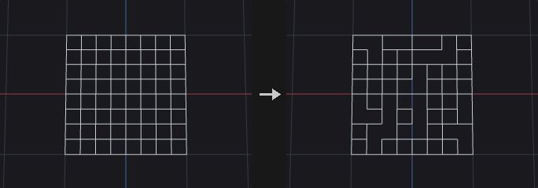

This is the same machinery as Remove Shared Edges in Divide, with a different granularity: Divide works on a primitive group and merges all interior edges between the selected faces, while Dissolve works on an edge group and merges only the edges you picked.

Connected selected edges are merged into one block in a single step instead of one by one, because merging one by one needs a topology rebuild each time and intermediate states may not be valid polygons. A block that does not yield a **single** boundary loop (it has holes) is left as it is, since a primitive can store only one vertex loop; the *Bridge* option decides what happens to such blocks.

*Remove Inline Points* is on by default and is the easily overlooked half of Dissolve: after merging, the end points of a dissolved edge typically have only two edges left and are collinear, so the face count drops while the vertex count does not. The test uses an angle rather than exact collinearity, as computed edges are rarely exactly collinear.

Boundary edges, which have only one face, are skipped, and their number is written to the detail attribute `dissolve_skipped`.

**Inputs**

| Input | Type | Description |
|---|---|---|
| `geo` | GEOMETRY | Geometry with edges to dissolve. |

**Outputs**

| Output | Type | Description |
|---|---|---|
| `geo` | GEOMETRY | Geometry with the faces merged. |

**Parameters**

| Parameter | Type | Default | Description |
|---|---|---|---|
| Group `edge_group` | string | *(empty)* | Edge group to dissolve. Empty selects no edges, which with *Dissolve Non-Selected* means all edges are dissolved. |
| Operation `operation` | menu | Dissolve Selected | Dissolve the selected edges, or all edges except the selected. Options: Dissolve Selected (`selected`), Dissolve Non-Selected (`non_selected`). |
| Recompute Normals `recompute_normals` | toggle | off | Recompute normals on the class that already had `N`. Normals are not created where none existed. |
| Remove Inline Points `remove_inline_points` | toggle | on | Remove points left on straight lines after the merge. |
| Collinearity Tolerance `inline_tolerance` | float [0.0..90.0] | 0.1 | Angle in degrees below which three points count as collinear. *Disabled when remove_inline_points is off.* |
| Remove Unused Points `delete_lone_points` | toggle | off | Delete points that no primitive uses after dissolving. |
| Bridge `bridge` | menu | Leave Polygons Unmerged | What to do when a merged block has holes: leave the polygons unmerged, create bridged polygons, or delete them. Options: Leave Polygons Unmerged (`leave`), Create Bridged Polygons (`bridged`), Delete Polygons (`delete`). |
| Boundary Edge Group `output_boundary_group` | string | *(empty)* | Name of an edge group that receives the outer border of the merged faces. Empty means not created. |

**Compared with Houdini**

The *Create Disjoint Polygons* bridge option is not implemented.

---

### Divide (PCG)

`PCG_Divide` · category `PCG/modify` · Houdini: Divide (SOP)

Triangulates or splits faces into convex polygons, cuts them into bricks, merges shared edges, or computes the dual.

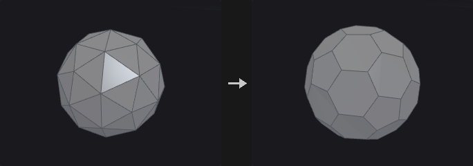

Triangulation is done carefully here: convex faces use a fan (linear time, and most faces are convex), concave faces use ear clipping. The Convert node's *Triangles* option is a plain fan, which gives triangles that reach outside the shape on concave n-gons, and concave n-gons are common in the output of Boolean, PolyBevel and Carve. Use this node when correct triangles are needed.

With *Maximum Edges* above 3, faces are first ear-clipped and then greedily merged back into convex polygons, only across diagonals and only when the result is still convex, so the covered area is unchanged.

*Bricker Polygons* cuts faces with three sets of parallel planes spaced by *Brick Size*, handy for floors and window panes of buildings. Smooth Polygons is not implemented (use Subdivide).

**Inputs**

| Input | Type | Description |
|---|---|---|
| `geo` | GEOMETRY | Geometry to divide. |

**Outputs**

| Output | Type | Description |
|---|---|---|
| `geo` | GEOMETRY | The divided geometry. |

**Parameters**

| Parameter | Type | Default | Description |
|---|---|---|---|
| Group `group` | string | *(empty)* | Group pattern of primitives to process. |

*Convex Polygons*

| Parameter | Type | Default | Description |
|---|---|---|---|
| Convex Polygons `convex_polygons` | toggle | on | Split faces into convex polygons. |
| Maximum Edges `max_edges` | int [3..4096] | 3 | Maximum number of edges of the resulting polygons. 3 gives triangles. *Disabled when convex_polygons is off.* |
| Don't Generate Slivers `avoid_slivers` | toggle | off | Prefer triangulations that avoid thin sliver triangles. Applies when non-planar triangulation is on. *Disabled when convex_polygons is off triangulate_nonplanar is off.* |
| Avoid Small Angles `avoid_small_angles` | toggle | off | Prefer triangulations that avoid very small angles. Applies when non-planar triangulation is on. *Disabled when convex_polygons is off triangulate_nonplanar is off.* |

*Triangulate Non-Planar*

| Parameter | Type | Default | Description |
|---|---|---|---|
| Triangulate Non-Planar `triangulate_nonplanar` | toggle | on | Triangulate polygons that are not planar. |
| Tolerance `planar_tolerance` | float [0.0..] | 0.0001 | Distance within which a polygon is considered planar. *Disabled when triangulate_nonplanar is off.* |

*Bricker Polygons*

| Parameter | Type | Default | Description |
|---|---|---|---|
| Bricker Polygons `brick_polygons` | toggle | off | Cut faces into bricks using planes spaced by the brick size. |
| Size `brick_size_x` `brick_size_y` `brick_size_z` | float [0.0..] | 1, 1, 1 | Spacing of the cutting planes along each axis. *Disabled when brick_polygons is off.* |
| Offset `brick_offset_x` `brick_offset_y` `brick_offset_z` | float | 0, 0, 0 | Offset of the brick grid along each axis. *Disabled when brick_polygons is off.* |
| Angle `brick_angle_x` `brick_angle_y` `brick_angle_z` | float [-3600..3600] | 0, 0, 0 | Rotation of the brick grid in degrees about each axis. *Disabled when brick_polygons is off.* |
| Bricker Shared Edges `brick_shared_edges` | toggle | on | Keep the points on cuts shared between neighbouring bricks. *Disabled when brick_polygons is off.* |

*Remove Shared Edges*

| Parameter | Type | Default | Description |
|---|---|---|---|
| Remove Shared Edges `remove_shared_edges` | toggle | off | Merge the primitives of the group by removing the edges between them. |

*Compute Dual*

| Parameter | Type | Default | Description |
|---|---|---|---|
| Compute Dual `compute_dual` | toggle | off | Replace the mesh with its dual: one point per face and one face per original point. |
| Attributes to Swap `attributes_to_swap` | string | `* ^P` | Attributes exchanged between the original and the dual elements. Wildcard pattern, default is everything except `P`. *Disabled when compute_dual is off.* |

**Compared with Houdini**

Smooth Polygons is not implemented; use the Subdivide node.

---

### Edge Collapse (PCG)

`PCG_EdgeCollapse` · category `PCG/modify` · Houdini: Edge Collapse (SOP)

Collapses each connected run of selected edges into a single point at the run's center.

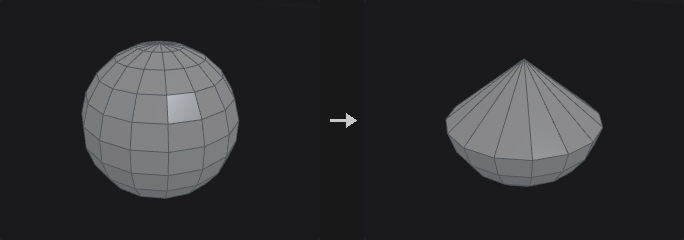

Edges in the group that are connected in a chain are collapsed into one point placed at the center of the chain's points. Afterwards duplicate corners and faces that can no longer stand are removed.

**Inputs**

| Input | Type | Description |
|---|---|---|
| `geo` | GEOMETRY | Geometry with edges to collapse. |

**Outputs**

| Output | Type | Description |
|---|---|---|
| `geo` | GEOMETRY | Geometry after the collapse. |
| `report` | STRING | Text summary of what was changed. |

**Parameters**

| Parameter | Type | Default | Description |
|---|---|---|---|
| Group `edges` | string | *(empty)* | Edge group pattern. Empty means all edges. |
| Remove Degenerate Primitives `remove_degenerate` | toggle | on | Remove duplicate corners and faces that collapse to fewer than three corners. |

---

### Edge Divide (PCG)

`PCG_EdgeDivide` · category `PCG/modify` · Houdini: Edge Divide (SOP)

Inserts points on selected edges and optionally connects them to split the faces.

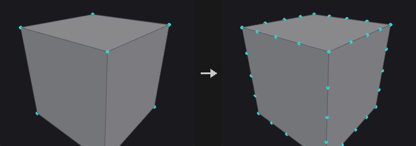

Inserting points and connecting them are two separate steps. Insertion is safe for any face; connecting has a unique answer only when exactly two edges of a face are cut, since otherwise there is no non-arbitrary choice for where a point should connect.

- Face with 0 edges cut: unchanged.
- Face with 2 edges cut and *Connect* on: split into *Cuts* + 1 pieces.
- Any other case: points are inserted only and the face becomes an n-gon with more edges.

Cut positions can be given explicitly (`0.2 0.5 0.9`); otherwise the edge is divided evenly according to *Cuts*.

**Inputs**

| Input | Type | Description |
|---|---|---|
| `geo` | GEOMETRY | Geometry with edges to divide. |

**Outputs**

| Output | Type | Description |
|---|---|---|
| `geo` | GEOMETRY | Geometry with the new points and cuts. |

**Parameters**

| Parameter | Type | Default | Description |
|---|---|---|---|
| Group `edge_group` | string | *(empty)* | Edge group pattern of the edges to divide. |
| Divisions `cuts` | int [1..64] | 1 | Number of evenly spaced points inserted on each edge. Ignored when *Cut Positions* is set. *Disabled when cut_positions ≠ "".* |
| Cut Positions `cut_positions` | string | *(empty)* | Custom parameter positions along the edge, separated by spaces, for example `0.25 0.5 0.75`. Empty divides evenly using *Cuts*. |
| Connect Cuts `connect` | toggle | on | When exactly two edges of a face are cut, join the new points with new edges and split the face. |
| Output Edge Group `output_edge_group` | string | *(empty)* | Name of an edge group that receives the resulting edges. Empty means not created. |
| Output Point Group `output_point_group` | string | *(empty)* | Name of a point group that receives the inserted points. Empty means not created. |

**Compared with Houdini**

For faces with three or more cut edges, Houdini fans the new points to the face center, which adds a point not on any edge. This node only inserts the points; use Divide afterwards to decide how to cut.

---

### Edge Equalize (PCG)

`PCG_EdgeEqualize` · category `PCG/modify` · Houdini: Edge Equalize (SOP)

Evens out edge lengths along edge chains, either by redistributing points along the polyline or by Houdini's target-length methods.

Selected edges are strung into chains. With *Redistribute Along Curve* (this plugin's method) the points are redistributed into equal segments **along the original polyline**, so the shape and total length stay the same. Open chains keep their end points; for pure closed loops the phase that moves the points least is chosen; loops passing through a fork point keep the fork point pinned.

The other three methods follow Houdini: the target edge length is the average, longest or shortest of the selected edges, each edge is scaled about its midpoint, and shared points are averaged and iterated to convergence. The shape and the total length change.

**Inputs**

| Input | Type | Description |
|---|---|---|
| `geo` | GEOMETRY | Geometry containing the edges. |

**Outputs**

| Output | Type | Description |
|---|---|---|
| `geo` | GEOMETRY | Geometry with the points moved. |
| `report` | STRING | Text summary of the operation. |

**Parameters**

| Parameter | Type | Default | Description |
|---|---|---|---|
| Group `edges` | string | *(empty)* | Edge group pattern. Empty means all edges. |
| Group Type `group_type` | menu | Guess from Group | How the group is interpreted (edges, points, primitives, or guessed). Only used by the three Houdini methods. Options: Guess from Group (`guess`), Edges (`edges`), Points (`points`), Primitives (`prims`). *Disabled when method = redistribute.* |
| Method `method` | menu | Redistribute Along Curve (PCG) | *Redistribute* keeps the polyline shape and total length. The other methods make all selected edges one common length. Options: Redistribute Along Curve (PCG) (`redistribute`), Average Edge Length (`average`), Longest Edge Length (`longest`), Shortest Edge Length (`shortest`). |
| Equalize `measure` | menu | Arc Length | Whether the segments are equal in arc length along the polyline or in straight-line (chord) distance. Options: Arc Length (`arc_length`), Chord Length (`chord`). *Hidden when method ≠ redistribute.* |
| Output Edge Group `output_edge_group` | string | *(empty)* | Name of an edge group that receives the processed edges. Empty means not written. |

---

### Edge Straighten (PCG)

`PCG_EdgeStraighten` · category `PCG/modify` · Houdini: Edge Straighten (SOP)

Pulls each open chain of selected edges into a straight line, keeping its end points fixed.

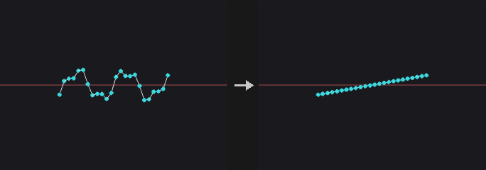

Each open chain in the edge group is straightened between its two end points. Closed loops are skipped, and the report states how many.

**Inputs**

| Input | Type | Description |
|---|---|---|
| `geo` | GEOMETRY | Geometry containing the edge chains. |

**Outputs**

| Output | Type | Description |
|---|---|---|
| `geo` | GEOMETRY | Geometry with straightened chains. |
| `report` | STRING | Text summary, including the number of skipped loops. |

**Parameters**

| Parameter | Type | Default | Description |
|---|---|---|---|
| Group `edges` | string | *(empty)* | Edge group pattern. Empty means all edges. Closed loops are skipped. |
| Spacing `spacing` | menu | Preserve Relative Spacing | How the points are placed on the line: *Preserve* keeps their relative arc-length proportions, *Equalize* spaces them evenly, *Project* projects them perpendicularly onto the line. Options: Preserve Relative Spacing (`preserve`), Equalize Edge Lengths (`uniform`), Project onto Line (`project`). |

---

### Ends (PCG)

`PCG_Ends` · category `PCG/modify` · Houdini: Ends (SOP)

Closes, opens, unrolls or rolls curves.

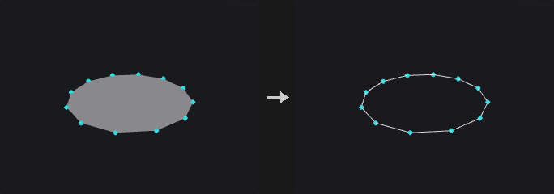

The `prim_closed` flag decides whether there is an edge between the last and first point. Many nodes (Resample, Carve, Sweep, PolyExpand2D) treat open and closed curves differently, and the upstream flag is often not what you need.

The four operations differ in whether the geometry changes:
- *Close Straight*: flips the flag, adds one closing edge, so the shape changes.
- *Open*: flips the flag, removes one edge, so the shape changes.
- *Unroll with Shared Points*: closed to open, hanging the first point again on the end. The edge count and shape are unchanged, the only operation that merely changes the representation.
- *Roll*: the inverse of unroll, turning an open curve with coinciding ends into a closed one with the duplicate point removed.

Unroll is the most common: a closed loop has no starting point, so a resampler does not know where to start. After unrolling it is an ordinary open curve that looks identical; roll it back when done. Unroll followed by roll is an exact topological identity.

Primitives with two points are not closed, since that would create two coincident edges (a zero-area degenerate face that looks the same as before but breaks normals and area later). They are silently skipped.

**Inputs**

| Input | Type | Description |
|---|---|---|
| `geo` | GEOMETRY | Curves to process. |

**Outputs**

| Output | Type | Description |
|---|---|---|
| `geo` | GEOMETRY | The processed curves. |

**Parameters**

| Parameter | Type | Default | Description |
|---|---|---|---|
| Group `group` | string | *(empty)* | Group pattern of the primitives to process. |
| Close U `op` | menu | Close Straight | Operation to apply: close, open, unroll (closed to open with a repeated first point) or roll (undo of unroll). Options: Close Straight (`close`), Open (`open`), Unroll with Shared Points (`unroll`), Roll (Undo Unroll) (`roll`). |
| Tolerance `tolerance` | float [0.0..] | 0 | For *Roll*: first and last points closer than this distance count as coincident even if they are different points. *Hidden when op ≠ roll.* |

---

### Exploded View (PCG)

`PCG_ExplodedView` · category `PCG/modify` · Houdini: Exploded View (SOP)

Moves fracture pieces apart from each other so cuts can be inspected.

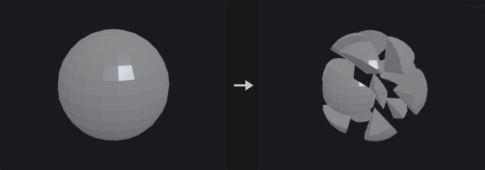

The output of Voronoi Fracture, Voronoi Cluster and Convex Decompose fits together seamlessly, so it looks as if nothing was cut. This node pushes the pieces apart.

Every piece undergoes a **rigid motion**: each piece is translated individually, so each piece's volume is unchanged. (Scaling the whole geometry about the center separates the pieces but scales each by the same factor, and its volume by the cube.)

The piece center is the **area-weighted** centroid, not the mean of the points. A mean would be biased by mesh density: a Voronoi cut face is one n-gon with few points, while the outer shell inherits the original tessellation with many.

Pieces come from a primitive attribute (`name`, `piece` or `cluster`, as written by the upstream nodes) or from connected components.

**Inputs**

| Input | Type | Description |
|---|---|---|
| `geo` | GEOMETRY | Geometry made of fitted pieces. |

**Outputs**

| Output | Type | Description |
|---|---|---|
| `geo` | GEOMETRY | Geometry with each piece moved away from the center. |

**Parameters**

| Parameter | Type | Default | Description |
|---|---|---|---|
| Pieces From `piece_from` | menu | Piece Attribute | Where the pieces are identified: from a primitive attribute or from connectivity. Options: Piece Attribute (`attribute`), Connectivity (`connectivity`). |
| Piece Attribute `piece_attribute` | string | `name` | Primitive attribute that identifies the pieces. *Hidden when piece_from ≠ attribute.* |
| Explode From `center` | menu | Pieces Centroid | The point pieces move away from: the centroid of all pieces, a specified point, or the center of the bounding box. Options: Pieces Centroid (`centroid`), Specified Point (`origin`), Bounding Box Center (`bbox`). |
| Center `center_x` `center_y` `center_z` | float | 0, 0, 0 | Explosion center when *Specified Point* is chosen. *Hidden when center ≠ origin.* |
| Explode Type `mode` | menu | Uniform Distance | *Uniform* moves every piece by the same distance (good for thin shell layers); *Proportional* moves each piece in proportion to its distance from the center (an explosion look). Options: Uniform Distance (`uniform`), Proportional to Distance (`proportional`). |
| Explode Distance `distance` | float | 0.25 | Movement distance. In *Proportional* mode it is a multiplier on the distance from the center. |
| Relative to Bounding Box `relative_to_size` | toggle | on | Measure the distance relative to the longest side of the bounding box. In *Proportional* mode it only affects *Up Bias*. |
| Up Bias `up_bias` | float | 0 | Additional movement along +Y. |
| Piece Scale `shrink` | float [0.0..1.0] | 1 | Scales each piece about its own centroid. 1 leaves it unchanged; smaller values leave gaps between cut faces. |

---

### Extract Transform (PCG)

`PCG_ExtractTransform` · category `PCG/modify` · Houdini: Extract Transform (SOP)

Computes the best-fit transform from a reference geometry to a deformed or moved copy of it.

The two inputs must be the same geometry before and after (point numbers correspond one to one). The node solves for the best rigid (Kabsch), similarity (Umeyama, adds uniform scale), non-uniform scale or full affine transform.

The *point* output is an instance point (`P`, `orient`, `pscale`; `scale` for non-uniform; `transform` for affine or matrix output). Feeding it to Copy to Points with the reference as the source places the copy on the target. The *geo* output is the reference transformed directly. The report contains the residual RMS.

With *Use Piece Attribute*, the geometry is split by a primitive or point attribute and each piece gets its own transform and its own output point (carrying the attribute); the point is placed at the transformed piece center and the `pivot` is the weighted center of the reference piece. Pieces with too few points for the fit (fewer than 3, or 4 for affine) get a translation only. Without it, one transform is fitted to the whole geometry.

**Inputs**

| Input | Type | Description |
|---|---|---|
| `reference` | GEOMETRY | The geometry before the transform. |
| `target` | GEOMETRY | The same geometry after the transform; same point count and order. |

**Outputs**

| Output | Type | Description |
|---|---|---|
| `point` | GEOMETRY | Instance point(s) carrying the transform. |
| `geo` | GEOMETRY | The reference geometry moved by the fitted transform. |
| `report` | STRING | Text report including the residual RMS. |

**Parameters**

| Parameter | Type | Default | Description |
|---|---|---|---|
| Piece Attribute `piece_attribute` | string | `name` | Name of the attribute that splits the geometry into pieces. |
| Use Piece Attribute `use_piece_attribute` | toggle | off | Fit one transform per piece instead of one for the whole geometry. |
| Attribute Class `attribute_class` | menu | Primitive | Whether the piece attribute is on primitives or points. Options: Primitive (`prim`), Point (`point`). *Disabled when use_piece_attribute is off.* |
| Extraction Method `mode` | menu | Translation and Rotation | Type of transform to fit: rigid, rigid plus uniform scale, full affine, or rigid plus non-uniform scale. Options: Translation and Rotation (`rigid`), Translation, Rotation, and Uniform Scale (`similarity`), Full Transform (`affine`), Translation, Rotation, and Non-Uniform Scale (`nonuniform`). |
| Output Attributes `output_attributes` | menu | Standard Instance Attributes | How the transform is written: standard instance attributes, a 3x3 matrix plus translation, or a 4x4 matrix. With *Standard*, the *Full Transform* mode still writes a 3x3 `transform` (shear is not split out). Matrices are written in Houdini's convention (row vectors, translation in the fourth row), so Copy to Points and Houdini read them the same way. Options: Standard Instance Attributes (`standard`), Transform Matrix (3×3) and Translation (`matrix3`), Transform Matrix (4×4) (`matrix4`). |
| Weight Attribute `weight_attribute` | string | *(empty)* | Point attribute on the reference used as a fit weight. Empty means equal weights. |
| Compute Distortion `distortion_attribute` | string | `distortion` | Name of the attribute that receives the residual RMS of each piece (distance from the transformed reference to the target). |
| Compute Distortion `compute_distortion` | toggle | off | Write the residual RMS to the attribute named in *Distortion Attribute* on each output point. |

**Compared with Houdini**

The weight attribute does not exist on the Houdini node; it is an addition of this plugin.

---

### Facet (PCG)

`PCG_Facet` · category `PCG/modify` · Houdini: Facet (SOP)

Runs a fixed chain of topology cleanup and hard-edge options: unique points, consolidate, orient, cusp, inline and degenerate removal, normals.

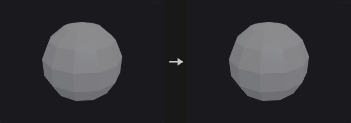

The enabled steps always run in Houdini's order, each consuming the result of the previous one:

`unique points -> consolidate -> orient -> cusp -> remove inline -> remove degenerate -> normals`

The easy trap is that **orient has to precede cusp**. With inconsistent winding, adjacent face normals point opposite ways, the angle between them is always 180 degrees, and the whole geometry would be split into hard edges.

Cusp is not the same as the vertex mode of a Normal node. Normal only stores one normal per corner and leaves the geometry alone; Facet's cusp **actually splits the points**, so any point normal computed afterwards is hard. Use Facet for engine export, UV seams, or when downstream nodes must see the hard edges.

The group is a primitive group; primitives outside it are left exactly as they are (no winding change, no point splitting, no corner removal).

**Inputs**

| Input | Type | Description |
|---|---|---|
| `geo` | GEOMETRY | Geometry to process. |

**Outputs**

| Output | Type | Description |
|---|---|---|
| `geo` | GEOMETRY | The processed geometry. |

**Parameters**

| Parameter | Type | Default | Description |
|---|---|---|---|
| Group `group` | string | *(empty)* | Primitive group pattern. Primitives outside the group are untouched. |
| Unique Points `unique_points` | toggle | off | Give every primitive its own copy of its points, so no points are shared. |
| Consolidate Points `consolidate_points` | toggle | off | Merge points that lie within *Distance* of each other. |
| Distance `consolidate_distance` | float [0.0..] | 0.001 | Distance within which points are merged. *Disabled when consolidate_points is off.* |
| Orient Polygons `orient_polygons` | toggle | off | Make the winding of adjacent polygons consistent. |
| Cusp Polygons `cusp_polygons` | toggle | off | Split points along edges where adjacent faces meet at a sharper angle than *Cusp Angle*. |
| Cusp Angle `cusp_angle` | float [0.0..180.0] | 60 | Angle in degrees between adjacent face normals above which the shared edge becomes hard. *Disabled when cusp_polygons is off.* |
| Remove Inline Points `remove_inline` | toggle | off | Remove points lying on a straight line between their neighbours. |
| Inline Distance `inline_distance` | float [0.0..] | 0.001 | Distance tolerance for deciding a point is inline. *Disabled when remove_inline is off.* |
| Remove Degenerate `remove_degenerate` | toggle | off | Remove repeated points of primitives and primitives that collapse. |
| Degenerate Distance `degenerate_distance` | float [0.0..] | 0.0001 | Distance tolerance for the degenerate test. *Disabled when remove_degenerate is off.* |
| Remove Bad Primitives `remove_bad_prims` | toggle | on | Also delete primitives left with too few points after the removal. *Disabled when remove_degenerate is off.* |
| Post-Compute Normals `post_normals` | toggle | off | Compute point normals after all other steps. |
| Make Normals Unit Length `unit_normals` | toggle | off | Normalize the normals to unit length. Disabled when normals are computed by the previous option, since those are already unit. *Disabled when post_normals is on.* |

---

### Fracture Detail (PCG)

`PCG_FractureDetail` · category `PCG/modify`

Adds noise to the cut (interior) faces of fracture pieces while keeping the pieces fitting together.

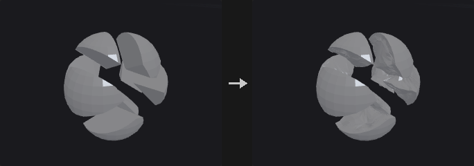

Cut faces from a Voronoi fracture are perfectly flat and look fake. The difficulty is that the pieces must still fit back into the original shape and the outer silhouette must not change.

**The displacement is a pure function of world position, not a push along normals.** Pieces A and B share a wall, each storing its own copy of the points at the same position but with opposite normals. A scalar pushed along normals would move the two copies in opposite directions and open a gap or interpenetrate. A vector noise depending only on world position gives both copies bit-identical displacement, so the wall stays shared and merely bends. The sum of all piece volumes is therefore unchanged.

**The falloff is a pure function too.** The rim where the cut face meets the original surface is pinned so that the outer silhouette does not change. Falloff uses the Euclidean distance to the global point cloud of rim points rather than a graph distance along the surface, because graph distances can differ between the two copies of a shared wall and would tear it.

*Divisions* first applies linear subdivision, since a cut face is typically one large n-gon and pushing its few points only tilts the plane. The whole piece is subdivided, since subdividing only the cut face would leave T-vertices on the border.

*Triangulate Interior* (on by default) triangulates the cut faces by picking the fan apex as the vertex with the lexicographically smallest coordinates, so that both sides of a shared wall pick the same diagonals. Without this, a displaced non-planar wall can open a thin crack.

Beveling is not part of this node: the cut faces are already a primitive group, so connect PolyBevel.

**Inputs**

| Input | Type | Description |
|---|---|---|
| `geo` | GEOMETRY | Fractured pieces with the interior faces in a group. |

**Outputs**

| Output | Type | Description |
|---|---|---|
| `geo` | GEOMETRY | Pieces with noise-displaced interior faces. |

**Parameters**

| Parameter | Type | Default | Description |
|---|---|---|---|
| Interior Group `group` | string | `interior` | Primitive group of the cut (interior) faces. Only these faces are displaced. |
| Subdivisions `divisions` | int [0..6] | 2 | Rounds of linear subdivision applied first to give the noise points to move. |
| Triangulate Interior `triangulate_interior` | toggle | on | Triangulate the interior faces in a position-determined way so that both sides of a shared wall match and no cracks open. |
| Amplitude `amount` | float [0.0..] | 0.02 | Displacement amplitude. |
| Frequency `frequency` | float [0.0..] | 8 | Noise frequency. |
| Relative to Bounding Box `relative_to_size` | toggle | on | Interpret amplitude, frequency and falloff relative to the longest side of the bounding box. |
| Edge Falloff `falloff` | float [0.0..] | 0.1 | Distance from the outer rim over which the displacement fades out. 0 means no falloff. |
| Falloff Shape `falloff_mode` | menu | Smooth | Shape of the falloff curve. Options: Smooth (`smooth`), Linear (`linear`). *Disabled when falloff = 0.* |

*Noise*

| Parameter | Type | Default | Description |
|---|---|---|---|
| Noise Type `noise_type` | menu | Value | Type of noise used for the displacement. Options: Value (`value`), Perlin (`perlin`), Simplex (`simplex`), Worley Cellular F1 (`worley`), Worley Cellular F2-F1 (`worley_f2f1`). |
| Fractal Type `fractal` | menu | None | Fractal layering mode of the noise. Options: None (`none`), Standard (`standard`), Terrain (`terrain`), Hybrid Terrain (`hybrid_terrain`). |
| Max Octaves `octaves` | int [1..16] | 3 | Number of noise layers. *Hidden when fractal = none.* |
| Lacunarity `lacunarity` | float [0.0..16.0] | 2 | Frequency multiplier from one octave to the next. *Hidden when fractal = none.* |
| Roughness `roughness` | float [0.0..1.0] | 0.5 | Amplitude multiplier from one octave to the next. *Hidden when fractal = none.* |
| Seed `rand_seed` | int [0..] | 0 | Seed that offsets the noise. |

---

### Fuse (PCG)

`PCG_Fuse` · category `PCG/modify` · Houdini: Fuse (SOP)

Snaps nearby points together (to each other, to a grid, or to a target) and optionally welds them into single points.

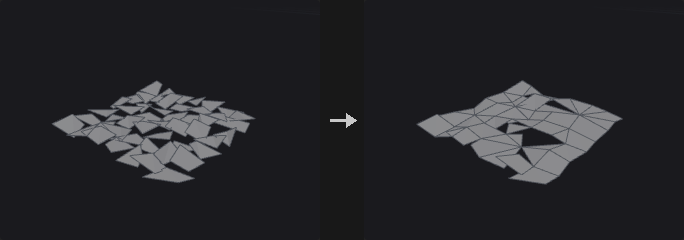

Three stages: *Snap* decides which points count as the same and where they go, *Fuse* decides whether the topology is actually welded, and *Output* manages groups and normals.

Near-point snapping does a real radius search (uniform grid hashing) and takes the transitive closure of the pairs, so chains of close points end up in one cluster regardless of grid cell borders, unlike a quantizing fuse.

When the *target* input is connected, points in the group snap to points on the target. The two geometries are not merged; the target only provides the places to snap to. With *Modify Target* the roles swap and the modified target is output.

The position attribute can be a different 3-component attribute (for example a rest position), so that proximity is judged in another space. This is useful for cleanup after deformation.

**Inputs**

| Input | Type | Description |
|---|---|---|
| `geo` | GEOMETRY | Geometry whose points are snapped and fused. |
| `target` *(optional)* | GEOMETRY | Optional geometry whose points the group points snap to. |

**Outputs**

| Output | Type | Description |
|---|---|---|
| `geo` | GEOMETRY | The snapped (and optionally welded) geometry. |

**Parameters**

*Snap*

| Parameter | Type | Default | Description |
|---|---|---|---|
| Group `group` | string | *(empty)* | Point group pattern to snap. Empty means all points. |

*Snap › Target*

| Parameter | Type | Default | Description |
|---|---|---|---|
| Target Points (2nd Input) `use_target` | toggle | off | Enables the target group settings. |
| Target Group `target_group` | string | *(empty)* | Point group pattern on the target input to snap to. |
| Modify Target `modify_target` | toggle | off | Snap the target's points to the input and output the changed target instead. |

*Snap*

| Parameter | Type | Default | Description |
|---|---|---|---|
| Position Attribute `position_attribute` | string | `P` | 3-component point attribute used to measure proximity. `P` by default. |
| Snap To `snap_to` | menu | Near Points | *Near Points* snaps points within a radius; *Grid* snaps to a regular grid; *None* snaps nothing. Options: Near Points (`near_points`), Grid (`grid`), None (`none`). |
| Using `using` | menu | Least Point Number | Which point of a cluster is chosen as the representative: lowest number, closest, or highest number. Options: Least Point Number (`least_point_number`), Closest Point (`closest`), Greatest Point Number (`greatest_point_number`). *Disabled when snap_to = none.* |
| Output Positions `output_positions` | menu | Average Value | Where snapped points end up: the average of the cluster, the chosen representative's position, or unchanged. Options: Average Value (`average`), Chosen Point (Using) (`target`), Keep Original (`keep`). *Disabled when snap_to = none.* |

*Snap › Snap Distance*

| Parameter | Type | Default | Description |
|---|---|---|---|
| Use Snap Distance `use_snap_distance` | toggle | on | Use the fixed *Snap Distance*. *Hidden when snap_to ≠ near_points.* |
| Snap Distance `snap_distance` | float [0.0..] | 0.001 | Points closer than this are snapped together. *Hidden when snap_to ≠ near_points.* |

*Snap › Radius*

| Parameter | Type | Default | Description |
|---|---|---|---|
| Radius Attribute `use_radius` | toggle | off | Use a per-point radius attribute as the snap distance basis. *Hidden when snap_to ≠ near_points.* |
| Radius Attribute `radius_attribute` | string | `pscale` | Point attribute holding the radius. Not read when a target is connected. *Hidden when snap_to ≠ near_points.* |

*Snap › Match Attribute*

| Parameter | Type | Default | Description |
|---|---|---|---|
| Match Attribute `use_match` | toggle | off | Only snap points whose match attribute satisfies the condition. *Hidden when snap_to ≠ near_points.* |
| Match Attribute `match_attribute` | string | `name` | Attribute compared between candidate points. Not read when a target is connected. *Hidden when snap_to ≠ near_points.* |
| Match Condition `match_condition` | menu | Equal | Snap only points whose attribute values are equal, or only those that are unequal. Options: Equal (`equal`), Unequal (`unequal`). *Hidden when snap_to ≠ near_points.* |
| Match Tolerance `match_tolerance` | float [0.0..] | 0 | Tolerance for comparing the attribute values. *Hidden when snap_to ≠ near_points.* |

*Snap › Grid*

| Parameter | Type | Default | Description |
|---|---|---|---|
| Grid `use_grid` | toggle | off | Enables the grid settings. *Hidden when snap_to ≠ grid.* |
| Grid Spacing `grid_x` `grid_y` `grid_z` | float [0.0..] | 0.1, 0.1, 0.1 | Grid spacing along each axis. *Hidden when snap_to ≠ grid.* |
| Grid Offset `grid_off_x` `grid_off_y` `grid_off_z` | float | 0, 0, 0 | Offset of the grid origin. *Hidden when snap_to ≠ grid.* |

*Fuse › Fuse*

| Parameter | Type | Default | Description |
|---|---|---|---|
| Fuse Snapped Points `fuse_snapped_points` | toggle | on | Weld snapped points into one point. When off, they are moved but the topology is unchanged. |
| Keep Fused Points `keep_fused_points` | toggle | off | Keep the points that were merged away as unused points instead of deleting them. |
| Remove Repeated Vertices and Degenerate Primitives `remove_repeated` | toggle | on | Remove repeated points within a primitive, and primitives left too small, after welding. |
| Remove Unused Points from Degenerate Primitives `remove_degenerate_unused` | toggle | on | Also delete the points that became unused through this removal. |
| Remove All Unused Points `remove_all_unused` | toggle | off | Delete every point not used by a primitive. |

*Output Attributes and Groups › Output*

| Parameter | Type | Default | Description |
|---|---|---|---|
| Output `use_output` | toggle | on | Enables the output options. |
| Recompute Affected Normals `recompute_normals` | toggle | on | Recompute point normals if the geometry has `N`. |
| Snapped Points Group `snapped_points_group` | string | *(empty)* | Name of a point group for the points that were moved. Empty means not created. |
| Snapped Destination Group `snapped_to_group` | string | *(empty)* | Name of a point group for the points that others snapped to. Empty means not created. |
| Attributes to Snap `attributes_to_snap` | string | *(empty)* | Point attributes (wildcards allowed) merged together with `P` using *Output Positions*. |

---

### Intersection Analysis (PCG)

`PCG_IntersectionAnalysis` · category `PCG/modify` · Houdini: Intersection Analysis (SOP)

Places a point wherever triangles or polylines pass through each other and records their sources.

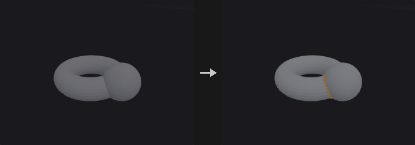

With only the first input connected, it finds self-intersections; with both inputs it finds intersections between them. Each intersection gets a point carrying, for the two sources, the input number, primitive number and primitive UVW, each stored twice: `[primitive containing the edge, primitive of the triangle that is pierced]`. An attribute name left empty is not written. The input does not need to be a closed manifold.

**Inputs**

| Input | Type | Description |
|---|---|---|
| `geo` | GEOMETRY | Geometry to test. |
| `geo_b` *(optional)* | GEOMETRY | Optional second geometry. When connected, intersections are searched between the two inputs. |

**Outputs**

| Output | Type | Description |
|---|---|---|
| `geo` | GEOMETRY | Points at the intersections. |
| `report` | STRING | Text summary of the analysis. |

**Parameters**

| Parameter | Type | Default | Description |
|---|---|---|---|
| Group A `group_a` | string | *(empty)* | Group pattern restricting the primitives of the first input. |
| Group B `group_b` | string | *(empty)* | Group pattern restricting the primitives of the second input. Only used when it is connected. |

*Output Attributes*

| Parameter | Type | Default | Description |
|---|---|---|---|
| Input Number `input_attribute` | string | `input` | Name of the integer attribute (two values) holding the input numbers. Empty means not written. |
| Primitive Number `prim_attribute` | string | `sourceprim` | Name of the integer attribute (two values) holding the primitive numbers. Empty means not written. |
| Primitive UVW `uvw_attribute` | string | `sourceprimuv` | Name of the float attribute (six values: the UVW of the first primitive, then of the second) holding the primitive UVW. Empty means not written. |

---

### Join (PCG)

`PCG_Join` · category `PCG/modify` · Houdini: Join (SOP)

Connects the selected polylines in order into one polyline, bridging gaps with straight segments.

The order is primitive order. The typical use is to join separately made path pieces into one complete path, where the end points are not supposed to coincide and the connecting segments are exactly what you want. This bridging is the one difference from PolyPath.

**Reverse To Fit** (on by default): before each primitive is appended, the end nearer the current tail is placed first. Houdini's Join does not do this, and without it a slightly inconsistent direction among the input primitives yields a zigzag that doubles back. That happens almost inevitably with Clip or Boolean output, as those do not guarantee consistent segment orientation. With it off, the result is strictly tail-to-head.

**Tolerance** is not a weld radius but a measure of how near counts as already connected: a gap smaller than it is treated as the same point (no bridging segment, no zero-length edge), a larger gap gets a connecting segment.

*Loop* joins the last segment back to the first start and outputs a closed primitive. *Partition Attribute* joins each group of a primitive attribute separately (for example one path per `name`).

Primitive attributes are taken from the first primitive of the chain, as in Houdini. Vertex attributes follow the corners, so when a line is reversed its UVs and widths are reversed with it; otherwise texture flow would flip at the seam.

**Inputs**

| Input | Type | Description |
|---|---|---|
| `geo` | GEOMETRY | Polylines to join. |

**Outputs**

| Output | Type | Description |
|---|---|---|
| `geo` | GEOMETRY | The joined polylines. |

**Parameters**

| Parameter | Type | Default | Description |
|---|---|---|---|
| Group `group` | string | *(empty)* | Primitive group pattern selecting the polylines to join. |
| Loop `loop` | toggle | off | Close the result by joining the last segment back to the first point. |
| Tolerance `tolerance` | float [0.0..] | 0 | Gaps smaller than this count as already connected: no bridging segment is added. |
| Reverse Primitives to Fit `reverse_to_fit` | toggle | on | Before each primitive is added, check which of its ends is nearer and reverse it if needed. |
| Partition Attribute `partition_attribute` | string | *(empty)* | Primitive attribute whose values partition the primitives; each group is joined separately. Empty joins everything into one. |
| Primitive Attributes `prim_attribs` | menu | Keep First | Whether the result takes the primitive attributes of the first primitive in the chain, or drops them. Options: Keep First (`first`), Drop (`drop`). |
| Remove Unused Points `remove_unused_points` | toggle | off | Delete the points that no primitive uses after joining. |

---

### Loop Cut (PCG)

`PCG_LoopCut` · category `PCG/modify`

Inserts a complete edge loop through quads, starting from seed edges.

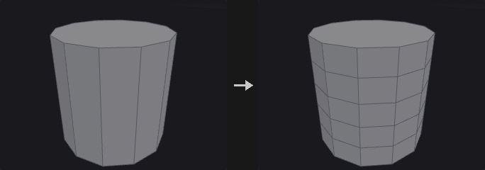

Works like the loop mode of PolySplit (Loop Cut or Insert Edge Loop in other packages). From a seed edge it enters the neighbouring **quad**, takes the opposite edge (two steps around the vertex loop), then crosses to the next quad, until it returns to the start or hits a boundary or a non-quad. The collected edges are cut like Edge Divide with connect on.

A non-quad ends the loop: a triangle has no opposite edge, and a pentagon has two, so the loop is genuinely broken there (Blender and Maya behave the same).

One seed edge is enough; giving several on the same loop does not cut it twice.

**Inputs**

| Input | Type | Description |
|---|---|---|
| `geo` | GEOMETRY | Mesh with quad loops. |

**Outputs**

| Output | Type | Description |
|---|---|---|
| `geo` | GEOMETRY | Mesh with the loop(s) inserted. |

**Parameters**

| Parameter | Type | Default | Description |
|---|---|---|---|
| Seed Edges `edge_group` | string | *(empty)* | Edge group pattern of seed edges. The loops start from these edges and run through quads. |
| Number of Loops `cuts` | int [1..64] | 1 | Number of evenly spaced loops inserted. Ignored when *Cut Positions* is set. *Disabled when cut_positions ≠ "".* |
| Cut Positions `cut_positions` | string | *(empty)* | Custom parameter positions along the edges, separated by spaces. When set, *Cuts* is ignored. |
| Output Edge Group `output_edge_group` | string | *(empty)* | Name of an edge group that receives the new edges. Empty means not created. |
| Output Point Group `output_point_group` | string | *(empty)* | Name of a point group that receives the new points. Empty means not created. |

---

### Match Axis (PCG)

`PCG_MatchAxis` · category `PCG/modify` · Houdini: Match Axis (SOP)

Rotates geometry by the smallest rotation that takes one axis direction onto another.

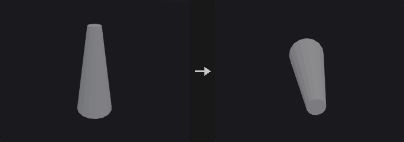

Rotates *From Axis* onto *To Axis* with the minimal rotation, about the origin, the centroid or the bounding box center. If *Up From* and *Up To* are both non-zero, a further rotation about the main axis then also aligns the up vectors. The vector attributes `N`, `up`, `v` and `orient` are rotated along with the points.

**Inputs**

| Input | Type | Description |
|---|---|---|
| `geo` | GEOMETRY | Geometry to rotate. |

**Outputs**

| Output | Type | Description |
|---|---|---|
| `geo` | GEOMETRY | The rotated geometry. |

**Parameters**

| Parameter | Type | Default | Description |
|---|---|---|---|
| Group `group` | string | *(empty)* | Group pattern of the points to rotate. Empty means all. |
| From Axis `from_x` `from_y` `from_z` | float | 0, 1, 0 | Direction that is rotated onto *To Axis*. |
| To Axis `to_x` `to_y` `to_z` | float | 0, 0, 1 | Direction that *From Axis* ends up pointing to. |
| Pivot `pivot` | menu | Origin | Point the rotation is performed about. Options: Origin (`origin`), Centroid (`centroid`), Bounding Box Center (`bbox_center`). |
| Up From `up_from_x` `up_from_y` `up_from_z` | float | 0, 0, 0 | Up vector before the rotation. Used only when both Up vectors are non-zero. |
| Up To `up_to_x` `up_to_y` `up_to_z` | float | 0, 0, 0 | Desired up vector after the rotation. Used only when both Up vectors are non-zero; the extra rotation about the main axis makes the up vectors line up. |

---

### Match Size (PCG)

`PCG_MatchSize` · category `PCG/modify` · Houdini: Match Size (SOP)

Moves and scales geometry to fit a reference box, and can stash the transform so it can be undone later.

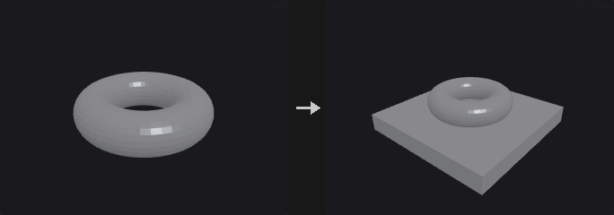

The real use is less resizing than establishing a **recoverable canonical space**: match any model to a unit box, work in that space (cut, scatter, compute UVs), then send it back with the stashed transform. The Stash and Restore fields are as important as the alignment.

If the second input is connected, the geometry is aligned to its bounding box. Otherwise (or with *Location and Size*) the target position and size parameters define the box.

When *Restore Attribute* names a detail attribute that actually exists on the geometry, the node **only restores**: it inverts the stored 4x4 matrix and applies it, ignoring all other parameters. As in Houdini, restoring and matching are two separate, mutually exclusive operations.

**Inputs**

| Input | Type | Description |
|---|---|---|
| `geo` | GEOMETRY | Geometry to match. |
| `target` *(optional)* | GEOMETRY | Optional reference geometry whose bounding box is the target. |

**Outputs**

| Output | Type | Description |
|---|---|---|
| `geo` | GEOMETRY | The matched geometry. |

**Parameters**

| Parameter | Type | Default | Description |
|---|---|---|---|
| Justify With `justify_with` | menu | Input If Wired | *Input If Wired* aligns to the second input when it is connected and otherwise to the target position and size below. *Location and Size* always uses the values below. Options: Input If Wired (`input_if_wired`), Location and Size (`target_values`). |

*Bounds Group*

| Parameter | Type | Default | Description |
|---|---|---|---|
| Use Groups to Determine Justification Bounds `use_group_bounds` | toggle | off | Measure the bounds of a group instead of the whole geometry. |
| Group `group` | string | *(empty)* | Group pattern whose bounds are used. *Disabled when use_group_bounds is off.* |
| Group Type `group_type` | menu | Primitives | Whether the group contains primitives or points. Options: Primitives (`prim`), Points (`point`). *Disabled when use_group_bounds is off.* |

| Parameter | Type | Default | Description |
|---|---|---|---|
| Target Position `target_px` `target_py` `target_pz` | float | 0, 0, 0 | Anchor of the reference box. On an axis where Justify is Min or Max it is that edge, otherwise it is the center. |
| Target Size `target_sx` `target_sy` `target_sz` | float [0.0..] | 1, 1, 1 | Size of the reference box along each axis. |
| Translate `translate` | toggle | on | Move the geometry to the reference box. |
| Justify X `justify_x` | menu | Center | Which part of the geometry's bounding box (center, min or max) is placed on the reference, per axis. *None* leaves that axis alone. Options: Center (`center`), Min (`min`), Max (`max`), None (`none`). |
| Justify Y `justify_y` | menu | Center | As for X. Options: Center (`center`), Min (`min`), Max (`max`), None (`none`). |
| Justify Z `justify_z` | menu | Center | As for X. Options: Center (`center`), Min (`min`), Max (`max`), None (`none`). |

*Justify To*

| Parameter | Type | Default | Description |
|---|---|---|---|
| Justify To `use_justify_to` | toggle | off | Enables the Justify To settings. *Disabled when translate is off.* |
| X To `to_x` | menu | Same | Which part of the reference box (same as the input justification, min, center or max) the geometry is aligned to. Options: Same (`same`), Min (`min`), Center (`center`), Max (`max`). *Disabled when translate is off } { use_justify_to is off } { justify_x = none.* |
| Y To `to_y` | menu | Same | As for X. Options: Same (`same`), Min (`min`), Center (`center`), Max (`max`). *Disabled when translate is off } { use_justify_to is off } { justify_y = none.* |
| Z To `to_z` | menu | Same | As for X. Options: Same (`same`), Min (`min`), Center (`center`), Max (`max`). *Disabled when translate is off } { use_justify_to is off } { justify_z = none.* |
| Offset By `offset_x` `offset_y` `offset_z` | float | 0, 0, 0 | Additional offset applied after the alignment. *Disabled when translate is off } { use_justify_to is off.* |

*Scale to Fit*

| Parameter | Type | Default | Description |
|---|---|---|---|
| Scale to Fit `scale_to_fit` | toggle | off | Scale the geometry so its bounding box matches the size of the reference box. |
| Uniform Scale `uniform_scale` | toggle | on | Scale equally on all axes so proportions are preserved. *Disabled when scale_to_fit is off.* |

*Transform Attribute*

| Parameter | Type | Default | Description |
|---|---|---|---|
| Transform Storage `use_xform` | toggle | off | Enables the stash and restore attributes. |
| Restore Transform `restore_attribute` | string | *(empty)* | Name of a detail attribute holding a stashed transform. If the geometry has it, only the inverse transform is applied and all other parameters are ignored. Empty means no restore. *Disabled when use_xform is off.* |
| Stash Transform `stash_attribute` | string | `xform` | Name of the detail attribute that receives the 4x4 matrix of the transform that was applied. *Disabled when use_xform is off.* |

---

### Merge (PCG)

`PCG_Merge` · category `PCG/modify` · Houdini: Merge (SOP), Point Merge (COP)

Combines up to six geometries into one.

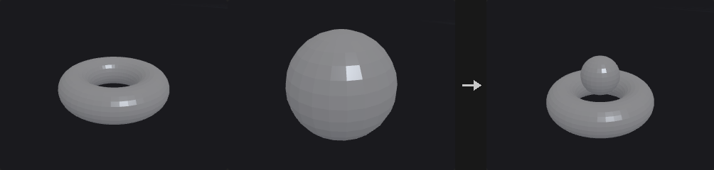

Concatenates the points and primitives of all connected inputs. Attributes and groups are the union across the inputs; where an input lacks an attribute its elements get zeros, and where it lacks a group its elements are simply not in the group. Empty inputs are ignored.

**Inputs**

| Input | Type | Description |
|---|---|---|
| `geo1` | GEOMETRY | First geometry. |
| `geo2` *(optional)* | GEOMETRY | Optional geometry. |
| `geo3` *(optional)* | GEOMETRY | Optional geometry. |
| `geo4` *(optional)* | GEOMETRY | Optional geometry. |
| `geo5` *(optional)* | GEOMETRY | Optional geometry. |
| `geo6` *(optional)* | GEOMETRY | Optional geometry. |

**Outputs**

| Output | Type | Description |
|---|---|---|
| `geo` | GEOMETRY | The merged geometry. |

---

### Mirror (PCG)

`PCG_Mirror` · category `PCG/modify` · Houdini: Mirror (SOP)

Mirrors geometry about a plane, optionally keeping the original and welding the seam.

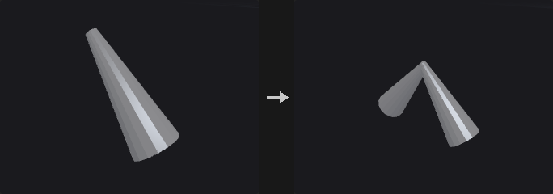

Three details matter and are handled here:

1. **Mirroring flips orientation, so the winding is reversed.** A reflection has determinant -1; reflecting only positions leaves the mirrored half with inward normals (black in renders, culled, and negative volume). *Reverse Normals* does this.
2. **Vector attributes are reflected, not copied.** Directions such as `N`, `v`, `up` and tangents must be reflected, while `Cd` and `uv` are copied as they are. There is no type system to tell them apart, so a name list is used and can be extended.
3. **In append mode the seam is welded.** Without welding, the points sitting on the plane exist twice and the seam is a ring of doubled boundary edges, so topology is not closed and nodes that require closed meshes fail. Points close to the plane are first projected exactly onto it (floating point puts a point meant to be at x=0 at +-1e-8), then welded within *Snap Tolerance*.

**Inputs**

| Input | Type | Description |
|---|---|---|
| `geo` | GEOMETRY | Geometry to mirror. |

**Outputs**

| Output | Type | Description |
|---|---|---|
| `geo` | GEOMETRY | Mirrored geometry, or original plus mirrored geometry. |

**Parameters**

| Parameter | Type | Default | Description |
|---|---|---|---|
| Group `group` | string | *(empty)* | Primitive group pattern to mirror. Empty means all. |
| Operation `operation` | menu | Mirror All Primitives | *Mirror All* reflects all selected primitives. *Clip and Mirror* first cuts the geometry at the plane and mirrors the part on the kept side. Options: Mirror All Primitives (`mirror_all`), Clip Primitives and Mirror (`clip_and_mirror`). |
| Keep Original `mode` | menu | Off (Mirrored Only) | *Mirrored Only* outputs just the reflected copy; *Original + Mirrored* outputs both. Options: Off (Mirrored Only) (`mirror`), On (Original + Mirrored) (`append`). |
| Orient Plane with `orient` | menu | Direction | Define the plane by origin and normal, or by translate and rotate. Options: Direction (`direction`), Transform (`transform`). |
| Origin `origin_x` `origin_y` `origin_z` | float | 0, 0, 0 | A point on the mirror plane. *Hidden when orient = transform.* |
| Direction `normal_x` `normal_y` `normal_z` | float | 1, 0, 0 | Normal of the mirror plane. *Hidden when orient = transform.* |
| Translate `translate_x` `translate_y` `translate_z` | float | 0, 0, 0 | A point on the mirror plane when oriented by transform. *Hidden when orient = direction.* |
| Rotate `rotate_x` `rotate_y` `rotate_z` | float | 0, 0, 0 | Rotation in degrees that turns (1,0,0) into the plane normal, applied in X, Y, Z order. *Hidden when orient = direction.* |
| Distance `distance` | float | 0 | Offset of the plane along its normal. |
| Reverse Normals `reverse_normals` | toggle | on | Reverse the winding of the mirrored primitives. Turn off to keep their winding (faces pointing inward). |
| Consolidate Seam `fuse_result` | toggle | on | Weld points on the mirror plane so that the two halves share them. *Hidden when mode = mirror.* |
| Seam Distance `snap_tolerance` | float [0.0..1.0] | 0.0001 | Welding distance, relative to the longest side of the bounding box. Points close to the plane are first projected exactly onto it. *Hidden when mode = mirror.* |
| Original Group `original_group` | string | *(empty)* | Name of a primitive group for the original primitives. Empty means not created. *Hidden when mode = mirror.* |
| Output Group `mirror_group` | string | *(empty)* | Name of a primitive group for the mirrored primitives. Empty means not created. |
| Reflect Vector Attributes `vector_attributes` | string | *(see panel)* | Names of 3-component direction attributes that are reflected along with the geometry, separated by spaces. |

---

### Peak (PCG)

`PCG_Peak` · category `PCG/modify` · Houdini: Peak (SOP)

Moves points along their normals by a distance.

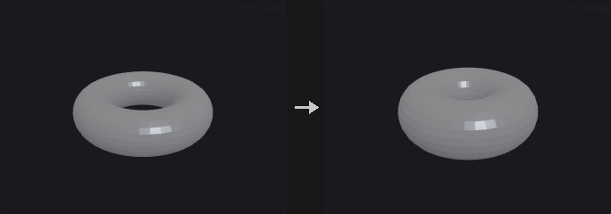

Pushing points by d along the point normal is **not** the same as growing the surface by d. A cube corner has normal (1,1,1)/sqrt(3); moving it by d shifts that corner only 0.577d along each face normal. Flat faces are no longer flat, the offset does not match the number entered, and a cube does not stay a cube. Houdini's Peak behaves the same way.

**Miter Corners** multiplies the displacement by `1 / (n_point . n_face)`, using the smallest dot product over the adjacent faces. This is a miter: the corner lands at the intersection of the offset adjacent faces. A cube corner gets sqrt(3), the cube stays a cube, and its edge length grows by exactly 2d. At nearly tangent folds the factor explodes, so *Max Miter* caps it.

Existing normals in `N` are used (upstream may have set a cusp angle or perturbed them); if there are none, they are computed but **not written back**. *Distance Attribute* gives each point its own factor, to combine with Attribute Fade or Attribute Noise.

**Inputs**

| Input | Type | Description |
|---|---|---|
| `geo` | GEOMETRY | Geometry whose points are moved. |

**Outputs**

| Output | Type | Description |
|---|---|---|
| `geo` | GEOMETRY | Geometry with displaced points. |

**Parameters**

| Parameter | Type | Default | Description |
|---|---|---|---|
| Group `group` | string | *(empty)* | Point group pattern to move. Empty means all points. |
| Distance `distance` | float | 0.1 | Distance to move along the normal. Negative values move against it. |
| Miter Corners `miter_corners` | toggle | off | Scale the displacement by the miter factor so that flat faces stay flat after the push. |
| Max Miter Scale `max_miter` | float [1.0..10000.0] | 8 | Upper limit of the miter factor, to avoid blow-up at nearly tangent folds. *Disabled when miter_corners is off.* |
| Distance Scale Attribute `distance_attribute` | string | *(empty)* | Point attribute multiplied into *Distance*. Empty means not used. |
| Normal Attribute `normal_attribute` | string | `N` | Attribute holding the normals to push along. |

---

### Point Jitter (PCG)

`PCG_PointJitter` · category `PCG/modify` · Houdini: Point Jitter (SOP)

Adds random displacement to points.

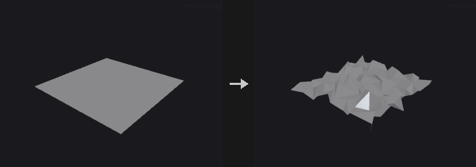

Each point moves in a random direction by at most *Scale* (further multiplied by the mask, `pscale` and the per-axis scales).

The random stream is keyed by the **ID attribute** when one is given, not by point number. If points are deleted upstream, sorted or fused, point numbers shift and a jitter keyed by number would change everywhere.

The displacement is uniform **inside a sphere**, not inside a cube. Taking three independent values in [-1,1] would make diagonals 1.73 times longer than the axes, a visible directionality on grid-like input. If you want directionality, use *Axis Scales*.

**Inputs**

| Input | Type | Description |
|---|---|---|
| `geo` | GEOMETRY | Geometry whose points are jittered. |

**Outputs**

| Output | Type | Description |
|---|---|---|
| `geo` | GEOMETRY | Geometry with jittered points. |

**Parameters**

| Parameter | Type | Default | Description |
|---|---|---|---|
| Group `group` | string | *(empty)* | Point group pattern to jitter. Empty means all points. |
| Mask `mask` | float [0.0..1.0] | 1 | Constant multiplier on the displacement, from 0 to 1. |
| Mask Mode `mask_mode` | menu | No Scaling | Whether the mask is only the constant above, or is also multiplied by a point attribute. Options: No Scaling (`no_scaling`), Scale by Attribute (`scale_by_attribute`). |
| Mask Attribute `mask_attribute` | string | *(empty)* | Point attribute multiplied into the displacement. Required when scaling by attribute. *Hidden when mask_mode ≠ scale_by_attribute.* |
| Id Attribute `id_attribute` | string | *(empty)* | Point attribute used as the key of the random stream instead of the point number. Empty uses point numbers. |
| Scale `scale` | float [0.0..] | 1 | Maximum displacement distance. |
| Axis Scales `axis_scale_x` `axis_scale_y` `axis_scale_z` | float | 1, 1, 1 | Per-axis multiplier of the displacement, for directional jitter. |
| Seed `rand_seed` | int [0..] | 1 | Seed of the random stream. |
| Use Point Scale `use_point_scale` | toggle | off | Also multiply the displacement by the point attribute `pscale` if present. |
| Update Normals `update_normals` | toggle | on | Recompute normals after the move if the geometry has them. |

---

### Point Split (PCG)

`PCG_PointSplit` · category `PCG/modify` · Houdini: Point Split (SOP), Split Points (SOP)

Splits points whose vertices carry different values of a vertex attribute into separate points.

When several vertices share one point but disagree on a vertex attribute (a UV seam, a hard edge in `N`), the point is duplicated so that each distinct value gets its own point. Values are compared with a chained tolerance rather than by bucketing, so values that are within `tolerance` of each other through a chain of neighbours end up on the same point.

With an empty attribute name every vertex becomes its own point. With **Promote** on, the vertex attribute is also written as a point attribute of the same name on the new points.

**Inputs**

| Input | Type | Description |
|---|---|---|
| `geo` | GEOMETRY | Geometry whose points should be split. |

**Outputs**

| Output | Type | Description |
|---|---|---|
| `geo` | GEOMETRY | Geometry with the split points. |
| `report` | STRING | Text summary of what was split. |

**Parameters**

| Parameter | Type | Default | Description |
|---|---|---|---|
| Group `group` | string | *(empty)* | Group pattern limiting which points are split. Empty means all. |
| Split by Attribute `attribute` | string | `uv` | Vertex attribute that decides the split. Leave empty to split every vertex into an independent point. |
| Tolerance `tolerance` | float [0.0..] | 1e-05 | Two values closer than this are considered equal and stay on the same point. |
| Promote to Point Attribute `promote` | toggle | on | Also write the split vertex attribute as a point attribute of the same name. |

**Compared with Houdini**

Corresponds to Houdini's Split Points / Point Split behaviour for vertex attributes.

---

### Poly Bridge (PCG)

`PCG_PolyBridge` · category `PCG/modify` · Houdini: Poly Bridge (SOP)

Builds a surface of polygons between two loops of edges, such as a tunnel or handle.

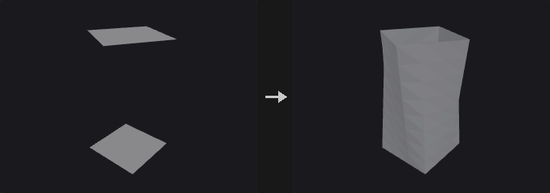

**Source** and **Destination** are either primitive groups or point groups. For primitives that are faces, their outer boundary is used (and the faces are deleted if **Remove Source and Destination Faces** is on); for open curves the curve itself is used. Point groups describe the boundary of a hole.

If both loops have the same number of points the bridge is made of quads; otherwise triangles are zipped by arc length. The start points are aligned automatically and **Twist** shifts the pairing by a number of points. The bridge has **Divisions** segments, interpolated linearly or with Hermite curves that leave along the cap normals (handle versus tunnel direction is detected automatically).

Face orientation is made consistent with neighbouring faces, so the result stays watertight after punching a tunnel. New polygons go to the output group.

**Inputs**

| Input | Type | Description |
|---|---|---|
| `geo` | GEOMETRY | Geometry containing both loops. |

**Outputs**

| Output | Type | Description |
|---|---|---|
| `geo` | GEOMETRY | Geometry with the bridge added. |
| `report` | STRING | Text summary of the bridge. |

**Parameters**

| Parameter | Type | Default | Description |
|---|---|---|---|
| Source Group `source_group` | string | *(empty)* | Group pattern for the source loop (primitives or points). |
| Destination Group `dest_group` | string | *(empty)* | Group pattern for the destination loop (primitives or points). |
| Divisions `divisions` | int [1..1000] | 1 | Number of segments along the bridge. |
| Twist `twist` | int | 0 | Shifts the start of the pairing by this many points for closed loops. Has no effect on open curves. |
| Reverse Destination `flip_direction` | toggle | off | Reverse the order of the destination loop before pairing. |
| Interpolation `interpolation` | menu | Linear | Linear connects matching points with straight lines. Hermite leaves each loop along its cap normal. Options: Linear (`linear`), Hermite (`hermite`). |
| Magnitude `magnitude` | float [-10.0..10.0] | 1 | Strength of the Hermite tangents. Negative values flip them. *Hidden when interpolation ≠ hermite.* |
| Remove Source and Destination Faces `remove_caps` | toggle | on | Delete the source and destination faces after bridging. |
| Reverse Normals `reverse_normals` | toggle | off | Flip the winding of the generated polygons. |
| Bridge Polygons Group `output_group` | string | `bridge` | Name of the primitive group holding the new polygons. |

---

### PolyBevel (PCG)

`PCG_PolyBevel` · category `PCG/modify` · Houdini: PolyBevel (SOP)

Bevels edges of polygon geometry with an optional rounded, chamfered, solid or crease profile.

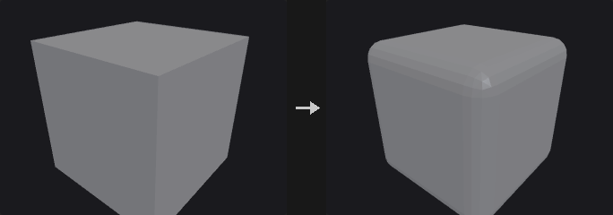

Every polygon adjacent to a beveled edge is shrunk away from that edge, then the gaps are bridged: faces become inset polygons, edges become bridge strips, and points become n-gons around the original point. New points are moved off the original edge into their faces, so the result is a true edge bevel and not a vertex cut.

The selected edges are interior manifold edges whose two sides are both selected. **Group Type** decides how `group` is interpreted: an edge group directly, or primitives or points from which the edges are derived. **Ignore Flat Edges** skips edges whose two faces meet at less than **Maximum Normal Angle**.

Output groups mark the generated fillet polygons and, optionally, the edges between the bevel faces and the shrunk faces.

Attributes and groups are carried over: new points copy the point attributes and point groups of the original point they come from, every new face takes the primitive attributes and groups of the face it was cut from (fillet strips from one adjacent face, corner patches from one face around the corner), and vertex attributes such as `uv` are copied from the corner of that face at the same original point. Detail attributes are kept.

**Inputs**

| Input | Type | Description |
|---|---|---|
| `geo` | GEOMETRY | Polygon geometry to bevel. |

**Outputs**

| Output | Type | Description |
|---|---|---|
| `geo` | GEOMETRY | Beveled geometry. |

**Parameters**

| Parameter | Type | Default | Description |
|---|---|---|---|
| Group `group` | string | *(empty)* | Group pattern selecting what to bevel; its meaning depends on Group Type. Empty means all edges. |
| Group Type `group_type` | menu | Guess from Group | How `group` is read. Guess from Group infers the class from the group name. Options: Guess from Group (`guess`), Edges (`edges`), Primitives (`prims`), Points (`points`). |
| Ignore Flat Edges `ignore_flat` | toggle | off | Skip edges whose adjacent faces are nearly coplanar (see Maximum Normal Angle). |
| Maximum Normal Angle `max_normal_angle` | float [0.0..180.0] | 2 | Edges whose two face normals differ by less than this angle (degrees) are not beveled. *Disabled when ignore_flat is off.* |
| Distance `distance` | float [0.0..] | 0.1 | Bevel width, measured along the faces from the original edge. |
| Distance Scaling `distance_scaling` | menu | No Scaling | No Scaling uses Distance as is. Scale by Attribute multiplies it by a point attribute. Options: No Scaling (`none`), Scale by Attribute (`attribute`). |
| Point Offset Scale `scale_attribute` | string | `pscale` | Point attribute that scales Distance per point. *Hidden when distance_scaling ≠ attribute.* |
| Limit Distance `limit_distance` | toggle | on | Clamp the distance to half of the shortest neighbouring edge at the ends of the beveled edge, a simplified version of Houdini's Collisions and Limits. |

*Fillet*

| Parameter | Type | Default | Description |
|---|---|---|---|
| Fillet `use_fillet` | toggle | on | Off produces a single-segment chamfer. |
| Shape `shape` | menu | Round | Round: curved profile. Chamfer: straight cut. Solid: one flat face per edge. Crease: the shape is unchanged and only a protective loop of edges is added on each side of the edge. None: faces are only pulled back, no bevel faces are created. Options: Round (`round`), Chamfer (`chamfer`), Solid (`solid`), Crease (`crease`), None (`none`). *Disabled when use_fillet is off.* |
| Convexity `convexity` | float [-1.0..1.0] | 1 | Bulge of the Round profile: 1 is an outward arc, 0 is flat, -1 is an inward arc. *Disabled when use_fillet is off } { shape ≠ round.* |
| Divisions `divisions` | int [1..64] | 1 | Number of segments across the bevel. *Disabled when use_fillet is off } { shape = solid } { shape = crease } { shape = none.* |

*Output Groups*

| Parameter | Type | Default | Description |
|---|---|---|---|
| Output Groups `use_out_groups` | toggle | on | Write the output groups below. |
| Point Fillet Group `point_fillet_group` | string | `pointfilletpolys` | Name of the polygon group holding the faces created at beveled points. *Disabled when use_out_groups is off.* |
| Edge Fillet Group `edge_fillet_group` | string | `edgefilletpolys` | Name of the polygon group holding the faces created along beveled edges. *Disabled when use_out_groups is off.* |
| Offset Group `offset_group` | string | *(empty)* | Name of an edge group holding the edges between the bevel faces and the pulled-back faces. Leave empty to not write it. *Disabled when use_out_groups is off.* |

**Compared with Houdini**

Follows Houdini's PolyBevel, including the None shape, Ignore Flat Edges, Scale by Attribute (default `pscale`), Convexity and Offset Group. Distance limiting is the simplified half-shortest-neighbour-edge rule, not the full Collisions and Limits options.

---

### PolyDoctor (PCG)

`PCG_PolyDoctor` · category `PCG/modify` · Houdini: PolyDoctor (SOP)

Detects and optionally repairs common polygon problems, writing validity flags.

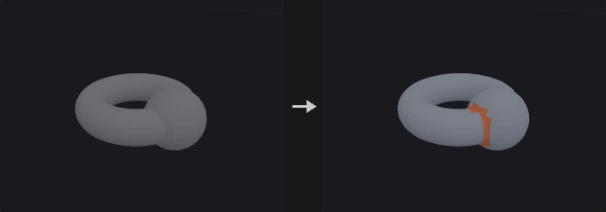

Each check has its own mode. Ignore skips the check, Mark only flags the problem, Repair fixes it and flags what was changed. Checks cover ill-formed polygons, polygons with five or more edges, non-convex polygons, overlapping polygons (optionally in pairs), polygons with locally small areas, non-uniform polygons, globally and locally small edges, disconnected points and non-manifold points.

Polygons that fail a check get `valid_poly = 0` and points get `valid_pt = 0`; polygons or points that were fixed get `repaired_poly = 1` or `repaired_pt = 1`. Attribute names are configurable and a group for each attribute can be created. Repairs run for at most **Max Passes** rounds.

**Self-Intersecting Polygons** (mark only) flags polygons that pass through other polygons of the same mesh, found with Intersection Analysis on the repaired result; faces that share a point are not tested against each other.

**Inputs**

| Input | Type | Description |
|---|---|---|
| `geo` | GEOMETRY | Polygon geometry to inspect. |

**Outputs**

| Output | Type | Description |
|---|---|---|
| `geo` | GEOMETRY | Geometry with flags, and repairs applied where requested. |
| `report` | STRING | Text report of the problems found and repaired. |

**Parameters**

| Parameter | Type | Default | Description |
|---|---|---|---|
| Max Passes `max_passes` | int [1..1000] | 10 | Maximum number of repair rounds. |

*Primitives*

| Parameter | Type | Default | Description |
|---|---|---|---|
| Ill-Formed `ill_formed` | menu | Repair | Polygons that are degenerate or invalid. Options: Ignore (`ignore`), Mark (`mark`), Repair (`repair`). |
| 5+ Edges `five_plus` | menu | Ignore | Polygons with five or more edges. Options: Ignore (`ignore`), Mark (`mark`), Repair (`repair`). |
| Non-Convex `non_convex` | menu | Ignore | Non-convex polygons. Options: Ignore (`ignore`), Mark (`mark`), Repair (`repair`). |
| Overlapping `overlapping` | menu | Repair | Polygons that overlap other polygons. Options: Ignore (`ignore`), Mark (`mark`), Repair (`repair`). |
| Pair Overlaps `pair_overlaps` | toggle | off | Also detect pairs of overlapping polygons. *Disabled when overlapping = ignore.* |
| Locally Small Areas `local_area` | menu | Ignore | Polygons whose area is small compared to the largest edge-sharing neighbour. Options: Ignore (`ignore`), Mark (`mark`), Repair (`repair`). |
| Local Area Threshold `local_area_threshold` | float [0.0..1.0] | 0.1 | A polygon is flagged when its area is below this fraction of its largest neighbour's area (0.1 = one tenth). *Disabled when local_area = ignore.* |
| Non-Uniform Polygons `non_uniform` | menu | Ignore | Polygons with an uneven shape. This check can only mark. Options: Ignore (`ignore`), Mark (`mark`). |
| Uniformity Threshold `uniformity_threshold` | float [0.0..1.0] | 0.1 | Isoperimetric quotient 4*pi*A / perimeter^2 (a circle is 1); polygons below this are non-uniform. *Disabled when non_uniform = ignore.* |

*Edges & Points*

| Parameter | Type | Default | Description |
|---|---|---|---|
| Globally Small Edges `global_edges` | menu | Ignore | Edges that are short relative to the whole geometry. Options: Ignore (`ignore`), Mark (`mark`), Repair (`repair`). |
| Global Edge Threshold `global_edge_threshold` | float [0.0..1.0] | 0.001 | Edges shorter than this fraction of the bounding box diagonal are flagged. *Disabled when global_edges = ignore.* |
| Locally Small Edges `local_edges` | menu | Ignore | Edges that are short relative to the longest edge of a polygon containing them. Options: Ignore (`ignore`), Mark (`mark`), Repair (`repair`). |
| Local Edge Threshold `local_edge_threshold` | float [0.0..1.0] | 0.1 | An edge is flagged when it is shorter than this fraction of the longest edge in a polygon that contains it. *Disabled when local_edges = ignore.* |
| Disconnected Points `disconnected` | menu | Repair | Points not used by any primitive. Options: Ignore (`ignore`), Mark (`mark`), Repair (`repair`). |

*Topology*

| Parameter | Type | Default | Description |
|---|---|---|---|
| Non-Manifold Points `nonmanifold` | menu | Ignore | Points where the surface is non-manifold. Options: Ignore (`ignore`), Mark (`mark`), Repair (`repair`). |
| Self-Intersecting Polygons `self_intersecting` | menu | Ignore | Mark polygons that pass through other polygons of the mesh (Ignore / Mark). Options: Ignore (`ignore`), Mark (`mark`). |

*Attributes*

| Parameter | Type | Default | Description |
|---|---|---|---|
| Valid Polygons `valid_poly` | string | `valid_poly` | Name of the primitive attribute set to 0 on invalid polygons. |
| Repaired Polygons `repaired_poly` | string | `repaired_poly` | Name of the primitive attribute set to 1 on repaired polygons. |
| Valid Points `valid_pt` | string | `valid_pt` | Name of the point attribute set to 0 on invalid points. |
| Modified Points `repaired_pt` | string | `repaired_pt` | Name of the point attribute set to 1 on modified points. |
| Create a group for each attribute `create_groups` | toggle | off | Also create a group for each attribute, named with a `_grp` suffix. |

**Compared with Houdini**

Partial implementation of PolyDoctor. Non-Uniform Polygons can only be marked. For general cleanup, PCG_Clean remains available.

---

### PolyExpand2D (PCG)

`PCG_PolyExpand2D` · category `PCG/modify` · Houdini: PolyExpand2D (SOP)

Offsets a planar curve network inward and outward by a constant distance.

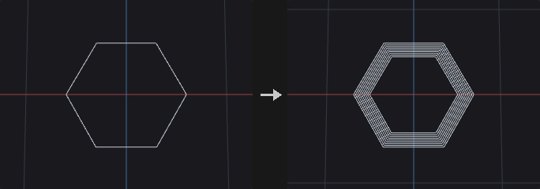

Produces offset curves (or the surface between input and offset) for a planar network of curves. Rather than just pushing each edge, the node builds mitered offsets that may self-intersect and then cuts away every part whose midpoint is closer than **Offset** to the input. What remains matches a straight-skeleton offset, with no event queue and therefore no degenerate-event ordering problems.

Inside and outside come from the faces of the input itself: the input is treated as a planar graph (welded, split at intersections, traversed by angle). Bounded faces offset inward give *inside*; the unbounded face offset inward expands outward and gives *outside*. A tree-shaped network has no bounded face, so it only has an outside loop around the whole network.

Open curve ends get a square cap extended by Offset along the tangent. A flat cap would lie at distance 0 and be trimmed away, breaking the loop. With **Split Offset Curves to Omit End Caps** the three cap segments are removed and two lines along the sides remain.

**Inputs**

| Input | Type | Description |
|---|---|---|
| `geo` | GEOMETRY | Planar curve network. |

**Outputs**

| Output | Type | Description |
|---|---|---|
| `geo` | GEOMETRY | Offset curves or surfaces. |

**Parameters**

| Parameter | Type | Default | Description |
|---|---|---|---|
| Group `group` | string | *(empty)* | Group pattern limiting which primitives are offset. Empty means all. |
| 2D Positions `positions_2d` | menu | Fit Plane | How the 2D plane is chosen. Fit Plane fits a plane to the points; Select Projection Plane uses the origin and normal below. Options: Fit Plane (`fit_plane`), Select Projection Plane (`specify_plane`). |
| Plane Origin `plane_origin_x` `plane_origin_y` `plane_origin_z` | float | 0, 0, 0 | Point on the projection plane (used with Select Projection Plane). *Hidden when positions_2d ≠ specify_plane.* |
| Plane Distance `plane_distance` | float | 0 | Moves the plane along its normal. It is also read in Fit Plane mode. |
| Plane Normal `plane_normal_x` `plane_normal_y` `plane_normal_z` | float | 0, 1, 0 | Normal of the projection plane (used with Select Projection Plane). *Hidden when positions_2d ≠ specify_plane.* |
| Output `output` | menu | Offset Curves | Offset Curves outputs only the offset lines. Offset Surfaces also fills the band between input and offset lines with triangles (road network to road surface). Options: Offset Curves (`offset_curves`), Offset Surfaces (`offset_surfaces`). |
| Offset `offset` | float | 0.1 | Offset distance. |
| Divisions `divisions` | int [1..256] | 1 | When greater than 1, outputs rings at evenly spaced distances up to Offset. |
| Side Determination `side_determination` | menu | Simple Reachability | How results are classified as inside or outside. Simple Reachability uses the face group the offset belongs to; Winding Number tests against the winding number of the input. Options: Simple Reachability (`simple_reachability`), Winding Number (`winding_number`). |
| Output Inside `output_inside` | toggle | on | Keep results that lie inside bounded faces of the input. |
| Output Outside `output_outside` | toggle | on | Keep results that lie outside, around the unbounded face. |
| Keep Input Geometry `keep_input_geometry` | toggle | off | Merge the input back into the output. |
| Split Offset Curves to Omit End Caps `split_offset_curves_to_omit_end_caps` | toggle | off | Remove the cap segments at open curve ends, leaving two side lines. *Hidden when output ≠ offset_curves.* |

*Local Attributes*

| Parameter | Type | Default | Description |
|---|---|---|---|
| Create Output Groups `create_output_groups` | toggle | off | Write the inside and outside groups. |
| Inside Group `inside_group` | string | `inside` | Name of the group for inside results. *Disabled when create_output_groups is off.* |
| Outside Group `outside_group` | string | `outside` | Name of the group for outside results. *Disabled when create_output_groups is off.* |
| Edge Distance Attribute `edge_distance_attribute` | string | *(empty)* | If set, writes the offset distance of each result curve or triangle to a point attribute of this name. Leave empty to not write it. |
| Edge Speed Attribute `edge_speed_attribute` | string | *(empty)* | Name of a primitive or point attribute that scales the offset speed of each input edge (point attributes are averaged over the edge ends). Leave empty for uniform speed. |

*Advanced*

| Parameter | Type | Default | Description |
|---|---|---|---|
| Coincidence Tolerance `coincidence_tolerance` | float [0.0..1000.0] | 0.003 | Points closer than this are welded when the input is turned into a planar graph. |
| Parallelism Tolerance `parallelism_tolerance` | float [0.0..1.0] | 0.01 | Tolerance used when intersecting edges and treating adjacent edges as parallel. |
| Skeleton Failure `on_failure` | menu | Fail with Error | What to do if the skeleton construction fails: raise an error, keep the input with a warning, or output nothing. Options: Fail with Error (`fail_with_error`), Warn and Keep Input (`warn_and_keep_input`), Output Empty Geometry (`output_nothing`). |
| Recompute Point Normals `recompute_point_normals` | toggle | on | Recompute `N` on the result. Only relevant when Keep Input Geometry merges input with faces back in. |

**Compared with Houdini**

Does not implement a straight skeleton with an event queue. It trims a self-intersecting mitered offset by distance to the input, which gives the straight-skeleton offset without degenerate-event ordering problems.

---

### PolyExtrude (PCG)

`PCG_PolyExtrude` · category `PCG/modify` · Houdini: PolyExtrude (SOP)

Extrudes polygons along their normals, a fixed direction or a spine curve, with inset, twist and divisions.

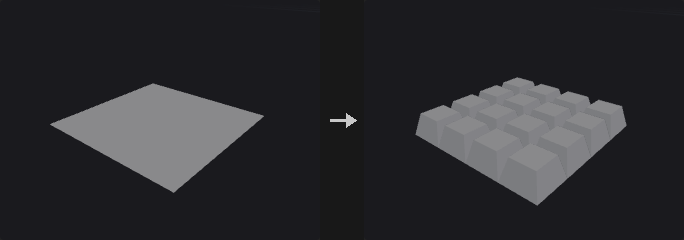

Extrudes the selected primitives and creates front, back and side polygons. **Divide Into** decides what counts as one region: Connected Components extrudes touching selected faces together, so side walls appear only where the two sides of an edge belong to different regions; Individual Elements extrudes every face on its own.

Inset uses angle-bisector miters scaled by 1/sin(half angle), so every edge moves in by the same perpendicular distance. **Limit Insetting** clamps the inset before edges flip.

If the `spine` input is connected and **External Spine** is on, the faces are swept along the spine curve using a rotation-minimising frame, initialised per region from the face's own axis, so there is no spurious twist between face orientation and the spine's normal plane. Distance and Twist are then ignored; the spine decides the length.

Groups: front, back and side polygons can be written to groups. Upstream groups are inherited by the front and back faces only, not by the side walls, which are new geometry.

**Inputs**

| Input | Type | Description |
|---|---|---|
| `geo` | GEOMETRY | Geometry with the polygons to extrude. |
| `spine` *(optional)* | GEOMETRY | Optional curve to sweep along. Used only when External Spine is on; otherwise the extrusion is straight. |

**Outputs**

| Output | Type | Description |
|---|---|---|
| `geo` | GEOMETRY | Extruded geometry. |

**Parameters**

*Extrusion*

| Parameter | Type | Default | Description |
|---|---|---|---|
| Group `group` | string | *(empty)* | Group pattern selecting the primitives to extrude. Empty means all. |
| Divide Into `divide_into` | menu | Connected Components | Connected Components treats touching selected faces as one region; Individual Elements extrudes each face separately. Options: Connected Components (`connected`), Individual Elements (`individual`). |
| Extrusion Mode `extrusion_mode` | menu | Primitive/Edge Normal | Primitive/Edge Normal moves along face normals. Point Normal moves each point along its own point normal (`N`, computed if missing). Has no effect when Specified Direction is on or a spine is used. Options: Primitive/Edge Normal (`prim_edge_normal`), Point Normal (`point_normal`). |

*Extrusion › Direction*

| Parameter | Type | Default | Description |
|---|---|---|---|
| Specified Direction `use_direction` | toggle | off | Off extrudes along the face normal (Houdini's Primitive Normal). On moves all points along the same direction. |
| Direction `dir_x` `dir_y` `dir_z` | float | 0, 1, 0 | Extrusion direction used when Specified Direction is on. *Disabled when use_direction is off.* |

*Extrusion*

| Parameter | Type | Default | Description |
|---|---|---|---|
| Distance `distance` | float | 1 | Extrusion length. Not used when a spine is applied. |
| Inset `inset` | float | 0 | Moves the extruded front inward (negative values outward) by this perpendicular distance. |
| Twist `twist` | float [-3600..3600] | 0 | Rotates the front around the extrusion direction, in degrees, progressively over the divisions. Not used when a spine is applied. |
| Divisions `divisions` | int [1..512] | 1 | Number of segments along the extrusion; each gives a ring of side polygons. |

*Extrusion › Spine*

| Parameter | Type | Default | Description |
|---|---|---|---|
| External Spine `use_spine` | toggle | off | Sweep along the connected spine curve. Without a connected curve the extrusion stays straight. |
| Up Vector `up_x` `up_y` `up_z` | float | 0, 1, 0 | Up vector used to orient the frame along the spine. *Disabled when use_spine is off.* |

*Extrusion › Front Transform*

| Parameter | Type | Default | Description |
|---|---|---|---|
| Transform Extruded Front `transform_front` | toggle | off | Apply an extra transform to the extruded front. |
| Translate `front_tx` `front_ty` `front_tz` | float | 0, 0, 0 | Translation of the front. *Disabled when transform_front is off.* |
| Rotate `front_rotate` | float [-3600..3600] | 0 | Rotation of the front around the extrusion direction, in degrees. *Disabled when transform_front is off.* |
| Scale `front_scale` | float [0.0..] | 1 | Uniform scale of the front, around its centroid. *Disabled when transform_front is off.* |

*Output Geometry and Groups › Output*

| Parameter | Type | Default | Description |
|---|---|---|---|
| Output Geometry and Groups `use_output` | toggle | on | Off uses the defaults of this section: output front and sides, with group names `extrudeFront` and `extrudeSide`. |
| Output Front `output_front` | toggle | on | Keep the front polygons. |
| Front Group `front_group` | string | `extrudeFront` | Group name for the front polygons. *Disabled when output_front is off.* |
| Output Back `output_back` | toggle | off | Keep the original (back) polygons. |
| Back Group `back_group` | string | `extrudeBack` | Group name for the back polygons. *Disabled when output_back is off.* |
| Output Side `output_side` | toggle | on | Create side wall polygons. |
| Side Group `side_group` | string | `extrudeSide` | Group name for the side polygons. *Disabled when output_side is off.* |
| Front Seam Group `front_seam_group` | string | *(empty)* | Point group of the loop where the side walls meet the front. Leave empty to not write it. |
| Back Seam Group `back_seam_group` | string | *(empty)* | Point group of the loop where the side walls meet the back. Leave empty to not write it. |
| Preserve Groups `preserve_groups` | toggle | on | Front and back faces inherit the upstream groups. Side walls do not. |

*Output Geometry and Groups › Insetting*

| Parameter | Type | Default | Description |
|---|---|---|---|
| Limit Insetting `limit_insetting` | toggle | off | Clamp the inset so edges cannot flip. |
| Common Limit `use_common_limit` | toggle | on | Use one limit (the smallest over all regions) for everything. Off limits each region separately. *Disabled when limit_insetting is off.* |

*Output Geometry and Groups › Normals*

| Parameter | Type | Default | Description |
|---|---|---|---|
| Add Vertex Normals `add_vertex_normals` | toggle | off | Compute vertex normals on the result, split at the Cusp Angle. |
| Cusp Angle `cusp_angle` | float [0.0..180.0] | 60 | Angle in degrees above which vertex normals are split. *Disabled when add_vertex_normals is off.* |

*Local Control › Local Control*

| Parameter | Type | Default | Description |
|---|---|---|---|
| Local Attributes `use_local` | toggle | off | Scale distance and inset per point or primitive with attributes. |
| Distance Scale `distance_attrib` | string | *(empty)* | Point or primitive attribute that multiplies Distance per element. Not used in external spine mode. *Disabled when use_local is off.* |
| Inset Scale `inset_attrib` | string | *(empty)* | Attribute that multiplies Inset per element. *Disabled when use_local is off.* |

*UVs › Texture*

| Parameter | Type | Default | Description |
|---|---|---|---|
| Generate Unwrapped Texture Coordinates for Sides `side_uv` | toggle | off | Generate unwrapped UV coordinates on the side walls: u along the accumulated boundary length, v along the extrusion. |
| Style `uv_style` | menu | Proportional | Proportional uses real edge lengths for u. Uniform gives each wall segment a unit-length span. Options: Proportional (`proportional`), Uniform (`uniform`). *Disabled when side_uv is off.* |

---

### PolyFill (PCG)

`PCG_PolyFill` · category `PCG/modify` · Houdini: PolyFill (SOP)

Closes open boundary loops with new polygons.

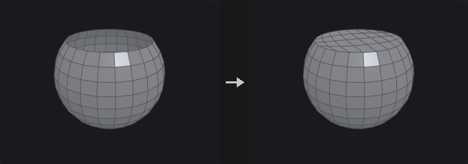

Clip, Blast and Delete leave openings, while volume computation, booleans and Voronoi fracture all want closed geometry. PolyFill finds the boundary loops of the input and caps each one.

The winding of the new face is the reverse of the boundary half-edges, so the cap normal agrees with the neighbouring faces. Fill modes: **Single Polygon** covers the hole with one n-gon (no points added; best for planar holes), **Triangle Fan** adds a point at the hole centre and fans triangles (use it for non-planar holes, where an n-gon would twist), **Triangles** ear-clips without adding points and handles concave holes, **Quadrilateral Fan** adds a centre point and makes one quad per two boundary edges (an odd count leaves one triangle), **Quadrilaterals** folds the loop into two chains and joins them quad by quad without new points (like a single polygon it suits convex, roughly flat holes), and **Quadrilateral Grid** treats the loop as the four sides of a patch and fills it with a Coons-interpolated quad grid. If the edge count is odd, the grid mode falls back to Quadrilaterals.

**Inputs**

| Input | Type | Description |
|---|---|---|
| `geo` | GEOMETRY | Geometry with open boundaries. |

**Outputs**

| Output | Type | Description |
|---|---|---|
| `geo` | GEOMETRY | Geometry with the holes filled. |

**Parameters**

| Parameter | Type | Default | Description |
|---|---|---|---|
| Fill Mode `mode` | menu | Single Polygon | How each hole is filled; see the description for the six modes. Options: Single Polygon (`ngon`), Triangle Fan (`fan`), Triangles (`triangles`), Quadrilateral Fan (`quad_fan`), Quadrilaterals (`quads`), Quadrilateral Grid (`quad_grid`). |
| Max Hole Sides `max_sides` | int [0..65536] | 0 | 0 fills every hole. A positive value fills only holes with at most that many boundary edges, which closes small holes without sealing a deliberately open model. |
| Planar Tolerance `planar_tolerance` | float [-1.0..] | -1 | -1 ignores planarity. A value of 0 or more fills only holes that are flat to within that tolerance. |
| Fill Polygons Group `output_group` | string | *(empty)* | Name of a primitive group that receives the new polygons. Leave empty to not write one. |

---

### PolyPath (PCG)

`PCG_PolyPath` · category `PCG/modify` · Houdini: PolyPath (SOP)

Joins polylines whose end points touch into the longest possible curves, without creating any edges.

Resample, Carve, Sweep and PolyExpand2D all work per primitive, so a curve has to be one primitive for them to know what "along the curve" means. Upstream nodes often deliver many fragments (a Clip, or Convert Line output, or several merged lines whose ends coincide but are different points). PolyPath chains them into longer primitives.

It never creates an edge: only end points that already coincide are connected, the shape is unchanged, and only the assignment of points to primitives changes. (Join, in contrast, forces connections and adds straight segments where ends do not meet.)

Each input polyline is an atomic unit and only its two end points take part in connections. A long polyline that another line happens to cross in the middle is therefore kept whole, which differs from Houdini's PolyPath. Polylines that are already broken have to be split with Dissolve or Blast first.

Faces and closed primitives are not touched; they pass through unchanged. When two end points are within **Point Tolerance** but not the same point, the one that comes first is kept and positions are not averaged, so the geometry does not move. Use Fuse first if you want both to move.

**Inputs**

| Input | Type | Description |
|---|---|---|
| `geo` | GEOMETRY | Geometry containing the polylines to join. |

**Outputs**

| Output | Type | Description |
|---|---|---|
| `geo` | GEOMETRY | Geometry with chained polylines. |

**Parameters**

| Parameter | Type | Default | Description |
|---|---|---|---|
| Group `group` | string | *(empty)* | Group pattern selecting which primitives take part. Empty means all. |
| Point Tolerance `tolerance` | float [0.0..] | 0 | 0 only joins ends that are the same point. A positive value also joins ends within this distance, keeping the first point encountered. |
| Junctions `junction` | menu | Split at Junctions | What to do where three or more lines meet at one end point. Split at Junctions stops there (Houdini's behaviour, most conservative). Continue Straightest continues along the line that turns least, limited by Max Turn Angle (the choice for road networks). Continue Any joins in an arbitrary order. Options: Split at Junctions (`split`), Continue Straightest (`straightest`), Continue Any (`any`). |
| Max Turn Angle `max_angle` | float [0.0..180.0] | 60 | Largest turn, in degrees, that Continue Straightest accepts at a junction. It only applies at junctions: where just two lines meet they are always joined. *Hidden when junction ≠ straightest.* |
| Match Attribute `match_attribute` | string | *(empty)* | Primitive attribute that must be equal on two lines for them to be joined (for example road class). Leave empty for no restriction. |
| Close Loops `close_loops` | toggle | on | When a chain returns to its start, close it into a closed curve. |
| Primitive Attributes `prim_attribs` | menu | Keep First | Keep First gives the joined primitive the attributes of the first piece. Drop removes primitive attributes. Options: Keep First (`first`), Drop (`drop`). |
| Remove Unused Points `remove_unused_points` | toggle | off | Delete points no longer referenced by any primitive. |

**Compared with Houdini**

Houdini's PolyPath breaks inputs into edges and re-chains them, which splits a long polyline where another line happens to cross it. This node treats each polyline as a unit and only connects end points.

---

### PolyReduce (PCG)

`PCG_PolyReduce` · category `PCG/modify` · Houdini: PolyReduce (SOP)

Reduces triangle or point count with quadric error edge collapse.

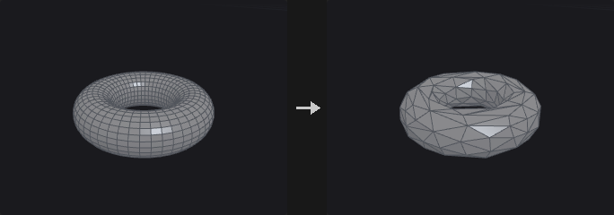

Implements Garland-Heckbert quadric error metric (QEM) edge collapse. Each point carries a 4x4 quadric (the area-weighted sum of squared distances to its planes); collapsing an edge adds the two quadrics, so error accumulates over successive collapses and the node does not keep eating the same spot.

The input is triangulated first and the output is always triangles (there is no Preserve Quads). **Boundaries** is usually the most important value: without it QEM happily eats away the border of flat meshes. Crease edges work through the same mechanism with their own weight. **Soft Points** add a cost for moving away from the original position, and **Hard Edges** lock both of their end points.

With **Preserve UVs** only half-edge collapses are performed, points on UV seams and hard edges are locked, and vertex attributes are rewritten along the way, so an LOD shares the textures of the original. This node is the only greedy serial algorithm in the plugin; reduction cannot be computed as one batch.

**Inputs**

| Input | Type | Description |
|---|---|---|
| `geo` | GEOMETRY | Mesh to reduce. |

**Outputs**

| Output | Type | Description |
|---|---|---|
| `geo` | GEOMETRY | Reduced triangle mesh. |

**Parameters**

| Parameter | Type | Default | Description |
|---|---|---|---|
| Group `group` | string | *(empty)* | Group pattern limiting the reduction to part of the mesh. Empty means all. |
| Target `target` | menu | Percentage of Triangle Count | The input is triangulated first. The two triangle options count triangles; the two point options count points. Percentage options use Percent to Keep, count options use Number to Keep. Options: Percentage of Triangle Count (`percentage`), Output Triangle Count (`triangle_count`), Percentage of Point Count (`point_percentage`), Output Point Count (`point_count`). |
| Percent to Keep `keep_percent` | float [0.01..100.0] | 50 | Percentage of triangles or points to keep. *Hidden when target ≠ percentage target ≠ point_percentage.* |
| Number to Keep `target_count` | int [1..] | 1000 | Number of triangles or points to keep. *Hidden when target ≠ triangle_count target ≠ point_count.* |

*Limit Using Normal Deviation*

| Parameter | Type | Default | Description |
|---|---|---|---|
| Threshold Angle `max_normal_flip` | float [0.0..180.0] | 90 | A collapse is rejected if it would rotate a face normal by more than this angle (degrees). |

*Output Geometry*

| Parameter | Type | Default | Description |
|---|---|---|---|
| Point Position `position` | menu | Optimal | Where the merged point is placed. Optimal minimises the quadric error, Midpoint uses the middle of the edge, Original Points keeps one of the end points. Forced to Original Points when Preserve UVs is on. Options: Optimal (`optimal`), Midpoint (`midpoint`), Original Points (Endpoint) (`endpoint`). *Disabled when preserve_uvs is on.* |
| Preserve UVs `preserve_uvs` | toggle | off | Half-edge collapses only; locks points on UV seams and hard edges and rewrites vertex attributes, so LODs share the original textures. |

*Stiffen*

| Parameter | Type | Default | Description |
|---|---|---|---|
| Boundaries `boundary_weight` | float [0.0..] | 4 | How strongly open boundaries resist collapse. 0 lets the border erode, and a flat grid reduced hard collapses to a thin strip; around 4 keeps the area intact. |

*Preserve Features*

| Parameter | Type | Default | Description |
|---|---|---|---|
| Hard Boundary Points `lock_boundary` | toggle | off | Never move or remove points on open boundaries. |
| Hard Points `lock_group` | string | *(empty)* | Group pattern of points that are never changed. |
| Hard Edges `hard_edges` | string | *(empty)* | Edge group whose end points are all locked. |
| Soft Points `soft_points` | string | *(empty)* | Group pattern of points that get an extra cost for moving from their original position. |
| Weight `soft_weight` | float [0.0..] | 1 | Strength of the cost applied to Soft Points. *Disabled when soft_points = "".* |
| Soft Edges `crease_group` | string | *(empty)* | Edge group of soft crease edges that are protected by extra constraint planes. |
| Weight `crease_weight` | float [0.0..] | 4 | Strength of the protection on Soft Edges. High values make crease edges very expensive to collapse. *Disabled when crease_group = "".* |

**Compared with Houdini**

The output is always triangles; Houdini's Preserve Quads is not implemented.

---

### PolySpline (PCG)

`PCG_PolySpline` · category `PCG/modify` · Houdini: PolySpline (SOP)

Converts polylines into smooth spline curves sampled as polylines.

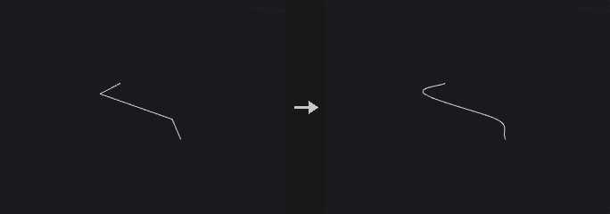

Each selected curve is interpreted as control points of the chosen **Spline Type** and sampled with **Sample Divisions** samples per span. Catmull-Rom passes through the points, with an Alpha that selects uniform, centripetal or chordal parametrisation; BSpline approximates (C2, does not pass through interior points); Interpolating (C2) passes through the points and is C2, solving a tridiagonal system for the control points; Bezier and Degree 2 Bezier take the points as control points, three (or two) per segment with shared end points; Cardinal passes through the points with tangents scaled by CV Tension; Linear gives straight segments.

Open curves pass through both end points. Numeric point attributes are interpolated with the same weights as `P`.

A Division Method other than Standard resamples the result afterwards with equal arc length or equal distance along one axis.

**Inputs**

| Input | Type | Description |
|---|---|---|
| `geo` | GEOMETRY | Geometry with the polylines to smooth. |

**Outputs**

| Output | Type | Description |
|---|---|---|
| `geo` | GEOMETRY | Smoothed curves. |
| `report` | STRING | Text summary of how many curves were processed. |

**Parameters**

| Parameter | Type | Default | Description |
|---|---|---|---|
| Group `group` | string | *(empty)* | Group pattern selecting the curves. Empty means all. |
| Spline Type `basis` | menu | Catmull-Rom | Spline type; see the description. Options: Catmull-Rom (`catmull_rom`), BSpline (`bspline`), Interpolating (C2) (`interpolate`), Bezier (`bezier`), Degree 2 Bezier (`degree2_bezier`), Cardinal (`cardinal`), Linear (`linear`). |
| Close `close` | menu | If polygon does | Off and On force open or closed (closing needs at least three points). If polygon does follows each primitive's own closed flag. Options: Off (`off`), On (`on`), If polygon does (`if_polygon_does`). |
| Division Method `division_method` | menu | Standard | Standard keeps the sample divisions as they are. The other methods resample the spline: Even Length uses equal chord lengths between neighbouring points, Even X/Y/Z uses equal distance along that axis. Options: Standard (`standard`), Even Length Segments (`even_length`), Even X Segments (`even_x`), Even Y Segments (`even_y`), Even Z Segments (`even_z`). |
| Segment Length `segment_length` | float [0.0..] | 0 | Target length for the resampling. 0 means use Output Divisions instead. *Disabled when division_method = standard.* |
| Output Divisions `output_divisions` | int [0..] | 0 | Number of output segments for the resampling when Segment Length is 0. If both are 0 no resampling happens. *Disabled when division_method = standard } { segment_length > 0.* |
| Sample Divisions `divisions` | int [1..1024] | 8 | Number of samples evaluated per span of the spline. |
| First CV Count `first_cv_count` | int [1..64] | 1 | How many times the first control point is repeated before the spline is evaluated. |
| Last CV Count `last_cv_count` | int [1..64] | 1 | How many times the last control point is repeated before the spline is evaluated. |
| CV Tension `tension` | float [-10.0..10.0] | 0.5 | Cardinal tension: 0 is a uniform Catmull-Rom, 1 gives zero tangents. *Hidden when basis ≠ cardinal.* |
| Alpha `alpha` | float [0.0..1.0] | 0.5 | Catmull-Rom parametrisation: 0 uniform, 0.5 centripetal, 1 chordal. *Hidden when basis ≠ catmull_rom.* |

**Compared with Houdini**

Alpha is an addition to Houdini. Houdini's Special Bezier and Special Smooth Bezier types are not implemented.

---

### Primitive (PCG)

`PCG_Primitive` · category `PCG/modify` · Houdini: Primitive (SOP)

Transforms each selected primitive around its own center and offsets it along its normal.

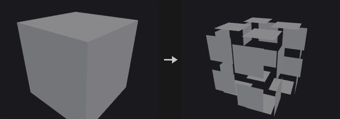

Every selected primitive is translated, rotated and scaled around its own center (shifted by **Pivot**), then moved along its own normal by **Normal Offset**. If **Scale Attribute** names a primitive attribute, the scale is multiplied by it. **Unshare Points** first separates the points of the selected primitives; without that, a shared point would be pulled by whichever primitive is processed last.

The Attributes section can add or remove `Cd` and `Alpha` on the selected primitives. The curve and surface section closes or opens polygons and polylines, and applies the same vertex operations as the Reverse node (reverse, swap UV, shift).

**Inputs**

| Input | Type | Description |
|---|---|---|
| `geo` | GEOMETRY | Geometry whose primitives should be transformed. |

**Outputs**

| Output | Type | Description |
|---|---|---|
| `geo` | GEOMETRY | Geometry with transformed primitives. |

**Parameters**

| Parameter | Type | Default | Description |
|---|---|---|---|
| Group `group` | string | *(empty)* | Group pattern selecting the primitives. Empty means all. |
| Transform Order `xform_order` | menu | Scale Rot Trans | Order in which scale, rotate and translate are applied, read left to right. Options: Scale Rot Trans (`srt`), Scale Trans Rot (`str`), Rot Scale Trans (`rst`), Rot Trans Scale (`rts`), Trans Scale Rot (`tsr`), Trans Rot Scale (`trs`). |
| Rotate Order `rotate_order` | menu | Rx Ry Rz | Order of the three axis rotations. Options: Rx Ry Rz (`xyz`), Rx Rz Ry (`xzy`), Ry Rx Rz (`yxz`), Ry Rz Rx (`yzx`), Rz Rx Ry (`zxy`), Rz Ry Rx (`zyx`). |
| Translate `translate_x` `translate_y` `translate_z` | float | 0, 0, 0 | Translation of each primitive. |
| Rotate `rotate_x` `rotate_y` `rotate_z` | float | 0, 0, 0 | Rotation in degrees. |
| Scale `scale_x` `scale_y` `scale_z` | float | 1, 1, 1 | Non-uniform scale around the primitive center. |
| Shear `shear_xy` `shear_xz` `shear_yz` | float | 0, 0, 0 | Shear values XY, XZ and YZ: x += xy*y + xz*z, y += yz*z. Applied immediately after scaling. |
| Pivot `pivot_x` `pivot_y` `pivot_z` | float | 0, 0, 0 | Pivot of the rotation and scale, relative to each primitive's own center. 0 is the center. |
| Uniform Scale `uniform_scale` | float | 1 | Extra scale factor applied to all axes. |
| Scale Attribute `scale_attribute` | string | *(empty)* | Primitive attribute that multiplies the scale. Leave empty to not use one. |
| Normal Offset `normal_offset` | float | 0 | Distance to move each primitive along its own normal. |
| Unshare Points `unshare_points` | toggle | on | Split the selected primitives' points from their neighbours before transforming. |

*Attributes*

| Parameter | Type | Default | Description |
|---|---|---|---|
| Color `color_mode` | menu | Keep Color | Add writes the primitive attribute `Cd` on the selected primitives; Remove deletes it. Options: Keep Color (`keep`), Add Color (`add`), Remove Color (`remove`). |

| Parameter | Type | Default | Description |
|---|---|---|---|
| Color `color_r` `color_g` `color_b` | float [0.0..] | 1, 1, 1 | Color written when Color is Add. *Hidden when color_mode ≠ add.* |
| Alpha `alpha_mode` | menu | Keep Alpha | Add writes the primitive attribute `Alpha` on the selected primitives; Remove deletes it. Options: Keep Alpha (`keep`), Add Alpha (`add`), Remove Alpha (`remove`). |
| Alpha `alpha` | float [0.0..1.0] | 1 | Alpha value written when Alpha is Add. *Hidden when alpha_mode ≠ add.* |

*Face/Hull*

| Parameter | Type | Default | Description |
|---|---|---|---|
| Close U `close_u` | menu | No Change | Open or close polygons and polylines. Houdini's two Unroll options are not implemented. Options: No Change (`no_change`), Open (`open`), Close (`close`). |

| Parameter | Type | Default | Description |
|---|---|---|---|
| Vertex `vertex_op` | menu | No Change | Vertex order operation, same implementation as the Reverse node. Options: No Change (`none`), Reverse (`reverse`), Reverse U (`reverse_u`), Reverse V (`reverse_v`), Swap UV (`swap_uv`), Shift (`shift`). |
| U Offset `u_offset` | int | 0 | Shift amount in U. Only meaningful for NURBS or Bezier surfaces (grids). *Hidden when vertex_op ≠ shift.* |
| V Offset `v_offset` | int | 0 | Shift amount in V. Only meaningful for NURBS or Bezier surfaces (grids). *Hidden when vertex_op ≠ shift.* |

**Compared with Houdini**

Transform Order, Rotate Order, Shear and Pivot are provided as in Houdini's Primitive SOP; the Unroll options of Close U are not implemented.

---

### Primitive Split (PCG)

`PCG_PrimitiveSplit` · category `PCG/modify` · Houdini: Primitive Split (SOP)

Splits shared points so that primitives with different attribute values no longer share them.

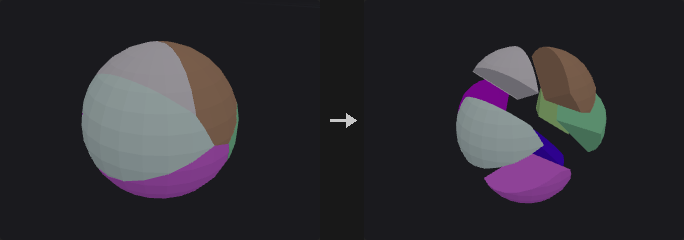

Primitives whose primitive attribute values differ by more than **Tolerance** (strings are compared for equality) stop sharing points: a point shared by several kinds of primitives is duplicated, one copy per kind. Primitives outside `group` form one class of their own and keep sharing points among themselves.

**Inputs**

| Input | Type | Description |
|---|---|---|
| `geo` | GEOMETRY | Geometry with shared points. |

**Outputs**

| Output | Type | Description |
|---|---|---|
| `geo` | GEOMETRY | Geometry with points split per attribute class. |
| `report` | STRING | Text summary of the split. |

**Parameters**

| Parameter | Type | Default | Description |
|---|---|---|---|
| Group `group` | string | *(empty)* | Group pattern limiting which primitives are split by attribute. Empty means all. |
| Split by Attribute `attribute` | string | `name` | Primitive attribute that decides the classes. |
| Tolerance `tolerance` | float [0.0..] | 0 | Numeric differences larger than this separate primitives. Strings are compared for equality. |

---

### Ray (PCG)

`PCG_Ray` · category `PCG/modify` · Houdini: Ray (SOP)

Projects points onto collision geometry by ray casting or by nearest surface point.

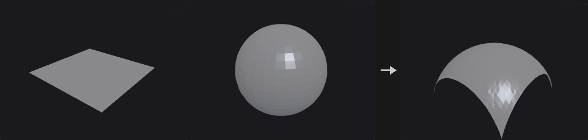

Typically used to drop scattered points onto terrain, or to shrink a shell onto a model. **Project Rays** casts each point along a direction (or its normal) and finds the intersection; **Minimum Distance** finds the closest surface point.

Points that miss are left where they are. Use **Hit Group** to let downstream nodes decide whether to delete or keep them. Hit information can be written to point attributes (distance, primitive number, UV, position, normal), and point attributes of the collision geometry can be transferred by nearest-vertex lookup. If the collision geometry has its own `N`, the hit normal is interpolated from it; otherwise the face normal is used.

**Inputs**

| Input | Type | Description |
|---|---|---|
| `geo` | GEOMETRY | Geometry whose points are projected. |
| `collision` | GEOMETRY | Geometry to project onto. |

**Outputs**

| Output | Type | Description |
|---|---|---|
| `geo` | GEOMETRY | Geometry with moved points and optional hit attributes. |

**Parameters**

| Parameter | Type | Default | Description |
|---|---|---|---|
| Group `group` | string | *(empty)* | Group pattern of points that take part. Empty means all. |
| Method `method` | menu | Minimum Distance | Minimum Distance snaps to the closest point on the surface. Project Rays casts rays along a direction. Options: Minimum Distance (`minimum_distance`), Project Rays (`project_rays`). |
| Use Point Normals as Direction `use_point_normals` | toggle | off | Use each point's `N` attribute as the ray direction. Errors if `N` is missing. *Hidden when method = minimum_distance.* |
| Direction `direction_x` `direction_y` `direction_z` | float | 0, -1, 0 | Ray direction when point normals are not used. *Hidden when method = minimum_distance.* *Disabled when use_point_normals is on.* |
| Reverse Rays `reverse` | toggle | off | Flip the ray direction. *Hidden when method = minimum_distance.* |
| Both Directions `both_directions` | toggle | off | Also accept hits behind the point. The closer of the front and back hits wins (the farther one with Intersect Farthest Surface); the stored distance is negative for a hit behind the point. *Hidden when method = minimum_distance.* |
| Intersect Farthest Surface `intersect_farthest` | toggle | off | Use the farthest hit along the ray instead of the nearest. *Hidden when method = minimum_distance.* |
| Max Distance `max_distance` | float [0.0..] | 0 | 0 means unlimited. Otherwise it limits the search distance, which also speeds up nearest point queries considerably. |

*Transform*

| Parameter | Type | Default | Description |
|---|---|---|---|
| Transform Points `transform_points` | toggle | on | Move hit points to the hit position. Off leaves positions and only writes attributes and the group. |
| Scale `scale` | float | 1 | Fraction of the way to the hit position: 1 moves all the way, 0.5 halfway. |
| Lift `lift` | float | 0 | Extra offset along the hit normal after moving. |

*Output*

| Parameter | Type | Default | Description |
|---|---|---|---|
| Hit Group `hit_group` | string | *(empty)* | Name of a point group to which points that hit are added. Leave empty to not write it. |
| Distance Attribute `distance_attribute` | string | *(empty)* | Point attribute for the hit distance. In Project Rays it is signed: hits behind the point are negative. |
| Hit Primitive Attribute `hitprim_attribute` | string | *(empty)* | Point attribute for the number of the hit primitive (-1 on miss). |
| Hit UV Attribute `hituv_attribute` | string | *(empty)* | Point attribute for the hit's barycentric coordinates. |
| Hit Position Attribute `hitpos_attribute` | string | *(empty)* | Point attribute for the hit position (the original position on a miss). |
| Hit Normal Attribute `normal_attribute` | string | *(empty)* | Point attribute for the hit normal. |
| Transfer Attributes `transfer_attributes` | string | *(empty)* | Pattern of collision point attributes to copy to the hit points, taken from the nearest corner of the hit triangle. |

---

### Refine (PCG)

`PCG_Refine` · category `PCG/modify` · Houdini: Refine (SOP)

Inserts, removes or subdivides points along curves at parametric positions.

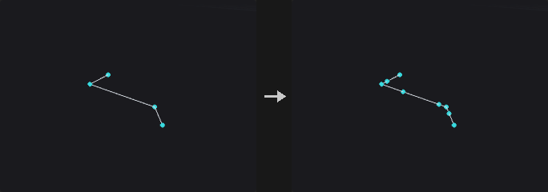

Unlike Resample, which discards the original points, Refine only inserts points between existing ones. Existing points, attributes and numbering stay untouched and new points are always appended at the end, so unselected primitives keep their vertex lists and shared points on meshes are not split apart.

Operations: **Refine** inserts a point at First U and/or Second U; **Subdivide** divides the range between First U and Second U into U Divisions parts; **Unrefine** removes points whose removal barely changes the shape (a Douglas-Peucker test with Tolerance).

**Parameter Space** decides how u is measured: by vertex index (uniform domain) or by arc length. These differ a lot on curves with uneven point spacing.

**Inputs**

| Input | Type | Description |
|---|---|---|
| `geo` | GEOMETRY | Geometry with curves to refine. |

**Outputs**

| Output | Type | Description |
|---|---|---|
| `geo` | GEOMETRY | Geometry with points inserted or removed. |

**Parameters**

| Parameter | Type | Default | Description |
|---|---|---|---|
| Group `group` | string | *(empty)* | Group pattern of curve primitives to refine. Empty means all. |
| Operation `mode` | menu | Refine | Refine inserts points, Unrefine removes redundant points, Subdivide divides a parameter range evenly. Options: Refine (`refine`), Unrefine (`unrefine`), Subdivide (`subdivide`). |
| First U `first_u` | float [0.0..1.0] | 0.25 | First parametric position, 0 to 1. |
| Use First U `use_first_u` | toggle | on | Enable the First U position. |
| Second U `second_u` | float [0.0..1.0] | 0.75 | Second parametric position, 0 to 1. |
| Use Second U `use_second_u` | toggle | off | Enable the Second U position. |
| Parameter Space `spacing` | menu | Uniform Domain | Uniform Domain measures u by vertex index; Uniform Arc Length measures it by arc length. Options: Uniform Domain (`uniform_domain`), Uniform Arc Length (`uniform_arc`). |
| U Divisions `u_divisions` | int [1..4096] | 2 | Number of parts the range is divided into (Subdivide only). *Hidden when mode ≠ subdivide.* |
| NURB Count U `nurb_count_u` | int [1..64] | 1 | Number of coincident points inserted at each position (the knot multiplicity of a spline). Refine only. *Hidden when mode ≠ refine.* |
| Tolerance U `tolerance` | float [0.0..] | 0.01 | Maximum shape deviation allowed when removing a point (Unrefine only). *Hidden when mode ≠ unrefine.* |

**Compared with Houdini**

The V direction is not implemented because polygon meshes have no global (u,v) parameterisation. Knot insertion on spline primitives is not implemented either; convert the spline first, otherwise the node reports an error.

---

### Remesh (PCG)

`PCG_Remesh` · category `PCG/modify` · Houdini: Remesh (SOP)

Rebuilds a triangle mesh with uniform, isotropic triangles of a target edge length.

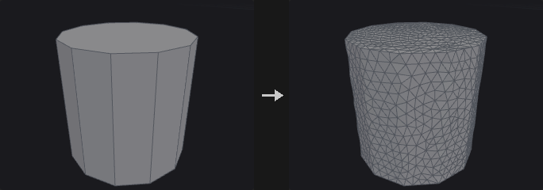

Isotropic remeshing after Botsch and Kobbelt (2004). Each iteration splits long edges, collapses short ones, flips edges to equalise valence, applies tangential smoothing and projects the points back onto the original surface. If Target Size is 0 or less, the average edge length of the input is used. Hard edges (dihedral angle above **Hard Edge Angle**) and boundaries (with **Keep Boundary**) are preserved, so the corners and edges of a cube survive.

Point, primitive and vertex attributes are interpolated from the nearest original triangle. UV seams are not preserved; re-unwrap afterwards if you need UVs. The report lists the number of splits, collapses and flips and the fraction of edges within the target range.

With a `group`, only those faces are remeshed and the rest is left untouched.

**Inputs**

| Input | Type | Description |
|---|---|---|
| `geo` | GEOMETRY | Triangle mesh to remesh. |

**Outputs**

| Output | Type | Description |
|---|---|---|
| `geo` | GEOMETRY | Remeshed geometry. |
| `report` | STRING | Text report of the split, collapse and flip counts and the edge length statistics. |

**Parameters**

| Parameter | Type | Default | Description |
|---|---|---|---|
| Group `group` | string | *(empty)* | Group pattern of faces to remesh. Empty means all. |
| Hard Edges Group `hard_edges` | string | *(empty)* | Edge group of edges that may be split but always stay in the output. |
| Hard Points Group `hard_points` | string | *(empty)* | Point group of points that stay in the output (they are not moved or collapsed). |
| UV Seams `uv_seams` | menu | Ignore | Harden treats UV island borders as hard edges. Options: Ignore (`ignore`), Harden (`harden`). |
| UV Attribute `uv_attribute` | string | `uv` | Name of the UV attribute used to find the seams. *Hidden when uv_seams = ignore.* |
| Iterations `iterations` | int [0..100] | 6 | Number of split / collapse / flip / smooth rounds. |
| Smoothing `relax` | float [0.0..1.0] | 0.5 | Strength of the tangential smoothing. |
| Detach From Nongroup Geometry `detach` | toggle | off | Off: new points split on the border to the unselected faces are also inserted into those neighbouring faces, so both sides share the points. On: the remeshed part is detached from the rest. *Disabled when group = "".* |
| Target Size `target_length` | float [0.0..] | 0 | Desired edge length. 0 means use the average edge length of the input. |
| Hard Edge Angle `feature_angle` | float [0.0..180.0] | 45 | Dihedral angle in degrees above which an edge is hard. A value of 180 or more disables hard edge detection. |
| Keep Boundary `keep_boundary` | toggle | on | Preserve open boundaries. |
| Smooth Feature Lines `smooth_features` | toggle | off | When on, a hard edge or boundary that is split gets its new point on a smooth curve through the neighbouring feature points (four-point subdivision) instead of on the straight segment, so a coarse curved rim becomes round as it is refined. Corners and turns of 60 degrees or more stay sharp. Off (default) keeps new points on the original edges, as Houdini does. Interface edges of a partial remesh are never curved. |
| Transfer Attributes `transfer_attributes` | toggle | on | Interpolate attributes from the original mesh onto the new one. |
| Hard Edges `out_hard_edges` | string | *(empty)* | Name of the output edge group holding the hard edges (including boundaries and seams). Leave empty to not write it. |

**Compared with Houdini**

Hard Edge Angle at 180 or more (disabling hard edges) and the Keep Boundary switch are extensions; Houdini always keeps boundaries. Edge Lengths = Adaptive is not implemented. Smooth Feature Lines is an extension.

---

### Remesh to Grid (PCG)

`PCG_RemeshToGrid` · category `PCG/modify` · Houdini: Remesh to Grid (SOP)

Rebuilds a surface as a closed all-quad mesh from a voxelised signed distance field.

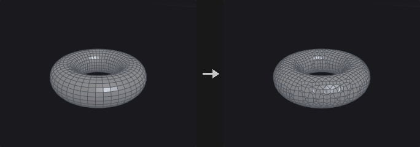

Computes an exact SDF on cubic voxels aligned to multiples of Voxel Size, then extracts a closed all-quad mesh using surface nets. **Project to Surface** moves the points back onto the original surface; **Smooth Iterations** runs tangential relaxation (re-projecting after every round when projection is on). Point attributes are carried over by barycentric interpolation at the nearest point.

Sharp edges are rounded; use Remesh if you need to keep creases.

**Inputs**

| Input | Type | Description |
|---|---|---|
| `geo` | GEOMETRY | Surface to rebuild. |

**Outputs**

| Output | Type | Description |
|---|---|---|
| `geo` | GEOMETRY | All-quad closed mesh. |
| `report` | STRING | Text summary of the result. |

**Parameters**

| Parameter | Type | Default | Description |
|---|---|---|---|
| Group `group` | string | *(empty)* | Group pattern of primitives that are used. Empty means all. |
| Voxel Size `voxel_size` | float [1e-06..] | 0.1 | Edge length of the cubic voxels, which sets the quad size. |
| Project to Surface `project` | toggle | on | Project points back onto the original surface. |
| Smooth Iterations `smooth` | int [0..100] | 2 | Number of tangential relaxation rounds. Without Project the points are not projected back and may drift slightly off the original surface. |
| Smooth Strength `smooth_strength` | float [0.0..1.0] | 0.5 | Strength of each relaxation round. *Disabled when smooth = 0.* |
| Transfer Attributes `transfer_attributes` | toggle | on | Carry point attributes over from the input. |

---

### Resample (PCG)

`PCG_Resample` · category `PCG/modify` · Houdini: Resample (SOP)

Resamples curves into evenly spaced points by length or segment count.

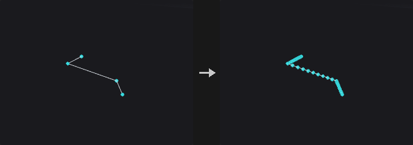

Resamples curves with equal-length segments, or equal steps along one axis. NURBS and Bezier curves are evaluated on the curve itself before sampling, not measured on the control polygon, since the two can differ greatly. Closed polygons are sampled all the way around (including the closing edge) and stay closed.

**Limit By** replaces Houdini's two switches: *Maximum Segment Length* samples by **Length** (optionally capped by Maximum Segments); *Segment Count* produces exactly **Segments** segments. With **Allow Primitive Attributes to Override Parameters** the primitive attributes `segment_length` and `num_segments` replace Length and Segments; values of 0 or less turn off the respective switch.

Optional output attributes record the curve parameter, distance along the curve, tangent and curve number.

**Inputs**

| Input | Type | Description |
|---|---|---|
| `geo` | GEOMETRY | Geometry with curves to resample. |

**Outputs**

| Output | Type | Description |
|---|---|---|
| `geo` | GEOMETRY | Resampled curves. |

**Parameters**

| Parameter | Type | Default | Description |
|---|---|---|---|
| Group `group` | string | *(empty)* | Group pattern of primitives to resample. Empty means all. |
| Maintain Primitive Order `maintain_prim_order` | toggle | off | Off places the resampled curves after the unselected primitives. |
| Resample by Polygon Edge `resample_by_edge` | toggle | off | Resample each polygon edge on its own, keeping all corners. Only for straight-edged polygons. *Disabled when treat_polygons_as ≠ straight_edges.* |
| Method `measure_method` | menu | Even Length Segments | Even Length uses equal lengths. Even X/Y/Z uses equal steps along that axis. Options: Even Length Segments (`even_length`), Even X Segments (`even_x`), Even Y Segments (`even_y`), Even Z Segments (`even_z`). |
| Measure `measure` | menu | Along Arc | Along Arc keeps the curve length between samples equal. Along Chord keeps the straight-line distance between samples equal. Options: Along Arc (`along_arc`), Along Chord (`along_chord`). *Disabled when resample_by_edge is on.* |
| Treat Polygons As `treat_polygons_as` | menu | Straight Edges | Straight Edges samples the polygon as drawn. Subdivision Curves treats points as control points, pulling the curve inside. Interpolating Curves passes through every point. The density for the curved options is Samples per Span. Options: Straight Edges (`straight_edges`), Subdivision Curves (`subdivision_curves`), Interpolating Curves (`interpolating_curves`). |
| Limit By `method` | menu | Maximum Segment Length | Maximum Segment Length samples by length; Segment Count produces an exact number of segments. Options: Maximum Segment Length (`max_segment_length`), Segment Count (`segment_count`). |
| Length `length` | float [1e-06..] | 0.1 | Maximum length of each segment. *Hidden when method ≠ max_segment_length.* |
| Maximum Segments `max_segments` | int [1..] | 10 | If the length-based count would exceed this, exactly this many segments are used instead. *Hidden when method ≠ max_segment_length.* |
| Use Max Segments `use_max_segments` | toggle | off | Enable the Maximum Segments cap. |
| Segments `segments` | int [1..] | 10 | Exact number of segments. *Hidden when method ≠ segment_count.* |
| Allow Primitive Attributes to Override Parameters `attrib_override` | toggle | off | Let the primitive attributes `segment_length` and `num_segments` override Length and Segments. Values of 0 or less disable the corresponding switch. |
| Even Last Segment `even_last_segment` | toggle | on | Round the segment count, then divide the total length evenly so all segments are equally long. Off steps strictly by Length and leaves a shorter last segment. *Hidden when method ≠ max_segment_length.* |
| Maintain Last Vertex `maintain_last_vertex` | toggle | on | When segments are not evened, keep the original end point of the curve even if the leftover tail is shorter than one step. *Disabled when method ≠ max_segment_length attrib_override is off } { even_last_segment is on.* |
| Randomize First Segment Length `randomize_first` | toggle | off | Make the first segment's length Length times a random number (seeded by the primitive number). *Disabled when method ≠ max_segment_length attrib_override is off } { resample_by_edge is on.* |
| Create Only Points `create_only_points` | toggle | off | Output only points, no curves. |
| Output as Polygon Curves to be Subdivided Later `subdivide_later` | toggle | off | Output polygon curves whose points are the control points of a subdivision curve, intended to be subdivided later. *Disabled when create_only_points is on.* |

*Spline*

| Parameter | Type | Default | Description |
|---|---|---|---|
| Spline Evaluation `use_spline_opts` | toggle | off | Enable Samples per Span. |
| Samples per Span `spline_samples` | int [2..512] | 16 | Density used to evaluate NURBS and Bezier curves before sampling, and when Treat Polygons As densifies. |

*Output Attributes*

| Parameter | Type | Default | Description |
|---|---|---|---|
| Output Attributes `use_out_attribs` | toggle | off | Write the output attributes below. |
| Curve U Attribute `curveu_attrib` | string | `curveu` | Point attribute for the normalised position along the curve (0 to 1). |
| Distance Attribute `distance_attrib` | string | `ptdist` | Point attribute for the arc-length distance along the curve. |
| Tangent Attribute `tangent_attrib` | string | `tangentu` | Point attribute for the unit tangent. |
| Curve Number Attribute `curvenum_attrib` | string | `curvenum` | Point attribute for the number of the source curve. |

---

### Reverse (PCG)

`PCG_Reverse` · category `PCG/modify` · Houdini: Reverse (SOP)

Reorders the vertices of primitives: reverse, swap U/V or shift.

Every operation is turned into a corner permutation per primitive, and then the vertex-to-point map, all vertex attributes and vertex groups are reordered together. A simple reversal and U/V surface operations follow the same path, so no kind of data is left behind.

Reverse V and Swap UV are only meaningful on NURBS or Bezier surfaces; polygons have no V direction.

**Inputs**

| Input | Type | Description |
|---|---|---|
| `geo` | GEOMETRY | Geometry whose primitives should be reordered. |

**Outputs**

| Output | Type | Description |
|---|---|---|
| `geo` | GEOMETRY | Geometry with reordered vertices. |

**Parameters**

| Parameter | Type | Default | Description |
|---|---|---|---|
| Group `group` | string | *(empty)* | Group pattern of primitives. Empty means all. |
| Vertex `mode` | menu | Reverse | Vertex operation. Reverse flips the winding (and so the normal of polygons). Options: Reverse (`reverse`), No Change (`none`), Reverse U (`reverse_u`), Reverse V (`reverse_v`), Swap UV (`swap_uv`), Shift (`shift`). |
| Enable Shift `use_shift` | toggle | on | Enable the offsets. When off, the offsets are treated as 0. *Hidden when mode ≠ shift } { use_shift is on.* |
| U Offset `u_offset` | int [-4096..4096] | 0 | Shift in U, in vertices. *Hidden when mode ≠ shift.* *Disabled when use_shift is off.* |
| V Offset `v_offset` | int [-4096..4096] | 0 | Shift in V. Only meaningful on NURBS or Bezier surfaces (grids). *Hidden when mode ≠ shift.* *Disabled when use_shift is off.* |

**Compared with Houdini**

Enable Shift is an addition; Houdini has no such switch.

---

### Shrinkwrap (PCG)

`PCG_Shrinkwrap` · category `PCG/modify` · Houdini: Shrinkwrap (SOP)

Wraps geometry in a single closed manifold shell by rolling a sphere over it from outside.

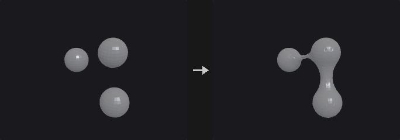

A sphere of the given **Wrap Radius** rolls over the geometry from the outside; the boundary of the region it cannot reach becomes the shell. Gaps, holes and grooves narrower than twice the radius are bridged, wider concavities are followed. Open meshes, loose pieces and interpenetrating parts all end up in one closed manifold surface. A radius approaching infinity gives the convex hull.

**Offset** pushes the whole shell outward. With **Project to Surface** the points that touch the input are snapped onto it exactly (and added to the point group `contact`); **Smooth Iterations** applies tangential relaxation. Accuracy is one voxel (Voxel Size, aligned to world coordinates).

**Inputs**

| Input | Type | Description |
|---|---|---|
| `geo` | GEOMETRY | Geometry to wrap. |

**Outputs**

| Output | Type | Description |
|---|---|---|
| `geo` | GEOMETRY | Closed shell around the input. |
| `report` | STRING | Text summary of the result. |

**Parameters**

| Parameter | Type | Default | Description |
|---|---|---|---|
| Group `group` | string | *(empty)* | Group pattern of primitives to wrap. Empty means all. |
| Voxel Size `voxel_size` | float [0.0001..10000.0] | 0.05 | Voxel size of the working grid; also the accuracy of the result. |
| Wrap Radius `radius` | float [0.0..10000.0] | 0.15 | Radius of the rolling sphere. Gaps narrower than twice this are bridged; larger values approach the convex hull. |
| Offset `offset` | float [0.0..10000.0] | 0 | Pushes the shell outward by this distance. It cannot exceed the radius. |
| Project to Surface `project` | toggle | on | Snap points that touch the input exactly onto its surface. These points go to the group `contact`. |
| Smooth Iterations `smooth` | int [0..100] | 2 | Number of tangential relaxation rounds. |
| Smooth Strength `smooth_strength` | float [0.0..1.0] | 0.5 | Strength of each relaxation round. *Disabled when smooth = 0.* |

---

### Smooth (PCG)

`PCG_Smooth` · category `PCG/modify` · Houdini: Smooth (SOP)

Applies Laplacian smoothing to points and other attributes.

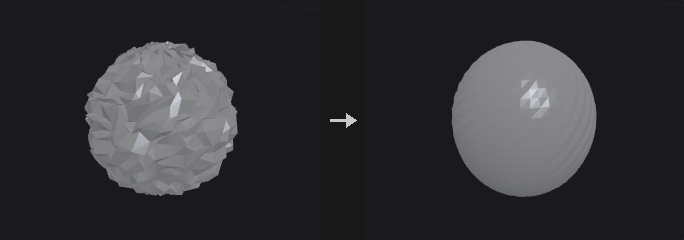

Each iteration moves every point towards the (weighted) centroid of its neighbours by **Strength**, which is a per-iteration step, unlike Houdini's Strength. Border points are pinned by default; otherwise an open mesh shrinks inwards with every pass.

The weights depend on **Method**: Uniform weights all neighbours equally; Scale-Dominant weights by 1/edge length, which preserves relative edge lengths; Curvature-Dominant uses cotangent weights, which move points almost only along the normal. **Attributes** lists the attributes to smooth (point and vertex float attributes, space separated, wildcards allowed); `P` is the default.

**Inputs**

| Input | Type | Description |
|---|---|---|
| `geo` | GEOMETRY | Geometry to smooth. |

**Outputs**

| Output | Type | Description |
|---|---|---|
| `geo` | GEOMETRY | Smoothed geometry. |

**Parameters**

| Parameter | Type | Default | Description |
|---|---|---|---|
| Group `group` | string | *(empty)* | Group pattern of points that are smoothed. Empty means all. |
| Pin Border Points (Unshared Edges) `pin_boundary` | toggle | on | Keep points on open borders (unshared edges) fixed. |
| Pin Group Boundary `pin_group_boundary` | toggle | off | Also pin the outer rim of the selection: selected points with at least one unselected neighbour. With Pin Border Points on as well this matches Houdini's Group Boundary. |
| Constrained Points `constrained_points` | string | *(empty)* | Group pattern of extra points that are never moved. |
| Attributes `attributes` | string | `P` | Space-separated names or wildcards of the attributes to smooth. |
| Weight Attribute `weight_attribute` | string | `weight` | Point attribute giving a per-point multiplier for Strength. |
| Use Weight Attribute `use_weight_attribute` | toggle | off | Enable the weight attribute. The product with Strength is clamped to the range 0 to 1. |
| Method `method` | menu | Uniform | Weighting scheme for neighbours; see the description. Options: Uniform (`uniform`), Scale-Dominant (`scale_dominant`), Curvature-Dominant (`curvature_dominant`). |
| Strength `strength` | float [0.0..1.0] | 0.5 | Step size per iteration, 0 to 1. |
| Iterations `iterations` | int [0..500] | 5 | Number of smoothing rounds. |
| Recompute Affected Normals `recompute_normals` | toggle | off | Recompute `N` on affected points and vertices when P was smoothed but N was not. |

**Compared with Houdini**

Strength is a per-iteration step and there is an Iterations count, unlike Houdini's Smooth. Filter Quality is not implemented.

---

### Sort (PCG)

`PCG_Sort` · category `PCG/modify` · Houdini: Sort (SOP)

Reorders points and primitives by position, attribute, expression or other criteria without changing the shape.

Only point and primitive numbers change; the geometry stays the same. Because numbering changes, everything that refers to numbers is remapped together: vertex lists, all kinds of groups, edge groups (stored as point pairs) and per-primitive side channels.

The point and primitive sorts are independent. *Circular (Around Axis)* sorts by angle around an axis (right-hand rule); it turns a scattered ring of points into a correct polygon ring, where X/Y/Z sorting only gives a zigzag.

The switches at the bottom (Enable ...) are not in Houdini. When off, the corresponding section's parameters are treated as their defaults.

**Inputs**

| Input | Type | Description |
|---|---|---|
| `geo` | GEOMETRY | Geometry to reorder. |

**Outputs**

| Output | Type | Description |
|---|---|---|
| `geo` | GEOMETRY | Geometry with new point and primitive numbering. |

**Parameters**

| Parameter | Type | Default | Description |
|---|---|---|---|
| Point Sort `point_sort` | menu | No Change | How points are ordered. X/Y/Z sort by that coordinate; Reverse reverses the order; Random shuffles with a seed; Shift rotates the order by an offset; Proximity orders by distance to a point; Along Vector by projection onto a vector; By Attribute and By Expression by a value; By Spatial Locality keeps spatial neighbours close in the numbering; Circular sorts by angle around an axis. Options: No Change (`none`), Sort by X (`x`), Sort by Y (`y`), Sort by Z (`z`), Reverse (`reverse`), Random (`random`), Shift (`shift`), Proximity to Point (`proximity`), Along Vector (`along_vector`), By Attribute (`attribute`), By Expression (`expression`), By Spatial Locality (`spatial_locality`), Circular (Around Axis) (`circular`). |
| Seed `rand_seed` | int [0..] | 0 | Seed for the random point sort. *Hidden when point_sort ≠ random.* *Disabled when use_rs is off.* |
| Offset `offset` | int | 0 | Number of positions to shift the point order by. *Hidden when point_sort ≠ shift.* *Disabled when use_rs is off.* |
| Vector `axis_x` `axis_y` `axis_z` | float | 0, 1, 0 | Direction vector for Along Vector, or the rotation axis for Circular. *Hidden when point_sort ≠ along_vector point_sort ≠ circular.* *Disabled when use_axis is off.* |
| Specify Center `use_center` | toggle | off | Specify the center of the Circular sort. Off uses the default center. *Hidden when point_sort ≠ circular.* *Disabled when use_axis is off.* |
| Center `center_x` `center_y` `center_z` | float | 0, 0, 0 | Center for the Circular point sort. *Hidden when point_sort ≠ circular.* *Disabled when use_axis is off } { use_center is off.* |
| Point `target_x` `target_y` `target_z` | float | 0, 0, 0 | Position that Proximity measures distance to. *Hidden when point_sort ≠ proximity.* *Disabled when use_target is off.* |
| Point Attribute `point_attrib` | string | *(empty)* | Point attribute used for the attribute sort. *Hidden when point_sort ≠ attribute.* *Disabled when use_key is off.* |
| Component `component` | int [0..15] | 0 | Component of the attribute used as the sort key. *Hidden when point_sort ≠ attribute.* *Disabled when use_key is off.* |
| Point Expression `point_expr` | string | *(empty)* | Expression evaluated per point and used as the sort key. *Hidden when point_sort ≠ expression.* *Disabled when use_key is off.* |
| Reverse Point Sort `reverse_point_sort` | toggle | off | Reverse the result of the chosen point sort. *Disabled when point_sort = none.* |
| Primitive Sort `prim_sort` | menu | No Change | How primitives are ordered; same options as the point sort, measured on primitive centers. Options: No Change (`none`), Sort by X (`x`), Sort by Y (`y`), Sort by Z (`z`), Reverse (`reverse`), Random (`random`), Shift (`shift`), Proximity to Point (`proximity`), Along Vector (`along_vector`), By Attribute (`attribute`), By Expression (`expression`), By Spatial Locality (`spatial_locality`), Circular (Around Axis) (`circular`). |
| Seed `prim_rand_seed` | int [0..] | 0 | Seed for the random primitive sort. *Hidden when prim_sort ≠ random.* *Disabled when use_rs is off.* |
| Offset `prim_offset` | int | 0 | Number of positions to shift the primitive order by. *Hidden when prim_sort ≠ shift.* *Disabled when use_rs is off.* |
| Vector `prim_axis_x` `prim_axis_y` `prim_axis_z` | float | 0, 1, 0 | Direction vector for Along Vector, or the rotation axis for Circular, for primitives. *Hidden when prim_sort ≠ along_vector prim_sort ≠ circular.* *Disabled when use_axis is off.* |
| Specify Center `prim_use_center` | toggle | off | Specify the center of the Circular primitive sort. *Hidden when prim_sort ≠ circular.* *Disabled when use_axis is off.* |
| Center `prim_center_x` `prim_center_y` `prim_center_z` | float | 0, 0, 0 | Center for the Circular primitive sort. *Hidden when prim_sort ≠ circular.* *Disabled when use_axis is off } { prim_use_center is off.* |
| Point `prim_target_x` `prim_target_y` `prim_target_z` | float | 0, 0, 0 | Position that Proximity measures distance to for primitives. *Hidden when prim_sort ≠ proximity.* *Disabled when use_target is off.* |
| Primitive Attribute `prim_attrib` | string | *(empty)* | Primitive attribute used for the attribute sort. *Hidden when prim_sort ≠ attribute.* *Disabled when use_key is off.* |
| Component `prim_component` | int [0..15] | 0 | Component of the attribute used as the sort key. *Hidden when prim_sort ≠ attribute.* *Disabled when use_key is off.* |
| Primitive Expression `prim_expr` | string | *(empty)* | Expression evaluated per primitive and used as the sort key. *Hidden when prim_sort ≠ expression.* *Disabled when use_key is off.* |
| Reverse Primitive Sort `reverse_prim_sort` | toggle | off | Reverse the result of the chosen primitive sort. *Disabled when prim_sort = none.* |
| Sort Points by Vertex Order `points_by_vertex_order` | toggle | off | First renumber points in the order in which their vertices appear in the primitives, then apply the Point Sort. |
| Enable Vector / Center `use_axis` | toggle | on | Enable the Vector and Center fields. Off treats them as their defaults. *Hidden when use_axis is on } { point_sort ≠ along_vector point_sort ≠ circular prim_sort ≠ along_vector prim_sort ≠ circular.* |
| Enable Proximity Point `use_target` | toggle | on | Enable the proximity point. Off treats it as the default. *Hidden when use_target is on } { point_sort ≠ proximity prim_sort ≠ proximity.* |
| Enable Attribute / Expression `use_key` | toggle | on | Enable the attribute and expression fields. Off treats them as their defaults. *Hidden when use_key is on } { point_sort ≠ attribute point_sort ≠ expression prim_sort ≠ attribute prim_sort ≠ expression.* |
| Enable Seed / Offset `use_rs` | toggle | on | Enable Seed and Offset. Off treats them as their defaults. *Hidden when use_rs is on } { point_sort ≠ random point_sort ≠ shift prim_sort ≠ random prim_sort ≠ shift.* |

**Compared with Houdini**

The four Enable switches (vector/center, proximity point, attribute/expression, seed/offset) do not exist in Houdini.

---

### Split (PCG)

`PCG_Split` · category `PCG/modify` · Houdini: Split (SOP)

Splits geometry into the part in a group and the part outside it.

Like Blast, but both halves are kept: the first output holds the group, the second everything else. It saves a Blast inside loops with the pattern "selected get A, unselected get B, merge back".

**Inputs**

| Input | Type | Description |
|---|---|---|
| `geo` | GEOMETRY | Geometry to split. |

**Outputs**

| Output | Type | Description |
|---|---|---|
| `inside` | GEOMETRY | Elements that are in the group. |
| `outside` | GEOMETRY | Elements that are not in the group. |

**Parameters**

| Parameter | Type | Default | Description |
|---|---|---|---|
| Group `group` | string | *(empty)* | Group pattern that defines the inside. |
| Group Type `cls` | menu | Primitives | Whether the group refers to primitives or points. Options: Primitives (`prim`), Points (`point`). |

---

### Subdivide (PCG)

`PCG_Subdivide` · category `PCG/modify` · Houdini: Subdivide (SOP)

Subdivides polygon meshes with Catmull-Clark, Loop or bilinear schemes.

**Catmull-Clark** turns any polygon into one quad per corner; the limit surface is a B-spline, a good default for hard-surface rounding and high-to-low baking. **Loop** takes triangles only and splits each into four, which gives better results than Catmull-Clark on triangle meshes. **Bilinear** only cuts and does not smooth, so it adds density without changing shape (useful for displacing yourself afterwards).

**Vertex Boundary Interpolation** follows OpenSubdiv: Edges and Corners makes borders crease curves with fixed corners; Edges Only lets corners follow the curve (and be worn away); None does not treat borders as creases and the whole surface shrinks inwards.

Creases: the edge group and the auto-crease angle are infinitely sharp. A vertex attribute (default `creaseweight`) can supply fractional weights as in OpenSubdiv's semi-sharp creases: a weight of 1 or more is sharp for that level, between 0 and 1 blends, and the value drops by 1 per level.

Attributes: point attributes follow the same rule as `P` (so `Cd` is smoothed), vertex attributes are interpolated linearly (as UVs should be) and primitive attributes are inherited from the source face.

**Inputs**

| Input | Type | Description |
|---|---|---|
| `geo` | GEOMETRY | Mesh to subdivide. |

**Outputs**

| Output | Type | Description |
|---|---|---|
| `geo` | GEOMETRY | Subdivided mesh. |

**Parameters**

| Parameter | Type | Default | Description |
|---|---|---|---|
| Group `group` | string | *(empty)* | Group pattern of primitives to subdivide. Empty means all. |
| Algorithm `algorithm` | menu | OpenSubdiv Catmull-Clark | Subdivision scheme; see the description. Options: OpenSubdiv Catmull-Clark (`catmull_clark`), OpenSubdiv Loop (`loop`), OpenSubdiv Bilinear (`linear`). |
| Depth `depth` | int [0..6] | 1 | Number of subdivision levels. 0 leaves the mesh unchanged. |
| Vertex Boundary Interpolation `boundary` | menu | Edges and Corners | How borders are treated. With Bilinear this does not change the shape and only affects the output crease group. Options: Edges and Corners (`edge_corner`), Edges Only (`edge_only`), None (`smooth`). |

*Creases*

| Parameter | Type | Default | Description |
|---|---|---|---|
| Creases `crease_group` | string | *(empty)* | Edge group of edges that are infinitely sharp. |
| Auto Crease Angle `auto_crease_angle` | float [-1.0..180.0] | -1 | Edges whose dihedral angle exceeds this (degrees) are treated as creases automatically. -1 turns it off. |
| Crease Weight Attribute `crease_attribute` | string | `creaseweight` | Vertex attribute holding fractional crease weights. Leave empty to not read one. |
| Output Crease Group `output_crease_group` | string | *(empty)* | Name of an edge group to write the crease edges to. Leave empty to not write it. |

---

### Switch (PCG)

`PCG_Switch` · category `PCG/modify` · Houdini: Switch (SOP)

Passes through one of up to eight inputs, chosen by index or expression, evaluating only the selected branch.

The branch inputs are lazy: only the selected one is requested, so the other branches are not executed, just as unselected branches are not cooked in Houdini. That is what makes the node useful.

**Select Input** accepts an expression as in Houdini: a plain index (`2`), a detail read from the control input (`detail(-1, "type", 0)`), a condition (`1 if detail("kind") == "drawer" else 0`, `nprims() > 100`) or `ninputs() - 1` for the last input. `ctrl` is the equivalent of Houdini's Spare Input, which `-1` refers to. Expressions can only read from `ctrl`, not from the branches, since reading a branch would run the unselected ones too. Connect the data you want to test to `ctrl` separately.

Only connected branches are counted, as in Houdini: with input0 and input2 connected, index 1 selects input2. Out-of-range indices are clamped to the ends, or wrapped with **Wrap Out-of-Range Index**.

**Inputs**

| Input | Type | Description |
|---|---|---|
| `ctrl` *(optional)* | GEOMETRY | Control input that expressions in Select Input read from (Houdini's Spare Input). Not passed through. |
| `input0` *(optional)* | GEOMETRY | Branch 0. |
| `input1` *(optional)* | GEOMETRY | Branch 1. |
| `input2` *(optional)* | GEOMETRY | Branch 2. |
| `input3` *(optional)* | GEOMETRY | Branch 3. |
| `input4` *(optional)* | GEOMETRY | Branch 4. |
| `input5` *(optional)* | GEOMETRY | Branch 5. |
| `input6` *(optional)* | GEOMETRY | Branch 6. |
| `input7` *(optional)* | GEOMETRY | Branch 7. |

**Outputs**

| Output | Type | Description |
|---|---|---|
| `geo` | GEOMETRY | The selected input. |

**Parameters**

| Parameter | Type | Default | Description |
|---|---|---|---|
| Select Input `select_input` | string | `0` | Index (or expression) of the input to pass through, counting connected inputs only. |
| Wrap Out-of-Range Index `wrap` | toggle | off | Off clamps out-of-range indices to the first or last input. On wraps around (negative values count from the end). |

---

### Switch-If (PCG)

`PCG_SwitchIf` · category `PCG/modify` · Houdini: Switch-If (SOP)

Outputs one of two inputs depending on whether a set of tests passes.

If the condition holds, `if_true` is output, otherwise `if_false` (an unconnected branch outputs empty geometry). **Tests** has one expression per line (lines starting with `#` are comments); **Merge Condition** decides whether all tests or any test has to pass, and **Invert Result** negates the outcome.

Available functions include `npoints()`, `nprims()`, `detail("x")`, `point("x", i)`, `hasattrib("point", "Cd")`, `hasgroup("prim", "top")`, `ngroup("edge", "crease")`, `attribmax("point", "P", 1)`, `attribmin` and `attribmean`.

Tests read the `test` input; if it is not connected they read `if_true`. Unselected branches are not executed (lazy): with `test` connected only the selected branch runs. Without it, `if_true` must be evaluated first (the tests read it) and `if_false` runs only if the condition fails.

**Inputs**

| Input | Type | Description |
|---|---|---|
| `test` *(optional)* | GEOMETRY | Geometry the tests read. Falls back to `if_true` if not connected. |
| `if_true` *(optional)* | GEOMETRY | Geometry output when the condition holds. |
| `if_false` *(optional)* | GEOMETRY | Geometry output when the condition fails. Empty geometry if not connected. |

**Outputs**

| Output | Type | Description |
|---|---|---|
| `geo` | GEOMETRY | The selected branch. |
| `result` | BOOLEAN | The outcome of the test (true or false). |
| `report` | STRING | Text report of the tests and their results. |

**Parameters**

| Parameter | Type | Default | Description |
|---|---|---|---|
| Merge Condition `merge` | menu | All Tests Pass | All Tests Pass requires every line to be true; Any Test Passes needs only one. Options: All Tests Pass (`all`), Any Test Passes (`any`). |
| Invert Result `invert` | toggle | off | Negate the final result. |
| Tests `tests` | string | `npoints() > 0` | One test expression per line. Lines starting with `#` are comments. |

---

### Thicken (PCG)

`PCG_Thicken` · category `PCG/modify`

Gives open surfaces a thickness with a second skin and side walls.

Turns a single-sided surface (a leaf, a cloth panel, a terrain patch) into a solid: a second skin is made Thickness away along the point normals and the borders are closed with side walls.

*Side* chooses where the thickness goes: *Outward* keeps the input as the inner skin, *Inward* as the outer skin, *Both* makes the input the mid-surface. Front, back and side faces are put into groups. Closed meshes become hollow shells. Thickness is measured along point normals, so sharp convex corners come out a little thinner, as with any normal offset.

**Inputs**

| Input | Type | Description |
|---|---|---|
| `geo` | GEOMETRY | Polygons to thicken. |

**Outputs**

| Output | Type | Description |
|---|---|---|
| `geo` | GEOMETRY | The solid. |
| `report` | STRING | Primitive count, thickness and side. |

**Parameters**

| Parameter | Type | Default | Description |
|---|---|---|---|
| Group `group` | string | *(empty)* | Primitives to thicken. |
| Thickness `thickness` | float | 0.1 | Distance between the two skins. |
| Side `side` | menu | Both (Centered) | Where the thickness goes: both sides (centered), outward or inward. Options: Both (Centered) (`both`), Outward (`outward`), Inward (`inward`). |
| Divisions `divisions` | int [1..1000] | 1 | Number of edge loops across the side walls. |

*Output Groups*

| Parameter | Type | Default | Description |
|---|---|---|---|
| Front Group `front_group` | string | `thickenFront` | Primitive group for the faces moved along the normals. |
| Back Group `back_group` | string | `thickenBack` | Primitive group for the faces on the other side. |
| Side Group `side_group` | string | `thickenSide` | Primitive group for the side walls. |

---

### Transform (PCG)

`PCG_Transform` · category `PCG/modify` · Houdini: Transform (SOP)

Translates, rotates, scales and shears points with a Houdini-style transform and pivot.

Applies one transform to the selected points. Transform Order sets the order of scale, rotate and translate, and Rotate Order the order of the three axis rotations. Scale and rotation happen around the pivot, in a coordinate system rotated by Pivot Rotate. Shear is applied immediately after scaling. **Invert Transformation** applies the inverse transform.

The group is always interpreted as Guess: first as a point group or point attribute expression, and if nothing matches on points, as a primitive group (using the points of those primitives).

**Inputs**

| Input | Type | Description |
|---|---|---|
| `geo` | GEOMETRY | Geometry to transform. |

**Outputs**

| Output | Type | Description |
|---|---|---|
| `geo` | GEOMETRY | Transformed geometry. |

**Parameters**

| Parameter | Type | Default | Description |
|---|---|---|---|
| Group `group` | string | *(empty)* | Group pattern (guessed as points first, then primitives) selecting what to transform. Empty means all. |
| Transform Order `xform_order` | menu | Scale Rot Trans | Order in which scale, rotate and translate are applied, read left to right. Options: Scale Rot Trans (`srt`), Scale Trans Rot (`str`), Rot Scale Trans (`rst`), Rot Trans Scale (`rts`), Trans Scale Rot (`tsr`), Trans Rot Scale (`trs`). |
| Rotate Order `rotate_order` | menu | Rx Ry Rz | Order in which the three axis rotations are applied. Options: Rx Ry Rz (`xyz`), Rx Rz Ry (`xzy`), Ry Rx Rz (`yxz`), Ry Rz Rx (`yzx`), Rz Rx Ry (`zxy`), Rz Ry Rx (`zyx`). |
| Translate `tx` `ty` `tz` | float | 0, 0, 0 | Translation. |
| Rotate `rx` `ry` `rz` | float [-3600..3600] | 0, 0, 0 | Rotation in degrees; the three angles are applied in the Rotate Order. |
| Scale `sx` `sy` `sz` | float | 1, 1, 1 | Per-axis scale. |
| Shear `shear_xy` `shear_xz` `shear_yz` | float | 0, 0, 0 | Shear values XY, XZ and YZ: x += xy*y + xz*z, y += yz*z. Applied right after scaling. |
| Uniform Scale `uniform_scale` | float | 1 | Extra scale factor on all axes. |
| Pivot Translate `px` `py` `pz` | float | 0, 0, 0 | Pivot point; scale and rotation happen around it. |
| Pivot Rotate `prx` `pry` `prz` | float [-3600..3600] | 0, 0, 0 | Rotation in degrees of the pivot's coordinate system; scale and rotation are done in the frame rotated by this angle. |
| Invert Transformation `invert` | toggle | off | Apply the inverse of the transformation. |

---

### Transform by Attribute (PCG)

`PCG_TransformByAttrib` · category `PCG/modify` · Houdini: Transform by Attribute (SOP)

Transforms geometry by matrix attributes, per detail, point or primitive.

Reads a matrix attribute (9 values for a 3x3, 16 for a 4x4, read the same way as in Copy to Points) and applies it to the geometry. **Attribute Class** chooses one matrix for the whole detail, one per point, or one per primitive. **Invert Transform** uses the inverse matrix.

Normals use the inverse transpose and are renormalised, vectors are multiplied by the 3x3 part only, and `orient` is multiplied by the rotation part.

Matrices use Houdini's convention: points are row vectors, `p' = p * M`, and a 4x4 keeps its translation in the fourth row. A `transform` written in Houdini, or by Extract Transform, means the same here.

**Inputs**

| Input | Type | Description |
|---|---|---|
| `geo` | GEOMETRY | Geometry to transform. |

**Outputs**

| Output | Type | Description |
|---|---|---|
| `geo` | GEOMETRY | Transformed geometry. |
| `report` | STRING | Text summary of what was transformed. |

**Parameters**

| Parameter | Type | Default | Description |
|---|---|---|---|
| Group `group` | string | *(empty)* | Group pattern selecting what to transform. Empty means all. |
| Transform Attribute `attribute` | string | `transform` | Name of the matrix attribute (3x3 or 4x4). |
| Attribute Class `attribute_class` | menu | Point | Where the matrix lives: one on the detail, one per point or one per primitive. Options: Detail (`detail`), Point (`point`), Primitive (`prim`). |
| Invert Transform `invert` | toggle | off | Use the inverse of the matrix. |
| Normals to Transform `normals` | string | `N` | Pattern of normal attributes to transform (inverse transpose, renormalised). |
| Vectors to Transform `vectors` | string | `v up` | Pattern of vector attributes to transform with the 3x3 part only. |
| Transform orient `orient` | toggle | on | Also transform the `orient` quaternion attribute with the rotation part. |

---

### Triangulate 2D (PCG)

`PCG_Triangulate2D` · category `PCG/modify` · Houdini: Triangulate 2D (SOP)

Builds a Delaunay or constrained Delaunay triangulation of points lying in a plane.

Where PolyFill just caps a hole (with fans or ear clipping, giving ugly triangles), this node produces a good triangulation: Delaunay maximises the minimum angle, which is what finite elements, terrain and cloth meshes need.

Delaunay is computed by lifting (x, y) to (x, y, x^2+y^2) and projecting the lower convex hull back, so the result is algebraically exact. Cocircular point sets (a square, a regular polygon) are handled separately, since any triangulation of cocircular points is Delaunay.

**Constrain = Input Polygons** forces the input polygon edges to appear in the output, which is needed for concave outlines because plain Delaunay triangulates the convex hull. Inside and outside are decided by region depth parity (crossing a constrained edge adds one), so holes and nested islands work. **Max Circumradius** and **Max Edge Length** prune large triangles, which gives a concave hull from a point cloud.

Vertex and primitive attributes are not carried over, because the output triangles do not correspond to input vertices or faces. Point attributes and point groups are kept as they are.

**Inputs**

| Input | Type | Description |
|---|---|---|
| `geo` | GEOMETRY | Points (and optionally polygons or edge groups for constraints). |

**Outputs**

| Output | Type | Description |
|---|---|---|
| `geo` | GEOMETRY | Triangulated geometry. |

**Parameters**

| Parameter | Type | Default | Description |
|---|---|---|---|
| Points to Triangulate `group` | string | *(empty)* | Group pattern of points to triangulate. Empty means all. |
| Plane `plane` | menu | Fit Plane | Plane in which the points are triangulated. Fit Plane fits one to the points; XY, ZX and YZ use the axis planes; Specify Plane uses the origin and normal. Options: Fit Plane (`fit_plane`), XY Plane (`xy`), ZX Plane (`zx`), YZ Plane (`yz`), Specify Plane (`specify_plane`). |
| Plane Origin `plane_origin_x` `plane_origin_y` `plane_origin_z` | float | 0, 0, 0 | Origin of the plane (for the plane modes other than Fit Plane). *Hidden when plane = fit_plane.* |
| Plane Normal `plane_normal_x` `plane_normal_y` `plane_normal_z` | float | 0, 1, 0 | Normal of the plane when Specify Plane is chosen. *Hidden when plane ≠ specify_plane.* |
| Plane Offset `plane_distance` | float | 0 | Extra distance by which the plane is moved along its normal. |
| Constrain `constrain` | menu | None | None triangulates points only. Input Polygons makes the input polygon edges part of the triangulation. Edge Group uses the edges in the given group. Options: None (`none`), Input Polygons (`input_polygons`), Edge Group (`edge_group`). |
| Constrained Edges `constrain_group` | string | *(empty)* | Edge group of the constrained edges. *Hidden when constrain ≠ edge_group.* |
| Region `region` | menu | Keep All | Which triangles to keep relative to the constrained outline: all, only inside, only outside or neither. Options: Keep All (`keep_all`), Remove Outside (`remove_outside`), Remove Inside (`remove_inside`), Remove Outside and Inside (`remove_outside_and_inside`). *Hidden when constrain = none.* |
| Max Circumradius `max_circumradius` | float [0.0..] | 0 | 0 disables pruning. Otherwise triangles with a larger circumradius are removed (concave hull). |
| Max Edge Length `max_edge_length` | float [0.0..] | 0 | 0 disables pruning. Otherwise triangles with a longer longest edge are removed. |

*Output*

| Parameter | Type | Default | Description |
|---|---|---|---|
| Keep Input Geometry `keep_input_geometry` | toggle | off | Merge the input geometry into the output. |
| Boundary Edge Group `border_group` | string | *(empty)* | Name of an edge group for the boundary edges of the result. Leave empty to not write it. |
| Constrained Edge Group `constrained_group` | string | *(empty)* | Name of an edge group for the constrained edges. Leave empty to not write it. |

*Advanced*

| Parameter | Type | Default | Description |
|---|---|---|---|
| Fuse Tolerance `fuse_tolerance` | float [0.0..1000.0] | 1e-06 | Points closer than this are treated as the same point. |
| Hull Tolerance `hull_tolerance` | float [0.0..0.001] | 1e-12 | Tolerance of the internal convex hull. Keep it tiny, otherwise almost cocircular points can vanish from the triangulation. |
| On Failure `on_failure` | menu | Fail with Error | What to do if triangulation fails: raise an error, keep the input with a warning, or output nothing. Options: Fail with Error (`fail_with_error`), Warn and Keep Input (`warn_and_keep_input`), Output Nothing (`output_nothing`). |

---

### Volume Blur (PCG)

`PCG_VolumeBlur` · category `PCG/modify` · Houdini: Volume Blur (SOP)

Blurs volumes with a Gaussian or box filter, or reduces neighbourhoods with min, max, median and similar operators.

The default **Reduction** is Filter, which runs a separable Gaussian (sigma = Radius / 2, converted per axis through voxel size so the blur is round in world space) or box filter, once per axis. The other reductions (Maximum, Minimum, Median, Sum, Root Mean Square and so on) operate on a box neighbourhood given by the radius.

A blurred SDF is no longer a distance field. Follow it with the redistance mode of Volume Reshape SDF, or use Volume Smooth SDF instead.

**Inputs**

| Input | Type | Description |
|---|---|---|
| `geo` | GEOMETRY | Geometry containing the volumes. |

**Outputs**

| Output | Type | Description |
|---|---|---|
| `geo` | GEOMETRY | Geometry with blurred volumes. |

**Parameters**

| Parameter | Type | Default | Description |
|---|---|---|---|
| Group `volumes` | string | *(empty)* | Volume names or numbers to process. Empty means all. |
| Reduction `reduction` | menu | Filter (Gaussian / Box) | Filter is the Gaussian or box blur; the others are Houdini's neighbourhood reductions. Options: Filter (Gaussian / Box) (`filter`), Maximum (`maximum`), Minimum (`minimum`), Maximum of Absolute (`max_abs`), Minimum of Absolute (`min_abs`), Average (`average`), Median (`median`), Sum (`sum`), Sum of Absolute (`sum_abs`), Sum of Squares (`sum_squares`), Root Mean Square (`rms`). |
| Filter `mode` | menu | Gaussian | Gaussian or box (mean value) filter. Options: Gaussian (`gaussian`), Box (Mean Value) (`box`). *Hidden when reduction ≠ filter.* |
| Use Voxel Radius `use_voxel_radius` | toggle | off | Specify the radius in voxels instead of world units. *Hidden when reduction = filter.* |
| Blur Radius `radius` | float [0.0..] | 0.1 | Blur radius in world units. For Gaussian, sigma is half of it; for other modes it is rounded to whole voxels using the voxel size. *Disabled when reduction ≠ filter use_voxel_radius is on.* |
| Voxel Radius `voxel_radius_x` `voxel_radius_y` `voxel_radius_z` | int [0..256] | 1, 1, 1 | Radius in voxels per axis. *Hidden when reduction = filter.* *Disabled when use_voxel_radius is off.* |
| Passes `iterations` | int [0..100] | 1 | Number of passes. |
| Override Border `override_border` | menu | Use Volume | How values outside the volume are treated: use the volume's own border, a constant, repeat the volume, or streak the edge values. Options: Use Volume (`use_volume`), Constant (`constant`), Repeat (`repeat`), Streak (`streak`). |
| Border Value `border_value` | float | 0 | The constant used when Override Border is Constant. *Hidden when override_border ≠ constant.* |
| Enable Blending `enable_blending` | toggle | off | Mix the result with the original. |
| Original Blend Amount `original_blend` | float | 0 | Weight of the original volume. *Disabled when enable_blending is off.* |
| Blurred Blend Amount `blurred_blend` | float | 1 | Weight of the blurred volume. *Disabled when enable_blending is off.* |

---

### Volume Mix (PCG)

`PCG_VolumeMix` · category `PCG/modify` · Houdini: Volume Mix (SOP)

Combines volumes of two inputs on the grid of the first, with arithmetic, blending or SDF boolean operations.

B is sampled trilinearly in world space onto the voxel grid of A and then combined. The result lives on A's grid. Operations are add, subtract, multiply, divide, min/max, blend, copy, diff, invert, clamp, a user expression, and the SDF union, intersection and difference, plus smooth variants (Quilez polynomial smooth min; Smooth Width is a transition width in world units).

Every selected volume of A is mixed. Volumes in B are matched by name; if B holds only one volume, it is used for all; otherwise they are matched in order.

Pre-add/multiply values are applied to the destination (A) and source (B) before the operation, post-add/multiply after it, followed by optional clamping.

**Inputs**

| Input | Type | Description |
|---|---|---|
| `geo_a` | GEOMETRY | Geometry with the destination volumes. The output grid is taken from here. |
| `geo_b` | GEOMETRY | Geometry with the source volumes mixed into A. |

**Outputs**

| Output | Type | Description |
|---|---|---|
| `geo` | GEOMETRY | Geometry with the mixed volumes. |
| `report` | STRING | Text summary of the mix. |

**Parameters**

| Parameter | Type | Default | Description |
|---|---|---|---|
| Source Group `volume_a` | string | *(empty)* | Names or numbers of volumes in A to mix. All matches are mixed. |
| Mix Group `volume_b` | string | *(empty)* | Names or numbers of volumes in B. Matching names pair up; a single B volume pairs with all; otherwise pairing is in order. |
| Mix Method `operation` | menu | Add | Mix method. The SDF options expect signed distance fields. Blend interpolates by Blend, Copy replaces A with B, Diff takes the difference, Clamp clamps to Range and User evaluates Value. Options: Add (`add`), Subtract (`subtract`), Multiply (`multiply`), Maximum (`maximum`), Minimum (`minimum`), Blend (`blend`), Copy (`copy_b`), SDF Union (`union`), SDF Intersection (`intersect`), SDF Difference (A − B) (`difference`), Smooth SDF Union (`smooth_union`), Smooth SDF Intersection (`smooth_intersect`), Smooth SDF Difference (`smooth_difference`), Diff (`diff`), Divide (`divide`), Invert (`invert`), Clamp (`clamp`), User (`user`). |
| Range `range_min` `range_max` | float | 0, 1 | Range used by the Clamp operation (minimum and maximum). *Hidden when operation ≠ clamp.* |
| Blend `factor` | float [-10.0..10.0] | 0.5 | Blend amount: 0 is A, 1 is B. *Hidden when operation ≠ blend.* |
| Value `value` | string | `@value` | Expression in Wrangle syntax. `@value` is A', `@value2` is B', also `@P`, `@ix @iy @iz`, and `@bb` / `@bb2` (0 to 1 position in the bounding box of A / B). *Hidden when operation ≠ user.* |
| Smooth Width `k` | float [0.0..] | 0.1 | Width of the smooth transition in world units. *Hidden when operation ≠ smooth_union operation ≠ smooth_intersect operation ≠ smooth_difference.* |
| Dest Pre-Add `dest_pre_add` | float | 0 | Value added to A before the operation. |
| Dest Pre-Mul `dest_pre_mul` | float | 1 | Factor multiplying A before the operation. |
| Source Pre-Add `src_pre_add` | float | 0 | Value added to B before the operation. |
| Source Pre-Mul `src_pre_mul` | float | 1 | Factor multiplying B before the operation. |
| Post-Add `post_add` | float | 0 | Value added to the result. |
| Post-Mul `post_mul` | float | 1 | Factor multiplying the result. |
| Clamp Minimum `clamp_min` | float | 0 | Lower clamp for the result. |
| Use Clamp Min `use_clamp_min` | toggle | off | Enable the lower clamp. |
| Clamp Maximum `clamp_max` | float | 1 | Upper clamp for the result. |
| Use Clamp Max `use_clamp_max` | toggle | off | Enable the upper clamp. |

---

### Volume Resample (PCG)

`PCG_VolumeResample` · category `PCG/modify` · Houdini: Volume Resample (SOP)

Changes the resolution of volumes while keeping their bounding box.

The bounding box stays fixed. The new resolution is given directly, derived from a voxel size, or from a scale on the voxel count. New voxels are sampled from the old field with trilinear or nearest interpolation.

**Inputs**

| Input | Type | Description |
|---|---|---|
| `geo` | GEOMETRY | Geometry containing the volumes. |

**Outputs**

| Output | Type | Description |
|---|---|---|
| `geo` | GEOMETRY | Geometry with resampled volumes. |
| `report` | STRING | Text summary of the new resolutions. |

**Parameters**

| Parameter | Type | Default | Description |
|---|---|---|---|
| Group `volumes` | string | *(empty)* | Volume names or numbers to process. Empty means all. |
| Resample By `mode` | menu | Resolution | Resolution gives the voxel counts per axis. Voxel Size derives them from a voxel edge length. Scale Voxel Count multiplies the current counts. Options: Resolution (`resolution`), Voxel Size (`voxel_size`), Scale Voxel Count (`scale`). |
| Resolution `res_x` `res_y` `res_z` | int [2..1024] | 32, 32, 32 | Voxel count along X, Y and Z. *Hidden when mode ≠ resolution.* |
| Voxel Size `voxel_size` | float [0.0..] | 0.1 | Edge length of the new voxels. *Hidden when mode ≠ voxel_size.* |
| Scale `scale` | float [0.0..] | 1 | Factor applied to the voxel count. *Hidden when mode ≠ scale.* |
| Interpolation `interpolation` | menu | Trilinear | Trilinear gives a smooth field; Nearest keeps values unchanged, which suits masks and labels. Options: Trilinear (`trilinear`), Nearest (`nearest`). |

---

### Volume Reshape SDF (PCG)

`PCG_VolumeReshapeSDF` · category `PCG/modify` · Houdini: VDB Reshape SDF (SOP)

Dilates, erodes, opens, closes or redistances signed distance field volumes.

Dilate computes f - d and erode f + d. Open (erode then dilate) removes protrusions thinner than 2d, and Close (dilate then erode) fills gaps narrower than 2d. Redistance only recomputes the distance, restoring |grad f| = 1 after blurring, mixing or wrangling: it extracts the zero isosurface, computes the exact distance to it and keeps the original sign.

Only meaningful for SDF volumes; fog volumes raise an error.

**Inputs**

| Input | Type | Description |
|---|---|---|
| `geo` | GEOMETRY | Geometry containing SDF volumes. |

**Outputs**

| Output | Type | Description |
|---|---|---|
| `geo` | GEOMETRY | Geometry with reshaped volumes. |

**Parameters**

| Parameter | Type | Default | Description |
|---|---|---|---|
| Group `volumes` | string | *(empty)* | Volume names or numbers to process. Empty means all. |
| Operation `operation` | menu | Dilate | Dilate grows the surface, Erode shrinks it, Open and Close combine both, Redistance rebuilds the distances without moving the surface. Options: Dilate (`dilate`), Erode (`erode`), Open (`open`), Close (`close`), Redistance (Renormalize) (`redistance`). |
| Offset `distance` | float [0.0..] | 0.05 | Offset distance in world units. Not used by Redistance. *Hidden when operation = redistance.* |

---

### Volume Smooth SDF (PCG)

`PCG_VolumeSmoothSDF` · category `PCG/modify` · Houdini: VDB Smooth SDF (SOP)

Smooths SDF volumes with mean, median, mean curvature flow or Laplacian flow filters.

Operations: Mean Value (box mean), Median Value (true box median), Mean Curvature Flow and Laplacian Flow. Filter Voxel Radius is measured in voxels. With **Alpha Mask**, the first volume of the second input is used as a 0 to 1 per-voxel blend weight (remapped by the cutoffs, optionally inverted).

Unlike OpenVDB, distances are not recomputed in the narrow band after each iteration; for |grad f| = 1 follow with the redistance operation of Volume Reshape SDF. Trim is not implemented. Only SDF volumes are accepted; fog volumes raise an error.

**Inputs**

| Input | Type | Description |
|---|---|---|
| `geo` | GEOMETRY | Geometry containing SDF volumes. |
| `mask` *(optional)* | GEOMETRY | Optional geometry whose first volume is the blend mask. |

**Outputs**

| Output | Type | Description |
|---|---|---|
| `geo` | GEOMETRY | Geometry with smoothed volumes. |

**Parameters**

| Parameter | Type | Default | Description |
|---|---|---|---|
| Group `volumes` | string | *(empty)* | Volume names or numbers to process. Empty means all. |
| Alpha Mask `use_mask` | toggle | off | Blend between original and smoothed values using the first volume of the mask input as weight. |
| Operation `operation` | menu | Mean Value | Smoothing filter. Options: Mean Value (`mean_value`), Median Value (`median_value`), Mean Curvature Flow (`mean_curvature_flow`), Laplacian Flow (`laplacian_flow`). |
| Filter Voxel Radius `filter_voxel_radius` | int [0..16] | 1 | Filter radius in voxels (mean and median filters). *Hidden when operation = mean_curvature_flow } { operation = laplacian_flow.* |
| Iterations `iterations` | int [0..1000] | 1 | Number of filter passes. |
| Invert Alpha Mask `invert_mask` | toggle | off | Use 1 minus the mask. *Disabled when use_mask is off.* |
| Min Mask Cutoff `min_mask_cutoff` | float | 0 | Mask value that maps to weight 0. *Disabled when use_mask is off.* |
| Max Mask Cutoff `max_mask_cutoff` | float | 1 | Mask value that maps to weight 1. *Disabled when use_mask is off.* |

**Compared with Houdini**

The narrow-band distance recomputation after each iteration is not done here; use Volume Reshape SDF with Redistance. Trim is not implemented.

---

### Volume Wrangle (PCG)

`PCG_VolumeWrangle` · category `PCG/modify` · Houdini: Volume Wrangle (SOP)

Runs wrangle code with each voxel as one element.

Uses the same syntax as the Wrangle node, with every voxel acting as a point: `@P` is the voxel position in world space, `@value` is the voxel value (read/write) and `@ix`, `@iy`, `@iz` are the indices. `volsample(name_or_index, position)` samples another volume of the same geometry.

`@value` reads as a one-dimensional array so it combines directly with `@P.x`; to multiply a vector by it, write `@P * @value[:, None]`.

**Inputs**

| Input | Type | Description |
|---|---|---|
| `geo` | GEOMETRY | Geometry containing the volumes. |

**Outputs**

| Output | Type | Description |
|---|---|---|
| `geo` | GEOMETRY | Geometry with the modified volumes. |
| `report` | STRING | Text report of the run. |

**Parameters**

| Parameter | Type | Default | Description |
|---|---|---|---|
| Code `code` | string | `@value = @value + 0.05 * noise(@P * 4.0)` | Wrangle code run for each voxel. |
| Volumes `volumes` | string | *(empty)* | Volume names or numbers to process. Empty means all. |
| Seed `rand_seed` | int [0..] | 0 | Seed for random functions in the code. |
| Ch Params `ch_params` | string | `{}` | Internal JSON text with the values of the node's custom parameters, read with `ch()`; `ch("name")` in the code creates the parameter. It is maintained by the frontend; do not edit by hand. |

---

### Voronoi Cluster (PCG)

`PCG_VoronoiCluster` · category `PCG/modify`

Groups Voronoi pieces into larger clusters and optionally glues each cluster into one piece.

Pure Voronoi cuts look too regular: all pieces are convex and similar in size. Real breakage has big chunks, small chunks and debris, and the large chunks are concave. This node cuts finely and then glues neighbours back together: for example 200 pieces clustered into 12 groups gives big concave chunks with polygonal boundaries.

Gluing welds the points and then deletes pairs of faces whose point sets are identical (the internal walls between pieces of the same cluster, two back to back). Welding is required first because otherwise the two faces use different point numbers. The result stays watertight and the volume is preserved. The points that remain on the former walls become redundant vertices on the surface; follow with Dissolve (PCG) using Remove Inline Points to clean them.

With Merge Pieces off, only the cluster attribute is written.

**Inputs**

| Input | Type | Description |
|---|---|---|
| `geo` | GEOMETRY | Geometry holding the Voronoi pieces, identified by the piece attribute. |
| `points` *(optional)* | GEOMETRY | Seed points for the clusters (used when Cluster Seeds is Second Input Points). |

**Outputs**

| Output | Type | Description |
|---|---|---|
| `geo` | GEOMETRY | Clustered geometry. |

**Parameters**

| Parameter | Type | Default | Description |
|---|---|---|---|
| Cluster Seeds `mode` | menu | Random Piece Centroids | Random Piece Centroids picks Cluster Count pieces at random as seeds. Second Input Points uses the points of the second input. Options: Random Piece Centroids (`count`), Second Input Points (`points`). |
| Cluster Count `cluster_count` | int [1..65536] | 8 | Number of clusters. *Hidden when mode ≠ count.* |
| Seed `rand_seed` | int [0..] | 0 | Seed for the random choice of cluster seeds. *Hidden when mode ≠ count.* |
| Piece Attribute `piece_attribute` | string | `piece` | Primitive attribute identifying the input pieces. |
| Merge Pieces `merge_pieces` | toggle | on | Glue each cluster into one piece. Off only writes the cluster attribute, without welding or removing internal walls. |
| Fuse Tolerance `fuse_tolerance` | float [0.0..1.0] | 1e-05 | Weld distance used when gluing. *Disabled when merge_pieces is off.* |
| Cluster Attribute `cluster_attribute` | string | `cluster` | Primitive attribute that receives the cluster number. |
| Name Attribute `name_attribute` | string | `name` | Primitive attribute that receives the name of each merged piece. *Disabled when merge_pieces is off.* |
| Name Prefix `name_prefix` | string | `cluster` | Prefix of the merged piece names. *Disabled when merge_pieces is off.* |

---

### Voronoi Fracture (PCG)

`PCG_VoronoiFracture` · category `PCG/modify` · Houdini: Voronoi Fracture (SOP)

Cuts geometry into pieces around seed points, with interior caps, piece names and attributes.

Does not build a 3D Voronoi diagram. Being nearer to seed i than to seed j is a half-space, namely the side of the bisector plane of i and j facing i, so cell i is the input geometry intersected with the half-spaces of all other seeds. The node applies Clip plane by plane.

Pruning is exact: other seeds are processed in order of distance and cutting stops once half the distance to the next seed is at least the largest distance R from seed i to the current piece, since later planes cannot reach it. Caps are added after each cut, and only for loops lying on that cut plane. A closed input therefore gives watertight pieces with conserved volume, while an open input (such as a grid) stays open. The cap faces go to the Interior Group, so interior surfaces can be given their own material.

All pieces are merged into one output and told apart by the `name` and `piece` attributes; feed it to a For-Each Begin in piece mode to process them one at a time. Seeds come from the second input.

**Inputs**

| Input | Type | Description |
|---|---|---|
| `geo` | GEOMETRY | Geometry to fracture. |
| `points` | GEOMETRY | Seed points, one per piece. |

**Outputs**

| Output | Type | Description |
|---|---|---|
| `geo` | GEOMETRY | All pieces merged into one geometry. |

**Parameters**

| Parameter | Type | Default | Description |
|---|---|---|---|
| Group `group` | string | *(empty)* | Group pattern of primitives to fracture. Empty means all. |

*Interior*

| Parameter | Type | Default | Description |
|---|---|---|---|
| Create Interior Surface `cap` | toggle | on | Create the interior surface on cut faces. |
| Cap Type `cap_mode` | menu | Single Polygon | How the cut loops are filled; same modes as PolyFill. Options: Single Polygon (`ngon`), Triangle Fan (`fan`), Triangles (`triangles`), Quadrilateral Fan (`quad_fan`), Quadrilaterals (`quads`), Quadrilateral Grid (`quad_grid`). |
| Interior Group `interior_group` | string | `interior` | Name of the primitive group for the interior (cap) faces. |
| Cap Tolerance `cap_tolerance` | float [0.0..1.0] | 1e-05 | Tolerance, relative to the bounding box size, for deciding that a loop lies on the cut plane. |

*Naming*

| Parameter | Type | Default | Description |
|---|---|---|---|
| Name Attribute `name_attribute` | string | `name` | Primitive attribute that receives each piece's name. |
| Name Mode `name_mode` | menu | Overwrite | Overwrite replaces existing names. Append adds to them. Options: Overwrite (`overwrite`), Append (`append`). |
| Fracture Namespace `fracture_namespace` | string | *(empty)* | With Append, the new name is the old name + '-' + namespace + prefix + number. *Hidden when name_mode ≠ append.* |
| Piece Prefix `name_prefix` | string | `piece` | Prefix of the piece names; the piece number follows. |

*Normals*

| Parameter | Type | Default | Description |
|---|---|---|---|
| Compute Interior Normals `compute_interior_normals` | toggle | off | Compute normals on the interior faces. |
| Interior Cusp Angle `interior_cusp_angle` | float [0.0..180.0] | 40 | Cusp angle in degrees for the interior normals. *Disabled when compute_interior_normals is off.* |
| Exterior Normals `exterior_normals` | menu | Preserve Existing Normals | What to do with normals on the original surface: keep, recompute or not touch. Options: Preserve Existing Normals (`preserve`), Recompute Normals (`recompute`), Do Not Compute Normals (`none`). |
| Exterior Cusp Angle `exterior_cusp_angle` | float [0.0..180.0] | 60 | Cusp angle in degrees for recomputed exterior normals. *Disabled when exterior_normals = none.* |

*Output Attributes*

| Parameter | Type | Default | Description |
|---|---|---|---|
| Primitive Piece `piece_attribute` | string | `piece` | Primitive attribute that receives the piece number. |
| Primitive Cell Point `cell_point_attribute` | string | *(empty)* | If set, writes the seed's point number in the second input to this primitive attribute. |
| Primitive Clip Piece `clip_piece_attribute` | string | *(empty)* | If set, cap faces store the number of the piece on the other side here; exterior faces get -1. |
| Exterior Group `exterior_group` | string | *(empty)* | Name of a primitive group for the faces that came from the original surface. Leave empty to not create it. |
| Merge with Existing Groups `merge_groups` | toggle | on | Merge with groups that already exist instead of replacing them. |
| Copy Cell Point Attributes `copy_cell_attributes` | string | *(empty)* | Pattern of seed point attributes to copy to the pieces. |
| To Piece Points `copy_to_points` | toggle | on | Copy those attributes to the points of each piece. *Disabled when copy_cell_attributes = "".* |
| To Piece Primitives `copy_to_prims` | toggle | off | Copy those attributes to the primitives of each piece. *Disabled when copy_cell_attributes = "".* |

*Cut*

| Parameter | Type | Default | Description |
|---|---|---|---|
| Cut Plane Offset `cut_plane_offset` | float [0.0..] | 0 | Leaves a gap of this width between pieces, each side giving way by half. |
| Connectivity Partition `connectivity_partition` | menu | None | Splits pieces that fall into several disconnected parts. Overwrite renumbers all pieces; Maintain keeps the numbering. Options: None (`none`), Overwrite Piece Numbering (`overwrite`), Maintain Piece Numbering (`maintain`). |

*Naming*

| Parameter | Type | Default | Description |
|---|---|---|---|
| Max Pieces `max_pieces` | int [1..65536] | 4096 | Upper limit on the number of pieces. |

---

### Voronoi Split (PCG)

`PCG_VoronoiSplit` · category `PCG/modify` · Houdini: Voronoi Split (SOP)

Cuts a surface along the Voronoi cell borders of the cell points.

Splits the surface on the bisector planes between cell points; the shape does not change, and faces lying entirely within one cell are untouched. With **Split Points** on every piece has its own points (truly separated); off, the two sides of a cut share points. The primitive attribute `cell` and the **Piece Attribute** (value `piece<k>`) are written. If **Cut Edge Group** has a name, the cut edges are written to that edge group.

With **Use Weight**, the cell points can be weighted by a point attribute, using either power distance or ratio.

**Inputs**

| Input | Type | Description |
|---|---|---|
| `geo` | GEOMETRY | Surface to cut. |
| `cell_points` | GEOMETRY | Points defining the Voronoi cells. |

**Outputs**

| Output | Type | Description |
|---|---|---|
| `geo` | GEOMETRY | Cut geometry. |
| `report` | STRING | Text summary of the cut. |

**Parameters**

| Parameter | Type | Default | Description |
|---|---|---|---|
| Group `group` | string | *(empty)* | Group pattern of primitives to cut. Empty means all. |
| Split Points `split_points` | toggle | on | On gives each piece its own points. Off lets the two sides of a cut share points. |

*Cut*

| Parameter | Type | Default | Description |
|---|---|---|---|
| Offset `offset` | float | 0 | Moves the cut plane along the line between two cell points (from the lower to the higher point number). |
| Weight Attribute `weight_attribute` | string | `weight` | Point attribute of the cell points holding their weights. |
| Use Weight `use_weight` | toggle | off | Use weights for the cells. |
| Method `method` | menu | Power Distance | How weights act: Power Distance or Ratio. Options: Power Distance (`power`), Ratio (`ratio`). *Disabled when use_weight is off.* |

| Parameter | Type | Default | Description |
|---|---|---|---|
| Piece Attribute `piece_attribute` | string | `name` | Primitive attribute that receives the piece name (`piece<k>`). |
| Cut Edge Group `cut_group` | string | *(empty)* | Name of an edge group for the cut edges. Leave empty to not write it. |

**Compared with Houdini**

Weight Attribute, Method and Offset follow Houdini's Voronoi Split.

---
