# Scatter & Copy

Scatter points and copy geometry onto them.

15 nodes.

[Back to the reference index](README.md)

## Contents

- [Adaptive Prune (PCG)](#pcg-adaptiveprune) — Thins a point cloud so that no two remaining points are closer than a radius, keeping points greedily by priority.
- [Assemble (PCG)](#pcg-assemble) — Names the connected pieces of a mesh piece0, piece1 ... and optionally packs each piece.
- [Chain (PCG)](#pcg-chain) — Lays out source pieces one after another along curves, as rigid links or deformed to follow the curve.
- [Copy and Transform (PCG)](#pcg-copyandtransform) — Makes several copies of the input, where copy k has the same transform applied k times.
- [Copy to Curves (PCG)](#pcg-copytocurves) — Copies source geometry along curves, at sampled positions or on the curves' existing points, oriented by the curve frame.
- [Copy to Points (PCG)](#pcg-copytopoints) — Copies source geometry onto each target point, oriented and scaled by the point's instance attributes.
- [Pack (PCG)](#pcg-pack) — Packs pieces of geometry into packed primitives: one point per piece.
- [Point Relax (PCG)](#pcg-pointrelax) — Pushes points apart until their radii no longer overlap.
- [Point Replicate (PCG)](#pcg-pointreplicate) — Scatters a cluster of new points around each source point.
- [Scatter (PCG)](#pcg-scatter) — Scatters points over the surface of polygons, by total count, density or per-primitive count.
- [Scatter and Align (PCG)](#pcg-scatteralign) — Scatters points on a surface and writes a ready-to-use instance frame: scale, normal, up vector and orientation.
- [Scatter from Map (PCG)](#pcg-scatterfrommap) — Scatters points on a surface with an image as the density field, using rejection sampling at each point's own UV.
- [Scatter in Volume (PCG)](#pcg-scattervolume) — Scatters points inside a closed piece of geometry, randomly or on a jittered grid.
- [Unpack (PCG)](#pcg-unpack) — Expands packed primitives back into real geometry.
- [Voronoi 2D (PCG)](#pcg-voronoi2d) — Builds a planar Voronoi diagram from points and outputs either cell polygons or their boundary lines.

## Nodes

### Adaptive Prune (PCG)

`PCG_AdaptivePrune` · category `PCG/scatter` · Houdini: Adaptive Prune (SOP)

Thins a point cloud so that no two remaining points are closer than a radius, keeping points greedily by priority.

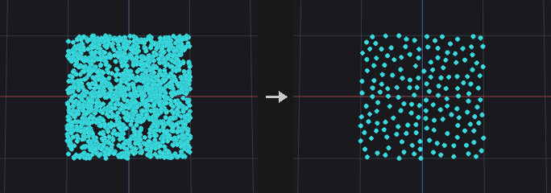

Visits points in priority order and keeps a point only if it does not conflict with an already kept one. Two points conflict when their distance is below the larger of their two radii, where each point's radius is `Radius` (optionally multiplied by a point attribute). The result is a set of kept points that are pairwise non-conflicting, and every removed point sits next to a kept point of higher priority.

With *Group Pruned Points* the removed points are only put into a point group and nothing is deleted; the `report` output summarises the result.

**Inputs**

| Input | Type | Description |
|---|---|---|
| `geo` | GEOMETRY | Point cloud (or any geometry with points) to thin. |

**Outputs**

| Output | Type | Description |
|---|---|---|
| `geo` | GEOMETRY | The pruned points, or the full input with the pruned points grouped. |
| `report` | STRING | Text summary of the operation. |

**Parameters**

| Parameter | Type | Default | Description |
|---|---|---|---|
| Group `group` | string | *(empty)* | Group pattern restricting which points take part in the pruning. |
| Radius `radius` | float [0.0..] | 0.1 | Minimum spacing between kept points. The effective radius of a pair is the larger of the two points' radii. |
| Radius Scale Attribute `radius_attribute` | string | *(empty)* | Optional point attribute that multiplies `Radius` per point. Leave empty for a uniform radius. |
| Priority `priority` | menu | Random | Decides which point of a conflicting pair survives. *Random* uses the seed, *Attribute* keeps points with the larger attribute value first, *Point Number* keeps lower point numbers first. Options: Random (`random`), Attribute (Largest First) (`attribute`), Point Number (`index`). |
| Priority Attribute `priority_attribute` | string | *(empty)* | Point attribute that ranks the points; larger values are kept first. *Hidden when priority ≠ attribute.* |
| Seed `rand_seed` | int [0..] | 0 | Seed of the random priority order. *Hidden when priority ≠ random.* |
| Operation `mode` | menu | Delete Pruned Points | Delete the pruned points, or keep everything and only put the pruned points into a group. Options: Delete Pruned Points (`delete`), Group Pruned Points (`group`). |
| Output Group `group_name` | string | `pruned` | Name of the point group that receives the pruned points. *Hidden when mode ≠ group.* |

**Tips**

- Use *Attribute* priority with `pscale` to let large instances win over small ones.

---

### Assemble (PCG)

`PCG_Assemble` · category `PCG/scatter` · Houdini: Assemble (SOP)

Names the connected pieces of a mesh piece0, piece1 ... and optionally packs each piece.

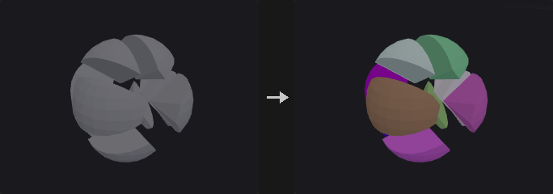

Finds the connected pieces among the group's primitives (primitives sharing points belong together) and writes Output Prefix plus the piece number into a string primitive attribute, numbered in order of each piece's first primitive. This is the usual step after a fracture or a Boolean that leaves loose parts.

With **Create Packed Geometry** every piece becomes a packed primitive placed at its pivot, ready to be moved per piece, instanced in the viewport or exported with GPU instancing. Primitives outside the group pass through unchanged.

**Inputs**

| Input | Type | Description |
|---|---|---|
| `geo` | GEOMETRY | Geometry with loose pieces. |

**Outputs**

| Output | Type | Description |
|---|---|---|
| `geo` | GEOMETRY | The named (or packed) pieces. |
| `report` | STRING | Number of pieces and of packed primitives. |

**Parameters**

| Parameter | Type | Default | Description |
|---|---|---|---|
| Group `group` | string | *(empty)* | Primitives to assemble; the rest pass through. |
| Name Attribute `name_attribute` | string | `name` | String primitive attribute that receives the piece names. |
| Output Prefix `name_prefix` | string | `piece` | Text before the piece number. |
| Create Packed Geometry `create_packed` | toggle | off | Turn every piece into a packed primitive. |
| Pivot `pivot` | menu | Centroid | Where each packed piece's point goes: centroid, bounding box center, origin or bottom center. Options: Centroid (`centroid`), Bounding Box Center (`bbox_center`), Origin (`origin`), Bottom Center (`bbox_min_y`). *Disabled when create_packed is off.* |

**Compared with Houdini**

Counterpart of the Assemble SOP. Connectivity is by shared points; there is no separate Connectivity Attribute, and the packed fragments carry no path attribute.

---

### Chain (PCG)

`PCG_Chain` · category `PCG/scatter` · Houdini: Chain (SOP)

Lays out source pieces one after another along curves, as rigid links or deformed to follow the curve.

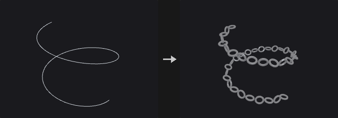

Two modes.

*Rigid Links* places each link as a rigid piece along the curve. Every link takes up its own bounding box length along local Z plus *Piece Spacing*; a negative spacing makes links overlap, as in chain rings. The link centre sits at the midpoint of the chord, +Z points along the chord, and on bends both ends lie on the curve. Neighbouring links are rotated by an extra *Roll per Link* (90 degrees by default for alternating chain links), counting from 0 on every curve. *Fit to Curve* adjusts the gaps equally so that the last link ends exactly at the end of the curve (a closed curve closes exactly), with the spacing only deciding how many links fit. With a piece attribute, several link types alternate.

*Deform Along Curve* is Houdini's Chain. The source is split into pieces by connectivity or by a piece attribute. The pieces are arranged into a chain following a pattern (cycle, explicit, random, weighted random), each piece's length being its bounding box length along the Forward axis times the piece scale plus spacing. The chain is then mapped onto the curve (see Map Length and Offset): every point is placed in the curve frame at its position, so each piece follows the bends of the curve. The curve frame uses the averaged tangent interpolated within segments and an up vector carried along the curve. Beyond the ends the geometry is extended along the end tangent, clamped to the end point, or clipped. Closed curves wrap around.

The output carries a copy number attribute and optionally the position, index and curve number along the curve.

**Inputs**

| Input | Type | Description |
|---|---|---|
| `source` | GEOMETRY | Geometry providing the link pieces. |
| `curves` | GEOMETRY | Curves the chain is laid along. |

**Outputs**

| Output | Type | Description |
|---|---|---|
| `geo` | GEOMETRY | The chain of copies merged into one geometry. |

**Parameters**

| Parameter | Type | Default | Description |
|---|---|---|---|
| Mode `chain_mode` | menu | Rigid Links on Chords | *Rigid Links* places whole links on the chord (the plugin's original method); *Deform Along Curve* is Houdini's Chain with pattern, mapping and deformation. Options: Rigid Links on Chords (`rigid_links`), Deform Along Curve (Houdini) (`deform_along_curve`). |
| Geometry Group `geometry_group` | string | *(empty)* | Primitive group pattern removed from the source in Deform Along Curve mode before it is split into pieces. *Hidden when chain_mode ≠ deform_along_curve.* |
| Curve Group `group` | string | *(empty)* | Primitive group pattern selecting which curves are used. |
| Piece Spacing `spacing` | float | 0 | Added to the length of each piece along its forward axis. Negative values make pieces overlap. |
| Fit to Curve `fit` | toggle | on | Adjust the gaps equally so that the last link ends exactly at the end of the curve. The spacing then only decides how many links fit. *Hidden when chain_mode = deform_along_curve.* |
| Curve Up Vector `up_x` `up_y` `up_z` | float [-1..1] | 0, 1, 0 | Up vector of the curve frame. In Deform Along Curve mode it applies when *Curve Up Control* is Custom. *Hidden when chain_mode = deform_along_curve curve_up_control ≠ custom.* |
| Roll `roll` | float [-3600..3600] | 0 | Rotation of all links about the curve direction, in degrees. *Hidden when chain_mode = deform_along_curve.* |
| Roll per Link `roll_step` | float [-3600..3600] | 90 | Extra rotation of each link relative to the previous one, in degrees, counting from 0 on each curve. 90 gives alternating chain links. *Hidden when chain_mode = deform_along_curve.* |
| Find Pieces `find_pieces` | menu | By Connectivity | Whether the source is split into pieces by connectivity or by a piece attribute. Options: By Connectivity (`connectivity`), By Piece Attribute (`piece_attribute`). *Hidden when chain_mode ≠ deform_along_curve.* |
| Piece Attribute `piece_attribute` | string | *(empty)* | Attribute that identifies the pieces. In Rigid Links mode the pieces alternate; in Deform Along Curve mode it splits the source. *Hidden when chain_mode = deform_along_curve find_pieces ≠ piece_attribute.* |
| Number of Pieces `number_of_pieces` | menu | Fit Pieces Along Curve | *Fit* places as many pieces as fit in a given fraction of the curve; *Explicit* places a fixed number. Options: Fit Pieces Along Curve (`fit`), Explicit Number (`explicit`). *Hidden when chain_mode ≠ deform_along_curve.* |
| Fraction of Curve `fraction_of_curve` | float [0.0..] | 1 | Fraction of the curve length that may be filled with pieces. *Hidden when chain_mode ≠ deform_along_curve } { number_of_pieces ≠ fit.* |
| Only Repeat Full Pattern `only_full_pattern` | toggle | off | Only place whole repeats of the pattern, dropping the incomplete last repeat. *Hidden when chain_mode ≠ deform_along_curve } { number_of_pieces ≠ fit.* |
| Num Pieces `num_pieces` | int [0..] | 10 | Number of pieces placed when *Number of Pieces* is Explicit, including any caps. *Hidden when chain_mode ≠ deform_along_curve } { number_of_pieces ≠ explicit.* |
| Uniform Piece Scale `uniform_piece_scale` | float [1e-06..] | 1 | Uniform scale of the pieces, applied in the chain's own coordinates before mapping to the curve. *Hidden when chain_mode ≠ deform_along_curve.* |
| Map Length Using `map_length_using` | menu | Fraction of Curve Length | How *Map Length* is measured: as a fraction of the curve length, a fraction of the chain's natural length, or as a distance. Options: Fraction of Curve Length (`fraction_curve`), Fraction of Geo Length (`fraction_geo`), Distance (`distance`). *Hidden when chain_mode ≠ deform_along_curve.* |
| Map Length `map_length` | float | 1 | Length over which the chain is stretched on the curve. The chain is scaled along the curve to fill it. *Hidden when chain_mode ≠ deform_along_curve.* |
| Pos End Attrib `map_length_attrib` | string | *(empty)* | Primitive attribute on the curves that overrides *Map Length* for each curve. Empty is not used. *Hidden when chain_mode ≠ deform_along_curve.* |
| Offset Position Using `offset_using` | menu | Curve U Position | How *Position Offset* is measured: as a fraction of the curve (`curve_u`), a fraction of the chain length, or as a distance. Options: Curve U Position (`curve_u`), Fraction of Geo Length (`fraction_geo`), Distance (`distance`). *Hidden when chain_mode ≠ deform_along_curve.* |
| Position Offset `position_offset` | float | 0 | Where along the curve the chain starts. *Hidden when chain_mode ≠ deform_along_curve.* |
| Pos Offset Attrib `offset_attrib` | string | *(empty)* | Primitive attribute on the curves that overrides *Position Offset* for each curve. Empty is not used. *Hidden when chain_mode ≠ deform_along_curve.* |
| Start Behavior `start_behavior` | menu | Extend | What happens to geometry that lies before the start of the curve: *Extend* continues along the end tangent, *Clamp* stops at the end point (the geometry bunches up), *Clip* cuts it off. Closed curves wrap around instead. Options: Extend (`extend`), Clamp (`clamp`), Clip (`clip`). *Hidden when chain_mode ≠ deform_along_curve.* |
| End Behavior `end_behavior` | menu | Extend | What happens to geometry that lies beyond the end of the curve, with the same options as the start. Options: Extend (`extend`), Clamp (`clamp`), Clip (`clip`). *Hidden when chain_mode ≠ deform_along_curve.* |
| Class Pattern `class_pattern` | string | *(empty)* | Explicit pattern as space-separated piece numbers, for example `0 0 1`. *Hidden when chain_mode ≠ deform_along_curve } { repeat_pattern ≠ explicit.* |
| Offset `pattern_offset` | int | 0 | Shift of the starting position in the pattern. *Hidden when chain_mode ≠ deform_along_curve.* |
| Seed `rand_seed` | int [0..] | 0 | Seed of the random pattern choices. *Hidden when chain_mode ≠ deform_along_curve } { repeat_pattern = cycle } { repeat_pattern = explicit.* |
| Repeat Length `repeat_length` | int [0..] | 0 | For random patterns: choose this many pieces randomly, then repeat them. 0 means no repetition. *Hidden when chain_mode ≠ deform_along_curve } { repeat_pattern = cycle } { repeat_pattern = explicit.* |
| Weights `piece_weights` | string | *(empty)* | Weights of the pieces in piece-number order, separated by spaces, for the weighted random pattern (Houdini uses a piece/weight list). *Hidden when chain_mode ≠ deform_along_curve } { repeat_pattern ≠ weighted_random.* |
| Weight Attribute `weight_attrib` | string | `weight` | Primitive attribute giving the weight of each piece, averaged over the piece, for the attribute-weighted random pattern. *Hidden when chain_mode ≠ deform_along_curve } { repeat_pattern ≠ weighted_random_attrib.* |
| Use Start Cap `use_start_cap` | toggle | off | Use a specific piece as the first piece of the chain. *Hidden when chain_mode ≠ deform_along_curve.* |
| Start Cap Piece `start_cap_piece` | int [0..] | 0 | Piece number of the start cap. *Hidden when chain_mode ≠ deform_along_curve.* *Disabled when use_start_cap is off.* |
| Use End Cap `use_end_cap` | toggle | off | Use a specific piece as the last piece of the chain. *Hidden when chain_mode ≠ deform_along_curve.* |
| End Cap Piece `end_cap_piece` | int [0..] | 0 | Piece number of the end cap. *Hidden when chain_mode ≠ deform_along_curve.* *Disabled when use_end_cap is off.* |
| Exclude End Pieces from Pattern `exclude_end_pieces` | toggle | on | Keep the cap pieces out of the repeating pattern. *Hidden when chain_mode ≠ deform_along_curve.* |
| Do Not Deform End Pieces `rigid_end_pieces` | toggle | off | Place the cap pieces rigidly at the middle of their position instead of bending them. *Hidden when chain_mode ≠ deform_along_curve.* |
| Base Scale Factor `base_scale` | float | 1 | Base scale factor for the cross-section of the chain when scaling is enabled. *Hidden when chain_mode ≠ deform_along_curve.* *Disabled when enable_scale is off.* |
| Curve Attribute (Scale) `scale_attrib` | string | *(empty)* | Numeric attribute on the curve points that multiplies the scale, interpolated along the curve. Empty is not used. *Hidden when chain_mode ≠ deform_along_curve.* *Disabled when enable_scale is off.* |
| Enable Rotation `enable_rotation` | toggle | off | Rotate the pieces about the curve direction by the base rotation and rotation attribute. *Hidden when chain_mode ≠ deform_along_curve.* |
| Base Rotation `base_rotation` | float | 0 | Rotation about the curve direction in degrees, multiplied by the rotation attribute when one is set. *Hidden when chain_mode ≠ deform_along_curve.* *Disabled when enable_rotation is off.* |
| Curve Attribute (Rotation) `rotation_attrib` | string | *(empty)* | Numeric attribute on the curve points that multiplies the base rotation, interpolated along the curve. *Hidden when chain_mode ≠ deform_along_curve.* *Disabled when enable_rotation is off.* |
| Forward Axis Vector `forward_x` `forward_y` `forward_z` | float | 0, 0, 1 | Direction in the source geometry that is the chain direction when *Forward Direction* is Custom. *Hidden when chain_mode ≠ deform_along_curve } { forward_dir ≠ custom.* |
| Up Direction `up_dir` | menu | Y | Axis of the source geometry that points up in the curve frame. Options: X (`x`), Y (`y`), Z (`z`), Custom (`custom`). *Hidden when chain_mode ≠ deform_along_curve.* |
| Up Axis Vector `upaxis_x` `upaxis_y` `upaxis_z` | float | 0, 1, 0 | Custom up axis of the source geometry. *Hidden when chain_mode ≠ deform_along_curve } { up_dir ≠ custom.* |
| Center Geometry on Curve `center_on_curve` | toggle | off | Center each piece's cross-section on the curve. *Hidden when chain_mode ≠ deform_along_curve.* |
| Piece Rotation `piece_rotation` | float [-3600..3600] | 0 | Rotation about the curve direction applied cumulatively: piece k is rotated by k times this angle, in degrees. *Hidden when chain_mode ≠ deform_along_curve.* |
| Curve Up Control `curve_up_control` | menu | Curve Normal | Up vector at the start of the curve: the curve normal, an axis, or the custom vector. Options: Curve Normal (`curve_normal`), X (`x`), Y (`y`), Z (`z`), Custom (`custom`). *Hidden when chain_mode ≠ deform_along_curve.* |
| Output Position Along Curve `position_attrib` | string | *(empty)* | Name of a point attribute that receives the position (arc length) along the curve. Empty writes none. *Hidden when chain_mode ≠ deform_along_curve.* |
| Output Index Along Curve `index_attrib` | string | *(empty)* | Name of a point attribute that receives the index of the piece in the chain. Empty writes none. *Hidden when chain_mode ≠ deform_along_curve.* |
| Output Curve Number `curvenum_attrib` | string | *(empty)* | Name of a point attribute that receives the number of the source curve. Empty writes none. *Hidden when chain_mode ≠ deform_along_curve.* |
| Copy Number Attribute `copy_attribute` | string | `copynum` | Name of the copy number attribute. Empty writes none. |

*Chain Pattern*

| Parameter | Type | Default | Description |
|---|---|---|---|
| Enable Deformation `enable_deformation` | toggle | on | Deform the pieces along the curve. When off, the chain is laid out straight along world Z, with z being the arc-length coordinate, so that it can be deformed later. *Hidden when chain_mode ≠ deform_along_curve.* |

*Pattern*

| Parameter | Type | Default | Description |
|---|---|---|---|
| Repeat Pattern `repeat_pattern` | menu | Cycle | How pieces are chosen: cycle in order, an explicit list, random, random weighted by the weights list, or random weighted by a primitive attribute. Options: Cycle (`cycle`), Explicit Pattern (`explicit`), Random (`random`), Weighted Random (`weighted_random`), Weighted Random from Attribute (`weighted_random_attrib`). *Hidden when chain_mode ≠ deform_along_curve.* |

*Deformation*

| Parameter | Type | Default | Description |
|---|---|---|---|
| Enable Scale `enable_scale` | toggle | off | Scale the chain's cross-section. *Hidden when chain_mode ≠ deform_along_curve.* |

*Alignment*

| Parameter | Type | Default | Description |
|---|---|---|---|
| Forward Direction `forward_dir` | menu | Z | Axis of the source geometry that runs along the chain. Options: X (`x`), Y (`y`), Z (`z`), Custom (`custom`). *Hidden when chain_mode ≠ deform_along_curve.* |

*Attributes*

| Parameter | Type | Default | Description |
|---|---|---|---|
| Attributes to Transform `attribs_to_transform` | string | `N` | Pattern of vector point attributes (such as `N`) that are rotated into the curve frame along with the pieces. *Hidden when chain_mode ≠ deform_along_curve.* |

**Compared with Houdini**

Deform Along Curve corresponds to Houdini's Chain. Rigid Links is the plugin's own earlier method, which places whole links rigidly on the chord.

---

### Copy and Transform (PCG)

`PCG_CopyAndTransform` · category `PCG/scatter` · Houdini: Copy and Transform (SOP)

Makes several copies of the input, where copy k has the same transform applied k times.

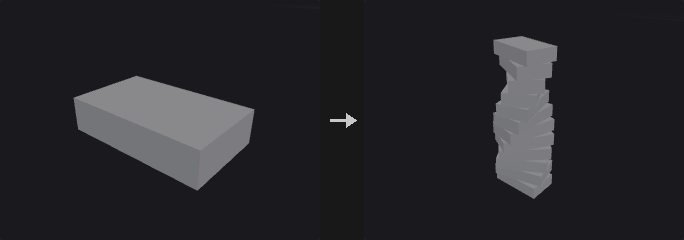

Produces `Total Number` copies including the original. Copy k is transformed by the same transform applied k times: scale and rotation happen about the pivot, followed by the translation. Spiral stairs, for example, are a rotation of 30 degrees plus a lift of 1 per copy; nested copies are a scale of 0.9 per copy.

The matrices are multiplied together, not approximated as separate `t*k` and `R^k` terms. Normals follow with the inverse transpose. The copy index is written to the copy-number attribute on both points and primitives.

**Inputs**

| Input | Type | Description |
|---|---|---|
| `geo` | GEOMETRY | Geometry to copy. |

**Outputs**

| Output | Type | Description |
|---|---|---|
| `geo` | GEOMETRY | The original and all transformed copies merged into one geometry. |

**Parameters**

| Parameter | Type | Default | Description |
|---|---|---|---|
| Total Number `copies` | int [0..] | 2 | Total number of copies including the original. Copy k applies the transform k times. |
| Translate `tx` `ty` `tz` | float | 0, 0, 0 | Translation applied per copy step. |
| Rotate `rx` `ry` `rz` | float [-3600..3600] | 0, 0, 0 | Rotation per copy step in degrees, in Rx Ry Rz order. The transform order is Scale, then Rotate, then Translate. |
| Scale `sx` `sy` `sz` | float | 1, 1, 1 | Non-uniform scale per copy step. |
| Uniform Scale `uniform_scale` | float [0.0..] | 1 | Uniform scale factor per copy step, multiplied with the scale vector. |
| Pivot Translate `pivot_x` `pivot_y` `pivot_z` | float | 0, 0, 0 | Pivot about which scale and rotation are applied. |
| Copy Number Attribute `copy_attribute` | string | `copynum` | Name of the copy-number attribute, written on both points and primitives. Leave empty to write nothing. |

---

### Copy to Curves (PCG)

`PCG_CopyToCurves` · category `PCG/scatter` · Houdini: Copy to Curves (SOP)

Copies source geometry along curves, at sampled positions or on the curves' existing points, oriented by the curve frame.

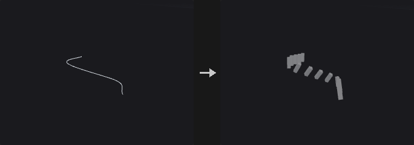

Two families of modes. In *Count* and *Spacing* mode, points are taken along each curve by count (both ends included) or by spacing, and the orientation is the rotation-minimising frame used by Orient Along Curve: +Z along the curve and +Y as the up vector. The copies are then placed as in Copy to Points. *Start / End Offset* leave out a stretch of arc length at each end. A closed curve does not repeat a copy at its start. *Roll per Copy* rotates copy k by an additional k times the step (alternating fence posts, spirals), where k counts from 0 on every curve separately, as in Chain.

*Curve Points* follows Houdini's Copy to Curves: the source is copied onto every existing point of each curve without resampling. The Frame, Additional Rotations and Scales settings only act in this mode. The frame is made of the tangent (see *Tangent Type*) and an up vector carried along the curve by rotation-minimising transport, followed by extra rotation in the curve frame (roll or twist about the tangent, yaw about the up axis, pitch about the outward axis), then scale and optional stretch at turns. On closed curves, leftover twist is spread so that it adds up to a whole turn.

If a piece attribute is given, the source is split into pieces and copies cycle through them in order (in Curve Points mode the attribute on the curve point selects the piece if it exists, otherwise they cycle). The output carries `curvenum` (index of the source curve) and the copy number attribute.

**Inputs**

| Input | Type | Description |
|---|---|---|
| `source` | GEOMETRY | Geometry to copy. |
| `curves` | GEOMETRY | Curves to copy along. |

**Outputs**

| Output | Type | Description |
|---|---|---|
| `geo` | GEOMETRY | All copies merged into one geometry. |

**Parameters**

| Parameter | Type | Default | Description |
|---|---|---|---|
| Source Group Type `source_group_type` | menu | Guess from Group | Whether the source group names primitives or points. *Guess* decides from the group name. Options: Guess from Group (`guess`), Primitive (`prim`), Point (`point`). *Disabled when source_group = "".* |
| Curve Group `group` | string | *(empty)* | Primitive group pattern selecting which curves are used. |
| Sample By `mode` | menu | Count | *Count* and *Spacing* resample the curves. *Curve Points* uses the existing points without resampling and enables the Frame, Rotation and Scale settings. Options: Count (`count`), Spacing (`spacing`), Curve Points (Houdini) (`curve_points`). |
| Count `count` | int [0..] | 10 | Number of copies on each curve, with copies at both ends. A closed curve does not repeat the copy at the start point. *Hidden when mode ≠ count.* |
| Spacing `spacing` | float [1e-06..] | 1 | Distance between copies along the curve, starting at the beginning. *Hidden when mode ≠ spacing.* |
| Start / End Offset `start_offset` `end_offset` | float [0.0..] | 0, 0 | Arc length left free at the start and at the end of each curve. *Hidden when mode = curve_points.* |
| Piece Attribute `piece_attribute` | string | *(empty)* | Attribute that splits the source into pieces. In Count and Spacing mode the pieces are used in turn; in Curve Points mode a matching attribute on the curve points picks the piece, otherwise they alternate. |
| Copy Number Attribute `copy_attribute` | string | `copynum` | Name of the attribute that stores the copy number. Empty writes none. |
| Make Closed Curve Orientations Continuous `closed_continuous` | toggle | on | Keep orientations continuous around closed curves by distributing the twist that accumulates on the way round. *Hidden when mode ≠ curve_points.* |
| Extrapolate End Tangents `extrapolate_ends` | toggle | off | Estimate the tangents at the two ends of an open curve by mirroring the neighbouring tangent in the first edge, which is exact for circular arcs. Only for Average and Central Difference tangents. *Hidden when mode ≠ curve_points.* *Disabled when tangent_type = previous } { tangent_type = next } { tangent_type = z_axis.* |
| Transform Using Curve Point Attributes `use_point_attribs` | toggle | off | Use the curve point attributes `up`, `orient`, `rot`, `scale`, `pscale`, `transform`, `trans` and `pivot` when they exist. *Hidden when mode ≠ curve_points.* |
| Target Up Vector `target_up` | menu | Curve Normal | Source of the up vector at the start of each curve: the *Curve Normal* (normal of the curve's plane, or Y for a straight curve), the *Y Axis*, a vector *Attribute* on the curve primitive or detail, or a *Custom* vector. Options: Curve Normal (`curve_normal`), Y Axis (`y_axis`), Attribute (`attribute`), Custom (`custom`). *Hidden when mode ≠ curve_points.* |
| Target Up Vector at Start (else Average) `up_at_start` | toggle | on | Fix the up vector at the start of the curve. When off, the whole curve is rotated about its tangent so that the average deviation from the target up is zero. *Hidden when mode ≠ curve_points.* |
| Use Target End Up Vector `use_end_up` | toggle | off | Also match a target up vector at the end of the curve; the difference is spread along the arc length. *Hidden when mode ≠ curve_points.* *Disabled when up_at_start is off.* |
| Start Up Attribute `start_up_attrib` | string | `start_up` | Name of the primitive or detail vector attribute that holds the start up vector. *Hidden when mode ≠ curve_points } { target_up ≠ attribute.* |
| End Up Attribute `end_up_attrib` | string | `end_up` | Name of the primitive or detail vector attribute that holds the end up vector. *Hidden when mode ≠ curve_points } { target_up ≠ attribute.* *Disabled when use_end_up is off } { up_at_start is off.* |
| Start Up Vector `up_x` `up_y` `up_z` | float [-1..1] | 0, 1, 0 | Up vector at the start of the curve. In Count and Spacing mode this is the up vector of the frame; in Curve Points mode it is the custom start up vector. *Hidden when mode = curve_points target_up ≠ custom.* |
| End Up Vector `end_up_x` `end_up_y` `end_up_z` | float [-1..1] | 0, 1, 0 | Custom up vector at the end of the curve, when using an end up vector. *Hidden when mode ≠ curve_points } { target_up ≠ custom.* *Disabled when use_end_up is off } { up_at_start is off.* |
| Roll `roll` | float [-3600..3600] | 0 | Rotation about the tangent in degrees, added to every copy. In Curve Points mode it is only applied when *Apply Roll or Twist* is on. *Disabled when mode = curve_points apply_roll is off.* |
| Roll per Copy `roll_step` | float [-3600..3600] | 0 | Additional rotation about the tangent per copy, in degrees. Copy k is rotated k times this value, counting from 0 on every curve. *Hidden when mode = curve_points.* |
| Apply Roll or Twist `apply_roll` | toggle | off | Apply roll and twist in Curve Points mode. *Hidden when mode ≠ curve_points.* |
| Twist Per `twist_per` | menu | Per Edge | How the twist is distributed along the curve: per edge, per unit of distance, scaled by an attribute, or as a total over the whole curve by edges or by distance. Options: Per Edge (`per_edge`), Per Unit Distance (`per_unit_distance`), Scale by Attribute (`scale_by_attribute`), Per Full Curve by Edges (`full_curve_by_edges`), Per Full Curve by Distance (`full_curve_by_distance`). *Hidden when mode ≠ curve_points.* *Disabled when apply_roll is off.* |
| Full Twists `full_twists` | int [-1000..1000] | 0 | Number of full 360 degree turns of twist (see *Twist Per* for what the amount is measured against). *Hidden when mode ≠ curve_points.* *Disabled when apply_roll is off.* |
| Partial Twist `partial_twist` | float | 0 | Extra twist in degrees added to the full twists. *Hidden when mode ≠ curve_points.* *Disabled when apply_roll is off.* |
| Twist Ramp Attribute `twist_ramp_attrib` | string | *(empty)* | Attribute (point, primitive or detail) whose value scales the twist when *Twist Per* is Scale by Attribute. *Hidden when mode ≠ curve_points } { twist_per ≠ scale_by_attribute.* *Disabled when apply_roll is off.* |
| Apply Yaw `apply_yaw` | toggle | off | Apply yaw rotation about the up axis. *Hidden when mode ≠ curve_points.* |
| Yaw `yaw` | float [-3600..3600] | 0 | Constant yaw offset in degrees. *Hidden when mode ≠ curve_points.* *Disabled when apply_yaw is off.* |
| Yaw Per `yaw_per` | menu | Per Edge | How the incremental yaw is distributed along the curve, as for twist. Options: Per Edge (`per_edge`), Per Unit Distance (`per_unit_distance`), Scale By Attribute (`scale_by_attribute`), Per Full Curve by Edges (`full_curve_by_edges`), Per Full Curve by Distance (`full_curve_by_distance`). *Hidden when mode ≠ curve_points.* *Disabled when apply_yaw is off.* |
| Incremental Yaw `incremental_yaw` | float | 0 | Yaw added per edge, unit of distance, or over the curve, depending on *Yaw Per*, in degrees. *Hidden when mode ≠ curve_points.* *Disabled when apply_yaw is off.* |
| Yaw Ramp Attribute `yaw_ramp_attrib` | string | *(empty)* | Attribute that scales the yaw when *Yaw Per* is Scale by Attribute. *Hidden when mode ≠ curve_points } { yaw_per ≠ scale_by_attribute.* *Disabled when apply_yaw is off.* |
| Apply Pitch `apply_pitch` | toggle | off | Apply pitch rotation about the outward axis. *Hidden when mode ≠ curve_points.* |
| Pitch `pitch` | float [-3600..3600] | 0 | Constant pitch offset in degrees. *Hidden when mode ≠ curve_points.* *Disabled when apply_pitch is off.* |
| Pitch Per `pitch_per` | menu | Per Edge | How the incremental pitch is distributed along the curve, as for twist. Options: Per Edge (`per_edge`), Per Unit Distance (`per_unit_distance`), Scale By Attribute (`scale_by_attribute`), Per Full Curve by Edges (`full_curve_by_edges`), Per Full Curve by Distance (`full_curve_by_distance`). *Hidden when mode ≠ curve_points.* *Disabled when apply_pitch is off.* |
| Incremental Pitch `incremental_pitch` | float | 0 | Pitch added per edge, unit of distance, or over the curve, depending on *Pitch Per*, in degrees. *Hidden when mode ≠ curve_points.* *Disabled when apply_pitch is off.* |
| Pitch Ramp Attribute `pitch_ramp_attrib` | string | *(empty)* | Attribute that scales the pitch when *Pitch Per* is Scale by Attribute. *Hidden when mode ≠ curve_points } { pitch_per ≠ scale_by_attribute.* *Disabled when apply_pitch is off.* |
| Uniform Scale `uniform_scale` | float | 1 | Uniform scale applied to every copy. *Hidden when mode ≠ curve_points.* |
| Stretch Around Turns `stretch_around_turns` | toggle | off | Stretch copies at sharp corners by 1/cos(angle/2) along the mitre direction, so that thickness is kept at bends. *Hidden when mode ≠ curve_points.* |
| Max Stretch `max_stretch` | float [1.0..] | 10 | Upper limit of the corner stretch factor. *Hidden when mode ≠ curve_points.* *Disabled when stretch_around_turns is off.* |

*Copy*

| Parameter | Type | Default | Description |
|---|---|---|---|
| Source Group `source_group` | string | *(empty)* | Group pattern selecting part of the source to copy. Read in every mode. |

*Frame*

| Parameter | Type | Default | Description |
|---|---|---|---|
| Tangent Type `tangent_type` | menu | Average of Edge Directions | How tangents are computed at curve points: average of the adjacent edges, central difference, the previous or next edge only, or the fixed Z axis. Options: Average of Edge Directions (`average`), Central Difference (`central_difference`), Previous Edge (`previous`), Next Edge (`next`), Z Axis (Ignore Curve) (`z_axis`). *Hidden when mode ≠ curve_points.* |

*Additional Rotations*

| Parameter | Type | Default | Description |
|---|---|---|---|
| Rotate Order `rotate_order` | menu | Pitch, Yaw, Roll | Order in which roll, yaw and pitch are applied (p = pitch, y = yaw, r = roll). The first listed is applied first, all in the curve frame. Options: Pitch, Yaw, Roll (`pyr`), Pitch, Roll, Yaw (`pry`), Yaw, Pitch, Roll (`ypr`), Yaw, Roll, Pitch (`yrp`), Roll, Pitch, Yaw (`rpy`), Roll, Yaw, Pitch (`ryp`). *Hidden when mode ≠ curve_points.* |

*Scales and Shears*

| Parameter | Type | Default | Description |
|---|---|---|---|
| Normalize Scales `normalize_scales` | toggle | off | Ignore the curve point `pscale` and `scale` attributes. Only meaningful with *Transform Using Curve Point Attributes*. *Hidden when mode ≠ curve_points.* *Disabled when use_point_attribs is off.* |

*Attributes*

| Parameter | Type | Default | Description |
|---|---|---|---|
| Attributes from Target `target_attributes` | string | *(empty)* | Pattern of curve point attributes that are copied onto the points of the copies. *Hidden when mode ≠ curve_points.* |

---

### Copy to Points (PCG)

`PCG_CopyToPoints` · category `PCG/scatter` · Houdini: Copy to Points (SOP)

Copies source geometry onto each target point, oriented and scaled by the point's instance attributes.

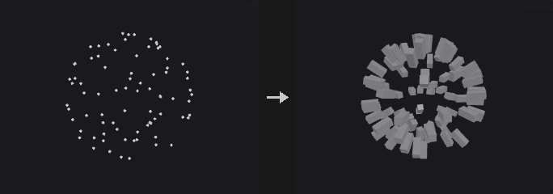

Follows the Houdini instance attribute convention. Target points may carry `orient`, `N` with `up`, `rot`, `scale`, `pscale`, `pivot`, `trans` or `transform`. The transform is composed as `P + trans + orient * (rot * (scale * (p - pivot)))`, so the `N` and random `pscale` produced by the scatter nodes can be plugged in directly. A `transform` attribute is read in Houdini's convention (`p' = p * M`, translation of a 4x4 in the fourth row).

When a piece attribute is given (for example `name` or `variant`), the source is split into pieces by that attribute and each target point picks the piece whose value matches its own attribute. This lets several variants, such as five tree types, be scattered in one node.

**Inputs**

| Input | Type | Description |
|---|---|---|
| `source` | GEOMETRY | Geometry to be copied. |
| `points` | GEOMETRY | Target points that define where, and with which orientation and scale, the copies are placed. |

**Outputs**

| Output | Type | Description |
|---|---|---|
| `geo` | GEOMETRY | All copies merged into one geometry. |

**Parameters**

| Parameter | Type | Default | Description |
|---|---|---|---|
| Source Group `source_group` | string | *(empty)* | Group pattern selecting part of the source (primitives, or points for a point cloud). |
| Target Points `target_group` | string | *(empty)* | Point group pattern selecting which target points receive a copy. |
| Piece Attribute `piece_attribute` | string | *(empty)* | Attribute present on both the source and the target points; it splits the source into pieces and matches each target point to a piece. |
| Pack and Instance `pack_and_instance` | toggle | off | Output one packed primitive per copy instead of real geometry. Packed copies are a point each: cheap to transform, merge and pass around, and the viewport draws them as GPU instances. Nodes that need real polygons unpack them automatically, and Unpack gives exactly the geometry this node gives with the toggle off. |
| Transform Using Target Point Orientations `transform_using_orientations` | toggle | on | Use the target points' orientation attributes. When off, copies are only translated to the points. |
| Default Up Vector `up_x` `up_y` `up_z` | float | 0, 1, 0 | Up vector used when the target points have `N` (or `v`) but no `orient`, `up` or `transform`. *Disabled when transform_using_orientations is off.* |

*Attributes from Target*

| Parameter | Type | Default | Description |
|---|---|---|---|
| Apply to Points `target_point_attributes` | string | `*` | Pattern of target point attributes passed down to the points of the copies. |
| Apply to Primitives `target_prim_attributes` | string | *(empty)* | Pattern of target point attributes passed down to the primitives of the copies. |
| Apply by Multiply `multiply_attributes` | string | *(empty)* | Attribute names that are multiplied with the existing source values instead of overwriting them. |
| Attributes to Transform `rotate_attributes` | string | `N v up` | Direction-type attributes that are rotated along with the copy. |

---

### Pack (PCG)

`PCG_Pack` · category `PCG/scatter` · Houdini: Pack (SOP)

Packs pieces of geometry into packed primitives: one point per piece.

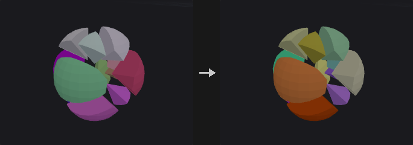

Turns every piece of the input into a packed primitive: a single point that carries the whole piece. Pieces are defined by a piece attribute (such as `name`), by connectivity, or the whole input is one piece. The piece's pivot (centroid, bounding box center, bottom center or origin) becomes the packed point.

Packed geometry is cheap to transform, merge and copy, and the viewport draws it as GPU instances. Nodes that need real polygons unpack it automatically, so a packed input never gives a wrong result.

**Inputs**

| Input | Type | Description |
|---|---|---|
| `geo` | GEOMETRY | Geometry to pack. |

**Outputs**

| Output | Type | Description |
|---|---|---|
| `geo` | GEOMETRY | One packed primitive per piece. |
| `report` | STRING | Number of packed primitives. |

**Parameters**

| Parameter | Type | Default | Description |
|---|---|---|---|
| Group `group` | string | *(empty)* | Primitives to pack. |
| Pack By `pack_by` | menu | Piece Attribute | How pieces are found: by Piece Attribute, by Connectivity, or Everything as one piece. Options: Piece Attribute (`piece_attribute`), Connectivity (`connectivity`), Everything (One Packed Primitive) (`all`). |
| Piece Attribute `piece_attribute` | string | `name` | Primitives sharing a value of this attribute form one piece. *Hidden when pack_by ≠ piece_attribute.* |
| Pivot `pivot` | menu | Centroid | Where the packed point of each piece goes: centroid, bounding box center, origin or bottom center. Options: Centroid (`centroid`), Bounding Box Center (`bbox_center`), Origin (`origin`), Bottom Center (`bbox_min_y`). |

---

### Point Relax (PCG)

`PCG_PointRelax` · category `PCG/scatter` · Houdini: Point Relax (SOP)

Pushes points apart until their radii no longer overlap.

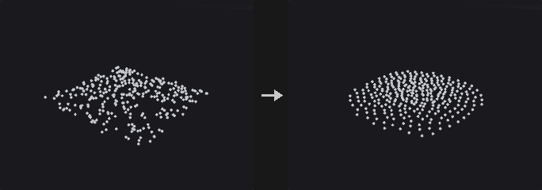

Each point is a sphere whose radius is `pscale` times *Point Radius Scale*, or the *Point Radius* value when there is no `pscale` or it is switched off. A radius of 0 is determined automatically. Overlapping points push each other away over several iterations.

With a surface connected, every step projects the points back onto it. Points outside the group do not move but still block the others. A point moves by at most *Max Step* times its radius per iteration, and relaxation stops early once nothing overlaps.

**Inputs**

| Input | Type | Description |
|---|---|---|
| `geo` | GEOMETRY | Points to relax. |
| `surface` *(optional)* | GEOMETRY | Optional surface the points are projected back onto after every step. |

**Outputs**

| Output | Type | Description |
|---|---|---|
| `geo` | GEOMETRY | The relaxed points. |
| `report` | STRING | Text summary of the relaxation. |

**Parameters**

| Parameter | Type | Default | Description |
|---|---|---|---|
| Group `group` | string | *(empty)* | Group pattern of the points that may move. Points outside it stay fixed but still act as obstacles. |
| Iterations `iterations` | int [0..10000] | 20 | Maximum number of relaxation iterations. The loop ends sooner if no overlaps remain. |
| Point Radius `radius` | float [0.0..] | 0 | Radius used when there is no `pscale` attribute or *Use pscale* is off. 0 chooses a radius automatically. |
| Use pscale Attribute `use_pscale` | toggle | on | Read each point's radius from `pscale`. |
| Point Radius Scale `radius_scale` | float [0.0..] | 1 | Multiplier applied to the radius of every point. |
| Max Step `max_step` | float [0.0..10.0] | 0.5 | Largest move per iteration as a fraction of the point radius. |

---

### Point Replicate (PCG)

`PCG_PointReplicate` · category `PCG/scatter` · Houdini: Point Replicate (SOP)

Scatters a cluster of new points around each source point.

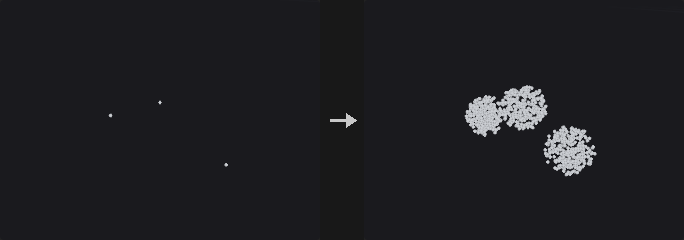

Every selected point spawns `Points per Point` new points (or a count read from an attribute) around itself. There are two families of shapes. *Sphere*, *Shell*, *Disk* and *Gaussian* are offsets in world space scaled by `Radius` times the radius attribute (`pscale` by default): sphere fills a ball uniformly, shell puts points on its surface, disk is a flat disc perpendicular to `N` (the Y axis if there is no `N`), and gaussian uses a normal distribution with the radius as its standard deviation. *Circle*, *Line* and *Grid* are generated in local space, controlled by Orientation, Center, Size and Uniform Scale, and then placed on each source point with the same instance rules as Copy to Points (`orient`, `N` with `up`, `pscale`, `scale`, `trans`, `pivot`, `transform`). These three ignore Radius.

Every source point draws its own random numbers from the seed and its `id` attribute (or its point number if there is no `id`), so adding or deleting other points does not change the cluster around a point. New points inherit the source point's attributes and get a point attribute with the source point number (`source` by default).

**Inputs**

| Input | Type | Description |
|---|---|---|
| `geo` | GEOMETRY | Source points. |

**Outputs**

| Output | Type | Description |
|---|---|---|
| `geo` | GEOMETRY | The new points, together with the original points if *Keep Input Geometry* is on. |
| `report` | STRING | Text summary: number of new points and number of source points. |

**Parameters**

| Parameter | Type | Default | Description |
|---|---|---|---|
| Group `group` | string | *(empty)* | Group pattern selecting the source points that spawn clusters. |
| Keep Input Geometry `keep_original` | toggle | off | Keep the source points in the output along with the new ones. |
| Points per Point `count` | int [0..] | 10 | Number of points created around each source point. *Disabled when count_attribute ≠ "".* |
| Count Attribute `count_attribute` | string | *(empty)* | Integer point attribute used directly as the number of points per source point (rounded, negative counts as 0). Unlike Houdini's Generate From Attribute it is not a probability times Points per Point. |
| Shape `shape` | menu | Sphere Volume | Sphere, Shell, Disk and Gaussian are world-space shapes of this plugin using Radius. Circle, Line and Grid are built in local space and placed with the instance rules of Copy to Points. Options: Sphere Volume (`sphere`), Sphere Surface (`shell`), Disk (Perpendicular to N) (`disk`), Gaussian (`gaussian`), Circle (`circle`), Line (`line`), Grid (`grid`). |
| Orientation `orientation` | menu | XY Plane | Plane of the circle or grid in local space. A line runs along the plane's normal axis, so with XY it lies along local Z, which is `N` or `v`. Options: XY Plane (`xy`), YZ Plane (`yz`), ZX Plane (`zx`). *Hidden when shape = sphere } { shape = shell } { shape = disk } { shape = gaussian.* |
| Center `center_x` `center_y` `center_z` | float | 0, 0, 0 | Local-space centre of the shape, applied after Size. *Hidden when shape = sphere } { shape = shell } { shape = disk } { shape = gaussian.* |
| Size `size_x` `size_y` `size_z` | float | 1, 1, 1 | Local-space size of the shape along each axis. *Hidden when shape = sphere } { shape = shell } { shape = disk } { shape = gaussian.* |
| Uniform Scale `uniform_scale` | float [0.0..] | 1 | Overall scale applied to the local-space shape. *Hidden when shape = sphere } { shape = shell } { shape = disk } { shape = gaussian.* |
| Velocity Stretch `velocity_stretch` | menu | None | Stretch the shape along local Z by the speed `v`. *Scaled* keeps the point's instance scale; *Ignore Geometry Scale* drops `pscale` and `scale` so that only the velocity stretches the shape. Needs a `v` attribute on the input. Options: None (`none`), Scaled (`scaled`), Ignore Geometry Scale (`ignore_geometry_scale`). *Hidden when shape = sphere } { shape = shell } { shape = disk } { shape = gaussian.* |
| Velocity Scale `velocity_scale` | float | 1 | Multiplier for the velocity stretch. *Hidden when shape = sphere } { shape = shell } { shape = disk } { shape = gaussian.* *Disabled when velocity_stretch = none.* |
| Radius `radius` | float [0.0..] | 0.1 | Radius of the world-space shapes. Multiplied by the radius attribute when it exists. *Hidden when shape = circle } { shape = line } { shape = grid.* |
| Radius Attribute `radius_attribute` | string | `pscale` | Point attribute that scales the radius per source point. If the attribute is missing, the radius is used as is. *Hidden when shape = circle } { shape = line } { shape = grid.* |
| Seed `rand_seed` | int [0..] | 0 | Seed of the random numbers. Combined with each point's `id` (or point number). |

*Attributes*

| Parameter | Type | Default | Description |
|---|---|---|---|
| Copy Source Attributes `copy_source_attributes` | toggle | on | Copy attributes of the source point to the new points. When off, only `P` and the source attributes are written. |
| Attributes `source_attributes` | string | `*` | Pattern of the point attributes that are copied. *Disabled when copy_source_attributes is off.* |
| Inherit Velocity `inherit_velocity` | float | 1 | Multiplier for the `v` of the new points relative to the source point's `v`. |
| Radial Velocity `radial_velocity` | float | 0 | Adds this factor times the new point's offset from the source point to `v` (created if absent). |
| Keep Source Attributes `keep_source_attributes` | toggle | on | Write the source tracking attributes below. |
| Source Point Attribute `source_point_attribute` | string | `source` | Name of the point attribute that stores the number of the source point. Original points kept in the output also get their own number. *Disabled when keep_source_attributes is off.* |
| Source Index Attribute `source_index_attribute` | string | *(empty)* | Name of an attribute for the index of a point within its cluster, counting from 0. Kept original points get -1. Empty writes none. *Disabled when keep_source_attributes is off.* |
| Create Output Group `output_group` | string | `replicated` | Name of the point group that contains the new points. Only written when *Create Output Group* is on. |
| Create Output Group `create_output_group` | toggle | off | Put the new points into the output group. |

---

### Scatter (PCG)

`PCG_Scatter` · category `PCG/scatter` · Houdini: Scatter (SOP)

Scatters points over the surface of polygons, by total count, density or per-primitive count.

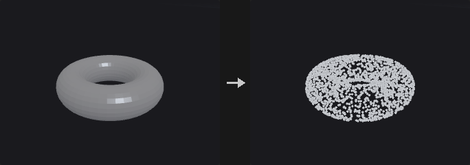

Faces are triangulated with ear clipping, not fans, so concave n-gons stay inside their outline and no points land outside the face. Points are drawn with probability proportional to triangle area, multiplied by a density attribute when enabled.

*Generate* chooses the model. *By Density* draws either a fixed total number of points (*Force Total Count*) or `Density Scale` times the weighted total area. An optional density texture on the second input is sampled at the surface's UVs and accepts points with probability proportional to the texture value, so the density precision depends only on the texture resolution and not on the mesh. *Count per Primitive* gives each primitive an exact number of points. *In Texture Space* scatters in the UV unit square and keeps the points that fall within the UV area of the surface.

Relaxation pushes the random points apart into a blue-noise-like distribution. After every iteration the points are projected back onto the nearest triangle, so they can migrate across triangles and do not drift off the surface. The relaxation radius is estimated from the target density as `sqrt(total area / (N * pi))`, the radius of N non-overlapping discs filling the area. With Count per Primitive, relaxation runs per primitive so points stay on their own primitive.

With *Primitive Seed* each primitive has its own random stream, so editing one face does not reshuffle the points on the others. This is slower because it samples face by face.

The node outputs a point cloud only. Point attributes (and vertex attributes, such as UVs, interpolated by corner) are interpolated barycentrically from the source; primitive and detail attributes are copied.

**Inputs**

| Input | Type | Description |
|---|---|---|
| `geo` | GEOMETRY | Polygonal surface to scatter on. |
| `density_texture` *(optional)* | COPIMAGE | Optional image that modulates the density, sampled at the surface UVs (see *UV Attribute*). |

**Outputs**

| Output | Type | Description |
|---|---|---|
| `points` | GEOMETRY | The scattered points with the output attributes. |

**Parameters**

*Density*

| Parameter | Type | Default | Description |
|---|---|---|---|
| Group `group` | string | *(empty)* | Primitive group pattern restricting the scatter to some faces. Empty uses all faces. |
| Generate `generate` | menu | By Density | *By Density* scatters by total count or density, *Count per Primitive* places an exact number on every primitive, *In Texture Space* scatters in the UV unit square and maps the points to the surface. Options: By Density (`by_density`), Count per Primitive (`count_per_primitive`), In Texture Space (`in_texture_space`). |
| Force Total Count `count` | int [0..] | 1000 | Total number of points when *Force Total Count* is on. *Hidden when generate = count_per_primitive.* |
| Force Total Count `force_total_count` | toggle | on | Create exactly the Total Number of points. When off, the number follows from the density scale and the area. *Hidden when generate = count_per_primitive.* |
| Density Scale `density_scale` | float [0.0..] | 10 | Points per unit of weighted area. The point count is this value times the weighted total area. For In Texture Space it is the expected number of points in the UV unit square. Unused while Force Total Count is on. *Hidden when generate = count_per_primitive.* *Disabled when force_total_count is on.* |

*Density › Density Attributes*

| Parameter | Type | Default | Description |
|---|---|---|---|
| Density Attributes `use_density` | toggle | off | Weight triangle sampling by a density attribute and an area override. |
| Density Attribute `density_attribute` | string | `density` | Point attribute multiplied into the area weighting (averaged over the triangle's points). *Disabled when use_density is off } { generate = in_texture_space.* |
| Override Primitive Area `area_attribute` | string | *(empty)* | Primitive attribute that replaces the geometric area of each primitive when weighting. *Disabled when use_density is off } { generate = in_texture_space.* |

*Density*

| Parameter | Type | Default | Description |
|---|---|---|---|
| UV Attribute `texture_uv_attribute` | string | `uv` | UV attribute (point or vertex) used for the density texture, for In Texture Space and for texture-space output. |
| Count per Prim Attribute `count_per_prim_attribute` | string | `1` | An integer, or the name of an integer primitive attribute, giving the number of points on each primitive. A missing attribute raises an error. *Hidden when generate ≠ count_per_primitive.* |
| Global Seed `rand_seed` | int [0..] | 0 | Global seed of the random numbers. |

*Density › Per-Prim Seed*

| Parameter | Type | Default | Description |
|---|---|---|---|
| Primitive Seed `use_prim_seed` | toggle | off | Give each primitive its own random stream so that editing one face does not change the points on the others. |
| Primitive Seed Attribute `prim_seed_attribute` | string | `name` | Primitive attribute whose value seeds each primitive's random stream. *Disabled when use_prim_seed is off } { generate = in_texture_space.* |

*Density*

| Parameter | Type | Default | Description |
|---|---|---|---|
| Randomize Point Order `randomize_order` | toggle | on | Shuffle the order of the output points. Otherwise points come out grouped by the triangle they were drawn from. |
| Max Point Limit `max_points` | int [0..] | 1000000 | Upper limit for the number of points when *Use Max Points* is on. *Hidden when generate = count_per_primitive.* |
| Use Max Points `use_max_points` | toggle | on | Enable the Max Point Limit. *Hidden when generate = count_per_primitive.* |

*Relax › Relax*

| Parameter | Type | Default | Description |
|---|---|---|---|
| Relax Points `use_relax` | toggle | off | Relax the points into a more even distribution. |
| Relax Iterations `relax_iterations` | int [0..200] | 10 | Number of relaxation iterations. Each iteration does a neighbour search and a projection back to the surface. *Disabled when use_relax is off.* |
| Use Geometric Normals `use_geometric_normals` | toggle | off | Write the face normal of the triangle each point sits on as the output normal instead of interpolating the source `N`. Independent of Relax. Without a source `N`, geometric normals are used anyway. |
| Scale Radii by `scale_radii_by` | float [0.0..100.0] | 1 | Multiplier for the estimated relaxation radius. *Disabled when use_relax is off.* |
| Max Relax Radius `max_relax_radius` | float [0.0..] | 10 | Upper limit for the relaxation radius when *Use Max Relax Radius* is on. *Disabled when use_relax is off.* |
| Use Max Relax Radius `use_max_relax_radius` | toggle | on | Cap the relaxation radius, and the output radius, at Max Relax Radius. |

*Output Attributes › Output Attributes*

| Parameter | Type | Default | Description |
|---|---|---|---|
| Output Attributes `use_out_attribs` | toggle | on | Write the point attributes listed below (prim number, UVW, normal and interpolated attributes). |
| Prim Num Attribute `sourceprim_attribute` | string | `sourceprim` | Name of the integer attribute that stores the source primitive number. *Disabled when use_out_attribs is off.* |
| Prim UVW Attribute `uv_attribute` | string | `sourceprimuv` | Name of the attribute that stores the barycentric coordinates `(u, v, 0)` of the point on its source triangle. *Disabled when use_out_attribs is off.* |
| Normal Attribute `normal_attribute` | string | `N` | Name of the normal attribute. Empty skips it. *Disabled when use_out_attribs is off.* |
| Interpolate Source Attributes `interpolate_attributes` | toggle | on | Interpolate the source point attributes onto the scattered points. Vertex attributes are controlled by *Vertex Attributes* below, not by this switch. *Disabled when use_out_attribs is off.* |

*Output Attributes*

| Parameter | Type | Default | Description |
|---|---|---|---|
| Output Density Attribute `out_density_name` | string | `density` | Name of the attribute that receives the local point density (points per unit area). |
| Use Out Density `use_out_density` | toggle | off | Write the density attribute. |
| Output Radius Attribute `out_radius_name` | string | `pscale` | Name of the attribute that receives the point radius, computed as 0.537 divided by the square root of the density, capped by Max Relax Radius when that is on. |
| Use Out Radius `use_out_radius` | toggle | off | Write the radius attribute. |
| Output ID Attribute `out_id_name` | string | `id` | Name of the integer id attribute. It is the index of the point at the time of scattering, so it stays stable after points are deleted downstream. |
| Use Out ID `use_out_id` | toggle | off | Write the id attribute. |
| Output Radius and Density in Texture Space `out_texture_space` | toggle | off | Express the output density and radius in texture space (relative to the UV area) rather than in surface space. *Disabled when use_out_density is off use_out_radius is off.* |

*Attributes*

| Parameter | Type | Default | Description |
|---|---|---|---|
| Point Attributes `point_attributes` | string | `*` | Pattern of source point attributes that are interpolated onto the new points. *Disabled when use_out_attribs is off } { interpolate_attributes is off.* |
| Vertex Attributes `vertex_attributes` | string | `*` | Pattern of source vertex attributes (such as `uv`) that are interpolated by corner onto the new points. A vertex attribute overrides a point attribute of the same name. |
| Primitive Attributes `primitive_attributes` | string | *(empty)* | Pattern of source primitive attributes copied unchanged onto the points from the primitive each point sits on. |
| Detail Attributes `detail_attributes` | string | *(empty)* | Pattern of source detail attributes copied to every point. |
| Detail as Detail `detail_as_detail` | string | *(empty)* | Pattern of source detail attributes copied to the output as detail attributes. |

**Compared with Houdini**

Scatter on Voxels Independently is not implemented: the node scatters on surfaces only, not on volumes (see Scatter Volume). Primitive and detail attribute patterns copy attributes only; groups are not copied.

**Tips**

- Use *Primitive Seed* when the surface is edited procedurally, to keep points on unchanged faces from reshuffling.
- Feed `N` and `pscale` into Copy to Points directly: this node's normal and radius outputs follow the same conventions.

---

### Scatter and Align (PCG)

`PCG_ScatterAlign` · category `PCG/scatter` · Houdini: Scatter and Align (SOP)

Scatters points on a surface and writes a ready-to-use instance frame: scale, normal, up vector and orientation.

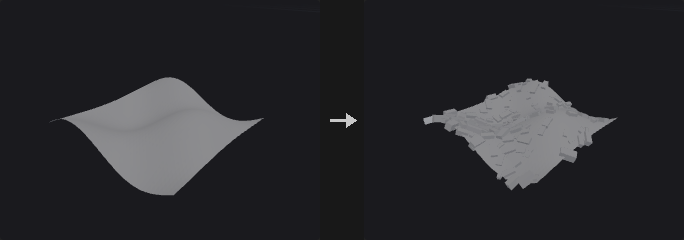

A scatter node plus the attributes that Copy to Points needs, in one step. The point count follows from *Point Count Method*: a total, a density, a coverage (the fraction of the area covered by discs of radius `pscale`, which gives `N = Coverage * area / (pi * E[pscale^2])`), or a spacing for hexagonal packing (`N = area / (sqrt(3)/2 * Spacing^2)`).

Each point gets `pscale`, a random value between the min and max radius; `N`, the surface normal (interpolated point normals when the surface has them); `up`, the Up Vector projected onto the tangent plane and rotated randomly about `N`; and `orient`, a quaternion of the same frame. By default instance +Z is aligned to `N` and +Y to `up`, the same convention as Copy to Points. *Max Random Cone Angle* tilts the normal in a random direction so that grass or rocks are not all upright.

*Remove Overlapping* pushes the points apart on the surface (using Point Relax with `pscale` times the radius scale) so that instances do not interpenetrate; normals are then recomputed at the new positions. The random numbers depend only on the seed, so the same input gives the same result.

In *Existing Points* mode nothing is scattered. The attributes are written onto the points of the second input instead. The normal comes from the nearest surface triangle of the first input (also writing `sourceprim`); without faces it comes from the point's own `N`, else +Y. Points outside the point group keep their attributes, and newly created attributes get unit-instance values (`pscale` 1, identity `orient`).

**Inputs**

| Input | Type | Description |
|---|---|---|
| `geo` | GEOMETRY | Surface to scatter on (and the normal source in Existing Points mode). |
| `points` *(optional)* | GEOMETRY | Point cloud that receives the attributes in Existing Points mode. |

**Outputs**

| Output | Type | Description |
|---|---|---|
| `geo` | GEOMETRY | The scattered points with `pscale`, `N`, `up` and `orient` (or the second input with those attributes added). |
| `report` | STRING | Text summary: point count, area, coverage and overlap statistics. |

**Parameters**

| Parameter | Type | Default | Description |
|---|---|---|---|
| Mode `scatter_mode` | menu | Scatter Points on Geometry Surface | *Surface* scatters new points. *Existing Points* only adds the attributes to the points of the second input. Options: Scatter Points on Geometry Surface (`surface`), Add Attributes to Existing Point Cloud (`existing_points`). |
| Group `group` | string | *(empty)* | Primitive group pattern restricting the surface faces. *Hidden when scatter_mode = existing_points.* |
| Point Group `point_group` | string | *(empty)* | Point group pattern selecting which points of the second input receive attributes. *Hidden when scatter_mode ≠ existing_points.* |
| Tag Name `tag_name` | string | *(empty)* | When not empty, a string point attribute `tag` is written with this value. |
| Global Seed `rand_seed` | int [0..] | 0 | Global seed. The result only depends on the seed and the input. |
| Point Count Method `mode` | menu | Number of Points | How the number of points is determined: *Total Points*, *Density* per unit area, *Coverage* of the area by discs of radius `pscale`, or *Spacing* (hexagonal packing). Options: Number of Points (`count`), By Density (`density`), By Size (Coverage) (`coverage`), By Point Spacing (`by_spacing`). *Hidden when scatter_mode = existing_points.* |
| Total Points `count` | int [0..] | 200 | Number of points to scatter. *Hidden when mode ≠ count } { scatter_mode = existing_points.* |
| Density Scale `density` | float [0.0..] | 10 | Points per unit of area. *Hidden when mode ≠ density } { scatter_mode = existing_points.* |
| Density Attribute `density_attribute` | string | `density` | Point attribute used as a density weight. *Hidden when scatter_mode = existing_points.* *Disabled when use_density_attribute is off.* |
| Use Density Attribute `use_density_attribute` | toggle | off | Weight the scattering by the density attribute. With the Density method it also determines the count; with the other methods it only affects the distribution. *Hidden when scatter_mode = existing_points.* |
| Coverage `coverage` | float [0.0..10.0] | 0.5 | Fraction of the surface area covered by discs of radius `pscale`, one per point. The point count is derived from it. *Hidden when mode ≠ coverage } { scatter_mode = existing_points.* |
| Spacing `spacing` | float [1e-06..] | 0.1 | Point spacing for hexagonal packing; the count is the area divided by `sqrt(3)/2 * Spacing^2`. *Hidden when mode ≠ by_spacing } { scatter_mode = existing_points.* |
| Min / Max Radius `scale_min` `scale_max` | float [0.0..] | 0.05, 0.1 | Minimum and maximum of `pscale`; each point gets a uniform random value in the range. Coverage mode also uses it to derive the count. |

*Orientation*

| Parameter | Type | Default | Description |
|---|---|---|---|
| Normal Direction `normal_direction` | menu | Z | Which axis of the instance is aligned with the surface normal. Z is the default of this plugin (Houdini uses Y). Options: Z (`z`), X (`x`), Y (`y`), Custom (`custom`). |
| Custom Normal Vector `normal_custom_x` `normal_custom_y` `normal_custom_z` | float | 0, 0, 1 | Instance axis that is aligned to the normal when *Normal Direction* is Custom. *Hidden when normal_direction ≠ custom.* |
| Forward Direction `forward_direction` | menu | Y | Which axis of the instance is aligned with the Up Vector projected onto the tangent plane. Options: Y (`y`), X (`x`), Z (`z`), Custom (`custom`). |
| Custom Forward Direction `forward_custom_x` `forward_custom_y` `forward_custom_z` | float | 0, 1, 0 | Instance axis aligned to the forward direction when *Forward Direction* is Custom. *Hidden when forward_direction ≠ custom.* |
| Up Vector `up_x` `up_y` `up_z` | float | 0, 1, 0 | Reference up direction. It is projected onto the tangent plane to give the `up` attribute. |
| Max Random Cone Angle `tilt` | float [0.0..90.0] | 0 | Maximum angle in degrees by which the normal is tilted in a random direction. |
| Rotation Range `rotation_range` | menu | Symmetric (± Random / 2) | *Symmetric* rotates randomly by plus or minus half the Random Rotation. *Min / Max* picks a uniform angle between Min Angle and Max Angle. Options: Symmetric (± Random / 2) (`symmetric`), Min / Max Angle (`min_max`). |
| Random Rotation Around Normal `rotate_random` | float [0.0..360.0] | 360 | Total range of the random rotation about the normal in degrees (plus or minus half of it). *Hidden when rotation_range ≠ symmetric.* |
| Min Angle `min_angle` | float [-3600.0..3600.0] | 0 | Lower end of the random rotation about the normal, in degrees. *Hidden when rotation_range ≠ min_max.* |
| Max Angle `max_angle` | float [-3600.0..3600.0] | 360 | Upper end of the random rotation about the normal, in degrees. *Hidden when rotation_range ≠ min_max.* |
| Round to Multiple Of `round_to` | float [0.0..360.0] | 90 | When above 0, the random rotation is rounded to a multiple of this angle in degrees (for example 90 for building parts). |
| Round Rotation `round_rotation` | toggle | off | Switch for rounding the random rotation. |
| Offset Angle `offset_angle` | float [-3600.0..3600.0] | 0 | Fixed extra rotation about the normal in degrees, applied after the random rotation. |

*Point Generation*

| Parameter | Type | Default | Description |
|---|---|---|---|
| Remove Overlapping `avoid_overlap` | toggle | off | Push the points apart along the surface so instances of size `pscale` do not overlap. *Hidden when scatter_mode = existing_points.* |
| Relax Iterations `relax_iterations` | int [0..1000] | 20 | Number of iterations of the overlap removal. *Hidden when scatter_mode = existing_points.* *Disabled when avoid_overlap is off.* |
| Radius Scale `overlap_scale` | float [0.0..10.0] | 1 | Multiplier applied to `pscale` when measuring overlap. *Hidden when scatter_mode = existing_points.* *Disabled when avoid_overlap is off.* |
| Emergency Limit `emergency_limit` | int [1..] | 1000000 | Maximum number of points when *Use Emergency Limit* is on. *Hidden when scatter_mode = existing_points.* |
| Use Emergency Limit `use_emergency_limit` | toggle | off | Cap the point count at the Emergency Limit. *Hidden when scatter_mode = existing_points.* |

*Attributes*

| Parameter | Type | Default | Description |
|---|---|---|---|
| Prim UVW Attribute `prim_uvw_attribute` | string | `sourceprimuv` | Name of the attribute that stores the barycentric coordinates of the point on its source triangle (like Scatter's `sourceprimuv`). *Hidden when scatter_mode = existing_points.* |
| Use Primitive Uvw `use_prim_uvw` | toggle | off | Write the primitive UVW attribute. *Hidden when scatter_mode = existing_points.* |
| Output Radius Attribute `radius_attribute` | string | `pscale` | Name under which the random radius is stored (`pscale` by default). |
| Use Radius Attribute `use_radius_attribute` | toggle | on | Write the radius attribute. |
| Output Orient Attribute `orient_attribute` | string | `orient` | Name of the orientation quaternion attribute. |
| Use Orient Attribute `use_orient_attribute` | toggle | on | Write the orientation attribute. |
| Surface Point Attributes `surface_point_attributes` | string | *(empty)* | Pattern of surface point attributes interpolated onto the new points. *Hidden when scatter_mode = existing_points.* |
| Surface Vertex Attributes `surface_vertex_attributes` | string | *(empty)* | Pattern of surface vertex attributes interpolated onto the new points. *Hidden when scatter_mode = existing_points.* |
| Surface Primitive Attributes `surface_primitive_attributes` | string | *(empty)* | Pattern of surface primitive attributes copied to the new points. *Hidden when scatter_mode = existing_points.* |
| Surface Detail Attributes `surface_detail_attributes` | string | *(empty)* | Pattern of surface detail attributes copied to the new points. *Hidden when scatter_mode = existing_points.* |

**Compared with Houdini**

Scatter Points Around Constraint Points is not implemented. The default for Normal Direction is Z instead of Houdini's Y, to keep earlier graphs unchanged. Houdini always writes the tag attribute; here it is written only when a tag name is given.

**Tips**

- Connect the result straight to Copy to Points; no further attribute work is needed.

---

### Scatter from Map (PCG)

`PCG_ScatterFromMap` · category `PCG/scatter` · Houdini: HeightField Scatter (SOP)

Scatters points on a surface with an image as the density field, using rejection sampling at each point's own UV.

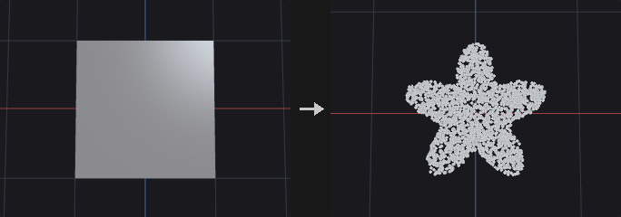

Typical use: planting grass or placing rocks from an AI-generated mask.

The obvious alternative, writing the image into a density point attribute and feeding it to Scatter, ties the density precision to the mesh resolution, because Scatter averages the attribute over the three corners of a triangle. A 2x2 grid under a 1024x1024 mask would see only 4 values. This node instead scatters more points than needed (*Oversample*), looks up the image at each point's own UV, and keeps the point with probability `density / max`. The precision is limited only by the image resolution, not by the mesh.

The cost is that the count is not exact, so the *Total Point Count* method repeats rounds with a new seed, adjusting the number of candidates with the previous acceptance rate, until enough points are accepted; surplus points are cut. The probability is normalised by the maximum of the whole image, so one isolated bright pixel lowers the acceptance everywhere and costs extra rounds. Blur the image or clamp the highlights if that happens.

The order of processing is decode, invert, floor, scatter. *Density Scale* multiplies only the written density attribute, since the count is fixed and the probability is normalised, so scaling cannot change the distribution. With *By Density* and *By Coverage*, the count is not fixed: candidates are drawn at `lambda * area * max(mask)` and thinned in one round, so the expected count is `lambda` times the integral of the mask over the area.

Optional post-processing writes `pscale` and `footprint` (Variability), `N` and `orient` (Randomize Orients), quantised positions and a `tag` attribute. Nothing is added when these options are at their defaults. The second output is the number of points.

**Inputs**

| Input | Type | Description |
|---|---|---|
| `geo` | GEOMETRY | Polygonal surface with UVs to scatter on. |
| `cop` | COPIMAGE | Image whose channel gives the density. |

**Outputs**

| Output | Type | Description |
|---|---|---|
| `points` | GEOMETRY | The scattered points, carrying the density attribute and the interpolated surface attributes. |
| `count` | INT | Number of points produced. |

**Parameters**

| Parameter | Type | Default | Description |
|---|---|---|---|
| Tag Name `tag_name` | string | *(empty)* | When not empty, a string point attribute `tag` with this value is written. |
| Group `group` | string | *(empty)* | Primitive group pattern restricting the surface faces. |
| Scatter Method `scatter_method` | menu | Total Point Count using Mask Layer | *Total Point Count* aims for an exact number of points. *Density* sets the number of points per unit area where the mask is 1. *Coverage* derives the density from the fraction of the area covered by footprint discs (Outer Radius times the point scale). Options: Total Point Count using Mask Layer (`count`), By Density using Mask Layer (`density`), By Coverage using Mask Layer (`coverage`). |
| Density Layer `layer` | string | `C` | Name of the image layer used as the density map. |
| Channel `channel` | int [0..63] | 0 | Index of the channel of the layer that is read. |
| Decode `decode` | menu | None | Colour decoding applied to the image values before use: none, sRGB to linear, or linear to sRGB. Options: None (`none`), sRGB to Linear (`srgb_to_linear`), Linear to sRGB (`linear_to_srgb`). |
| Total Point Count `count` | int [0..] | 1000 | Number of points to produce for the Total Point Count method. *Hidden when scatter_method ≠ count.* |
| Density `density` | float [0.0..] | 1 | Number of points per unit of surface area where the mask value is 1. *Hidden when scatter_method ≠ density.* |
| Coverage `coverage` | float [0.0..100.0] | 0.5 | Fraction of the (mask-weighted) area to be covered by footprint discs of radius Outer Radius times the point scale. *Hidden when scatter_method ≠ coverage.* |
| Outer Radius `outer_radius` | float [0.0..] | 1 | Radius of the disc each point occupies (times its `pscale`), stored in `footprint`. Coverage uses it to compute the count. |
| Density Scale `density_scale` | float [0.0..10000.0] | 1 | Multiplier for the written density attribute only; it does not change the distribution or the count. |
| Density Floor `density_floor` | float [0.0..1.0] | 0 | Minimum density on a 0 to 1 scale, so fully black areas of the mask still get some points. Applied after invert. |
| Invert Density `invert` | toggle | off | Use one minus the mask value as the density. |
| Seed `rand_seed` | int [0..] | 0 | Seed of the random numbers. |
| Max Points `max_points` | int [0..] | 0 | Hard upper limit for the point count. 0 means unlimited. |
| Variability Method `variability` | menu | None (No pscale) | Random per-point scale written to `pscale`. *Uniform* draws between the range limits, *Normal* draws a clamped normal around the range centre, *Exact* gives every point the same scale. Options: None (No pscale) (`none`), Uniform Distribution (`uniform`), Normal Distribution (`normal`), Exact Scale (`exact`). |
| Range `range_min` `range_max` | float [0.0..] | 0.5, 1.5 | Minimum and maximum of the random scale. *Hidden when variability = none } { variability = exact.* |
| Spread `spread` | float [0.0..] | 0.25 | Standard deviation of the normal distribution of the scale. *Hidden when variability ≠ normal.* |
| Exact Scale `exact_scale` | float [0.0..] | 1 | The scale given to every point. *Hidden when variability ≠ exact.* |
| Randomize Orients `randomize_orients` | toggle | off | Write `N` and `orient` with random rotation about the normal. |
| Match Normals with Terrain `match_normals` | toggle | on | Use the surface normal as the up axis of the orientation. When off, the up axis is +Y. *Disabled when randomize_orients is off.* |
| Randomize Up `randomize_up` | float [0.0..180.0] | 0 | Maximum angle in degrees by which the up axis is randomly tilted away from the normal. *Disabled when randomize_orients is off.* |
| Randomize Yaw `randomize_yaw` | float [0.0..180.0] | 180 | Random rotation about the up axis, plus or minus this angle in degrees. *Disabled when randomize_orients is off.* |
| Quantization `quantization` | float [0.0..] | 0 | Snap point positions to a grid of this size on all three axes. 0 means no quantization. |

*Sampling*

| Parameter | Type | Default | Description |
|---|---|---|---|
| Oversample `oversample` | float [1.0..64.0] | 4 | Factor by which the first round draws more candidates than the target count. Only for the Total Point Count method. *Disabled when scatter_method ≠ count.* |
| Max Rounds `max_rounds` | int [1..32] | 6 | Maximum number of sampling rounds before giving up on reaching the count. Only for the Total Point Count method. *Disabled when scatter_method ≠ count.* |
| Filter `filter` | menu | Bilinear | How the image is sampled: bilinear or nearest pixel. Options: Bilinear (`bilinear`), Closest (`closest`). |
| Border `border` | menu | Clamp | How UVs outside 0 to 1 are treated: clamp to the edge, wrap around, or read black. Options: Clamp (`clamp`), Wrap (`wrap`), Black (`black`). |

*UV*

| Parameter | Type | Default | Description |
|---|---|---|---|
| UV Attribute `uv_attrib` | string | `uv` | Name of the UV attribute on the surface. |
| UV Scale `uv_scale_u` `uv_scale_v` | float [-10000.0..10000.0] | 1, 1 | Scale applied to the UVs before the image lookup. |
| UV Offset `uv_offset_u` `uv_offset_v` | float [-10000.0..10000.0] | 0, 0 | Offset added to the UVs after scaling. |

| Parameter | Type | Default | Description |
|---|---|---|---|
| Output Density Attribute `out_density` | string | `density` | Name of the point attribute that receives the density value at each point (scaled by Density Scale). Empty writes nothing. |

**Compared with Houdini**

Corresponds to HeightField Scatter. Per Point Count using Source Points is not implemented. The Relax Iterations value is not used; use Point Relax downstream for blue-noise spacing.

---

### Scatter in Volume (PCG)

`PCG_ScatterVolume` · category `PCG/scatter` · Houdini: Points from Volume (SOP)

Scatters points inside a closed piece of geometry, randomly or on a jittered grid.

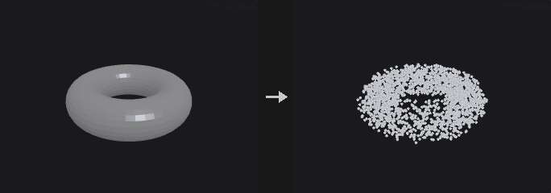

The points are in the interior, so they make solid seeds for Voronoi Fracture; surface scatter would give cells hugging the shell, resulting in shards instead of solid chunks.

*Random* scatters in the bounding box and discards points outside the geometry (rejection sampling). The distribution is truly random, so there are sparse and dense regions, and Voronoi fracturing gives uneven chunk sizes like natural breakage. *Grid* uses a jittered regular grid, giving similar chunk sizes like man-made cutting. The hit rate is volume divided by bounding box volume, which can be a few percent for a thin diagonal bar, so batches are drawn and the rate re-estimated until the count is reached.

Inside tests use ray parity and require a closed surface; an open mesh is rejected with an error (close it with PolyFill first). With *Min Distance* above 0 a Poisson-disc filter is applied using a spatial grid (linear time). No further points are added afterwards, so the final count can fall below the target.

**Inputs**

| Input | Type | Description |
|---|---|---|
| `geo` | GEOMETRY | Closed polygonal geometry that defines the volume. |

**Outputs**

| Output | Type | Description |
|---|---|---|
| `points` | GEOMETRY | Points inside the volume. |

**Parameters**

| Parameter | Type | Default | Description |
|---|---|---|---|
| Group `group` | string | *(empty)* | Primitive group pattern selecting the faces that form the volume. |
| Method `mode` | menu | Random | *Random* draws random points inside. *Grid* uses a jittered regular lattice; Count has no effect there. Options: Random (`random`), Jittered Grid (`grid`). |
| Count `count` | int [0..] | 100 | Number of points to scatter in Random mode. *Hidden when mode ≠ random.* |
| Spacing `spacing` | float [1e-06..] | 0.1 | Grid cell size in Grid mode. A spacing that would create too many cells is rejected with an error. *Hidden when mode ≠ grid.* |
| Jitter Scale `jitter` | float [0.0..1.0] | 1 | How far each grid point may be displaced inside its cell, from 0 (regular grid) to 1 (anywhere in the cell). *Hidden when mode ≠ grid.* |
| Min Distance `min_distance` | float [0.0..] | 0 | When above 0, points closer together than this are removed (Poisson-disc filtering). No points are added back afterwards. |
| Seed `rand_seed` | int [0..] | 0 | Seed of the random numbers. |
| Inside Test Rays `ray_directions` | int [1..3] | 3 | Number of oblique rays that vote on whether a point is inside. 3 is the most robust against rays that graze edges. |

**Compared with Houdini**

Corresponds to Scatter combined with a volume (Points from Volume).

---

### Unpack (PCG)

`PCG_Unpack` · category `PCG/scatter` · Houdini: Unpack (SOP)

Expands packed primitives back into real geometry.

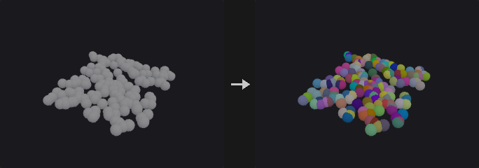

Replaces packed primitives with the geometry they carry, transformed to where they are; other primitives pass through. Copies made by Copy to Points with *Pack and Instance* unpack to exactly what Copy to Points gives without packing, attributes included.

*Transfer Attributes* copies attributes of the packed points and primitives (such as a colour set after packing) onto the unpacked pieces.

**Inputs**

| Input | Type | Description |
|---|---|---|
| `geo` | GEOMETRY | Geometry with packed primitives. |

**Outputs**

| Output | Type | Description |
|---|---|---|
| `geo` | GEOMETRY | The unpacked geometry. |
| `report` | STRING | Packed primitives unpacked and distinct pieces. |

**Parameters**

| Parameter | Type | Default | Description |
|---|---|---|---|
| Group `group` | string | *(empty)* | Packed primitives to unpack. |
| Transfer Attributes `transfer_attributes` | string | *(empty)* | Attributes of the packed points / primitives copied onto the unpacked points / primitives (patterns allowed). |

---

### Voronoi 2D (PCG)

`PCG_Voronoi2D` · category `PCG/scatter`

Builds a planar Voronoi diagram from points and outputs either cell polygons or their boundary lines.

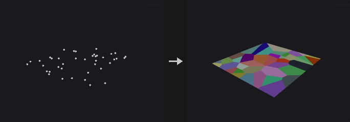

The dual of a Delaunay triangulation: scatter points in, get city-block-like cells out. It is the 2D partitioning counterpart of the 3D Voronoi Fracture node, which cuts solids into chunks. A typical road-network chain is Scatter, Voronoi 2D (edges), PolyPath, PolyExpand2D for the road width; what remains in between are the blocks.

Each site's cell is the boundary region clipped by the perpendicular bisector between the site and each of its Delaunay neighbours. Because the cell is always bounded, sites on the convex hull and inside use the same code path, and no unbounded cells need special handling. For this reason the boundary region must be convex: with *Polygon* the convexity is checked and an error is raised if it fails. For a concave outline, compute with a bounding box and then cut with Boolean or Clip.

The output points are new points (Voronoi vertices) with no relation to the sites, so point attributes are not carried down. Each cell gets a primitive attribute (default `site`) with the site's point number. Vertices shared between neighbouring cells are welded, so the lines can be joined into a network.

**Inputs**

| Input | Type | Description |
|---|---|---|
| `geo` | GEOMETRY | Site points. |
| `bounds_geo` *(optional)* | GEOMETRY | Convex closed polygon used as the boundary when *Boundary* is set to Polygon. |

**Outputs**

| Output | Type | Description |
|---|---|---|
| `geo` | GEOMETRY | Cell polygons, or the de-duplicated cell edges as two-point lines. |

**Parameters**

| Parameter | Type | Default | Description |
|---|---|---|---|
| Site Group `group` | string | *(empty)* | Point group pattern selecting the sites. |
| Plane `plane` | menu | Fit Plane | Plane the points are projected onto for the 2D computation. *Fit Plane* is determined from the points; *XY*, *ZX* and *YZ* are axis planes; *Specify Plane* uses the origin and normal below. Options: Fit Plane (`fit_plane`), XY Plane (`xy`), ZX Plane (`zx`), YZ Plane (`yz`), Specify Plane (`specify_plane`). |
| Output `output` | menu | Cells (Polygons) | *Cells* gives one closed polygon per site. *Edges* gives the unique cell boundary segments, each a two-point line, which suits road networks. Options: Cells (Polygons) (`cells`), Edges (Lines) (`edges`). |
| Boundary `boundary` | menu | Bounding Box | *Bounds* uses the bounding box of the sites plus padding. *Polygon* uses the first closed polygon of the second input, which must be convex. Options: Bounding Box (`bounds`), Second Input Polygon (`polygon`). |
| Padding `padding` | float [0.0..] | 0 | Extra margin around the site bounding box, for Bounds boundary. *Hidden when boundary ≠ bounds.* |

*Plane*

| Parameter | Type | Default | Description |
|---|---|---|---|
| Plane Origin `plane_origin_x` `plane_origin_y` `plane_origin_z` | float | 0, 0, 0 | A point on the plane. Not used for Fit Plane. *Hidden when plane = fit_plane.* |
| Plane Normal `plane_normal_x` `plane_normal_y` `plane_normal_z` | float | 0, 1, 0 | Normal of the plane for Specify Plane. *Hidden when plane ≠ specify_plane.* |
| Plane Offset `plane_distance` | float | 0 | Additional offset of the plane along its normal. |

*Local Attributes*

| Parameter | Type | Default | Description |
|---|---|---|---|
| Site Attribute `site_attribute` | string | `site` | Name of the primitive attribute that stores the site's point number on each cell. *Hidden when output ≠ cells.* |
| Interior Edge Group `interior_group` | string | `interior` | Name of the primitive group that marks the edges shared by two cells, as opposed to edges on the boundary. *Hidden when output ≠ edges.* |

*Advanced*

| Parameter | Type | Default | Description |
|---|---|---|---|
| Fuse Tolerance `fuse_tolerance` | float [0.0..1000.0] | 1e-06 | Sites closer than this are merged, since two coincident sites would produce degenerate bisectors and empty cells. |
| Hull Tolerance `hull_tolerance` | float [0.0..0.001] | 1e-12 | Tolerance of the convex-hull step in the Delaunay computation. Very small values are needed so almost-cocircular points are not dropped. |
| On Failure `on_failure` | menu | Fail with Error | What to do when no cell can be produced (for example all sites lie outside the boundary polygon). *Fail with Error* raises an error; the other two options return the input geometry unchanged. Options: Fail with Error (`fail_with_error`), Warn and Keep Input (`warn_and_keep_input`), Output Nothing (`output_nothing`). |

---
