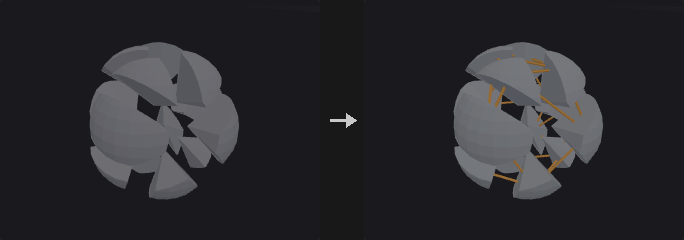
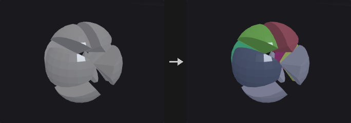
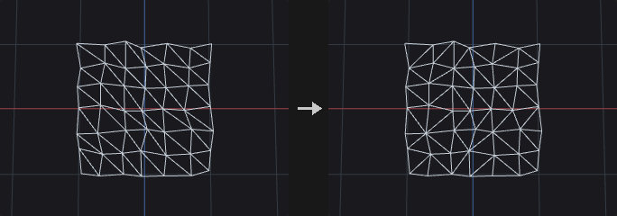
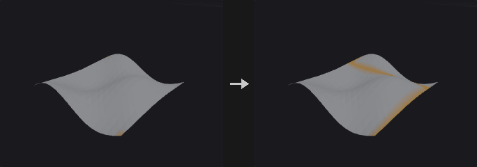
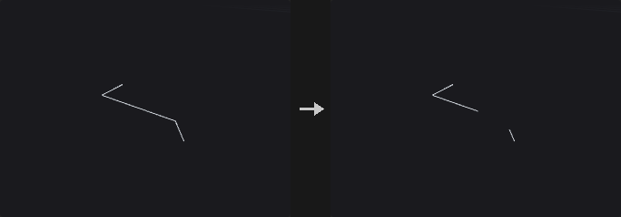
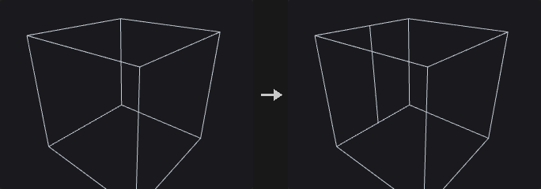
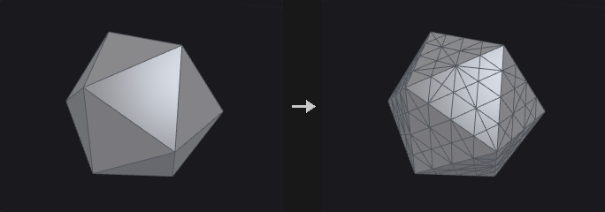
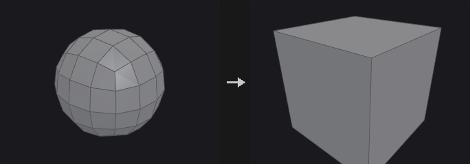

# Topology

Connectivity, edges, paths and other structural queries and edits.

12 nodes.

[Back to the reference index](README.md)

## Contents

- [Connect Adjacent Pieces (PCG)](#pcg-connectadjacentpieces) — Connects nearby points or pieces with two-point polylines, for constraint or road-network skeletons.
- [Connectivity (PCG)](#pcg-connectivity) — Numbers the connected components of the geometry and writes the number to an integer attribute.
- [Edge Cusp (PCG)](#pcg-edgecusp) — Splits geometry along edges so the faces on either side no longer share points, optionally filtered by dihedral angle.
- [Edge Flip (PCG)](#pcg-edgeflip) — Flips edges shared by two faces, either by rotating them or by Delaunay-style flipping of triangle pairs.
- [Find Shortest Path (PCG)](#pcg-findshortestpath) — Finds least-cost paths along the edges of a mesh or curve network using Dijkstra's algorithm.
- [Match Topology (PCG)](#pcg-matchtopology) — Renumbers a mesh so that its point, primitive and corner order matches a reference mesh.
- [PolyCut (PCG)](#pcg-polycut) — Cuts polygons and polylines along their edges into open polylines, by point group, point attribute threshold, or edge rules.
- [PolySplit (PCG)](#pcg-polysplit) — Splits polygons along a path of points and edge positions.
- [PolyStitch (PCG)](#pcg-polystitch) — Welds and stitches the seams between patches of different resolution so both sides share the same points.
- [Rewire Vertices (PCG)](#pcg-rewirevertices) — Reconnects vertices to different points according to an integer attribute.
- [Tri Divide (PCG)](#pcg-tridivide) — Triangulates the selected faces and subdivides them until edges and areas are below limits, without creating T-points.
- [Unsubdivide (PCG)](#pcg-unsubdivide) — Reverses Catmull-Clark subdivision by a given number of levels.

## Nodes

### Connect Adjacent Pieces (PCG)

`PCG_ConnectAdjacentPieces` · category `PCG/topology` · Houdini: Connect Adjacent Pieces (SOP)

Connects nearby points or pieces with two-point polylines, for constraint or road-network skeletons.

Builds line primitives between neighbouring things. In *points* mode each point is linked to its nearest points within the search radius, up to `Max Connections`. In *piece_centroids* mode two pieces are linked between their centres when any pair of their points is within the radius. In *piece_points* mode the line joins the closest pair of points of the two pieces.

Each new line carries a `restlength` attribute and the piece numbers or point numbers of its two ends. Pieces are defined by the piece attribute; if that attribute cannot be found, pieces are the connected components of the geometry.

**Inputs**

| Input | Type | Description |
|---|---|---|
| `geo` | GEOMETRY | Geometry whose points or pieces are to be connected. |

**Outputs**

| Output | Type | Description |
|---|---|---|
| `geo` | GEOMETRY | The connecting lines (plus the input when *Keep Input Geometry* is on in points mode). |
| `report` | STRING | Text summary of how many connections were made. |

**Parameters**

| Parameter | Type | Default | Description |
|---|---|---|---|
| Group `group` | string | *(empty)* | Group pattern restricting which points are used. |
| Connection Type `mode` | menu | Adjacent Points | *Points* links individual points, *Piece Centroids* links pieces centre to centre, *Piece Points* links the closest point pair of two pieces. Options: Adjacent Points (`points`), Adjacent Pieces (Centroids) (`piece_centroids`), Adjacent Pieces (Closest Points) (`piece_points`). |
| Piece Attribute `piece_attribute` | string | `name` | Primitive attribute that identifies the pieces. If it does not exist, pieces are taken from connectivity. *Hidden when mode = points.* |
| Search Radius `radius` | float [1e-09..] | 0.1 | Maximum distance for a connection to be made. |
| Max Connections `max_connections` | int [1..1000] | 4 | Maximum number of connections created per point. |
| Keep Input Geometry `keep_input` | toggle | off | Keep the input geometry in the output next to the new lines. *Hidden when mode ≠ points.* |

---

### Connectivity (PCG)

`PCG_Connectivity` · category `PCG/topology` · Houdini: Connectivity (SOP)

Numbers the connected components of the geometry and writes the number to an integer attribute.

Computes connected components and writes an integer component index to the chosen attribute, on points or on primitives. Elements that belong to the same connected piece share the same number.

**Inputs**

| Input | Type | Description |
|---|---|---|
| `geo` | GEOMETRY | Geometry to analyse. |

**Outputs**

| Output | Type | Description |
|---|---|---|
| `geo` | GEOMETRY | Input geometry with the component attribute added. |

**Parameters**

| Parameter | Type | Default | Description |
|---|---|---|---|
| Connectivity Type `cls` | menu | Point | Attribute class that receives the component number: points or primitives. Options: Point (`point`), Primitive (`prim`). |
| Attribute `attribute` | string | `class` | Name of the integer attribute that stores the component number. |

**Compared with Houdini**

Corresponds to the Connectivity SOP. The Assemble SOP is only partly covered.

---

### Edge Cusp (PCG)

`PCG_EdgeCusp` · category `PCG/topology` · Houdini: Edge Cusp (SOP)

Splits geometry along edges so the faces on either side no longer share points, optionally filtered by dihedral angle.

Cuts along the edges of the edge group (all edges if empty), so the faces on both sides stop sharing endpoints. When `Cusp Angle` is above 0, only edges whose dihedral angle is at least that value are cut. Points that touch no cut edge are left alone.

With *Compute Normals* the node writes area-weighted point normals, which produce hard edges at the cuts.

**Inputs**

| Input | Type | Description |
|---|---|---|
| `geo` | GEOMETRY | Polygonal geometry to cusp. |

**Outputs**

| Output | Type | Description |
|---|---|---|
| `geo` | GEOMETRY | Geometry with the selected edges split. |
| `report` | STRING | Text summary of the operation. |

**Parameters**

| Parameter | Type | Default | Description |
|---|---|---|---|
| Group `edges` | string | *(empty)* | Edge group pattern. Empty means all edges. |
| Cusp Angle `min_angle` | float [0.0..180.0] | 0 | Only edges with a dihedral angle at least this large (in degrees) are cut. 0 cuts every selected edge. |
| Compute Normals `compute_normals` | toggle | on | Write area-weighted point normals; the cut edges become hard edges. |

---

### Edge Flip (PCG)

`PCG_EdgeFlip` · category `PCG/topology` · Houdini: Edge Flip (SOP)

Flips edges shared by two faces, either by rotating them or by Delaunay-style flipping of triangle pairs.

In *rotate* mode the two faces sharing an edge are merged into one loop and the edge is rotated along that loop by `Cycles` steps. For two triangles this flips the diagonal; for two quads it rotates the edge. The number of sides of each face does not change.

In *delaunay* mode only triangle pairs are flipped, and only when the sum of the two opposite angles exceeds 180 degrees. Flipping repeats until no more flips are possible, and edges whose dihedral angle exceeds `Max Dihedral Angle` are not flipped.

An empty edge group means all edges. Flipped edges are replaced by the new edges in the edge group of the same name.

**Inputs**

| Input | Type | Description |
|---|---|---|
| `geo` | GEOMETRY | Polygonal geometry to modify. |

**Outputs**

| Output | Type | Description |
|---|---|---|
| `geo` | GEOMETRY | Geometry with the edges flipped. |
| `report` | STRING | Text summary of the operation. |

**Parameters**

| Parameter | Type | Default | Description |
|---|---|---|---|
| Group `edges` | string | *(empty)* | Edge group pattern. Empty means all edges. |
| Mode `mode` | menu | Rotate Edges | *Rotate* turns edges by a fixed number of steps; *Delaunay* flips triangle pairs until the triangulation is Delaunay. Options: Rotate Edges (`rotate`), Delaunay (`delaunay`). |
| Cycles `cycles` | int [-64..64] | 1 | How many steps each edge is rotated around its two-face loop. Negative values rotate the other way. *Hidden when mode ≠ rotate.* |
| Max Dihedral Angle `max_angle` | float [0.0..180.0] | 10 | Edges with a dihedral angle above this value (in degrees) are left unflipped. *Hidden when mode ≠ delaunay.* |

---

### Find Shortest Path (PCG)

`PCG_FindShortestPath` · category `PCG/topology` · Houdini: Find Shortest Path (SOP)

Finds least-cost paths along the edges of a mesh or curve network using Dijkstra's algorithm.

The cost of an edge is its length (or 1 per step), multiplied by `1 + Cost Weight * cost` and by `1 + Slope Weight * |slope|`. On terrain, the slope weight makes roads follow contour lines, and a cost attribute steers them around water or forest. The cost attribute is averaged over the two points of an edge. The slope is the absolute cosine between the edge direction and the up vector. Houdini-style additive costs (point and primitive cost attributes), surface constraints and directed primitives are applied on top of that.

The output paths mode decides which paths are built; see the *Output Paths* menu. Paths that cannot be reached (disconnected parts, or above the max cost) are skipped and counted in the report.

*Output* chooses what is produced. *Paths* outputs only the path polylines (point copies carrying `srcpt`, and primitive attributes `cost`, `length`, `startpt`, `endpt`). *Merge* outputs the source geometry together with the paths. *Group* outputs no new geometry and writes an edge group and a point group of the same name onto the source.

**Inputs**

| Input | Type | Description |
|---|---|---|
| `geo` | GEOMETRY | Mesh or curve network; the search follows its edges. |

**Outputs**

| Output | Type | Description |
|---|---|---|
| `geo` | GEOMETRY | The paths, the source plus the paths, or the source with a path group, depending on `Output`. |
| `report` | STRING | Text summary: number of paths, number unreachable and total cost. |

**Parameters**

| Parameter | Type | Default | Description |
|---|---|---|---|
| Start Points `start_group` | string | *(empty)* | Point group, or point numbers written in order (`12 40 7`). Sequence and Corresponding modes use that order. |
| End Points `end_group` | string | *(empty)* | Point group or point numbers of the destinations. Not used in Sequence mode. *Hidden when mode = sequence.* |
| Output Paths `mode` | menu | From Each Start to Any End | *Nearest End*: each start goes to its cheapest end. *Each Pair*: one path for every start/end combination. *Sequence*: the start points are chained in the order written. *Any to Any*: only the single cheapest path of all. *Any Start to Each End*: one path per end, coming from the cheapest start. *Corresponding*: starts and ends are paired in order (equal counts required). Options: From Each Start to Any End (`nearest_end`), From Each Start to Each End (`each_pair`), Through Start Points in Order (PCG) (`sequence`), From Any Start to Any End (`any_to_any`), From Any Start to Each End (`any_start_to_each_end`), From Each Start to Corresponding End (`corresponding`). |
| Close Sequence `close_sequence` | toggle | off | In Sequence mode, also connect the last point back to the first (needs more than two points). *Hidden when mode ≠ sequence.* |

*Cost*

| Parameter | Type | Default | Description |
|---|---|---|---|
| Use Edge Length `use_length` | toggle | on | Use the edge length as base cost. When off, every edge costs 1 (counting steps). *Disabled when omit_distance is on.* |
| Omit Distance from Cost `omit_distance` | toggle | off | Drop the length / step part of the cost entirely, so only the point and primitive cost attributes remain. |
| Cost Attribute (PCG, Multiplier) `cost_attribute` | string | *(empty)* | Optional point attribute used as a multiplier: the edge cost is multiplied by `1 + Cost Weight * average cost` of the edge's two points. |
| Cost Weight `cost_weight` | float | 1 | Weight of the cost attribute in the multiplier. *Disabled when cost_attribute = "".* |
| Slope Weight (PCG) `slope_weight` | float [0.0..] | 0 | How strongly steep edges are penalised. 0 ignores slope. |
| Up Vector `up_x` `up_y` `up_z` | float [-1..1] | 0, 1, 0 | Up direction used to measure the slope. *Disabled when slope_weight = 0.* |
| Max Search Path Cost `max_cost` | float [0.0..] | 100 | Paths costing more than this are treated as unreachable. Only used when *Use Max Cost* is on. |
| Use Max Cost `use_max_cost` | toggle | off | Enable the *Max Search Path Cost* limit. |
| Point Cost Attribute `point_cost_attribute` | string | *(empty)* | Numeric point attribute added to the cost whenever a path steps into that point. The start point itself is not charged. |
| Primitive Cost Attribute `prim_cost_attribute` | string | *(empty)* | Numeric primitive attribute added to the cost of the edges of that primitive. If several primitives share an edge, the lowest numbered one is used. |

*Surface Constraints*

| Parameter | Type | Default | Description |
|---|---|---|---|
| Surface Primitives `surface_prims` | string | *(empty)* | Primitive group pattern. When given, paths may only travel along the edges of these primitives. |
| Directed Primitives `directed_prims` | string | *(empty)* | Primitive group pattern. An edge that exists only in these primitives can only be walked in the primitive's direction; an edge that also belongs to another primitive is usable both ways. |
| Edges to Avoid `edges_to_avoid` | string | *(empty)* | Names of edge groups whose edges the paths may not use. |

*Output*

| Parameter | Type | Default | Description |
|---|---|---|---|
| Output `output` | menu | Paths Only | *Paths* only outputs the path lines, *Merge* adds them to the source geometry, *Group* writes an edge group and point group on the source geometry. Options: Paths Only (`paths`), Merge with Input (`merge`), Groups on Input (`group`). |
| Path Group `group_name` | string | `path` | Name of the edge group and the point group of the same name that receive the paths. *Hidden when output ≠ group.* |

**Tips**

- Costs must be positive; a negative cost attribute or weight is rejected with an error.
- For roads over terrain, combine a small Slope Weight with a cost attribute that is high on water.

---

### Match Topology (PCG)

`PCG_MatchTopology` · category `PCG/topology` · Houdini: Match Topology (SOP)

Renumbers a mesh so that its point, primitive and corner order matches a reference mesh.

Use it when `geo` and `reference` are the same mesh but their point numbers, primitive numbers or starting corners have been scrambled. *Topology* mode starts from a pair of seed corners and walks both meshes in step across opposite edges. It ignores positions, so it works however much the mesh has been deformed. Seeds left at -1 are found automatically. *Position* mode matches by nearest point instead.

The output is `geo` renumbered to follow `reference`.

**Inputs**

| Input | Type | Description |
|---|---|---|
| `geo` | GEOMETRY | Mesh to renumber. |
| `reference` | GEOMETRY | Mesh whose numbering is to be reproduced. |

**Outputs**

| Output | Type | Description |
|---|---|---|
| `geo` | GEOMETRY | The input mesh renumbered to match the reference. |
| `report` | STRING | Text summary of the matching. |

**Parameters**

| Parameter | Type | Default | Description |
|---|---|---|---|
| Method `mode` | menu | Topology | *Topology* walks both meshes from seed corners and ignores positions. *Position* pairs points by nearest distance. Options: Topology (`topology`), Nearest Position (`position`). |
| Reference Primitive `ref_prim` | int [-1..] | -1 | Seed primitive on the reference. -1 finds the seed automatically. *Hidden when mode ≠ topology.* |
| Reference Point `ref_point` | int [-1..] | -1 | Seed point on the reference primitive, selecting the starting corner. Only used when both seed primitives are set. *Hidden when mode ≠ topology.* *Disabled when ref_prim < 0 } { geo_prim < 0.* |
| Input Primitive `geo_prim` | int [-1..] | -1 | Seed primitive on the input mesh that corresponds to the reference seed primitive. -1 finds the seed automatically. *Hidden when mode ≠ topology.* |
| Input Point `geo_point` | int [-1..] | -1 | Seed point on the input primitive that corresponds to the reference seed point. Only used when both seed primitives are set. *Hidden when mode ≠ topology.* *Disabled when ref_prim < 0 } { geo_prim < 0.* |
| Distance Tolerance `tolerance` | float [0.0..] | 0.0001 | Maximum distance for two points to be matched in Position mode. *Hidden when mode ≠ position.* |

---

### PolyCut (PCG)

`PCG_PolyCut` · category `PCG/topology` · Houdini: PolyCut (SOP)

Cuts polygons and polylines along their edges into open polylines, by point group, point attribute threshold, or edge rules.

Faces and polylines are turned into polylines by cutting along edges. Three strategies are specific to this plugin: *Cut Points* breaks the polylines at the points of the point group, *Keep Points* only keeps edges whose two ends are both in the point group, and *Threshold* inserts a point where a point attribute crosses the threshold (shared by neighbouring faces). *Keep* selects all (only break), above or below. A closed face that is not cut is kept unchanged.

*Remove* and *Cut* are the semantics of Houdini's PolyCut. They look for edges that fail the test, which can be edges whose attribute crosses *Cut Value* or changes by more than *Cut Threshold* (with an empty attribute, all edges fail). With *Type* set to points, the failing points' ends are deleted or the line is broken there. With *Type* set to edges, the failing edge is deleted or broken in its middle. In these two strategies *Cut Points* is Houdini's Cut Points (empty means all points) and *Cut Value* is the cut value; *Keep* is not used.

**Inputs**

| Input | Type | Description |
|---|---|---|
| `geo` | GEOMETRY | Polygons or polylines to cut. |

**Outputs**

| Output | Type | Description |
|---|---|---|
| `geo` | GEOMETRY | Polylines resulting from the cut. |
| `report` | STRING | Text summary of the operation. |

**Parameters**

| Parameter | Type | Default | Description |
|---|---|---|---|
| Polygon Group `group` | string | *(empty)* | Primitive group pattern of the polygons that are processed. |
| Strategy `mode` | menu | Cut at Points | *Remove* and *Cut* follow Houdini's PolyCut; *Cut Points*, *Keep Points* and *Threshold* are extensions of this plugin. Options: Cut at Points (`cut_points`), Keep Edges Between Points (`keep_points`), Attribute Threshold (`threshold`), Remove (`remove`), Cut (`cut`). |
| Type `cut_type` | menu | Points | For Remove and Cut: whether the cut acts on points (the two end points of failing edges) or on the edges themselves. Options: Points (`points`), Edges (`edges`). *Hidden when mode ≠ remove mode ≠ cut.* |
| Cut Points `points` | string | *(empty)* | Point group pattern. In Cut Points / Keep Points mode it is the point selection. In Remove and Cut mode it limits which points may be removed or broken; empty means all. *Hidden when mode = threshold } { mode = remove cut_type = edges } { mode = cut cut_type = edges.* |
| Cut Edges `cut_edges` | string | *(empty)* | Edge group pattern limiting which edges may be removed or cut. Empty means all. *Hidden when mode ≠ remove mode ≠ cut } { cut_type ≠ edges.* |
| Detect Edge Changes `detect` | menu | Cut At Attribute Crossing | How failing edges are detected: *Crossing* when the attribute crosses the cut value along the edge, *Change* when it differs by more than the cut threshold between the two ends. Options: Cut At Attribute Crossing (`crossing`), Cut At Attribute Change (`change`). *Hidden when mode ≠ remove mode ≠ cut.* |
| Cut Attribute `attribute` | string | *(empty)* | Point attribute that is tested. In Remove and Cut mode an empty attribute makes every edge fail. *Hidden when mode = cut_points } { mode = keep_points.* |
| Cut Value `threshold` | float | 0.5 | Value the attribute is compared against (the cut value). *Hidden when mode = cut_points } { mode = keep_points } { mode = remove detect = change } { mode = cut detect = change.* |
| Cut Threshold `cut_threshold` | float [0.0..] | 0.1 | Largest allowed attribute difference between the two points of an edge (the distance for vector attributes). *Hidden when mode ≠ remove mode ≠ cut } { detect ≠ change.* |
| Keep `keep` | menu | All (Cut Only) | In Threshold mode: *All* only breaks the geometry at the crossings, *Above* and *Below* keep only the part above or below the threshold. Options: All (Cut Only) (`all`), Above Threshold (`above`), Below Threshold (`below`). *Hidden when mode ≠ threshold.* |
| Keep Polygons Closed `keep_closed` | toggle | off | In Remove and Cut mode: a closed polygon whose result is still one loop stays closed instead of becoming an open polyline. *Hidden when mode ≠ remove mode ≠ cut.* |

---

### PolySplit (PCG)

`PCG_PolySplit` · category `PCG/topology` · Houdini: PolySplit (SOP)

Splits polygons along a path of points and edge positions.

Locations are separated by spaces. `12` (or `p12`) is a point, `3-7@0.25` is the position t = 0.25 on the edge from point 3 to point 7, and omitting `@` means the midpoint. Houdini's notation (`p3-7:0.25`, `0v2`, `0e1:0.25`) is accepted too; the in-face form `0f:u,v` is not supported.

Two consecutive locations must lie on the same face, and that face is cut in two along the line between them. New points on edges are inserted into all faces on both sides, so no T-junctions are left. *Close Path* connects the last location back to the first. If an output edge group is named, the cut edges are written to it.

The *Edge Loop* path type inserts a ring of edges through quad loops starting from each edge location; with more than one loop the rings are spaced evenly.

**Inputs**

| Input | Type | Description |
|---|---|---|
| `geo` | GEOMETRY | Polygonal geometry to split. |

**Outputs**

| Output | Type | Description |
|---|---|---|
| `geo` | GEOMETRY | Geometry with the faces split. |
| `report` | STRING | Text summary of the operation. |

**Parameters**

| Parameter | Type | Default | Description |
|---|---|---|---|
| Split Locations `locations` | string | `0-1@0.5 2-3@0.5` | Space-separated split locations: `12` is a point, `3-7@0.25` is a position on an edge (midpoint when `@` is omitted). Houdini's `p3-7:0.25`, `0v2` and `0e1:0.25` forms are accepted too. |
| Path Type `path_type` | menu | Shortest Path | *Shortest Path* only cuts between consecutive locations that share a face; no path is searched. *Edge Loop* inserts edge loops through quad strips from each edge location. Options: Shortest Path (`shortest_path`), Edge Loop (`edge_loop`). |
| Close Path `close_path` | toggle | off | Connect the last location back to the first. *Hidden when path_type = edge_loop.* |
| Number of Loops `num_loops` | int [1..1024] | 1 | Number of edge loops inserted, spaced evenly. Only for Edge Loop. *Hidden when path_type ≠ edge_loop.* |
| Edge Percentage `edge_percentage` | float [0.0..1.0] | 0.5 | Position along the edge used for all edge locations when *Use Edge Percentage* is on. Unavailable when Edge Loop inserts several loops. *Disabled when path_type = edge_loop num_loops > 1.* |
| Use Edge Percentage `use_edge_percentage` | toggle | off | Place every edge location at the same *Edge Percentage* instead of the individual t values. |
| Output Edge Group `edge_group` | string | *(empty)* | Name of the edge group that receives the new cut edges. Empty writes none. |

**Compared with Houdini**

The Shortest Path option is named to match Houdini, but no path is searched: consecutive locations still have to lie on the same face.

---

### PolyStitch (PCG)

`PCG_PolyStitch` · category `PCG/topology` · Houdini: PolyStitch (SOP)

Welds and stitches the seams between patches of different resolution so both sides share the same points.

Boundary points closer than the tolerance are welded. With snapping on, the remaining boundary points are snapped onto the boundary edges of other patches, and points that land on an edge are inserted into the face that owns that edge. T-junctions at the seam disappear and both sides use the same sequence of points. The report includes the number of boundary edges that remain.

**Inputs**

| Input | Type | Description |
|---|---|---|
| `geo` | GEOMETRY | Polygonal patches to stitch together. |

**Outputs**

| Output | Type | Description |
|---|---|---|
| `geo` | GEOMETRY | Stitched geometry. |
| `report` | STRING | Text summary including the number of remaining boundary edges. |

**Parameters**

| Parameter | Type | Default | Description |
|---|---|---|---|
| Group `group` | string | *(empty)* | Primitive group pattern restricting which primitives are stitched. |
| Tolerance `tolerance` | float [0.0..] | 0.001 | Maximum distance for welding and for snapping onto edges. |
| Snap to Boundary Edges `snap` | toggle | on | Snap the remaining boundary points onto other patches' boundary edges and insert them into those edges. |

---

### Rewire Vertices (PCG)

`PCG_RewireVertices` · category `PCG/topology` · Houdini: Rewire Vertices (SOP)

Reconnects vertices to different points according to an integer attribute.

An integer attribute gives, for each vertex, the point number that the vertex should reference. A vertex attribute is preferred; if there is none, the point attribute of the same name is used. Values of -1 or out of range leave the vertex unchanged.

Optionally consecutive duplicate corners and primitives that can no longer stand as a face are removed, and points that nobody uses can be deleted.

**Inputs**

| Input | Type | Description |
|---|---|---|
| `geo` | GEOMETRY | Geometry whose vertices are to be rewired. |

**Outputs**

| Output | Type | Description |
|---|---|---|
| `geo` | GEOMETRY | Rewired geometry. |
| `report` | STRING | Text summary of the operation. |

**Parameters**

| Parameter | Type | Default | Description |
|---|---|---|---|
| Point Number Attribute `attribute` | string | `rewire_to` | Integer attribute with the target point number per vertex. A vertex attribute is preferred, otherwise a point attribute is used. -1 or out-of-range values leave the vertex untouched. |
| Keep Unused Points `keep_unused_points` | toggle | on | Keep points that are no longer referenced by any vertex. When off they are deleted. |
| Remove Degenerate Primitives `remove_degenerate` | toggle | off | Remove consecutive duplicate corners and primitives that no longer have enough points to form a face. |

---

### Tri Divide (PCG)

`PCG_TriDivide` · category `PCG/topology` · Houdini: Tri Divide (SOP)

Triangulates the selected faces and subdivides them until edges and areas are below limits, without creating T-points.

Selected faces are triangulated and then bisected along their longest edge (longest-edge propagation) until each edge is no longer than *Max Edge Length* and each area no larger than *Max Area*. A value of 0 disables that limit. Both triangles sharing the split edge are bisected together, so there are no T-points, the shape stays the same and the smallest angle does not keep getting worse. Neighbouring faces that are not selected only receive a midpoint on the shared edge.

With *Restore Delaunay* on, a final Lawson edge-flip pass is done. Only edges whose dihedral angle is at most the flip angle are flipped.

**Inputs**

| Input | Type | Description |
|---|---|---|
| `geo` | GEOMETRY | Polygonal geometry to subdivide. |

**Outputs**

| Output | Type | Description |
|---|---|---|
| `geo` | GEOMETRY | Subdivided geometry. |
| `report` | STRING | Text summary of the operation. |

**Parameters**

| Parameter | Type | Default | Description |
|---|---|---|---|
| Group `group` | string | *(empty)* | Primitive group pattern selecting the faces to subdivide. |
| Max Edge Length `max_edge_length` | float [0.0..] | 0 | Longest allowed edge. 0 means no limit. |
| Max Area `max_area` | float [0.0..] | 0 | Largest allowed triangle area. 0 means no limit. |
| Restore Delaunay `delaunay` | toggle | on | Finish with Lawson edge flips to restore the Delaunay property. |
| Max Flip Dihedral Angle `flip_angle` | float [0.0..180.0] | 1 | Edges are only flipped when their dihedral angle is at most this value in degrees, so curved surfaces keep their shape. *Disabled when delaunay is off.* |

---

### Unsubdivide (PCG)

`PCG_Unsubdivide` · category `PCG/topology` · Houdini: Unsubdivide (SOP)

Reverses Catmull-Clark subdivision by a given number of levels.

Recognises the original vertices, edge points and face points that Catmull-Clark subdivision leaves behind, and rewinds the topology by `Levels` levels. With *Fit* positions are recovered by inverting the subdivision stencil in the least-squares sense, so a mesh that really came from subdivision is restored exactly. With *Keep*, the subdivided positions of the original vertices are simply kept, as Houdini does, which makes the shape shrink a little.

**Inputs**

| Input | Type | Description |
|---|---|---|
| `geo` | GEOMETRY | Subdivided polygonal mesh. |

**Outputs**

| Output | Type | Description |
|---|---|---|
| `geo` | GEOMETRY | Mesh with the topology rewound. |
| `report` | STRING | Text summary of the operation. |

**Parameters**

| Parameter | Type | Default | Description |
|---|---|---|---|
| Levels `levels` | int [1..6] | 1 | Number of subdivision levels to undo. |
| Positions `positions` | menu | Fit (Least Squares) | *Fit* solves for the original positions by least squares; *Keep* keeps the current positions of the surviving vertices. Options: Fit (Least Squares) (`fit`), Keep Original Vertices (`keep`). |
| Vertex Boundary Interpolation `boundary` | menu | Edges and Corners | Boundary interpolation rule that was used when the mesh was subdivided. It has to match for Fit to reproduce the original. Options: Edges and Corners (`edge_corner`), Edges Only (`edge_only`), None (`smooth`). *Hidden when positions ≠ fit.* |

**Compared with Houdini**

The Keep option is Houdini's behaviour; Fit is an addition that reconstructs the original positions exactly when the mesh came from Catmull-Clark subdivision.

---
