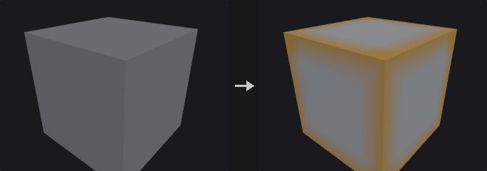
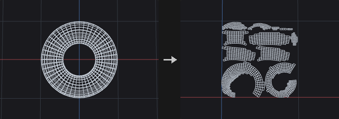
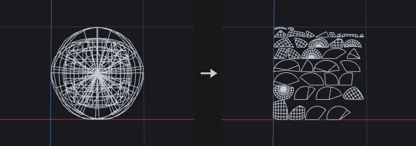
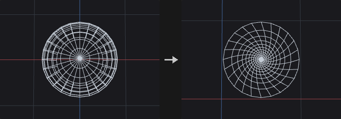
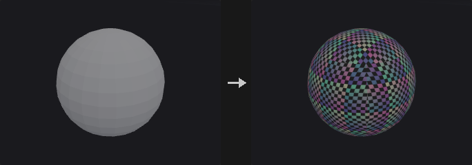
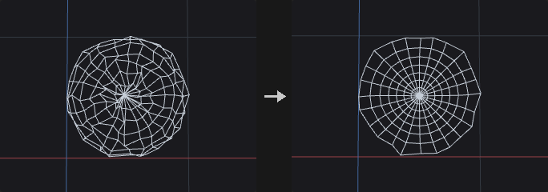
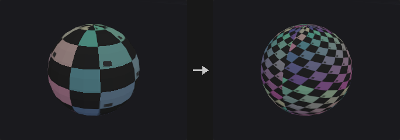
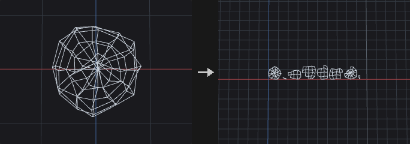

# UV

UV projection, unwrapping, layout and seams.

9 nodes.

[Back to the reference index](README.md)

## Contents

- [UV Auto Seams (PCG)](#pcg-uvautoseams) — Finds UV seams automatically and writes them as an edge group for UV Flatten.
- [UV Flatten (PCG)](#pcg-uvflatten) — Flattens surface pieces into UV space with a conformal (LSCM), spectral (SCP) or ABF solver.
- [UV Fuse (PCG)](#pcg-uvfuse) — Welds vertices that are close together in UV space by averaging their UVs.
- [UV Layout (PCG)](#pcg-uvlayout) — Finds UV islands and packs them into the 0..1 square (or UDIM tiles).
- [UV Pelt (PCG)](#pcg-uvpelt) — Unwraps one chart by pinning its longest boundary loop to a frame and relaxing the interior with springs.
- [UV Project (PCG)](#pcg-uvproject) — Generates UVs by projection: planar, cylindrical, spherical, box, per-face, rows and columns, toroidal or plastic wrap.
- [UV Smooth (PCG)](#pcg-uvsmooth) — Relaxes UVs within UV space to smooth out distortion.
- [UV Transform (PCG)](#pcg-uvtransform) — Translates, rotates and scales UVs in UV space.
- [UV Unwrap (PCG)](#pcg-uvunwrap) — Unwraps by assigning each face to its best projection plane, grouping connected faces into regions and laying the regions out.

## Nodes

### UV Auto Seams (PCG)

`PCG_UVAutoSeams` · category `PCG/uv` · Houdini: UV Autoseam (SOP)

Finds UV seams automatically and writes them as an edge group for UV Flatten.

Seams must satisfy two unrelated requirements: they should look good (cut along creases and separate high curvature so distortion is low) and they must make every piece a topological disk, otherwise LSCM has no solution. So candidate seams are chosen heuristically first and then completed with a topological algorithm.

With Make Disks on, each chart is guaranteed to be a disk, checked by the Euler characteristic V - E + F == 1 (V counts wedges, seam edges count twice). The completion uses a tree-cotree construction: cutting every edge outside a spanning tree of the dual graph always gives a disk, then dangling branches are pruned to return most edges. On a sphere this prunes to nothing, which is correct since a sphere needs one cut: the longest path found in the leftovers is protected from pruning, so one meridian-like cut remains.

Modes: `angle` cuts creases only; `charts` splits by normal cones (like Smart UV Project); `both` does both; `existing_islands` starts from edges where the existing vertex UVs are already discontinuous. Smaller Cone Angle gives more charts and lower distortion.

Include Edges and Island Attribute enforce cuts, Exclude Edges avoids them (Make Disks also routes around them; if they form a closed ring, one is still cut). Group limits cutting to edges touching the selected primitives.

**Inputs**

| Input | Type | Description |
|---|---|---|
| `geo` | GEOMETRY | Geometry to find seams on. |

**Outputs**

| Output | Type | Description |
|---|---|---|
| `geo` | GEOMETRY | The input geometry with the seams as an edge group. |

**Parameters**

| Parameter | Type | Default | Description |
|---|---|---|---|
| Group `group` | string | *(empty)* | Primitive group pattern; seams are only created on edges that touch these primitives. |
| Include Edges `include_edges` | string | *(empty)* | Edge group pattern; these edges are always seams. |
| Island Attribute `island_attribute` | string | *(empty)* | Integer primitive attribute; adjacent faces with different values are cut apart. |
| Exclude Edges `exclude_edges` | string | *(empty)* | Edge group pattern; these edges are not used as seams, and Make Disks avoids them when completing seams. |
| Mode `mode` | menu | Both | Angle cuts only creases. Charts cuts chart borders from normal-cone clustering. Both uses both. Existing Islands uses edges where the vertex UV is already split. Options: Crease Angle (`angle`), Normal Charts (`charts`), Both (`both`), Existing Islands (`existing_islands`). |
| Min Crease Angle `min_angle` | float [0.0..180.0] | 45 | Crease angle in degrees; edges whose adjacent faces meet at a sharper angle become seams (angle and both modes). *Hidden when mode = charts } { mode = existing_islands.* |
| Chart Cone Angle `cone_angle` | float [1.0..180.0] | 66 | Maximum cone angle in degrees of the normals within one chart (charts and both modes). Smaller values give more charts and lower distortion. *Hidden when mode = angle } { mode = existing_islands.* |
| UV Attribute `uv_attribute` | string | `uv` | Vertex UV attribute read by Existing Islands. *Hidden when mode ≠ existing_islands.* |
| Connectivity Tolerance `connectivity_tolerance` | float [0.0..1.0] | 1e-06 | Existing Islands: UV distance below which two vertices of an edge count as the same UV (not a seam). *Hidden when mode ≠ existing_islands.* |
| Ensure Disk Topology `make_disks` | toggle | on | Guarantees every piece is a disk, so that LSCM can flatten it. |
| Output Seam Group `output_group` | string | `seams` | Name of the edge group that receives the seams. |
| Output Chart Attribute `output_chart_attribute` | string | *(empty)* | Name of an integer primitive attribute that receives the chart number of each face. Empty does not write it. |

**Compared with Houdini**

Corresponds to UV Autoseam. Houdini's default Curvature Based splitting (granular regions that are then merged) is a different algorithm and is not reproduced; Enforce / Avoid cuts correspond to Include / Exclude Edges and Island Attribute.

---

### UV Flatten (PCG)

`PCG_UVFlatten` · category `PCG/uv` · Houdini: UV Flatten (SOP)

Flattens surface pieces into UV space with a conformal (LSCM), spectral (SCP) or ABF solver.

Projection only works for roughly planar, cylindrical or spherical shapes. For arbitrary shapes this node finds (u,v) so each triangle maps from 3D to 2D as a rotation and uniform scale with as little shear as possible. The conformal condition (Cauchy-Riemann) is linear, so the solution is one sparse least-squares problem rather than an iterative optimisation. The solver is a Jacobi-preconditioned CGNR written in numpy, started from the projection onto the best-fit plane, which is already near the answer for developable surfaces.

Seams do not cut the geometry. The unknowns are wedges: two corners belong to the same wedge when they share a point and the edge between them is not a seam. Each side of a seam is a separate wedge with its own (u,v). This is why UVs must be a vertex attribute here. Without a Seam Group the geometry's own boundary is used.

**Closed pieces cannot be flattened** (a sphere has no isometric flattening, Gauss's Theorema Egregium). The node raises an error telling you to select a ring of edges as seams, rather than producing overlapping UVs; UV AutoSeams can do this.

Methods: `lscm` is the original solver that pins two points; `scp` is spectral conformal, which pins nothing so the boundary is not pulled by pins; `abf` solves angles first and reconstructs (lowest area distortion, slowest).

With Normalize on all islands share one scale so the largest fills 0..1 and the others keep their relative size. Islands with two or more pins are not rescaled. The optional distortion attribute stores the UV area over 3D area per primitive divided by the global median; 1 means typical texel density. A conformal map preserves angles, not area, so it will not be 1 everywhere; use it to find parts that are stretched too much.

**Inputs**

| Input | Type | Description |
|---|---|---|
| `geo` | GEOMETRY | Geometry to unwrap. Needs polygons. |

**Outputs**

| Output | Type | Description |
|---|---|---|
| `geo` | GEOMETRY | Geometry with the UV vertex attribute. |

**Parameters**

| Parameter | Type | Default | Description |
|---|---|---|---|
| Group `flatten_group` | string | *(empty)* | Primitive group pattern; only these faces are flattened. The border of the selection is treated as a seam and other faces keep their UVs. |
| UV Attribute `attribute_name` | string | `uv` | Name of the vertex UV attribute to write. |
| Flattening Method `method` | menu | Least Squares Conformal (LSCM) | LSCM is this plugin's original algorithm (not in Houdini 3.0). SCP is spectral conformal and does not pin points. ABF solves angles first: smallest area distortion, slowest. Options: Least Squares Conformal (LSCM) (`lscm`), Spectral (SCP) (`scp`), Angle Based (ABF) (`abf`). |
| Preserve Seams `preserve_seams` | toggle | off | Also treats edges where the existing UVs are discontinuous as seams. |
| Seams `seam_group` | string | *(empty)* | Edge group pattern that cuts the surface into discs. |
| Vertex Pins `pin_group` | string | *(empty)* | Point group pattern. Corners at these points are pinned to their existing UVs. Islands with two or more pins are not rescaled or normalized. |
| Normalize to 0-1 `normalize` | toggle | on | Scales all islands by one common factor so the largest one fits 0..1. *Disabled when pack is on.* |

*Solver*

| Parameter | Type | Default | Description |
|---|---|---|---|
| Max Iterations `iterations` | int [1..] | 2000 | Maximum number of solver iterations. |
| Tolerance `tolerance` | float [1e-14..1.0] | 1e-08 | Solver convergence tolerance. |
| ARAP Iterations `arap_iterations` | int [0..200] | 0 | Rounds of ARAP refinement after the initial flattening, which tends to make texel density more uniform. 0 disables it. Skipped for islands with two or more pins. |

*Pack*

| Parameter | Type | Default | Description |
|---|---|---|---|
| Pack Islands `pack` | toggle | off | Packs the islands into 0..1 after flattening, like a basic UV Layout. |
| Island Padding `padding` | float [0.0..0.25] | 0.01 | Gap between islands as a fraction of the unit square, when packing. |
| Pack Group `group` | string | *(empty)* | Primitive group pattern that limits packing only. The faces to flatten come from Flatten Group. |

*Output*

| Parameter | Type | Default | Description |
|---|---|---|---|
| Distortion Attribute `distortion_attribute` | string | *(empty)* | Name of a primitive attribute that receives the relative area distortion. Empty does not write it. |
| Seams Group `output_seams` | string | *(empty)* | Name of an edge group that receives the seams actually used (Seam Group plus preserved seams). Empty does not write it. |
| Constrained Islands Group `output_constrained` | string | *(empty)* | Name of a primitive group that receives the faces of islands with pins. Empty does not write it. |

**Compared with Houdini**

Corresponds to UV Flatten. Houdini 3.0 offers only SCP and ABF; LSCM is kept as the plugin's original behaviour and default. Pins stay at their existing UVs; per-pin coordinate entry is not available (use UV Transform first).

---

### UV Fuse (PCG)

`PCG_UVFuse` · category `PCG/uv` · Houdini: UV Fuse (SOP)

Welds vertices that are close together in UV space by averaging their UVs.

Vertices whose UVs are within Distance of each other are merged to their average. Shared Points only welds vertices that sit on the same geometric point, which cleans up small gaps left by a projection. Distance ignores whether the vertices share a point, so it can stitch the touching edges of two islands together.

**Inputs**

| Input | Type | Description |
|---|---|---|
| `geo` | GEOMETRY | Geometry with a vertex UV attribute. |

**Outputs**

| Output | Type | Description |
|---|---|---|
| `geo` | GEOMETRY | Geometry with fused UVs. |
| `report` | STRING | Text report of what was fused. |

**Parameters**

| Parameter | Type | Default | Description |
|---|---|---|---|
| Group `group` | string | *(empty)* | Primitive group pattern limiting the faces that are fused. |
| UV Attribute `uv_attribute` | string | `uv` | Name of the vertex UV attribute. |
| Fuse `mode` | menu | Shared Points Only | Shared Points welds only vertices on the same point. Distance welds any vertices within the distance. Options: Shared Points Only (`shared_points`), Any Within Distance (`distance`). |
| Distance `distance` | float [0.0..] | 0.001 | Maximum UV distance for two vertices to be fused. |

---

### UV Layout (PCG)

`PCG_UVLayout` · category `PCG/uv` · Houdini: UV Layout (SOP)

Finds UV islands and packs them into the 0..1 square (or UDIM tiles).

Islands are found from UV connectivity, not geometric connectivity: two faces sharing an edge are not connected in UV when the UVs on the two sides of that edge differ, which is the definition of a seam. Splitting by geometry is a common mistake and shows up as a six-way box projection that still looks like a single blob after packing.

Packing: `shelf` fills shelves, wrapped in a binary search for the largest scale that fits (the fit test is cheap, so the search lands on the maximum texel density). `raster` rasterizes islands into masks and interlocks them by shape, trying several rotations, so triangular and L-shaped islands do not each reserve a bounding box; it typically raises coverage on reduced rocks from about 40% to over 60%. Pack Resolution is the occupancy grid size: larger is tighter and slower.

Rotate to Fit uses rotating calipers to find the minimum-area bounding rectangle orientation (testing only the convex hull edges is enough); a 35 degree strip dropped from 0.76 to 0.47 occupancy. Scale Mode `uniform` uses one scale for all islands (consistent texel density, what baking wants); `individual` normalizes each island by its longer side first (sizes evened out); `fixed` applies Fixed Scale as is and does not search for the maximum, islands that do not fit are placed outside the target and added to the Nonpacked group. Pack Into UDIM Tiles packs across several tiles starting at Starting UDIM with Columns per row (with Fixed, tiles open as needed).

**Inputs**

| Input | Type | Description |
|---|---|---|
| `geo` | GEOMETRY | Geometry with a UV attribute. |

**Outputs**

| Output | Type | Description |
|---|---|---|
| `geo` | GEOMETRY | Geometry with the packed UVs. |

**Parameters**

*Islands to Pack*

| Parameter | Type | Default | Description |
|---|---|---|---|
| UV Attribute `attribute_name` | string | `uv` | Name of the UV attribute. |
| Group `group` | string | *(empty)* | Primitive group pattern; only islands containing these faces are laid out. |
| Attribute Class `attribute_class` | menu | Vertex | Whether the UVs are stored on vertices or points. Vertex is needed for seams. Options: Vertex (`vertex`), Point (`point`). |
| Scale Islands to Match Their Surface Areas `match_surface_area` | toggle | off | Before packing, scales each island so its UV area is proportional to its 3D area. |
| Rotate to Fit `rotate_to_fit` | toggle | on | Rotates each island to the orientation of its minimum-area bounding box first (where Houdini has Axis Alignment; the algorithm differs). |

*Packing*

| Parameter | Type | Default | Description |
|---|---|---|---|
| Packing Method `method` | menu | Bounding Box (Shelf) | Shelf packs by bounding boxes. Raster packs by island shape and is tighter. Options: Bounding Box (Shelf) (`shelf`), Island Shape (Raster) (`raster`). |
| Scale `scale_mode` | menu | Largest Packable (Uniform) | Uniform: one scale for all islands. Individual: each island is normalized separately. Fixed: Fixed Scale, no fitting. Options: Largest Packable (Uniform) (`uniform`), Individual (Equal Area) (`individual`), Fixed (`fixed`). |
| Fixed Scale `fixed_scale` | float [1e-06..] | 1 | Scale applied to all islands in Fixed mode. *Hidden when scale_mode ≠ fixed.* |
| Island Rotation Step `island_rotation` | menu | Default (Raster: 90°) | Which orientations are tried per island. Auto keeps the original behaviour (Raster tries the four 90 degree orientations, Shelf does not rotate); None never rotates; Step tries every Rotation Step degrees; Custom divides 360 degrees into Rotation Divisions parts. Options: Default (Raster: 90°) (`auto`), No Rotation (`none`), Rotation Step (`step`), Custom (`custom`). |
| Step `rotation_step` | float [1.0..360.0] | 90 | Angle increment in degrees for the Step option. *Hidden when island_rotation ≠ step.* |
| Divisions of 360° `rotation_divisions` | int [1..360] | 4 | Number of equally spaced orientations for the Custom option. *Hidden when island_rotation ≠ custom.* |
| Island Padding `padding` | float [0.0..0.25] | 0.01 | Gap between islands and around the border, as a fraction of the unit square. |
| Search Resolution `pack_resolution` | int [32..2048] | 256 | Raster method only: edge length of the occupancy grid. Larger packs tighter and runs slower. *Hidden when method ≠ raster.* |

*Targets*

| Parameter | Type | Default | Description |
|---|---|---|---|
| Pack Into `pack_into` | menu | Unit Square (0-1) | Unit Square packs into 0..1. UDIM Tiles spreads the islands over several tiles. Options: Unit Square (0-1) (`unit_square`), UDIM Tiles (`udim_tiles`). |
| Starting UDIM `udim_start` | int [1001..99999] | 1001 | UDIM number of the first tile (1001 is the 0..1 tile). *Hidden when pack_into ≠ udim_tiles.* |
| Columns `udim_columns` | int [1..100] | 10 | Number of tiles per row of the UDIM grid. *Hidden when pack_into ≠ udim_tiles.* |
| Tile Count `udim_count` | int [1..1000] | 1 | Number of tiles to use. *Hidden when pack_into ≠ udim_tiles.* *Disabled when scale_mode = fixed.* |

*Output*

| Parameter | Type | Default | Description |
|---|---|---|---|
| Nonpacked Polygons `nonpacked_group` | string | *(empty)* | Name of a primitive group for faces whose islands did not fit (Fixed scale mode). Empty does not write it. *Disabled when scale_mode ≠ fixed.* |
| Island Number `island_attribute` | string | *(empty)* | Name of an integer primitive attribute that receives the island number. Empty does not write it. |
| Assigned Target `target_attribute` | string | *(empty)* | Name of an integer primitive attribute that receives the UDIM number of the tile (0 for the unit square, -1 if not packed). Empty does not write it. |

**Compared with Houdini**

Corresponds to UV Layout. Pack Into supports the unit square and UDIM tiles only; packing into rectangles and islands from a second input are not implemented.

---

### UV Pelt (PCG)

`PCG_UVPelt` · category `PCG/uv` · Houdini: UV Pelt (SOP)

Unwraps one chart by pinning its longest boundary loop to a frame and relaxing the interior with springs.

Unlike UV Flatten, which solves a conformal energy with a free boundary, Pelt works like stretching an animal skin. The surface is cut along the seams into a topological disk, the longest boundary loop of the chart containing the Hint Primitive is attached by arc length to a frame (a circle by default; if a closed face is connected to the second input, its P.x and P.y are used as U and V), and the interior is pulled flat by springs.

The Pelting Method sets spring weights: `spring_relaxation` uses adjacent triangle area over squared edge length; `tutte_barycentric` uses unit weights, which cannot flip faces with a convex frame; `discrete_harmonic` uses cotangent weights. The boundary is not hard pinned: each boundary point is attached to its frame position by a spring of strength Boundary Springs, and the resulting linear system is solved with conjugate gradients. Unknowns are wedges, so seams do not cut the geometry.

Only the chart that contains the hint primitive is unwrapped; the UVs of all other faces are left as they are (0 if there were none).

**Inputs**

| Input | Type | Description |
|---|---|---|
| `geo` | GEOMETRY | Geometry to unwrap. |
| `frame` *(optional)* | GEOMETRY | Optional closed face used as the boundary shape instead of a circle (U = P.x, V = P.y). |

**Outputs**

| Output | Type | Description |
|---|---|---|
| `geo` | GEOMETRY | Geometry with the UVs of the hint chart written. |

**Parameters**

| Parameter | Type | Default | Description |
|---|---|---|---|
| UV Attribute `attribute_name` | string | `uv` | Name of the vertex UV attribute. |
| Edge Cut Group `seam_group` | string | *(empty)* | Edge group pattern that cuts the surface into a disk. |
| Pelting Method `method` | menu | Spring Relaxation | Spring weighting: area over squared length, unit weights (no flips with a convex frame), or cotangent weights (least angle distortion). Options: Spring Relaxation (`spring_relaxation`), Tutte Barycentric (`tutte_barycentric`), Discrete Harmonic (`discrete_harmonic`). |
| Output Group `output_group` | string | *(empty)* | Name of a primitive group for the faces of the unwrapped chart. Empty does not write it. |

*Pelt*

| Parameter | Type | Default | Description |
|---|---|---|---|
| Iterations `iterations` | int [1..] | 1000 | Maximum number of conjugate-gradient steps of the solver. Too few steps leave the result unconverged. |

| Parameter | Type | Default | Description |
|---|---|---|---|
| Boundary Springs `boundary_springs` | float [1e-06..] | 10 | Stiffness of the springs holding the boundary to the frame. Larger values keep the boundary closer to the frame and make the chart bigger. |
| Stiffness Attribute `stiffness_attribute` | string | *(empty)* | Optional point attribute that scales the spring weights (the average of the two end points is used per edge). |
| Hint Primitive `hint_prim` | int [0..] | 0 | Index of a primitive; only the chart containing it is unwrapped. |

*Frame*

| Parameter | Type | Default | Description |
|---|---|---|---|
| Use Range `use_range` | toggle | off | Rescales the result so its bounding box matches the U and V ranges below. |

| Parameter | Type | Default | Description |
|---|---|---|---|
| U Range `u_range_min` `u_range_max` | float | 0, 1 | Target U range (min, max) when Use Range is on. *Disabled when use_range is off.* |
| V Range `v_range_min` `v_range_max` | float | 0, 1 | Target V range (min, max) when Use Range is on. *Disabled when use_range is off.* |
| Orientation `orientation` | float | 0 | Position on the frame (0 to 1, as arc-length parameter) where the boundary point nearest to the hint primitive is attached; rotates the result. |

**Compared with Houdini**

Corresponds to UV Pelt 2.0. The exact spring weight formulas are not documented by Houdini; the area / length^2 form here is this plugin's choice.

---

### UV Project (PCG)

`PCG_UVProject` · category `PCG/uv` · Houdini: UV Project (SOP), UV Texture (SOP)

Generates UVs by projection: planar, cylindrical, spherical, box, per-face, rows and columns, toroidal or plastic wrap.

UVs are written as a vertex attribute by default, not point. A point can have several UV positions (either side of a seam, island borders), which a point attribute cannot store. Cylindrical and spherical projection always create a seam; as point UVs, the faces along it would interpolate u from 0.98 back to 0.02 and smear the texture.

Fix Seams checks each face's u range and, if it spans more than half a period, adds 1 to the smaller half, so a seam face gets u of (0.98, 0.99, 1.01, 1.02) which is continuous. Values outside 0..1 are fine because textures repeat. This is only possible with vertex attributes.

Modes: `planar`, `cylindrical`, `spherical` project along Axis. `box` is six-sided and picks the axis by face normal (point normals would tear faces apart in UV space), giving six islands for UV Layout. `face` gives each face its own 0..1 square (for brick or card per-piece textures). `rows_columns` assigns row and column UVs to a structured quad grid by BFS on the dual graph, independent of primitive order. `toroidal` wraps u around the main axis and v around the tube (for tori); `plastic_wrap` wraps from the positive axis end down, pinching only at the back and with no seam.

By default the projection is centered on the bounding box and fitted to 0..1, then rotated about (0.5, 0.5), scaled and translated. With Projector Transform on, Houdini semantics apply: a unit-size projector (square, cylinder, sphere or torus) is placed in the scene with the given transform, UVs come from the parameters on that projector and are remapped by U / V Range, without centering or fitting. Box, Face and Rows and Columns are not affected by the projector.

**Inputs**

| Input | Type | Description |
|---|---|---|
| `geo` | GEOMETRY | Geometry to project UVs onto. |

**Outputs**

| Output | Type | Description |
|---|---|---|
| `geo` | GEOMETRY | Geometry with the new UV attribute. |

**Parameters**

| Parameter | Type | Default | Description |
|---|---|---|---|
| UV Attribute `attribute_name` | string | `uv` | Name of the UV attribute to write. |
| Group `group` | string | *(empty)* | Primitive group pattern; only these faces get new UVs and other faces keep their values. |
| Attribute Class `attribute_class` | menu | Vertex | Vertex or point. Box and Face can only write Vertex. Options: Vertex (`vertex`), Point (`point`). |
| Projection `mode` | menu | Orthographic | Projection type. Toroidal: u goes around the main axis and v around the tube. Plastic Wrap: wrapped from the positive axis end, pinched only at the back, no seam. Options: Orthographic (`planar`), Cylindrical (`cylindrical`), Polar (`spherical`), Box (Six Sides) (`box`), Face (`face`), Rows & Columns (`rows_columns`), Toroidal (`toroidal`), Plastic Wrap (`plastic_wrap`). |
| Projection Axis `axis` | menu | Y Axis | Projection axis for the planar, cylindrical, spherical, toroidal and plastic wrap modes. Options: X Axis (`x`), Y Axis (`y`), Z Axis (`z`). *Hidden when mode ≠ planar mode ≠ cylindrical mode ≠ spherical mode ≠ toroidal mode ≠ plastic_wrap.* |

*Transform*

| Parameter | Type | Default | Description |
|---|---|---|---|
| Fit to 0-1 `fit_to_01` | toggle | on | Fits the result into 0..1. Ignored by modes that use the projector when Projector Transform is on; it then only affects Box, Face and Rows and Columns. |
| Keep Aspect Ratio `keep_aspect` | toggle | on | Fit uses one common scale for u and v instead of stretching each to fill 0..1. *Disabled when fit_to_01 is off.* |
| Offset `translate_u` `translate_v` | float | 0, 0 | Offset applied to the UVs after rotation and scale. |
| Angle `rotate` | float [-360.0..360.0] | 0 | Rotation of the UVs in degrees about (0.5, 0.5). |
| Scale `scale_u` `scale_v` | float | 1, 1 | Scale of the UVs (applied before translation). |
| Fix Boundary Seams `fix_seams` | toggle | on | Makes UVs continuous across the seam of cylindrical, spherical and toroidal projections (vertex UVs only). *Hidden when mode ≠ cylindrical mode ≠ spherical mode ≠ toroidal.* *Disabled when attribute_class = point.* |

*Projector*

| Parameter | Type | Default | Description |
|---|---|---|---|
| Projector Transform `use_projector` | toggle | off | Turns on the Projector settings: a unit-size projector shape placed by the transform below, with no centering or fitting. Box, Face and Rows and Columns are unaffected. |
| Transform Order `xform_order` | menu | Scale Rot Trans | Order in which scale, rotate and translate are applied (left to right). Options: Scale Rot Trans (`srt`), Scale Trans Rot (`str`), Rot Scale Trans (`rst`), Rot Trans Scale (`rts`), Trans Scale Rot (`tsr`), Trans Rot Scale (`trs`). |
| Rotate Order `rotate_order` | menu | Rx Ry Rz | Order of the rotation axes. Options: Rx Ry Rz (`xyz`), Rx Rz Ry (`xzy`), Ry Rx Rz (`yxz`), Ry Rz Rx (`yzx`), Rz Rx Ry (`zxy`), Rz Ry Rx (`zyx`). |
| Translate `proj_translate_x` `proj_translate_y` `proj_translate_z` | float | 0, 0, 0 | Translation of the projector. |
| Rotate `proj_rotate_x` `proj_rotate_y` `proj_rotate_z` | float [-360.0..360.0] | 0, 0, 0 | Rotation of the projector in degrees. |
| Scale `proj_scale_x` `proj_scale_y` `proj_scale_z` | float | 1, 1, 1 | Scale of the projector. |
| Pivot `proj_pivot_x` `proj_pivot_y` `proj_pivot_z` | float | 0, 0, 0 | Pivot point of the projector transform. |
| U Range `u_range_min` `u_range_max` | float | 0, 1 | Range of the projector's U parameter mapped to the texture: min is the left edge, max is the right edge. |
| V Range `v_range_min` `v_range_max` | float | 0, 1 | Range of the projector's V parameter mapped to the texture. |
| Inner Radius `inner_radius` | float [0.0..0.5] | 0.25 | Toroidal only, with the projector: inner radius of the projector torus. Its outer radius is fixed at 0.5. *Hidden when mode ≠ toroidal.* *Disabled when use_projector is off.* |

**Compared with Houdini**

Combines UV Texture and UV Project. The Projector section follows UV Project's Transformation page. Plastic Wrap uses an azimuthal equidistant mapping built from Houdini's description, as its exact formula is not published.

---

### UV Smooth (PCG)

`PCG_UVSmooth` · category `PCG/uv` · Houdini: UV Smooth (SOP)

Relaxes UVs within UV space to smooth out distortion.

Corners at the same point with the same UV form one wedge, so the two sides of a seam move independently and are not welded together. Edge weights are `cotangent` (computed on the 3D triangles, with linear precision: planar regions with linear UVs stay unchanged and only distortion that disagrees with the 3D shape is removed) or `uniform`.

`relax` runs a number of iterations, each moving every free wedge toward the weighted average of its neighbours by Strength. `harmonic` solves directly to convergence, equivalent to infinitely many relax steps; it needs fixed wedges (Pin Boundary or a group), otherwise an island would collapse to a point. Pin Boundary fixes the boundary of each UV island including seams; points outside the group are also fixed.

**Inputs**

| Input | Type | Description |
|---|---|---|
| `geo` | GEOMETRY | Geometry with a UV attribute. |

**Outputs**

| Output | Type | Description |
|---|---|---|
| `geo` | GEOMETRY | Geometry with smoothed UVs. |
| `report` | STRING | Wedge and pinned counts. |

**Parameters**

| Parameter | Type | Default | Description |
|---|---|---|---|
| Group `group` | string | *(empty)* | Point group pattern; points outside it are held fixed. |
| UV Attribute `uv_attribute` | string | `uv` | Name of the UV attribute (vertex, or point if there is no vertex attribute of that name). |
| Method `solve` | menu | Relax (Iterative) | Relax: fixed number of iterations. Harmonic: solved to convergence (requires pinned wedges). Options: Relax (Iterative) (`relax`), Harmonic (Solve to Convergence) (`harmonic`). |
| Weights `weights` | menu | Cotangent | Cotangent weights follow the 3D shape; Uniform weights every edge equally and can pull UVs toward even point spacing. Options: Cotangent (`cotangent`), Uniform (`uniform`). |
| Iterations `iterations` | int [0..] | 20 | Number of relax steps. Not used by Harmonic. *Hidden when solve ≠ relax.* |
| Strength `strength` | float [0.0..1.0] | 0.5 | Fraction of the way to the neighbour average that each wedge moves per step. Not used by Harmonic. *Hidden when solve ≠ relax.* |
| Pin Boundary `pin_boundary` | toggle | on | Holds the boundary of each UV island (including seams) fixed. |

**Compared with Houdini**

Corresponds to UV Smooth.

---

### UV Transform (PCG)

`PCG_UVTransform` · category `PCG/uv` · Houdini: UV Transform (SOP)

Translates, rotates and scales UVs in UV space.

Each UV is scaled and rotated about the pivot and then translated. With Per Island on, every island is transformed about its own center instead of the Pivot. This is what you want to rotate scattered islands by 90 degrees each, rather than orbiting them around the center of the atlas.

**Inputs**

| Input | Type | Description |
|---|---|---|
| `geo` | GEOMETRY | Geometry with a UV attribute. |

**Outputs**

| Output | Type | Description |
|---|---|---|
| `geo` | GEOMETRY | Geometry with transformed UVs. |

**Parameters**

| Parameter | Type | Default | Description |
|---|---|---|---|
| Group `group` | string | *(empty)* | Point or vertex group pattern (matching Attribute Class); only these elements are transformed. |
| UV Attribute `attribute_name` | string | `uv` | Name of the UV attribute. |
| Attribute Class `attribute_class` | menu | Vertex | Whether the UVs are stored on vertices or points. Options: Vertex (`vertex`), Point (`point`). |
| Per Island `per_island` | toggle | off | Transforms each island about its own center and ignores Pivot. |
| Translate `translate_u` `translate_v` | float | 0, 0 | Offset in UV space, added last. |
| Rotate `rotate` | float [-360.0..360.0] | 0 | Rotation in degrees about the pivot. |
| Scale `scale_u` `scale_v` | float | 1, 1 | Scale about the pivot, applied before rotation. |
| Pivot `pivot_u` `pivot_v` | float | 0.5, 0.5 | Pivot of rotation and scale in UV space. The center of the unit square by default. *Hidden when per_island is on.* |

**Compared with Houdini**

Corresponds to UV Transform.

---

### UV Unwrap (PCG)

`PCG_UVUnwrap` · category `PCG/uv` · Houdini: UV Unwrap (SOP)

Unwraps by assigning each face to its best projection plane, grouping connected faces into regions and laying the regions out.

Not the same as UV Flatten: nothing is solved. Each face picks the plane with the smallest projection distortion, i.e. the largest absolute dot product between face normal and plane normal. By default the planes are the three axis planes, rotated together by Rotate; if polygons are connected to the second input, they are used as planes instead. Connected faces projected onto the same plane form one region, and regions are placed side by side: `strip` in a row, `square` filled into a square from largest to smallest. Scale then sizes the result.

Faces on the back of a plane form their own region with u negated, so that the UV handedness matches the face winding (not mirrored). Faces outside Group keep their UVs.

**Inputs**

| Input | Type | Description |
|---|---|---|
| `geo` | GEOMETRY | Geometry to unwrap. |
| `planes` *(optional)* | GEOMETRY | Optional polygons used as the projection planes. |

**Outputs**

| Output | Type | Description |
|---|---|---|
| `geo` | GEOMETRY | Geometry with the new UV attribute. |

**Parameters**

| Parameter | Type | Default | Description |
|---|---|---|---|
| UV Attribute `attribute_name` | string | `uv` | Name of the UV attribute to write. |
| Group `group` | string | *(empty)* | Primitive group pattern; only these faces are unwrapped, the rest keep their UVs. |
| Plane Group `plane_group` | string | *(empty)* | Primitive group pattern: which polygons of the second input are used as planes. |
| Rotate Order `rotate_order` | menu | Rx Ry Rz | Rotation order for the default coordinate planes. Not used when the second input is connected. Options: Rx Ry Rz (`xyz`), Rx Rz Ry (`xzy`), Ry Rx Rz (`yxz`), Ry Rz Rx (`yzx`), Rz Rx Ry (`zxy`), Rz Ry Rx (`zyx`). |
| Rotate `rotate_x` `rotate_y` `rotate_z` | float [-360.0..360.0] | 0, 0, 0 | Rotation of the default three coordinate planes in degrees. Not used when the second input is connected. |
| Layout `layout` | menu | Strip | Strip: regions in a row. Square: regions packed into a square, largest first. Options: Strip (`strip`), Square (`square`). |
| Scale `scale` | menu | None | None keeps world size. Uniform scales proportionally to fit 0..1. Stretch fills 0..1 in both directions. Options: None (`none`), Uniform (`uniform`), Stretch (`stretch`). |
| Spacing `spacing` | float [0.0..100.0] | 5 | Gap between regions in percent of the layout space (the side of a square with the summed bounding box areas of the regions). |

**Compared with Houdini**

Corresponds to UV Unwrap. Houdini's menu for default plane orientations is not reproduced; only the axis coordinate planes are available.

---
