# Volumes & VDB

VDB creation, active regions, level sets, fields and the rest of the Volume SOPs (pcg106).

68 nodes.

[Back to the reference index](README.md)

## Contents

- [Convert VDB (PCG)](#pcg-convertvdb) — Converts between VDBs, dense volumes, polygons, fog and SDF.
- [VDB (PCG)](#pcg-vdb) — Creates an empty or filled VDB volume of a given class, type and voxel size.
- [VDB Activate (PCG)](#pcg-vdbactivate) — Changes which voxels of a VDB are active, by box, voxel range, dilation, reference geometry or value.
- [VDB Activate SDF (PCG)](#pcg-vdbactivatesdf) — Activates a narrow band of a given width around the surface of an SDF, with true distances.
- [VDB Advect (PCG)](#pcg-vdbadvect) — Moves volume content through a velocity field.
- [VDB Advect Points (PCG)](#pcg-vdbadvectpoints) — Moves points through a velocity field or onto a closest-point field.
- [VDB Analysis (PCG)](#pcg-vdbanalysis) — Computes gradient, curvature, Laplacian, closest point, divergence, curl, length or normalized fields.
- [VDB Clip (PCG)](#pcg-vdbclip) — Deactivates the voxels of a VDB outside (or inside) a box, a mask VDB or a camera frustum.
- [VDB Combine (PCG)](#pcg-vdbcombine) — Combines pairs of volumes with arithmetic, SDF boolean or activity operations.
- [VDB Densify (PCG)](#pcg-vdbdensify) — Makes every voxel of a VDB active.
- [VDB Diagnostics (PCG)](#pcg-vdbdiagnostics) — Checks VDBs for invalid values, wrong backgrounds and bad SDF gradients, and optionally repairs them.
- [VDB Extrapolate (PCG)](#pcg-vdbextrapolate) — Widens an SDF band, converts fog to SDF, or extends fields off a surface.
- [VDB Fill (PCG)](#pcg-vdbfill) — Sets a box of voxels to a value and activates or deactivates it.
- [VDB Fracture (PCG)](#pcg-vdbfracture) — Cuts SDF volumes into fragments with cutter shapes.
- [VDB from Particle Fluid (PCG)](#pcg-vdbfromparticlefluid) — Builds a smooth fluid surface SDF from particles.
- [VDB from Particles (PCG)](#pcg-vdbfromparticles) — Builds an SDF from points as spheres of their pscale.
- [VDB from Polygons (PCG)](#pcg-vdbfrompolygons) — Builds an SDF (and optionally fog and attribute volumes) from a polygon mesh.
- [VDB LOD (PCG)](#pcg-vdblod) — Builds lower-resolution levels of detail of volumes.
- [VDB Merge (PCG)](#pcg-vdbmerge) — Merges VDBs with the same name (or all of them) into one.
- [VDB Metadata (PCG)](#pcg-vdbmetadata) — Sets the name, class, background and VDB flag of volumes.
- [VDB Morph SDF (PCG)](#pcg-vdbmorphsdf) — Moves one SDF surface towards another over time.
- [VDB Noise (PCG)](#pcg-vdbnoise) — Adds fractal noise to the surface of an SDF.
- [VDB Occlusion Mask (PCG)](#pcg-vdbocclusionmask) — Marks the voxels hidden from a camera behind a surface.
- [VDB Platonic (PCG)](#pcg-vdbplatonic) — Creates the SDF or fog of a sphere or a Platonic solid.
- [VDB Points Group (PCG)](#pcg-vdbpointsgroup) — Groups points by percentage, bounding box or SDF range.
- [VDB Potential Flow (PCG)](#pcg-vdbpotentialflow) — Computes the potential flow of a fluid around the solid of an SDF.
- [VDB Project Non-Divergent (PCG)](#pcg-vdbprojectnondivergent) — Removes the divergence from a velocity field (pressure projection).
- [VDB Prune (PCG)](#pcg-vdbprune) — Collapses constant regions of a VDB and deactivates background regions.
- [VDB Ray (PCG)](#pcg-vdbray) — Projects points onto the surface of a volume, along their normals or to the closest point.
- [VDB Rebuild SDF (PCG)](#pcg-vdbrebuildsdf) — Builds a clean SDF from an iso contour of any scalar volume.
- [VDB Remap (PCG)](#pcg-vdbremap) — Remaps volume values from one range to another through a ramp.
- [VDB Renormalize SDF (PCG)](#pcg-vdbrenormalizesdf) — Restores the distance property of an SDF after it was edited.
- [VDB Resample (PCG)](#pcg-vdbresample) — Resamples volumes to a new voxel size or to match a reference VDB.
- [VDB Scatter (PCG)](#pcg-vdbscatter) — Scatters points in the active voxels of volumes.
- [VDB Segment by Connectivity (PCG)](#pcg-vdbsegment) — Splits volumes into their connected pieces.
- [VDB Smooth (PCG)](#pcg-vdbsmooth) — Smooths volumes with a mean, Gaussian or median filter, or offsets them.
- [VDB to Spheres (PCG)](#pcg-vdbtospheres) — Fills the inside of an SDF with non-overlapping spheres (points with pscale).
- [VDB Topology to SDF (PCG)](#pcg-vdbtopologytosdf) — Turns the active region of a VDB into an SDF.
- [VDB Transform (PCG)](#pcg-vdbtransform) — Translates, scales and rotates volumes.
- [VDB Vector Merge (PCG)](#pcg-vdbvectormerge) — Merges three scalar volumes into one vector volume.
- [VDB Vector Split (PCG)](#pcg-vdbvectorsplit) — Splits vector volumes into scalar .x / .y / .z volumes.
- [VDB Visualize Tree (PCG)](#pcg-vdbvisualizetree) — Draws the leaf / internal node layout and the active voxels of VDBs as geometry.
- [Volume Adjust Fog (PCG)](#pcg-volumeadjustfog) — Adjusts fog density with patterns, ramps and pre / post processing.
- [Volume Bound (PCG)](#pcg-volumebound) — Builds the bounding box of the voxels that meet a condition.
- [Volume Break (PCG)](#pcg-volumebreak) — Cuts polygons with the surface of an SDF.
- [Volume Compress (PCG)](#pcg-volumecompress) — Quantizes and simplifies volume values the way compressed volumes store them.
- [Volume Convolve 3×3×3 (PCG)](#pcg-volumeconvolve) — Convolves volumes with a 3×3×3 kernel.
- [Volume Feather (PCG)](#pcg-volumefeather) — Limits how fast volume values change, growing or shrinking fog smoothly.
- [Volume FFT (PCG)](#pcg-volumefft) — Computes the forward or inverse Fourier transform of volumes.
- [Volume from Attrib (PCG)](#pcg-volumefromattrib) — Writes a point attribute into volumes.
- [Volume Merge (PCG)](#pcg-volumemerge) — Flattens several volumes into one base volume.
- [Volume Optical Flow (PCG)](#pcg-volumeopticalflow) — Estimates the displacement field between two volumes.
- [Volume Patch (PCG)](#pcg-volumepatch) — Fills a masked region of a volume seamlessly from another volume.
- [Volume Ramp (PCG)](#pcg-volumeramp) — Remaps volume values through a scalar or color ramp.
- [Volume Rasterize Curve (PCG)](#pcg-volumerasterizecurve) — Turns curves into density, color or SDF volumes.
- [Volume Rasterize Particles (PCG)](#pcg-volumerasterizeparticles) — Splats points into volumes with filter kernels.
- [Volume Rasterize Points (PCG)](#pcg-volumerasterizepoints) — Turns points into soft spheres of density in volumes.
- [Volume Reduce (PCG)](#pcg-volumereduce) — Reduces each volume to one number (maximum, average, sum, ...).
- [Volume Resize (PCG)](#pcg-volumeresize) — Changes the bounds of volumes without resampling.
- [Volume SDF (PCG)](#pcg-volumesdf) — Converts any volume into an SDF of one of its iso contours.
- [Volume Slice (PCG)](#pcg-volumeslice) — Cuts a plane through volumes as a mesh, points or a thin volume.
- [Volume Splice (PCG)](#pcg-volumesplice) — Joins volumes of the same name into one larger volume.
- [Volume Stamp (PCG)](#pcg-volumestamp) — Copies volumes onto points and composites them into a destination.
- [Volume Trail (PCG)](#pcg-volumetrail) — Traces streamlines from points through a velocity field.
- [Volume Velocity (PCG)](#pcg-volumevelocity) — Adds uniform, vortex, curl-noise and point velocities to a velocity volume.
- [Volume Velocity from Curves (PCG)](#pcg-volumevelocityfromcurves) — Builds a velocity volume from the tangents of nearby curves.
- [Volume Velocity from Surface (PCG)](#pcg-volumevelocityfromsurface) — Builds a velocity field inside a closed surface from a divergence attribute.
- [Volume Visualization (PCG)](#pcg-volumevisualization) — Sets how the viewport draws volumes: smoke, rainbow, iso surface or invisible.

## Nodes

### Convert VDB (PCG)

`PCG_ConvertVDB` · category `PCG/volume` · Houdini: Convert VDB (SOP)

Converts between VDBs, dense volumes, polygons, fog and SDF.

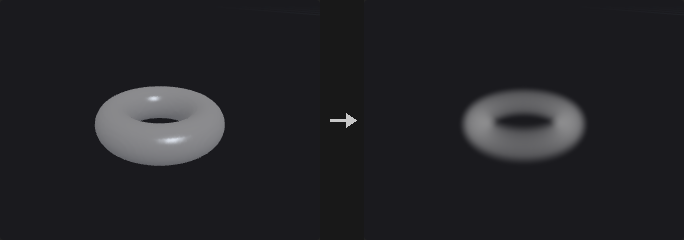

To VDB (from a Houdini volume; Deactivate Tolerance drops background voxels), to Volume (densify, no mask), to Polygons (closed iso-surface at Isovalue; Adaptivity reduces the face count), or between classes: fog -> SDF (Fog Isovalue, ±Half Band voxels) and SDF -> fog (OpenVDB's ramp across the interior band).

**Inputs**

| Input | Type | Description |
|---|---|---|
| `geo` | GEOMETRY | Geometry containing the volumes. |

**Outputs**

| Output | Type | Description |
|---|---|---|
| `geo` | GEOMETRY | The result. |

**Parameters**

| Parameter | Type | Default | Description |
|---|---|---|---|
| Group `group` | string | *(empty)* | Which volumes to process: empty for all, numbers for the n-th volume, or names (wildcards, ^ to exclude) matched against the name attribute. |
| Convert To `convert_to` | menu | VDB | Target: VDB, dense volume, polygons, fog to SDF, or SDF to fog. Options: VDB (`vdb`), Volume (`volume`), Polygons (`polygons`), Fog to SDF (`sdf`), SDF to Fog (`fog`). |
| Isovalue `isovalue` | float | 0 | Surface value for polygons. *Hidden when convert_to ≠ polygons.* |
| Fog Isovalue `fog_isovalue` | float | 0.5 | Fog value that becomes the SDF surface. *Hidden when convert_to ≠ sdf.* |
| Half-Band Voxels `half_band` | float [0.5..] | 3 | Half width of the SDF band in voxels (and the ramp width for SDF to fog). *Hidden when convert_to = vdb } { convert_to = volume } { convert_to = polygons.* |
| Adaptivity `adaptivity` | float [0.0..0.99] | 0 | Reduce the polygon count by this fraction. *Hidden when convert_to ≠ polygons.* |
| Keep Original Geometry `keep_original` | toggle | off | Keep the volumes next to the polygons. *Hidden when convert_to ≠ polygons.* |
| Deactivate Tolerance `deactivate_tolerance` | float [0.0..] | 0 | When converting to VDB, deactivate voxels within this distance of the background. *Hidden when convert_to ≠ vdb.* |

---

### VDB (PCG)

`PCG_VDB` · category `PCG/volume` · Houdini: VDB (SOP)

Creates an empty or filled VDB volume of a given class, type and voxel size.

Creates a VDB prim covering the reference geometry's bounds (+ Padding) or Size / Center at Voxel Size. Class SDF / Fog / None, scalar or vector. Empty (no active voxels, every voxel = Background) unless Fill Active is on (every voxel active with Value). Background defaults to 0 (fog / none) or 3 voxels (SDF).

**Inputs**

| Input | Type | Description |
|---|---|---|
| `reference` *(optional)* | GEOMETRY | Optional reference geometry (see the parameters for what it is used for). |

**Outputs**

| Output | Type | Description |
|---|---|---|
| `geo` | GEOMETRY | The result. |

**Parameters**

| Parameter | Type | Default | Description |
|---|---|---|---|
| Name `name` | string | `density` | Name of the new VDB. |
| Class `vdb_class` | menu | Fog Volume | Grid class: fog volume (density), level set (SDF, negative inside) or none. Options: Fog Volume (`fog`), Level Set (SDF) (`sdf`), None (`none`). |
| Vector (3 Floats) `vector` | toggle | off | Make a vector grid (three floats per voxel) instead of a scalar one. |
| Voxel Size `voxel_size` | float [1e-06..] | 0.1 | Edge length of a voxel in world units (the spacing of the grid samples). |
| Size `size_x` `size_y` `size_z` | float [0.0..] | 1, 1, 1 | Size of the box the grid covers (when there is no reference geometry). |
| Center `center_x` `center_y` `center_z` | float | 0, 0, 0 | Centre of the box. |
| Padding `padding` | float [0.0..] | 0 | Extra space around the reference bounds or the box. |
| Default Background `auto_background` | toggle | on | Use the default background: 0, or 3 voxels for an SDF. |
| Background `background` | float | 0 | Background value (the value of every inactive voxel). *Disabled when auto_background is on.* |
| Fill Active `fill_active` | toggle | off | Make every voxel active with Value; otherwise the VDB is empty. |
| Value `value` | float | 0 | Value of the voxels when Fill Active is on. *Disabled when fill_active is off.* |

---

### VDB Activate (PCG)

`PCG_VDBActivate` · category `PCG/volume` · Houdini: VDB Activate (SOP)

Changes which voxels of a VDB are active, by box, voxel range, dilation, reference geometry or value.

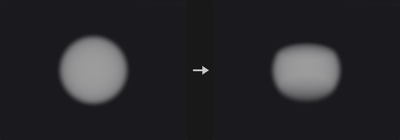

Combines the active region with a region (Union / Intersect / A − B / Copy). Region Type: Position (world box), Voxel (inclusive index box, voxel 0 = the bounding-box minimum), Expand (dilate by voxels or distance; face / face+edge / face+edge+vertex pattern), Reference (second input: bounding box, its VDBs' active voxels, the convex hull of its points, or inside its implicit surface, offset in voxels / world), Deactivate (voxels within Tolerance of the background) and Fill SDF (the inside of an SDF). Union / Copy can write Value.

**Inputs**

| Input | Type | Description |
|---|---|---|
| `geo` | GEOMETRY | Geometry containing the volumes. |
| `reference` *(optional)* | GEOMETRY | Optional reference geometry (see the parameters for what it is used for). |

**Outputs**

| Output | Type | Description |
|---|---|---|
| `geo` | GEOMETRY | The result. |
| `report` | STRING | JSON report (counts and other details). |

**Parameters**

| Parameter | Type | Default | Description |
|---|---|---|---|
| Source Group `group` | string | *(empty)* | Which volumes to process: empty for all, numbers for the n-th volume, or names (wildcards, ^ to exclude) matched against the name attribute. |
| Operation `operation` | menu | Union | How the region combines with the current active region: union, intersect, A − B (deactivate the region) or copy (exactly the region). Options: Union (`union`), Intersect (`intersect`), A - B (`subtract`), Copy (`copy`). |
| Write Value `set_value` | toggle | on | Write Value into the voxels the region activates (Union and Copy). *Hidden when operation = intersect } { operation = subtract.* |
| Value `value` | float | 1 | Value written into the activated voxels. *Hidden when operation = intersect } { operation = subtract.* *Disabled when set_value is off.* |
| Region Type `region` | menu | Position | How the region is given: a world box, an index box, by expanding the active region, from a reference, by deactivating background voxels, or by filling the inside of an SDF. Options: Position (`position`), Voxel (`voxel`), Expand (`expand`), Reference (`reference`), Deactivate (`deactivate`), Fill SDF (`fillsdf`). |
| Center `center_x` `center_y` `center_z` | float | 0, 0, 0 | Centre of the world box; voxels touching the box are in the region. *Hidden when region ≠ position.* |
| Size `size_x` `size_y` `size_z` | float [0.0..] | 0, 0, 0 | Size of the world box. *Hidden when region ≠ position.* |
| Min `min_x` `min_y` `min_z` | int | 0, 0, 0 | Minimum voxel index (voxel 0 is at the bounding-box minimum). *Hidden when region ≠ voxel.* |
| Max `max_x` `max_y` `max_z` | int | 0, 0, 0 | Maximum voxel index (inclusive). *Hidden when region ≠ voxel.* |
| Expand Voxels `expand` | int [0..1000] | 1 | Dilate the active region by this many voxels. *Hidden when region ≠ expand.* |
| Expand Distance `expand_dist` | float [0.0..] | 0 | Dilate by at least this world distance. *Hidden when region ≠ expand.* |
| Expansion Pattern `pattern` | menu | Faces | Neighbour pattern of the dilation. Options: Faces (`face`), Faces and Edges (`faceedge`), Faces, Edges and Vertices (`faceedgevertex`). *Hidden when region ≠ expand.* |
| Bound Group `bound_group` | string | *(empty)* | Which volumes of the reference input are used. *Hidden when region ≠ reference.* |
| Activate Using VDBs `use_vdb` | toggle | off | Activate where the reference VDBs are active. *Hidden when region ≠ reference.* |
| Activate Using Convex Hull `use_hull` | toggle | off | Activate inside the convex hull of the reference points. *Hidden when region ≠ reference.* |
| Activate Using Implicit Surface `use_implicit` | toggle | off | Activate inside the implicit surface of the reference volumes (SDF < offset, fog > 0.5). *Hidden when region ≠ reference.* |
| Voxel Offset `voxel_offset` | float | 0 | Grow (positive) or shrink the hull / implicit surface by this many voxels. *Hidden when region ≠ reference.* |
| World Offset `world_offset` | float | 0 | Grow or shrink the hull / implicit surface by this world distance. *Hidden when region ≠ reference.* |
| Deactivate Tolerance `bg_tolerance` | float [0.0..] | 0 | Deactivate voxels within this distance of the background value. *Hidden when region ≠ deactivate.* |
| Prune `prune` | toggle | off | Collapse constant 8³ leaves afterwards. |
| Prune Tolerance `prune_tolerance` | float [0.0..] | 0 | Tolerance for pruning. *Disabled when prune is off.* |

---

### VDB Activate SDF (PCG)

`PCG_VDBActivateSDF` · category `PCG/volume` · Houdini: VDB Activate SDF (SOP)

Activates a narrow band of a given width around the surface of an SDF, with true distances.

The narrow band |φ| ≤ Half-Width voxels around the surface becomes active and gets true distances (redistanced from the zero crossing); everything else is inactive ±background (the background becomes the band width). The input SDF is assumed to be right near its surface.

**Inputs**

| Input | Type | Description |
|---|---|---|
| `geo` | GEOMETRY | Geometry containing the volumes. |

**Outputs**

| Output | Type | Description |
|---|---|---|
| `geo` | GEOMETRY | The result. |
| `report` | STRING | JSON report (counts and other details). |

**Parameters**

| Parameter | Type | Default | Description |
|---|---|---|---|
| Group `group` | string | *(empty)* | Which volumes to process: empty for all, numbers for the n-th volume, or names (wildcards, ^ to exclude) matched against the name attribute. |
| Half-Width `half_width` | float [0.1..1000.0] | 3 | Width of the active band on each side of the surface, in voxels. |

---

### VDB Advect (PCG)

`PCG_VDBAdvect` · category `PCG/volume` · Houdini: VDB Advect (SOP)

Moves volume content through a velocity field.

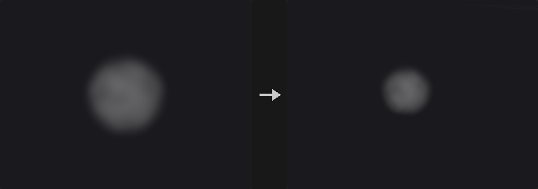

Moves the selected grids through a velocity (a vector VDB, or vel.x/.y/.z volumes) in the second input for Timestep: Semi-Lagrangian / Mid-Point / RK3 / RK4 back-tracing, Substeps, limiter (none / clamp to the source neighbourhood extrema / revert to first order). VDB grids grow so the content does not leave them; SDFs (Respect Grid Class) are renormalised.

**Inputs**

| Input | Type | Description |
|---|---|---|
| `geo` | GEOMETRY | Geometry containing the volumes. |
| `velocity` | GEOMETRY | Velocity volume(s): a vector volume or vel.x / vel.y / vel.z. |

**Outputs**

| Output | Type | Description |
|---|---|---|
| `geo` | GEOMETRY | The result. |

**Parameters**

| Parameter | Type | Default | Description |
|---|---|---|---|
| Group `group` | string | *(empty)* | Which volumes to process: empty for all, numbers for the n-th volume, or names (wildcards, ^ to exclude) matched against the name attribute. |
| Velocity `vel_name` | string | *(empty)* | Name of the velocity volume (empty = the first vector volume, or three scalar volumes vel.x / vel.y / vel.z). |
| Respect Grid Class `respect_class` | toggle | on | Renormalise SDFs after advection. |
| Timestep `timestep` | float [-10000.0..10000.0] | 0.0416667 | Time to advect for. |

*General Advection*

| Parameter | Type | Default | Description |
|---|---|---|---|
| Substeps `substeps` | int [1..1000] | 1 | Substeps per timestep. |

| Parameter | Type | Default | Description |
|---|---|---|---|
| Advection Scheme `advection` | menu | Semi-Lagrangian | Integration scheme of the back-tracing. Options: Semi-Lagrangian (`semi`), Mid-Point (`mid`), 3rd order Runge-Kutta (`rk3`), 4th order Runge-Kutta (`rk4`). |
| Limiter Scheme `limiter` | menu | No limiter | Keeps higher-order schemes from overshooting. Options: No limiter (`none`), Clamp to extrema (`clamp`), Revert to 1st order (`revert`). *Hidden when advection = semi.* |

---

### VDB Advect Points (PCG)

`PCG_VDBAdvectPoints` · category `PCG/volume` · Houdini: VDB Advect Points (SOP)

Moves points through a velocity field or onto a closest-point field.

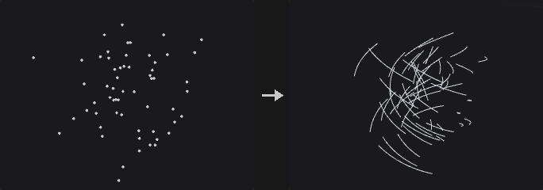

Advection (RK1–RK4 through the velocity for Timestep in Substeps), Projection (to a closest-point vector field, VDB Analysis → Closest Point) or Constrained Advection (both); Output Streamlines adds the paths as polylines.

**Inputs**

| Input | Type | Description |
|---|---|---|
| `geo` | GEOMETRY | Geometry containing the volumes. |
| `velocity` | GEOMETRY | Velocity volume(s): a vector volume or vel.x / vel.y / vel.z. |

**Outputs**

| Output | Type | Description |
|---|---|---|
| `geo` | GEOMETRY | The result. |

**Parameters**

| Parameter | Type | Default | Description |
|---|---|---|---|
| Point Group `group` | string | *(empty)* | Points to move (empty = all). |
| Velocity VDB `vel_name` | string | *(empty)* | Name of the velocity volume (empty = the first vector volume, or three scalar volumes vel.x / vel.y / vel.z). |
| Operation `operation` | menu | Advection | Advect, project onto a closest-point field, or both. Options: Advection (`advection`), Projection (`projection`), Constrained Advection (`constrained`). |
| Integration `integration` | menu | 4th order Runge-Kutta | Runge-Kutta order. Options: 4th order Runge-Kutta (`rk4`), Forward Euler (`rk1`), 2nd order Runge-Kutta (`rk2`), 3rd order Runge-Kutta (`rk3`). *Hidden when operation = projection.* |
| Timestep `timestep` | float [-10000.0..10000.0] | 0.0416667 | Time to advect for. *Hidden when operation = projection.* |
| Substeps `substeps` | int [1..1000] | 1 | Steps per timestep. *Hidden when operation = projection.* |
| Closest-Point VDB `cpt_name` | string | *(empty)* | Closest-point vector volume (from VDB Analysis). *Hidden when operation = advection.* |
| Iterations `iterations` | int [0..100] | 0 | Extra projection passes. *Hidden when operation = advection.* |
| Output Streamlines `streamlines` | toggle | off | Add the point paths as polylines. |

---

### VDB Analysis (PCG)

`PCG_VDBAnalysis` · category `PCG/volume` · Houdini: VDB Analysis (SOP), Volume Analysis (SOP)

Computes gradient, curvature, Laplacian, closest point, divergence, curl, length or normalized fields.

Gradient, Curvature (mean curvature ∇·(∇φ/|∇φ|)), Laplacian, Closest Point (P − φ∇φ) on scalar grids; Divergence, Curl, Length, Normalize on vector grids. Central differences in world units. An optional mask VDB (second input) zeroes the result outside its active voxels. Vector results are vector grids (VDB Vector Split for .x / .y / .z).

**Inputs**

| Input | Type | Description |
|---|---|---|
| `geo` | GEOMETRY | Geometry containing the volumes. |
| `mask` *(optional)* | GEOMETRY | Optional volume used as a mask. |

**Outputs**

| Output | Type | Description |
|---|---|---|
| `geo` | GEOMETRY | The result. |
| `report` | STRING | JSON report (counts and other details). |

**Parameters**

| Parameter | Type | Default | Description |
|---|---|---|---|
| Group `group` | string | *(empty)* | Which volumes to process: empty for all, numbers for the n-th volume, or names (wildcards, ^ to exclude) matched against the name attribute. |
| Operator `operator` | menu | Gradient (Scalar->Vector) | The quantity to compute; the first four need scalar volumes, the rest vector volumes. Options: Gradient (Scalar->Vector) (`gradient`), Curvature (Scalar->Scalar) (`curvature`), Laplacian (Scalar->Scalar) (`laplacian`), Closest Point (Scalar->Vector) (`closestpoint`), Divergence (Vector->Scalar) (`divergence`), Curl (Vector->Vector) (`curl`), Length (Vector->Scalar) (`length`), Normalize (Vector->Vector) (`normalize`). |
| Mask VDB `mask_name` | string | *(empty)* | Name of the mask volume in the mask input (empty = the first one). |
| Output Name `output_name` | menu | Keep Incoming VDB Names | Keep the name, append the operator, or use a custom name. Options: Keep Incoming VDB Names (`keep`), Append Operation Name (`append`), Custom Name (`custom`). |
| Custom Name `custom_name` | string | *(empty)* | Custom output name. *Hidden when output_name ≠ custom.* |

---

### VDB Clip (PCG)

`PCG_VDBClip` · category `PCG/volume` · Houdini: VDB Clip (SOP)

Deactivates the voxels of a VDB outside (or inside) a box, a mask VDB or a camera frustum.

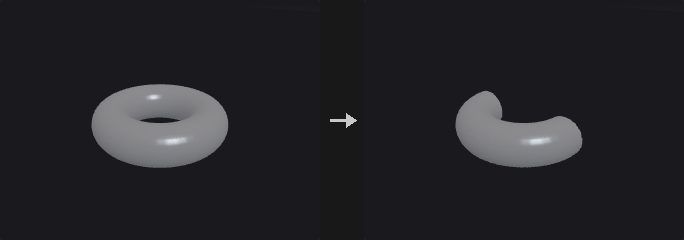

Keeps the active voxels inside (or outside, Keep Inside off) the clipping region -- the bounding box of the second input, the active voxels of a mask VDB there, or the view frustum of the camera input (frame edges, near and far planes) -- expanded by Padding; the rest become inactive background. For SDFs the removed voxels take the outside background value. The grid is not resampled into a frustum-shaped grid; voxels keep their places.

**Inputs**

| Input | Type | Description |
|---|---|---|
| `geo` | GEOMETRY | Geometry containing the volumes. |
| `clip` *(optional)* | GEOMETRY | Geometry whose bounding box (or mask VDB) defines the clipping region; not needed for Camera Frustum. |
| `camera` *(optional)* | PCGCAM | Camera whose view frustum is the clipping region when Clip To is Camera Frustum. |

**Outputs**

| Output | Type | Description |
|---|---|---|
| `geo` | GEOMETRY | The result. |
| `report` | STRING | JSON report (counts and other details). |

**Parameters**

| Parameter | Type | Default | Description |
|---|---|---|---|
| Group `group` | string | *(empty)* | Which volumes to process: empty for all, numbers for the n-th volume, or names (wildcards, ^ to exclude) matched against the name attribute. |
| Keep Inside `inside` | toggle | on | Keep the voxels inside the region (off: keep those outside). |
| Clip To `clipper` | menu | Geometry Bounding Box | What defines the region: the second input's bounding box, a mask VDB in the second input, or the camera's view frustum. Options: Geometry Bounding Box (`geometry`), Mask VDB (`mask`), Camera Frustum (`camera`). |
| Mask VDB `mask` | string | *(empty)* | Name of the mask VDB in the second input. *Hidden when clipper ≠ mask.* |
| Padding `padding` | float | 0 | Grows the region by this world distance. |

---

### VDB Combine (PCG)

`PCG_VDBCombine` · category `PCG/volume` · Houdini: VDB Combine (SOP)

Combines pairs of volumes with arithmetic, SDF boolean or activity operations.

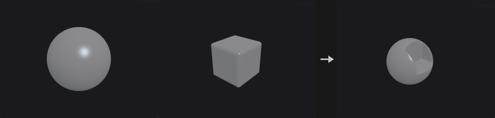

A × A Multiplier with B × B Multiplier (B resampled to A's grid; A grows to cover B for VDBs): Copy A / B, Invert A, Add, Subtract, Multiply, Divide, Maximum, Minimum, (1 − A) × B, A + (1 − A) × B, SDF Union / Intersection / Difference, Replace A with Active B, and Activity Union / Intersection / Difference (masks only). Collation: A/B pairs, each A with the first B, or flatten all A into the first A. Deactivate Background Voxels, Prune.

**Inputs**

| Input | Type | Description |
|---|---|---|
| `a` | GEOMETRY | A volumes. |
| `b` *(optional)* | GEOMETRY | B volumes. |

**Outputs**

| Output | Type | Description |
|---|---|---|
| `geo` | GEOMETRY | The result. |

**Parameters**

| Parameter | Type | Default | Description |
|---|---|---|---|
| Group A `agroup` | string | *(empty)* | A volumes. |
| Group B `bgroup` | string | *(empty)* | B volumes. |
| Collation `collation` | menu | Combine A/B Pairs | How A and B are paired. Options: Combine A/B Pairs (`pairs`), Combine Each A With First B (`awithfirstb`), Flatten All A (`flattena`). |
| Operation `operation` | menu | Add | How A and B combine. Options: Add (`add`), Copy A (`copya`), Copy B (`copyb`), Invert A (`inverta`), Subtract (`subtract`), Multiply (`multiply`), Divide (`divide`), Maximum (`maximum`), Minimum (`minimum`), (1 - A) * B (`compatimesb`), A + (1 - A) * B (`apluscompatimesb`), SDF Union (`sdfunion`), SDF Intersection (`sdfintersect`), SDF Difference (`sdfdifference`), Replace A with Active B (`replacewithactive`), Activity Union (`topounion`), Activity Intersection (`topointersect`), Activity Difference (`topodifference`). |
| A Multiplier `amult` | float | 1 | Multiplies A first. |
| B Multiplier `bmult` | float | 1 | Multiplies B first. |
| Interpolation `interp` | menu | Linear | Interpolation when sampling another grid: linear (trilinear) or nearest. Options: Linear (`linear`), Nearest (`point`). |
| Deactivate Background Voxels `deactivate` | toggle | off | Deactivate voxels equal to the background afterwards. |
| Deactivate Tolerance `bg_tolerance` | float [0.0..] | 0 | Tolerance for that. *Disabled when deactivate is off.* |
| Prune `prune` | toggle | off | Collapse constant leaves afterwards. |
| Prune Tolerance `prune_tolerance` | float [0.0..] | 0 | Tolerance for pruning. *Disabled when prune is off.* |

---

### VDB Densify (PCG)

`PCG_VDBDensify` · category `PCG/volume` · Houdini: VDB Densify (SOP)

Makes every voxel of a VDB active.

Every voxel becomes active (the VDB keeps its values; inactive ones held the background).

**Inputs**

| Input | Type | Description |
|---|---|---|
| `geo` | GEOMETRY | Geometry containing the volumes. |

**Outputs**

| Output | Type | Description |
|---|---|---|
| `geo` | GEOMETRY | The result. |

**Parameters**

| Parameter | Type | Default | Description |
|---|---|---|---|
| Group `group` | string | *(empty)* | Which volumes to process: empty for all, numbers for the n-th volume, or names (wildcards, ^ to exclude) matched against the name attribute. |

---

### VDB Diagnostics (PCG)

`PCG_VDBDiagnostics` · category `PCG/volume` · Houdini: VDB Diagnostics (SOP)

Checks VDBs for invalid values, wrong backgrounds and bad SDF gradients, and optionally repairs them.

Tests: finite values, a valid background, inactive voxels holding the background, SDF gradient magnitude within Tolerance of 1 (in the band), active values within [Min, Max]. Repair: non-finite -> background, inactive -> background, values clamped into the range. Mark: adds "<name>_bad" fog VDBs = 1 at failing voxels. The report lists the counts per volume.

**Inputs**

| Input | Type | Description |
|---|---|---|
| `geo` | GEOMETRY | Geometry containing the volumes. |

**Outputs**

| Output | Type | Description |
|---|---|---|
| `geo` | GEOMETRY | The result. |
| `report` | STRING | JSON report (counts and other details). |

**Parameters**

| Parameter | Type | Default | Description |
|---|---|---|---|
| Group `group` | string | *(empty)* | Which volumes to process: empty for all, numbers for the n-th volume, or names (wildcards, ^ to exclude) matched against the name attribute. |

*Tests*

| Parameter | Type | Default | Description |
|---|---|---|---|
| Finite Values `test_finite` | toggle | on | Check for NaN and infinite values. |

| Parameter | Type | Default | Description |
|---|---|---|---|
| Uniform Background `test_background` | toggle | on | Check that the background value is valid. |
| Inactive Voxels Hold the Background `test_inactive` | toggle | on | Check that inactive voxels hold the background. |
| SDF Gradient Magnitude `test_gradient` | toggle | on | Check that \|∇φ\| is close to 1 in the band of SDFs. |
| Gradient Tolerance `gradient_tolerance` | float [0.0..] | 0.2 | Allowed deviation of \|∇φ\| from 1. *Disabled when test_gradient is off.* |
| Value Range `test_range` | toggle | off | Check that active values lie in the range. |
| Range `range_min` `range_max` | float | 0, 1 | Allowed value range. *Disabled when test_range is off.* |

*Output*

| Parameter | Type | Default | Description |
|---|---|---|---|
| Repair `repair` | toggle | off | Fix what can be fixed: invalid and inactive values become the background, values are clamped into the range. |

| Parameter | Type | Default | Description |
|---|---|---|---|
| Mark Failing Voxels `mark` | toggle | off | Add a fog VDB named <name>_bad that is 1 at failing voxels. |

---

### VDB Extrapolate (PCG)

`PCG_VDBExtrapolate` · category `PCG/volume` · Houdini: VDB Extrapolate (SOP)

Widens an SDF band, converts fog to SDF, or extends fields off a surface.

Expand SDF Narrowband (by Dilation voxels, true distances), Convert Fog VDB to SDF, Renormalize SDF, or Extend Field(s) off the surface of the fog / SDF source: each voxel of the Extension Group grids takes the value at its closest voxel on the surface (what fast sweeping converges to).

**Inputs**

| Input | Type | Description |
|---|---|---|
| `geo` | GEOMETRY | Geometry containing the volumes. |

**Outputs**

| Output | Type | Description |
|---|---|---|
| `geo` | GEOMETRY | The result. |

**Parameters**

| Parameter | Type | Default | Description |
|---|---|---|---|
| Source Group `group` | string | *(empty)* | Source volume (an SDF or a fog volume). |
| Operation `mode` | menu | Expand SDF Narrowband | What to do: widen the SDF band, convert fog to SDF, renormalise, or extend fields off the surface. Options: Expand SDF Narrowband (`dilate`), Convert Fog VDB To SDF (`convert`), Renormalize SDF (`renormalize`), Extend Fields of Fog VDB (`fogext`), Extend Fields of SDF VDB (`sdfext`). |
| Dilation `dilate` | int [0..1000] | 3 | Voxels to widen the band by. *Hidden when mode ≠ dilate.* |
| Dilation Pattern `pattern` | menu | Faces | Neighbour pattern of the widening. Options: Faces (`face`), Faces and Edges (`faceedge`), Faces, Edges and Vertices (`faceedgevertex`). *Hidden when mode ≠ dilate.* |
| Fog Isovalue `fog_isovalue` | float | 0.5 | Surface value of the fog source. *Hidden when mode ≠ convert mode ≠ fogext.* |
| SDF Isovalue `sdf_isovalue` | float | 0 | Surface value of the SDF source. *Hidden when mode ≠ renormalize mode ≠ sdfext.* |
| Extension Group `ext_group` | string | *(empty)* | Volumes (on the same grid) whose values are extended off the surface. *Hidden when mode ≠ fogext mode ≠ sdfext.* |

---

### VDB Fill (PCG)

`PCG_VDBFill` · category `PCG/volume` · Houdini: VDB Fill (SOP)

Sets a box of voxels to a value and activates or deactivates it.

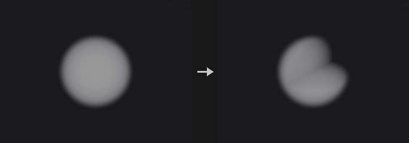

Sets a box -- inclusive index range, world range, or the reference geometry's bounds -- to Value (x only for scalar grids) and makes it active (or inactive: then it takes the background).

**Inputs**

| Input | Type | Description |
|---|---|---|
| `geo` | GEOMETRY | Geometry containing the volumes. |
| `reference` *(optional)* | GEOMETRY | Optional reference geometry (see the parameters for what it is used for). |

**Outputs**

| Output | Type | Description |
|---|---|---|
| `geo` | GEOMETRY | The result. |

**Parameters**

| Parameter | Type | Default | Description |
|---|---|---|---|
| Group `group` | string | *(empty)* | Which volumes to process: empty for all, numbers for the n-th volume, or names (wildcards, ^ to exclude) matched against the name attribute. |
| Bounds `mode` | menu | Min and Max in Index Space | How the box is given: index range, world range, or the reference geometry's bounds. Options: Min and Max in Index Space (`index`), Min and Max in World Space (`world`), Reference Geometry (`geom`). |
| Min Coord `min_x` `min_y` `min_z` | int | 0, 0, 0 | Minimum voxel index. *Hidden when mode ≠ index.* |
| Max Coord `max_x` `max_y` `max_z` | int | 0, 0, 0 | Maximum voxel index (inclusive). *Hidden when mode ≠ index.* |
| Min Coord `wmin_x` `wmin_y` `wmin_z` | float | 0, 0, 0 | Minimum world corner. *Hidden when mode ≠ world.* |
| Max Coord `wmax_x` `wmax_y` `wmax_z` | float | 0, 0, 0 | Maximum world corner. *Hidden when mode ≠ world.* |
| Value `value_x` `value_y` `value_z` | float | 0, 0, 0 | Fill value (x only for scalar volumes). |
| Active `active` | toggle | on | Activate the box (off: deactivate it; it then holds the background). |

---

### VDB Fracture (PCG)

`PCG_VDBFracture` · category `PCG/volume` · Houdini: VDB Fracture (SOP)

Cuts SDF volumes into fragments with cutter shapes.

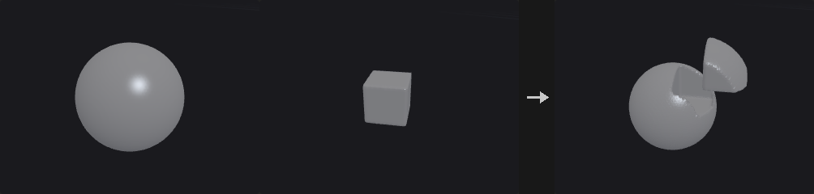

Cuts each SDF with the cutters of the second input (polygons -> exact SDF on the same grid, or SDF VDBs), optionally instanced on the points of the third input (centred, random rotation): inside piece max(φ, φc), residual max(φ, −φc). Allow Cutter Overlap cuts the earlier fragments too; Separate Cutters by Connectivity uses each connected piece of the cutter separately.

**Inputs**

| Input | Type | Description |
|---|---|---|
| `geo` | GEOMETRY | Geometry containing the volumes. |
| `cutters` | GEOMETRY | Cutter geometry: closed polygons or SDF volumes. |
| `points` *(optional)* | GEOMETRY | Points. |

**Outputs**

| Output | Type | Description |
|---|---|---|
| `geo` | GEOMETRY | The result. |
| `report` | STRING | JSON report (counts and other details). |

**Parameters**

| Parameter | Type | Default | Description |
|---|---|---|---|
| Group `group` | string | *(empty)* | Which volumes to process: empty for all, numbers for the n-th volume, or names (wildcards, ^ to exclude) matched against the name attribute. |
| Separate Cutters by Connectivity `separate_cutters` | toggle | off | Cut with each connected piece of the cutter separately. |
| Allow Cutter Overlap `cutter_overlap` | toggle | off | Later cutters cut the fragments made by earlier ones too. |
| Center Cutter Geometry `center_cutter` | toggle | on | Centre the cutter on each instance point. |
| Randomize Cutter Rotation `random_rotation` | toggle | off | Rotate each cutter instance randomly. |
| Random Seed `rand_seed` | int [0..] | 1 | Seed for the random rotations. *Hidden when random_rotation is off.* |
| Split Input Fragments into Primitives `segment_fragments` | toggle | off | Split fragments into their connected pieces. |
| Fragment Group `fragment_group` | string | *(empty)* | Prim group for the fragments. |
| Randomize Fragment Colors `visualize` | toggle | on | Give fragments random colors. |

---

### VDB from Particle Fluid (PCG)

`PCG_VDBFromParticleFluid` · category `PCG/volume` · Houdini: VDB from Particle Fluid (SOP)

Builds a smooth fluid surface SDF from particles.

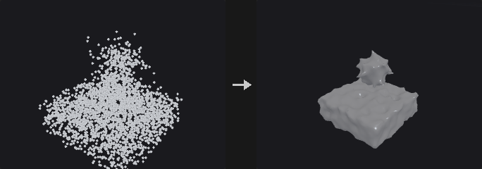

A smooth fluid surface from particles: spheres of Influence Scale × separation / 2 (isolated droplets: Droplet Scale), voxel size = Particle Separation × Voxel Scale, then Dilate, Smooth passes and Erode (in units of half a separation).

**Inputs**

| Input | Type | Description |
|---|---|---|
| `geo` | GEOMETRY | Geometry containing the volumes. |

**Outputs**

| Output | Type | Description |
|---|---|---|
| `geo` | GEOMETRY | The result. |

**Parameters**

| Parameter | Type | Default | Description |
|---|---|---|---|
| Point Group `group` | string | *(empty)* | Points to use (empty = all). |
| Particle Separation `separation` | float [1e-06..] | 0.1 | Typical distance between particles. |
| Voxel Scale `voxel_scale` | float [0.05..4.0] | 0.5 | Voxel size relative to the separation. |
| Influence Scale `influence_scale` | float [0.5..] | 3 | Sphere radius relative to half the separation. |
| Droplet Scale `droplet_scale` | float [0.0..] | 1 | Radius of isolated droplets relative to half the separation. |

*Filtering*

| Parameter | Type | Default | Description |
|---|---|---|---|
| Dilate `dilate` | float [0.0..] | 1 | Grow the surface (in half separations). |

| Parameter | Type | Default | Description |
|---|---|---|---|
| Smooth `smooth` | int [0..20] | 1 | Number of smoothing passes. |
| Erode `erode` | float [0.0..] | 1 | Shrink the surface back (in half separations). |
| Surface VDB Name `name` | string | `surface` | Name of the output volume. |

---

### VDB from Particles (PCG)

`PCG_VDBFromParticles` · category `PCG/volume` · Houdini: VDB from Particles (SOP)

Builds an SDF from points as spheres of their pscale.

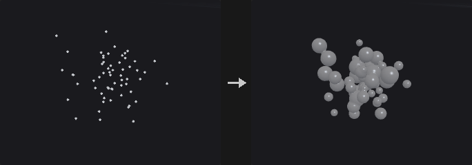

SDF union of spheres of radius pscale × Particle Scale; particles smaller than Minimum Radius (voxels) are ignored; Velocity Trails add tapering spheres back along v × Velocity Scale every Trail Resolution × radius. Optional fog VDB.

**Inputs**

| Input | Type | Description |
|---|---|---|
| `geo` | GEOMETRY | Geometry containing the volumes. |

**Outputs**

| Output | Type | Description |
|---|---|---|
| `geo` | GEOMETRY | The result. |
| `report` | STRING | JSON report (counts and other details). |

**Parameters**

| Parameter | Type | Default | Description |
|---|---|---|---|
| Point Group `group` | string | *(empty)* | Points to use (empty = all). |
| Voxel Size `voxel_size` | float [1e-06..] | 0.1 | Edge length of a voxel in world units (the spacing of the grid samples). |
| Use World Space for Band `world_units` | toggle | off | Give band widths in world units instead of voxels. |
| Half-Band `half_band` | float [0.5..] | 3 | Half width of the narrow band. |
| Particle Scale `particle_scale` | float [0.0..] | 1 | Multiplies pscale (the sphere radius). |
| Minimum Radius `min_radius` | float [0.0..] | 1.5 | Particles smaller than this many voxels are ignored. |
| Velocity Trails `velocity_trails` | toggle | off | Add trails of spheres behind each particle along -v. |
| Velocity Scale `velocity_scale` | float | 1 | Scales the trail length. *Hidden when velocity_trails is off.* |
| Trail Resolution `trail_resolution` | float [0.01..] | 1 | Spacing of the trail spheres, relative to the radius. *Hidden when velocity_trails is off.* |

*Output*

| Parameter | Type | Default | Description |
|---|---|---|---|
| Distance VDB `build_distance` | toggle | on | Output the SDF. |

| Parameter | Type | Default | Description |
|---|---|---|---|
| Distance VDB Name `distance_name` | string | `surface` | Name of the SDF. *Disabled when build_distance is off.* |
| Fog VDB `build_fog` | toggle | off | Output a fog volume. |
| Fog VDB Name `fog_name` | string | `density` | Name of the fog volume. *Disabled when build_fog is off.* |

---

### VDB from Polygons (PCG)

`PCG_VDBFromPolygons` · category `PCG/volume` · Houdini: VDB from Polygons (SOP)

Builds an SDF (and optionally fog and attribute volumes) from a polygon mesh.

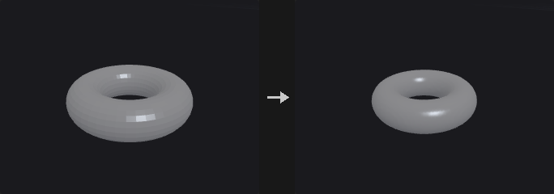

Exact SDF of the mesh at Voxel Size (or the reference VDB's), narrow band of Exterior / Interior Band voxels (or world units; Fill Interior keeps the whole inside), or an unsigned distance field. Optional fog VDB (0 outside, 0 -> 1 across the interior band) and surface attribute VDBs: for each listed point / vertex / prim attribute, the value at the closest surface point.

**Inputs**

| Input | Type | Description |
|---|---|---|
| `geo` | GEOMETRY | Geometry containing the volumes. |
| `reference` *(optional)* | GEOMETRY | Optional reference geometry (see the parameters for what it is used for). |

**Outputs**

| Output | Type | Description |
|---|---|---|
| `geo` | GEOMETRY | The result. |

**Parameters**

| Parameter | Type | Default | Description |
|---|---|---|---|
| Voxel Size `voxel_size` | float [1e-06..] | 0.1 | Edge length of a voxel in world units (the spacing of the grid samples). |
| Use World Space Units for Narrow Band `world_units` | toggle | off | Give band widths in world units instead of voxels. |
| Exterior Band `ext_band` | float [0.0..] | 3 | Width of the band outside the surface. |
| Interior Band `int_band` | float [0.0..] | 3 | Width of the band inside the surface. *Disabled when fill_interior is on.* |
| Fill Interior `fill_interior` | toggle | off | Keep true distances for the whole inside. |
| Unsigned Distance Field `unsigned` | toggle | off | Output unsigned distances (works on open meshes). |

*Output*

| Parameter | Type | Default | Description |
|---|---|---|---|
| Distance VDB `build_distance` | toggle | on | Output the SDF. |

| Parameter | Type | Default | Description |
|---|---|---|---|
| Distance VDB Name `distance_name` | string | `surface` | Name of the SDF. *Disabled when build_distance is off.* |
| Fog VDB `build_fog` | toggle | off | Output a fog volume. |
| Fog VDB Name `fog_name` | string | `density` | Name of the fog volume. *Disabled when build_fog is off.* |

*Attribute Transfer*

| Parameter | Type | Default | Description |
|---|---|---|---|
| Surface Attributes `attributes` | string | *(empty)* | Point, vertex or prim attributes to store in volumes (value at the closest surface point). |

---

### VDB LOD (PCG)

`PCG_VDBLOD` · category `PCG/volume` · Houdini: VDB LOD (SOP)

Builds lower-resolution levels of detail of volumes.

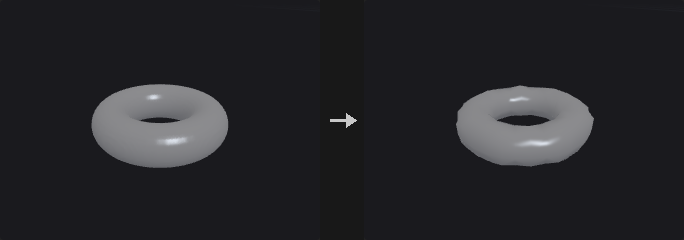

Level L keeps every 2^L-th sample after a 2^L box filter (level 0 = the input). Single Level, Level Range (start, end, step) or an LOD Pyramid of Count levels; outputs are named <name>_level<L> unless Preserve Grid Names (single level).

**Inputs**

| Input | Type | Description |
|---|---|---|
| `geo` | GEOMETRY | Geometry containing the volumes. |

**Outputs**

| Output | Type | Description |
|---|---|---|
| `geo` | GEOMETRY | The result. |

**Parameters**

| Parameter | Type | Default | Description |
|---|---|---|---|
| Group `group` | string | *(empty)* | Which volumes to process: empty for all, numbers for the n-th volume, or names (wildcards, ^ to exclude) matched against the name attribute. |
| LOD Mode `lod` | menu | Single Level | One level, a range of levels, or a pyramid. Options: Single Level (`single`), Level Range (`range`), LOD Pyramid (`mipmaps`). |
| Level `level` | float [0.0..10.0] | 1 | Level to build (0 = the input; level L keeps every 2^L-th voxel). *Hidden when lod ≠ single.* |
| Range `range_start` `range_end` `range_step` | int [0..10] | 0, 2, 1 | Start, end and step of the levels. *Hidden when lod ≠ range.* |
| Count `count` | int [1..10] | 2 | Number of pyramid levels. *Hidden when lod ≠ mipmaps.* |
| Preserve Grid Names `reuse` | toggle | off | Keep the input's name (single level only). *Hidden when lod ≠ single.* |

---

### VDB Merge (PCG)

`PCG_VDBMerge` · category `PCG/volume` · Houdini: VDB Merge (SOP)

Merges VDBs with the same name (or all of them) into one.

VDBs of the same class collated by name / primitive number / all are merged into one whose grid covers all of them (first one's voxel size): fog add (or none), SDF union / intersect, other add.

**Inputs**

| Input | Type | Description |
|---|---|---|
| `geo` | GEOMETRY | Geometry containing the volumes. |

**Outputs**

| Output | Type | Description |
|---|---|---|
| `geo` | GEOMETRY | The result. |
| `report` | STRING | JSON report (counts and other details). |

**Parameters**

| Parameter | Type | Default | Description |
|---|---|---|---|
| Group `group` | string | *(empty)* | Which volumes to process: empty for all, numbers for the n-th volume, or names (wildcards, ^ to exclude) matched against the name attribute. |
| Collation `collation` | menu | Name | Which VDBs merge together: same name, same primitive number, or all. Options: Name (`name`), Primitive Number (`primitive_number`), All (`all`). |
| Interpolation `interp` | menu | Linear | Interpolation when sampling another grid: linear (trilinear) or nearest. Options: Linear (`linear`), Nearest (`point`). |
| Fog VDBs `op_fog` | menu | Add | Operation for fog VDBs. Options: Add (`add`), None (`none`). |
| SDF VDBs `op_sdf` | menu | SDF Union | Operation for SDF VDBs. Options: SDF Union (`sdfunion`), SDF Intersect (`sdfintersect`), None (`none`). |

---

### VDB Metadata (PCG)

`PCG_VDBMetadata` · category `PCG/volume` · Houdini: VDB Metadata (SOP)

Sets the name, class, background and VDB flag of volumes.

Sets the name, class, background and VDB flag of the selected volumes (each with a toggle).

**Inputs**

| Input | Type | Description |
|---|---|---|
| `geo` | GEOMETRY | Geometry containing the volumes. |

**Outputs**

| Output | Type | Description |
|---|---|---|
| `geo` | GEOMETRY | The result. |

**Parameters**

| Parameter | Type | Default | Description |
|---|---|---|---|
| Group `group` | string | *(empty)* | Which volumes to process: empty for all, numbers for the n-th volume, or names (wildcards, ^ to exclude) matched against the name attribute. |
| Name `name` | string | *(empty)* | New name. |
| Name `set_name` | toggle | off | Change the name. |
| Class `vdb_class` | menu | Level Set (SDF) | New grid class. Options: Level Set (SDF) (`sdf`), Fog Volume (`fog`), None (`none`). |
| Class `set_class` | toggle | off | Change the grid class. |
| Background `background` | float | 0 | New background value. |
| Background `set_background` | toggle | off | Change the background value (inactive voxels take it). |
| Is VDB `vdb` | toggle | on | VDB (on) or a dense Houdini volume (off). |
| VDB `set_vdb` | toggle | off | Change whether the prim is a VDB. |

---

### VDB Morph SDF (PCG)

`PCG_VDBMorphSDF` · category `PCG/volume` · Houdini: VDB Morph SDF (SOP)

Moves one SDF surface towards another over time.

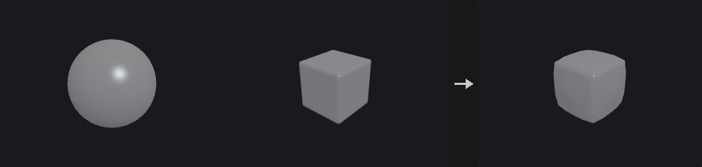

Moves the source surface toward the target (second input): ∂φ/∂t + φ_target |∇φ| = 0 (Godunov upwind, CFL-limited substeps) for Timestep, renormalising every Renorm Steps substeps. A large timestep ends at the target. Optional alpha mask (third input) blends.

**Inputs**

| Input | Type | Description |
|---|---|---|
| `source` | GEOMETRY | Source volumes. |
| `target` | GEOMETRY | Target SDF. |
| `mask` *(optional)* | GEOMETRY | Optional volume used as a mask. |

**Outputs**

| Output | Type | Description |
|---|---|---|
| `geo` | GEOMETRY | The result. |
| `report` | STRING | JSON report (counts and other details). |

**Parameters**

| Parameter | Type | Default | Description |
|---|---|---|---|
| Source `source_group` | string | *(empty)* | Source SDFs. |
| Target `target_group` | string | *(empty)* | Target SDF in the second input. |
| Timestep `timestep` | float [0.0..10000.0] | 0.0416667 | How long to morph; long enough and the source becomes the target. |
| Renormalization Steps `renorm_steps` | int [0..100] | 3 | Renormalise every this many substeps (0 = never). |

*Alpha Mask*

| Parameter | Type | Default | Description |
|---|---|---|---|
| Alpha Mask `mask_name` | string | *(empty)* | Name of the mask volume in the mask input (empty = the first one). |

| Parameter | Type | Default | Description |
|---|---|---|---|
| Invert Alpha Mask `invert_mask` | toggle | off | Invert the mask: 0 becomes 1 and 1 becomes 0. |
| Min Mask Cutoff `min_mask` | float | 0 | Mask values at or below this count as 0. |
| Max Mask Cutoff `max_mask` | float | 1 | Mask values at or above this count as 1. |

---

### VDB Noise (PCG)

`PCG_VDBNoise` · category `PCG/volume` · Houdini: VDB Noise (SOP)

Adds fractal noise to the surface of an SDF.

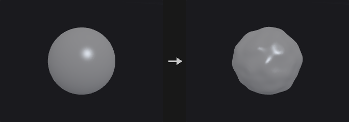

φ − Amplitude × fractal Perlin noise (Frequency, Octaves, Lacunarity, Gain, Roughness, Noise Offset); Straight / Absolute / Inverse Absolute. Positive noise pushes the surface out. An optional mask volume (second input) suppresses or scales the noise.

**Inputs**

| Input | Type | Description |
|---|---|---|
| `geo` | GEOMETRY | Geometry containing the volumes. |
| `mask` *(optional)* | GEOMETRY | Optional volume used as a mask. |

**Outputs**

| Output | Type | Description |
|---|---|---|
| `geo` | GEOMETRY | The result. |

**Parameters**

| Parameter | Type | Default | Description |
|---|---|---|---|
| Group `group` | string | *(empty)* | Which volumes to process: empty for all, numbers for the n-th volume, or names (wildcards, ^ to exclude) matched against the name attribute. |
| Amplitude `amp` | float | 1 | Noise amplitude; positive noise pushes the surface out. |
| Frequency `freq` | float | 1 | Noise frequency. |
| Octaves `octaves` | int [0..16] | 0 | Extra octaves. |
| Lacunarity `lacunarity` | float | 2 | Frequency multiplier per octave. |
| Gain `gain` | float | 1 | Amplitude multiplier per octave. |
| Roughness `roughness` | float | 1 | Extra amplitude multiplier per octave. |
| Surface Offset `surface_offset` | float | 0 | Offset of the surface the noise is applied around. |
| Noise Offset `noise_offset_x` `noise_offset_y` `noise_offset_z` | float | 0, 0, 0 | Offset of the noise pattern. |
| Noise Mode `mode` | menu | Straight | Straight noise, its absolute value, or one minus its absolute value. Options: Straight (`straight`), Absolute (`abs`), Inverse Absolute (`invabs`). |

*Mask*

| Parameter | Type | Default | Description |
|---|---|---|---|
| Mask Group `mask_group` | string | *(empty)* | Mask volume in the second input. |

| Parameter | Type | Default | Description |
|---|---|---|---|
| Mask `mask_mode` | menu | No noise if mask < threshold | How the mask limits or scales the noise. Options: No noise if mask < threshold (`maskless`), No noise if mask > threshold (`maskgreater`), Mask (normalized) (`maskgreaternml`), Inverted mask (normalized) (`masklessnml`), Absolute mask (`maskgreaterabs`). |
| Mask Threshold `threshold` | float | 0 | Mask threshold. |
| Falloff `falloff` | float [0.0..] | 0 | Soft range around the threshold. |

---

### VDB Occlusion Mask (PCG)

`PCG_VDBOcclusionMask` · category `PCG/volume` · Houdini: VDB Occlusion Mask (SOP)

Marks the voxels hidden from a camera behind a surface.

A fog VDB "<name>_occlusion" on each SDF's grid: 1 where the voxel is hidden from the camera because the line of sight to the eye passes through the inside first; Erode shrinks it. (Houdini builds the mask in a camera frustum grid; here it lives on the input grid.)

**Inputs**

| Input | Type | Description |
|---|---|---|
| `geo` | GEOMETRY | Geometry containing the volumes. |
| `camera` | PCGCAM | The camera. |

**Outputs**

| Output | Type | Description |
|---|---|---|
| `geo` | GEOMETRY | The result. |

**Parameters**

| Parameter | Type | Default | Description |
|---|---|---|---|
| Group `group` | string | *(empty)* | Which volumes to process: empty for all, numbers for the n-th volume, or names (wildcards, ^ to exclude) matched against the name attribute. |
| Erode `erode` | int [0..100] | 0 | Shrink the mask by this many voxels. |
| Ray Steps `steps` | int [4..1024] | 64 | Samples along each line of sight. |

---

### VDB Platonic (PCG)

`PCG_VDBPlatonic` · category `PCG/volume` · Houdini: VDB Platonic (SOP)

Creates the SDF or fog of a sphere or a Platonic solid.

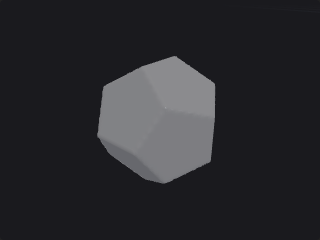

SDF (narrow band of Half-Band Width voxels) or fog of a sphere or a Platonic solid of the given radius (circumradius for the solids) and centre; exact distances to the solid's faces.

**Outputs**

| Output | Type | Description |
|---|---|---|
| `geo` | GEOMETRY | The result. |

**Parameters**

| Parameter | Type | Default | Description |
|---|---|---|---|
| Solid Type `solid` | menu | Sphere | Shape. Options: Sphere (`sphere`), Tetrahedron (`tetrahedron`), Cube (`cube`), Octahedron (`octahedron`), Dodecahedron (`dodecahedron`), Icosahedron (`icosahedron`). |
| Radius/Size `radius` | float [1e-06..] | 1 | Radius of the sphere or circumradius of the solid. |
| Center `center_x` `center_y` `center_z` | float | 0, 0, 0 | Centre. |
| Voxel Size `voxel_size` | float [1e-06..] | 0.1 | Edge length of a voxel in world units (the spacing of the grid samples). |
| Half-Band Width `half_width` | float [0.5..] | 3 | Half width of the narrow band in voxels. |
| Convert to Fog Volume `fog` | toggle | off | Output fog instead of an SDF. |
| Name `name` | string | `surface` | Name of the output volume. |

---

### VDB Points Group (PCG)

`PCG_VDBPointsGroup` · category `PCG/volume` · Houdini: VDB Points Group (SOP)

Groups points by percentage, bounding box or SDF range.

A point group from: a percentage or a count (random, or seeded by an attribute), a bounding box or the bounds of the second input, and an SDF range (the second input's SDF, Min ≤ φ ≤ Max, invertible). Filters combine with AND.

**Inputs**

| Input | Type | Description |
|---|---|---|
| `geo` | GEOMETRY | Geometry containing the volumes. |
| `reference` *(optional)* | GEOMETRY | Optional reference geometry (see the parameters for what it is used for). |

**Outputs**

| Output | Type | Description |
|---|---|---|
| `geo` | GEOMETRY | The result. |
| `report` | STRING | JSON report (counts and other details). |

**Parameters**

| Parameter | Type | Default | Description |
|---|---|---|---|
| Group Name `group_name` | string | `group1` | Name of the group to create. |

*Number*

| Parameter | Type | Default | Description |
|---|---|---|---|
| Number `enable_number` | toggle | off | Filter by number. |

| Parameter | Type | Default | Description |
|---|---|---|---|
| Mode `number_mode` | menu | Percentage | Percentage or total count. Options: Percentage (`percentage`), Total (`total`). |
| Percent `percent` | float [0.0..100.0] | 10 | Percentage of points. *Hidden when number_mode ≠ percentage.* |
| Count `count` | int [0..] | 5000 | Number of points. *Hidden when number_mode ≠ total.* |
| Attribute Seed `seed_attribute` | string | *(empty)* | Attribute used to make the random choice stable (empty = random). |

*Bounding*

| Parameter | Type | Default | Description |
|---|---|---|---|
| Bounding `enable_box` | toggle | off | Filter by a box. |

| Parameter | Type | Default | Description |
|---|---|---|---|
| Mode `bound_mode` | menu | Bounding Box | A box, or the bounds of the second input. Options: Bounding Box (`boundingbox`), Bounding Object (`boundingobject`). |
| Size `size_x` `size_y` `size_z` | float [0.0..] | 1, 1, 1 | Size of the box. *Hidden when bound_mode ≠ boundingbox.* |
| Center `center_x` `center_y` `center_z` | float | 0, 0, 0 | Centre of the box. *Hidden when bound_mode ≠ boundingbox.* |

*SDF*

| Parameter | Type | Default | Description |
|---|---|---|---|
| SDF `enable_sdf` | toggle | off | Filter by SDF value. |

| Parameter | Type | Default | Description |
|---|---|---|---|
| Name `sdf_name` | string | *(empty)* | SDF volume (second input). |
| SDF Minimum `sdf_min` | float | -0.1 | Lowest SDF value. |
| SDF Minimum `use_min` | toggle | on | Use the minimum. |
| SDF Maximum `sdf_max` | float | 0.1 | Highest SDF value. |
| SDF Maximum `use_max` | toggle | on | Use the maximum. |
| Invert `invert` | toggle | off | Invert the SDF test. |
| Random Seed `rand_seed` | int [0..] | 0 | Random seed. |

---

### VDB Potential Flow (PCG)

`PCG_VDBPotentialFlow` · category `PCG/volume` · Houdini: VDB Potential Flow (SOP)

Computes the potential flow of a fluid around the solid of an SDF.

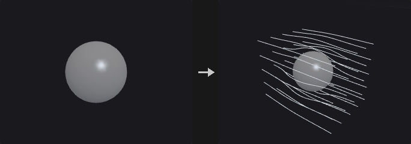

Flow around the solid of an SDF in a domain dilated by Dilation Voxels: ∇²φ = 0 with no flow through the solid (Neumann, driven by the Background Velocity) and φ = 0 at the domain border; outputs the velocity ∇φ (+ background when Apply Background Velocity) as a vector VDB, and optionally the potential.

**Inputs**

| Input | Type | Description |
|---|---|---|
| `geo` | GEOMETRY | Geometry containing the volumes. |

**Outputs**

| Output | Type | Description |
|---|---|---|
| `geo` | GEOMETRY | The result. |

**Parameters**

| Parameter | Type | Default | Description |
|---|---|---|---|
| Group `group` | string | *(empty)* | Which volumes to process: empty for all, numbers for the n-th volume, or names (wildcards, ^ to exclude) matched against the name attribute. |
| Dilation Voxels `dilation_voxels` | int [1..1000] | 10 | Size of the flow domain around the solid, in voxels. |
| Iterations `iterations` | int [1..] | 1000 | Maximum solver iterations. |
| Tolerance `tolerance` | float [0.0..1.0] | 0.0001 | Relative residual at which the solver stops. |
| Use Background Velocity `use_background` | toggle | on | Drive the flow with a background velocity. |
| Background Velocity `background_x` `background_y` `background_z` | float | 1, 0, 0 | Background (free-stream) velocity. *Disabled when use_background is off.* |
| Apply Background Velocity to Flow Field `apply_background` | toggle | on | Add the background velocity to the output. |
| Output Potential `output_potential` | toggle | off | Add the potential volume. |
| Velocity Name `name` | string | `vel` | Name of the velocity volume. |

---

### VDB Project Non-Divergent (PCG)

`PCG_VDBProjectNonDivergent` · category `PCG/volume` · Houdini: VDB Project Non-Divergent (SOP)

Removes the divergence from a velocity field (pressure projection).

Removes the divergence of vector grids: ∇²p = ∇·u (conjugate gradient, Iterations / Tolerance), u − ∇p. Without a collider p = 0 beyond the grid; Bounding Box collider = no flow through the grid border; a VDB collider (second input) = no flow into its inside / active voxels. Output Pressure adds p.

**Inputs**

| Input | Type | Description |
|---|---|---|
| `geo` | GEOMETRY | Geometry containing the volumes. |
| `collider` *(optional)* | GEOMETRY | Optional collider volume. |

**Outputs**

| Output | Type | Description |
|---|---|---|
| `geo` | GEOMETRY | The result. |
| `report` | STRING | JSON report (counts and other details). |

**Parameters**

| Parameter | Type | Default | Description |
|---|---|---|---|
| Group `group` | string | *(empty)* | Which volumes to process: empty for all, numbers for the n-th volume, or names (wildcards, ^ to exclude) matched against the name attribute. |
| Iterations `iterations` | int [1..] | 1000 | Maximum solver iterations. |
| Tolerance `tolerance` | float [0.0..1.0] | 0.0001 | Relative residual at which the solver stops. |
| Use Collider `use_collider` | toggle | off | Use a collider. |
| Collider Type `collider_type` | menu | Bounding Box | Bounding box (no flow through the grid border) or a static VDB. Options: Bounding Box (`bbox`), Static VDB (`static`). *Disabled when use_collider is off.* |
| Collider `collider_name` | string | *(empty)* | Collider volume in the second input. *Hidden when collider_type ≠ static.* |
| Invert Collider `invert_collider` | toggle | off | Swap the collider's inside and outside. *Hidden when collider_type ≠ static.* |
| Output Pressure `output_pressure` | toggle | off | Add the pressure volume. |

---

### VDB Prune (PCG)

`PCG_VDBPrune` · category `PCG/volume` · Houdini: VDB Prune (SOP)

Collapses constant regions of a VDB and deactivates background regions.

Value: 8³ leaves whose values differ by at most Tolerance collapse to one constant (their mean). Inactive: leaves within Tolerance of the background are deactivated. Level Set: voxels with |φ| ≥ background are deactivated (outside +background, inside −background).

**Inputs**

| Input | Type | Description |
|---|---|---|
| `geo` | GEOMETRY | Geometry containing the volumes. |

**Outputs**

| Output | Type | Description |
|---|---|---|
| `geo` | GEOMETRY | The result. |
| `report` | STRING | JSON report (counts and other details). |

**Parameters**

| Parameter | Type | Default | Description |
|---|---|---|---|
| Group `group` | string | *(empty)* | Which volumes to process: empty for all, numbers for the n-th volume, or names (wildcards, ^ to exclude) matched against the name attribute. |
| Mode `mode` | menu | Value | Value: collapse leaves of (almost) equal values; Inactive: deactivate leaves at the background; Level Set: deactivate voxels at or beyond the band. Options: Value (`value`), Inactive (`inactive`), Level Set (`levelset`). |
| Tolerance `tolerance` | float [0.0..] | 0 | Values within this tolerance count as equal. *Hidden when mode = levelset.* |

---

### VDB Ray (PCG)

`PCG_VDBRay` · category `PCG/volume` · Houdini: VDB Ray (SOP)

Projects points onto the surface of a volume, along their normals or to the closest point.

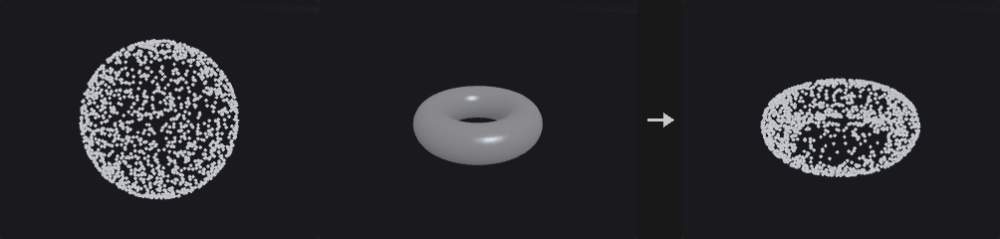

Moves points onto the surface of the VDB in the second input: Ray Intersection along N (or reversed, from Bias; nearest or farthest hit; sphere tracing + bisection) or Closest Surface Point (the exact closest point on the extracted iso surface, at any distance from it). Scale moves only part of the way; Store Distances writes dist; Ray Hit Group collects hits.

**Inputs**

| Input | Type | Description |
|---|---|---|
| `geo` | GEOMETRY | Geometry containing the volumes. |
| `vdb` | GEOMETRY | The volume to project onto. |

**Outputs**

| Output | Type | Description |
|---|---|---|
| `geo` | GEOMETRY | The result. |
| `report` | STRING | JSON report (counts and other details). |

**Parameters**

| Parameter | Type | Default | Description |
|---|---|---|---|
| Point Group `group` | string | *(empty)* | Points to project (empty = all). |
| Method `method` | menu | Ray Intersection | Along the normals (ray intersection) or to the closest surface point. Options: Ray Intersection (`rayintersection`), Closest Surface Point (`closestpoint`). |
| Isovalue `isovalue` | float | 0 | Value that defines the surface (0 for an SDF, around 0.5 for fog). |
| Transform `transform` | toggle | on | Move the points. |
| Scale `scale` | float | 1 | Move only this fraction of the way. *Disabled when transform is off.* |
| Store Distances `store_dist` | toggle | off | Store the distance moved in dist. |
| Intersect Farthest Surface `farthest` | toggle | off | Use the farthest intersection instead of the nearest. *Hidden when method ≠ rayintersection.* |
| Reverse Rays `reverse` | toggle | off | Shoot rays against the normals. *Hidden when method ≠ rayintersection.* |
| Bias `bias` | float | 0 | Start the rays this far along them. *Hidden when method ≠ rayintersection.* |
| Create Ray Hit Group `create_group` | toggle | off | Put points that hit into a group. |
| Ray Hit Group `hit_group` | string | `rayHitGroup` | Name of the hit group. *Disabled when create_group is off.* |

---

### VDB Rebuild SDF (PCG)

`PCG_VDBRebuildSDF` · category `PCG/volume` · Houdini: VDB Rebuild SDF (SOP)

Builds a clean SDF from an iso contour of any scalar volume.

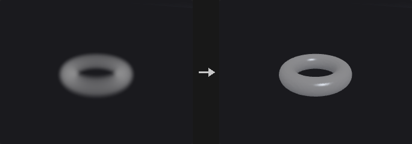

An SDF from the Isovalue contour of any scalar grid (fog: dense = inside), with new exterior / interior bands (voxels or world units); Fill Interior keeps the whole inside active.

**Inputs**

| Input | Type | Description |
|---|---|---|
| `geo` | GEOMETRY | Geometry containing the volumes. |

**Outputs**

| Output | Type | Description |
|---|---|---|
| `geo` | GEOMETRY | The result. |

**Parameters**

| Parameter | Type | Default | Description |
|---|---|---|---|
| Group `group` | string | *(empty)* | Which volumes to process: empty for all, numbers for the n-th volume, or names (wildcards, ^ to exclude) matched against the name attribute. |
| Isovalue `isovalue` | float | 0 | Value that defines the surface (0 for an SDF, around 0.5 for fog). |
| Use World Space Units `world_units` | toggle | off | Give band widths in world units instead of voxels. |
| Exterior Band `ext_band` | float [0.0..] | 3 | Width of the band outside. |
| Interior Band `int_band` | float [0.0..] | 3 | Width of the band inside. *Disabled when fill_interior is on.* |
| Fill Interior `fill_interior` | toggle | off | Keep the whole inside active. |

---

### VDB Remap (PCG)

`PCG_VDBRemap` · category `PCG/volume` · Houdini: VDB Remap (SOP)

Remaps volume values from one range to another through a ramp.

Input Range -> Output Range through the Transfer Function ramp (empty = linear). Below / Above the input range: Clamp, Preserve (keep the value) or Extrapolate (continue the end slope). The background is remapped too; Deactivate turns voxels equal to the new background inactive.

**Inputs**

| Input | Type | Description |
|---|---|---|
| `geo` | GEOMETRY | Geometry containing the volumes. |

**Outputs**

| Output | Type | Description |
|---|---|---|
| `geo` | GEOMETRY | The result. |

**Parameters**

| Parameter | Type | Default | Description |
|---|---|---|---|
| Group `group` | string | *(empty)* | Which volumes to process: empty for all, numbers for the n-th volume, or names (wildcards, ^ to exclude) matched against the name attribute. |
| Below Minimum `below` | menu | Clamp | What happens below the input range: clamp, keep the value, or extrapolate. Options: Clamp (`clamp`), Preserve (`preserve`), Extrapolate (`extrapolate`). |
| Above Maximum `above` | menu | Clamp | What happens above the input range. Options: Clamp (`clamp`), Preserve (`preserve`), Extrapolate (`extrapolate`). |
| Input Range `in_min` `in_max` | float | 0, 1 | Input range. |
| Output Range `out_min` `out_max` | float | 0, 1 | Output range. |
| Transfer Function `ramp` | string | *(empty)* | Transfer function from the input range (x) to the output range (y); empty = linear. |
| Deactivate Background Voxels `deactivate` | toggle | off | Deactivate voxels that end up equal to the remapped background. |

---

### VDB Renormalize SDF (PCG)

`PCG_VDBRenormalizeSDF` · category `PCG/volume` · Houdini: VDB Renormalize SDF (SOP)

Restores the distance property of an SDF after it was edited.

Restores |∇φ| = 1 (exact distance to the zero crossing), keeping the band.

**Inputs**

| Input | Type | Description |
|---|---|---|
| `geo` | GEOMETRY | Geometry containing the volumes. |

**Outputs**

| Output | Type | Description |
|---|---|---|
| `geo` | GEOMETRY | The result. |

**Parameters**

| Parameter | Type | Default | Description |
|---|---|---|---|
| Group `group` | string | *(empty)* | Which volumes to process: empty for all, numbers for the n-th volume, or names (wildcards, ^ to exclude) matched against the name attribute. |
| Iterations `iterations` | int [1..10] | 1 | Number of renormalisation passes. |

---

### VDB Resample (PCG)

`PCG_VDBResample` · category `PCG/volume` · Houdini: VDB Resample (SOP)

Resamples volumes to a new voxel size or to match a reference VDB.

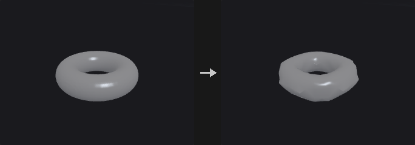

Same world content on a new grid: Explicitly (scale the voxel size, translate in voxels, rotate about the pivot -- the grid stays axis aligned), To Match Reference VDB (second input), Using Voxel Size Only, or Using Voxel Scale Only. Nearest / linear interpolation; SDFs are redistanced (Rebuild SDF).

**Inputs**

| Input | Type | Description |
|---|---|---|
| `geo` | GEOMETRY | Geometry containing the volumes. |
| `reference` *(optional)* | GEOMETRY | Optional reference geometry (see the parameters for what it is used for). |

**Outputs**

| Output | Type | Description |
|---|---|---|
| `geo` | GEOMETRY | The result. |

**Parameters**

| Parameter | Type | Default | Description |
|---|---|---|---|
| Group `group` | string | *(empty)* | Which volumes to process: empty for all, numbers for the n-th volume, or names (wildcards, ^ to exclude) matched against the name attribute. |
| Define Transform `mode` | menu | Using Voxel Size Only | How the new grid is defined. Options: Using Voxel Size Only (`voxelsizeonly`), Explicitly (`explicit`), To Match Reference VDB (`refvdb`), Using Voxel Scale Only (`voxelscaleonly`). |
| Reference `ref_name` | string | *(empty)* | Reference VDB in the second input. *Hidden when mode ≠ refvdb.* |
| Interpolation `interp` | menu | Linear | Interpolation when sampling another grid: linear (trilinear) or nearest. Options: Linear (`linear`), Nearest (`point`). |
| Translate Voxels `t_x` `t_y` `t_z` | float | 0, 0, 0 | Translation in voxels. *Hidden when mode ≠ explicit.* |
| Rotate `r_x` `r_y` `r_z` | float | 0, 0, 0 | Rotation in degrees (X, then Y, then Z). *Hidden when mode ≠ explicit.* |
| Scale `s_x` `s_y` `s_z` | float | 1, 1, 1 | Scale of the voxel size. *Hidden when mode ≠ explicit.* |
| Pivot `p_x` `p_y` `p_z` | float | 0, 0, 0 | Pivot for rotation and scale. *Hidden when mode ≠ explicit.* |
| Voxel Size `voxel_size` | float [1e-06..] | 0.1 | Edge length of a voxel in world units (the spacing of the grid samples). *Hidden when mode ≠ voxelsizeonly.* |
| Voxel Scale `voxel_scale` | float [1e-06..] | 1 | Voxel size multiplier. *Hidden when mode ≠ voxelscaleonly.* |
| Rebuild SDF `rebuild_sdf` | toggle | on | Redistance SDFs after resampling. |
| Transform Vectors `xform_vectors` | toggle | off | Rotate vector values too. |

---

### VDB Scatter (PCG)

`PCG_VDBScatter` · category `PCG/volume` · Houdini: VDB Scatter (SOP)

Scatters points in the active voxels of volumes.

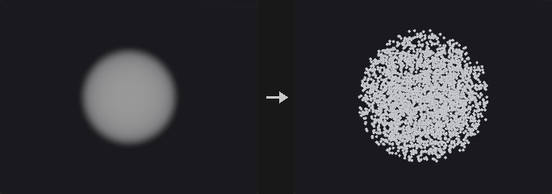

Points in the active voxels: Point Total, Point Density (per unit volume) or Points Per Voxel; Spread jitters within the voxel; Scale Density by Voxel Values (fog / other); SDFs scatter in the Interior, on the Isosurface (projected onto it) or in the Narrow Band. Keep Original Geometry, Scatter Group.

**Inputs**

| Input | Type | Description |
|---|---|---|
| `geo` | GEOMETRY | Geometry containing the volumes. |

**Outputs**

| Output | Type | Description |
|---|---|---|
| `geo` | GEOMETRY | The result. |

**Parameters**

| Parameter | Type | Default | Description |
|---|---|---|---|
| Group `group` | string | *(empty)* | Which volumes to process: empty for all, numbers for the n-th volume, or names (wildcards, ^ to exclude) matched against the name attribute. |
| Keep Original Geometry `keep` | toggle | off | Keep the incoming geometry in the output. |
| Mode `mode` | menu | Point Total | How many points: a total, a density per unit volume, or per voxel. Options: Point Total (`count`), Point Density (`density`), Points Per Voxel (`pointspervoxel`). |
| Point Total `count` | int [0..] | 5000 | Total number of points. *Hidden when mode ≠ count.* |
| Points Per Voxel `points_per_voxel` | float [0.0..] | 8 | Points per active voxel. *Hidden when mode ≠ pointspervoxel.* |
| Point Density `density` | float [0.0..] | 1 | Points per unit volume. *Hidden when mode ≠ density.* |
| Scale Density by Voxel Values `multiply` | toggle | off | Scale the density by the voxel values (fog). |
| Spread `spread` | float [0.0..1.0] | 1 | How far points may move from the voxel centre (fraction of a voxel). |
| SDF Domain `sdf_domain` | menu | Narrow Band | For SDFs: the narrow band, the interior, or the iso-surface. Options: Narrow Band (`band`), Interior (`interior`), Isosurface (`surface`). |
| Isovalue `isovalue` | float | 0 | Value that defines the surface (0 for an SDF, around 0.5 for fog). |
| Random Seed `rand_seed` | int [0..] | 0 | Random seed. |
| Scatter Group `scatter_group` | string | *(empty)* | Point group for the new points (empty = none). |

---

### VDB Segment by Connectivity (PCG)

`PCG_VDBSegment` · category `PCG/volume` · Houdini: VDB Segment by Connectivity (SOP)

Splits volumes into their connected pieces.

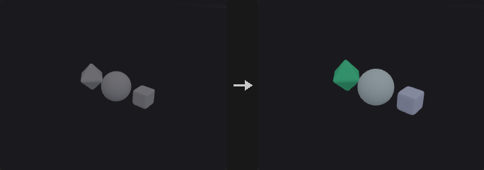

Splits each volume into connected pieces: SDF interiors, or active non-background voxels of fog / other grids (face connectivity). Pieces are named <name>_<n> (Append Segment Number) and get a random Cd (Color Segments).

**Inputs**

| Input | Type | Description |
|---|---|---|
| `geo` | GEOMETRY | Geometry containing the volumes. |

**Outputs**

| Output | Type | Description |
|---|---|---|
| `geo` | GEOMETRY | The result. |
| `report` | STRING | JSON report (counts and other details). |

**Parameters**

| Parameter | Type | Default | Description |
|---|---|---|---|
| Group `group` | string | *(empty)* | Which volumes to process: empty for all, numbers for the n-th volume, or names (wildcards, ^ to exclude) matched against the name attribute. |
| Color Segments `color` | toggle | on | Give each piece a random color (Cd). |
| Append Segment Number to Grid Name `append_number` | toggle | on | Append the piece number to the name. |

---

### VDB Smooth (PCG)

`PCG_VDBSmooth` · category `PCG/volume` · Houdini: VDB Smooth (SOP)

Smooths volumes with a mean, Gaussian or median filter, or offsets them.

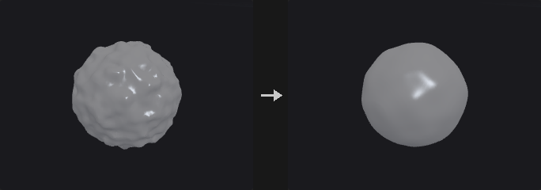

Mean / Gaussian / Median over a cube of ± Filter Voxel Radius (or world radius), or Offset, Iterations times; only active voxels change; an optional alpha mask (second input, Min / Max cutoff, invert) blends.

**Inputs**

| Input | Type | Description |
|---|---|---|
| `geo` | GEOMETRY | Geometry containing the volumes. |
| `mask` *(optional)* | GEOMETRY | Optional volume used as a mask. |

**Outputs**

| Output | Type | Description |
|---|---|---|
| `geo` | GEOMETRY | The result. |

**Parameters**

| Parameter | Type | Default | Description |
|---|---|---|---|
| Group `group` | string | *(empty)* | Which volumes to process: empty for all, numbers for the n-th volume, or names (wildcards, ^ to exclude) matched against the name attribute. |
| Operation `operation` | menu | Mean Value | Filter type, or Offset (add a constant). Options: Mean Value (`mean`), Gaussian (`gauss`), Median Value (`median`), Offset (`offset`). |
| Use World Space Radius Units `world_units` | toggle | off | Give the radius in world units. *Hidden when operation = offset.* |
| Filter Voxel Radius `radius` | int [0..100] | 1 | Filter radius in voxels. *Hidden when world_units is on } { operation = offset.* |
| Filter Radius `world_radius` | float [0.0..] | 0.1 | Filter radius in world units. *Hidden when world_units is off } { operation = offset.* |
| Iterations `iterations` | int [0..1000] | 4 | Number of passes. |
| Offset `offset` | float | 1 | Value added per pass in Offset mode. *Hidden when operation ≠ offset.* |

*Alpha Mask*

| Parameter | Type | Default | Description |
|---|---|---|---|
| Alpha Mask `mask_name` | string | *(empty)* | Name of the mask volume in the mask input (empty = the first one). |

| Parameter | Type | Default | Description |
|---|---|---|---|
| Invert Alpha Mask `invert_mask` | toggle | off | Invert the mask: 0 becomes 1 and 1 becomes 0. |
| Min Mask Cutoff `min_mask` | float | 0 | Mask values at or below this count as 0. |
| Max Mask Cutoff `max_mask` | float | 1 | Mask values at or above this count as 1. |

---

### VDB to Spheres (PCG)

`PCG_VDBToSpheres` · category `PCG/volume` · Houdini: VDB to Spheres (SOP)

Fills the inside of an SDF with non-overlapping spheres (points with pscale).

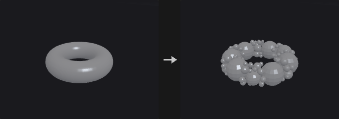

Greedy packing inside the Isovalue contour: Point Count random candidates, repeatedly the deepest becomes a sphere; others shrink to stay outside it (or, Overlapping, only those inside it are dropped). Radii in voxels or world units, Min / Max Radius and Min / Max Spheres. Output: points with pscale and id (copy a sphere onto them; sphere primitives are not a prim type here).

**Inputs**

| Input | Type | Description |
|---|---|---|
| `geo` | GEOMETRY | Geometry containing the volumes. |

**Outputs**

| Output | Type | Description |
|---|---|---|
| `geo` | GEOMETRY | The result. |

**Parameters**

| Parameter | Type | Default | Description |
|---|---|---|---|
| Group `group` | string | *(empty)* | Which volumes to process: empty for all, numbers for the n-th volume, or names (wildcards, ^ to exclude) matched against the name attribute. |
| Isovalue `isovalue` | float | 0 | Value that defines the surface (0 for an SDF, around 0.5 for fog). |
| Use World Space Units `world_units` | toggle | off | Give band widths in world units instead of voxels. |
| Min Radius `radius_min` | float [0.0..] | 1 | Smallest sphere radius. |
| Min Radius `use_radius_min` | toggle | on | Use a minimum radius. |
| Max Radius `radius_max` | float [0.0..] | 100 | Largest sphere radius. |
| Max Radius `use_radius_max` | toggle | off | Use a maximum radius. |
| Min Spheres `spheres_min` | int [0..] | 1 | Minimum number of spheres. |
| Min Spheres `use_spheres_min` | toggle | on | Produce at least Min Spheres. |
| Max Spheres `spheres_max` | int [1..] | 50 | Maximum number of spheres. |
| Max Spheres `use_spheres_max` | toggle | on | Stop at Max Spheres. |
| Point Count `scatter` | int [1..] | 10000 | Number of candidate centres. |
| Overlapping `overlapping` | toggle | off | Allow spheres to overlap. |
| Add ID Attribute `add_id` | toggle | on | Add an id attribute. |
| Add PScale Attribute `add_pscale` | toggle | on | Add the radius as pscale. |
| Random Seed `rand_seed` | int [0..] | 1 | Random seed. |

---

### VDB Topology to SDF (PCG)

`PCG_VDBTopologyToSDF` · category `PCG/volume` · Houdini: VDB Topology to SDF (SOP)

Turns the active region of a VDB into an SDF.

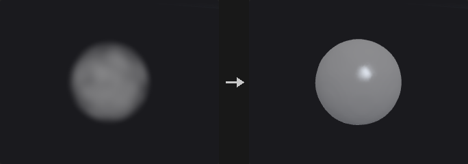

The active voxels as a solid: an SDF with the surface half a voxel outside the outermost active samples (exact Euclidean distance transforms), after Voxel Dilation and Closing Width (dilate then erode); Smoothing Steps of mean filtering + redistancing. Narrow band of Half-Band voxels (or world units).

**Inputs**

| Input | Type | Description |
|---|---|---|
| `geo` | GEOMETRY | Geometry containing the volumes. |

**Outputs**

| Output | Type | Description |
|---|---|---|
| `geo` | GEOMETRY | The result. |

**Parameters**

| Parameter | Type | Default | Description |
|---|---|---|---|
| Group `group` | string | *(empty)* | Which volumes to process: empty for all, numbers for the n-th volume, or names (wildcards, ^ to exclude) matched against the name attribute. |
| Output Name `output_name` | menu | Keep Original Name | Keep the name, add a suffix, or use a custom name. Options: Keep Original Name (`keep`), Add Suffix (`append`), Custom Name (`replace`). |
| Custom Name `custom_name` | string | *(empty)* | Suffix or custom name. *Hidden when output_name = keep.* |
| Use World Space for Band `world_space` | toggle | off | Give the half band in world units. |
| Half-Band in Voxels `half_band` | int [1..100] | 3 | Half width of the narrow band in voxels. *Hidden when world_space is on.* |
| Half-Band in World `half_band_world` | float [1e-06..] | 1 | Half width of the narrow band in world units. *Hidden when world_space is off.* |
| Voxel Dilation `dilation` | int [0..100] | 0 | Dilate the active region by this many voxels first. |
| Closing Width `closing` | int [0..100] | 1 | Dilate then erode by this many voxels to fill holes and gaps. |
| Smoothing Steps `smoothing` | int [0..100] | 0 | Number of smoothing passes (mean filter + redistance). |

---

### VDB Transform (PCG)

`PCG_VDBTransform` · category `PCG/volume` · Houdini: VDB Transform (SOP)

Translates, scales and rotates volumes.

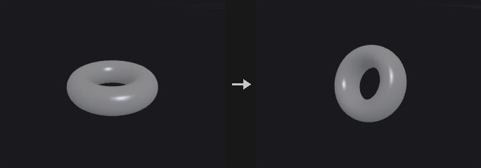

Translate and (non-uniform) scale move the grid exactly; with a rotation the grid is resampled into the axis-aligned bounds of the rotated one at the same voxel size (grids here are axis aligned). Order: scale, rotate, translate about the pivot. Transform Vectors rotates / scales vector values.

**Inputs**

| Input | Type | Description |
|---|---|---|
| `geo` | GEOMETRY | Geometry containing the volumes. |

**Outputs**

| Output | Type | Description |
|---|---|---|
| `geo` | GEOMETRY | The result. |

**Parameters**

| Parameter | Type | Default | Description |
|---|---|---|---|
| Group `group` | string | *(empty)* | Which volumes to process: empty for all, numbers for the n-th volume, or names (wildcards, ^ to exclude) matched against the name attribute. |
| Translate `t_x` `t_y` `t_z` | float | 0, 0, 0 | Translation. |
| Rotate `r_x` `r_y` `r_z` | float | 0, 0, 0 | Rotation in degrees (X, then Y, then Z). |
| Scale `s_x` `s_y` `s_z` | float | 1, 1, 1 | Scale per axis. |
| Uniform Scale `uniform_scale` | float | 1 | Multiplies the scale. |
| Pivot `p_x` `p_y` `p_z` | float | 0, 0, 0 | Pivot for rotation and scale. |
| Invert Transformation `invert` | toggle | off | Apply the inverse transform. |
| Transform Vectors `xform_vectors` | toggle | off | Rotate and scale the values of vector volumes too. |

---

### VDB Vector Merge (PCG)

`PCG_VDBVectorMerge` · category `PCG/volume` · Houdini: VDB Vector Merge (SOP), Volume Vector Join (SOP)

Merges three scalar volumes into one vector volume.

Pairs the X / Y / Z scalar grids (by base name for patterns like *.x, else in order) into vector grids on the X grid's samples; missing components are 0. Named after the X grid's base name, or Merged VDB Name (# = number). Remove Source VDBs deletes the scalars.

**Inputs**

| Input | Type | Description |
|---|---|---|
| `geo` | GEOMETRY | Geometry containing the volumes. |

**Outputs**

| Output | Type | Description |
|---|---|---|
| `geo` | GEOMETRY | The result. |

**Parameters**

| Parameter | Type | Default | Description |
|---|---|---|---|
| X Group `xgroup` | string | `*.x` | Pattern of the X component volumes. |
| Y Group `ygroup` | string | `*.y` | Pattern of the Y component volumes. |
| Z Group `zgroup` | string | `*.z` | Pattern of the Z component volumes. |
| Use Basename of X VDB `use_basename` | toggle | on | Name the vector volume after the X volume's base name (vel.x -> vel). |
| Merged VDB Name `merge_name` | string | `merged#` | Name when not using the base name; # becomes a number. *Hidden when use_basename is on.* |
| Remove Source VDBs `remove_sources` | toggle | on | Delete the merged scalar volumes. |

---

### VDB Vector Split (PCG)

`PCG_VDBVectorSplit` · category `PCG/volume` · Houdini: VDB Vector Split (SOP), Volume Vector Split (SOP)

Splits vector volumes into scalar .x / .y / .z volumes.

Each vector grid becomes scalar grids <name>.x / .y / .z; scalar grids pass through. Keep Source Volumes keeps the vector grids too.

**Inputs**

| Input | Type | Description |
|---|---|---|
| `geo` | GEOMETRY | Geometry containing the volumes. |

**Outputs**

| Output | Type | Description |
|---|---|---|
| `geo` | GEOMETRY | The result. |

**Parameters**

| Parameter | Type | Default | Description |
|---|---|---|---|
| Group `group` | string | *(empty)* | Which volumes to process: empty for all, numbers for the n-th volume, or names (wildcards, ^ to exclude) matched against the name attribute. |
| Keep Source Volumes `keep_source` | toggle | off | Keep the vector volumes as well. |

---

### VDB Visualize Tree (PCG)

`PCG_VDBVisualizeTree` · category `PCG/volume` · Houdini: VDB Visualize Tree (SOP)

Draws the leaf / internal node layout and the active voxels of VDBs as geometry.

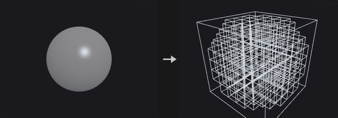

Leaf nodes (8³ blocks holding active voxels) and internal nodes (128³ blocks) as wireframe boxes or points, active voxels as boxes or points, the grid bounding box; groups leaves / internal / voxels / bbox and Cd. Keep Original Geometry keeps the volumes.

**Inputs**

| Input | Type | Description |
|---|---|---|
| `geo` | GEOMETRY | Geometry containing the volumes. |

**Outputs**

| Output | Type | Description |
|---|---|---|
| `geo` | GEOMETRY | The result. |

**Parameters**

| Parameter | Type | Default | Description |
|---|---|---|---|
| Group `group` | string | *(empty)* | Which volumes to process: empty for all, numbers for the n-th volume, or names (wildcards, ^ to exclude) matched against the name attribute. |
| Leaf Nodes `leaves` | menu | Wireframe Boxes | How leaf nodes (8³ blocks holding active voxels) are drawn. Options: Wireframe Boxes (`boxes`), Points (`points`), Disabled (`none`). |
| Internal Nodes `internal` | menu | Disabled | How internal nodes (128³ blocks) are drawn. Options: Disabled (`none`), Wireframe Boxes (`boxes`), Points (`points`). |
| Active Voxels `voxels` | menu | Disabled | How active voxels are drawn. Options: Disabled (`none`), Points (`points`), Wireframe Boxes (`boxes`). |
| Bounding Box `bbox` | toggle | on | Draw the grid's bounding box. |
| Keep Original Geometry `keep` | toggle | off | Keep the volumes in the output. |

---

### Volume Adjust Fog (PCG)

`PCG_VolumeAdjustFog` · category `PCG/volume` · Houdini: Volume Adjust Fog (SOP)

Adjusts fog density with patterns, ramps and pre / post processing.

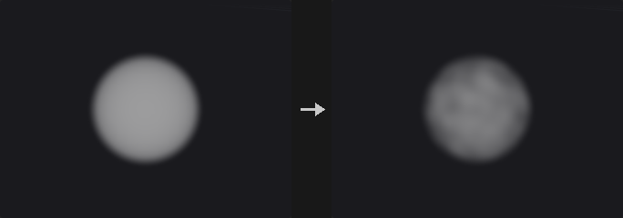

Pre-process (overwrite with Initial Value, complement), an adjustment of Adjust Value × pattern (constant / random / noise / line / radial / bounding box, through the Remap Ramp, scaled to Range) combined by Operation, post-process (scale, add, clamp, complement), blended by Blend Amount or a blend volume.

**Inputs**

| Input | Type | Description |
|---|---|---|
| `geo` | GEOMETRY | Geometry containing the volumes. |
| `blend_volume` *(optional)* | GEOMETRY | Optional volume used as the blend amount. |

**Outputs**

| Output | Type | Description |
|---|---|---|
| `geo` | GEOMETRY | The result. |

**Parameters**

| Parameter | Type | Default | Description |
|---|---|---|---|
| Volume Name `group` | string | *(empty)* | Volumes to adjust. |
| Operation `operation` | menu | Add | How the adjustment combines with the density. Options: Add (`add`), Set Always (`set`), Subtract (`subtract`), Multiply (`multiply`), Minimum (`minimum`), Maximum (`maximum`). |
| Adjust Value `value` | float | 1 | Adjustment value. |
| Pattern Type `pattern` | menu | Constant | Spatial pattern of the adjustment. Options: Constant (`constant`), Random (`random`), Noise (`noise`), Line (`line`), Radial (`radial`), Bounding Box (`bbox`). |
| Range `range_min` `range_max` | float | 0, 1 | Range the pattern is mapped to. |
| Remap Ramp `ramp` | string | *(empty)* | Ramp applied to the pattern (empty = linear). |
| Element Size `element_size` | float [1e-06..] | 1 | Noise size. *Hidden when pattern ≠ noise.* |
| Offset `offset_x` `offset_y` `offset_z` | float | 0, 0, 0 | Noise offset. *Hidden when pattern ≠ noise.* |
| Seed `rand_seed` | int [0..] | 0 | Random seed. *Hidden when pattern ≠ noise pattern ≠ random.* |
| Line Origin `line_origin_x` `line_origin_y` `line_origin_z` | float | 0, 0, 0 | Start of the line pattern. *Hidden when pattern ≠ line.* |
| Line Direction `line_dir_x` `line_dir_y` `line_dir_z` | float | 0, 1, 0 | Direction of the line pattern. *Hidden when pattern ≠ line.* |
| Center `radial_center_x` `radial_center_y` `radial_center_z` | float | 0, 0, 0 | Centre of the radial pattern. *Hidden when pattern ≠ radial.* |
| Radius `radial_radius` | float [1e-06..] | 1 | Radius of the radial pattern. *Hidden when pattern ≠ radial.* |

*Pre-Process*

| Parameter | Type | Default | Description |
|---|---|---|---|
| Overwrite Initial Value `pre_overwrite` | toggle | off | Replace the density with Initial Value first. |

| Parameter | Type | Default | Description |
|---|---|---|---|
| Initial Value `initial_value` | float | 0 | Initial value. *Disabled when pre_overwrite is off.* |
| Complement Volume `pre_complement` | toggle | off | Use 1 − density first. |

*Post-Process*

| Parameter | Type | Default | Description |
|---|---|---|---|
| Post-Process `post` | toggle | off | Post-process the result. |

| Parameter | Type | Default | Description |
|---|---|---|---|
| Scale `post_scale` | float | 1 | Multiplies the result. |
| Add `post_add` | float | 0 | Added to the result. |
| Minimum `clamp_min` | float | 0 | Lowest value. |
| Minimum `post_clamp_min` | toggle | off | Clamp below. |
| Maximum `clamp_max` | float | 1 | Highest value. |
| Maximum `post_clamp_max` | toggle | off | Clamp above. |
| Complement Volume `post_complement` | toggle | off | Use 1 − result. |

*Blend*

| Parameter | Type | Default | Description |
|---|---|---|---|
| Blend `blend` | menu | Constant | Blend by a constant or by a volume. Options: Constant (`constant`), Use Volume (`volume`). |

| Parameter | Type | Default | Description |
|---|---|---|---|
| Blend Amount `blend_amount` | float [0.0..1.0] | 1 | Blend amount (0 = unchanged, 1 = adjusted). *Hidden when blend ≠ constant.* |
| Blend Volume `blend_name` | string | *(empty)* | Blend volume in the third input. *Hidden when blend ≠ volume.* |

---

### Volume Bound (PCG)

`PCG_VolumeBound` · category `PCG/volume` · Houdini: Volume Bound (SOP)

Builds the bounding box of the voxels that meet a condition.

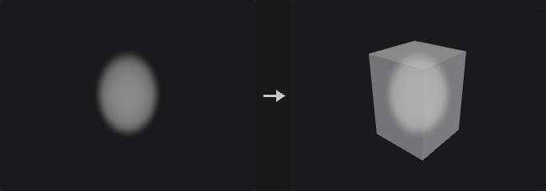

A box around the voxels meeting the condition (≥ / > / ≤ / < / = Bounding Value), on the voxel edges (±½ voxel) and expanded by Voxel Padding (−0.5 = bound on voxel centres). No matching voxel: no box.

**Inputs**

| Input | Type | Description |
|---|---|---|
| `geo` | GEOMETRY | Geometry containing the volumes. |

**Outputs**

| Output | Type | Description |
|---|---|---|
| `geo` | GEOMETRY | The result. |
| `report` | STRING | JSON report (counts and other details). |

**Parameters**

| Parameter | Type | Default | Description |
|---|---|---|---|
| Group `group` | string | *(empty)* | Which volumes to process: empty for all, numbers for the n-th volume, or names (wildcards, ^ to exclude) matched against the name attribute. |
| Region to Find `region` | menu | Greater or Equal | Which voxels count. Options: Greater or Equal (`greaterequal`), Strictly Greater (`greater`), Less or Equal (`lessequal`), Strictly Less (`less`), Equal (`equal`). |
| Bounding Value `value` | float | 0 | Value compared against. |
| Voxel Padding `padding_x` `padding_y` `padding_z` | float | 0, 0, 0 | Grow the box by this many voxels. |

---

### Volume Break (PCG)

`PCG_VolumeBreak` · category `PCG/volume` · Houdini: Volume Break (SOP)

Cuts polygons with the surface of an SDF.

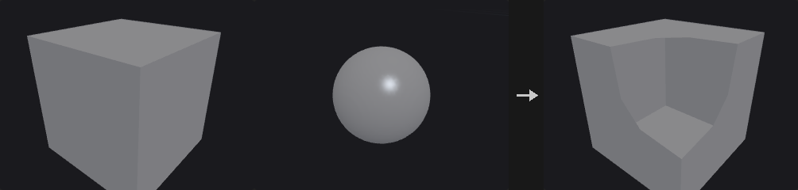

Cuts polygons with the zero surface of the SDF in the second input (fog: its 0.5 contour), linear along edges; keeps inside, outside or both, with inside / outside primitive groups. Snapping Tolerance snaps near-zero point distances to the surface. Holes are not closed.

**Inputs**

| Input | Type | Description |
|---|---|---|
| `geo` | GEOMETRY | Geometry containing the volumes. |
| `volume` | GEOMETRY | The SDF volume. |

**Outputs**

| Output | Type | Description |
|---|---|---|
| `geo` | GEOMETRY | The result. |

**Parameters**

| Parameter | Type | Default | Description |
|---|---|---|---|
| Volume Group `volume_group` | string | *(empty)* | SDF volume in the second input. |
| Geometry to Keep `keep` | menu | All Geometry | Which side to keep. Options: All Geometry (`both`), Geometry Inside (`inside`), Geometry Outside (`outside`). |
| Snapping Tolerance `snap` | float [0.0..] | 0 | Point distances smaller than this snap to the surface. |
| Create Groups `create_groups` | toggle | on | Create inside / outside groups. |
| Inside Group `inside_group` | string | `inside` | Name of the inside group. *Disabled when create_groups is off.* |
| Outside Group `outside_group` | string | `outside` | Name of the outside group. *Disabled when create_groups is off.* |

---

### Volume Compress (PCG)

`PCG_VolumeCompress` · category `PCG/volume` · Houdini: Volume Compress (SOP)

Quantizes and simplifies volume values the way compressed volumes store them.

16³ tiles whose values differ by at most Constant Tolerance become constant; values are quantised to Quantization Tolerance (ordered dithering optional); Use 16bit Float rounds to half floats; a mask (second input, strictly above Mask Minimum / below Mask Maximum, invertible) zeroes the rest. Values are what a compressed Houdini volume would read back.

**Inputs**

| Input | Type | Description |
|---|---|---|
| `geo` | GEOMETRY | Geometry containing the volumes. |
| `mask` *(optional)* | GEOMETRY | Optional volume used as a mask. |

**Outputs**

| Output | Type | Description |
|---|---|---|
| `geo` | GEOMETRY | The result. |
| `report` | STRING | JSON report (counts and other details). |

**Parameters**

| Parameter | Type | Default | Description |
|---|---|---|---|
| Source Group `group` | string | *(empty)* | Which volumes to process: empty for all, numbers for the n-th volume, or names (wildcards, ^ to exclude) matched against the name attribute. |
| Constant Tolerance `constant_tolerance` | float [0.0..] | 0 | 16³ tiles whose values differ by at most this become constant. |
| Quantization Tolerance `quantization_tolerance` | float [0.0..] | 0 | Round values to multiples of this (0 = off). |
| Dithering `dither` | menu | None | Dithering when quantizing. Options: None (`none`), Ordered (`ordered`). |
| Use 16bit Float `half` | toggle | off | Round to 16-bit floats. |

*Mask*

| Parameter | Type | Default | Description |
|---|---|---|---|
| Mask Group `mask_group` | string | *(empty)* | Mask volume in the second input. |

| Parameter | Type | Default | Description |
|---|---|---|---|
| Mask Minimum `mask_min` | float | 0 | Keep voxels whose mask is above this. |
| Mask Minimum `use_min` | toggle | off | Use the mask minimum. |
| Mask Maximum `mask_max` | float | 1 | Keep voxels whose mask is below this. |
| Mask Maximum `use_max` | toggle | off | Use the mask maximum. |
| Invert Mask `invert_mask` | toggle | off | Invert the mask. |

---

### Volume Convolve 3×3×3 (PCG)

`PCG_VolumeConvolve` · category `PCG/volume` · Houdini: Volume Convolve 3×3×3 (SOP)

Convolves volumes with a 3×3×3 kernel.

27 coefficients (three z planes z−1 / z / z+1, each 3 rows y−1..y+1 of x−1..x+1, whitespace separated); Normalize Kernel divides by their sum; Add, or Add Absolute (|coefficient × voxel|).

**Inputs**

| Input | Type | Description |
|---|---|---|
| `geo` | GEOMETRY | Geometry containing the volumes. |

**Outputs**

| Output | Type | Description |
|---|---|---|
| `geo` | GEOMETRY | The result. |

**Parameters**

| Parameter | Type | Default | Description |
|---|---|---|---|
| Source Group `group` | string | *(empty)* | Which volumes to process: empty for all, numbers for the n-th volume, or names (wildcards, ^ to exclude) matched against the name attribute. |
| Kernel (Z-1, Z=0, Z+1) `kernel` | string | *(see panel)* | 27 coefficients: three planes (z−1, z, z+1), each three rows of three. |
| Normalize Kernel `normalize` | toggle | on | Divide by the sum of the coefficients. |
| Combine Operation `operation` | menu | Add | Add, or add absolute products. Options: Add (`add`), Add Abs (`addabs`). |

---

### Volume Feather (PCG)

`PCG_VolumeFeather` · category `PCG/volume` · Houdini: Volume Feather (SOP)

Limits how fast volume values change, growing or shrinking fog smoothly.

Caps how fast values may change: High to Low v = max(v, w − rate·d) (fog grows), otherwise min(v, w + rate·d) (fog shrinks), over the 26 neighbours until stable. The rate comes from the Feather Mode (change per distance / per voxel, distance or voxels for a unit change, slope angle).

**Inputs**

| Input | Type | Description |
|---|---|---|
| `geo` | GEOMETRY | Geometry containing the volumes. |

**Outputs**

| Output | Type | Description |
|---|---|---|
| `geo` | GEOMETRY | The result. |

**Parameters**

| Parameter | Type | Default | Description |
|---|---|---|---|
| Source Group `group` | string | *(empty)* | Which volumes to process: empty for all, numbers for the n-th volume, or names (wildcards, ^ to exclude) matched against the name attribute. |
| Feather Mode `mode` | menu | Change per Distance | How the rate of change is given. Options: Change per Distance (`change_per_distance`), Change per Voxel (`change_per_voxel`), Distance for Unit Change (`distance_for_unit`), Voxels for Unit Change (`voxels_for_unit`), Slope Angle (`slope_angle`). |
| Amount `amount` | float [0.0..] | 1 | The rate (meaning depends on Feather Mode). |
| Feather from High to Low `high_to_low` | toggle | on | Limit decreases (fog grows); off limits increases (fog shrinks). |
| Override Border `border` | menu | Use Volume | Values beyond the grid. Options: Use Volume (`use_volume`), Constant (`constant`), Repeat (`repeat`), Streak (`streak`). |
| Border Value `border_value` | float | 0 | Value used with Constant. *Hidden when border ≠ constant.* |

---

### Volume FFT (PCG)

`PCG_VolumeFFT` · category `PCG/volume` · Houdini: Volume FFT (SOP)

Computes the forward or inverse Fourier transform of volumes.

Volumes in (real, imaginary) pairs; a lone real volume gets a zero imaginary part (written to a new <name>_imag volume). Invert computes the inverse; Normalize makes forward then inverse the identity; Center DC shifts zero frequency to the centre; Compute 2D Slices transforms each slice along the axis.

**Inputs**

| Input | Type | Description |
|---|---|---|
| `geo` | GEOMETRY | Geometry containing the volumes. |

**Outputs**

| Output | Type | Description |
|---|---|---|
| `geo` | GEOMETRY | The result. |

**Parameters**

| Parameter | Type | Default | Description |
|---|---|---|---|
| Source Group `group` | string | *(empty)* | Which volumes to process: empty for all, numbers for the n-th volume, or names (wildcards, ^ to exclude) matched against the name attribute. |
| Center DC `center_dc` | toggle | off | Move zero frequency to the centre. |
| Invert `invert` | toggle | off | Inverse transform. |
| Normalize `normalize` | toggle | on | Scale so forward then inverse returns the input. |
| Compute 2D Slices `slices` | toggle | off | Transform 2D slices separately. |
| Slice Axis `axis` | menu | Z | Axis the slices are taken along. Options: Z (`z`), Y (`y`), X (`x`). *Hidden when slices is off.* |

---

### Volume from Attrib (PCG)

`PCG_VolumeFromAttrib` · category `PCG/volume` · Houdini: Volume from Attrib (SOP)

Writes a point attribute into volumes.

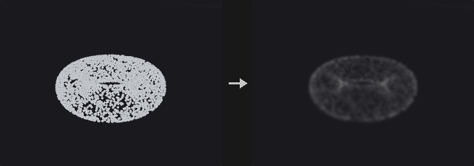

Writes a point attribute (second input) into the volumes: Accumulated (trilinear splat, normalised where the total weight exceeds Threshold; Bandwidth widens the splat), or Extrapolated (nearest point within Max Extrapolation Distance / cells). Combined with the volume by Calculation with pre / post add and multiply.

**Inputs**

| Input | Type | Description |
|---|---|---|
| `geo` | GEOMETRY | Geometry containing the volumes. |
| `points` | GEOMETRY | Points. |

**Outputs**

| Output | Type | Description |
|---|---|---|
| `geo` | GEOMETRY | The result. |

**Parameters**

| Parameter | Type | Default | Description |
|---|---|---|---|
| Volume Group `group` | string | *(empty)* | Which volumes to process: empty for all, numbers for the n-th volume, or names (wildcards, ^ to exclude) matched against the name attribute. |
| Point Group `point_group` | string | *(empty)* | Points to use (empty = all). |
| Attribute `attribute` | string | `density` | Point attribute to write. |
| Attribute `use_attribute` | toggle | on | Use the attribute (off: write 1). |
| Accumulated `accumulated` | toggle | on | Splat each point into its eight surrounding voxels. |
| Extrapolated `extrapolated` | toggle | off | Each voxel takes the nearest point's value. |
| Max Extrap Cells `max_cells` | int [0..1000] | 1 | Extrapolation reach in voxels. *Hidden when extrapolated is off.* |
| Max Extrapolation Distance `max_dist` | float [0.0..] | 0 | Extrapolation reach in world units. *Hidden when extrapolated is off.* |
| Threshold `threshold` | float [0.0..] | 1 | Total weight above which the splat is normalised. *Hidden when extrapolated is on.* |
| Bandwidth `bandwidth` | float [0.0..] | 0 | Widens the splat by this many voxels. *Hidden when extrapolated is on.* |
| Scale by Voxel Volume `scale_by_volume` | toggle | off | Divide by the voxel volume. |

*Calculation*

| Parameter | Type | Default | Description |
|---|---|---|---|
| Calculation `calculation` | menu | Copy | How the value combines with the volume. Options: Copy (`copy`), Add (`add`), Subtract (`subtract`), Multiply (`multiply`), Divide (`divide`), Maximum (`maximum`), Minimum (`minimum`). |

| Parameter | Type | Default | Description |
|---|---|---|---|
| Dest Pre-Add `dest_add` | float | 0 | Added to the destination value before the operation. |
| Dest Pre-Mul `dest_mul` | float | 1 | Multiplies the destination value before the operation. |
| Source Pre-Add `src_add` | float | 0 | Added to the source value before the operation. |
| Source Pre-Mul `src_mul` | float | 1 | Multiplies the source value before the operation. |
| Post-Add `post_add` | float | 0 | Added to the result. |
| Post-Mul `post_mul` | float | 1 | Multiplies the result. |

---

### Volume Merge (PCG)

`PCG_VolumeMerge` · category `PCG/volume` · Houdini: Volume Merge (SOP)

Flattens several volumes into one base volume.

Flattens the Merge Group volumes (second input, or the first input's other volumes) into the base volume: Copy (the last), Add, Multiply, Maximum, Minimum, Average; Dest / Source pre add-multiply, post add-multiply, clamps. Clamp at Volume Boundary: B contributes 0 outside its own box.

**Inputs**

| Input | Type | Description |
|---|---|---|
| `geo` | GEOMETRY | Geometry containing the volumes. |
| `merge` *(optional)* | GEOMETRY | Optional volumes to merge in (otherwise the other volumes of the first input). |

**Outputs**

| Output | Type | Description |
|---|---|---|
| `geo` | GEOMETRY | The result. |

**Parameters**

| Parameter | Type | Default | Description |
|---|---|---|---|
| Source Group `group` | string | *(empty)* | Which volumes to process: empty for all, numbers for the n-th volume, or names (wildcards, ^ to exclude) matched against the name attribute. |
| Merge Group `merge_group` | string | *(empty)* | Volumes to flatten in. |
| Merge Method `method` | menu | Add | How they combine. Options: Add (`add`), Copy (`copy`), Multiply (`multiply`), Max (`maximum`), Min (`minimum`), Average (`average`). |
| Clamp at Volume Boundary `clamp_boundary` | toggle | on | Volumes contribute nothing outside their own box. |

*Adjustments*

| Parameter | Type | Default | Description |
|---|---|---|---|
| Dest Pre-Add `dest_add` | float | 0 | Added to the destination value before the operation. |

| Parameter | Type | Default | Description |
|---|---|---|---|
| Dest Pre-Mul `dest_mul` | float | 1 | Multiplies the destination value before the operation. |
| Source Pre-Add `src_add` | float | 0 | Added to the source value before the operation. |
| Source Pre-Mul `src_mul` | float | 1 | Multiplies the source value before the operation. |
| Post-Add `post_add` | float | 0 | Added to the result. |
| Post-Mul `post_mul` | float | 1 | Multiplies the result. |
| Clamp Minimum `clamp_min` | float | 0 | Lowest value. |
| Clamp Minimum `use_min` | toggle | off | Clamp below. |
| Clamp Maximum `clamp_max` | float | 1 | Highest value. |
| Clamp Maximum `use_max` | toggle | off | Clamp above. |

---

### Volume Optical Flow (PCG)

`PCG_VolumeOpticalFlow` · category `PCG/volume` · Houdini: Volume Optical Flow (SOP)

Estimates the displacement field between two volumes.

The displacement from each source voxel to the matching goal values (Horn–Schunck with warping, coarse to fine over Pyramid Levels scaled by Pyramid Scale, Iterations per level, displacement blurred by Blurring Window Radius, box or Gaussian; Approximation Window Radius pre-smooths the images). Outputs <source>.x / .y / .z in world units.

**Inputs**

| Input | Type | Description |
|---|---|---|
| `source` | GEOMETRY | Source volumes. |
| `goal` | GEOMETRY | Goal volumes. |

**Outputs**

| Output | Type | Description |
|---|---|---|
| `geo` | GEOMETRY | The result. |

**Parameters**

| Parameter | Type | Default | Description |
|---|---|---|---|
| Source Group `group` | string | *(empty)* | Source volumes. |
| Goal Group `goal_group` | string | *(empty)* | Goal volumes. |
| Tolerance `tolerance` | float [0.0..] | 0 | Differences below this give no motion. |
| Blurring Window Radius `blur_radius` | int [0..20] | 1 | Blur of the displacement per iteration. |
| Use Gaussian Filter `gaussian` | toggle | off | Gaussian instead of box blur. |
| Pyramid Levels `levels` | int [1..8] | 3 | Pyramid levels. |
| Pyramid Scale `pyramid_scale` | float [0.1..0.9] | 0.5 | Size ratio between levels. |
| Iterations `iterations` | int [1..100] | 4 | Iterations per level. |
| Approximation Window Radius `approx_radius` | int [0..20] | 2 | Pre-smoothing of the volumes. |

---

### Volume Patch (PCG)

`PCG_VolumePatch` · category `PCG/volume` · Houdini: Volume Patch (SOP)

Fills a masked region of a volume seamlessly from another volume.

Fills the masked region (Mask ≥ Cutoff) of the background with the foreground's features while matching the background on the region's border (Poisson: ∇²u = ∇²foreground inside, u = background outside). Use Foreground as Laplacian: the foreground already is the Laplacian.

**Inputs**

| Input | Type | Description |
|---|---|---|
| `geo` | GEOMETRY | Geometry containing the volumes. |

**Outputs**

| Output | Type | Description |
|---|---|---|
| `geo` | GEOMETRY | The result. |

**Parameters**

| Parameter | Type | Default | Description |
|---|---|---|---|
| Background Group `background` | string | `background` | Volume whose masked region is filled. |
| Foreground Group `foreground` | string | `foreground` | Volume that supplies the detail. |
| Mask `mask` | string | `mask` | Mask volume. |
| Cutoff for Mask `cutoff` | float | 0.5 | Mask values at or above this are filled. |
| Use Foreground as Laplacian `foreground_is_laplacian` | toggle | off | The foreground already is a Laplacian. |
| Solver Iterations `iterations` | int [1..] | 2000 | Solver iterations. |

---

### Volume Ramp (PCG)

`PCG_VolumeRamp` · category `PCG/volume` · Houdini: Volume Ramp (SOP)

Remaps volume values through a scalar or color ramp.

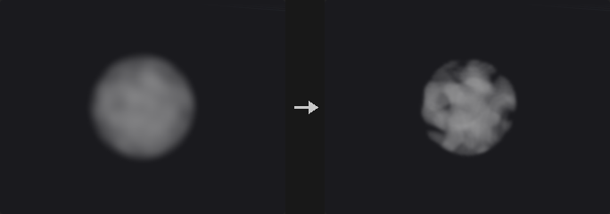

Remaps the volumes: Source Min / Max -> 0..1 (clamped) -> the scalar ramp -> Dest Min / Max, or through a colour ramp into three volumes <name>.x / .y / .z (New Name "Cd" gives Cd.x / .y / .z).

**Inputs**

| Input | Type | Description |
|---|---|---|
| `geo` | GEOMETRY | Geometry containing the volumes. |

**Outputs**

| Output | Type | Description |
|---|---|---|
| `geo` | GEOMETRY | The result. |

**Parameters**

| Parameter | Type | Default | Description |
|---|---|---|---|
| Volume Primitive `group` | string | *(empty)* | Which volumes to process: empty for all, numbers for the n-th volume, or names (wildcards, ^ to exclude) matched against the name attribute. |
| New Name `new_name` | string | *(empty)* | New name (with a color ramp, .x .y .z are appended). |
| Source Range `src_min` `src_max` | float | 0, 1 | Input range. |
| Dest Range `dest_min` `dest_max` | float | 0, 1 | Output range. |
| Use Color Ramp `use_color` | toggle | off | Use the color ramp (three output volumes). |
| Scalar Ramp `ramp` | string | `0:0 1:1` | Scalar ramp. *Hidden when use_color is on.* |
| Color Ramp `color_ramp` | string | `0:0,0,0 1:1,1,1` | Color ramp. *Hidden when use_color is off.* |

---

### Volume Rasterize Curve (PCG)

`PCG_VolumeRasterizeCurve` · category `PCG/volume` · Houdini: Volume Rasterize Curve (SOP), Volume Rasterize Hair (SOP)

Turns curves into density, color or SDF volumes.

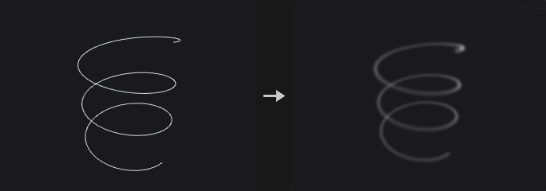

Curves as tubes of radius width / 2 × stroke_pressure (pscale when width is missing): Mask = density (smooth from 1 on the axis to 0 at the tube surface), Color = density + a vector Cd volume, SDF = union of the tubes. Fade lowers the density along the stroke, Flow Rate scales it.

**Inputs**

| Input | Type | Description |
|---|---|---|
| `geo` | GEOMETRY | Geometry containing the volumes. |

**Outputs**

| Output | Type | Description |
|---|---|---|
| `geo` | GEOMETRY | The result. |

**Parameters**

| Parameter | Type | Default | Description |
|---|---|---|---|
| Output `output` | menu | Mask | Mask (density), Color (density + Cd) or SDF. Options: Mask (`mask`), Color (`color`), SDF (`sdf`). |
| Voxel Size `voxel_size` | float [1e-06..] | 0.05 | Edge length of a voxel in world units (the spacing of the grid samples). |
| Density Scale `density_scale` | float | 1 | Multiplies the density. *Hidden when output = sdf.* |
| Fade `fade` | float [0.0..1.0] | 0 | Density falloff along the stroke. *Hidden when output = sdf.* |
| Flow Rate `flow_rate` | float [0.0..] | 1 | Density strength. *Hidden when output = sdf.* |
| Name `name` | string | `density` | Name of the output volume. |

---

### Volume Rasterize Particles (PCG)

`PCG_VolumeRasterizeParticles` · category `PCG/volume` · Houdini: Volume Rasterize Particles (SOP)

Splats points into volumes with filter kernels.

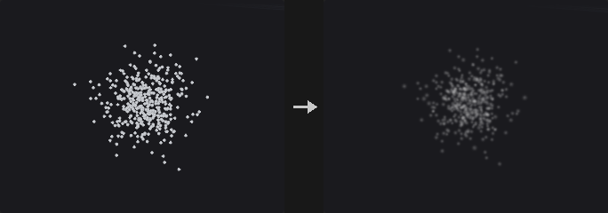

Each point adds kernel(|x − p| / r) × coverage to density (Gaussian / Box / Cubic Spline), r = max(pscale × Particle Scale, Minimum Filter Size voxels); listed attributes become coverage-weighted averages. Into the first input's volumes when given (same names), else a new grid at Voxel Size.

**Inputs**

| Input | Type | Description |
|---|---|---|
| `points` | GEOMETRY | Points. |
| `destination` *(optional)* | GEOMETRY | Optional destination volumes; without them a new grid is made. |

**Outputs**

| Output | Type | Description |
|---|---|---|
| `geo` | GEOMETRY | The result. |

**Parameters**

| Parameter | Type | Default | Description |
|---|---|---|---|
| Particles `point_group` | string | *(empty)* | Points to use (empty = all). |
| Filter `filter` | menu | Gaussian | Splat kernel. Options: Gaussian (`gaussian`), Box (`box`), Cubic Spline (`cubic`). |
| Coverage Attribute `coverage_attribute` | string | *(empty)* | Point attribute with the coverage (empty = 1). |
| Coverage Scale `coverage_scale` | float | 1 | Multiplies the coverage. |
| Particle Scale `particle_scale` | float [0.0..] | 1 | Multiplies pscale. |
| Minimum Filter Size `min_filter` | float [0.0..] | 1 | Smallest kernel radius in voxels. |
| Attributes `attributes` | string | *(empty)* | Point attributes averaged into same-named volumes. |
| Voxel Size `voxel_size` | float [1e-06..] | 0.1 | Edge length of a voxel in world units (the spacing of the grid samples). |

---

### Volume Rasterize Points (PCG)

`PCG_VolumeRasterizePoints` · category `PCG/volume` · Houdini: VDB Rasterize Points (SOP), Volume Rasterize (SOP), Volume Rasterize Points (SOP)

Turns points into soft spheres of density in volumes.

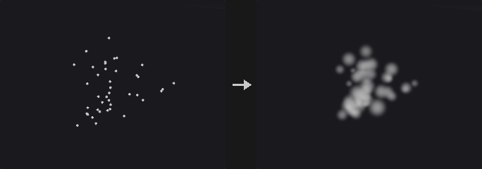

Points as spheres of pscale + Exterior Pad: density 1 inside Solid Ratio × r, falling to 0 at r (linear or smooth), × Density Scale × point density; Merge Method maximum / add; optional noise; listed attributes into same-named volumes. Into the first input's volumes or a new grid.

**Inputs**

| Input | Type | Description |
|---|---|---|
| `points` | GEOMETRY | Points. |
| `destination` *(optional)* | GEOMETRY | Optional destination volumes; without them a new grid is made. |

**Outputs**

| Output | Type | Description |
|---|---|---|
| `geo` | GEOMETRY | The result. |

**Parameters**

| Parameter | Type | Default | Description |
|---|---|---|---|
| Rasterization Group `point_group` | string | *(empty)* | Points to use (empty = all). |
| Density Scale `density_scale` | float | 1 | Multiplies the density. |
| Solid Ratio `solid_ratio` | float [0.0..1.0] | 0 | Fraction of the radius at full density. |
| Smooth Falloff `smooth` | toggle | on | Smooth falloff instead of linear. |
| Exterior Pad `exterior_pad` | float | 0 | Added to every radius. |
| Scalar / Vector Attributes `attributes` | string | *(empty)* | Point attributes averaged into same-named volumes. |
| Voxel Size `voxel_size` | float [1e-06..] | 0.1 | Edge length of a voxel in world units (the spacing of the grid samples). |
| Merge Method `merge_method` | menu | Maximum | How overlapping points combine. Options: Maximum (`maximum`), Add (`add`). |

*Noise*

| Parameter | Type | Default | Description |
|---|---|---|---|
| Noise Gain `noise_amp` | float | 0 | Noise strength (0 = none). |

| Parameter | Type | Default | Description |
|---|---|---|---|
| Element Size `noise_size` | float [1e-06..] | 1 | Noise size. |
| Seed `rand_seed` | int [0..] | 0 | Random seed. |

---

### Volume Reduce (PCG)

`PCG_VolumeReduce` · category `PCG/volume` · Houdini: Volume Reduce (SOP)

Reduces each volume to one number (maximum, average, sum, ...).

One number per volume (maximum, minimum, average, sum, median at Percentile, RMS, sums and extremes of absolutes, sum of squares; active voxels only for VDBs), optionally × voxel length / area / volume; stored as a detail attribute, a prim attribute, or the volume itself becomes constant.

**Inputs**

| Input | Type | Description |
|---|---|---|
| `geo` | GEOMETRY | Geometry containing the volumes. |

**Outputs**

| Output | Type | Description |
|---|---|---|
| `geo` | GEOMETRY | The result. |
| `report` | STRING | JSON report (counts and other details). |

**Parameters**

| Parameter | Type | Default | Description |
|---|---|---|---|
| Source Group `group` | string | *(empty)* | Which volumes to process: empty for all, numbers for the n-th volume, or names (wildcards, ^ to exclude) matched against the name attribute. |
| Reduction `reduction` | menu | Maximum | How the voxels reduce to one number. Options: Maximum (`maximum`), Minimum (`minimum`), Average (`average`), Sum (`sum`), Median (`median`), Root Mean Square (`rms`), Sum of Absolute (`sum_abs`), Maximum Absolute (`max_abs`), Minimum Absolute (`min_abs`), Sum of Squares (`sum_squares`). |
| Percentile `percentile` | float [0.0..100.0] | 50 | Percentile for Median. *Hidden when reduction ≠ median.* |
| Scale By `scale_by` | menu | None | Multiply the result by voxel length, area or volume. Options: None (`none`), By Voxel Length (`length`), By Voxel Area (`area`), By Voxel Volume (`volume`). |
| Store Results In `store` | menu | Detail Attribute | Where the result goes. Options: Detail Attribute (`detail`), Primitive Attribute (`prim`), Volume (`volume`). |
| Attribute `attribute` | string | *(empty)* | Attribute name (empty = the reduction's name). *Hidden when store = volume.* |

---

### Volume Resize (PCG)

`PCG_VolumeResize` · category `PCG/volume` · Houdini: Volume Resize (SOP)

Changes the bounds of volumes without resampling.

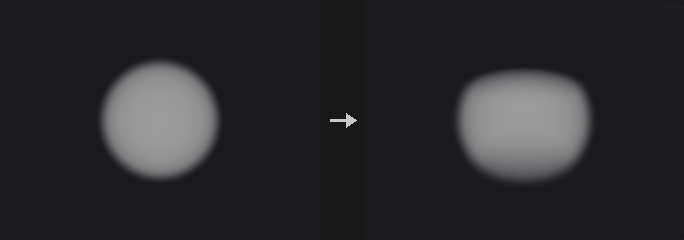

New bounds on the same voxel lattice (no filtering): the second input's bounds or Size / Center, Replace / Intersect / Union with the current box, Voxel Padding; new voxels repeat the edge (streak). Keep Data off: an empty volume. Limit Resolution caps each axis.

**Inputs**

| Input | Type | Description |
|---|---|---|
| `geo` | GEOMETRY | Geometry containing the volumes. |
| `reference` *(optional)* | GEOMETRY | Optional reference geometry (see the parameters for what it is used for). |

**Outputs**

| Output | Type | Description |
|---|---|---|
| `geo` | GEOMETRY | The result. |

**Parameters**

| Parameter | Type | Default | Description |
|---|---|---|---|
| Source Group `group` | string | *(empty)* | Which volumes to process: empty for all, numbers for the n-th volume, or names (wildcards, ^ to exclude) matched against the name attribute. |
| Combine Mode `combine` | menu | Replace | Replace the bounds, or intersect / union them with the current ones. Options: Replace (`replace`), Intersect (`intersect`), Union (`union`). |
| Size `size_x` `size_y` `size_z` | float [0.0..] | 1, 1, 1 | Size of the box. |
| Center `center_x` `center_y` `center_z` | float | 0, 0, 0 | Centre of the box. |
| Voxel Padding `padding_x` `padding_y` `padding_z` | float | 0, 0, 0 | Voxels added on each side. |
| Keep Data `keep_data` | toggle | on | Keep the values (off: an empty volume). |
| Maximum Resolution `max_res` | int [2..65536] | 512 | Largest resolution per axis. |
| Limit Resolution `limit_res` | toggle | off | Cap the resolution. |

---

### Volume SDF (PCG)

`PCG_VolumeSDF` · category `PCG/volume` · Houdini: Volume SDF (SOP)

Converts any volume into an SDF of one of its iso contours.

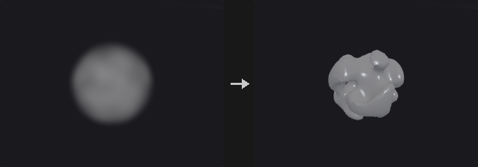

Any volume -> SDF of its Iso Surface contour (same resolution). Invert flips the sign (use it for fog so dense = inside). Use Maximum Distance clamps to ±Maximum Distance. Distances are exact to the extracted contour (Houdini uses fast marching).

**Inputs**

| Input | Type | Description |
|---|---|---|
| `geo` | GEOMETRY | Geometry containing the volumes. |

**Outputs**

| Output | Type | Description |
|---|---|---|
| `geo` | GEOMETRY | The result. |

**Parameters**

| Parameter | Type | Default | Description |
|---|---|---|---|
| Source Group `group` | string | *(empty)* | Which volumes to process: empty for all, numbers for the n-th volume, or names (wildcards, ^ to exclude) matched against the name attribute. |
| Iso Surface `iso` | float | 0 | Contour that becomes the zero surface (0.5 for fog, 0 for SDF). |
| Invert `invert` | toggle | off | Flip the sign (for fog, so dense regions are inside). |
| Maximum Distance `max_dist` | float [0.0..] | 1 | Largest distance kept. |
| Use Maximum Distance `use_max` | toggle | off | Clamp distances. |

---

### Volume Slice (PCG)

`PCG_VolumeSlice` · category `PCG/volume` · Houdini: Volume Slice (SOP)

Cuts a plane through volumes as a mesh, points or a thin volume.

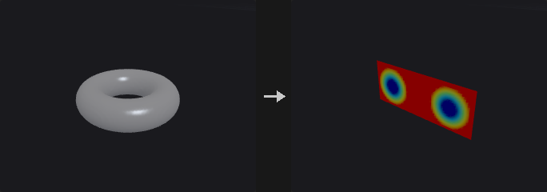

A plane through the volumes (XY / YZ / ZX; relative offset −1..1 or a world position + offset; snap to voxels) as a mesh or points with the volumes' values in one attribute (one component per volume), or as thin volumes. Visualize writes Cd through a ramp over the Visualization Range (several volumes -> RGB).

**Inputs**

| Input | Type | Description |
|---|---|---|
| `geo` | GEOMETRY | Geometry containing the volumes. |

**Outputs**

| Output | Type | Description |
|---|---|---|
| `geo` | GEOMETRY | The result. |

**Parameters**

| Parameter | Type | Default | Description |
|---|---|---|---|
| Source Group `group` | string | *(empty)* | Which volumes to process: empty for all, numbers for the n-th volume, or names (wildcards, ^ to exclude) matched against the name attribute. |
| Method `method` | menu | Mesh | Output as a mesh, points or thin volumes. Options: Mesh (`mesh`), Points (`points`), Volume (`volume`). |
| Plane `plane` | menu | XY Plane | Slice plane. Options: XY Plane (`xy`), YZ Plane (`yz`), ZX Plane (`zx`). |
| Relative Location `relative` | toggle | on | Position relative to the volume (−1 .. 1). |
| Position `position_x` `position_y` `position_z` | float | 0, 0, 0 | World position of the slice (absolute mode). *Hidden when relative is on.* |
| Offset `offset` | float | 0 | Offset of the plane. |
| Snap to Voxel `snap` | toggle | off | Snap the plane to voxel samples. |
| Attribute `attribute` | string | *(empty)* | Attribute name for the values. *Hidden when method = volume.* |

*Visualization*

| Parameter | Type | Default | Description |
|---|---|---|---|
| Visualize `visualize` | toggle | on | Color by value. *Hidden when method = volume.* |

| Parameter | Type | Default | Description |
|---|---|---|---|
| Visualization Range `vis_min` `vis_max` | float | 0, 1 | Value range of the colors. *Hidden when method = volume.* |
| Visualization Ramp `ramp` | string | *(empty)* | Color ramp (empty = a default spectrum). *Hidden when method = volume.* |
| Keep Original Geometry `keep` | toggle | off | Keep the incoming geometry in the output. |

---

### Volume Splice (PCG)

`PCG_VolumeSplice` · category `PCG/volume` · Houdini: Volume Splice (SOP)

Joins volumes of the same name into one larger volume.

Same-named volumes on the same voxel lattice are joined into one volume covering them all; where they overlap the voxel comes from the volume whose centre is nearest. Delete Original Volumes.

**Inputs**

| Input | Type | Description |
|---|---|---|
| `geo` | GEOMETRY | Geometry containing the volumes. |

**Outputs**

| Output | Type | Description |
|---|---|---|
| `geo` | GEOMETRY | The result. |

**Parameters**

| Parameter | Type | Default | Description |
|---|---|---|---|
| Source Group `group` | string | *(empty)* | Which volumes to process: empty for all, numbers for the n-th volume, or names (wildcards, ^ to exclude) matched against the name attribute. |
| Delete Original Volumes `delete_original` | toggle | on | Delete the source volumes. |

---

### Volume Stamp (PCG)

`PCG_VolumeStamp` · category `PCG/volume` · Houdini: Volume Stamp (SOP)

Copies volumes onto points and composites them into a destination.

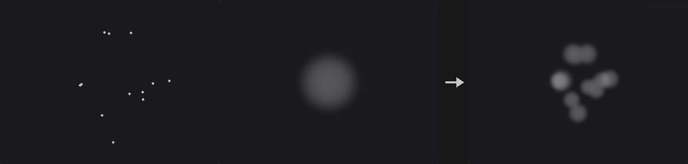

The volumes of the third input (matched to the destination by name) are placed on every point of the second input (translated to P, scaled by pscale, rotated by orient) and merged into the destination (maximum / add / minimum / copy / average).

**Inputs**

| Input | Type | Description |
|---|---|---|
| `geo` | GEOMETRY | Geometry containing the volumes. |
| `points` | GEOMETRY | Points. |
| `stamps` | GEOMETRY | Volumes to stamp onto the points. |

**Outputs**

| Output | Type | Description |
|---|---|---|
| `geo` | GEOMETRY | The result. |

**Parameters**

| Parameter | Type | Default | Description |
|---|---|---|---|
| Destination `group` | string | *(empty)* | Destination volumes. |
| Stamp Points `point_group` | string | *(empty)* | Points to use (empty = all). |
| Merge Method `merge_method` | menu | Maximum | How stamps combine with the destination. Options: Maximum (`maximum`), Add (`add`), Minimum (`minimum`), Copy (`copy`), Average (`average`). |

---

### Volume Trail (PCG)

`PCG_VolumeTrail` · category `PCG/volume` · Houdini: Volume Trail (SOP)

Traces streamlines from points through a velocity field.

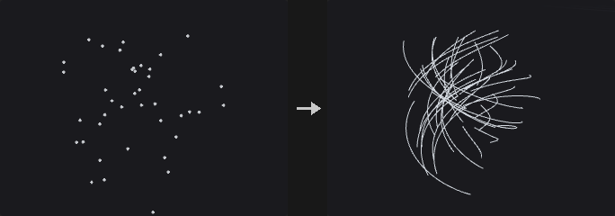

A polyline per point through the velocity of the second input (a vector volume or vel.x / .y / .z), RK2: Trail Length in seconds (time) or path length (distance), × traillen; a fixed Number of Steps or CFL-limited steps (CFL × voxel size, at most Max Steps). Visualize: Cd from the speed (Detect Range).

**Inputs**

| Input | Type | Description |
|---|---|---|
| `geo` | GEOMETRY | Geometry containing the volumes. |
| `velocity` | GEOMETRY | Velocity volume(s): a vector volume or vel.x / vel.y / vel.z. |

**Outputs**

| Output | Type | Description |
|---|---|---|
| `geo` | GEOMETRY | The result. |

**Parameters**

| Parameter | Type | Default | Description |
|---|---|---|---|
| Group `point_group` | string | *(empty)* | Points to use (empty = all). |
| Volume `vel_name` | string | *(empty)* | Name of the velocity volume (empty = the first vector volume, or three scalar volumes vel.x / vel.y / vel.z). |
| Advection Method `method` | menu | Time | Trail length in time or in distance. Options: Time (`time`), Distance (`distance`). |
| Trail Length `length` | float [0.0..] | 1 | Trail length. |
| CFL `cfl` | float [0.01..] | 1 | Step size as a fraction of the voxel size. *Hidden when use_cfl is off.* |
| Use CFL `use_cfl` | toggle | off | Adapt the step size to the velocity. |
| Number of Steps `steps` | int [1..] | 10 | Number of steps. *Hidden when use_cfl is on.* |
| Max Steps `max_steps` | int [1..] | 1000 | Most steps per trail. *Hidden when use_cfl is off.* |
| Keep Original Geometry `keep` | toggle | off | Keep the incoming geometry in the output. |

*Visualization*

| Parameter | Type | Default | Description |
|---|---|---|---|
| Visualize `visualize` | toggle | on | Color by speed. |

| Parameter | Type | Default | Description |
|---|---|---|---|
| Detect Range `detect_range` | toggle | on | Find the top speed automatically. |
| Maximum `maximum` | float [0.0..] | 1 | Speed for the top color (or a multiplier). |
| Ramp `ramp` | string | *(empty)* | Color ramp. |

---

### Volume Velocity (PCG)

`PCG_VolumeVelocity` · category `PCG/volume` · Houdini: Volume Velocity (SOP)

Adds uniform, vortex, curl-noise and point velocities to a velocity volume.

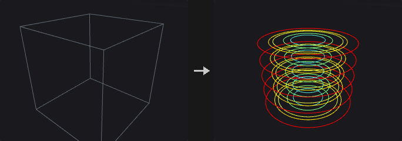

Adds to the selected velocity volume (a vector volume, or the first three scalar ones): a uniform velocity, a vortex (centre, axis, angular velocity, radius), divergence-free curl noise (scale, swirl size, grain, offset, attenuation, turbulence octaves) and velocity extrapolated from the second input's points; optionally masked by a third-input volume (expansion, comparison, cutoff).

**Inputs**

| Input | Type | Description |
|---|---|---|
| `geo` | GEOMETRY | Geometry containing the volumes. |
| `points` *(optional)* | GEOMETRY | Points. |
| `mask` *(optional)* | GEOMETRY | Optional volume used as a mask. |

**Outputs**

| Output | Type | Description |
|---|---|---|
| `geo` | GEOMETRY | The result. |

**Parameters**

| Parameter | Type | Default | Description |
|---|---|---|---|
| Group `group` | string | *(empty)* | Which volumes to process: empty for all, numbers for the n-th volume, or names (wildcards, ^ to exclude) matched against the name attribute. |

*Uniform*

| Parameter | Type | Default | Description |
|---|---|---|---|
| Add Uniform Velocity `uniform` | toggle | off | Add a constant velocity. |

| Parameter | Type | Default | Description |
|---|---|---|---|
| Constant Velocity `constant_x` `constant_y` `constant_z` | float | 0, 0, 0 | The constant velocity. |

*Vortex*

| Parameter | Type | Default | Description |
|---|---|---|---|
| Add Vortex `vortex` | toggle | off | Add a vortex. |

| Parameter | Type | Default | Description |
|---|---|---|---|
| Center `center_x` `center_y` `center_z` | float | 0, 0, 0 | Vortex centre. |
| Direction `direction_x` `direction_y` `direction_z` | float | 0, 1, 0 | Vortex axis. |
| Angular Velocity `angular` | float | 1 | Speed one unit from the axis. |
| Vortex Radius `vortex_radius` | float [0.0..] | 0 | Limit the vortex to this radius (0 = everywhere). |

*Curl Noise*

| Parameter | Type | Default | Description |
|---|---|---|---|
| Add Curl Noise `curl` | toggle | off | Add curl noise. |

| Parameter | Type | Default | Description |
|---|---|---|---|
| Scale `curl_scale` | float | 1 | Curl noise strength. |
| Swirl Size `swirl_size` | float [1e-06..] | 1 | Size of the largest swirls. |
| Grain `grain` | float [0.0..] | 0.5 | Strength of each smaller octave. |
| Offset `curl_offset_x` `curl_offset_y` `curl_offset_z` | float | 0, 0, 0 | Noise offset. |
| Attenuation `attenuation` | float | 1 | Contrast of the octaves. |
| Turbulence `turbulence` | int [1..10] | 3 | Number of octaves. |
| Seed `rand_seed` | int [0..] | 0 | Random seed. |

*Points*

| Parameter | Type | Default | Description |
|---|---|---|---|
| Add Point Velocity `point_velocity` | toggle | off | Add velocity from the second input's points. |

| Parameter | Type | Default | Description |
|---|---|---|---|
| Attribute `attribute` | string | `v` | Point velocity attribute. |
| Scale `point_scale` | float | 1 | Multiplies the point velocity. |
| Extrapolation Distance `extrap_dist` | float [0.0..] | 1 | Reach of each point. |

*Mask*

| Parameter | Type | Default | Description |
|---|---|---|---|
| Apply Mask `apply_mask` | toggle | off | Zero the velocity outside a mask. |

| Parameter | Type | Default | Description |
|---|---|---|---|
| Mask Volumes `mask_group` | string | *(empty)* | Mask volume (third input). |
| Expansion `expansion` | float [0.0..] | 0 | Grow the mask by this distance. |
| Comparison `comparison` | menu | Greater Than | Which mask values are kept. Options: Greater Than (`greater`), Less Than (`less`), Greater Than or Equal (`greaterequal`), Less Than or Equal (`lessequal`). |
| Cut Off `cutoff` | float | 0 | Threshold. |

---

### Volume Velocity from Curves (PCG)

`PCG_VolumeVelocityFromCurves` · category `PCG/volume` · Houdini: Volume Velocity from Curves (SOP)

Builds a velocity volume from the tangents of nearby curves.

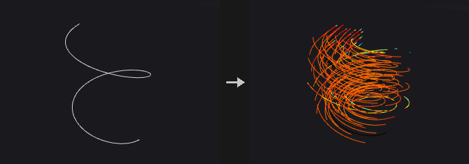

Each voxel averages the tangents of curve segments within the lookup radius (constant, or the distance to the N-th nearest curve × multiplier), weighted by (1 − d / R)² × an optional prim weight attribute; optionally smoothed. The grid comes from a reference volume (third input), or the curves' bounds (and the surface's, second input) at Voxel Size.

**Inputs**

| Input | Type | Description |
|---|---|---|
| `curves` | GEOMETRY | Curves. |
| `surface` *(optional)* | GEOMETRY | Optional surface geometry. |
| `reference` *(optional)* | GEOMETRY | Optional reference geometry (see the parameters for what it is used for). |

**Outputs**

| Output | Type | Description |
|---|---|---|
| `geo` | GEOMETRY | The result. |

**Parameters**

| Parameter | Type | Default | Description |
|---|---|---|---|
| Voxel Size `voxel_size` | float [1e-06..] | 0.1 | Edge length of a voxel in world units (the spacing of the grid samples). |

*Curve Lookup*

| Parameter | Type | Default | Description |
|---|---|---|---|
| Radius Mode `radius_mode` | menu | Constant | Fixed radius, or the distance to the N-th nearest curve. Options: Constant (`constant`), Find Minimum Number of Curves (`minimum`). |

| Parameter | Type | Default | Description |
|---|---|---|---|
| Radius `radius` | float [1e-06..] | 0.5 | Lookup radius. *Hidden when radius_mode ≠ constant.* |
| Minimum Curves in Radius `min_curves` | int [1..1000] | 3 | N for the automatic radius. *Hidden when radius_mode ≠ minimum.* |
| Radius Multiplier `radius_mult` | float [0.0..] | 1 | Multiplies the radius. |

*Smoothing*

| Parameter | Type | Default | Description |
|---|---|---|---|
| Smooth Velocities `smooth` | toggle | off | Smooth the velocities. |

| Parameter | Type | Default | Description |
|---|---|---|---|
| Voxel Radius `voxel_radius` | int [0..20] | 1 | Smoothing radius in voxels. *Disabled when smooth is off.* |
| Blur Iterations `blur_iters` | int [0..100] | 1 | Smoothing passes. *Disabled when smooth is off.* |

*Curve Weights*

| Parameter | Type | Default | Description |
|---|---|---|---|
| Use Curve Weight Attribute `use_weight` | toggle | off | Weight curves by an attribute. |

| Parameter | Type | Default | Description |
|---|---|---|---|
| Curve Weight Attribute `weight_attribute` | string | *(empty)* | Prim attribute with the weight. *Disabled when use_weight is off.* |
| Velocity Name `name` | string | `vel` | Name of the velocity volume. |

---

### Volume Velocity from Surface (PCG)

`PCG_VolumeVelocityFromSurface` · category `PCG/volume` · Houdini: Volume Velocity from Surface (SOP)

Builds a velocity field inside a closed surface from a divergence attribute.

Flow inside a closed surface driven by its divergence attribute (point or prim): sources near the surface, ∇²p = divergence inside with zero flux through the surface, v = ∇p -- the flow leaves high-divergence regions for low ones. Optional collision SDF output.

**Inputs**

| Input | Type | Description |
|---|---|---|
| `geo` | GEOMETRY | Geometry containing the volumes. |

**Outputs**

| Output | Type | Description |
|---|---|---|
| `geo` | GEOMETRY | The result. |

**Parameters**

| Parameter | Type | Default | Description |
|---|---|---|---|
| Voxel Size `voxel_size` | float [1e-06..] | 0.1 | Edge length of a voxel in world units (the spacing of the grid samples). |
| Exterior Band `ext_band` | float [0.0..] | 0.2 | Band around the surface. |
| Pressure Solve Iterations `iterations` | int [1..] | 500 | Pressure solver iterations. |
| Divergence Attribute `divergence_attribute` | string | `divergence` | Point or prim attribute with the divergence. |
| Velocity Volume `name` | string | `vel` | Name of the velocity volume. |
| Output Collision Volume `collision` | toggle | off | Also output the surface SDF. |
| Collision Volume `collision_name` | string | `collision` | Name of the collision volume. *Disabled when collision is off.* |

---

### Volume Visualization (PCG)

`PCG_VolumeVisualization` · category `PCG/volume` · Houdini: Volume Visualization (SOP)

Sets how the viewport draws volumes: smoke, rainbow, iso surface or invisible.

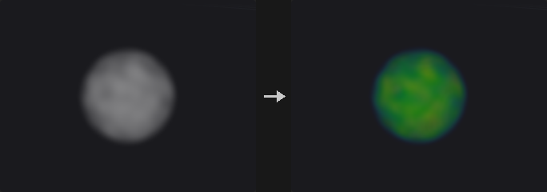

How the viewport draws the volumes: Smoke (ray-marched; density = optical thickness per unit length × Density Scale, self-shadowing × Shadow Scale, Shadow Color), Rainbow, Iso Surface (at Iso Value, closed at the grid boundary) or Invisible. Density / Diffuse / Emission fields by name; a scalar diffuse field goes through the ramp (clamped / periodic), a vector one is RGB; Minimum / Maximum remap the fields. Writes volvis_* detail attributes; the geometry is unchanged.

**Inputs**

| Input | Type | Description |
|---|---|---|
| `geo` | GEOMETRY | Geometry containing the volumes. |

**Outputs**

| Output | Type | Description |
|---|---|---|
| `geo` | GEOMETRY | The result. |

**Parameters**

| Parameter | Type | Default | Description |
|---|---|---|---|
| Visualization Mode `mode` | menu | Smoke | How the volumes are drawn. Options: Smoke (`smoke`), Rainbow (`rainbow`), Iso Surface (`iso`), Invisible (`invisible`). |
| Range `range_min` `range_max` | float | 0, 1 | Values in this range map to 0..1 (density and scalar fields). |
| Density Scale `density_scale` | float [0.0..] | 1 | Multiplies the density (opacity). *Hidden when mode = iso } { mode = invisible.* |
| Shadow Scale `shadow_scale` | float [0.0..] | 1 | Multiplies the density for self-shadowing. *Hidden when mode = iso } { mode = invisible.* |

*Smoke*

| Parameter | Type | Default | Description |
|---|---|---|---|
| Density Field `density_field` | string | *(empty)* | Volumes that are drawn (empty = all scalar volumes). |

| Parameter | Type | Default | Description |
|---|---|---|---|
| Diffuse Field `diffuse_field` | string | *(empty)* | Volume(s) used as color (one scalar through the ramp, three scalars or a vector as RGB). |
| Exposed Color `color_r` `color_g` `color_b` | float [0.0..1.0] | 1, 1, 1 | Color of lit smoke. |
| Shadow Color `shadow_color_r` `shadow_color_g` `shadow_color_b` | float [0.0..1.0] | 0, 0, 0 | Color of the shadows (its complement scales the shadowing per channel). |
| Diffuse Ramp `ramp_mode` | menu | No Ramp | How a scalar diffuse field maps to color. Options: No Ramp (`none`), Clamped Ramp (`clamp`), Periodic Ramp (`periodic`). |
| Diffuse Color Ramp `ramp` | string | *(empty)* | Color ramp for the diffuse field. *Hidden when ramp_mode = none.* |

*Emission*

| Parameter | Type | Default | Description |
|---|---|---|---|
| Emission Field `emit_field` | string | *(empty)* | Volume used as emission. |

| Parameter | Type | Default | Description |
|---|---|---|---|
| Emission Scale `emit_scale` | float [0.0..] | 0 | Emission strength. |
| Emission Color `emit_color_r` `emit_color_g` `emit_color_b` | float [0.0..1.0] | 1, 1, 1 | Emission color. |

*Iso Surface*

| Parameter | Type | Default | Description |
|---|---|---|---|
| Iso Value `iso` | float | 0 | Value of the iso surface in Iso Surface mode. |

*Viewport Quality*

| Parameter | Type | Default | Description |
|---|---|---|---|
| Max Vis Res `max_res` | int [8..512] | 128 | Most voxels per axis sent to the viewport. |

---
